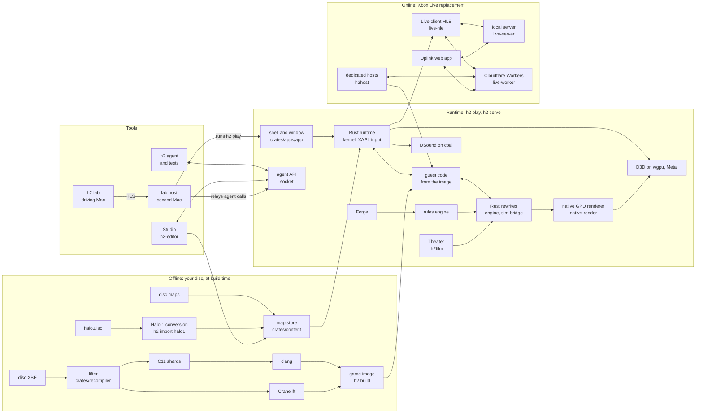

# Architecture

Goal: Halo 2 (original Xbox, title `4D530064`) running natively, ending up as
well-structured, mostly safe Rust. The game disc is supplied by the user at
build time and nothing derived from it is committed.

## Overview

The offline path turns the disc into a game image and a map store. The
runtime loads both, runs the guest code under the Rust runtime and replaces
parts of it with Rust. Tools and Live reach a running game through its
agent API and Live's client HLE.

Each box has a page: [LIFTER.md](lifter/LIFTER.md),
[BOOT.md](runtime/BOOT.md), [native-renderer.md](graphics/native-renderer.md),
[rules-engine.md](game/rules-engine.md), [forge.md](game/forge.md),
[theater-design.md](game/theater-design.md), [agent-api.md](runtime/agent-api.md),
[lab.md](runtime/lab.md), [editor.md](editor/editor.md) and
[live.md](live/live.md).

## Targets

- **macOS on arm64 and x86-64, rendering through Metal.** The first target.
- **Apple TV and iPhone/iPad.** tvOS and iOS share the Mac's arm64 and Metal
  path; the UIKit hosts are in `platform/tvos` and `platform/ios`
  ([tvos.md](runtime/tvos.md), [ios.md](runtime/ios.md)).
- **Windows and Xbox in Developer Mode** (x86-64 and DX12). The runtime and
  the generated module cross-compile for Windows from a Mac
  ([windows.md](runtime/windows.md)); the Xbox app is in
  [xbox.md](runtime/xbox.md). Personal, sideloaded use only.
- **Linux x86-64** for the dedicated host ([linux.md](runtime/linux.md)).
- **Rendering goes through wgpu,** which covers Metal, Vulkan and DX12 with
  one renderer.

The recompiled code is portable C11, so arm64 and x86-64 builds take the
same path. Nothing relies on running the original x86 directly. Platform
code (window, input, audio, file access) lives in its own layer, so a port
swaps that layer.

## The pipeline

The lifter turns functions in the retail XBE into a backend-independent IR.
In `crates/runtime/recomp/src/tier.rs`, the default desktop launch selects
a current clang module when available. Otherwise it starts on a Cranelift
module while clang builds the optimised module from generated C11. The next
launch selects the matching optimised module. The generator reads the
user's disc, and the Rust runtime loads either module through the same
ABI. See [LIFTER.md](lifter/LIFTER.md), [build caches](lifter/BUILD-CACHE.md)
and [the fast tier](lifter/cranelift-tier.md).

Rust subsystems take over at named boundaries. Every guest
function address goes through a dispatch table, and a Rust function can
register itself as the override for an address, so the game runs at every
step and a replacement can be backed out. Overrides are Rust features with
hooks and switches ([feature-engine.md](engine/feature-engine.md)); the
rewritten engine functions and their differential tests against the
generated code are in [engine/README.md](engine/README.md), and
shadow execution checks a port against the original on the states the
game reaches as it runs ([shadow-exec.md](engine/shadow-exec.md)). Booting and
running is in [BOOT.md](runtime/BOOT.md).

Statically linked SDK libraries (D3D, DSOUND, XONLINE, XNET, BINK, ...) are
not recompiled. Their functions are found by signature and replaced at the
dispatch table with native Rust implementations: D3D on wgpu
([d3d.md](graphics/d3d.md)), DSound on cpal ([dsound.md](audio/dsound.md)),
Bink by a high-level player ([bink-hle.md](audio/bink-hle.md)), and Xbox Live
by client HLE over our own service ([live.md](live/live.md)).

What is rewritten first is what editing and modding touch: tag and cache-file
loading as a typed data model ([map-format.md](formats/map-format.md)),
then the renderer above the D3D layer ([native-renderer.md](graphics/native-renderer.md)),
then objects, game state and the HaloScript runtime, and physics and AI
last, because their floating-point behaviour needs the most care
([sim-rewrite.md](engine/sim-rewrite.md)). Where each part stands is on its
own page.

## Crates

Every directory in `crates/` is one row. The table is generated:
`scripts/crate-table.py` writes it from each crate's `Cargo.toml`
(`description`, and `status` and `doc` under `[package.metadata.h2]`)
and its domain, so a new crate brings its own row; edit the manifest and
run the script, not the table. The domains, what each may depend on, and
the workspace checks are in
[dev/crate-structure.md](dev/crate-structure.md).

<!-- crate-table:begin (generated by scripts/crate-table.py from the Cargo.toml descriptions; do not edit) -->
| crate | domain | purpose | docs | status |
|---|---|---|---|---|
| `asf` | formats | ASF demuxer for the retail sound permutations ([wma.md](audio/wma.md)) † | [wma.md](audio/wma.md) | done |
| `content` | formats | Map packages: the manifest, MapId, PPF/IPS/BPS patch readers and the resolver that turns a package into the bytes of maps\<name>.map (docs/game/maps.md) | [maps.md](game/maps.md) | foundation built |
| `dev-texture` | formats | Forge block-out dev textures: code-drawn family grid tiles, a 5 by 7 font atlas and the face label layout | [forge-blockout.md](game/forge-blockout.md) | in progress |
| `firefight` | formats | Portable Firefight definitions and admission rules |  |  |
| `font` | formats | Halo 2 packed bitmap font parser and CPU text rasteriser | [fonts.md](formats/fonts.md) | done |
| `forge-doc` | formats | Forge documents: portable map edits, bounded canonical JSON and the host edit log |  |  |
| `forge-shapes` | formats | Block-out pieces: a piece's definition, its canonical name and the generators that turn it into a closed shell and convex hulls, the same bits on every machine | [forge-blockout.md](game/forge-blockout.md) | in progress |
| `game-markers` | formats | Game type markers: the shapes Forge and Studio draw for spawns, goals, areas, teleporters, item spawns, volumes and script labels, and the area a hill or a site covers | [gametype-markers.md](game/gametype-markers.md) | in progress |
| `h1-contract` | formats | The names both Halo 1 halves share: what the converters write and the game's Halo 1 hooks read (tag layouts, markers, script slots, function names) | [text.md](halo1/text.md), [script-builtins.md](halo1/script-builtins.md), [crate-structure.md](dev/crate-structure.md) |  |
| `host-dirs` | formats | The per-user data, cache and config directories under each host's convention (docs/runtime/storage.md) | [storage.md](runtime/storage.md) |  |
| `host-log` | formats | Canonical hash-chained command entries for Forge and Firefight |  |  |
| `hs` | formats | HaloScript scenario tables, builtin catalog, typed expression API, and a native VM ([haloscript.md](formats/haloscript.md), [engine/hs_vm.md](engine/hs_vm.md)) † | [haloscript.md](formats/haloscript.md), [engine/hs_vm.md](engine/hs_vm.md) | decoding done, VM checks supported campaign script executions against the guest |
| `map` | formats | Reader for retail cache v8 `.map` files, with no game data ([map-format.md](formats/map-format.md)) † | [map-format.md](formats/map-format.md) | done |
| `mopp` | formats | Havok MOPP code for Halo 2 structure BSPs: the engine's interpreter semantics as a query model, and an offline compiler over collision surfaces | [mopp.md](formats/mopp.md) | done |
| `movies` | formats | Manifest, hashing and naming for optional Bink-to-MP4 conversion with the user's ffmpeg ([movies.md](audio/movies.md)) † | [movies.md](audio/movies.md) | done |
| `pathfind` | formats | Halo 2 AI pathfinding data: decode retail sbsp pathfinding, generate it from a structure BSP's collision geometry, compare, and emit map::build blocks | [pathfinding.md](formats/pathfinding.md) | in progress |
| `pogo` | formats | The Pogo Stick's looks, rig and placed weapon tags, shared by the kit and the game |  |  |
| `rules` | formats | Scripted game types: the rules language, verified IR, capabilities and VM |  |  |
| `settings` | formats | Our host settings as a schema: definitions, one store, atomic handles, one writer for settings.toml | [feature-engine.md](engine/feature-engine.md) | done |
| `shaders` | formats | Xbox (NV2A) vertex microcode and register-combiner translation to WGSL | [shaders.md](graphics/shaders.md) | done |
| `tag-names` | formats | Developer comparison of retail plugin layouts against the checked-in tag definitions |  |  |
| `tags` | formats | Reviewed tag definitions, fixed-record codecs and owned domain types, including sound ([sound.md](formats/sound.md)), localized text ([localization.md](formats/localization.md)) and the effects family ([effects.md](formats/effects.md)) † | [sound.md](formats/sound.md), [localization.md](formats/localization.md), [effects.md](formats/effects.md) | done |
| `variants` | formats | Halo 2 game variants: the 0x130-byte record, the settings schema, saved-variant files and the editor panel (docs/editor/variants.md) | [variants.md](editor/variants.md) | in progress |
| `xbe` | formats | Parses the XBE: header, certificate, sections, libraries, kernel thunks † |  | done |
| `xiso` | formats | Reads the XDVDFS game partition (plain XISO or full Redump image) † |  | done |
| `analyze` | recompiler | Disassembly (iced-x86), function discovery, coverage report, per-function CFG export † |  | done |
| `clif` | recompiler | The Cranelift fast tier: planned IR straight to host objects (docs/lifter/cranelift-tier.md) | [cranelift-tier.md](lifter/cranelift-tier.md) |  |
| `emit` | recompiler | IR to C11 against the runtime ABI (`h2abi.h`), sharded; clang build glue (output under `target/`, never committed) † |  | done |
| `hostfault` | recompiler | The process-wide host fault handler: regions with in-handler callbacks, and fixup tables that send a faulting access to its slow path |  |  |
| `ir` | recompiler | Backend-independent semantic IR for lifted code, with a reference interpreter † |  | done for integer, x87, SSE1 and MMX |
| `lift` | recompiler | Lowers decoded x86 to the IR, per instruction and per CFG function ([LIFTER.md](lifter/LIFTER.md)) † | [LIFTER.md](lifter/LIFTER.md) | done for integer, x87, SSE1 and MMX |
| `opt` | recompiler | IR-to-IR optimisation passes between lifting and emission † |  | done |
| `oracle` (bin `oracle-fixtures`) | recompiler | Independent x86-32 instruction oracle for synthetic differential fixtures | [oracle.md](lifter/oracle.md) | done |
| `simd` | recompiler | Bit-exact, MXCSR-exact reference semantics for the Pentium III's SSE1 floating point | [simd.md](lifter/simd.md) | done |
| `sse-oracle` (bin `sse-oracle`) | recompiler | SSE1/MMX results from x86-64 hardware under Rosetta 2 ([sse-oracle.md](lifter/sse-oracle.md)) † | [sse-oracle.md](lifter/sse-oracle.md) | done |
| `symbols` | recompiler | Identify statically linked Xbox SDK library functions in an XBE using OOVPA signatures | [xdk-libraries.md](lifter/xdk-libraries.md) | done |
| `x87` | recompiler | Exact software x87 (ext80) helpers that lifted x87 code calls ([FLOAT-ABI.md](lifter/FLOAT-ABI.md)) † | [FLOAT-ABI.md](lifter/FLOAT-ABI.md) | done |
| `background` | runtime | Background work in the game process: named threads below the game's own priority, and the worker cap for background jobs (docs/runtime/background-work.md) | [background-work.md](runtime/background-work.md) |  |
| `kernel` | runtime | Xbox kernel HLE: threads, scheduling on a logical clock, sync, memory, files ([kernel-imports.md](runtime/kernel-imports.md), [kernel README](../crates/runtime/kernel/README.md)) † | [kernel-imports.md](runtime/kernel-imports.md), [kernel README](../crates/runtime/kernel/README.md) | in progress: covers the boot to the menu and the first level |
| `lifted` | runtime | The lifted original on the IR interpreter: the oracle for port differential tests and for runtime shadow checks (docs/engine/shadow-exec.md) | [shadow-exec.md](engine/shadow-exec.md) |  |
| `mem-watch` | runtime | Process footprint history, memory limits, diagnostic reports and the memory flight recorder |  |  |
| `recomp` | runtime | Build and load: the XBE lifted, emitted and compiled into one host module, its build stamp, the module loaded with the boot bridge, and the interpreter for what the module leaves out (docs/runtime/BOOT.md) | [BOOT.md](runtime/BOOT.md) |  |
| `runtime` | runtime | Guest memory, CPU state, dispatch/override table and the runner that drives generated code ([runtime README](../crates/runtime/runtime/README.md)) † | [runtime README](../crates/runtime/runtime/README.md) | done |
| `runtime-test-probe` | runtime | Native C fixtures and declarations for runtime's integration tests |  |  |
| `snapshot` | runtime | Machine snapshots: the versioned container, compressed guest RAM pages and the snapshot store (docs/runtime/snapshots.md) | [snapshots.md](runtime/snapshots.md) |  |
| `timeline` | runtime | Near-zero-cost timeline events (Chrome/Perfetto trace JSON) and a frame counter | [profiling.md](perf/profiling.md) | done |
| `vfs` | runtime | Xbox object-manager storage, independent of guest memory ([storage.md](runtime/storage.md)) † | [storage.md](runtime/storage.md) | done |
| `assets` | platform | Glue from decoded game tags (bitmaps first) to gfx texture decoding | [bitmaps.md](formats/bitmaps.md) | done |
| `audio` | platform | DirectSound-level audio model, Xbox ADPCM decoder and software mixer for h2recomp | [audio.md](audio/audio.md) | done |
| `bink-hle` | platform | High-level replacement for the statically linked Bink player ([bink-hle.md](audio/bink-hle.md)) † | [bink-hle.md](audio/bink-hle.md) | Plays installed movies with audio through the game mixer or skips them at the movie wrapper. A windowed menu boot using the default movie directory can prepare the attract clip from disc with local ffmpeg. Film sessions use installed assets. |
| `canvas-fit` | platform | The one widescreen rule: the lens and the uniform fit of the guest's 640x480 canvas on a window of any shape (docs/graphics/high-resolution.md) | [high-resolution.md](graphics/high-resolution.md) | in progress |
| `d3d` | platform | Guest-facing Direct3D 8 (Xbox, XDK 5849 LTCG) replacement for Halo 2, on top of gfx | [d3d.md](graphics/d3d.md) | in progress: the menu and the first level render |
| `dsound` | platform | Guest-facing DirectSound replacement for h2recomp: guest memory in, crates/platform/audio out | [dsound.md](audio/dsound.md) | done |
| `frame-types` | platform | The frame types the Direct3D device and FrameScene share: the carried part by slot, the render camera, the view and instance keys; plain data (docs/graphics/framescene.md) | [framescene.md](graphics/framescene.md) |  |
| `gfx` | platform | Direct3D 8 (Xbox flavour) replacement on wgpu: texture decoding, state model, presenter | [graphics.md](graphics/graphics.md) | done, foundation only |
| `hot-render` | platform | Hot iteration on the host renderer: WGSL overrides of translated programs from a watched directory, tunable parameters and toggles (docs/graphics/hot-iteration.md) | [hot-iteration.md](graphics/hot-iteration.md) |  |
| `input` | platform | Xbox gamepad model (XINPUT_GAMEPAD), 4-port device model and host backends for h2recomp | [input.md](input/input.md) | done, foundation only |
| `sound-clips` | platform | The one sound decoder: a snd! permutation to PCM, with a keyed clip cache and chunk streaming |  |  |
| `voice` | platform | The communicator under the title's own voice engine: microphone and headphone media objects over host capture and playback (docs/live/live-voice.md) | [live-voice.md](live/live-voice.md) |  |
| `wma` | platform | Native WMAv2 decoder ([wma.md](audio/wma.md)) † | [wma.md](audio/wma.md) | done |
| `xapi` | platform | Guest XAPI service replacements for Halo 2 | [xapi.md](runtime/xapi.md) | done |
| `guest-layout` | hooking | Typed guest layouts: every Halo 2 structure offset and global address, written once; the guest-memory boundary, typed views and the named points (docs/engine/guest-layout.md) | [guest-layout.md](engine/guest-layout.md) |  |
| `hooks` | hooking | The feature registry: named points, ordered hook chains, conflicts at plan time, switches, a guest arena, and the frame and game bridges (docs/engine/feature-engine.md) | [feature-engine.md](engine/feature-engine.md) | in progress |
| `engine` | rewrites | Hand-written Rust replacements for Halo 2 engine functions, over guest memory | [engine/README.md](engine/README.md) | in progress; the game installs the leaves through the `engine-leaves` feature (locale group on by default) |
| `frame-scene` | rewrites | FrameScene: the owned, typed snapshot of one rendered frame that the native renderer reads; no guest addresses, no GPU (docs/graphics/framescene.md) | [framescene.md](graphics/framescene.md) |  |
| `hud-kit-core` | rewrites | The HUD kit's shared core: the element model, the templates and their resolution from a map, the compiler to nhdt widget records and the HUDs of ours, for the offline preview and the game's runtime alike (docs/game/hud-kit.md) | [hud-kit.md](game/hud-kit.md) | in progress |
| `native-render` | rewrites | Native GPU renderer: the static world (structure BSP) loaded once from the map's tags, culled and drawn with indirect draws (docs/graphics/native-renderer.md) | [native-renderer.md](graphics/native-renderer.md) |  |
| `render-bridge` | rewrites | The guest side of the native renderer until FrameScene replaces it: the stage hooks, admissions and the frame step's scene (docs/graphics/framescene.md) | [native-renderer.md](graphics/native-renderer.md), [framescene.md](graphics/framescene.md) | in progress |
| `scene-extract` | rewrites | Guest memory to FrameScene: the only render code with guest offsets (docs/graphics/framescene.md) | [framescene.md](graphics/framescene.md) |  |
| `sim-anim` | rewrites | Native animation sampling: decoded clips and the node-record sampler (docs/engine/anim-sampling.md) | [anim-sampling.md](engine/anim-sampling.md) |  |
| `sim-bridge` | rewrites | The guest side of the native simulation: adapters from hook entries to the sim crates, the installs under impl.sim.native, the tick driver, the shadow checks (docs/engine/sim-rewrite.md) | [sim-rewrite.md](engine/sim-rewrite.md), [shadow-exec.md](engine/shadow-exec.md) | in progress |
| `sim-collision` | rewrites | The native collision world: BSPs decoded once, queries as single Rust calls (docs/engine/sim-rewrite-collision.md) | [sim-rewrite-collision.md](engine/sim-rewrite-collision.md) |  |
| `sim-core` | rewrites | Shared math, exact SSE-order lanes and float rules for the native simulation subsystems |  |  |
| `sim-effects` | rewrites | The effects phase of the native simulation: the effect walk, the damage, object and sound part arms and the renderer's part events | [effects-parts.md](engine/effects-parts.md), [sim-rewrite.md](engine/sim-rewrite.md) | in progress |
| `sim-havok` | rewrites | Ordered Havok simulation kernels over transient, Rust-owned data |  |  |
| `sim-objects` | rewrites | The object update in Rust: typed views over the object pool, the definition table and the object kernels (docs/engine/sim-rewrite-objects.md) | [sim-rewrite-objects.md](engine/sim-rewrite-objects.md) |  |
| `sim-sound` | rewrites | Sound source, scheduling and environment kernels for the native simulation | [sim-rewrite.md](engine/sim-rewrite.md), [sound-instances.md](engine/sound-instances.md), [dsound.md](audio/dsound.md) | in progress |
| `sim-state` | rewrites | Typed, read-only views of the simulation for theater, stats, Live and the agent API (docs/engine/sim-rewrite-objects.md section 8) | [sim-rewrite-objects.md](engine/sim-rewrite-objects.md) |  |
| `sim-world` | rewrites | The native simulation's World: salted slot pools, canonical save and restore, an incremental hash and the shared RNG stream | [sim-world.md](engine/sim-world.md), [sim-rewrite.md](engine/sim-rewrite.md) | in progress |
| `actor-net` | live | Versioned actor presentation records and per-client scheduling for distributed games | [ai-networking.md](game/ai-networking.md) |  |
| `bots` | live | Multiplayer bots (Clankers): the brain that turns what a bot sees into controller input, and the phantom peers that play through the host simulation (docs/game/bots.md) | [bots.md](game/bots.md) |  |
| `cloud-saves` | live | Cloud saves on the Live service: merge an account's saved items into the local save storage at sign-in, and push changes as the game writes them (docs/live/live-cloud-saves.md) | [live-cloud-saves.md](live/live-cloud-saves.md) | in progress |
| `coop` | live | Co-op over Live, phase 0: the peer transport, the two-port pad schedule and the per-tick hash exchange (docs/live/live-coop.md) | [live-coop.md](live/live-coop.md) | in progress |
| `film` | live | Seekable Halo 2 engine films, presentation records and the local film library |  |  |
| `host-data` | live | The dedicated host's game data: build the owner's bundle from their disc, and fetch, verify and cache it on a host (docs/live/dedicated-host.md, Game data bundle) | [dedicated-host.md](live/dedicated-host.md) |  |
| `live-hle` | live | Opt-in Xbox Live public API HLE for Halo 2 retail 5849 | [live-boundary.md](live/live-boundary.md) | in progress, opt-in |
| `live-proto` | live | Wire types, signing and verification shared by the Xbox Live replacement's clients and server (docs/live/live-api.md, docs/live/live-security.md) | [live-api.md](live/live-api.md), [live-security.md](live/live-security.md) | in progress |
| `live-server` (bin `h2-live-server`) | live | The Xbox Live replacement service: signed events on SQLite or Postgres behind axum (docs/live/live.md, docs/live/live-api.md) | [live.md](live/live.md), [live-api.md](live/live-api.md) | in progress |
| `live-telemetry` | live | Non-invasive Halo 2 guest-state telemetry and live ingest | [live-telemetry.md](live/live-telemetry.md) | in progress |
| `live-worker` (cdylib `live_worker`) | live | The Live server as a Cloudflare Worker: live-server's routes over D1, R2 and Durable Objects (docs/live/live-worker.md) | [live-worker.md](live/live-worker.md) |  |
| `show-lan` | live | The show channel's LAN carrier: authenticated actor-channel datagrams between System Link peers (docs/game/rules-world-api.md, slice W11) | [rules-world-api.md](game/rules-world-api.md) |  |
| `sim-bench` | live | Sim mode's pure parts: match and batch files, bot tuning files, the paced clock and speed-up, the metrics tally and report, and the A/B comparison (docs/runtime/sim.md) | [sim.md](runtime/sim.md) |  |
| `superbounce` | live | Superbounce and forced-crouch spots found in a map's collision geometry (docs/game/superbounce.md) | [superbounce.md](game/superbounce.md) |  |
| `agent` | extensions | The agent API server: a Unix socket in the game process, answered at tick boundaries (docs/runtime/agent-api.md) | [agent-api.md](runtime/agent-api.md) |  |
| `agent-proto` | extensions | The agent API's wire types: JSON-RPC 2.0 over a Unix socket, one JSON object per line (docs/runtime/agent-api.md) | [agent-api.md](runtime/agent-api.md) |  |
| `debug-menu` | extensions | Our in-game debug menu: a tree of rows over the agent API's registries, its navigation, touchpad and pad input, and the lines the host overlay draws (docs/runtime/debug-menu.md) | [debug-menu.md](runtime/debug-menu.md) |  |
| `forge` | extensions | Local in-game Forge editing session and Objects tool |  |  |
| `game` | extensions | Our additions to the game: menus and settings screens, skulls, variants, the campaign picker, gameplay hooks and the glue to the platform crates (docs/game/settings-menu.md) | [settings-menu.md](game/settings-menu.md) |  |
| `h1-runtime` | extensions | Hooks that only converted Halo 1 maps need: projectile velocity curves and the scope zoom (docs/halo1/README.md); the rest of Halo 1 in the game is game's h1_* modules | [README.md](halo1/README.md) | in progress |
| `hot-tags` | extensions | Live edits of the running game's tags in guest memory, by field path from the tag definitions, with a journal to list and revert them (docs/graphics/hot-iteration.md) | [hot-iteration.md](graphics/hot-iteration.md) |  |
| `lockstep` | extensions | Determinism harness: per-tick guest-RAM hashes, run traces and their comparison (docs/game/high-framerate.md) | [high-framerate.md](game/high-framerate.md) | done |
| `anim-edit` | tools | *(no description)* † |  |  |
| `bitmap-edit` | tools | The Textures tool's canvas of h2-editor: tiled RGBA8 layers with shared-tile undo snapshots, brush, fill and adjust tools, resampling, PNG in and out and dirty-rectangle tracking (docs/editor/modeling.md) | [modeling.md](editor/modeling.md) | in progress |
| `collision-build` | tools | Compiles convex polygons to a Halo 2 collision BSP (planes, 3D and 2D trees, leaves, surfaces, winged edges, vertices), opens coll BSPs as editable meshes, rebuilds their BSP physics slots, makes collision from render faces, and adds solids to a structure's level collision with its per-leaf block and MOPP (docs/editor/modeling.md) | [modeling.md](editor/modeling.md), [modeling-targets.md](editor/modeling-targets.md) | in progress |
| `editor-core` | tools | UI-free parts of h2-editor shared by its tools: map sources, the snapshot undo stack, status messages, where game variants come from | [editor.md](editor/editor.md) | in progress |
| `firefight-kit` | tools | Offline Firefight map kit |  |  |
| `forge-build` | tools | Deterministic local Forge map materialisation over the user's Halo 2 maps |  |  |
| `forge-nav` | tools | Generate nav for a Forge map: the bots' nav mesh over the structure BSP with the map's solid objects merged in, the teleporters linked, and its problems (docs/game/forge-design.md, F9) | [forge-nav.md](game/forge-nav.md) | in progress |
| `geometry-edit` | tools | The Modeling tool's targets and save: structure clusters, instanced geometry definitions and render-model sections opened as mesh-edit meshes, with undo, the op log, in-place and grown writes (docs/editor/modeling.md) | [modeling.md](editor/modeling.md), [modeling-targets.md](editor/modeling-targets.md) | in progress |
| `h1-assets` | tools | Halo 1 assets as Halo 2 tags: bitmaps, models, sounds, skies and text, read from Xbox cache files (docs/halo1/README.md) | [README.md](halo1/README.md) |  |
| `h1campaign` | tools | Halo 1 campaign levels converted to Halo 2 v8 maps (docs/halo1/campaign.md) | [campaign.md](halo1/campaign.md) |  |
| `h1convert` | tools | Halo 1 multiplayer maps converted to Halo 2 tags: collision, shaders, objects ([multiplayer.md](halo1/multiplayer.md)) † | [multiplayer.md](halo1/multiplayer.md) | in progress: all 13 disc maps convert |
| `h1map` | tools | Halo 1 Xbox cache (v5) reader ([map-format.md](halo1/map-format.md)) † | [map-format.md](halo1/map-format.md) | done |
| `h1objects` | tools | Halo 1 sandbox objects converted to Halo 2 tags |  |  |
| `hopper-edit` | tools | The playlist (multiplayer_hopper.dat) editor's UI-free logic: the working copy, validation, presets, the variant picker's sources, undo and file handling | [editor.md](editor/editor.md) | in progress |
| `hud-edit` | tools | The HUD editor's UI-free logic: a map's nhdt HUDs and their widgets, the engine's placement, a preview canvas, layout checks, edits with undo and the patched-map save (docs/editor/hud-editor.md) | [hud-editor.md](editor/hud-editor.md) |  |
| `hud-kit` | tools | HUD elements of ours drawn by Halo 2's own HUD: the element model, the compiler to nhdt widget records, the offline preview over the retail player HUD and its checks (docs/game/hud-kit.md) | [hud-kit.md](game/hud-kit.md) | in progress |
| `mesh-edit` | tools | The modeling kernel of h2-editor: a radial-edge mesh in index arenas, selection, MeshOp operations as values, import and stable export (docs/editor/modeling.md) | [modeling.md](editor/modeling.md) | in progress |
| `perf` | tools | Performance tooling: guest-aware sampling profiler, timeline capture, benchmark harness | [profiling.md](perf/profiling.md) | done |
| `content-kit` | tools | The content kit: one tool that builds an item's content/<item>/ (parametric YAML sources, atlases, a kit.yaml manifest) into tags; the Pogo Stick, the Flood pod, the content stage and the Forge block-out pieces are its items | [content-stage.md](editor/content-stage.md), [forge-blockout.md](game/forge-blockout.md) | in progress |
| `scenario-edit` | tools | Sapien-style scenario placement editor: typed scnr placement blocks, undoable edits written as patched .map files, a UI-free session and an offscreen wgpu viewport | [scenario-editor.md](editor/scenario-editor.md) | in progress |
| `sound-edit` | tools | Waveform edits as a list: trim, fades, gain, normalise, silence, and a sound's permutations as files (docs/editor/studio-redesign.md, "The sound editor") | [studio-redesign.md](editor/studio-redesign.md) | in progress |
| `starter-map` | tools | File > New map: a playable starter map built from a template (content/new-map), block-out pieces and the content stage's fresh build | [editor.md](editor/editor.md) | in progress |
| `workspace` | tools | The package build: the builder registry, Layered tag sources and the build of a package set onto a map's TagSet (docs/editor/studio-redesign.md, "Packages") | [studio-redesign.md](editor/studio-redesign.md), [tag-workspace.md](editor/tag-workspace.md) | in progress |
| `xtask` (bin `xtask`) | tools | The workspace's test and check runner, `cargo xtask`: a branch's affected crates in one nextest run, their doctests, the disc tier, the web tests and the pre-merge checks (docs/dev/build-speed.md) | [build-speed.md](dev/build-speed.md), [crate-structure.md](dev/crate-structure.md) |  |
| `app` (bin `h2-app-demo`) | apps | Host shell for h2recomp: window, presentation, live input, audio device and guest-thread lifecycle (macOS first) | [app.md](runtime/app.md) | done; `h2 play` runs the game in it |
| `app-icon` | apps | The app icon for the unbundled Mac windows (h2 play, h2-editor) from art/app-icon |  |  |
| `boot` | apps | The composition root: a built module run on the runtime with the kernel HLE, the hooks and every feature attached | [BOOT.md](runtime/BOOT.md) | done |
| `cli` (bin `h2`) | apps | `h2` binary: `build`, `run`, `play`, `info`, `ls`, `extract`, `analyze`, `symbols`, `lift`, `emit`, the tag decoders and more (`cargo h2` lists them) † |  | done |
| `cli-common` | apps | What the h2 and h2-tools binaries share: the default disc, opening it and its maps, and no-clobber exporter output (docs/runtime/cli-tools.md) | [cli-tools.md](runtime/cli-tools.md) |  |
| `h2-tools` (bin `h2-tools`) | apps | The h2-tools binary: the offline map, tag and script tools `h2 <tool>` runs, linked without the game (docs/runtime/cli-tools.md) | [cli-tools.md](runtime/cli-tools.md) |  |
| `h2host` (staticlib `h2host`) | apps | The tvOS and iOS apps' Rust half: a static library the UIKit hosts (platform/tvos, platform/ios) call to boot the game into their CAMetalLayer | [tvos.md](runtime/tvos.md), [ios.md](runtime/ios.md) | in progress |
| `live-mirror` | apps | The editor's live object and player stream, sample store and interpolation |  |  |
| `studio` (bin `h2-editor`) | apps | h2-editor: the editor suite on Dear ImGui (docking) + wgpu + winit: scenario placements, game variants, playlists | [editor.md](editor/editor.md) | in progress |
| `studio-proto` | apps | The studio agent API's names, short forms and client: JSON-RPC 2.0 over a local Unix socket, as the game's agent API (docs/editor/agent-api.md) | [agent-api.md](editor/agent-api.md) |  |
| `uwp-host` (bin `h2uwp`) | apps | The Xbox (UWP, Dev Mode) app: a CoreApplication view that runs the game into a composition swap chain, and the Mac-side packaging helpers (AppxManifest, package identity, the app-container API check) | [xbox.md](runtime/xbox.md) | in progress: boots on a Series X (DX12, audio); out of memory in App mode |

† Written here by hand. The text belongs in the crate's `Cargo.toml` `description`; `scripts/crate-table.py --strict` fails until it is there.
<!-- crate-table:end -->
