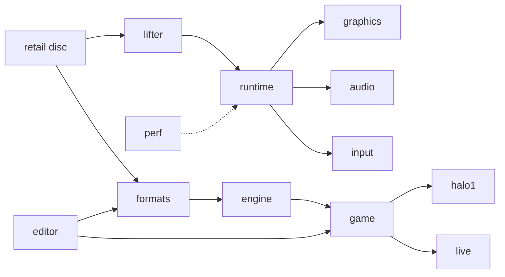

# Docs

| Area | Folder | Pages | Start here |
|---|---|---|---|
| Lifter | `lifter/` | 20 | [LIFTER.md](lifter/LIFTER.md) |
| Runtime | `runtime/` | 32 | [BOOT.md](runtime/BOOT.md) |
| Input | `input/` | 6 | [input.md](input/input.md) |
| Graphics | `graphics/` | 50 | [graphics.md](graphics/graphics.md) |
| Audio and movies | `audio/` | 6 | [audio.md](audio/audio.md) |
| Performance | `perf/` | 19 | [README.md](perf/README.md) |
| Formats and tags | `formats/` | 22 | [map-format.md](formats/map-format.md) |
| Engine | `engine/` | 40 | [engine-map.md](engine/engine-map.md) |
| Game features | `game/` | 74 | [settings-menu.md](game/settings-menu.md) |
| Halo 1 | `halo1/` | 32 | [halo1 section](#halo-1-halo1) |
| Xbox Live | `live/` | 70 | [live.md](live/live.md) |
| Editor | `editor/` | 27 | [editor-guide.md](editor/editor-guide.md) |
| Development | `dev/` | 5 | [crate-structure.md](dev/crate-structure.md) |

The whole project starts at [ARCHITECTURE.md](ARCHITECTURE.md): goals,
targets, the pipeline and the crate table. [features.md](features.md) lists
every feature beyond the retail game with its state and its page, the
measured speed numbers and the roadmap. Dated reviews of the code are under
[Reviews](#reviews).

Every page below has a status line: built, partly built or a design. Pages
follow [meta/docs-style.md](meta/docs-style.md).

## Lifter: analysis, lifting and CPU semantics (`lifter/`)

- [LIFTER.md](lifter/LIFTER.md) (**start here**): the lifter: x86 to IR to C11, the runtime contract, the validation plan. Where it and the code differ, the code wins
- [FLOAT.md](lifter/FLOAT.md): what floating point the game uses (measured with `h2 fpstats`) and the correctness-first plan
- [FLOAT-ABI.md](lifter/FLOAT-ABI.md): the x87 IR ops and `h2x87_v1_*` runtime helpers (`crates/recompiler/x87`), #MF included; read when touching x87 lowering
- [x87-native.md](lifter/x87-native.md): the guarded native binary64 x87 path, on by default (`H2_X87_NATIVE=0` disables it): range proof, status bits, fallbacks
- [x87-transcendentals.md](lifter/x87-transcendentals.md): the guarded 128-bit first pass for FYL2X, F2XM1 and the trig ops, and the table-driven FYL2X and F2XM1: guards and rules
- [sse-native.md](lifter/sse-native.md): guarded native SSE arithmetic, on by default (`H2_SSE_NATIVE=0` disables it): eligibility and range proof
- [simd.md](lifter/simd.md): bit-exact SSE1 reference semantics (`crates/recompiler/simd`), its C twin and how it is tested
- [oracle.md](lifter/oracle.md): independent x86 instruction oracle on Unicorn (`crates/recompiler/oracle`)
- [sse-oracle.md](lifter/sse-oracle.md): SSE/MMX results measured on Rosetta 2 (`crates/recompiler/sse-oracle`)
- [cranelift-tier.md](lifter/cranelift-tier.md): Cranelift fast start, the background clang build and the shared module contract
- [dispatch-coverage.md](lifter/dispatch-coverage.md): indirect-dispatch coverage of the campaign's main tables, and how to reproduce it
- [xdk-libraries.md](lifter/xdk-libraries.md): how `h2 symbols` identifies statically linked XDK library code
- [BUILD-CACHE.md](lifter/BUILD-CACHE.md): generated-source and object caches, locking, iteration builds, `H2_EMIT_TARGET`; read before changing the build
- [lift-pruning.md](lifter/lift-pruning.md): design for leaving out guest functions that Rust replaces outright and all that only they reach: the replaced list, reachability, the named stop
- Notes: [build-perf.md](lifter/notes/build-perf.md) (build-time measurements behind the caches), [fp-census.md](lifter/notes/fp-census.md) (floating-point census of the retail image), [not-adopted.md](lifter/notes/not-adopted.md) (lifter experiments that lost), [precedents.md](lifter/notes/precedents.md) (public lifter projects read), [x87-native.md](lifter/notes/x87-native.md) (guarded native x87 measurements), [x87-transcendentals.md](lifter/notes/x87-transcendentals.md) (guarded transcendental measurements)

## Runtime: booting and running the game (`runtime/`)

- [BOOT.md](runtime/BOOT.md) (**start here**): `h2 build` and `h2 run`, the boot runner's flags and environment, stopgaps, current state
- [switches.md](runtime/switches.md): every env var and `H2_FEATURES` switch left, one line each, and the experiments still waiting for a measurement
- [cli-tools.md](runtime/cli-tools.md): `h2-tools`, the offline map, tag and script tools in a binary without the game; `h2 <tool>` runs it, `cargo h2-tools` builds only it
- [building.md](runtime/building.md): the root `justfile`: building every target (Mac, Apple TV, iPhone, Windows, Xbox) from your disc, `just doctor`, `maps=demo|all`
- [app.md](runtime/app.md): the host shell, `h2 play`, `h2 play --follow` and `h2 play --watch` (`crates/apps/app`): flags, pacing, frame stats, embedded hosts (tvOS, iOS)
- [app-overlays.md](runtime/app-overlays.md): app: the `--frame-stats` overlay and the watermark
- [app-follow.md](runtime/app-follow.md): app: `h2 play --follow` and `--watch`
- [level-boot.md](runtime/level-boot.md): `h2 play --level` / `H2_LEVEL`: start a campaign level or a local multiplayer game directly
- [kernel-imports.md](runtime/kernel-imports.md): work list of every kernel import Halo 2 uses, with signatures
- [xapi.md](runtime/xapi.md): which XAPI services are replaced (`crates/platform/xapi`) and which stay generated, native saves included
- [xapi-saves.md](runtime/xapi-saves.md): XAPI: generated and native saves, the N: volume
- [xapi-inventory.md](runtime/xapi-inventory.md): XAPI: runtime registration and the inventory of matched and inferred entries
- [storage.md](runtime/storage.md): the Xbox storage boundary (`crates/runtime/vfs`): volumes, FATX names, file semantics, map overrides
- [storage-writes.md](runtime/storage-writes.md): xbox storage: write metadata and write-behind
- [storage-nt.md](runtime/storage-nt.md): xbox storage: file objects, NT behaviour and kernel integration
- [background-work.md](runtime/background-work.md): work nothing on the frame waits for (nav meshes, film hashes, uploads) on threads below the game's priority, and the worker cap (`crates/runtime/background`, `H2_BACKGROUND_THREADS`)
- [agent-api.md](runtime/agent-api.md): the agent API to the running game (`h2 serve`, `h2 agent`): UI and world views, profiling by owner, snapshots, input, overrides, sim matches and tick traces
- [agent-api-session.md](runtime/agent-api-session.md): the agent API, the live mirror and `session.*`
- [agent-api-world.md](runtime/agent-api-world.md): the agent API, the world, Havok and Superbounce views
- [agent-api-render.md](runtime/agent-api-render.md): the agent API, profiling and `render.*`
- [agent-api-render-checks.md](runtime/agent-api-render-checks.md): the agent API, FrameScene checks and residual D3D work
- [agent-api-host.md](runtime/agent-api-host.md): the agent API, load timeline, `host.*`, lobby and `ui.*`
- [agent-api-input.md](runtime/agent-api-input.md): the agent API, audio, HaloScript, input and `state.*`
- [agent-api-edit.md](runtime/agent-api-edit.md): the agent API, `edit.*`, menu methods and the paired editor
- [agent-api-sim.md](runtime/agent-api-sim.md): the agent API, bots, bounce routes, `player.goto` and `sim.*`
- [agent-api-modes.md](runtime/agent-api-modes.md): the agent API, Forge, Firefight, rules, variants and Theater
- [agent-api-checks.md](runtime/agent-api-checks.md): the agent API, `anim`, `collision`, traces, shadow checks, test maps and the tag store
- [debug-menu.md](runtime/debug-menu.md): our in-game debug menu: an overlay over the game image, in the 8x8 font, over the same registries as `h2 agent` (built and unit tested, not yet seen in the game)
- [contract-thin-transfers-flat-ram.md](runtime/contract-thin-transfers-flat-ram.md): spec for the first recompiler-contract change: calls and host calls that stay off the runner, and one-instruction guest memory with a fixup table and card marking; why the opt-in flat RAM is slower; slices, gates and measurements (design only)
- [contract-thin-transfers-flat-ram-target.md](runtime/contract-thin-transfers-flat-ram-target.md): spec section 4: the flat memory model and the thin transfers
- [block-clock-imprecise-faults.md](runtime/block-clock-imprecise-faults.md): the fault census (`profile.faults`: which guest memory faults need a precise exit), the block clock (the default; the scheduler counts planned block costs, not accesses) and imprecise memory faults (the default)
- [lab.md](runtime/lab.md): `h2 lab`: start levels on a second Mac over the LAN, build branches there, replay input recordings, fetch frame stats, profiles and logs
- [lab-consent.md](runtime/lab-consent.md): the lab: player consent before a job, what happens when the player opens a game, memory limits
- [lab-runs.md](runtime/lab-runs.md): the lab: the agent API on a run, own-data play, the dedicated System Link host, sim benchmarks, Theater runs, recordings
- The [agent API skill](../.claude/skills/h2-agent-api/SKILL.md) and [lab skill](../.claude/skills/h2-lab/SKILL.md) guide coding agents through live checks and remote runs.
- [checkpoints.md](runtime/checkpoints.md): the checkpoint save and revert acceptance test
- [sim.md](runtime/sim.md): headless bot matches, tuning comparisons and uploads to Clanker Training in Uplink
- [sim-match-setup.md](runtime/sim-match-setup.md): sim mode: the playerless host and start, the match file, rules scripts, Firefight, bot parameters
- [sim-metrics.md](runtime/sim-metrics.md): sim mode: the tally and report, the spatial trace, sim stores, shared guest RAM
- [sim-parallel.md](runtime/sim-parallel.md): sim mode: batches, arm swaps, Uplink watching, batches on hosts
- [sim-bounce.md](runtime/sim-bounce.md): sim mode: bounce practice, the drill, sweeps, site training, seam drops
- [sim-determinism.md](runtime/sim-determinism.md): sim mode: post-tick state hashes, finding the first differing state, bot navigation cost, host audit corpus
- [bounce-search.md](runtime/bounce-search.md): the forked bounce search: superbounce trials from a saved machine, the region that bounces on each seam and the seams ranked by ease
- [snapshots.md](runtime/snapshots.md): machine snapshots for `state.save`/`state.load`: what state lives outside guest RAM, the file format, the quiescence rule
- [snapshots-state.md](runtime/snapshots-state.md): machine snapshots: kernel and machine state, devices, the `state.*` wiring
- [snapshots-quiescence.md](runtime/snapshots-quiescence.md): machine snapshots: the quiescence probe
- [cache-slots.md](runtime/cache-slots.md): the campaign cache-slot integration test
- [tvos.md](runtime/tvos.md): building and deploying to Apple TV (`platform/tvos`, `H2_EMIT_TARGET=tvos`)
- [windows.md](runtime/windows.md): cross-building the runtime and the game module as a Windows DLL from a Mac (`x86_64-pc-windows-msvc`)
- [linux.md](runtime/linux.md): the Linux desktop `h2 play` (Buck2 build, Vulkan, XDG data, a prebuilt module on a machine without clang) and the Linux x86-64 game module (`libh2game.so`) the dedicated host runs
- [steamos.md](runtime/steamos.md): playing on Linux and on a Steam Machine in Developer Mode through Buck (`//platform/linux:play`, `//platform/steamos:run`), the disc from `.buckconfig.local`
- [xbox.md](runtime/xbox.md): the UWP app for an Xbox in Dev Mode, packaged, signed and deployed from a Mac (`platform/xbox`, `H2_EMIT_TARGET=windows`)
- [title-updates.md](runtime/title-updates.md): design for title-update XBEs (1.1 and later): what assumes the 1.0 image, the address-map plan; design only, the one built part is `h2 import-mappack` copying the Map Pack's update aside
- [title-updates-design.md](runtime/title-updates-design.md): title updates: version detection, the per-version address map, hook translation, testing
- [second-executor.md](runtime/second-executor.md): a second guest executor, the runtime building block the phantoms' action build runs on
- [ios.md](runtime/ios.md): the iOS app: building, deploying and the touch controls (`platform/ios`, `input::touch`)
- Notes: [boot-log.md](runtime/notes/boot-log.md) (the boot milestone log), [sim.md](runtime/notes/sim.md) (sim mode's speed-up estimate and per-process memory), [snapshots.md](runtime/notes/snapshots.md) (snapshot quiescence probe runs), [steamos-boot.md](runtime/notes/steamos-boot.md) (the first Steam Machine boot)

## Development (`dev/`)

- [buck.md](dev/buck.md): the Buck2 build on Linux: the devenv shell, `.buckconfig.local`, the generated BUCK files (`scripts/update-buck.py`), Reindeer fixups, the SteamOS sysroot mode
- [build-speed.md](dev/build-speed.md): the Rust build and test loop: the dev profile, one test binary per crate (`tests/it.rs`), building many worktrees (target directories, the cache), `cargo xtask` (the affected packages, the test ledger, one nextest run per branch); the measurement plan and what is left
- Notes: [2026-11-20-nightly-rust.md](dev/notes/2026-11-20-nightly-rust.md) (nightly Rust, Cranelift and `-Zthreads` timed against stable), [not-adopted.md](dev/notes/not-adopted.md) (developer tooling experiments that lost)

## Input (`input/`)

- [input.md](input/input.md) (**start here**): XInput replacement, device model, backends, bindings and input timelines (`crates/platform/input`)
- [input-default.toml](input/input-default.toml): the default binding file; [input-menu-example.toml](input/input-menu-example.toml): an example input timeline
- [host-keyboard.md](input/host-keyboard.md): host typing in the game's virtual keyboard
- [controller-layouts.md](input/controller-layouts.md): the retail button layouts and the extra ones we add
- [button-icons.md](input/button-icons.md): button glyphs that follow the device in use (Xbox 360, PlayStation, keyboard; `H2_ICONS`)
- [steam-controller.md](input/steam-controller.md): Steam Controllers over raw HID, trackpad aim and haptics (`H2_STEAM_*`)
- [keyboard-charset.md](input/keyboard-charset.md): design for extending the on-screen keyboard's characters (not built)

## Graphics (`graphics/`)

- [graphics.md](graphics/graphics.md) (**start here**): D3D8 state and textures on wgpu (`crates/platform/gfx`): batching, merged passes, the pipeline cache; textures in [graphics-textures.md](graphics/graphics-textures.md) (decode, the Xbox D3DFORMAT to wgpu table)
- D3D replacement: [d3d.md](graphics/d3d.md) (the guest-facing Direct3D 8 replacement, `crates/platform/d3d`), [entries](graphics/d3d-entries.md) (functions with address, convention, status), [device](graphics/d3d-device.md) (guest structures, state ordering, draws, clears, swap), [render targets](graphics/d3d-render-targets.md), [frame buffers](graphics/d3d-frame-buffers.md), [caches](graphics/d3d-caches.md), [timing](graphics/d3d-timing.md) (vblank, fences, callbacks), [NV2A](graphics/d3d-nv2a.md) (fragments, registers, boot path), [visibility](graphics/d3d-visibility.md) (visibility tests and lens flares)
- [framescene.md](graphics/framescene.md): design for `FrameScene` and a native renderer that owns the frame: the snapshot type, threads, 60/120 fps from two snapshots, the order D3D is cut and deleted, slices with tests and gates
- FrameScene slices: [0 to 2](graphics/framescene-slices-0-2.md) (agent methods, crates, stages), [3](graphics/framescene-slice-3.md) (opaque block, objects, lights, layer items), [4](graphics/framescene-layer-plan.md) (layer plan, skip rules, counters), [5](graphics/framescene-late-passes.md) (fog, water, post), [6](graphics/framescene-owner.md) (carried census, sink, display owner), [7 to 10](graphics/framescene-display-rate.md) (the blend, the loop, fractional grids)
- FrameScene checks: [parity](graphics/framescene-parity.md) (corpus, pixel bar, hash gate), [measure](graphics/framescene-measure.md) (A/B, counters, run commands), [deletion](graphics/framescene-deletion.md) (the deletion table and risks)
- [retire-d3d.md](graphics/retire-d3d.md): design for retiring the guest D3D path: what the native stages leave on D3D by caller, the residual census (`render.residual`), what replaces each guest render subsystem, the slices and the zero-residual gate before `crates/platform/d3d` is deleted
- retire-d3d slices: [R2](graphics/retire-d3d-r2.md) (display queue runs, effects shadow arm), [R5](graphics/retire-d3d-r5.md) (rest of a game view: fog, water, sky, layer 2), [R7](graphics/retire-d3d-menus.md) (menu-frame draws from the overlay, `scene_kept_ui_<kind>_<cause>`), [R8](graphics/retire-d3d-display.md) (`0x00223240` as the Rust frame step, the movie picture), [remainders](graphics/retire-d3d-remainders.md) (what is left on the guest's draws by counter, what R10 and R11 delete), [R1, the decal call](graphics/retire-d3d-decals.md) (the decal callback returns without its body, records drawn from the mode's template), [the decal decorators' draw](graphics/retire-d3d-decal-decorators.md) (`0x0004ebd0` drawn at the call, returned once the last body's template stands for it), [the fog quad](graphics/retire-d3d-fog-quad.md) (the planar fog's screen quad `0x00025d50` drawn natively, its fan cut once a reference matches)
- [shaders.md](graphics/shaders.md): NV2A vertex microcode, register combiners, fog and shadow maps to WGSL (`crates/formats/shaders`); [pixel](graphics/shaders-pixel.md) (combiners, texture modes, HILO, COLORSIGN), [fog](graphics/shaders-fog.md), [shadow maps](graphics/shaders-shadow-maps.md), [testing](graphics/shaders-testing.md) (test map, conformance coverage)
- [render-thread.md](graphics/render-thread.md): the render thread (on by default, `H2_RENDER_THREAD=0` turns it off): what the guest can observe
- Retail renderer reads: [render-loop.md](graphics/render-loop.md) (view and pass loops, the render-state list ported to Rust), [occlusion-culling.md](graphics/occlusion-culling.md) (object choice, the per-object skip point, the W-buffer scale), [layer-draw.md](graphics/layer-draw.md) (the layer draw and its entry loop, the `render-timing` breakdown)
- [hot-iteration.md](graphics/hot-iteration.md): live tag edits (`edit.*`) and hot WGSL overrides, parameters and toggles for the host renderer (`render.*`), without a rebuild or restart
- High resolution: [high-resolution.md](graphics/high-resolution.md) (native and fixed output sizes, per-axis raster scaling, widescreen projection), [widescreen](graphics/high-resolution-widescreen.md) (menu and HUD fit, gather lens, ocean grid), [prior art](graphics/high-resolution-prior-art.md) (xemu and Halo-2-HD scaling)
- [native-renderer.md](graphics/native-renderer.md): the native GPU renderer (`impl.render.native`, `crates/rewrites/native-render`): the frame, the stages and how a frame is checked; [admission](graphics/native-renderer-admission.md) (`DrawAdmission`, external passes, refusals)
- Retail draw traces: [shader animation writes at draw time](graphics/notes/2026-11-24-shader-constant-animation.md), [HUD shader selection and constant upload](graphics/notes/2026-11-24-hud-shader-setup.md), [lens-flare draws](graphics/notes/2026-11-24-lens-flares.md), [where the view snapshot draws](graphics/notes/2026-11-27-snapshot-slot.md) (layers 18, 19 and 21 and the colour copy `0x000352e0`), [map-load memory](graphics/notes/2026-11-24-map-load-memory.md), [campaign frame time and retained render state](graphics/notes/2026-11-24-campaign-frame-time.md); menu widget reads: [text](graphics/notes/2026-11-24-menu-text.md), [scroll arrows and buttons](graphics/notes/2026-11-24-menu-list-button.md), [model selection](graphics/notes/2026-11-24-menu-model-selection.md)
- Stage 1, the world: [native-visibility.md](graphics/native-visibility.md) (retire-d3d R4: every mode's clusters and objects, window frusta, light views), [native-world.md](graphics/native-world.md) (the static world), [materials](graphics/native-world-materials.md) (layer-3 translation and refusals), [live](graphics/native-world-live.md) (display lightmaps, live editor edits), [walk](graphics/native-world-walk.md) (stage 1b: other layers, the BSP scene walk)
- Stage 2, objects: [native-objects.md](graphics/native-objects.md) (objects and skinning), [fade](graphics/native-objects-fade.md) (fade byte, shader flag bit 0), [first person](graphics/native-objects-first-person.md) (cut, items, effects, drops), [programs](graphics/native-objects-programs.md) (shading, lighting, render state, streams); [native-decorators.md](graphics/native-decorators.md) (BSP model decorators drawn instanced)
- [native-transparents.md](graphics/native-transparents.md): native renderer stage 3: transparents
- Stage 4, lights: [native-lights.md](graphics/native-lights.md) (lights and shadows), [constants](graphics/native-lights-constants.md) (light constants, lights over the native world), [tiles](graphics/native-light-tiles.md) (layers 12 and 13 binned into screen tiles, one instanced pass)
- [native-light-gather.md](graphics/native-light-gather.md): the light gather, the first-person lights, the object shadows and the light passes as Rust bodies (design, retire-d3d R3): the model, the guest state per step, the slices and their checks; [checks](graphics/native-light-gather-checks.md) (counters, tests, live checks, refusals)
- [native-water-fog.md](graphics/native-water-fog.md): native renderer stage 4b: water, fog and camouflage
- Stage 5, post and HUD: [native-post-hud.md](graphics/native-post-hud.md), [frame](graphics/native-post-frame.md) (where post and the HUD sit), [post](graphics/native-post.md) (colour pass glow, admission, hooks), [screen effects](graphics/native-screen-effects.md) (evaluator, plans, convolutions), [UI producers](graphics/native-ui-producers.md) (draw primitives, producers Rust reads), [HUD overlay](graphics/native-hud-overlay.md) (bitmaps, text, shader state, glyph pages), [menus overlay](graphics/native-menus-overlay.md) (bitmap widgets, fade, bars, loading screen, dialog blur)
- Shadows and effects: [native-shadows.md](graphics/native-shadows.md) (caster enumeration, projection, the light graph), [native-shadow-layers.md](graphics/native-shadow-layers.md) (layers 10, 11 and 14 from the gathered groups, design), [native-gels.md](graphics/native-gels.md) (shader gel quads through `DrawAdmission`), [native-particles.md](graphics/native-particles.md) (particles, contrails, beams, immediate effects), [native-decals-research.md](graphics/native-decals-research.md) (the dynamic decal path read from guest code)
- [e3-lighting.md](graphics/e3-lighting.md): E3 2003-style lighting on the native renderer over FrameScene (design): sun shadows from objects, the renderer's own choice of lights, shadows from every cone light, the sharp edge, the budget and the slices; retail light-path findings
- E3 lighting parts: [target](graphics/e3-lighting-target.md) (the look, sources, evidence labels), [sun](graphics/e3-lighting-sun.md), [lights](graphics/e3-lighting-lights.md) (choice, flashlight, first-person pass), [cones](graphics/e3-lighting-cones.md) (guest tiles and renderer cones), [setting](graphics/e3-lighting-setting.md) (the Lighting row on the D3D path, `H2_LIGHTING`)
- E3 stencil research: [pstencil.md](graphics/pstencil.md) (the Digsite E3 tag set's lights, and why shadows stay shadow maps), [pstencil-history.md](graphics/pstencil-history.md) (how the cut stencil lighting worked and why it was cut; the look to tune against, §4)
- Notes: [e3-lighting.md](graphics/notes/e3-lighting.md) (shadow-prototype timings, in-level Lighting runs, the budget arithmetic and the reading of Sev's shaders), [editor-guest-reads.md](graphics/notes/editor-guest-reads.md) (which of the renderer's guest reads are tag data and which are run state), [decorator-stages.md](graphics/notes/decorator-stages.md) (the lightmap page a decorator samples and what engine-driven states need), [native-ab.md](graphics/notes/native-ab.md) (the all-native A/B record behind the native renderer defaults), [not-adopted.md](graphics/notes/not-adopted.md) (removed render switches and experiments that lost), [pipeline-cache.md](graphics/notes/pipeline-cache.md) (the unbounded pipeline-cache prewarm that ran out of memory at boot), [pipelined-render.md](graphics/notes/pipelined-render.md) (pipelined rendering: census, prototype and measurements), [render-thread.md](graphics/notes/render-thread.md) (render thread measurements), [scene-pass-timing.md](graphics/notes/scene-pass-timing.md) (scene pass timing)
- More notes: [2026-11-pstencil-research](graphics/notes/2026-11-pstencil-research.md) (pstencil research record: library, recovery, sources), [d3d-caches](graphics/notes/d3d-caches.md) (vertex cache measurements and visibility polling), [high-resolution-seams-and-text](graphics/notes/high-resolution-seams-and-text.md) (glyph filter, seam pixels and BSP crack survey), [live-gi-technique](graphics/notes/live-gi-technique.md) (live GI technique costs and ray-query reads), [merged-passes](graphics/notes/merged-passes.md) (merged-pass evidence), [native-objects-resources](graphics/notes/native-objects-resources.md) (shared program resource counts), [pipeline-compile-cost](graphics/notes/pipeline-compile-cost.md) (Metal pipeline compile cost), [pipelined-render-census](graphics/notes/pipelined-render-census.md) (pipelined rendering: census and dependency tables), [pipelined-render-prototype](graphics/notes/pipelined-render-prototype.md) (pipelined rendering: prototype, faults, measurements), [render-state-skip](graphics/notes/render-state-skip.md) (render-state skip rates), [residual-callers](graphics/notes/residual-callers.md) (the callers left on D3D in a 16-bot game, read by caller), [shaders-corpus](graphics/notes/shaders-corpus.md) (retail shader corpus counts)
- [relighting-review.md](graphics/relighting-review.md): bake one lamp on the owner’s disc and compare three captures from a pinned frame
- [dynamic-lighting.md](graphics/dynamic-lighting.md): design (investigation) for an opt-in live sun over the baked lightmaps: what lighting data the disc holds, the approaches with costs on an M3 at 4x, the offline lightmap split, what FrameScene carries, and the slices
- [live-gi.md](graphics/live-gi.md): design for the `dynamic` mode's indirect light computed every sim tick: the technique choice with costs on an M3 at 4x, wgpu's Metal ray queries as built, transport traced offline and relit live, the fit to the retail lightmap and the fill, objects, leaks and caches, the engine shared with E3 lighting, the slices and the go or stop checkpoint

## Audio and movies (`audio/`)

- [audio.md](audio/audio.md) (**start here**): the mixer behind DirectSound (`crates/platform/audio`): voices, ADPCM, mix bins, effects, output
- [dsound.md](audio/dsound.md): the guest-facing DirectSound shim (`crates/platform/dsound`): call sites, buffers, streams, audio stats
- [wma.md](audio/wma.md): ASF demuxing and native WMAv2 decoding (`crates/formats/asf`, `crates/platform/wma`)
- [playstation-audio.md](audio/playstation-audio.md): DualSense/DS4 speaker routing, mute button and microphone design
- [bink-hle.md](audio/bink-hle.md): the Bink player replacement (`crates/platform/bink-hle`): playback of installed movies with sound, skip mode
- [movies.md](audio/movies.md): optional Bink movie conversion with your own ffmpeg (`h2 movies`)

## Performance (`perf/`)

- [README.md](perf/README.md) (**start here**): where the frame rate stands, which doc answers which question, and the order to read them in
- [profiling.md](perf/profiling.md): the profiler, timeline traces and benchmarks (`h2 profile`, `h2 bench`, `crates/tools/perf`, `crates/runtime/timeline`); test and bench knobs
- [guest-memory.md](perf/guest-memory.md): guest memory accessors, the inline RAM path (`H2_FASTMEM`, on by default), direct calls, the one exit call, the lent view and runtime counters
- [sim-budget.md](perf/sim-budget.md): the Waterworks and Lockout simulation tick budget: where an unrendered sim's main thread spends its time
- [sim-attribution.md](perf/sim-attribution.md): every sample of that Waterworks sim given an owner, the runtime share split, and the rewrite phase order it implies
- [sim-10x.md](perf/sim-10x.md): one sim match at 10 to 20 times real time: the Lockout budget, every lever ranked, the lanes, the ceiling of each step and the measurements that confirm or kill each
- [sim-10x-tier.md](perf/sim-10x-tier.md): spec for the sim tier in the image: roots, journaled segments, the exact clock, call-outs and the fallback to the reference image
- [sim-10x-callouts.md](perf/sim-10x-callouts.md): `ExecCtx::call_inline`: a Rust body calls lifted code in place and leaves to the runner only when the runner has work
- [sim-headless-skips.md](perf/sim-headless-skips.md): what a headless sim still computes for a screen, a speaker or a local player, what the title already skips for a phantom roster, and each candidate skip classed for game state, films and the viewer
- [sim-phantom-build.md](perf/sim-phantom-build.md): the phantoms' action build call by call, where its 1.15 ms goes, and the design that runs it on live RAM with an undo journal
- [sim-light.md](perf/sim-light.md): RAM, disk and setup time per headless match: why mapped reads never fire in a sim, the levers ranked, and the lanes for a warm N:, frozen slots and lean reports
- Notes: [device-cost.md](perf/notes/device-cost.md) (D3D device CPU cost), [fastmem-proto.md](perf/notes/fastmem-proto.md) (the Mach write-watch prototype), [gameplay-budget.md](perf/notes/gameplay-budget.md) (where an in-level frame goes), [guest-memory.md](perf/notes/guest-memory.md) (guest memory and runner measurements), [menu-budget.md](perf/notes/menu-budget.md) (the main-menu frame budget), [steammachine-perf.md](perf/notes/steammachine-perf.md) (the Steam Machine profile and the music hangs), [sim-10x.md](perf/notes/sim-10x.md) (phantom-roster sim speeds and the Lockout budget arithmetic), [not-adopted.md](perf/notes/not-adopted.md) (performance experiments that lost)

## Data formats and tags (`formats/`)

- [map-format.md](formats/map-format.md) (**start here**): the cache file (v8) format and the `map` reader; read before the tag docs Also [map-format-records.md](formats/map-format-records.md).
- [map-builder.md](formats/map-builder.md): writing whole maps from a tag set (`map::build`): layout, fixups, retail round trips
- [tag-schema.md](formats/tag-schema.md): tag layouts inferred from every retail map; relocating any retail tag (`tags::schema`), shuffle proof, coverage
- [tag-definitions.md](formats/tag-definitions.md): typed tag definitions (`tags::defs`): every field named or an explicit unknown span; decode, encode, defaults, diff; disc round trip and coverage per group; scenery rebuilt with no template bytes
- [tag-repo.md](formats/tag-repo.md): the loose tag repository: one position-independent file per tag (`tags::repo`), `h2 tags extract` / `h2 tags build`, variants, rebuild proof
- [animation.md](formats/animation.md): animation graphs (`jmad`) and frame decompression (`h2 anim`)
- [bitmaps.md](formats/bitmaps.md): bitmap tags to textures and PNG (`crates/platform/assets`, `h2 bitmap`)
- [collision.md](formats/collision.md): collision and physics model tags (`h2 collision`)
- [effects.md](formats/effects.md): the effects family (`effe`, `prt3`, `pmov` and more; `h2 effect`)
- [fonts.md](formats/fonts.md): packed bitmap fonts and the text rasteriser (`crates/formats/font`, `h2 font`)
- [haloscript.md](formats/haloscript.md): HaloScript syntax, builtins and decoding (`crates/formats/hs`, `h2 hs`)
- [lighting.md](formats/lighting.md): level lighting, lightmaps and atmosphere
- [localization.md](formats/localization.md): string IDs and localized text
- [mopp.md](formats/mopp.md): Havok MOPP code in structure BSPs: the engine's opcodes, a query model, and the writer (`crates/formats/mopp`)
- [objects.md](formats/objects.md): object tags (`obje` family, `hlmt`, `itmc`, `vehc`; `h2 object`)
- [pathfinding.md](formats/pathfinding.md): AI pathfinding data in structure BSPs, and generating it from collision (`crates/formats/pathfind`)
- [shader-instances.md](formats/shader-instances.md): shader instance, template and pass tags (`shad`, `stem`, `spas`)
- [sound.md](formats/sound.md): sound tags (`snd!`, `ugh!`) and `h2 sound`
- [structure-bsp.md](formats/structure-bsp.md): render model and structure BSP geometry, lightmaps, and the viewer
- [ui.md](formats/ui.md): user-interface tags (`wgit`, `wgtz`, `wigl`, `skin`) Also [ui-validation.md](formats/ui-validation.md), [ui-classes.md](formats/ui-classes.md).
- Notes: [2026-11-24-facial-sequences.md](formats/notes/2026-11-24-facial-sequences.md) (the engine read of a sound's facial sequence), [asset-variants.md](formats/notes/asset-variants.md) (a store's variants by group as files and as assets)

## Engine (`engine/`)

- [engine-map.md](engine/engine-map.md) (**start here**): survey of the retail engine's subsystems and where to start overriding
- [engine-map-formats.md](engine/engine-map-formats.md): the engine map's data layouts: collision and physics models, UI tags, animation graphs, effects, objects and shaders
- [feature-engine.md](engine/feature-engine.md): the feature engine: Rust subsystems at clean boundaries, hooks, settings; what is built and what is design
- [guest-layout.md](engine/guest-layout.md): `crates/hooking/guest-layout`: guest structure offsets and globals, the `impl.*` switch table, hook point shapes
- [anim-sampling.md](engine/anim-sampling.md): animation sampling in Rust (`sim-anim`), native only: the contract, the decoded clips and the disc sweep
- [skeleton-walk.md](engine/skeleton-walk.md): `bd090`'s skeleton walk (node records to node matrices) as one Rust call, `sim_anim::build_matrices`
- [markers.md](engine/markers.md): `b8d30`'s marker lookup (the group scan `1d8f00` and the transform fill `1d8f50`) as one Rust call, `sim_anim::model_markers`, native only
- [palette.md](engine/palette.md): the first-person bone palette of `16760c` (the identity fill and the model-node overlay) as one Rust call, `sim_anim::palette`, native only
- [animation-manager.md](engine/animation-manager.md): channel advance, graph lookup, preload and selector fallback
- [unit-pose.md](engine/unit-pose.md): the unit pose entry, aim channels, angle projection, overlay callouts and return-site fallback
- [first-person-filters.md](engine/first-person-filters.md): the first-person seat and weapon-slot update `166d75`, including the inline axis filter `11eed0`
- [sim-effects.md](engine/sim-effects.md): phase 6 effects, particles, contrails and decals ports, always installed, and their parity arm
- [object-update.md](engine/object-update.md): the object update's contracts read from the lifted code (callouts, flag setters, register liveness) and how the phase 3 bodies, native only, keep them
- [object-update-bodies-core.md](engine/object-update-bodies-core.md): the object update bodies of slices 0, 1, 3 and 4 (walks, function values, post-update shell)
- [object-update-bodies-types.md](engine/object-update-bodies-types.md): the bodies of slices 8, 11, 5 and 6b (damage, small types, lights, unit state)
- [object-update-bodies-units.md](engine/object-update-bodies-units.md): the bodies of the unit, weapon, vehicle and biped updates
- [object-update-liveness.md](engine/object-update-liveness.md): register liveness over every object update entry and call site
- [sim-review.md](engine/sim-review.md): typed simulation state and the experimental leaf compiler contract
- [sim-tier-experiment.md](engine/sim-tier-experiment.md): the sim-tier experiment: the tick's leaves compiled under a looser contract (`emit::sim`), checked against the interpreter and timed against the hand ports
- [sim-tier-writes.md](engine/sim-tier-writes.md): a static census of every store the game tick can make
- [README.md](engine/README.md): contracts for the engine functions rewritten in Rust (`crates/rewrites/engine`) and their differential tests, indexing [datum_new.md](engine/datum_new.md), [tag_get_checked.md](engine/tag_get_checked.md), [locale_string_id_find.md](engine/locale_string_id_find.md), [memory_pool.md](engine/memory_pool.md) and the HaloScript VM, [hs_vm.md](engine/hs_vm.md)
- [shadow-exec.md](engine/shadow-exec.md): shadow execution: native ports checked against the lifted original on the states the game reaches (`shadow.*`, `scripts/shadow-gate.sh`), and the shared `lifted` crate
- [havok-runtime.md](engine/havok-runtime.md): how the retail game keeps its Havok world in guest memory: world, islands, bodies, shapes, contacts, agents
- [collision-queries.md](engine/collision-queries.md): the native collision world behind `impl.sim.native.collision`: entries, contract and bail reasons
- [collision-queries-entries.md](engine/collision-queries-entries.md): the per-entry contracts of the collision queries (E, F, G, H, I, J) and the sphere pretest
- [asset-store.md](engine/asset-store.md): the asset store (slices AS1 to AS5 built, not run on the disc): every disc tag extracted once into a shared, deduplicated store; levels assembled from it as images and extents; assets by hash; mods as packages of patches and new assets; `LevelId`
- [asset-store-packages.md](engine/asset-store-packages.md): how packages lay over the asset store, conflicts, and level identity on the network and in films
- [asset-store-plan.md](engine/asset-store-plan.md): the asset store's risks, build slices, decisions and evidence
- [sim-rewrite.md](engine/sim-rewrite.md): plan for rewriting the simulation as Rust subsystems (not built), with the phase specs [sim-rewrite-collision.md](engine/sim-rewrite-collision.md) (phase 2), [sim-rewrite-objects.md](engine/sim-rewrite-objects.md) (phase 3) and [sim-rewrite-havok.md](engine/sim-rewrite-havok.md) (phase 4), whose contract page is [havok-step.md](engine/havok-step.md), with the integrate phase in [havok-integrate.md](engine/havok-integrate.md) the structure polygon in [havok-structure.md](engine/havok-structure.md) and the convex agent (separated pairs, the closest-feature query, contact points) in [havok-convex.md](engine/havok-convex.md); phase 1 is [sim-rewrite-phase-1.md](engine/sim-rewrite-phase-1.md), the subsystem sketches are [sim-rewrite-sketches.md](engine/sim-rewrite-sketches.md) and the tick driver is [sim-rewrite-tick.md](engine/sim-rewrite-tick.md)
- [sim-render-split.md](engine/sim-render-split.md): design for a simulation that never depends on rendering: each render-to-sim coupling, where it moves, its proof, the slices, and the end of exact mode and the reference copy (not built)
- [sim-world.md](engine/sim-world.md): the native simulation's `World`: salted slot pools, canonical save and restore, the incremental hash and the shared RNG (`sim-world`)
- [effects-parts.md](engine/effects-parts.md): the effects phase of the tick in Rust: the effect walk, the damage part arm compared with the guest, decal, light and lens flare parts as scene events (`sim-effects`, `sim-bridge`)
- [sound-sim.md](engine/sound-sim.md): the native sound simulation behind `impl.sim.sound-events`: sounds as records with end ticks computed from the tag, no voice state, the host mixer fed from events (`sim-sound`, `sim-bridge`)
- [sound-instances.md](engine/sound-instances.md): design for the Rust sound instance table: admission and its RNG order, owners, looping sounds, the shared clip decoder, the mixer feed and the staged DirectSound cut (not built)
- Notes: [2026-11-21-engine-vtables.md](engine/notes/2026-11-21-engine-vtables.md) (the retail game engines' vtables and the slots that make rules), [2026-11-22-script-scoring-and-roles.md](engine/notes/2026-11-22-script-scoring-and-roles.md) (the carriers' scoring sites, Juggernaut's role and Oddball's ball return, for script games), [2026-11-23-round-start-and-player-quit.md](engine/notes/2026-11-23-round-start-and-player-quit.md) (the round reset and the player-left notice that deliver `on round_start` and `on quit`), [2026-11-28-players-phases-map.md](engine/notes/2026-11-28-players-phases-map.md) (what a Rust players_before and players_after has to cover), [2026-11-27-next-round.md](engine/notes/2026-11-27-next-round.md) (the round end with the game going on, behind `next_round`), [2026-11-27-forge-spawner-rows.md](engine/notes/2026-11-27-forge-spawner-rows.md) (the netgame item state and spawn weighing behind Forge's Spare clips and Weight, and what Place at start needs), [2026-11-27-sound-events-parity.md](engine/notes/2026-11-27-sound-events-parity.md) (the sound events switch off against on, identical over a Firefight run), [feature-engine.md](engine/notes/feature-engine.md) (feature engine and engine contracts evidence)

## Game features and enhancements (`game/`)

- [settings-menu.md](game/settings-menu.md) (**start here**): the in-game settings screens (Video, Voice, pause menus), FOV, the settings schema and `h2 settings`; how Halo 2's own settings screens work
- [settings-menu-screens.md](game/settings-menu-screens.md): The pause menu, voice, profile and field-of-view screens, and settings as a schema.
- Notes: [2026-11-27-firefight-sky-materials.md](game/notes/2026-11-27-firefight-sky-materials.md) (sky materials of the retail maps), [2026-11-27-insertion-pod-donors.md](game/notes/2026-11-27-insertion-pod-donors.md) (which campaign maps hold the insertion pod, and the kit's pods on Coagulation and Zanzibar)
- [teabag.md](game/teabag.md): teabags in every game (two crouches over a fresh body), the `Teabag` event and the Incel medal for a game without one
- [pogo-stick.md](game/pogo-stick.md): Superbounce's Pogo Stick: a weapon of our own in three looks built from the `pogo` package (`content/pogo/`) into each multiplayer map, the secondary weapon by a script option, carried on the ground and ridden in the air with a trick for each bounce of a chain, the chase camera, `pogo.state` and `pogo.test`
- [superbounce.md](game/superbounce.md): how a superbounce happens: a landing in a floor crease next to a seam, the Havok push, the forced-crouch and crouch-height code, per-tick traces on Ascension; the scan for spots in a map's collision (`h2 superbounce scan`); the bounce medals (design)
- [superbounce-traces.md](game/superbounce-traces.md): superbounce: the traces behind the rules
- [superbounce-spots.md](game/superbounce-spots.md): Where bounces and crouch spots are in the map geometry.
- [superbounce-game-type.md](game/superbounce-game-type.md): The superbounce game type: targets and the second bounce.
- [superbounce-guide.md](game/superbounce-guide.md): The approach guide, the HUD options, the hold-X fall assist, the flight model and what is open.
- [superbounce-landings.md](game/superbounce-landings.md): Charge, crouch spots, landings, floor marks, lock-on and how spots are verified.
- [superbounce-ghosts-medals.md](game/superbounce-ghosts-medals.md): Ghost runs, the medals, recording and the bounce view.
- [aim-assist.md](game/aim-assist.md): the Aim Assist setting (Auto, Default, Strong, Very Strong), the weapon and globals fields it scales at map load
- [ui-builder.md](game/ui-builder.md): the UI builder for native screens: pages as pure state machines, one `View` drawn offline from the disc, layout checks, the fidelity loop against game captures
- [ui-builder-dialogs.md](game/ui-builder-dialogs.md): The modal dialog, panel texts and the Dialog kind.
- [ui-builder-settings-dialog.md](game/ui-builder-settings-dialog.md): The settings dialog, the value picker, a page header, Game Setup picture and description, Quick Options and behaviour.
- [ui-builder-yaml-editor.md](game/ui-builder-yaml-editor.md): Screens in YAML, the design system, the layout gallery, editing in the editor and retail-screen fidelity.
- [ui-screens.md](game/ui-screens.md): the UI kit for list screens of ours: ids, input, previews, the checklist
- [ui-in-maps.md](game/ui-in-maps.md): our screens as generated `wgit` tags in the mainmenu and shared maps, listed in the `wgtz`, cached by disc map and docs hash
- [hud-kit.md](game/hud-kit.md): the HUD kit (design): what Halo 2's HUD is made of (widgets, messages, training prompts, colours, fonts, anchors), HUD elements of ours drawn by the game's own HUD code, `h2 hud preview` and its checks, the superbounce HUD rebuilt on it
- [hud-kit-how-it-works.md](game/hud-kit-how-it-works.md): The mechanism: how the kit builds and draws the HUD.
- [hud-kit-preview-superbounce.md](game/hud-kit-preview-superbounce.md): The preview and the checks, and the superbounce HUD built on the kit.
- [hud-kit-readout-interfaces.md](game/hud-kit-readout-interfaces.md): The superbounce readout, the scripted objective HUD, interfaces, rules, evidence and the build plan.
- [skulls.md](game/skulls.md): campaign skulls per profile, the skulls menu, and our own skulls
- [skulls-model.md](game/skulls-model.md): skulls: the model picture and gold and silver skulls
- [skulls-modes.md](game/skulls-modes.md): Where each effect lives, and how skulls work in multiplayer and Firefight.
- [skulls-ours.md](game/skulls-ours.md): The skulls we add, and what is not verified.
- [community-gametypes.md](game/community-gametypes.md): community classics (Zombies, SWAT and more) as extra built-in game variants
- [game-options.md](game/game-options.md): game variant options retail doesn't allow (no-weapon starts, instant respawn, gravity) and names with any character (design)
- [game-options-extension.md](game/game-options-extension.md): The option extension.
- [game-options-names-tests.md](game/game-options-names-tests.md): Names with any character, tests and open items.
- [maps.md](game/maps.md): map packages, patches applied at load, separate mod slots, and Live downloads
- [maps-new-maps.md](game/maps-new-maps.md): New maps and the Map Pack.
- [maps-sharing.md](game/maps-sharing.md): Sharing map layers through Live.
- [maps-saving.md](game/maps-saving.md): Saving packages from the editor, and what is not verified.
- [test-maps.md](game/test-maps.md): test maps from recipes (spawn grid, weapon range, superbounce patch...), built from the disc and loaded through the agent API's `maps.test.*`
- [bots.md](game/bots.md): Clanker navigation, beliefs, personality, phantom seats, appearance, player options, and Clankermatch
- [bots-appearance.md](game/bots-appearance.md): bots: Clanker appearance and Live player options
- [bots-perception-navigation.md](game/bots-perception-navigation.md): Perception and navigation
- [bots-navigation.md](game/bots-navigation.md): bots perception navigation: navigation, traversal, belief and pace (3.2)
- [bots-decision-aim.md](game/bots-decision-aim.md): Decisions, aim and emotes
- [bots-aim.md](game/bots-aim.md): bots decision aim: aim, the aim net and the emote layer (3.4, 3.5)
- [bots-weapons-objectives.md](game/bots-weapons-objectives.md): Weapons and objectives
- [bots-glitches.md](game/bots-glitches.md): Glitches
- [bots-bounce-practice.md](game/bots-bounce-practice.md): Practising and driving bounces
- [bots-vehicles-firefight.md](game/bots-vehicles-firefight.md): Vehicles and Firefight
- [bots-local-slots.md](game/bots-local-slots.md): Way in 1, local slots
- [bots-phantom-peers.md](game/bots-phantom-peers.md): Way in 2, phantom peers
- [bots-phantom-peers-pad.md](game/bots-phantom-peers-pad.md): bots phantom peers: phantom audio, the action from a pad and ping
- [bots-phantom-runtime.md](game/bots-phantom-runtime.md): Phantom runtime and custom games
- [bots-clankermatch.md](game/bots-clankermatch.md): Clankermatch
- [bots-clankermatch-search.md](game/bots-clankermatch-search.md): bots clankermatch: the empty search, the lobby and the game-run checklist (8.4, 8.5)
- [bots-server.md](game/bots-server.md): The server interface
- [bots-stages.md](game/bots-stages.md): Stages
- [bots-stages-late.md](game/bots-stages-late.md): bots stages: stages 6 to 9, combat decisions, weapon skill and the library surface
- [bots-game-run.md](game/bots-game-run.md): Game runs and testing
- [bot-training.md](game/bot-training.md): tuning the Clanker table from sim matches: what is searched, the fitness against people, throughput, the admin's Training views and promoting a table (design)
- [bounce-search.md](game/bounce-search.md): the bots learn each superbounce spot by a per-spot knob search in headless sims (design): the knobs, the search, `<map>.learned`, `h2 sim train`
- [map-pack.md](game/map-pack.md): the Multiplayer Map Pack disc, `h2 import-mappack` and how 1.0 lists its maps
- [map-pack-playing.md](game/map-pack-playing.md): How the maps play on 1.0, why the game said the content was damaged, and playing the map pack on 1.0.
- [map-select.md](game/map-select.md): Change Map categories for Halo 2, Map Pack, Mods and Halo: CE, with separate retail and mod slots
- [high-framerate.md](game/high-framerate.md): 60 and 120 fps with the 30 Hz tick exact (`H2_FPS`): the determinism harness and display frames between two scenes (built, not yet run in game)
- [theater.md](game/theater.md): the in-game film library, host-film playback and seeking, with real-host verification pending
- [theater-research.md](game/theater-research.md): How Halo 3 Theater works and whether Halo 2 fits, recording, playback, event view, risks and research points.
- [Theater seek measurements](game/notes/theater-seek.md): cold launch, keyframe capture and tape size procedure
- [film-format.md](game/film-format.md): the `.h2film` container a host records and Theater replays: layout, keyframes, seeking, determinism checks
- [film-format-container.md](game/film-format-container.md): The version 3 container, keyframes, determinism, event records, size targets and live storage.
- [forge.md](game/forge.md): what Halo 3's Forge is and what retail Halo 2 has for one to sit on: placement blocks, the netgame equipment spawner, object creation
- [forge-design.md](game/forge-design.md): Forge documents, edit logs, local map builds and the design for in-game tools and sharing
- [forge-design-features.md](game/forge-design-features.md): The Forge feature list, its UI, interfaces, rules and risks.
- [forge-design-slices.md](game/forge-design-slices.md): The build slices, decisions, evidence and open items.
- [Forge probes](game/notes/forge-probes.md) records the runtime measurement procedure and results for Forge.
- [forge-features.md](game/forge-features.md): design for each Forge feature: monitor bodies, objects, links and triggers, emitters, barriers, nav, AI, geometry and paint, character import (not built)
- [forge-monitor-appearance.md](game/forge-monitor-appearance.md): design for what a Forge monitor looks like: its model from the disc, colours, tint and light, the picker and preview, how a session agrees on it, and how Theater shows it (not built)
- [forge-monitor-appearance-contract.md](game/forge-monitor-appearance-contract.md): Interfaces, rules, slices, decisions, evidence and open items.
- [ai-networking.md](game/ai-networking.md): AI actors in network games: host actors in the distributed model, the synchronous model for campaign, what retail replicates, the actor channel, budgets, probes and slices
- [ai-networking-budgets.md](game/ai-networking-budgets.md): Budgets, join in progress, Theater, determinism, Forge, interfaces, probes and slices.
- [firefight.md](game/firefight.md): Firefight: waves of AI on multiplayer maps for up to 16 players, the director, the offline map kit, wave-set definitions and the design for scoring, lives, skulls and Live
- [forge-nav.md](game/forge-nav.md): Forge's Generate nav: the bots' mesh with the placed objects merged in, its problems and their marks (partly built)
- [forge-editing.md](game/forge-editing.md): what a Forge monitor can do, after Halo 3, Reach and Infinite: controls, tools, snapping and Coordinates, the object menu, properties by kind, groups and prefabs (partly built)
- [gametype-markers.md](game/gametype-markers.md): the markers Forge and Studio draw for a game type's parts (spawns, flag and bomb places, hills, territories, teleporters, item spawns, volumes, script labels) from one generated set (`game_markers`), and the area of a hill or a site as a radius or a dropped path that a script's zone reads (design; the set and the area model are built)
- [gametype-markers-drawing.md](game/gametype-markers-drawing.md): Drawing, editing, the agent API, rules, slices and evidence.
- [forge-blockout.md](game/forge-blockout.md): design for Forge block-out (slice F8): pieces from a definition in the document (block, ramp, wedge, stairs, cylinder, arch), sizes on a power-of-two grid of units, generated `bloc`, `coll`, `phmo` and `mode` tags, the seeded natural set of rocks textured from the map's own shaders, the code-drawn dev textures with a size label on each face, Dev view, slots and slices BO1 to BO12 (design)
- [forge-blockout-set.md](game/forge-blockout-set.md): The natural set, the dev textures, the monitor, interfaces, rules, slices and evidence.
- [gametype-marker-forms.md](game/gametype-marker-forms.md): design for the markers' icons on a plate, the edit form and the play form of each kind (capture plate, plant zone, portal, boundary), box and sphere areas, and what shows in a match, slices MK10 to MK16 (design)
- [forge-map-variants.md](game/forge-map-variants.md): design for Forge as a scenario editor: edits of the map's own placements named by identity with a print, the fields by kind, game types, the map variant file, how a lobby, a playlist entry and a game variant name one, materialising, Live, the named refusals, slices (design)
- [forge-map-variants-games-ai.md](game/forge-map-variants-games-ai.md): forge map variants: game types and the AI ground
- [forge-map-variants-files.md](game/forge-map-variants-files.md): forge map variants: the file, packages, picks, the lobby, materialising and Live
- [forge-map-variants-status.md](game/forge-map-variants-status.md): forge map variants: slices, open decisions, evidence and what is not verified
- [forge-map-variants-ui.md](game/forge-map-variants-ui.md): design for that editor's UI on the kits: Properties rows by kind from a YAML doc, the bottom-left readout, world marks, the budget, the map variant save, load and rename screens, previews, slices (design)
- [Forge prior art](game/notes/forge-prior-art.md) records what Halo 3, Reach and Infinite Forge do, with sources.
- [forge-firefight.md](game/forge-firefight.md): design for building a Firefight map in a Forge session and playing it: placed drops, bases and cover, the wave set in the map variant, the wave test, Map Waves in the lobby, enemy classes, slices FA1 to FA8 (the markers and the ground build are built)
- [forge-firefight-ui.md](game/forge-firefight-ui.md): Forge and Firefight UI as Halo 2 draws it: an audit of each screen, HUD piece and overlay, the retail screen or HUD element each copies, the six-row main menu, the lobby modes, and the slices (design)
- [forge-firefight-ui-session.md](game/forge-firefight-ui-session.md): forge firefight ui: the monitor HUD, screens, markers, AI tool and Waves screens
- [party-lobby.md](game/party-lobby.md): the party lobby's modes (Multiplayer, Custom Games, Forge, Firefight, Co-op): the header that names the mode, the leader's GAME MODE picker on X, the Xbox Live menu's mode rows, where each mode runs, what a switch does, and its slices
- [game-types-without-carriers.md](game/game-types-without-carriers.md): design for game types as rules scripts with no retail game type under them: what the `carrier` supplies today and what replaces each part, the `type` line (menu row, start line, what a point is), one scoring model, objectives owned by the script, retail records, an index of ours with the four retail paths answered natively and no retail engine object, Firefight and Siege maps made in Forge or Studio with AI ground built on demand, the engine reads needed and the slices
- [rules-engine.md](game/rules-engine.md): scripted game types: a typed rules language and Forge's logic graph compiled to one verified IR, a host-only VM over named engine entries, script ports of the seven retail engines (design)
- [rules-engine-carrying.md](game/rules-engine-carrying.md): rules engine: compiler, verifier, variant record, engine index, blob transport
- [rules-engine-host.md](game/rules-engine-host.md): rules engine: the host runtime, reload, live variants
- [rules-engine-language.md](game/rules-engine-language.md): rules engine: the `.rules` language
- [rules-engine-modes.md](game/rules-engine-modes.md): rules engine: Slayer, Infection, Firefight, phased Siege, Forge graph
- [rules-engine-ir-api.md](game/rules-engine-ir-api.md): rules engine: IR, VM, engine API, roles and capabilities
- [rules-engine-security.md](game/rules-engine-security.md): rules engine: VM budgets, threat model, usability
- [rules-engine-workbench.md](game/rules-engine-workbench.md): rules engine: Studio and web workbench
- [rules-engine-ports.md](game/rules-engine-ports.md): rules engine: engine ports, Firefight, payoff, Forge labels
- [rules-language-types.md](game/rules-language-types.md): the rules language with Forge labels as declared, typed names and map requirements; nullable handles with narrowing, `time`, `zone` and `weapon` types, `match`, constants; diagnostics with fixes; the IR's label table; the slices (design)
- [rules-language-types-tooling.md](game/rules-language-types-tooling.md): Diagnostics and the editor, the workbench, the IR and the implementation plan.
- [rules-start-gate.md](game/rules-start-gate.md): a map that breaks a script's label requirements blocks the game: the check in the lobby, on the host at game start and on Live's hopper edits (design)
- [rules-variants.md](game/rules-variants.md): a game variant as one rules script: the `settings` block for record settings, `quick` marks for the lobby's Quick Options, `type` and `uses`, the community variants as scripts in place of the Rust table, the slices (design)
- [rules-variants-lineup.md](game/rules-variants-lineup.md): rules variants: built-in list entries, the default Live lineup, copies, saves and files
- [rules-world-api.md](game/rules-world-api.md): the world API for rules scripts: who runs a script in each session kind, the authenticated show channel for HUD, messages and sounds, entries for objects, drop ships, AI squads, bots, audio, HUD and physics, security and limits, per-entry costs and bench gates, splitting a script, the slices (design)
- [rules-world-api-reference.md](game/rules-world-api-reference.md): The world API.
- [rules-world-api-limits.md](game/rules-world-api-limits.md): Firefight and Superbounce as scripts, splitting a script, security, performance and the plan.
- [rules-world-limits.md](game/rules-world-limits.md): the world API's security, limits and performance: what an attacker controls in each direction, verifier refusals, caps on every write, the show channel's validation, the hopper gate, a property test per entry, per-entry costs and bench gates (design)
- [rules-world-modes.md](game/rules-world-modes.md): Firefight and Superbounce as plain scripts over the world API: what each needs, what is engine code today, a sketch of each, and when the Rust oracles go (design)
- [theater-design.md](game/theater-design.md): design for the full in-game Theater: stats is the summary and the film is the simulation; rewind and jumps from the session ring and the game start, cameras, clips, sharing through Live and the web-to-game link; slices in build order (design)
- [theater-design-recording-playback.md](game/theater-design-recording-playback.md): How a film is recorded and played back.
- [theater-design-interfaces.md](game/theater-design-interfaces.md): Numbers, interfaces, slices, rules, evidence and risks.
- [input-film.md](game/input-film.md): what a film holds (seed, per-seat inputs, joins, digests), every host answer replay depends on, the Halo 3 reference, the column encoding, sizes and memory (design)
- [Vehicle actions and Havok transforms](game/notes/2026-11-24-vehicle-actions.md) (retail traces for rules research R6 and R7)
- Notes: [not-adopted.md](game/notes/not-adopted.md) (game designs built and removed), [2026-11-26-forge-loose-ends.md](game/notes/2026-11-26-forge-loose-ends.md) (static traces for the Forge loose ends: the arming bits, the weapon reserve, the spawn weight), [2026-11-24-game-type-engine-reads.md](game/notes/2026-11-24-game-type-engine-reads.md) (the engine reads for game types without carriers: the start line, the list's filing, the post-game, carried objectives, the four index paths, the clean-up's and protocol map's answers), [2026-11-26-firefight-class-census.md](game/notes/2026-11-26-firefight-class-census.md) (which retail maps hold each Firefight class's character, by tag name), [2026-11-23-firefight-kit-headroom.md](game/notes/2026-11-23-firefight-kit-headroom.md) (where the Firefight kit's tag memory goes on Zanzibar and the other large maps), [2026-11-22-retail-settings-dialogs.md](game/notes/2026-11-22-retail-settings-dialogs.md) (where retail's settings dialogs put the window's line and a setting's help), [high-framerate.md](game/notes/high-framerate.md) (prior art and measurements for 60 and 120 fps), [halo3-film.md](game/notes/halo3-film.md) (Halo 3's saved film layout and sizes, from public sources), [ai-networking.md](game/notes/ai-networking.md) (what retail's distributed replication carries, read from the image)
- [creature-entity.md](game/notes/creature-entity.md) (retail creature-slot registration, scheduler bounds, wire dispatch and session admission)
- [2026-11-21-h2-custom-hud-mods.md](game/notes/2026-11-21-h2-custom-hud-mods.md) (how Halo 2 mods did custom HUD work and how an `nhdt` meter is made, from public sources), [superbounce-spots.md](game/notes/superbounce-spots.md) (the pair word tick by tick round a forced crouch, the time to sleep, and what a stricter crouch filter keeps per map), [2026-11-21-known-superbounce-spots.md](game/notes/2026-11-21-known-superbounce-spots.md) (the community's documented superbounce spots per map and technique facts, set against our scan), [2026-11-21-bot-bounce-sim.md](game/notes/2026-11-21-bot-bounce-sim.md) (the bots' superbounce practice and tuning sweeps in sim mode: commands and results tables), [2026-11-22-seam-drop-depth.md](game/notes/2026-11-22-seam-drop-depth.md) (seam drops with a carried velocity: the Ascension seam bounces when the last free tick ends deep enough), [2026-11-23-why-bounces-work.md](game/notes/2026-11-23-why-bounces-work.md) (what the engine needs on the tick of contact to superbounce: the pair pass, the agent's sweep threshold, the edge rule, stepped traces and a predictor scored on the search), [2026-11-23-pogo-static-reads.md](game/notes/2026-11-23-pogo-static-reads.md) (the Pogo Stick's static reads: the starting weapon pick and the spawn's weapon pass in the image, what can refuse a weapon, the camera route, the node rows), [2026-11-23-item-game-types.md](game/notes/2026-11-23-item-game-types.md) (the item spawner's game-type slots, the matcher and the respawn modes, read from the image), [2026-11-24-siege-spawns-and-bodies.md](game/notes/2026-11-24-siege-spawns-and-bodies.md) (the spawn chooser and its free-spot test, and the model byte the spawn reads for a player's body, read from the image, for a script's spawn rules and team bodies), [2026-11-23-bots-natural-round1.md](game/notes/2026-11-23-bots-natural-round1.md) (bots fighting like people: Midship Slayer and Juggernaut activity, accuracy by range and melee before the fixes)

## Halo 1 (`halo1/`)

Halo 1 (Xbox) running in the Halo 2 engine: its data read from your own `halo1.iso` and converted offline into Halo 2 maps. [README.md](halo1/README.md) (**start here**) says where each part stands.

- [rebuild.md](halo1/rebuild.md): the Halo 1 converter writing objects from typed definitions: scenery, vehicles, bipeds, devices, physics, effects, weapons, particles Also [rebuild-vehicles.md](halo1/rebuild-vehicles.md), [rebuild-effects.md](halo1/rebuild-effects.md).
- [campaign.md](halo1/campaign.md): Halo 1's campaign in the Halo 2 engine: the decisions, the pipeline, and every step. All ten levels convert offline at import (`h2 import halo1`); a30 has run headless, none has been played yet Also [campaign-levels.md](halo1/campaign-levels.md).
- [multiplayer.md](halo1/multiplayer.md): Halo 1's 13 disc multiplayer maps converted onto Halo 2 base maps (`h2 h1 convert`): collision, structure BSP, MOPP, placements, packages with variants Also [multiplayer-vehicles.md](halo1/multiplayer-vehicles.md), [multiplayer-convert.md](halo1/multiplayer-convert.md), [multiplayer-structure.md](halo1/multiplayer-structure.md), [multiplayer-sandbox.md](halo1/multiplayer-sandbox.md).
- [campaign-picker.md](halo1/campaign-picker.md): how 1.0's menus list campaign levels and keep progress, and the campaign picker and per-campaign progress built on them (confirmed in the game)
- [parity.md](halo1/parity.md): headless behavioural checks of converted Blood Gulch and a30 against the Halo 1 disc, driven through the agent API's `probe.*` methods (`h2 parity`)
- [health.md](halo1/health.md): Halo 1's health model on Halo 2's engine: no body regeneration, health packs, the meter in Halo 2's HUD; picked from the map at game start (`H2_HEALTH_MODEL` overrides)
- [hud.md](halo1/hud.md): Halo 1's HUD on converted maps: the unit HUD is built and the default; weapon HUDs, grenades and the HUD globals are not converted yet Also [hud-weapons.md](halo1/hud-weapons.md).
- [script-builtins.md](halo1/script-builtins.md): Halo 1 unit, object and miscellaneous script builtins: retail equivalents and the hooks on converted campaign maps (`boot::h1_script_builtins`)
- [shared-map.md](halo1/shared-map.md): design for a shared Halo 1 cache and the Halo 1 sandbox on every map: the sandbox built once and added to a map as a layer, its raw in an appendix to `shared.map`'s offset space (not built)
- Notes: [shared-map.md](halo1/notes/shared-map.md) (what the converted maps repeat, and the room in the shared caches)
- Notes: [campaign.md](halo1/notes/campaign.md) (campaign conversion sizes, per-level counts, the stub survey and import timing)
- Notes: [sky.md](halo1/notes/sky.md) (a10's grey slab under the space sky)
- Notes: [sounds.md](halo1/notes/sounds.md) (the sound audit of a10 on the Delta Approach base)
- Notes: [models.md](halo1/notes/models.md) (the model and animation round trips: skinning error, geometry error)
- Notes: [objects.md](halo1/notes/objects.md) (game-run observations on converted Blood Gulch: ghost, scorpion treads, scenery bodies, leaf shaders)
- Notes: [rebuild.md](halo1/notes/rebuild.md) (game runs on converted Blood Gulch behind the rebuilt vehicles, scenery and weapons)
- Notes: [hud.md](halo1/notes/hud.md) (the reload warning's thresholds on a converted map)
- Notes: [multiplayer.md](halo1/notes/multiplayer.md) (the teleporter receiver's brightness against Halo 1's)
- Notes: [campaign-picker.md](halo1/notes/campaign-picker.md) (the card rewrite on the disc's mainmenu, the retail level-picture frame, the owner's progress)
- Notes: [not-adopted.md](halo1/notes/not-adopted.md) (Halo 1 designs built and removed)

Reading and converting Halo 1 data:

- [map-format.md](halo1/map-format.md): Halo 1 Xbox cache files (v5, zlib) and the `h1map` reader (`h2 h1 info|tags|convert`, `h2 import halo1`)
- [models.md](halo1/models.md): Halo 1 Xbox models and animation graphs converted to Halo 2 `mode` and `jmad` (`crates/tools/h1-assets`) Also [models-animation.md](halo1/models-animation.md).
- [bitmaps.md](halo1/bitmaps.md): Halo 1 Xbox bitmaps: where the pixels are, decoding with Halo 2's decoder, conversion to Halo 2 `bitm` and lightmap pages (`crates/tools/h1-assets`, `h2 h1 bitmap`)
- [sounds.md](halo1/sounds.md): Halo 1 Xbox sounds: where the samples are, decoding to PCM, conversion to Halo 2 `snd!` plus `ugh!` gestalt entries, the whole gestalt layout, class mapping (`crates/tools/h1-assets`, `h2 h1 sound`)
- [objects.md](halo1/objects.md): Halo 1 sandbox objects (`weap`, `proj`, `eqip`, `bipd`, `vehi`, `coll`, `phys`) read from Halo 1 and built as Halo 2 tags on retail templates, with the tuning carried over (`crates/tools/h1objects`) Also [objects-tests.md](halo1/objects-tests.md), [objects-build-weapons.md](halo1/objects-build-weapons.md), [objects-build.md](halo1/objects-build.md).
- [role-audit.md](halo1/role-audit.md): Halo 2 values left in converted tags (role words, counterpart references), each allowed or a bug
- [ai.md](halo1/ai.md): Halo 1 AI data (actors, encounters, command lists) read, Halo 2's scenario AI blocks and `char` decoded, and the conversion between them (`crates/tools/h1campaign`) Also [ai-conversion.md](halo1/ai-conversion.md).
- [ai-control.md](halo1/ai-control.md): Halo 1 encounter script controls bound to Halo 2 evaluators (`h1scripts::aicontrol`, `h1ai::control`)
- [scripts.md](halo1/scripts.md): Halo 1 campaign scripts decoded, decompiled, translated to Halo 2 builtins and compiled to Halo 2 nodes (`crates/tools/h1campaign`) Also [scripts-levels.md](halo1/scripts-levels.md).
- [sky.md](halo1/sky.md): Halo 1 and Halo 2 `sky ` tags: layouts, the disc census, and conversion (`crates/tools/h1-assets`)
- [text.md](halo1/text.md): Halo 1 `ustr` and `hmt ` text: reading UTF-16 lists and HUD messages, converting them to Halo 2 `unic` locale rows (`crates/tools/h1-assets`)

## Xbox Live (`live/`)

- [live.md](live/live.md) (**start here**): the Xbox Live replacement: overview, CLI, service and every client HLE section
- [live-pieces.md](live/live-pieces.md): the pieces: the server, protocol and client parts and where each lives
- [live-client-hle.md](live/live-client-hle.md): client HLE: sign-in, sockets, System Link, service logon
- [live-client-hle-services.md](live/live-client-hle-services.md): client HLE: feedback, mute list, bans, storage, stats, messages
- [live-client-hle-offline.md](live/live-client-hle-offline.md): client HLE: Live not set up, invitations, sessions, teams
- [live-api.md](live/live-api.md): the service's HTTP and WebSocket contract
- [live-api-events.md](live/live-api-events.md): events and read endpoints
- [live-api-theater-stats.md](live/live-api-theater-stats.md): theater, stats, medals and clanker training
- [live-api-sessions.md](live/live-api-sessions.md): sessions, invites, sign-ins and hosts
- [live-api-social.md](live/live-api-social.md): friends, teams, moderation, saves and the co-op relay
- [live-api-content.md](live/live-api-content.md): custom maps and packages
- [live-api-rules.md](live/live-api-rules.md): rules scripts and game variants
- [live-api-details.md](live/live-api-details.md): game art, clarifications, account details, ranks and arbitration
- [live-security.md](live/live-security.md): identity, signing, token checks, recovery, rate limits and the federation design
- [live-cloud-saves.md](live/live-cloud-saves.md): cloud saves: profiles, variants, campaign saves and profile settings follow the account; the merge and conflict rules
- [live-admin.md](live/live-admin.md): who may publish title files, and the web MOTD editor and playlist builder
- [live-admin-api.md](live/live-admin-api.md): the admin API
- [live-admin-moderation.md](live/live-admin-moderation.md): custom content moderation, reports and bans
- [web-boundary.md](live/web-boundary.md): what goes on the dashboard and what on the stats site, and the dashboard's dense style for admin and ops screens
- [web-app.md](live/web-app.md): the Live web app: its pages, the mock server and its `H2_MOCK_*` knobs, derived stats, sign-up, social features, link previews and the state architecture
- [web-app-pages.md](live/web-app-pages.md): the web app's pages, one by one
- [web-viewer.md](live/web-viewer.md): the web app's optional game art and the game page's 2D map and 3D viewer
- [viewer-overlay.md](live/viewer-overlay.md): the 3D view's opening camera, Halo 2-style overlay, name tags and progressive reveal (design only, not built)
- [viewer-overlay-layers.md](live/viewer-overlay-layers.md): the overlay, name tags and progressive reveal
- [viewer-effects.md](live/viewer-effects.md): how damage reads in the viewer, and its combat effects: shields, explosions, impacts, melee, teleporters and deaths, what each derives from and the new telemetry two need (design only, not built)
- [Telemetry cost](live/notes/2026-11-19-telemetry-cost.md): frame sizes and CPU per version, with the benchmark commands.
- [Replay: the original 1 Hz recording](live/notes/2026-11-18-replay-original-1hz.md): stage rates, fields and sizes of the first recording.
- [Live Worker rehearsal](live/notes/2026-11-18-worker-rehearsal.md): the migration rehearsal on a copy of the real log.
- [Live Worker slice measurements](live/notes/2026-11-18-worker-slice-results.md): cold start, stream, ingest, upload and relay timings under local `wrangler dev`.
- [MOTD first reading](live/notes/2026-11-16-motd-first-reading.md): the superseded XONLINE call-chain reading, kept for its addresses.
- [Dedicated host measurements](live/notes/host-halving.md): the evidence for halving the dedicated host.
- [Telemetry precision and replay measurements](live/notes/2026-11-19-telemetry-precision.md) for the Live v8 stream: the workload, byte counts per player and the finished-archive limits.
- [Grenade trajectories](live/notes/grenade-trajectories.md) compares the telemetry viewer’s grenade arcs with recorded Lockout projectiles.
- [dash-concepts.md](live/dash-concepts.md): the Live dashboard as it is now: the orb, the menu blades, the Games screen and its Halo 2 panel
- [live-hosting.md](live/live-hosting.md): hosting a server for friends (Cloudflare Tunnel, docker compose)
- [live-worker.md](live/live-worker.md): the Live service on Workers, Durable Objects and R2, including the game header and cutover runbook
- [live-worker-deploy.md](live/live-worker-deploy.md): deploy, cutover runbook and rollback
- [live-worker-slices.md](live/live-worker-slices.md): build slices and how to build and run the Worker locally
- [dedicated-host.md](live/dedicated-host.md): native game hosting, zero-local trial, light host, cloud choices and Ranked telemetry design
- [dedicated-host-light.md](live/dedicated-host-light.md): the light host
- [dedicated-host-ops.md](live/dedicated-host-ops.md): game data bundle, routing, tunnel, playerless lobby and the Fly provider
- [dedicated-host-build.md](live/dedicated-host-build.md): the shared contract of the parallel dedicated-host build: the slim host, contracts and file ownership
- [host-halving.md](live/host-halving.md): dedicated host resource profiles, pack admission and fleet sizing, measurement gates and the proposed template start
- [live-boundary.md](live/live-boundary.md): static inventory of the retail XOnline/XNet entry points and the sign-in sequence
- [live-motd.md](live/live-motd.md): how retail fetches and parses `message_of_the_day.dat` and `multiplayer_hopper.dat`
- [live-matchmaking.md](live/live-matchmaking.md): sessions, invites, arbitration, the Ranked page and ping-aware host selection in progress
- [live-matchmaking-hoppers.md](live/live-matchmaking-hoppers.md): the hopper file, field by field
- [live-matchmaking-search.md](live/live-matchmaking-search.md): OptiMatch search and ping-aware assignments
- [live-matchmaking-ranks.md](live/live-matchmaking-ranks.md): ranks: what the game does and what the server does
- [live-custom-games.md](live/live-custom-games.md): the custom games browser, filters, visibility and joining
- [live-coop.md](live/live-coop.md): campaign co-op over Live: options, decisions, and what is built and probed (Co-op over Live built and confirmed in the game)
- [live-coop-lockstep.md](live/live-coop-lockstep.md): the retail engine, lockstep below the game and the settings layer
- [live-coop-crate.md](live/live-coop-crate.md): the coop crate, the probe and the retail lobby
- [live-coop-test.md](live/live-coop-test.md): `h2 coop test`, one command on one Mac
- [live-coop-join.md](live/live-coop-join.md): more than two players and join in progress
- [live-coop-live.md](live/live-coop-live.md): co-op over Live, latency and prediction
- [live-voice.md](live/live-voice.md): voice chat, voice messages and the mute list: how the title does voice, and the host design (design only, not built)
- [live-voice-host.md](live/live-voice-host.md): voice host design
- [live-gamestate.md](live/live-gamestate.md): retail game-state addresses and layouts for the scoreboard and map
- [live-gamestate-objects.md](live/live-gamestate-objects.md): objects, positions, hooks and the structure map
- [live-telemetry.md](live/live-telemetry.md): capture hooks, events, machine travel, negotiated v8 live frames and the archive handoff
- [live-telemetry-frames.md](live/live-telemetry-frames.md): frame species, cinematics, velocity and appearance
- [live-telemetry-packed.md](live/live-telemetry-packed.md): packed frames
- [replay-fidelity.md](live/replay-fidelity.md): current recording and playback, the original 1 Hz measurements and the spectator track design
- [replay-fidelity-spectator.md](live/replay-fidelity-spectator.md): the spectator track proposal
- [replay-migration.md](live/replay-migration.md): migrate, verify and roll back finished-game archives in both homes
- [live-art.md](live/live-art.md): map geometry and pre-drawn views extracted from the disc for the stats site
- [live-art-viewer-packs.md](live/live-art-viewer-packs.md): the 3D viewer, map packs and mods
- [live-art-pipeline.md](live/live-art-pipeline.md): packing, pipeline and limits
- [live-art-models.md](live/live-art-models.md): player and weapon models

## Editor (`editor/`)

- [editor-guide.md](editor/editor-guide.md) (**start here**): user guide to `h2-editor`: map placements, tags, variants, playlists, UI screens, HUDs and Halo 1 maps
- [editor-guide-maps.md](editor/editor-guide-maps.md): editor guide, section 4: editing a map, playing it, saving, packages, Map Pack, Halo 1 maps
- [editor-guide-variants.md](editor/editor-guide-variants.md): editor guide, sections 5 and 6: game variants, game type scripts, playlists
- [editor-guide-content.md](editor/editor-guide-content.md): editor guide, sections 7 to 9: UI Screens, HUD, tags, announcer, voices
- [editor-guide-troubleshooting.md](editor/editor-guide-troubleshooting.md): editor guide, section 12: troubleshooting
- [editor.md](editor/editor.md): the editor for developers (`crates/apps/studio`, Dear ImGui + wgpu): window, the tools, Halo 1 maps and converting, the playlist format rules, code layout, scripted headless screenshots (`--do`, `--crop`, `--callout`), viewport gaps
- [editor-scenario.md](editor/editor-scenario.md): the editor for developers, Scenario: the Maps list, packages, Halo 1 maps, the Map Pack, what the viewport shows
- [editor-play.md](editor/editor-play.md): the editor for developers, play and pair, game variants and playlists
- [editor-tags.md](editor/editor-tags.md): the editor for developers, the Tags tool: field registry, document, bundles, windows and panel
- [scenario-editor.md](editor/scenario-editor.md): the scenario placement editor (`crates/tools/scenario-edit`): blocks, fields, save rules, packages
- [rules-editors.md](editor/rules-editors.md): game type scripts in VS Code and Zed: the extensions in `editors/`, `h2 rules editors`, the language server's features, CI and troubleshooting
- [variants.md](editor/variants.md): the game variant record, its schema and saved files (`crates/formats/variants`)
- [hud-editor.md](editor/hud-editor.md): the HUD tool (`nhdt` tags): placement, checks, the save, what is not modelled
- [agent-api.md](editor/agent-api.md): the editor's socket API: JSON methods over maps, tags, placements, variants, playlists and UI screens, and content previews in a paired game (`pair.preview`, `pair.audio`)
- [agent-api-methods.md](editor/agent-api-methods.md): the editor API, method reference by namespace
- [agent-api-pairing.md](editor/agent-api-pairing.md): the editor API, pairing, mirror, views and previews in a paired game
- [agent-api-workspace.md](editor/agent-api-workspace.md): the editor API, tag workspace, Browser, packages, Forge variants, problems
- [agent-api-media.md](editor/agent-api-media.md): the editor API, image generation, content checks, announcer and voices
- [agent-api-extensions.md](editor/agent-api-extensions.md): the editor API, provider extension points per tool
- [agent-api-models.md](editor/agent-api-models.md): the editor API, `model.*`, poses and customisation
- The [Studio content skill](../.claude/skills/h2-studio-content/SKILL.md) guides coding agents through building content in Studio: render, `check.run`, then preview it in a running game.
- [live-mirror.md](editor/live-mirror.md): paired game discovery, live world state, conditional edit batches, undo and conflict handling
- [click-to-edit.md](editor/click-to-edit.md): placement-to-tag navigation, editable tag documents, references and the remaining unified Map work
- [tag-editing.md](editor/tag-editing.md): design for the tag field panel: rows in plain words, when a change takes effect, folded unnamed fields, lists, pickers, search, the naming workflow and the API additions
- [rich-editors.md](editor/rich-editors.md): design for editors past raw fields: colour pickers, curves, the shader tab and its preview, script source and compiler, sounds with mouth curves, recordings, and what each can write
- [modeling.md](editor/modeling.md): mesh kernel and the design for editing geometry, collision, lightmaps and textures
- [modeling-targets.md](editor/modeling-targets.md): design for the Halo 2 round trip of each modeling target: read path, edit model, write classes, what is recomputed, limits and risks for `sbsp` render geometry and collision, portals, lightmaps, `mode`, `coll` and `phmo`
- [realtime-edits.md](editor/realtime-edits.md): design for sending geometry, placement add and remove, collision and texture edits to the running game without a reload: the raw overlay, the edit arena, the agent methods and the build slices
- [tag-workspace.md](editor/tag-workspace.md): design for Studio as the whole tools suite: tags extracted from the user's disc into a local tree on first start and again when layouts improve, layers, edit files, projects, kits as build steps, the incremental map build, what the game can run, and the build slices
- [announcer.md](editor/announcer.md): the Announcer: announcer lines from text with a Fish Audio voice, its key in the Keychain, trimmed and brought to the retail announcer's loudness, cached, saved under the data root, and the explicit step that copies one into `art/announcer`
- [voice-cloning.md](editor/voice-cloning.md): new lines in a game character's voice: a dataset of their lines from the user's disc paired with subtitles or a local Whisper, a local clone model (F5-TTS on MLX, Qwen3-TTS) in a managed Python sidecar, the fine-tune, and `voice.clone.*`
- [content-stage.md](editor/content-stage.md): design for the content stage, the first map built from the tree: a test map of ours from `art/stage`, `stage.*` in Studio (open, shoot, listen, run), the fixed cameras and checks, and its slices
- [live-editors.md](editor/live-editors.md): design for an editor and a preview for every tag kind: the kind registry, what each kind has and lacks, the subject, and how one write reaches Studio's preview, its own game and an attached game
- [game-view.md](editor/game-view.md): design for the game's picture inside Studio: the frame ring and stream (`render.picture`), editor mode and Studio's own game, attached mode, input and cameras
- [Game view cost and latency](editor/notes/game-view.md) records how to measure the Studio frame stream.
- [studio-redesign.md](editor/studio-redesign.md): design for Studio redone as one window over the tag tree of every map, where opening a tag opens the editor for its kind; packages as the one format for all added content (manifest, item kinds, load order, the game's single rewrite, Live sharing, signing and credit) with each current content path mapped onto one; the animation editor and the sound editor; where the other editors dock; and the build slices
- [studio-flow.md](editor/studio-flow.md): design for one way through Studio: every asset opens its editors from a shared header, links to what it uses and what uses it, one preview, check, save and undo for every kind, voices and the announcer as assets, and the slices
- [playtest.md](editor/playtest.md): design for headless bot matches on the map being edited: static checks, the spatial trace, heatmaps, spawn, flow, sightline, item and stuck-spot overlays, seeds, before and after, and what a fresh map needs
- Notes: [2026-11-24-studio-flow-survey.md](editor/notes/2026-11-24-studio-flow-survey.md) (three journeys through Studio read from the code, and where each loses the person), [2026-11-23-realtime-survey.md](editor/notes/2026-11-23-realtime-survey.md) (what a live edit of each tag group does today and what realtime needs, sized), [game-view.md](editor/notes/game-view.md) (the game view's cost and latency, not yet measured), [tag-field-names.md](editor/notes/tag-field-names.md) (the sources of tag field names, their links and licences)

## Working on the repository (`dev/`)

- [crate-structure.md](dev/crate-structure.md): crate domains, dependency checks, composition and the crate table

## Reviews

Dated reviews of the code or a plan, frozen on their date. The design pages
hold what was done about their findings.

- [2026-11-16-frame-time.md](reviews/2026-11-16-frame-time.md): why gameplay runs at about 18 fps against a 33.3 ms budget, with ranked structural changes
- [2026-11-20-architecture.md](reviews/2026-11-20-architecture.md): a read of the whole repository (recompiler, runtime, hooks, renderers, crate structure) and an ordered list of ten changes
- [2026-11-20-e3-lighting.md](reviews/2026-11-20-e3-lighting.md): the E3 lighting design against the public record of the 2003 renderer and against FrameScene: what holds, what is stale, what was missing
- [2026-11-20-sim.md](reviews/2026-11-20-sim.md): how the Halo 2 sim works, why it is slow, and a critique of the rewrite plan

## About these docs (`meta/`)

- [docs-style.md](meta/docs-style.md): how docs here are written, where each kind goes, the evidence labels and the checker
