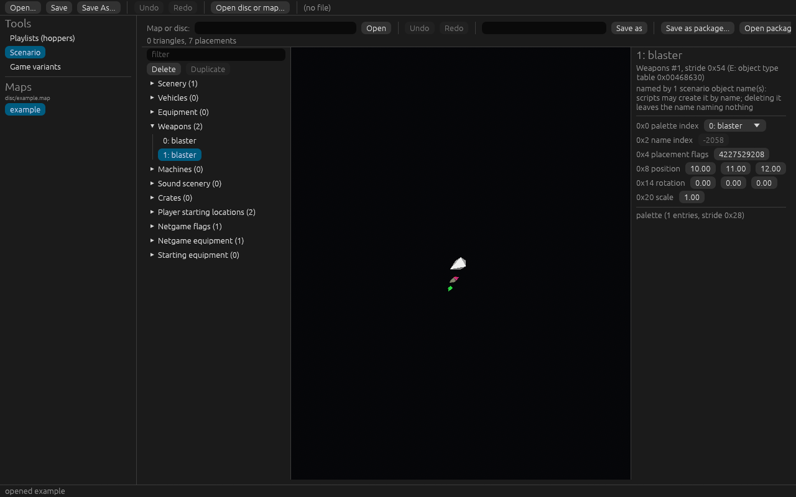
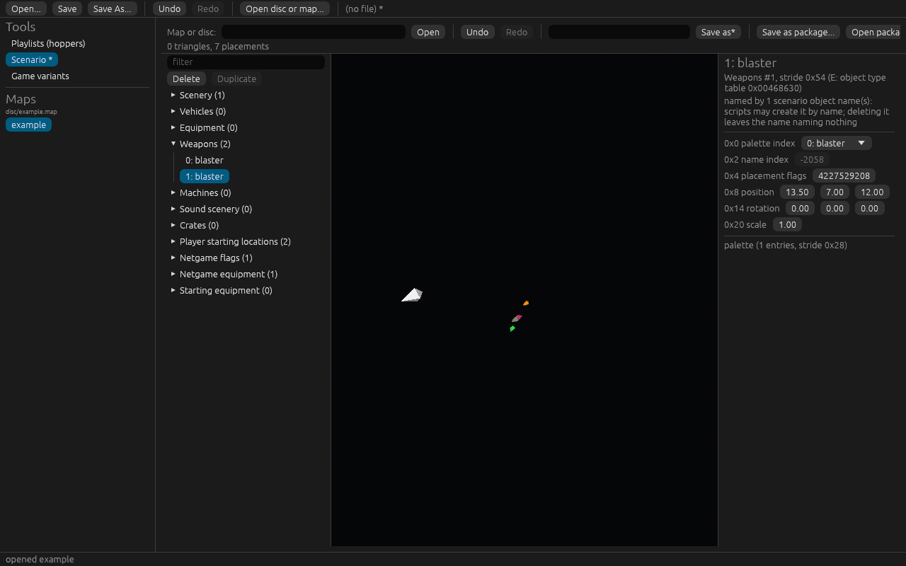
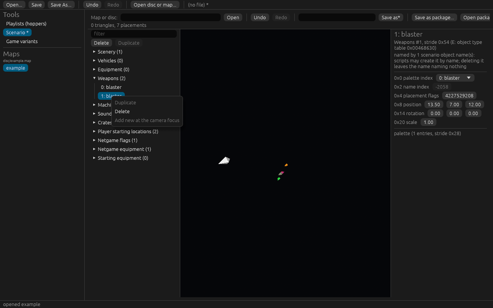
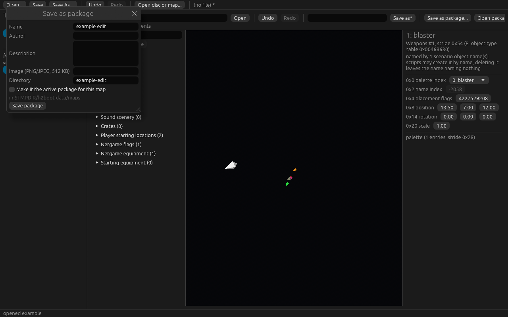
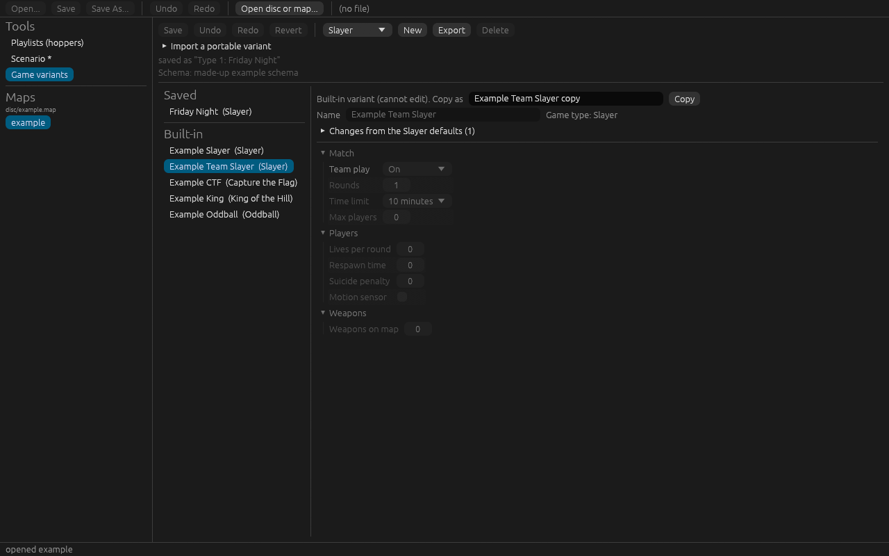
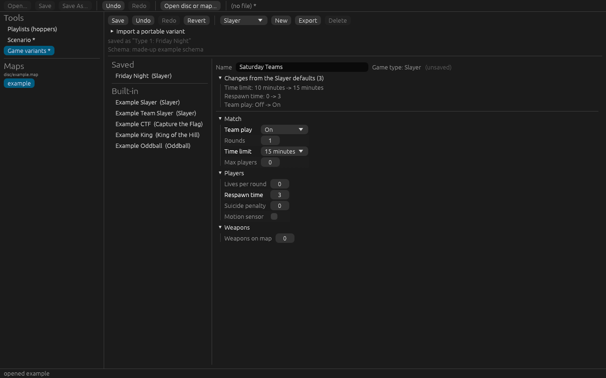
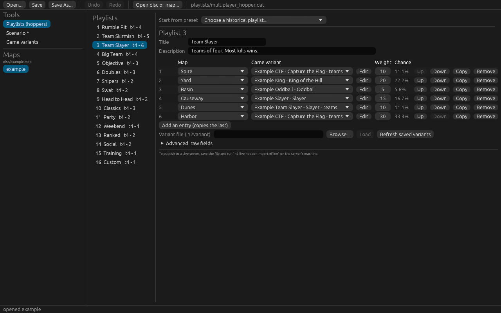
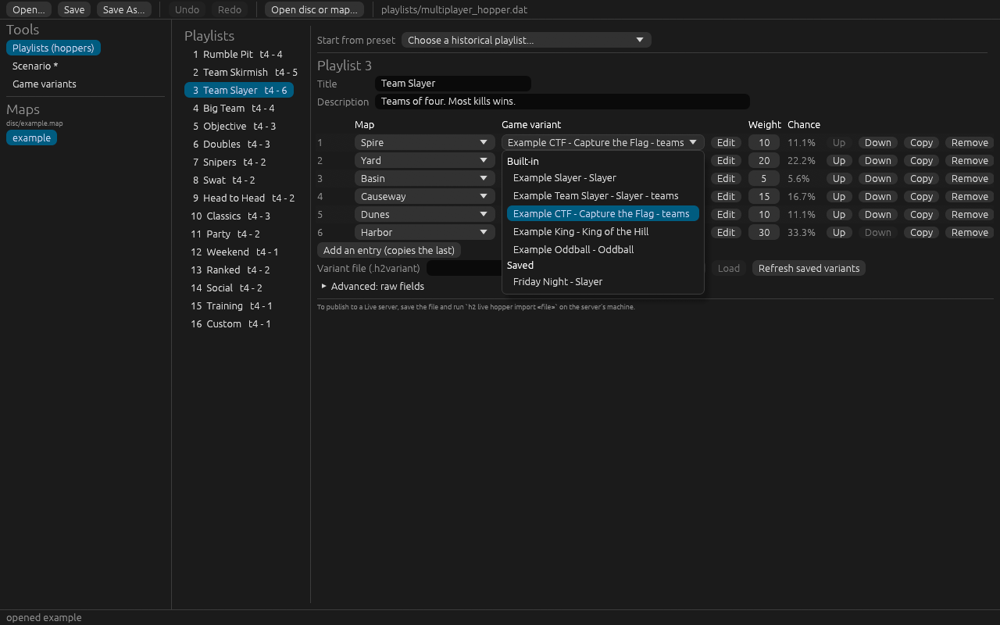
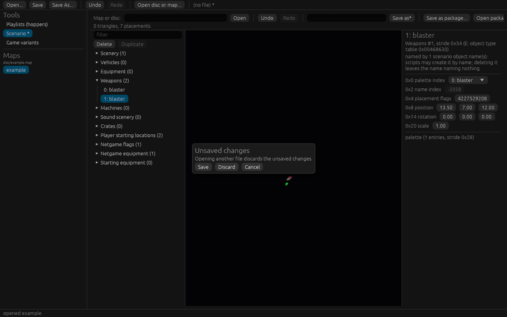

# Editor guide

`h2-editor` is h2recomp's editor suite. With it you can:

- move, add and remove the objects placed on a map (weapons, vehicles,
  spawn points, flags and the rest) and play the result;
- make your own game variants (custom Slayer, CTF and other game
  settings) and use them in game;
- edit the matchmaking playlists file (`multiplayer_hopper.dat`) for a
  Live server.

This guide shows how to use it. If you want to know how it works inside,
see [editor.md](editor.md), [scenario-editor.md](scenario-editor.md) and
[variants.md](variants.md).

The screenshots use made-up example data, not anything from the game.
Your own window shows your own disc's maps, names and level geometry.

## Contents

1. [What you need](#1-what-you-need)
2. [Starting the editor](#2-starting-the-editor)
3. [The window](#3-the-window)
4. [Scenario: editing what is on a map](#4-scenario-editing-what-is-on-a-map)
5. [Game variants](#5-game-variants)
6. [Playlists (hoppers)](#6-playlists-hoppers)
7. [Undo and redo](#7-undo-and-redo)
8. [Where files go](#8-where-files-go)
9. [Troubleshooting](#9-troubleshooting)

## 1. What you need

- **Your Halo 2 disc image** (an `.iso`), the same one you play with. The
  editor reads it and never changes it. Put it at `disc/halo2.iso` in the
  repository, or say where it is when you start the editor.
- **The game's `default.xbe`** (optional). The game variant editor reads
  the names it gives saved variants from it. Put it next to the disc image
  (`disc/default.xbe`), or set `H2_XBE` to its path. Without it you can
  still open and change variants you have already saved, but you can't
  save new ones.
- The Rust toolchain you build h2recomp with.

The editor doesn't need the game to be built, and it doesn't run it.

## 2. Starting the editor

From the repository:

```sh
cargo run -p editor --release -- --disc disc/halo2.iso
```

Options:

| Option | What it does |
|---|---|
| `--disc <file.iso>` | The disc image to read maps from. Without it, the editor uses `H2_DISC`, then `disc/halo2.iso`. |
| `--map <file.map>` | Open a single loose `.map` file instead of a disc. |
| `--hopper <file>` | Open this `multiplayer_hopper.dat` in the playlist tool at startup. |
| `--data <dir>` | The game's data folder: where saved variants and map packages go. It defaults to the same folder `h2 play` uses (`$TMPDIR/h2boot-data`). |

If you start the game with `h2 play --data <dir>`, give the editor the
same `--data <dir>`, or the game won't see what you save. If you don't
use `--data` with either, they already agree.

With no disc found, the editor still starts. Click **Open disc or
map...** to pick one.

## 3. The window



- **Sidebar, Tools**: the three tools: **Playlists (hoppers)**,
  **Scenario** and **Game variants**. Click one to switch to it. A tool
  with unsaved changes shows a `*` after its name. Switching tools never
  loses anything: each tool keeps its state while hidden.
- **Sidebar, Maps**: the maps on the open disc (or the one loose map).
  Clicking a map opens it in the Scenario tool. The path of the disc is
  shown above the list.
- **Top bar**: **Open...**, **Save** and **Save As...** act on the tool
  you're in. **Undo** and **Redo** step through that tool's changes.
  **Open disc or map...** picks another disc image or loose map. On the
  right is the file the tool is editing, with a `*` when it has unsaved
  changes, or `(no file)`.
- **Status line** (bottom): the result of the last action, or an error in
  red. It says `ready` when nothing has happened yet.

Open, Save As and Open disc or map use your system's file dialog. If you
prefer to type paths, start the editor with `H2_EDITOR_TYPED_PATHS=1`.

Keyboard shortcuts (Cmd on macOS, Ctrl elsewhere):

| Keys | Action |
|---|---|
| Cmd+O | Open... |
| Cmd+S | Save |
| Cmd+Shift+S | Save As... |
| Cmd+Z | Undo |
| Cmd+Shift+Z or Cmd+Y | Redo |

## 4. Scenario: editing what is on a map

The Scenario tool edits the objects a map places: scenery, vehicles,
equipment, weapons, machines, sound scenery, crates, player starting
locations, netgame flags (CTF flags, hills, bomb spots and so on),
netgame equipment (the weapons and items that respawn in multiplayer) and
starting equipment. It doesn't change the level's geometry.

### Opening a map

Click a map in the sidebar's **Maps** list. The status line says
`opened <map>`. The tool has three parts:



- **Outliner** (left): a **filter** box, the **Delete** and
  **Duplicate** buttons, and one group per kind of object, with its count,
  for example `Weapons (2)`. Click a group to expand it, and an entry to
  select it.
- **Viewport** (middle): the level in 3D, with a small coloured marker for
  each object. Each kind has its own colour; the selected object is drawn
  white and larger. In the screenshots the example map has no level
  geometry, so only the markers show; with your disc you also see the
  level.
- **Inspector** (right): the selected object's fields: where it is, which
  way it faces, which item or object it is, and the rest. Fields you can't
  change are greyed out. Hover over a field's name for a note on where its
  meaning comes from.

The tool also has its own row of controls above these: a **Map or disc:**
box with **Open** (type a path to a `.map` or `.iso` there; an `.iso`
adds a **Disc map** list to pick from), **Undo** and **Redo**, a box for a
file name with **Save as**, and **Save as package...** and **Open
package...**. Below that row is the tool's own status: how many triangles
and placements the map has, or what the last action did.

Moving around the viewport:

| Input | Action |
|---|---|
| Right-drag | Orbit around the focus point |
| Middle-drag | Pan |
| Scroll | Zoom |
| W, A, S, D | Fly forward, left, back, right |
| Q, E | Fly down, up |
| Left-click a marker | Select it |
| Left-drag a marker | Move it across the ground (keeps its height) |
| Shift + left-drag | Move it up or down |

The keys work while the pointer is over the viewport. Selecting an entry
in the outliner moves the focus point to it.

### Move a weapon spawn and play it

1. Click the map in the **Maps** list.
2. In the outliner, expand **Netgame equipment** (the weapons and items
   that respawn in multiplayer) or **Weapons** (weapons placed once), and
   click the weapon. You can type part of its name into the **filter**
   box to find it. It turns white in the viewport.
3. Move it: drag it in the viewport (Shift-drag to change its height), or
   type new numbers into its **position** in the inspector. The three
   numbers are x, y and z. Drag a number left or right to nudge it.
   Change which way it faces the same way, with **rotation**,
   **orientation** or **facing** (depending on the kind of object; in
   radians).
4. To swap what spawns there, pick another item from the drop-down on the
   **item** field (netgame equipment) or the **palette index** field
   (placed objects such as weapons and vehicles).
5. Save it (next section) and start the game.

After an edit, the tool shows `Scenario *` in the sidebar, the top bar's
file name gets a `*`, and the tool's own **Save as** button reads
**Save as\***.

### Add and remove objects

- **Delete**: select an entry and click **Delete** above the outliner.
  The last entry of that group moves into the deleted one's place, so the
  numbers in the list change. Undo puts everything back exactly.
- **Duplicate**: select an entry and click **Duplicate**. The copy is
  added at the end of the group, selected, and placed at the viewport's
  focus point (where the original is, if you selected it in the
  outliner): drag it where you want it.
- **Add new**: right-click a group's name (or an entry) and choose **Add
  new at the camera focus**. The new entry is placed at the viewport's
  focus point, using the first item of the group's list.



A button or menu item that is greyed out says why when you hover over it.
The usual reason for **Duplicate** and **Add new** is that the group is
full: a map has room for exactly the entries it shipped with, and the
editor doesn't make room for more yet. Delete an entry from that group
first, and you can add one.

The inspector warns when an object is "named by" a scenario object name:
the level's scripts may create it by name. Deleting it leaves that name
pointing at nothing, which can break those scripts (mostly a campaign
concern).

### Save as a map package or as a map file

There are two ways to save. Either way, the disc and the map you opened
are never changed.

**As a map package (recommended).** Click **Save as package...** in the
tool's controls.



- **Name**: what the package is called (required).
- **Author**, **Description**: optional.
- **Image (PNG/JPEG, 512 KB)**: an optional picture: type the path of a
  PNG or JPEG of at most 512 KB.
- **Directory**: the folder name for the package inside `<data>/maps`.
  It defaults to `<map>-edit`.
- **Make it the active package for this map**: tick it to make the game
  use this package for the map even when you have others for the same
  map.

Click **Save package**. The window shows where it goes (`in <data>/maps`).
The status line then says `saved package ...` with the package's MapId,
an identifier for this exact version of the map.

A package is small: it holds only the difference from your disc's map,
plus a description. It's the form that can be shared, and the game picks
it up by itself.

To keep working on a package later, open the same map, click **Open
package...** and click **Open** next to it. Saving again with the same
**Directory** updates that package (the window says `replaces this
package's patch`).

**As a whole `.map` file.** Click **Save** or **Save As...** in the top
bar (or press Cmd+S) and choose where to write it. You can also type a
file name into the box next to the tool's **Save as** button and click
it. The editor always asks for a new file: it refuses to overwrite the
map it read from.

### Playing your edited map

- **A package**: start the game with the same data folder as the editor
  (`h2 play`, or `h2 play --data <dir>` if you gave the editor `--data`).
  The game uses the package in place of the disc's map the next time it
  loads that map. If you have several packages for one map, it uses the
  active one, or else the one whose directory name sorts last
  alphabetically. Delete the package's folder from `<data>/maps` (or
  untick it as active and save another) to go back.
- **A `.map` file**: save it under the disc's own file name (the name in
  the Maps list, plus `.map`) in a folder of its own, and start the game
  with that folder:

  ```sh
  mkdir -p ~/h2-maps
  # Save As ~/h2-maps/<map>.map in the editor, then:
  H2_MAP_DIR=~/h2-maps h2 play
  ```

  The game reads that map from your file, and everything else from the
  disc. Unset `H2_MAP_DIR` to go back.

Then start a game on that map: a custom game for a multiplayer map. In
multiplayer, everyone in the game needs the same edited map.

## 5. Game variants

A game variant is a set of game settings: the game type (Slayer, CTF and
so on), its name, and options like the score to win, the time limit and
the weapons. The game ships with built-in variants, and you can save your
own.



- **Toolbar**: **Save**, **Undo**, **Redo**, **Revert** (back to the
  variant as last saved), a game type list with **New**, **Export** and
  **Delete**. Under it, **Import a portable variant** opens a box to paste
  a shared variant into.
- **List** (left): your **Saved** variants, then the **Built-in** ones,
  each with its game type.
- **Settings** (right): the variant's **Name** and **Game type**, then its
  settings, grouped as the game groups them. Settings you changed from
  the game type's defaults are in bold. Hover over a setting for its help
  text and its default. Above the settings, **Changes from the ...
  defaults** lists what you changed, and **The game would not accept
  this** appears if a value is one the game would refuse.

The settings and built-in variants come from your disc. Without a disc,
the tool says `no disc: using the built-in setting model`, and shows
generic setting names with plain numbers and checkboxes.

### Make a game variant

From a built-in variant:

1. Click **Game variants** in the sidebar.
2. Click a variant under **Built-in**. Built-ins can't be changed: the
   form shows **Built-in variant (cannot edit). Copy as** with a name box.
3. Type a name and click **Copy**. You now have an unsaved copy.
4. Change its settings. Each change shows in **Changes from the ...
   defaults**.
5. Click **Save** in the tool's toolbar (or press Cmd+S). The status says
   `saved as "..."`, and the variant appears under **Saved**.



From scratch: pick a game type in the list next to **New**, click
**New**, give it a **Name**, change what you want and **Save**.

To change a saved variant later, click it under **Saved**, edit it and
**Save** again. **Delete** removes the selected saved variant.

Note that the top bar's **Open...**, **Save** and **Save As...** are
greyed out in this tool: variants are saved into the game's own storage,
not to a file you choose. Use the tool's own **Save** button (or Cmd+S).

### Use it in game

The editor saves variants where the game keeps its saved variants, inside
the data folder. Start the game with the same data folder (`h2 play`, or
`h2 play --data <dir>`) and set up a custom game: your variant is listed
with the game's own saved variants for its game type.

### Share a variant

**Export** copies the open variant to the clipboard as a portable
`.h2variant` text. Paste it into a file or a message. To use one you were
given, open **Import a portable variant**, paste the text and click
**Import**: it opens as a new, unsaved variant; click **Save** to keep it.

## 6. Playlists (hoppers)

Matchmaking playlists ("hoppers") live in one file, `multiplayer_hopper.dat`,
which the game downloads from a Live server after signing in. The
playlist tool edits that file: the 16 playlists, their titles and
descriptions, and for each playlist the list of map and game variant
pairs it picks from, with how often each comes up.

This only matters if you run a Live server (see
[live-admin.md](live-admin.md)). The game doesn't read the file from your
computer: you publish it to your server.

### Open a file

Click **Playlists (hoppers)** in the sidebar, then **Open...** in the top
bar and pick a `multiplayer_hopper.dat`. Both forms work: the raw file
the console keeps, and the compressed download a Live server publishes.
The editor saves it back in the same form. With no file at hand, click
**New blank file** to start from an empty one.



- **Playlists** (left): the 16 playlists, each with its number, title,
  type (`t4`) and number of entries.
- **Start from preset**: fill the open playlist from a historical lineup
  (below).
- **Playlist N**: its **Title** (at most 15 characters) and
  **Description** (at most 127).
- **Entries**: one row per entry: its **Map**, its **Game variant**, an
  **Edit** button, its **Weight** and the resulting **Chance**, then
  **Up**, **Down**, **Copy** and **Remove**. **Add an entry (copies the
  last)** adds a row.
- **Variant file (.h2variant)** with **Browse...** and **Load**, and
  **Refresh saved variants**: more variants to choose from (below).
- **Advanced: raw fields**: every raw number of the playlist and its
  entries. Leave these alone unless you know what they mean.

Map names come from your disc. Without a disc, maps show as numbers
(`map id 3`) and presets can't be used.

### Edit a playlist

1. Click the playlist on the left.
2. Change its **Title** and **Description**.
3. For each entry, pick the **Map** from its list, and set its **Weight**
   (1 to 1000). An entry's chance of coming up is its weight divided by
   the playlist's total, shown under **Chance**.
4. Reorder entries with **Up** and **Down**, copy one with **Copy**, and
   remove one with **Remove**. A playlist has between 1 and 100 entries.
5. Click **Save** in the top bar (Cmd+S).

If something isn't valid (an empty title, say), it's listed in red under
the entries, and saving is refused until it's fixed.

**Start from preset** offers lineups from Halo 2's Live years. Pick one:
the tool lists the games it would add, greyed out where your disc or file
lacks what one needs. Click **Fill playlist N with M entries** to replace
the open playlist's entries with them.

### Give an entry another game variant

Click the entry's **Game variant**. The list has three groups:



- **Built-in**: the game's built-in variants, from your disc.
- **Saved**: the variants you saved in the Game variants tool. After
  saving a new one, click **Refresh saved variants** to see it here.
- **Files**: `.h2variant` files you loaded this session: type a path
  into **Variant file (.h2variant)** and click **Load**, or click
  **Browse...**.

Pick one, and the entry shows it with `(picked)` after it. A variant the
game would refuse is greyed out; hover over it to see why.

To change an entry's variant a little: click **Edit** on its row. The
Game variants tool opens with a copy of it. Change it, click **Save**
there, go back to **Playlists (hoppers)**, click **Refresh saved
variants**, and pick your variant from **Saved**.

### Publish it

Save the file, then on your Live server's machine run:

```sh
h2 live hopper import <file>
```

Players get the new playlists the next time they sign in.

## 7. Undo and redo

Each tool has its own history; **Undo** and **Redo** in the top bar (and
Cmd+Z, Cmd+Shift+Z) act on the tool you're in. The Scenario and Game
variants tools also have **Undo** and **Redo** in their own toolbars.

- One drag of an object in the viewport is one step. Typing into one
  field is one step, until you select something else or save.
- You can undo past a save. The tool then has unsaved changes again
  (the `*` comes back), and undoing back to the saved state clears them.
- In Game variants, **Revert** goes back to the variant as last saved
  (and can itself be undone). Typing a name is one step.

## 8. Where files go

`<data>` is the data folder: `--data`, or by default the one `h2 play`
uses, `$TMPDIR/h2boot-data`.

| What | Where | How the game finds it |
|---|---|---|
| Map packages | `<data>/maps/<directory>/` | Automatically, the next time it loads that map ([maps.md](maps.md) §7). `<data>/maps/active.toml` records which package is active for each map. |
| Edited `.map` files | Wherever you save them | With `H2_MAP_DIR=<that folder> h2 play`; the file must have the disc's map name. |
| Saved game variants | `<data>/disk/Partition1/UDATA/4D530064/` (the game's saved data) | Listed in the game with its own saved variants. |
| Exported variants | The clipboard (`.h2variant` text) | Not directly: import it in the editor and save it. |
| Playlists | Wherever you save the `.dat` | Through your Live server (`h2 live hopper import`). |

Your disc image is only ever read.

## 9. Troubleshooting

**"... has unsaved edits: save or undo them to open ..."** You clicked
another map in the sidebar while the open map has unsaved changes. The
Scenario tool keeps the map you were editing open. Save it (as a package
or a file), or undo the changes, and the map you clicked opens.
**Open package...** is refused the same way (`the open map has unsaved
edits: save or undo them first`).

**"Unsaved changes" window.** Opening another file in a tool with
unsaved changes, or closing the editor with any, asks first: **Save**,
**Discard** or **Cancel**. When saving needs a file name, it asks for one
and then carries on.



**"The open variant has unsaved changes."** You picked another variant
in Game variants while the open one has changes. Click **Discard them**
to open the one you picked, or **Keep editing**.

**Duplicate or Add new is greyed out.** Hover over it for the reason.
Usually the group is full: `the block is full: growing it needs more tag
memory ...`. Delete an entry from the same group first.

**"refusing to overwrite the source map".** Save to a new file name. For
the game to use it, put it in a folder of its own under the disc's map
name (section 4).

**My package isn't used in game.** Check that the game and the editor use
the same data folder (`--data`). If you have several packages for the
map, the active one wins, else the directory name that sorts last. A
package for another version of the map (a different disc) is skipped
with a warning on the game's console, and the disc's map is used.

**"no XBE found (set H2_XBE): saved variants can be edited, but not
created".** Put `default.xbe` next to your disc image, or set `H2_XBE`
to its path, and restart the editor.

**My saved variant isn't listed in game.** Check that the game and the
editor use the same data folder (`--data`), and that the variant is
listed under **Saved** in the editor. Saving from the editor follows the
game's own file format, but the signature the game checks on our runtime
hasn't been confirmed in a running game yet ([variants.md](variants.md),
"Open"); if the game skips the variant, that is the likely cause: please
report it.

**"no disc: using the built-in setting model".** The Game variants tool
couldn't read your disc. Open one with **Open disc or map...**.

**"the game would reject this variant: ..."** when saving a variant. Open
**The game would not accept this** above the settings: it lists the
values to fix. Undo the change that caused it, or pick another value.

**"this save's signature does not match the signing key; saving re-signs
it".** The saved variant you opened wasn't signed the way this runtime
signs saves (for example, one copied from a real console). Saving it
again signs it.

**"No disc open: maps show as numbers and presets cannot resolve."** The
playlist tool has no disc to read map names from. Open your disc with
**Open disc or map...**.

**A playlist file won't save as a download.** The compressed file must
fit the game's 128 KiB download buffer, or the game would ignore it and
keep its built-in playlists. Remove some entries.

**"The scenario editor needs the wgpu renderer."** The window couldn't
start its 3D renderer. Check that your machine's GPU driver supports
Metal (macOS), Vulkan or DirectX 12.

**Edits to `shared.map` or `single_player_shared.map`.** The Scenario
tool doesn't edit those. Edit the map itself.

## Regenerating the screenshots

The pictures in this guide come from a test that draws the editor's real
window with made-up example data (no game files) and writes PNGs to
`docs/images/editor/`:

```sh
cargo test -p editor screenshots -- --ignored
```

It needs a GPU that wgpu can use offscreen (Metal on macOS). Without the
`--ignored` flag, a normal `cargo test` skips it and leaves the images
alone.
