# Editor guide: maps

Status: Built. The walkthroughs follow the controls in Studio.

Section 4 of the editor guide: editing what is on a map, playing it, saving, packages, Map Pack and Halo 1 maps. The index is [editor-guide.md](editor-guide.md).

## 4. Scenario: editing what is on a map

The Scenario tool edits the objects a map places: scenery, vehicles,
equipment, weapons, machines, sound scenery, crates, player starting
locations, netgame flags (CTF flags, hills, bomb spots and so on),
netgame equipment (the weapons and items that respawn in multiplayer) and
starting equipment. It doesn't change the level's geometry.

### Opening a map

Click a map in the **Maps** tab or in the grid in the centre of the
workspace. **Scene** opens with the level's placements. The Log records
how many triangles and placements the editor could read.

The names, descriptions and pictures come from your disc's
`mainmenu.map`: the multiplayer maps as **Select Map** shows them, the
campaign levels as **Select Level** shows them. The editor reads them in
the background when a disc or folder opens, so for a moment after opening
the list shows file names. A folder of maps without `mainmenu.map` keeps
its file names.

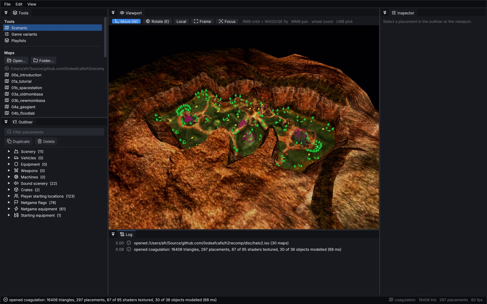

*Ascension just opened: the outliner lists its groups, the viewport frames the level, and the log says what was read.*

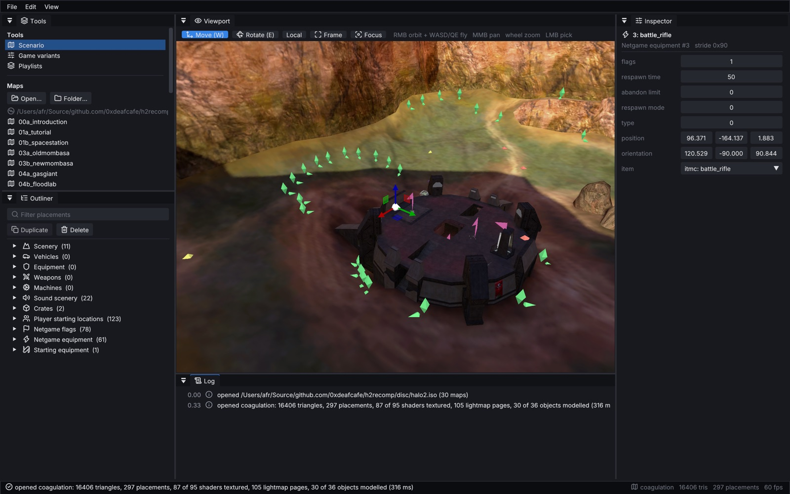

- **Scene**: a **Filter placements** box, **Duplicate** and
  **Delete**, and one group per kind of object with its count, for
  example `Netgame equipment (33)`. Click a group to expand it, and an
  entry to select it; double-click an entry to point the camera at it.
  Cmd/Ctrl+click adds an entry to the selection (or takes it out), and
  Shift+click selects every shown entry between the selected one and
  the one you click.
- **Viewport**: the level in 3D with its textures and baked lighting, its
  sky, the placed objects' models, and a small coloured marker for each
  placement. Hover a toolbar icon to see its action and shortcut:
  **Move (W)**, **Rotate (E)**, **Scale (R)** and **Local/World (X)**.
  Grid and angle snapping each have a toggle and a step dropdown.
  The camera controls frame the map or selection and set fly speed.
- **Inspector**: the selected object's fields, grouped under Transform,
  Object, Spawn and Settings: where it is (x, y, z), which way it faces
  (yaw, pitch and roll in degrees), which item or object it is (a list
  you can type into to search), its flags as checkboxes, its team, and
  the rest. Fields you can't change are greyed out. Hover over a field's
  name for its offset and where its meaning comes from.


*Click a group to expand it. Each entry is numbered and named by what it places.*


*Hovering a field's name shows its offset in the entry and the evidence for what it means.*

Moving around the viewport:

| Input | Action |
|---|---|
| Hold right button and move | Look around |
| W, A, S, D (holding the right button) | Fly forward, left, back, right |
| Q, E (holding the right button) | Fly down, up |
| Scroll (holding the right button) | Fly faster or slower (the toolbar shows the speed) |
| Shift (while flying) | Fly four times as fast |
| Alt + left-drag | Orbit around the selection, or the spot under the pointer |
| Middle-drag | Pan |
| Scroll | Move in and out |
| F | Frame the selection |
| Double-click | Focus on the placement or the spot under the pointer |
| Left-click | Select the placement under the pointer |
| Cmd/Ctrl + left-click | Add it to the selection, or take it out |
| Drag the gizmo | Move, rotate or scale the selection |

The camera eases in and out rather than jumping, at the same speed
whatever the frame rate. With **Grid** on, moves snap to the grid step;
with **°** on, turns snap to the angle step.


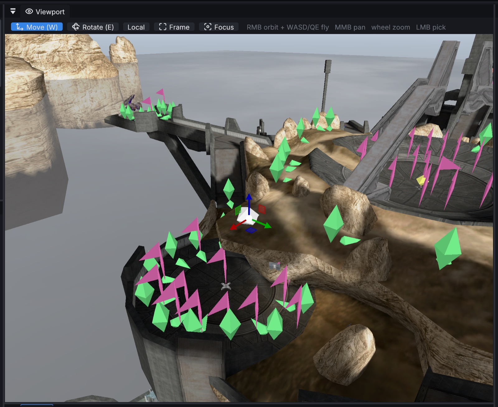

***Move (W)**: drag an arrow to move along one axis.*

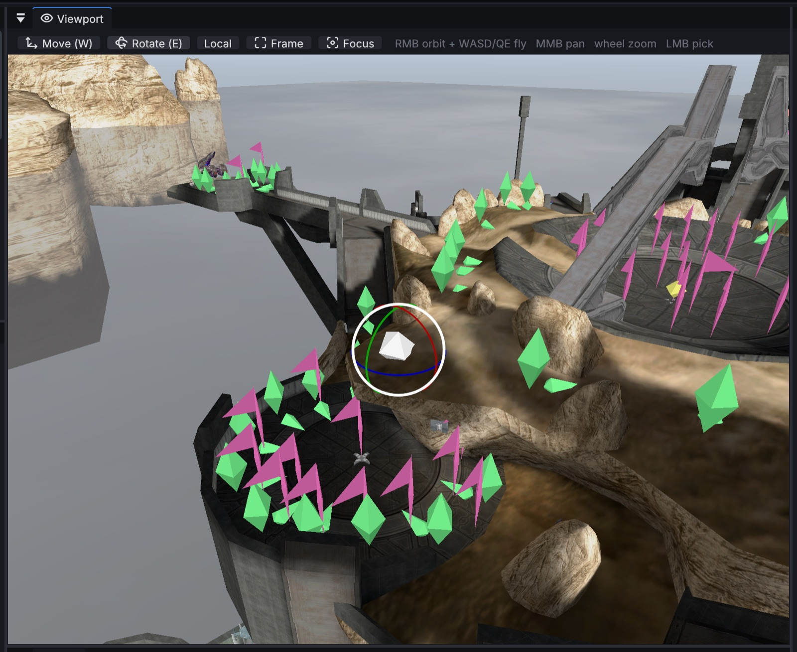

***Rotate (E)**: drag a ring to turn the selection.*

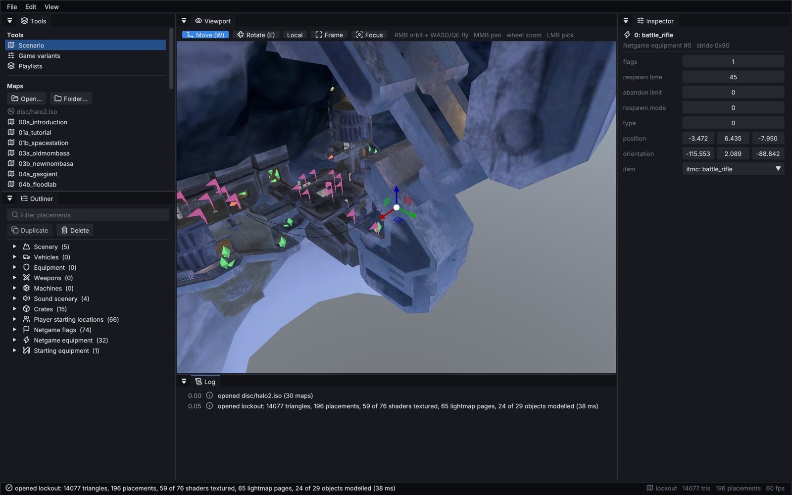

*Lockout, a battle rifle spawn selected.*

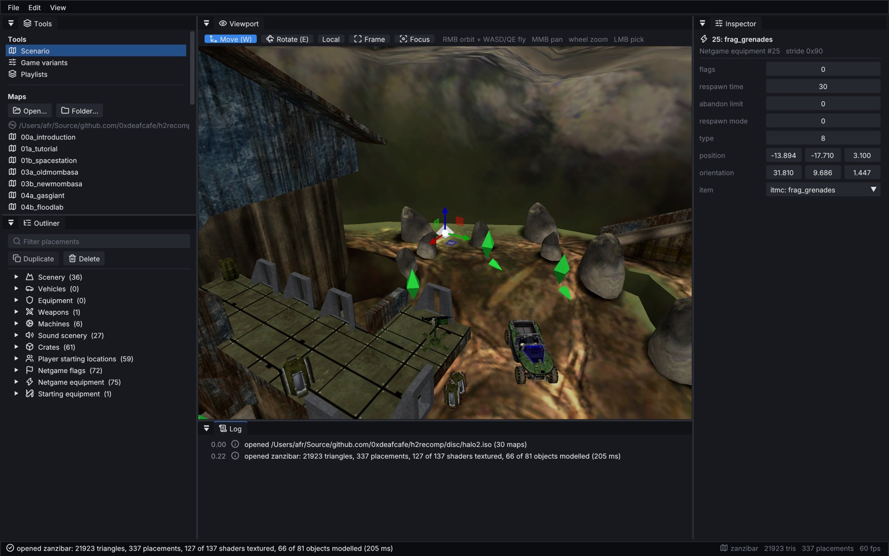

*Zanzibar.*


*Headlong.*

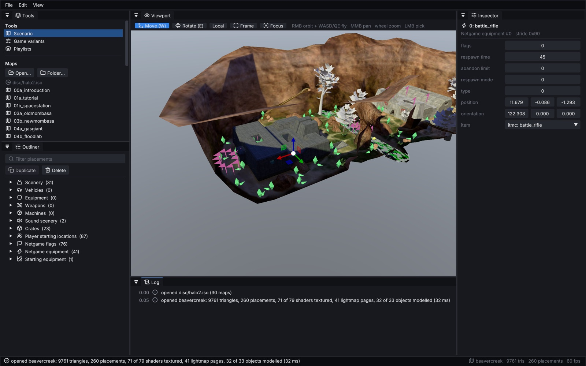

*Beaver Creek.*

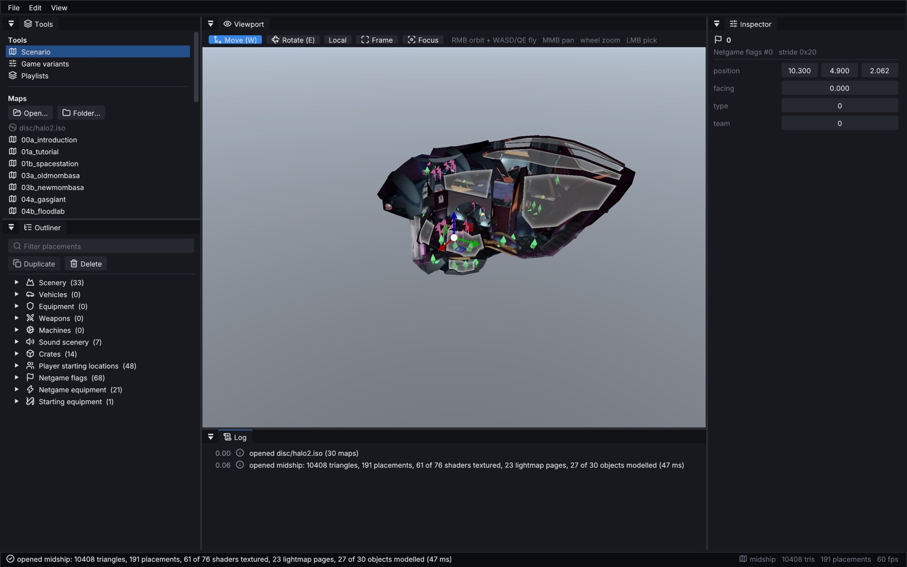

*Midship, seen from outside its hull.*

### What the inspector shows

Each kind of placement has its own fields. Some examples:

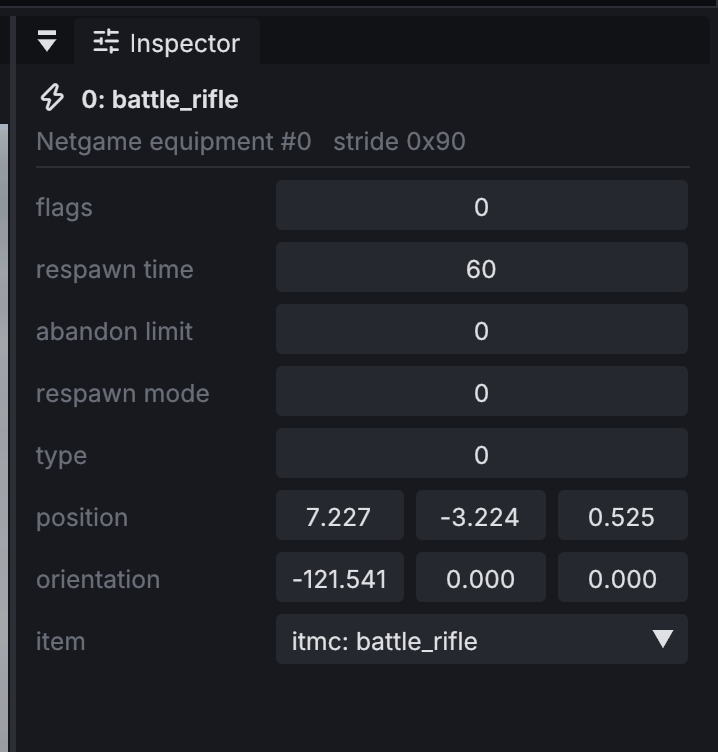

*Netgame equipment (a respawning weapon): respawn time, position, orientation and the **item** it spawns.*

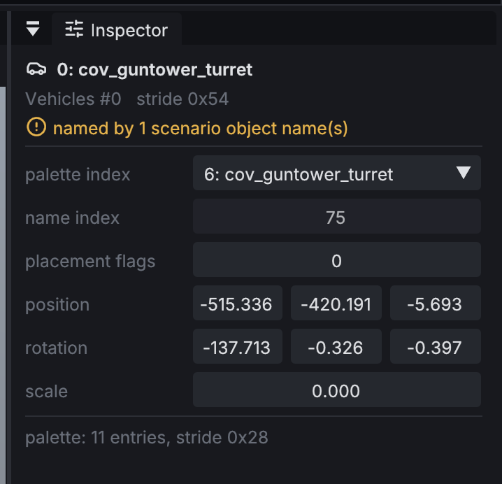

*A placed vehicle (here from the campaign's Old Mombasa): its palette entry, position, rotation and scale. The orange line warns that a script names it.*


*A player starting location: position, facing, team and player type.*


*A netgame flag (CTF flags, hills, bomb spots): position, facing, type and team.*

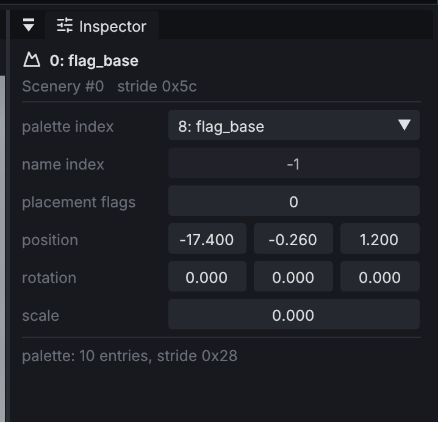

*Scenery: a palette entry with a position, rotation and scale.*

For one placement with an object or item reference, expand its entry in
**Tags** below the placement fields. For a weapon, open **Model** for
its model tag or **Render model** for the mesh tag. For a netgame item,
open the item collection and then a **Collection entry**. Other links
appear under **All references**. A tag edit affects every placement
and tag that uses it. **Undo tag edit** and **Redo tag edit** step
through the tag's history: its fields, and what its editor changed, such
as a sound's mouth curve. Saving the map includes both tag and placement
edits.
Use **Show in** on a shared tag to open its cache read-only.

Use a reference field's **Show this tag** button or a node's **Focus
tag** button to bring that tag to the top of **Tags**. The placement
stays selected in the viewport. Click a breadcrumb to return to an
ancestor. **Back** and **Forward** restore the tag and field you were
viewing. Alt+Left, Alt+Right and the mouse's back and forward buttons
step through the same history.

### See invisible walls and where bots walk

Click **Show** above the viewport.
Each row turns one layer on or off. These layers start off:

- **Collision only** (under Collision): the invisible walls, in red. The
  other Collision rows show all of the level's collision.
- **AI pathfinding** (under Navigation): the floor Halo 2's own AI walks
  on, as tinted patches with their edges. Campaign levels have it;
  multiplayer maps from the disc don't, so the row counts 0.
- **Bot nav mesh**: where the Clankers walk, in blue, with their links
  between patches coloured by move: walks blue, drops orange, jumps
  yellow, crouch-jumps purple, teleporters cyan and lifts green. An
  arrowhead marks a one-way link, such as a drop you can't climb back up.
  Patches in a dim grey-blue are out of the map: no spawn reaches them
  without a glitch, like the snow past Coagulation's cliffs. Bots never
  head there, but one a superbounce lands there walks back in over them.
- **Bot superbounce spots**: the superbounce and crouch spots the bots
  know, each a post coloured by what is known about it: green proven,
  red dead, dull red failed, yellow-green learned, amber still training,
  pink a guess. A diamond round a spot means a ghost run of it is kept.

**Navigation** turns on the level, the invisible walls and all three
navigation layers in one click. The first time a bot layer shows for a
map, the editor reads the bots' saved mesh; if the map has none yet it
builds one, which can take a moment on a big map (the Log says when it
is ready).

Click a patch, link or spot to select it. The inspector shows what it
is: a pathfinding patch's number, flags and neighbours, a bot link's
move and ends, or a spot's state and how its training and test runs
went. **F** frames it.

### Move a weapon spawn and play it

1. Click the map in the **Maps** list.
2. In the outliner, expand **Netgame equipment** (the weapons and items
   that respawn in multiplayer) or **Weapons** (weapons placed once), and
   click the weapon, or click its marker in the viewport. Type part of its
   name into **Filter placements** to find it.

   
   
   *Filtering for `sniper` leaves only the sniper rifle spawns.*
3. Move it: drag one of the gizmo's arrows in the viewport, or type new
   numbers into its **position** in the inspector (x, y and z; drag a
   number left or right to nudge it). Press **E** (or click **Rotate
   (E)**) for the rotate gizmo, or change **rotation**, **orientation** or
   **facing** in the inspector, depending on the kind of object.

   
   
   *The spawn in the gizmo picture above, two units along x later.*
4. To swap what spawns there, pick another item from the list on the
   **item** field (netgame equipment) or the palette field (placed
   objects such as weapons and vehicles).
5. Save it (below) and start the game.

After an edit, the map's tab shows a `*`.
The window title has the same mark.

### Add and remove objects

- **Delete**: select an entry and click **Delete** (or press Delete). The
  last entry of that group moves into the deleted one's place, so the
  numbers in the list change. Undo puts everything back exactly. With
  several entries selected, all of them go, as one undo step.
- **Duplicate**: select an entry and click **Duplicate** (Cmd+D). The copy
  is added at the end of the group and selected: drag it where you want
  it. With several selected, each is copied where it stands and the
  copies are selected.
- **Add new**: right-click a group's name (or an entry) and choose **Add
  new at the camera focus**, or **Place new with the mouse** (**Place a
  copy with the mouse** on an entry), then click the level where it
  should go. Esc cancels.
- **Edit many at once**: with several entries selected, the inspector
  shows the fields they all have. A field marked `*` differs between
  them; changing it (or one of its x, y, z, or one flag) changes it on
  every selected entry, and one undo takes it back.


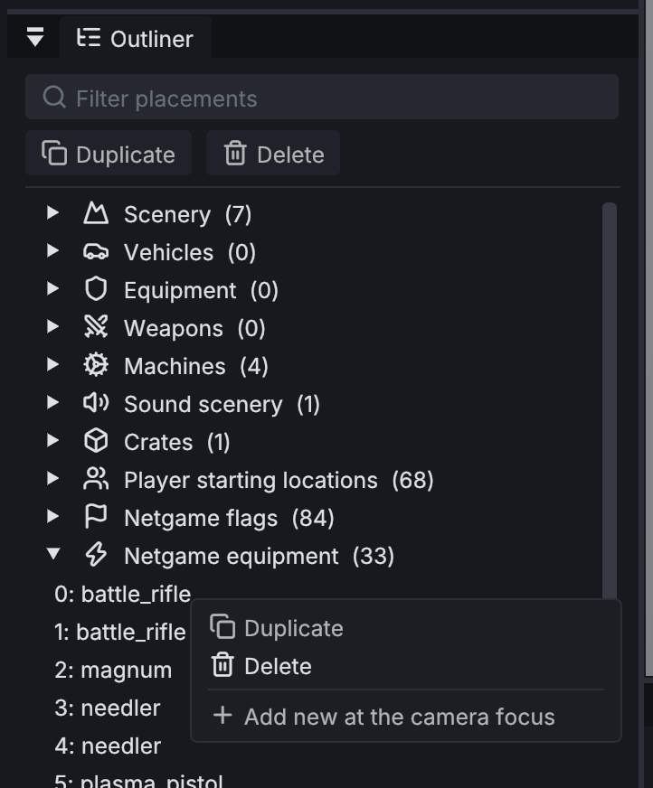

*Right-click an entry for **Duplicate**, **Delete**, **Add new at the camera focus** and **Place a copy with the mouse**.*


*On a group's name, the menu has only **Add new at the camera focus** and **Place new with the mouse**.*


*With nothing selected, **Duplicate** and **Delete** are greyed out; hovering says why.*

A button or menu item that is greyed out says why when you hover over it.
The usual reason for **Duplicate** and **Add new** is that the group is
full: a map has room for the entries it shipped with. Delete an entry from
that group first, or turn on **Edit > Allow growing full blocks**, which
makes room by moving the group to the end of the map's tag data.

The inspector warns when an object is named by a scenario object name:
the level's scripts may create it by name. Deleting it leaves that name
pointing at nothing, which can break those scripts (mostly a campaign
concern).

### Save to the edit target, or export a map

Your edits are lines in the edit target, a local package. The first
change to a disc map asks which package takes it: pick an existing one
or **New package...**. After that every change, undo and redo updates the
package's edit lines for the map (`edits/<map>.yaml`), and the document
tab shows a `*` until **File > Save** (Cmd+S) writes the package's files.
Saving keeps the disc or loose source map intact.

A package is small: it holds only the difference from your disc's map,
plus a description. The game finds it at boot. Pick it from
**Change Map > Mods** when a slot is available.
[Map selection](../game/map-select.md)

To keep working on a package later, open the same map, choose **File >
Open package...** and click **Open** next to it.

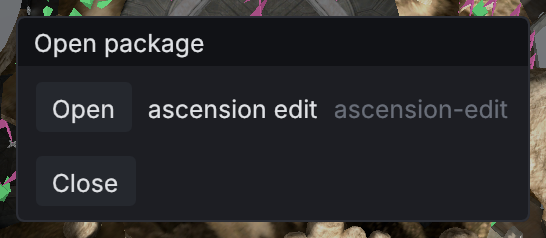

***Open package** lists this map's packages.*

**As a whole `.map` file.** Choose **File > Export map...**
(Shift+Cmd+S) and pick the destination in your system's save window. The
file is for use outside the game's package set.

### Playing your edited map

- **A package**: start the game with the same data folder as the editor
  (`h2 play`, or `h2 play --data <dir>` if you gave the editor `--data`).
  The game uses the package in place of the disc's map the next time it
  loads that map. If you have several packages for one map, it uses the
  active one, or else the one whose directory name sorts last. Delete the
  package's folder from `<data>/maps` to go back.
- **A `.map` file**: save it under the disc's own file name (the name in
  the Maps list, plus `.map`) in a folder of its own, and start the game
  with that folder:

  ```sh
  mkdir -p ~/h2-maps
  # Save map as ~/h2-maps/<map>.map in the editor, then:
  H2_MAP_DIR=~/h2-maps h2 play
  ```

  The game reads that map from your file, and everything else from the
  disc. Unset `H2_MAP_DIR` to go back.

Then start a game on that map: a custom game for a multiplayer map. In
multiplayer, everyone in the game needs the same edited map.

### Play from the editor

Press **F5**, click the Play button beside the game link, or choose
**Game > Play** in any tool. With no game, the editor launches a copy
of the open map with your edits. With a game running, it pairs, sends
pending edits and resumes play. A structural edit reloads a fresh copy.
A game you started yourself asks before accepting edits. If it is on
another map, choose whether to load your document in the game or open
the game's map in the editor. A game without reload support needs a
manual load unless the editor started it and can relaunch it. The same
applies when a game refuses the play copy. F5 leaves the Edit switch as
you set it. In View, later edits wait for your next F5.

The Game tab's **Spawn** picker offers the level spawn, editor camera,
selected placement and **Where I was**. Once you have played this map,
the editor remembers your position and facing for the next playtest.
Your editor selection, camera and undo history stay in place. Enable
**Game > Pause the game while I edit** to pause when you return to the
editor. Press **Shift+F5** or click Stop to close a game the editor
started. Launching needs the disc and `h2`. Running the editor from a checkout with
`cargo run`, build `h2` beside it with `cargo build --release -p cli --bin
h2`; otherwise install it (`~/.cargo/bin/h2`) or set the path under
**Advanced** in the Game tab.

While the game runs, the editor stays paired with it:

- the game link shows the map and whether you're viewing or editing
  live. The Game tab's Session section shows the phase, tick and stream
  details;
- live objects move with their bind-pose models. Player labels show the
  name and team, and a line shows where each player aims;
- **Go to player** brings the camera to you; **Teleport player here**
  moves you to the spot the camera looks at, and **T** over the viewport
  to the spot under the mouse;
- **Pause**, **Step** and **Resume** are beside the game link and in
  the Game menu. Set the step count under **Advanced**;
- with **Edit** on, moving a placement or changing its fields goes to
  the game. The green viewport frame and **Live** pill in the inspector
  show when live edits are active.
  The game only reads a placement when it makes the object, so you see
  it at the next respawn (a weapon or vehicle spawn, your own respawn at
  a starting location) or after **Play** again. Things already in the
  world stay put.
- with **Edit** on, adding or removing a placement, and undoing or
  redoing either, changes the running game at once: an added scenery,
  vehicle, weapon, equipment, machine or crate appears, a removed one
  disappears, and a new spawn point or netgame equipment entry is used
  at the next spawn (a new netgame flag at the next game). The game
  refuses some of these, and Pending shows its reason under **Reload
  map**: other people in a System Link or Live game you host (bots don't
  count), a block with no room left for the entry (the game has room for
  as many entries as the map loaded with, plus any you removed), and a
  matchmade Live game. A named entry, one with placement flags, a scale
  or type-specific fields is written but appears only after a reload,
  and sound scenery always waits for one. If the game's answer is lost,
  the entry stays under **Reload map** and is never sent twice.
- with **Edit** on, geometry and painted pixels go to the game too.
  Moving vertices of a cluster, an instanced definition or a model
  section shows in the game on the next frame; an edit that adds or
  removes faces shows within a few frames, and the level rebuilds for a
  moment while it does. A Textures stroke shows mip 0 while you paint and
  the smaller mips when you let go. Undo sends the old geometry or pixels
  back. Each edit sits in the Pending tab until the game has it. A
  bitmap you resize or reformat, an image or sequence you add to one,
  and a geometry edit the save refuses,
  wait for **Play** again.

A game you started yourself is found without any setup. `h2 play` opens
an agent socket of its own (in the `agents` folder of the h2recomp cache;
`H2_AGENT=off` closes it), and the editor looks for those every second:

- With one game running, the pill says "Halo 2 is running" with the
  map name. Click it to pair. If the game is on another map, click
  the pill and choose **Open** with the game's map name to switch maps.
- **Auto-pair** in the pill's popover is on by default. It pairs with
  the only running game or the only game on the open map. To disconnect, click the pill
  and choose **Unpair**.
- With several games, open the pill's list and choose **Pair** beside
  the map and phase you want.
- A game started another way (`h2 serve`, or `H2_AGENT=<path> h2 play`)
  is listed too when its socket is the default one or in the cache; any
  other socket goes under **Advanced** in the Game tab. **Find** refreshes
  the list.

Pairing with an already-running game starts in View. Turn **Edit** on
when you're ready to send tag and placement edits. Open **Pending** to see
when each edit takes effect, resolve a conflict, or reload the play copy
for structural edits. **Send**, **Reload map** and **Respawn now** are at
the top of Pending, above the rows they act on. A red mark on a field or tree row shows why a write
was refused. An amber conflict offers **Take the game's value** and
**Overwrite**. Click the count on the game link to open Pending. Failed
game actions also appear in the viewport for four seconds. If a co-op session or
another restriction prevents writes, the pill says "Edits stay here"
and the frame and **Live** pill turn amber. Hover the pill for the
reason. If the connection drops while the game is still present, the editor
retries for 30 seconds. The same retry window applies to a socket you
named under **Advanced**. Click **Cancel** to stay unpaired or **Pair again**
after the retry window ends.

An agent drives the same with `pair.list`, `pair.status`, `pair.connect`,
`pair.disconnect`, `pair.auto`, `pair.playtest`, `pair.settings`, `pair.stop`, `pair.control`
and `pair.edit` ([agent-api.md](agent-api.md)).

### Edit a map's textures

The **Textures** workspace paints a map's bitmaps and changes their
shape. The outliner lists the map's bitmaps (an edited one marked `*`);
click one and the centre is its canvas, the inspector the image's
format and budget.

- **Painting.** Brush, eraser, clone, fill, eyedropper, selection and
  the colour adjustments (invert, levels, hue, saturation and value,
  **Copy channel**, flip and the quarter turns) work at mip 0; every
  edit is one undo step on the Textures document (Cmd+Z). Keys: B brush,
  E eraser, S clone, G fill, I eyedropper, `[` and `]` size, X swap
  colours; Shift+click draws a line from the last point, and the middle
  button pans. With **Clone**, the first click sets the source (a cross;
  Alt+click moves it) and a drag copies from it. Fill, adjust, copy and
  turn take the whole image or the rectangle dragged with **Select**.
  With a game paired and **Edit**
  on, a stroke shows in the game as you paint (above). **PNG** imports
  a picture into the image and exports one; **Generate...** makes a
  picture from a prompt ([Generating an image](editor-guide-content.md#generating-an-image)).
- **Resize.** Type a width, height and format and press **Resize**: the
  image saves at that size and format, every layer resampled and every
  mip written again. **Auto** fills the format in for the picture: the one
  it has when that holds its alpha, else DXT1 or DXT5. One undo step. The line under it says what the
  image saves as against what is stored.
- **Add image** appends an image after the bitmap's last, the size and
  format of the one shown, transparent until you paint, import or
  generate into it; **New image, generated...** does the same and opens
  the Generate window on the new image. **Sequences** lists the
  bitmap's sequences (which images each names, and its sprites) with
  **Add a sequence** for the selected image. Adding is one undo step
  each.
- **Saving.** Edits stay in the editor until the map is saved (**File >
  Save**), which writes them into the edit target's package
  (**Export map...** writes a whole `.map`). A bitmap
  that gained an image or a sequence no longer fits where it is stored,
  so the save writes its whole tag again at the end of the map's
  metadata: the other images keep their pixels and every other tag its
  bytes. (modeling.md, "Texture editing"
  ([modeling.md](modeling.md)).)

### Start a new map

**File > New map...** makes a map you can play straight away: a small
lit courtyard with walls, a ramp and cover.

1. Open your Halo 2 disc. The new map takes its tags from it.
2. Choose **File > New map...**, type a name and pick a kind.
3. Click **Build**. The map opens when it is built, and it is listed
   under **Packages**.

| Kind | You get |
|---|---|
| Multiplayer | 16 spawns over two teams, points for every game type, a battle rifle and a Warthog |
| Campaign | the player start and a squad of two Elites |

The walls, ramp and cover are block-out pieces. Move them, delete them
or add more, as on any map. **File > Save** updates the package.

### Your packages in the Maps list

Every package in the data folder is listed under **Packages** in **Maps**,
by the name you gave it, with its image beside it when the package has
one (`[package] image`) and its description in the tooltip. Click one to keep working on it: the editor opens
its map from your disc and the package over it, ready to edit. Use
**File > Save** to update the package. A package based on a disc map
requires that disc to be open.


*The **Packages** section and the read-only maps of an open Halo 1 disc.*

### Map Pack maps

The Multiplayer Map Pack's nine maps have a group of their own, **Map
Pack**, below the disc's playable maps. The editor lists them
alphabetically by their **Select Map** names, with their pictures.
Hover a map to see its whole picture and description.

The maps come from the Map Pack disc when the editor has it (section 2),
else from the copy the game installed in your data folder
(`<data>/disk/Partition1/TDATA/4D530064/$c/`). The names and pictures
come from that installed copy, so install it once even if you keep the
disc: put the Map Pack disc image next to your Halo 2 disc as
`mappack.iso` and start the game once (`h2 play` installs it), or run
`h2 import-mappack <iso> --data <data>`
([map-pack.md](../game/map-pack.md)). If the group says *Not installed*,
the editor has neither.

Click a map to open it. It opens in the Scenario tool like a disc map,
and the Tags tool and the viewport show it too. Its textures, models and
sounds partly live in the Halo 2 disc's `shared.map`, so keep that disc
open: the log says so when it isn't, and the Tags tool says when a tag's
data is in a shared map.

Saving never changes the Map Pack's files:

- **File > Save** writes the edit target's package over the Map Pack
  map, as for a disc map.
- **File > Export map...** writes a whole `.map` wherever you choose,
  except into the game's installed content, which the editor refuses.

### Halo 1 maps

The editor can show Halo 1 maps too.

**Converted maps.** Once you have imported Halo 1 multiplayer maps
([multiplayer.md](../halo1/multiplayer.md)), look under **Halo 1 sandbox
variants**. Each map's H1 sandbox comes first, followed by its H2
sandbox. Both show the picture and description from Halo 1's menu.
Click a variant to edit it in the map editor. Its edits go to the edit
target, a package listed under **Packages**; the imported map is left as
it was.

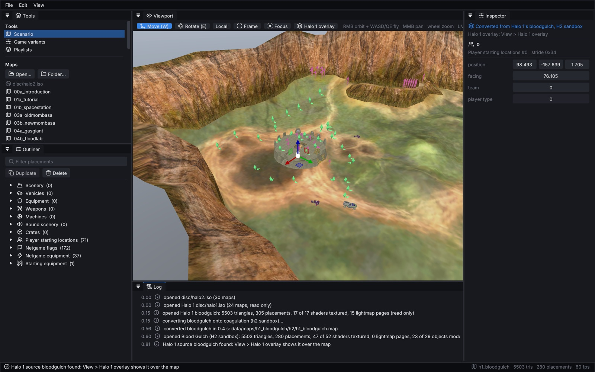

*Blood Gulch converted to Halo 2. Its surfaces wear Halo 2 stand-in
textures from your Halo 2 disc and have no lightmaps yet, so they are lit
by a plain sun.*

**Comparing with the original.** If the editor can find the Halo 1 map a
converted map was made from (on the Halo 1 disc or folder you opened, or
in `H1_MAP_DIR`), the inspector says `Converted from Halo 1's <map>`,
and **View > Halo 1 overlay** (also under **Show** above the viewport) draws
the original level and its spawns in orange over the converted one, so
you can check that everything lines up. Click it again to hide it. The
editor checks that the file is the very one the map was converted from;
if it isn't, the inspector says `No Halo 1 overlay` (hover for why).

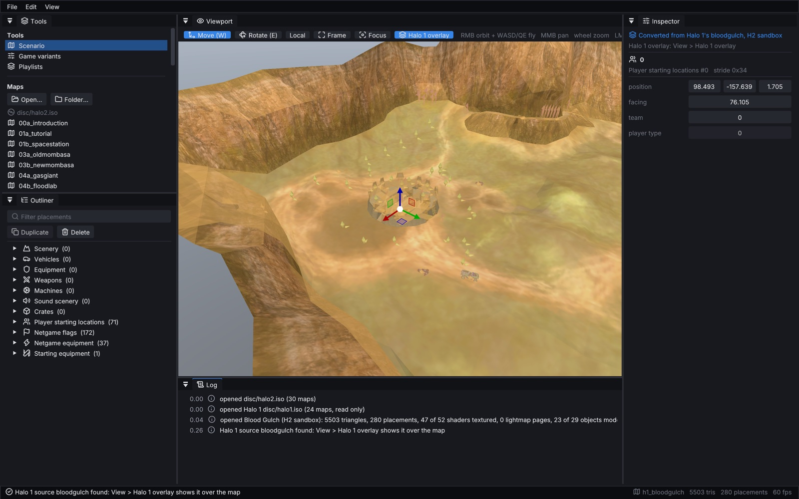

*The same view with the Halo 1 overlay on: the original level in orange
over the converted one.*


*A converted map's inspector says where it came from and how to show the original.*

**Looking at Halo 1 maps.** Open your Halo 1 disc image or a folder of
Halo 1 maps with **Open...** (or start with `--halo1`), and its maps are
listed under **Halo 1**, by the names Halo 1's own menus give them
(**Blood Gulch**, **The Pillar of Autumn**) with their pictures, read
from the disc's `ui.map`. An unlisted level keeps its file name and eye
icon. The menu cache appears in **Shared and menu**. Click a level to
see its geometry, lit by its own lightmaps, and its multiplayer spawn
points, flags, weapon spawns and vehicles. Select a placement to see
its details. These maps are read only (the outliner says `Halo 1:
read only`): nothing can be moved or saved.


*A Halo 1 map's outliner: read only, grouped by kind.*

**Converting a Halo 1 map.** With a Halo 1 map on show and your Halo 2
disc open, the inspector's **Convert to Halo 2** section builds a new
Halo 2 map from it:

1. Pick the **Sandbox**: **Halo 2** (Halo 2's nearest weapons and
   vehicles) or **Halo 1** (its own; not built yet, so it says so).
2. The line under it names the new map (`Builds a new map,
   h1_bloodgulch`). It is built from scratch out of the Halo 1 level;
   the shaders, weapons and vehicles it needs come from your Halo 2
   disc, which must be open (the button says so when it isn't).
3. Click **Convert to Halo 2**. It runs in the background
   (`Building h1_bloodgulch (h2 sandbox)...` with the seconds so far)
   and writes the new map into the data folder, as the importer does,
   with the map's picture and description from your Halo 1 disc when
   it has them. When it is done, the map appears under **Halo 1 sandbox
   variants** in **Maps** (for example **Blood Gulch (H2 sandbox)**)
   and opens for editing.


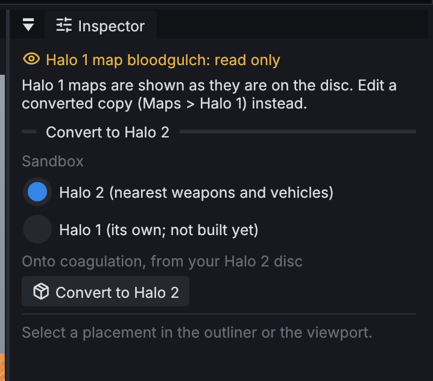

*The **Convert to Halo 2** section, before converting.*


*While it converts, the button is greyed out and the line under it counts the seconds.*

If it can't convert, the inspector says `Not converted` and why, and the
log says the same: for example `This level has 70,000 surfaces; Halo 2
holds at most 65,536, so it can't be converted.`


*Picking the **Halo 1** sandbox, which isn't built yet, ends in `Not converted` and the reason.*


*Halo 1's Blood Gulch, read only, a spawn point selected.*
