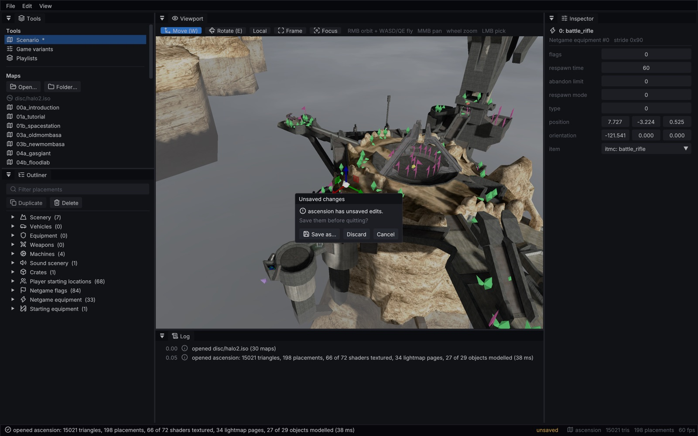

# Editor guide: troubleshooting

Status: Built. The walkthroughs follow the controls in Studio.

Section 12 of the editor guide: what goes wrong and what to do about it. The index is [editor-guide.md](editor-guide.md).

## 12. Troubleshooting

**"Unsaved changes" window.** Anything that would throw away a tool's
unsaved changes asks first: opening another disc or map,
opening, starting or importing another variant (Game variants), opening
or starting another playlist file (Playlists), and quitting. It names the
editor, and offers **Save** (or **Save as...** when a file name is needed),
**Discard** or **Cancel**. Quitting with changes in several tools asks
about each in turn.

**"the open map has unsaved edits: save or undo them first".** **Open
package...** won't replace a map with unsaved changes. Save it (as a
package or a file), or undo the changes.

**Duplicate or Add new is greyed out.** Hover over it for the reason
(section 4 shows one). Usually the group is full. Delete an entry from the same group first, or
turn on **Edit > Allow growing full blocks**.

**"refusing to overwrite the source map".** Save to a new file name. For
the game to use it, put it in a folder of its own under the disc's map
name (section 4).

**My package isn't used in game.** Check that the game and the editor use
the same data folder (`--data`). If you have several packages for the
map, the active one wins, else the directory name that sorts last. A
package for another version of the map (a different disc) is skipped
with a warning on the game's console, and the disc's map is used.

**"no XBE found (set H2_XBE): saved variants can be edited, but not
created".** Put `default.xbe` next to your disc image, or set `H2_XBE`
to its path, and restart the editor.

**"no disc: using the built-in setting model".** The Game variants tool
couldn't read your disc. Open one with **File > Open disc or map...**.

**"the game would reject this variant: ..."** when saving or picking a
variant. The inspector's **The game would not accept this** lists the
values to fix. Undo the change that caused it, or pick another value.

**"this save's signature does not match the signing key; saving re-signs
it".** The saved variant you opened wasn't signed the way this runtime
signs saves (for example, one copied from a real console). Saving it
again signs it.

**"No disc open: maps show as numbers and presets cannot resolve."** The
Playlists tool has no disc to read map names from. Open your disc with
**File > Open disc or map...**.

**A playlist file won't save as a download.** The compressed file must
fit the game's 128 KiB download buffer, or the game would ignore it and
keep its built-in playlists. Remove some entries.

**Parts of a level are untextured, or an object has only a marker.**
The viewport draws the level's textures with its baked lighting, its
sky, and its sky's sun and fog, but not everything the game draws (no
bump, environment or specular layers, for example). The status bar says
how many shaders and objects could be drawn; the rest show flat-shaded
or as markers only. Editing works the same.

**A level looks flat, without baked lighting.** Some levels have none:
the main menu's backdrop (mainmenu) was never lightmapped, and the
status bar says so (`0 lightmap pages (mainmenu: empty lightmap group,
lit by its sky's sun)`). The viewport lights such a level with its sky's
sun.

**A package isn't in the Maps list.** The list shows the packages in the
editor's data folder: check `--data`. A folder without a readable
`manifest.toml` is left out.

**"... edits <map>: open a disc that has that map first".** A package of
an edited disc map is opened over that map: open your Halo 2 disc first.

**Not converted.** The inspector says why under the **Convert to Halo 2**
button (section 4 shows one).

**No Halo 1 overlay.** Hover over `No Halo 1 overlay` in the inspector.
Open your Halo 1 disc (or set `H1_MAP_DIR`) before opening the converted
map; "has another SHA-256" means the Halo 1 map you have is not the file
the map was converted from.

**The panels are in a mess.** **View > Reset layout** (pictured in
section 3).

**The editor won't start: `h2-editor: ...`.** It couldn't start its
renderer. Check that your GPU driver supports Metal (macOS), Vulkan or
DirectX 12.
