# Editor guide: variants and playlists

Status: Built. The walkthroughs follow the controls in Studio.

Sections 5 and 6 of the editor guide: game variants, game type scripts, and the matchmaking playlists. The index is [editor-guide.md](editor-guide.md).

## 5. Game variants

A game variant is a set of game settings: the game type (Slayer, CTF and
so on), its name, and options like the score to win, the time limit and
the weapons. The game ships with built-in variants, and you can save your
own. Open the tool from Go to anything (`Open editor: Game variants`),
or open a script item from the Browser's **Game types** kind.


- **Variants** (left): a game type list with **New**, then your **Saved**
  variants and the **Built-in** ones, each with its game type.

  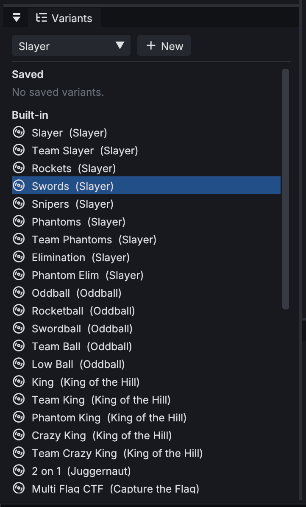
  
  *The variant list: none saved yet, and the disc's built-ins.*
- **Settings** (middle): the variant's name, then its settings grouped as
  the game groups them. Settings changed from the game type's defaults are
  in bold. Hover over a setting for its help text and its default.

  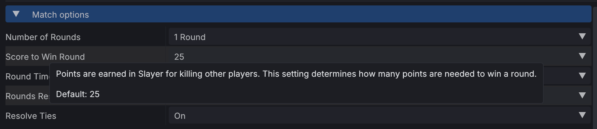
  
  *Hovering a setting shows the game's help text and the default.*
- **Inspector** (right): **Revert** (back to the variant as
  last saved), **Delete**, **Export...** and **Import...**; whether the
  game accepts the variant; and **Changes from the ... defaults**, the
  list of what differs from the game type's defaults. At the bottom,
  **Paste a portable variant** takes a shared variant as text.

The settings and built-in variants come from your disc. Without a disc,
the log says `no disc: using the built-in setting model`, and the
settings show generic names with plain numbers and checkboxes.

### Make a game variant

From a built-in variant:

1. Click a variant under **Built-in**. Built-ins can't be changed: the
   settings say **Built-in variant: copy it to edit.**, with a name box.

   
   
   *A built-in, with the name its copy will get.*
2. Type a name and click **Copy**. Rename the unsaved copy in its
   **Name** box.

   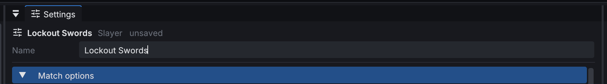
   
   *The copy, renamed.*
3. Change its settings. Each change shows under **Changes from the ...
   defaults**.

   
   
   *Two settings changed on the copy, at the top of the changes list (the rest are Swords' own).*
4. Click **Save** in the header (or press Cmd+S). Choose or create a
   package if the edit target is unset. The package contains the
   portable variant record.


From scratch: pick a game type in the list next to **New**, click
**New**, give it a name, change what you want and **Save**.

From a game type script: open the **New from script...** list under
**New** and pick a built-in script, an example, or **The open script**
(the one in the Game type script window, when it builds). You get an
unsaved variant with the record the script describes: its game type's
stock values, the script's `settings` written over them, its name and
its option defaults
(`variants::portable::record_for`, the same record the game's list and
`h2 variants from-script` make).

A variant that names a script has a **Script** section above its
settings. It shows the script's name and description, how it scores,
and the Quick Options rows it marks, in order, with this variant's
values. Each option of the script is a row below, with a checkbox, a
slider or a list for its kind and the option's help on hover; changing
one is one undo step, and dragging a slider is one step. A flag beside a
setting or an option means the script marks it for Quick Options. When
Studio does not have the script (a variant made from a script of
someone else's), the section names the script's hash and the settings
are left as they are; open the script in the Game type script window to
see its options.

Use **Import...** on a saved `.h2variant` package file to reopen the
record. The **Saved** list and **Delete** manage variants in the game's
save storage.

### The settings pages

The settings are grouped in pages, as the game groups them. Click a
page's title to fold it. Every variant has the common pages (**Match
options**, **Player options**, **Weapon options**, **Vehicle options**,
and **Team options** for team games), plus one for its game type. Your
disc's settings data also has a page it titles `Page 31`; it is shown as
it is.


***Match options**: rounds, score to win and time limit.*

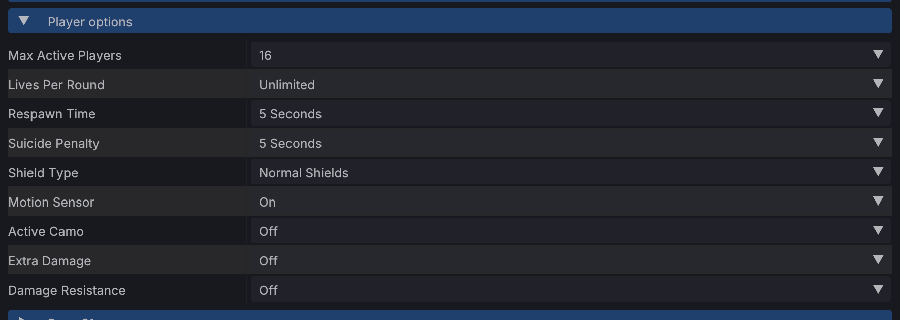

***Player options**: lives, respawning, shields, sensors and damage.*

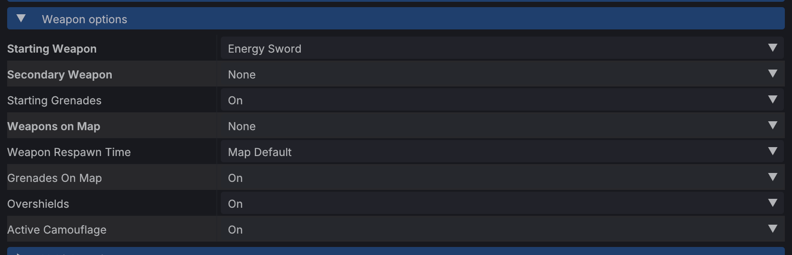

***Weapon options**. Bold settings differ from the game type's defaults.*


***Vehicle options**.*


***Team options**.*


***Slayer options**.*


***Capture the Flag options**.*


***Assault options**.*

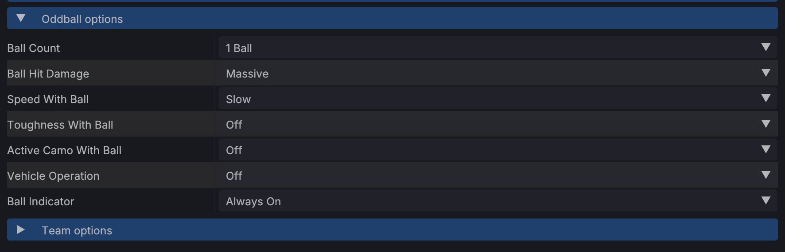

***Oddball options**.*


***King of the Hill options**.*


***Juggernaut options**.*

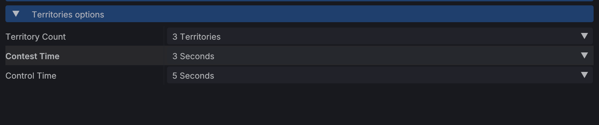

***Territories options**.*

### Share a variant

**Export...** writes the open variant to a portable `.h2variant` file.
To use one you were given, click **Import...** and pick the file, or
paste its text under **Paste a portable variant** and click **Import the
pasted text**. It opens as a new, unsaved variant; click **Save** to keep
it.


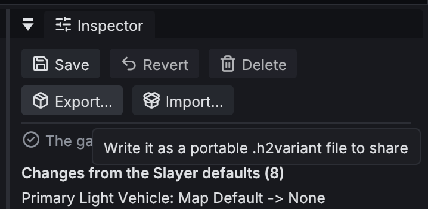

***Export...** writes a `.h2variant` file. (The file itself is picked in your system's save window, not pictured.)*


***Paste a portable variant** takes a shared variant as text.*

### Game type scripts

A game type script is a `.rules` file in the
[rules language](../game/rules-engine.md#the-language): the game type's
own rules, run by the game on top of the engine it rides. An open
script is a document tab in the bar, named for the file, with a `*` while
it has unsaved edits; the editor shows beside the variant's settings
(`crates/apps/studio/src/ui/game_script.rs`, over
`crates/apps/studio/src/app/rules_edit.rs`). Closing the tab keeps the
text for the next open.

- **New** starts a blank script, or one of the built-in game types or
  examples to change. **Open** reads a `.rules` file and brings its
  tab forward. The header's **Save** writes to the edit target, and
  **Export script...** writes a standalone file. **Format**
  (**Shift+Alt+F**) lays the script out the standard way; it refuses a
  script that does not parse.
- The text is coloured as the language reads it (its semantic tokens),
  and every use of the name at the cursor is highlighted.
- **Completion as you type.** Typing a name, or a `.`, opens the list of
  what can go at the cursor, narrowed to what the word typed starts
  with, then what holds it, each in the language's order (what the
  place wants first). **Ctrl+Space** opens it with nothing typed.
  **Up** and **Down** pick, **Enter** or **Tab** (or a click) puts the
  pick in, **Escape** closes the list. A snippet goes in with its
  defaults written out and the first one selected, so typing replaces
  it. The list shows the pick's documentation under it.
- Hover a name for what it is, and a problem's text for the problem.
  The hover wraps at about 60 characters, with code in a monospace
  font. Inside a call, the line under the text shows the call's
  parameters.
- **Open in VS Code** and **Open in Zed** save the script and open its
  file in that editor at the cursor's line; **Open in editor** opens it
  in the first editor Studio finds. A script with no file goes to
  `scripts/<name>.rules` under the data root, named after the script
  (`slayer.rules`; `slayer-2.rules` when that name is in use). For
  **Open in editor** Studio tries, in order: VS Code (`code`) or Zed
  (`zed`) when it has the rules extension, then `$VISUAL`, `$EDITOR`
  (skipping a terminal editor such as `vim`, which has no terminal to
  run in), VS Code, Zed, and on macOS `open -t` (`editor_launches_at`,
  `extension_installed`). A command that fails within three seconds
  hands over to the next. Studio then checks the file once a second.
  Each save there comes into Studio's text, and into the paired game
  while **Reload on save** is ticked; the status line shows how the
  reload went. Studio's own edits go to the file
  ([Scripts in VS Code and Zed](#scripts-in-vs-code-and-zed)). If
  Studio's text has unsaved changes too, a row under the title asks:
  **Keep mine** or **Take the file's**
  (`crates/apps/studio/src/app/rules_edit.rs`, `prepare_external` and
  `poll_disk`).
- **VS Code and Zed** edit scripts as well as this window does:
  highlighting, problems as you type, completion, hover, signature help,
  go to definition, references, rename, quick fixes, formatting and the
  outline, all from `h2 rules lsp`. `h2 rules editors install` puts the
  extension in VS Code and prints the steps for Zed;
  [rules-editors.md](rules-editors.md) has the rest, and
  [Security and usability](../game/rules-engine.md#security-and-usability)
  has Helix and Neovim.
- **Problems** lists every error and warning, errors first; each is
  underlined in the text, and clicking one puts the cursor on it. Each
  fix the language offers is a button on its row, and **Cmd+.** lists
  the fixes at the cursor.
- **Rename** (**F2**) renames the name at the cursor and every use of
  it; the language refuses a keyword or a name the script has already.
  **F12** or **Cmd+click** goes to where a name is declared.
- **Escape** never throws typing away: with the list open it closes the
  list, otherwise it leaves the text as it is.
- **Check** is the [workbench](../game/rules-engine.md#workbench)
  report: the worst tick against the op budget and each handler's cost,
  the variables used against their limits, the size, and the
  capabilities the script asks for. **Settings and Quick Options**
  under it lists the record settings the script's `settings` block names
  with their values, and the rows its `quick` line marks, in order,
  each tagged as a setting or an option.
- **Export game variant...** writes the script's own variant as a
  `.h2variant` file: the record of the script, its options at their
  defaults, and the script with its source
  (`variants::portable::from_script`, as `h2 variants from-script`
  does). The script has to build and fit its budget.

**In game** compiles the script and queues a reload into Studio's own
game. With **Reload on save** ticked, **Save** (Cmd/Ctrl+S) also requests
a reload after writing the script. The game chooses how to reload in
([Reloading a running script](../game/rules-engine.md#reloading-a-running-script)):

- **In place** when the script keeps the running one's variables,
  options and labels (changed handlers and starting values are fine).
  The game carries on: scores, timers and every variable keep their
  values, and the next event runs the new code.
- **Restart** otherwise: the game starts again on the same map and
  variant with the new script, and the editor's row says why it could
  not go in place.

The mode list next to **Reload on save** picks **Auto** (the above), **In
place** (refuse rather than restart) or **Restart** (always). The
result shows at the bottom of the window and in the Game panel. The
game refuses a reload in a Theater film, in a matchmade Live game, on a
guest's machine, and outside a multiplayer game; a Live custom game
reloads in place only.

### Scripts in VS Code and Zed

Both kinds of script Studio edits open in VS Code or Zed and stay in
step with Studio while they are open. Studio checks their files once a
frame, and between API calls when it runs without a window
(`App::poll_external` in `crates/apps/studio/src/app/external.rs`).
`h2 rules editors install` puts the extension, with both language
servers, in VS Code and prints the steps for Zed
([rules-editors.md](rules-editors.md)).

Studio opens VS Code with `code -g <file>:<line>:<column>` and Zed with
`zed <file>:<line>:<column>`. It finds each command on `PATH`, in
Homebrew's `bin`, or inside the app in `/Applications` or
`~/Applications` (`editor_launches_at`, `bundled_programs` in
`crates/apps/studio/src/app/rules_edit.rs`).

**Game type scripts** (the Game type script window):

- **Open in VS Code** or **Open in Zed** opens the script's file at the
  cursor's line. Each save there comes back into Studio, and into the
  paired game while **Reload on save** is ticked.
- Edits made in Studio go to the file once typing has paused for a
  second, while **Write edits to the file** is ticked, as it is by
  default (`RulesEditor::sync_out`). They are not reloaded into the game
  until you save or press **Reload**. Nothing is written while the file
  and Studio's text disagree; the **Keep mine** / **Take the file's** row
  settles that first.
- In VS Code, **H2: Reload Script in Game** (in the editor's right-click
  menu and the command palette) saves the file and has Studio reload it
  into the paired game, then shows how it went in.
  **H2: Run Scenario Test...** runs the script over a scenario file on
  the fake game, as `h2 rules run` does, and shows the printout. In Zed
  both are code actions (**Cmd+.**). Both need Studio running
  ([rules-editors.md, "Commands that talk to Studio"](rules-editors.md#commands-that-talk-to-studio)).

**Scenario scripts** (the Scripts tab, see
[rich-editors.md, "Scripts"](rich-editors.md#scripts)):

- **Open in VS Code** or **Open in Zed** writes a working copy and opens
  it at the definition shown. The working copy holds every global and
  script of the open map, as the Scripts tab decompiles them, in
  `scripts/<map>/<map>.hsc` under the data root.
- Beside it, `h2hs.json` holds what `h2 hs lsp` checks the file against:
  - the executable's types, script kinds and builtins, named as the
    Scripts tab names them, with the documentation listing's text when
    one is loaded;
  - the game globals the scripts name;
  - the scenario's object names, trigger volumes and the other names the
    scripts spell.

  Both files are made from your own map and executable and stay in the
  data root.
- With the extension, the file has problems as you type, such as:
  - an unknown builtin, type or script kind;
  - the wrong number of arguments;
  - an object name or trigger volume the scenario does not have.

  It also has completion of builtins and the scenario's names, hover
  with each builtin's parameters and documentation, signature help, go
  to definition and references, rename, the outline, folding and
  formatting.
- Each save comes back to the Scripts tab, which shows which definitions
  differ from the map's (edited, added, removed) and how many errors the
  file has.
- The map itself is not changed by a save. **Compile working copy** in
  the Scripts tab compiles the definitions the file changed or added
  into the map's scripts (one undo step, **Undo compile**); a new
  script, global or string, or more nodes than the map has free, grows a
  table, which needs **Edit > Allow growing full blocks**. A definition
  removed from the file stays in the map
  ([rich-editors.md, "Scripts"](rich-editors.md#scripts)).
- When the map's scripts or names change in Studio, the context is
  written again, and so is the working copy while it holds no edits. A
  working copy with edits is left as it is, and the Scripts tab says it
  was made from an older map. Opening it again keeps your edits:
  `.h2hs-base.hsc` beside it records what Studio last wrote.
- In VS Code, **H2: Show Uses in Map** lists the definitions that use
  the name under the cursor, each a link to its place in the file, and
  **H2: Show in Studio** shows the definition in the Scripts tab. In Zed
  both are code actions.

Agents do the same through `rules.external`, `rules.run`,
`rules.reload` with a `path`, `script.external`, `script.working`,
`script.compile` and `script.undo` ([agent-api.md](agent-api.md)).

## 6. Playlists (hoppers)

Matchmaking playlists ("hoppers") live in one file,
`multiplayer_hopper.dat`, which the game downloads from a Live server
after signing in. The Playlists tool edits that file: the 16 playlists,
their titles and descriptions, and for each the list of map and game
variant pairs it picks from, with how often each comes up.

This only matters if you run a Live server (see
[live-admin.md](../live/live-admin.md)). The game doesn't read the file
from your computer: you publish it to your server.

### Open a file

Open the tool from Go to anything (`Open editor: Playlists`), then
**Open...** above the list and pick
a `multiplayer_hopper.dat`. Both forms work: the raw file the console
keeps, and the compressed download a Live server publishes. The editor
saves it back in the same form. With no file at hand, click **New** for
an empty one, or **Default lineup** for the playlists a Live server
serves before anything is published.

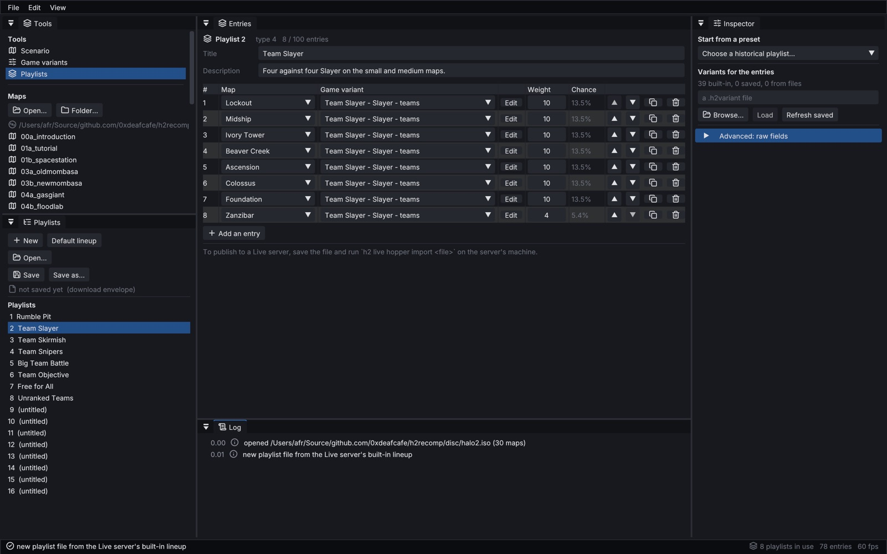

- **Playlists** (left): **New**, **Default lineup**, **Open...**,
  the file's path and form, then the 16
  playlists. Hover over one for its type and number of entries; one that
  wouldn't save has a warning mark.

  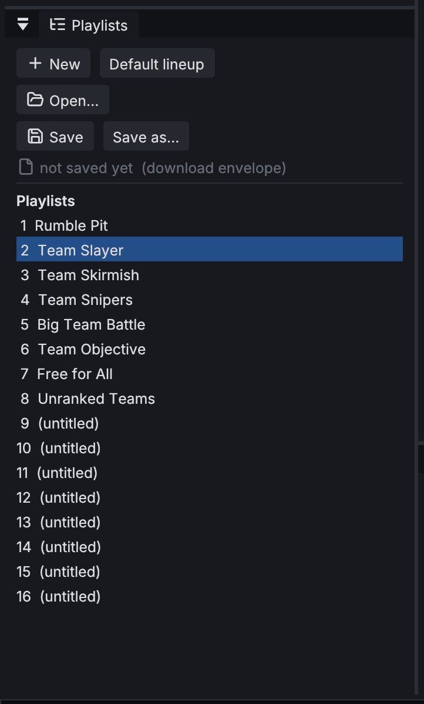
  
  *The default lineup's 16 playlists, Team Slayer selected.*
- **Entries** (middle): the playlist's **Title** (at most 15 characters)
  and **Description** (at most 127), then one row per entry: its **Map**,
  its **Game variant**, an **Edit** button, its **Weight** and the
  resulting **Chance**, then buttons to move it up or down, duplicate it
  and remove it. **Add an entry** adds a copy of the last.

  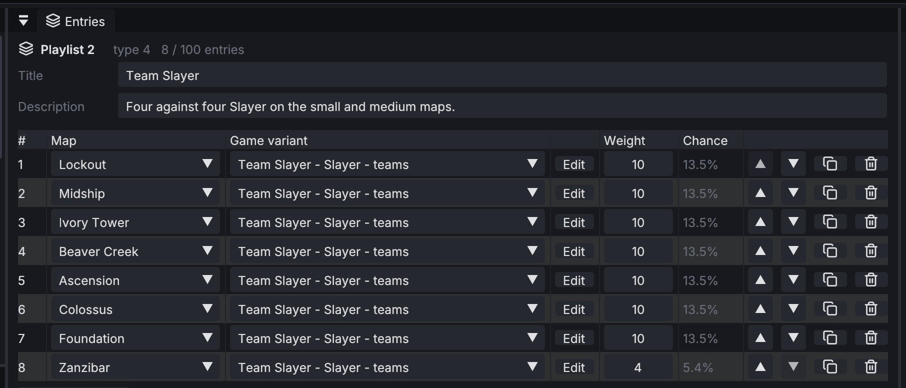
  
  *Team Slayer's entries: map, game variant, weight and chance.*
- **Inspector** (right): **Start from a preset**, **Variants for the
  entries** (more variants to pick from, below) and **Advanced: raw
  fields** (every raw number of the playlist and its entries; leave these
  alone unless you know what they mean).

  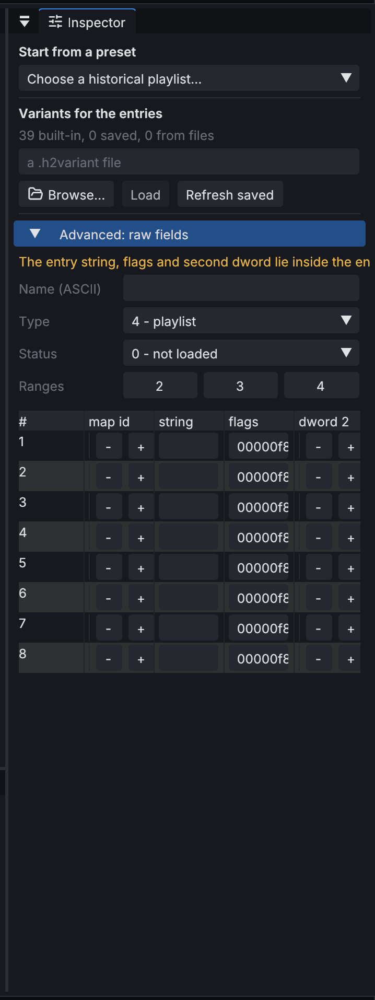
  
  ***Advanced: raw fields**, opened.*

Map names come from your disc. Without a disc, maps show as numbers
(`map id 3`) and presets can't be used.

### Edit a playlist

1. Click the playlist on the left.
2. Change its **Title** and **Description**.
3. For each entry, pick the **Map** from its list, and set its **Weight**
   (1 to 1000). An entry's chance of coming up is its weight divided by
   the playlist's total, shown under **Chance**.

   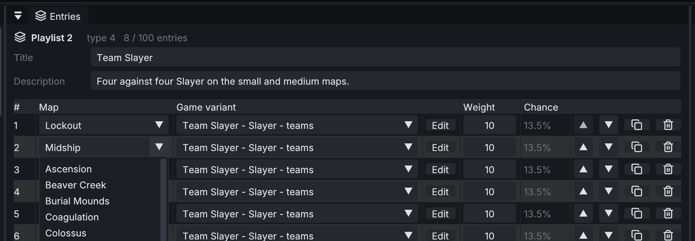
   
   *An entry's **Map** list, open.*
4. Reorder entries with the arrows, copy one, or remove one. A playlist
   has between 1 and 100 entries.
5. Click **Save** (Cmd+S) in the document header to write a playlist
   item. Use **File > Export playlist file...** for a standalone copy.

If something isn't valid (an empty title, say), it's listed in red under
the entries, and saving is refused until it's fixed.


*An empty title, reported under the entries.*

**Start from a preset** offers lineups from Halo 2's Live years. Pick one
in **Choose a historical playlist...**: the inspector lists the games it
would add, marking those your disc or file can't provide as unavailable.
Click **Fill playlist N with M entries** to replace the open playlist's
entries with them.


*A preset picked for playlist 1.*


*Close up: the preset's games, two of them unavailable, and the **Fill playlist 1 with 11 entries** button.*

### Give an entry another game variant

Click the entry's **Game variant**. The list has three groups:

- **Matchmaking**: the variants of the default lineup, each the record of
  a script.
- **Saved**: variants from the game's save storage that run a script.
  Use **Refresh saved** to update this list.
- **Files**: `.h2variant` files you loaded this session that run a script:
  type a path under **Variants for the entries** and click **Load**, or
  click **Browse...**.

A hopper plays only variants that run a rules script, so the game's
built-in variants from your disc are not in the list. Pick one, and the
entry shows it with `(picked)` after it. A variant the game would refuse
is greyed out; hover over it to see why.

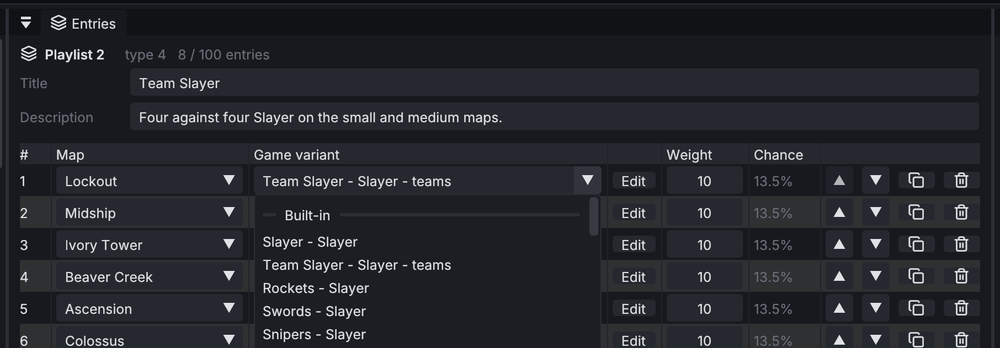

*An entry's **Game variant** list, open at **Built-in**.*


To change an entry's variant a little, click **Edit** on its row. The Game
variants tool opens with a copy of it. Change it and **Export...** from
the variant editor, then load the portable file in the Playlists inspector
and select it from **Files**.

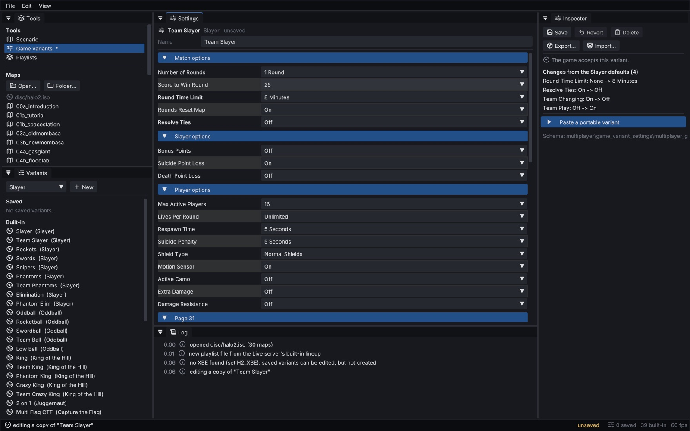

*After **Edit** on an entry: the Game variants tool, with a copy of that entry's variant.*


### Publish it

Save the file, then on your Live server's machine run:

```sh
h2 live hopper import <file>
```

Players get the new playlists the next time they sign in.
