# Editor guide

`h2-editor` is h2recomp's editor. With it you can:

- move, add and remove the objects placed on a map (weapons, vehicles,
  spawn points, flags and the rest) and play the result;
- make your own game variants (custom Slayer, CTF and other game
  settings) and use them in game;
- edit the matchmaking playlists file (`multiplayer_hopper.dat`) for a
  Live server.

This guide shows how to use it. If you want to know how it works inside,
see [editor.md](editor.md), [scenario-editor.md](scenario-editor.md) and
[variants.md](variants.md).

The screenshots were taken from a retail Halo 2 disc. Your window shows
whatever is on your own disc. Whole-window pictures are JPEGs; close-ups
of a single panel, menu or tooltip are cropped from the same window at
full resolution so their text reads. Section 10 says how they are made.

## Contents

1. [What you need](#1-what-you-need)
2. [Starting the editor](#2-starting-the-editor)
3. [The window](#3-the-window)
4. [Scenario: editing what is on a map](#4-scenario-editing-what-is-on-a-map)
5. [Game variants](#5-game-variants)
6. [Playlists (hoppers)](#6-playlists-hoppers)
7. [Undo and redo](#7-undo-and-redo)
8. [Where files go](#8-where-files-go)
9. [Troubleshooting](#9-troubleshooting)
10. [Regenerating the screenshots](#10-regenerating-the-screenshots)

## 1. What you need

- **Your Halo 2 disc image** (an `.iso`), the same one you play with. The
  editor reads it and never changes it. Put it at `disc/halo2.iso` in the
  repository, or say where it is when you start the editor.
- **The game's `default.xbe`** (optional). The Game variants tool reads
  the names it gives saved variants from it. Put it next to the disc image
  (`disc/default.xbe`), or set `H2_XBE` to its path. Without it you can
  still open and change variants you have already saved, but you can't
  save new ones.
- The Rust toolchain you build h2recomp with, and a GPU with Metal
  (macOS), Vulkan or DirectX 12.

The editor doesn't need the game to be built, and it doesn't run it.

## 2. Starting the editor

From the repository:

```sh
cargo run --release -p studio -- --disc disc/halo2.iso
```

(The package is called `studio`; the program it builds is `h2-editor`.)

Options:

| Option | What it does |
|---|---|
| `--disc <file.iso>` | The disc image to read maps from. Without any source, the editor uses `H2_DISC`, then `disc/halo2.iso`. |
| `--map <file.map>` | Open a single loose `.map` file instead of a disc. |
| `--folder <dir>` | Open a folder of `.map` files. |
| `--halo1 <file.iso or dir>` | A Halo 1 disc image or folder of Halo 1 maps, to look at (section 4). Without it, the editor uses `H1_ISO`, then `H1_MAP_DIR`, then `disc/halo1.iso`. |
| `--hopper <file>` | Open this `multiplayer_hopper.dat` in the Playlists tool at startup. |
| `--data <dir>` | The game's data folder: where saved variants and map packages go. It defaults to the same folder `h2 play` uses (`$TMPDIR/h2boot-data`). |

If you start the game with `h2 play --data <dir>`, give the editor the
same `--data <dir>`, or the game won't see what you save. If you don't
use `--data` with either, they already agree.

With no disc found, the editor still starts: use **File > Open disc or
map...**, or drop a disc image, `.map` file or folder onto the window.

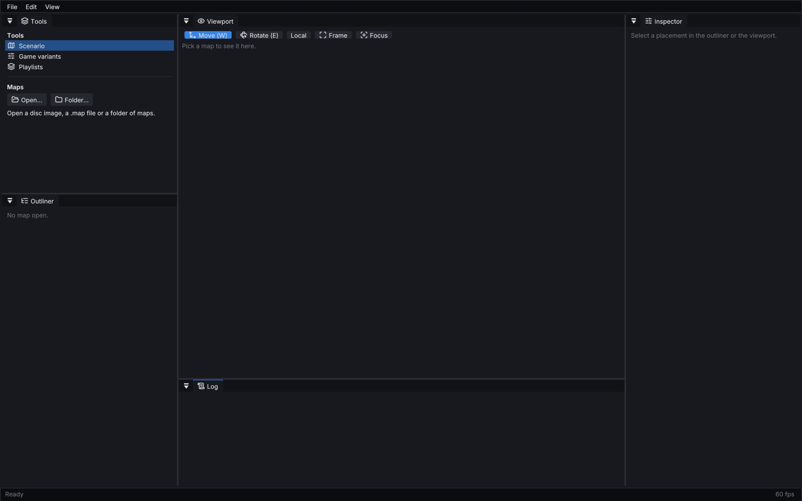

*The first run with no disc found: every panel is there, waiting for a disc.*


*With a disc open, its maps are listed under Maps, by their file names.*

## 3. The window


*The window's regions: (1) the menu bar, (2) Tools and Maps, (3) the Outliner, (4) the Viewport, (5) the Inspector, (6) the Log and (7) the status bar.*

The window is made of panels that dock together:

- **Tools** (top left): the three tools, **Scenario**, **Game variants**
  and **Playlists**. Click one to switch to it. A tool with unsaved
  changes shows a `*` after its name. Switching tools never loses
  anything: each tool keeps its state while hidden. Under the tools,
  **Maps** has **Open...** (a disc image or `.map`) and **Folder...** (a
  folder of maps), the path of what is open, and its maps. Below them,
  **Packages** lists the map packages you have saved, and **Halo 1** the
  Halo 1 maps (section 4). Clicking any of them opens it in the Scenario
  tool.
- **Outliner** (bottom left), **Viewport** (middle) and **Inspector**
  (right) show the tool you are in. In Game variants the outliner becomes
  **Variants** and the viewport **Settings**; in Playlists they become
  **Playlists** and **Entries**.
- **Log** (under the viewport): everything the editor did, newest last,
  errors in red.
- **Status bar** (bottom): the last message on the left; on the right,
  `unsaved` when the open tool has changes, a summary of what is open,
  and the frame rate.

The menus at the top: **File** (open, save, packages, quit), **Edit**
(**Undo**, **Redo**, **Duplicate**, **Delete**, **Allow growing full
blocks**) and **View** (**Frame map**, **Focus selection**, the gizmo
mode, **Reset layout**).


***File**, in the Scenario tool. The Game variants and Playlists tools add their own items here.*

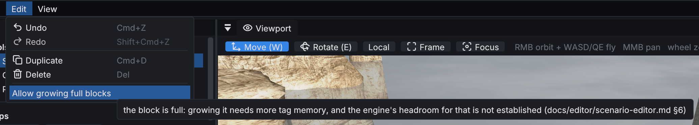

***Edit**: hovering **Allow growing full blocks** explains what it does.*


***View**: framing, the gizmo's mode and axes, the Halo 1 overlay and **Reset layout**.*

**Docking.** Drag a panel by its tab to move it: drop it on the arrows
that appear to dock it beside or inside another panel, or anywhere else
to float it. Drag the borders between panels to resize them. Your layout
is remembered between runs; **View > Reset layout** puts the default
back.


*Dragging the **Inspector** tab over the outliner: the blue targets show where it can dock.*


*Dropped on the middle target, the inspector becomes a tab beside the outliner.*

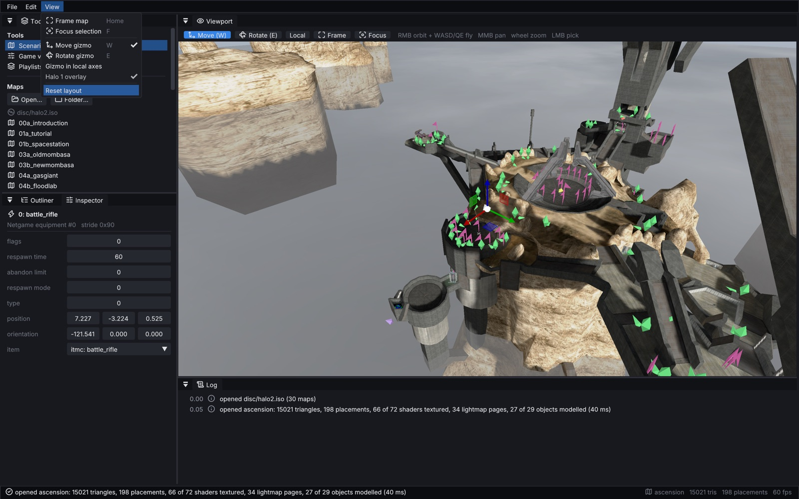

***View > Reset layout** puts every panel back where it started.*

Keyboard shortcuts (Cmd on macOS, Ctrl elsewhere):

| Keys | Action |
|---|---|
| Cmd+O | Open a disc image or map |
| Cmd+S | Save: the map as a new file (Scenario), the variant (Game variants), the playlist file (Playlists) |
| Cmd+Z | Undo in the tool you're in |
| Cmd+Shift+Z or Cmd+Y | Redo |
| Cmd+Q | Quit |

The Scenario tool adds Cmd+D (duplicate), Delete (delete), F (focus the
selection), Home (frame the map), and W and E (move or rotate gizmo).

## 4. Scenario: editing what is on a map

The Scenario tool edits the objects a map places: scenery, vehicles,
equipment, weapons, machines, sound scenery, crates, player starting
locations, netgame flags (CTF flags, hills, bomb spots and so on),
netgame equipment (the weapons and items that respawn in multiplayer) and
starting equipment. It doesn't change the level's geometry.

### Opening a map

Click a map in the **Maps** list. The status bar says `opened <map>`,
with how many triangles and placements it has and how much of its art
could be drawn.


*Ascension just opened: the outliner lists its groups, the viewport frames the level, and the log says what was read.*


- **Outliner**: a **Filter placements** box, **Duplicate** and
  **Delete**, and one group per kind of object with its count, for
  example `Netgame equipment (33)`. Click a group to expand it, and an
  entry to select it; double-click an entry to point the camera at it.
- **Viewport**: the level in 3D with its textures and baked lighting, the placed objects'
  models, and a small coloured marker for each placement. The toolbar
  above it has **Move (W)**, **Rotate (E)**, **Local** (gizmo in the
  object's own axes), **Frame** and **Focus**.
- **Inspector**: the selected object's fields: where it is, which way it
  faces (in degrees), which item or object it is, and the rest. Fields you
  can't change are greyed out. Hover over a field's name for its offset
  and where its meaning comes from.


*Click a group to expand it. Each entry is numbered and named by what it places.*


*Hovering a field's name shows its offset in the entry and the evidence for what it means.*

Moving around the viewport:

| Input | Action |
|---|---|
| Right-drag | Orbit around the focus point |
| W, A, S, D (while right-dragging) | Fly forward, left, back, right |
| Q, E (while right-dragging) | Fly down, up |
| Middle-drag | Pan |
| Scroll | Zoom |
| Left-click | Select the placement under the pointer |
| Drag the gizmo | Move or rotate the selection |


***Move (W)**: drag an arrow to move along one axis.*


***Rotate (E)**: drag a ring to turn the selection.*


*Lockout, a battle rifle spawn selected.*


*Zanzibar.*


*Headlong.*

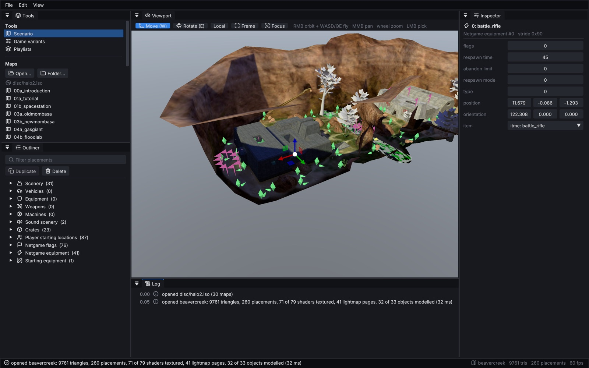

*Beaver Creek.*


*Midship, seen from outside its hull.*

### What the inspector shows

Each kind of placement has its own fields. Some examples:

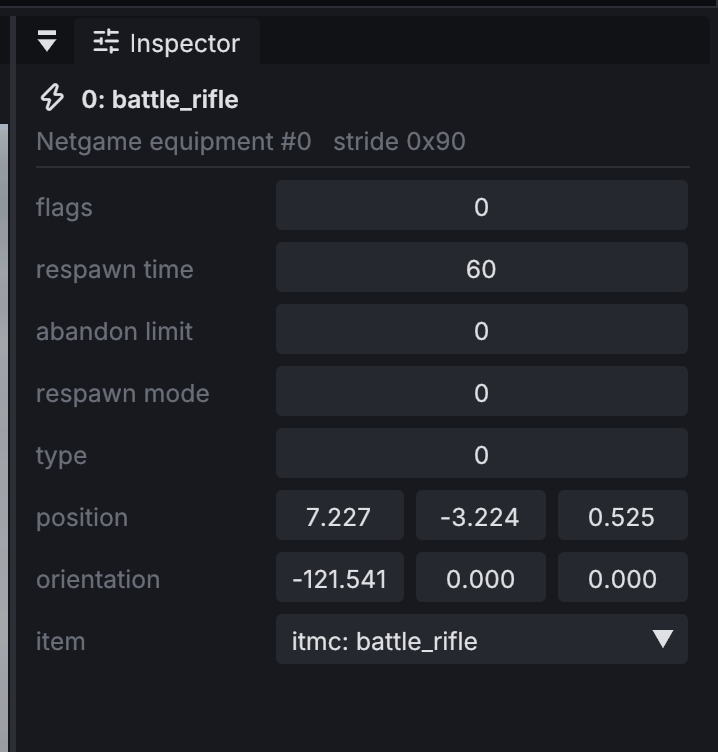

*Netgame equipment (a respawning weapon): respawn time, position, orientation and the **item** it spawns.*

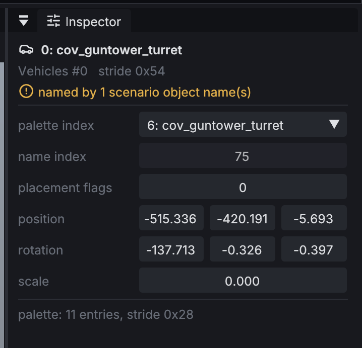

*A placed vehicle (here from the campaign's Old Mombasa): its palette entry, position, rotation and scale. The orange line warns that a script names it.*


*A player starting location: position, facing, team and player type.*


*A netgame flag (CTF flags, hills, bomb spots): position, facing, type and team.*

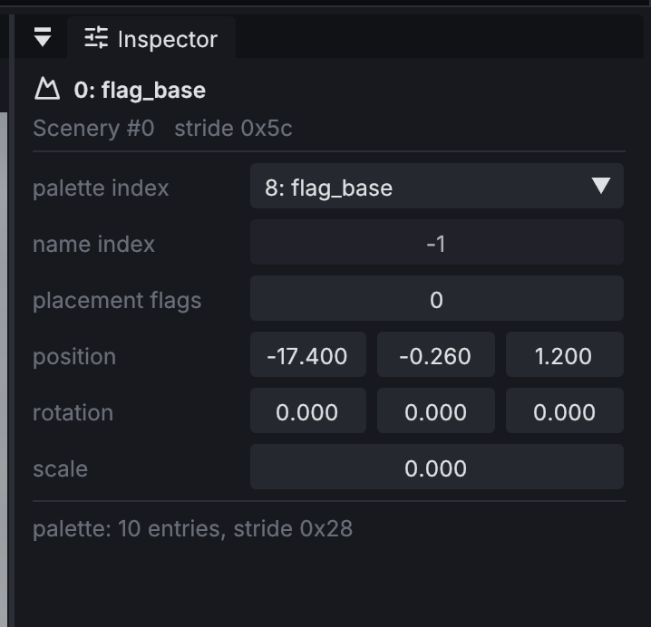

*Scenery: a palette entry with a position, rotation and scale.*

### Move a weapon spawn and play it

1. Click the map in the **Maps** list.
2. In the outliner, expand **Netgame equipment** (the weapons and items
   that respawn in multiplayer) or **Weapons** (weapons placed once), and
   click the weapon, or click its marker in the viewport. Type part of its
   name into **Filter placements** to find it.

   
   
   *Filtering for `sniper` leaves only the sniper rifle spawns.*
3. Move it: drag one of the gizmo's arrows in the viewport, or type new
   numbers into its **position** in the inspector (x, y and z; drag a
   number left or right to nudge it). Press **E** (or click **Rotate
   (E)**) for the rotate gizmo, or change **rotation**, **orientation** or
   **facing** in the inspector, depending on the kind of object.

   
   
   *The spawn in the gizmo picture above, two units along x later.*
4. To swap what spawns there, pick another item from the list on the
   **item** field (netgame equipment) or the palette field (placed
   objects such as weapons and vehicles).
5. Save it (below) and start the game.

After an edit, **Scenario** shows a `*` in **Tools**, the window title
gets a `*`, and the status bar says `unsaved`.

### Add and remove objects

- **Delete**: select an entry and click **Delete** (or press Delete). The
  last entry of that group moves into the deleted one's place, so the
  numbers in the list change. Undo puts everything back exactly.
- **Duplicate**: select an entry and click **Duplicate** (Cmd+D). The copy
  is added at the end of the group and selected: drag it where you want
  it.
- **Add new**: right-click a group's name (or an entry) and choose **Add
  new at the camera focus**.


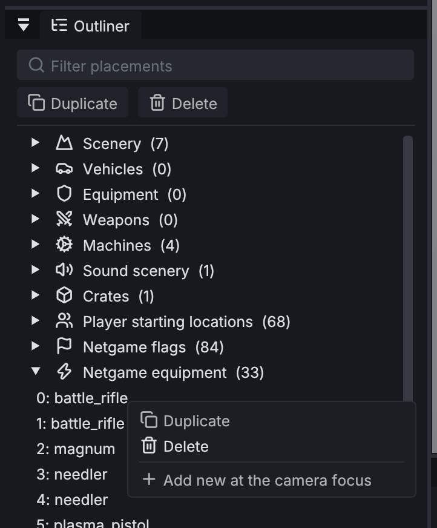

*Right-click an entry for **Duplicate**, **Delete** and **Add new at the camera focus**.*


*On a group's name, the menu has only **Add new at the camera focus**.*


*With nothing selected, **Duplicate** and **Delete** are greyed out; hovering says why.*

A button or menu item that is greyed out says why when you hover over it.
The usual reason for **Duplicate** and **Add new** is that the group is
full: a map has room for the entries it shipped with. Delete an entry from
that group first, or turn on **Edit > Allow growing full blocks**, which
makes room by moving the group to the end of the map's tag data.

The inspector warns when an object is named by a scenario object name:
the level's scripts may create it by name. Deleting it leaves that name
pointing at nothing, which can break those scripts (mostly a campaign
concern).

### Save as a map package or as a map file

There are two ways to save. Either way, the disc and the map you opened
are never changed.

**As a map package (recommended).** Choose **File > Save as package...**.


***Save as package**, filled in for Ascension.*

- **Name**: what the package is called (required).
- **Author**, **Description**: optional.
- **Image (PNG/JPEG)**: an optional picture: the path of a PNG or JPEG of
  at most 512 KB.
- **Directory**: the folder name for the package inside `<data>/maps`.
  It defaults to `<map>-edit`.
- **Make it the active package for this map**: tick it to make the game
  use this package for the map even when you have others for it.

Click **Save package**. The window shows where it goes (`in <data>/maps`),
and the log then says `saved package ...` with the package's MapId, an
identifier for this exact version of the map.

A package is small: it holds only the difference from your disc's map,
plus a description. It's the form that can be shared, and the game picks
it up by itself.

To keep working on a package later, open the same map, choose **File >
Open package...** and click **Open** next to it. Saving again with the
same **Directory** updates that package (the window says `Replaces this
package's patch.`).


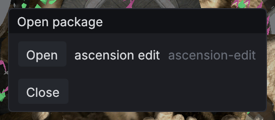

***Open package** lists this map's packages.*

**As a whole `.map` file.** Choose **File > Save map as...** (Cmd+S) and
pick where to write it. The editor refuses to overwrite the map it read
from. (Where to write it is chosen in your system's own save window, so
it isn't pictured here.)

### Playing your edited map

- **A package**: start the game with the same data folder as the editor
  (`h2 play`, or `h2 play --data <dir>` if you gave the editor `--data`).
  The game uses the package in place of the disc's map the next time it
  loads that map. If you have several packages for one map, it uses the
  active one, or else the one whose directory name sorts last. Delete the
  package's folder from `<data>/maps` to go back.
- **A `.map` file**: save it under the disc's own file name (the name in
  the Maps list, plus `.map`) in a folder of its own, and start the game
  with that folder:

  ```sh
  mkdir -p ~/h2-maps
  # Save map as ~/h2-maps/<map>.map in the editor, then:
  H2_MAP_DIR=~/h2-maps h2 play
  ```

  The game reads that map from your file, and everything else from the
  disc. Unset `H2_MAP_DIR` to go back.

Then start a game on that map: a custom game for a multiplayer map. In
multiplayer, everyone in the game needs the same edited map.

### Your packages in the Maps list

Every package in the data folder is listed under **Packages** in **Maps**,
by the name you gave it. Click one to keep working on it: the editor opens
its map from your disc and the package over it, ready to edit. **File >
Save as package...** then offers the same **Directory**, so saving updates
that package. (The disc that has the package's map must be open.)


*Below the disc's maps: **Packages**, then **Halo 1** with the maps of an open Halo 1 disc.*

### Halo 1 maps

The editor can show Halo 1 maps too.

**Converted maps.** Once you have imported Halo 1 multiplayer maps
([h1-multiplayer.md](../game/h1-multiplayer.md)), each is listed under
**Halo 1** twice, once per sandbox: for example **Blood Gulch (H1
sandbox)** (Halo 1's weapons and vehicles) and **Blood Gulch (H2
sandbox)** (Halo 2's). Click one to open it in the Scenario tool and
edit it like any map. Saving it with **File > Save as package...** makes a
new package (its **Directory** starts as `<map>-edit`), listed under
**Packages**; the imported map is left as it was.


*Blood Gulch converted to Halo 2. Its surfaces wear Halo 2 stand-in
textures from its base map, Coagulation, and have no lightmaps yet, so
they are lit by a plain sun.*

**Comparing with the original.** If the editor can find the Halo 1 map a
converted map was made from (on the Halo 1 disc or folder you opened, or
in `H1_MAP_DIR`), the inspector says `Converted from Halo 1's <map>`,
and **View > Halo 1 overlay** (also a button above the viewport) draws
the original level and its spawns in orange over the converted one, so
you can check that everything lines up. Click it again to hide it. The
editor checks that the file is the very one the map was converted from;
if it isn't, the inspector says `No Halo 1 overlay` (hover for why).

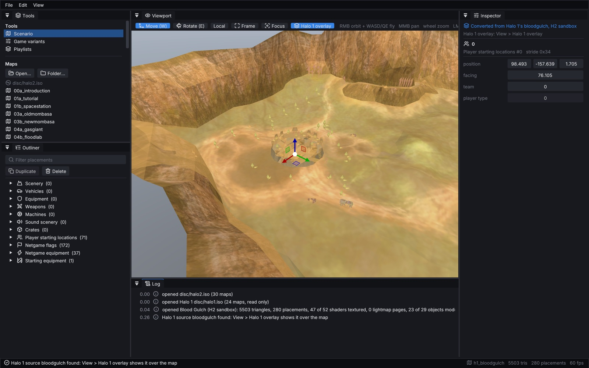

*The same view with the Halo 1 overlay on: the original level in orange
over the converted one.*


*A converted map's inspector says where it came from and how to show the original.*

**Looking at Halo 1 maps.** Open your Halo 1 disc image or a folder of
Halo 1 maps with **Open...** (or start with `--halo1`), and its maps are
listed under **Halo 1** with an eye. Click one to look at it: its level
(textured and lit by its own lightmaps, without its sky or scenery) and its multiplayer
spawn points, flags, weapon spawns and vehicles, which you can select to
see their details. These maps are read only (the outliner says `Halo 1:
read only`): nothing can be moved or saved.


*A Halo 1 map's outliner: read only, grouped by kind.*

**Converting a Halo 1 map.** With a Halo 1 map on show and your Halo 2
disc open, the inspector's **Convert to Halo 2** section turns it into a
Halo 2 map:

1. Pick the **Sandbox**: **Halo 2** (Halo 2's nearest weapons and
   vehicles) or **Halo 1** (its own; not built yet, so it says so).
2. The line under it says which Halo 2 map the conversion starts from
   (`Onto coagulation, from your Halo 2 disc`): it gives the sky, the
   weapons and vehicles and everything else a Halo 2 level needs. The
   editor picks it; your Halo 2 disc must be open.
3. Click **Convert to Halo 2**. It runs in the background
   (`Converting bloodgulch (h2 sandbox)...` with the seconds so far) and
   writes the converted map into the data folder, as the importer does.
   When it is done, the map appears under **Halo 1** in **Maps** (for
   example **Blood Gulch (H2 sandbox)**) and opens, ready to edit.


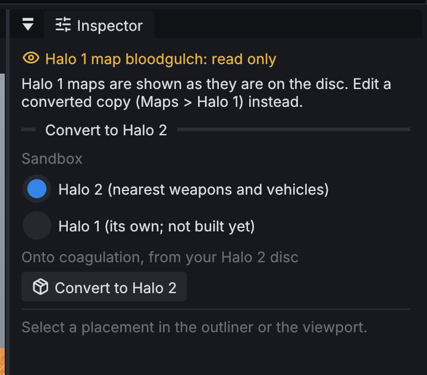

*The **Convert to Halo 2** section, before converting.*


*While it converts, the button is greyed out and the line under it counts the seconds.*

If it can't convert, the inspector says `Not converted` and why, and the
log says the same: for example `This level has 70,000 surfaces; Halo 2
holds at most 65,536, so it can't be converted.`


*Picking the **Halo 1** sandbox, which isn't built yet, ends in `Not converted` and the reason.*


*Halo 1's Blood Gulch, read only, a spawn point selected.*

## 5. Game variants

A game variant is a set of game settings: the game type (Slayer, CTF and
so on), its name, and options like the score to win, the time limit and
the weapons. The game ships with built-in variants, and you can save your
own. Click **Game variants** in **Tools**.


- **Variants** (left): a game type list with **New**, then your **Saved**
  variants and the **Built-in** ones, each with its game type.

  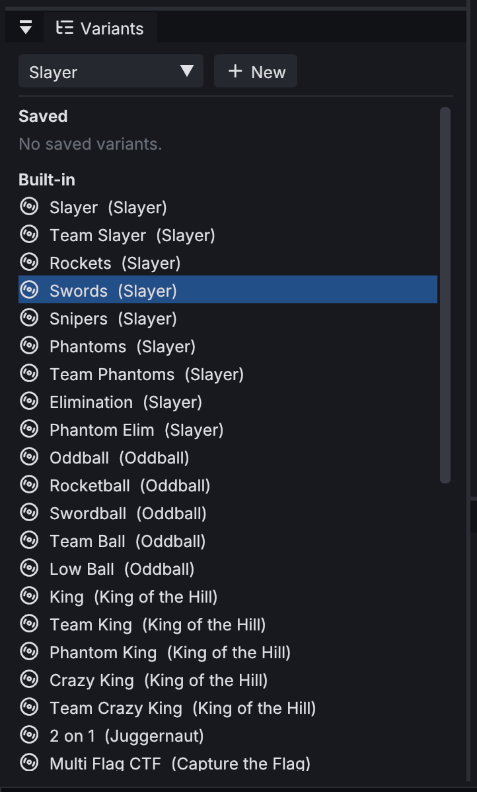
  
  *The variant list: none saved yet, and the disc's built-ins.*
- **Settings** (middle): the variant's name, then its settings grouped as
  the game groups them. Settings changed from the game type's defaults are
  in bold. Hover over a setting for its help text and its default.

  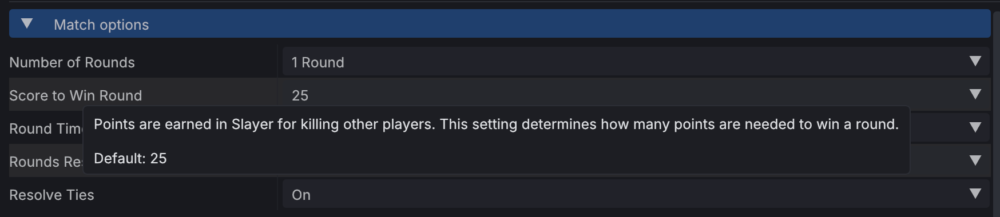
  
  *Hovering a setting shows the game's help text and the default.*
- **Inspector** (right): **Save**, **Revert** (back to the variant as
  last saved), **Delete**, **Export...** and **Import...**; whether the
  game accepts the variant; and **Changes from the ... defaults**, the
  list of what differs from the game type's defaults. At the bottom,
  **Paste a portable variant** takes a shared variant as text.

The settings and built-in variants come from your disc. Without a disc,
the log says `no disc: using the built-in setting model`, and the
settings show generic names with plain numbers and checkboxes.

### Make a game variant

From a built-in variant:

1. Click a variant under **Built-in**. Built-ins can't be changed: the
   settings say **Built-in variant: copy it to edit.**, with a name box.

   
   
   *A built-in, with the name its copy will get.*
2. Type a name and click **Copy**. You now have an unsaved copy. You can
   still rename it in its **Name** box.

   
   
   *The copy, renamed.*
3. Change its settings. Each change shows under **Changes from the ...
   defaults**.

   
   
   *Two settings changed on the copy, at the top of the changes list (the rest are Swords' own).*
4. Click **Save** (or press Cmd+S). The log says `saved as "..."`, and the
   variant appears under **Saved**.

   
   
   *Saved: the variant is listed under **Saved**.*


From scratch: pick a game type in the list next to **New**, click
**New**, give it a name, change what you want and **Save**.

To change a saved variant later, click it under **Saved**, edit it and
**Save** again. **Delete** removes the open saved variant.

Variants are saved into the game's own storage, not to a file you choose
(use **Export...** for a file).


### The settings pages

The settings are grouped in pages, as the game groups them. Click a
page's title to fold it. Every variant has the common pages (**Match
options**, **Player options**, **Weapon options**, **Vehicle options**,
and **Team options** for team games), plus one for its game type. Your
disc's settings data also has a page it titles `Page 31`; it is shown as
it is.


***Match options**: rounds, score to win and time limit.*

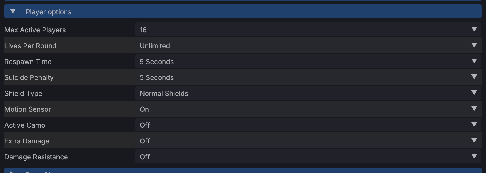

***Player options**: lives, respawning, shields, sensors and damage.*


***Weapon options**. Bold settings differ from the game type's defaults.*


***Vehicle options**.*


***Team options**.*


***Slayer options**.*


***Capture the Flag options**.*


***Assault options**.*


***Oddball options**.*


***King of the Hill options**.*


***Juggernaut options**.*


***Territories options**.*

### Use it in game

The editor saves variants where the game keeps its saved variants, inside
the data folder. Start the game with the same data folder (`h2 play`, or
`h2 play --data <dir>`) and set up a custom game: your variant is listed
with the game's own saved variants for its game type.

### Share a variant

**Export...** writes the open variant to a portable `.h2variant` file.
To use one you were given, click **Import...** and pick the file, or
paste its text under **Paste a portable variant** and click **Import the
pasted text**. It opens as a new, unsaved variant; click **Save** to keep
it.


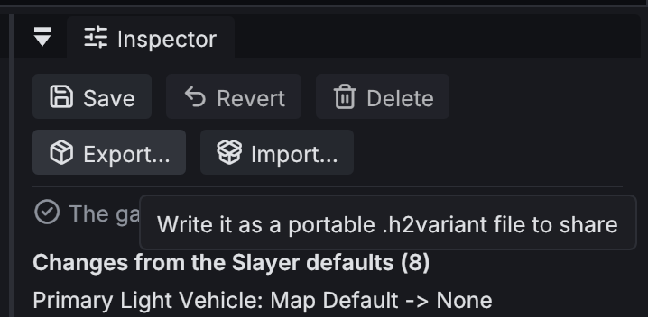

***Export...** writes a `.h2variant` file. (The file itself is picked in your system's save window, not pictured.)*


***Paste a portable variant** takes a shared variant as text.*

## 6. Playlists (hoppers)

Matchmaking playlists ("hoppers") live in one file,
`multiplayer_hopper.dat`, which the game downloads from a Live server
after signing in. The Playlists tool edits that file: the 16 playlists,
their titles and descriptions, and for each the list of map and game
variant pairs it picks from, with how often each comes up.

This only matters if you run a Live server (see
[live-admin.md](../live/live-admin.md)). The game doesn't read the file
from your computer: you publish it to your server.

### Open a file

Click **Playlists** in **Tools**, then **Open...** above the list and pick
a `multiplayer_hopper.dat`. Both forms work: the raw file the console
keeps, and the compressed download a Live server publishes. The editor
saves it back in the same form. With no file at hand, click **New** for
an empty one, or **Default lineup** for the playlists a Live server
serves before anything is published.


- **Playlists** (left): **New**, **Default lineup**, **Open...**,
  **Save** and **Save as...**, the file's path and form, then the 16
  playlists. Hover over one for its type and number of entries; one that
  wouldn't save has a warning mark.

  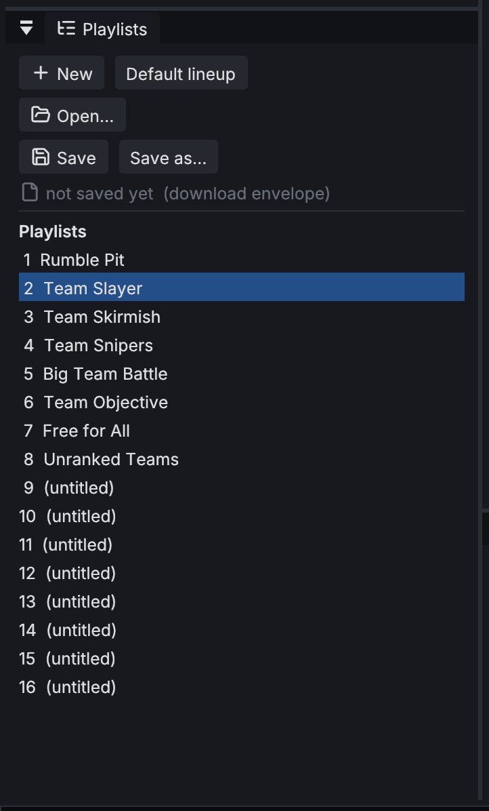
  
  *The default lineup's 16 playlists, Team Slayer selected.*
- **Entries** (middle): the playlist's **Title** (at most 15 characters)
  and **Description** (at most 127), then one row per entry: its **Map**,
  its **Game variant**, an **Edit** button, its **Weight** and the
  resulting **Chance**, then buttons to move it up or down, duplicate it
  and remove it. **Add an entry** adds a copy of the last.

  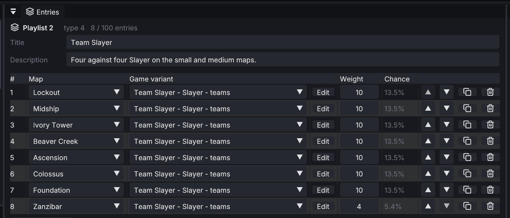
  
  *Team Slayer's entries: map, game variant, weight and chance.*
- **Inspector** (right): **Start from a preset**, **Variants for the
  entries** (more variants to pick from, below) and **Advanced: raw
  fields** (every raw number of the playlist and its entries; leave these
  alone unless you know what they mean).

  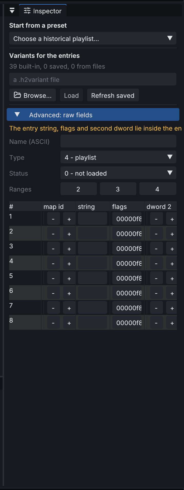
  
  ***Advanced: raw fields**, opened.*

Map names come from your disc. Without a disc, maps show as numbers
(`map id 3`) and presets can't be used.

### Edit a playlist

1. Click the playlist on the left.
2. Change its **Title** and **Description**.
3. For each entry, pick the **Map** from its list, and set its **Weight**
   (1 to 1000). An entry's chance of coming up is its weight divided by
   the playlist's total, shown under **Chance**.

   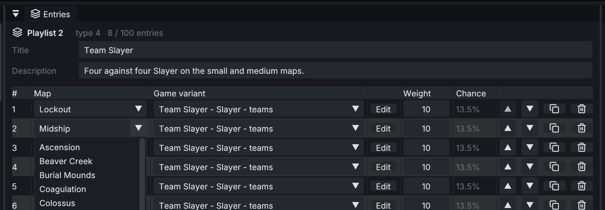
   
   *An entry's **Map** list, open.*
4. Reorder entries with the arrows, copy one, or remove one. A playlist
   has between 1 and 100 entries.
5. Click **Save** (Cmd+S), or **Save as...** for a new file.

   
   
   *In the Playlists tool, **File** has the playlist file's commands too. The file's name and place are picked in your system's save window, not pictured.*

If something isn't valid (an empty title, say), it's listed in red under
the entries, and saving is refused until it's fixed.


*An empty title, reported under the entries.*

**Start from a preset** offers lineups from Halo 2's Live years. Pick one
in **Choose a historical playlist...**: the inspector lists the games it
would add, marking those your disc or file can't provide as unavailable.
Click **Fill playlist N with M entries** to replace the open playlist's
entries with them.


*A preset picked for playlist 1.*


*Close up: the preset's games, two of them unavailable, and the **Fill playlist 1 with 11 entries** button.*

### Give an entry another game variant

Click the entry's **Game variant**. The list has three groups:

- **Built-in**: the game's built-in variants, from your disc.
- **Saved**: the variants you saved in the Game variants tool. After
  saving a new one, click **Refresh saved** to see it here.
- **Files**: `.h2variant` files you loaded this session: type a path
  under **Variants for the entries** and click **Load**, or click
  **Browse...**.

Pick one, and the entry shows it with `(picked)` after it. A variant the
game would refuse is greyed out; hover over it to see why.


*An entry's **Game variant** list, open at **Built-in**.*


To change an entry's variant a little, click **Edit** on its row. The Game
variants tool opens with a copy of it. Change it and **Save** there, go
back to **Playlists**, click **Refresh saved**, and pick your variant
from **Saved**.


*After **Edit** on an entry: the Game variants tool, with a copy of that entry's variant.*


### Publish it

Save the file, then on your Live server's machine run:

```sh
h2 live hopper import <file>
```

Players get the new playlists the next time they sign in.

## 7. Undo and redo

Each tool has its own history; **Edit > Undo** and **Edit > Redo** (and
Cmd+Z, Cmd+Shift+Z) act on the tool you're in.

- One drag of the gizmo is one step. Typing into one field, or dragging
  one number, is one step.
- You can undo past a save. The tool then has unsaved changes again, and
  undoing back to the saved state clears them.
- In Game variants, **Revert** goes back to the variant as last saved
  (and can itself be undone). Typing a name is one step.


*After an edit, **Edit > Undo** is enabled.*


*The log records each undo (`undid set position`).*

## 8. Where files go

`<data>` is the data folder: `--data`, or by default the one `h2 play`
uses, `$TMPDIR/h2boot-data`.

| What | Where | How the game finds it |
|---|---|---|
| Map packages (yours, and converted Halo 1 maps) | `<data>/maps/<directory>/` | Automatically, the next time it loads that map ([maps.md](../game/maps.md) §7). `<data>/maps/active.toml` records which package is active for each map. |
| Edited `.map` files | Wherever you save them | With `H2_MAP_DIR=<that folder> h2 play`; the file must have the disc's map name. |
| Saved game variants | `<data>/disk/Partition1/UDATA/4D530064/` (the game's saved data) | Listed in the game with its own saved variants. |
| Exported variants | Wherever you save the `.h2variant` | Not directly: import it in the editor and save it. |
| Playlists | Wherever you save the `.dat` | Through your Live server (`h2 live hopper import`). |
| The window layout | `$TMPDIR/h2boot-data/h2-editor.ini` | (The editor's own.) |

Your disc image is only ever read.

## 9. Troubleshooting

**"Unsaved changes" window.** Anything that would throw away a tool's
unsaved changes asks first: opening another disc or map (Scenario),
opening, starting or importing another variant (Game variants), opening
or starting another playlist file (Playlists), and quitting. It names the
tool, and offers **Save** (or **Save as...** when a file name is needed),
**Discard** or **Cancel**. Quitting with changes in several tools asks
about each in turn.


**"the open map has unsaved edits: save or undo them first".** **Open
package...** won't replace a map with unsaved changes. Save it (as a
package or a file), or undo the changes.

**Duplicate or Add new is greyed out.** Hover over it for the reason
(section 4 shows one). Usually the group is full. Delete an entry from the same group first, or
turn on **Edit > Allow growing full blocks**.

**"refusing to overwrite the source map".** Save to a new file name. For
the game to use it, put it in a folder of its own under the disc's map
name (section 4).

**My package isn't used in game.** Check that the game and the editor use
the same data folder (`--data`). If you have several packages for the
map, the active one wins, else the directory name that sorts last. A
package for another version of the map (a different disc) is skipped
with a warning on the game's console, and the disc's map is used.

**"no XBE found (set H2_XBE): saved variants can be edited, but not
created".** Put `default.xbe` next to your disc image, or set `H2_XBE`
to its path, and restart the editor.

**My saved variant isn't listed in game.** Check that the game and the
editor use the same data folder (`--data`), and that the variant is
listed under **Saved** in the editor. Saving from the editor follows the
game's own file format, but the signature the game checks on our runtime
hasn't been confirmed in a running game yet ([variants.md](variants.md),
"Open"); if the game skips the variant, that is the likely cause: please
report it.

**"no disc: using the built-in setting model".** The Game variants tool
couldn't read your disc. Open one with **File > Open disc or map...**.

**"the game would reject this variant: ..."** when saving or picking a
variant. The inspector's **The game would not accept this** lists the
values to fix. Undo the change that caused it, or pick another value.

**"this save's signature does not match the signing key; saving re-signs
it".** The saved variant you opened wasn't signed the way this runtime
signs saves (for example, one copied from a real console). Saving it
again signs it.

**"No disc open: maps show as numbers and presets cannot resolve."** The
Playlists tool has no disc to read map names from. Open your disc with
**File > Open disc or map...**.

**A playlist file won't save as a download.** The compressed file must
fit the game's 128 KiB download buffer, or the game would ignore it and
keep its built-in playlists. Remove some entries.

**Parts of a level are untextured, or an object has only a marker.**
The viewport draws the level's textures with its baked lighting, but
not everything the game draws (no detail maps or the real sky, for
example). The status bar says how many shaders and objects could be
drawn; the rest show flat-shaded or as markers only. Editing works the
same.

**A package isn't in the Maps list.** The list shows the packages in the
editor's data folder: check `--data`. A folder without a readable
`manifest.toml` is left out.

**"... edits <map>: open a disc that has that map first".** A package of
an edited disc map is opened over that map: open your Halo 2 disc first.

**Not converted.** The inspector says why under the **Convert to Halo 2**
button (section 4 shows one).

**No Halo 1 overlay.** Hover over `No Halo 1 overlay` in the inspector.
Open your Halo 1 disc (or set `H1_MAP_DIR`) before opening the converted
map; "has another SHA-256" means the Halo 1 map you have is not the file
the map was converted from.

**The panels are in a mess.** **View > Reset layout** (pictured in
section 3).

**The editor won't start: `h2-editor: ...`.** It couldn't start its
renderer. Check that your GPU driver supports Metal (macOS), Vulkan or
DirectX 12.

## 10. Regenerating the screenshots

The pictures in this guide are rendered by the editor itself, offscreen,
from your own disc image (no window opens and the game does not run):

```sh
scripts/editor-screenshots.sh            # every shot, from disc/halo2.iso
scripts/editor-screenshots.sh --disc <iso> --only scenario-weapon
```

It builds `h2-editor`, renders each shot with its `--screenshot` flags at
1600x1000 points at scale 2, and writes them to `docs/images/editor/`:
whole windows and 3D views as JPEGs at most 1600 pixels wide (macOS
`sips` does the scaling), close-ups of panels, menus and tooltips as PNGs
at full resolution. Each shot's flags are in the script: the map,
selection and camera, then scripted input (`--do`: clicks, hovers,
drags, typing), a crop (`--crop`) and numbered boxes (`--callout`).
[editor.md](editor.md) lists the flags.

Not everything can be pictured this way: your system's own open and save
windows (**Open...**, **Save map as...**, **Export...**, **Save as...**)
are outside the editor, so the guide describes them in words.
