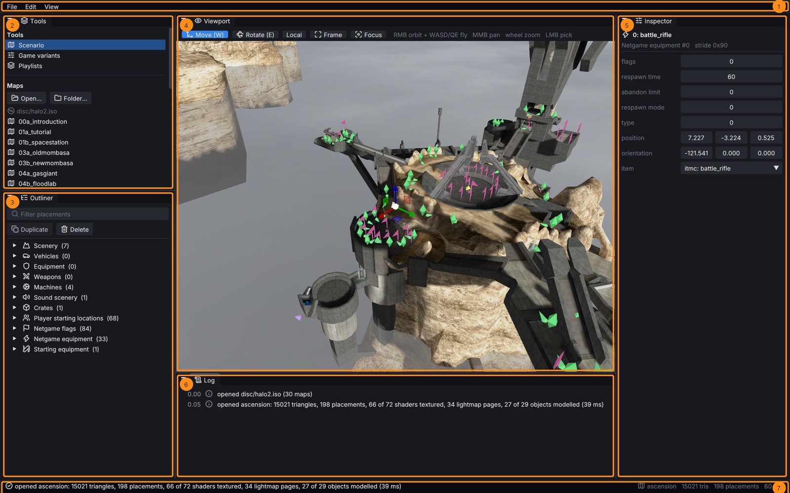
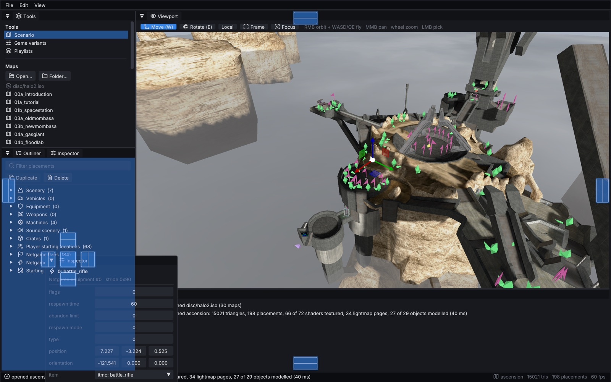

# Editor guide

Status: Built. The walkthroughs follow the controls in Studio.

`h2-editor` is h2recomp's editor. With it you can:

- move, add and remove the objects placed on a map (weapons, vehicles,
  spawn points, flags and the rest) and play the result;
- make your own game variants (custom Slayer, CTF and other game
  settings) and use them in game;
- edit the matchmaking playlists file (`multiplayer_hopper.dat`) for a
  Live server;
- look at h2recomp's own game screens (the Skulls page, the co-op
  screens, the Xbox Live sign-in) in every state, press buttons on them,
  and see what the layout checks find.

This guide shows how to use it. If you want to know how it works inside,
see [editor.md](editor.md), [scenario-editor.md](scenario-editor.md) and
[variants.md](variants.md).

The screenshots were taken from a retail Halo 2 disc. Your window shows
whatever is on your own disc. Whole-window pictures are JPEGs; close-ups
of a single panel, menu or tooltip are cropped from the same window at
full resolution so their text reads. Section 13 says how they are made.

## Pages

| Page | Holds |
|---|---|
| This page | Sections 1 to 3, 10, 11 and 13, and the task walkthroughs before them: what you need, starting, the window, undo, files, troubleshooting, screenshots. |
| [editor-guide-maps.md](editor-guide-maps.md) | Section 4: editing a map, playing it, saving, packages, the Map Pack, Halo 1 maps. |
| [editor-guide-variants.md](editor-guide-variants.md) | Sections 5 and 6: game variants, game type scripts, playlists. |
| [editor-guide-troubleshooting.md](editor-guide-troubleshooting.md) | Section 12: troubleshooting. |
| [editor-guide-content.md](editor-guide-content.md) | Sections 7 to 9: UI Screens, HUD, tags, announcer, voices. |

## Contents

- [Document header and links](#document-header-and-links)
- [A new weapon](#a-new-weapon)
- [An announcer line in a cloned voice](#an-announcer-line-in-a-cloned-voice)
- [A game type](#a-game-type)

1. [What you need](#1-what-you-need)
2. [Starting the editor](#2-starting-the-editor)
3. [The window](#3-the-window)
4. [Scenario: editing what is on a map](#4-scenario-editing-what-is-on-a-map)
5. [Game variants](#5-game-variants)
6. [Playlists (hoppers)](#6-playlists-hoppers)
7. [UI Screens](#7-ui-screens)
8. [HUD](#8-hud)
9. [Tags: every field of a tag](#9-tags-every-field-of-a-tag)
10. [Undo and redo](#10-undo-and-redo)
11. [Where files go](#11-where-files-go)
12. [Troubleshooting](#12-troubleshooting)
13. [Regenerating the screenshots](#13-regenerating-the-screenshots)

## Document header and links

1. Double-click an asset in the **Browser**, or find it with **Go to
   anything** (Cmd/Ctrl+P). Search covers tags across the tree, package
   items, voices and commands. A Problems row can also take you to an
   asset or a line in a script. [Code](../../crates/apps/studio/src/app/commands.rs)
2. Use **<** and **>** above the editor to step through document history.
   The trail shows the asset's location, kind and name. For tags, the
   badge below the trail shows the tag group and whether a package adds
   or edits it. **In Browser** selects the asset's row. **into:** shows
   the edit target, with a `*` when the document has unsaved edits.
   [Code](../../crates/apps/studio/src/ui/doc_header.rs)
3. Open **Links** and look under **Uses** for dependencies or **Used by**
   for references back to the asset. Pick a tag to open it or a package,
   item or voice to locate its Browser row. Hover a link to see where it
   comes from. **Show all in the Browser** lists the whole section,
   including links beyond the first 20 per role. **Open with** lists
   editor choices. Hover an unavailable choice for its reason.
   [Code](../../crates/apps/studio/src/ui/doc_header.rs)

### Preview, check, apply and undo

- **Preview.** Work in the editor's own view with **Studio**. For
  supported tags, pair a game, choose **My game** for a game Studio starts
  or **Attached** for one you connect, and click **In game**
  (Cmd/Ctrl+Enter). The Game panel comes forward with the result.
  Variants launch Studio's own game, and scripts reload into it.
  [Code](../../crates/apps/studio/src/app/preview_switch.rs)
- **Check.** Click **Check** to refresh **Problems**. The number on the
  button counts findings for the front asset. Click a finding to go to
  its asset or location. [Code](../../crates/apps/studio/src/app/problems.rs)
- **Apply.** Make edits in the document, then use **Save** (Cmd/Ctrl+S)
  to keep them. Package saves ask for a local package when the edit target
  is unset. Pick one or enter a name and click **New package...**.
  Scripts, variants, playlist files, selected animation clips and
  generated lines save as package items. Use the editor's export
  control when you want a standalone file.
  [Code](../../crates/apps/studio/src/app/doc_save.rs)
- **Undo.** **Undo** and **Redo** act on the front document. Use
  Cmd/Ctrl+Z and Cmd/Ctrl+Shift+Z, or the buttons in the header. A tag's
  history covers field edits and the steps from its specialized editor.
  The header's **Revert** is disabled. Game variants has its own **Revert**
  in the Inspector. [Code](../../crates/apps/studio/src/app/shell.rs)

## A new weapon

1. Open a map that holds the weapon. In the **Browser**, pick
   **Objects**, find the weapon and double-click it. Choose **Links >
   Uses** to inspect references such as **Model**, **Sounds** or
   **Projectile** when present. Follow a tag link, then click **<** to
   return. [Code](../../crates/apps/studio/src/app/links.rs)
2. Right-click the weapon's Browser row, choose **Copy into package...**
   and select an enabled local package. If you need one, create it with
   [`package.new`](agent-api.md#packages). The copy has a `_copy` suffix.
   Studio writes a `tag` item that refers to the source with `like:`.
   Set that package as the edit target with
   [`package.target`](agent-api.md#packages).
   [Code](../../crates/apps/studio/src/app/assets.rs)
3. Build a map that contains the copy with
   [`package.build`](agent-api.md#packages), passing the map and an
   output folder, then open the resulting map in Studio. Find the copy
   in the map's **Tags** tree and open its fields. Make your changes,
   click **Check** to refresh Problems, then **Save** in the document
   you edited. [Code](../../crates/apps/studio/src/api/packages.rs)
4. With a paired game running a map that contains the copy, click
   **In game** on the copied weapon's tag. Studio gives it to the
   player and shows the outcome in **Game**. Check and build the
   package through the [package API](agent-api.md#packages).
   [Code](../../crates/apps/studio/src/api/preview/run.rs)

## An announcer line in a cloned voice

1. To replace an existing dialogue sound, find its `snd!` tag under
   **Sounds** and open it. Under **Lines**, click **New line**. The
   row takes the sound as its target and uses the voice matched by its
   path. For a sound without a voice match, open a character in
   **Voices** and use the **Replaces** picker in that voice's **Lines** pane to
   select a dialogue sound from the open map. [Code](../../crates/apps/studio/src/app/voices.rs)
2. If the row flags missing setup, click **Open its Setup** and follow
   [Lines in a game character's voice](#lines-in-a-game-characters-voice).
   Return to the sound, enter the line in **What is said**, then click
   **Say**. Compare the waveforms on the same time axis and use **Play**
   on the result to hear it.
   [Code](../../crates/apps/studio/src/ui/voices/lines.rs)
3. Click **Save** in the sound document to put the generated take in the
   edit target as a `sound` item. To hear it in the game, load a map
   built with that item in the paired game, then click **In game** from
   the sound document. This plays the sound tag in that game.
   [Code](../../crates/apps/studio/src/app/doc_save.rs)
4. For a new announcer clip, open **Announcer** under **Voices** and use
   **Say it** in **Lines**. Give the take a clip id and use the header's
   **Save**. This uses the announcer's Fish Audio voice. See
   [Announcer lines](#announcer-lines).
   [Code](../../crates/apps/studio/src/ui/voices/lines.rs)

## A game type

1. Open **Game variants** from **Go to anything** using
   `Open editor: Game variants`. In its **Game type script** panel,
   choose **New**, then **Blank script** or a starter. To work from an
   existing packaged script, open its item from **Game types** in the
   Browser. [Code](../../crates/apps/studio/src/ui/game_script.rs)
2. Edit the script and use **Check** and **Problems** to find errors.
   Click the script header's **Save** to add or update the `rules` item
   in the edit target.
   [Code](../../crates/apps/studio/src/app/doc_save.rs)
3. In the **Variants** list, choose **New from script... > The open
   script**. This entry appears when the script passes analysis. Adjust
   the settings and save from the variant's header to add the
   `variant` item to the same package.
   [Code](../../crates/apps/studio/src/ui/variants.rs)
4. With a multiplayer map open, click **In game** on the variant.
   Studio starts its own game with the current variant record,
   including unsaved settings. Return to the script and use **In game**
   to compile and reload the open buffer. **Reload on save** requests
   a reload after a successful script save. Watch the **Game** panel
   for the result, then use [`package.check`](agent-api.md#packages)
   to check the saved package.
   [Code](../../crates/apps/studio/src/api/preview.rs)

## 1. What you need

- **Your Halo 2 disc image** (an `.iso`), the same one you play with. The
  editor reads it and never changes it. Put it at `disc/halo2.iso` in the
  repository, or say where it is when you start the editor.
- **The game's `default.xbe`** (optional). The Game variants tool reads
  the names it gives saved variants from it. Put it next to the disc image
  (`disc/default.xbe`), or set `H2_XBE` to its path. Without it you can
  still open and change variants you have already saved, but you can't
  save new ones.
- The Rust toolchain you build h2recomp with, and a GPU with Metal
  (macOS), Vulkan or DirectX 12.

The editor doesn't need the game to be built, and it doesn't run it.

## 2. Starting the editor

From the repository:

```sh
cargo run --release -p studio -- --disc disc/halo2.iso
```

(The package is called `studio`; the program it builds is `h2-editor`.)

Options:

| Option | What it does |
|---|---|
| `--disc <file.iso>` | The disc image to read maps from. Without any source, the editor uses `H2_DISC`, then `disc/halo2.iso`. |
| `--map <file.map>` | Open a single loose `.map` file instead of a disc. |
| `--folder <dir>` | Open a folder of `.map` files. |
| `--halo1 <file.iso or dir>` | A Halo 1 disc image or folder of Halo 1 maps, to look at (section 4). Without it, the editor uses `H1_ISO`, then `H1_MAP_DIR`, then `disc/halo1.iso`. |
| `--mappack <file.iso or dir>` | The Halo 2 Multiplayer Map Pack disc, to add its nine maps. Without it, the editor uses `H2_MAPPACK_ISO`, then a `mappack.iso` next to the Halo 2 disc, then `disc/mappack.iso`. |
| `--hopper <file>` | Open this `multiplayer_hopper.dat` in the Playlists tool at startup. |
| `--data <dir>` | The game's data folder: where saved variants and map packages go. It defaults to the same folder `h2 play` uses (`~/Library/Application Support/h2recomp/data`). |

If you start the game with `h2 play --data <dir>`, give the editor the
same `--data <dir>`, or the game won't see what you save. If you don't
use `--data` with either, they already agree.

**The Map Pack.** If you have the Halo 2 Multiplayer Map Pack disc, put it
next to your Halo 2 disc as `mappack.iso` (or give `--mappack`) and the
editor adds its nine maps under their own **Map Pack** heading in the Maps
list. You can also add it by hand: **Open...** on the map pack ISO adds it
and keeps your Halo 2 disc open. The editor knows it by what is on it, not
its name. Its maps open, edit and save as a package like the disc's maps;
keep the Halo 2 disc open too, because their textures and level geometry
come from it. Press F5 (Play) as usual: the game starts from your Halo 2
disc. If the map pack is not next to that disc, the game will not install
it and the Log says so; your edited map still plays.

With no disc found, use **Open a disc or map...** in the centre of the
Map tool, or drop a disc image, `.map` file or folder onto the window.

**The first start.** With no tags tree yet, the editor opens a **First
start** window over the panels: choose the disc to extract every tag
from (an `.iso` image, a `.map` file or a folder of them - `H2_DISC` and
`disc/halo2.iso` are offered), see how big it is, and press **Extract
every map**. The tree it writes is game data under the data folder
(about 2.65 GB for the retail disc, a minute and a half, never
committed; a folder of your choosing when `tags_root` is set, which is
kept with the window layout); a bar in the status line shows the
progress and you can work while it fills. Press **Not now** to skip it
for this run. On later starts the editor re-extracts in the background
what a changed disc or a better layout made stale - the same bar in the
status line - and maps already extracted keep working while it runs. The
agent API's `workspace.status`, `workspace.extract` and
`workspace.prune` are the same thing
([agent-api.md](agent-api.md#the-tag-workspace)).


*The first run with no disc found: the First start window asks for the
disc, every panel waiting behind it.*


*With a disc open, its maps are listed under Maps, by their file names.*

## 3. The window



*The window's regions: (1) the menu bar, (2) the bar of document tabs and the game link, (3) Scene, (4) the Viewport, (5) the Inspector, (6) the Log and (7) the status bar.*

See [Document header and links](#document-header-and-links) for the
controls above the active editor.

The window is made of panels that dock together:

- **The bar** (under the menu) holds a tab for each open document: the
  map, the variant, the playlist file, the script, the screen, the HUD
  map, and each tag you open. There are no tool tabs: a document opens
  in the editor its kind gets. Click a tab to show it, or its **x** to
  close it; tabs that do not fit are under **More**. A `*` marks unsaved
  changes. Open a document from the Browser, Go to anything, a link or a
  Problems row. Go to anything also offers commands such as
  `Open editor: Game variants`. The **game link** is at the right
  end: click the pill to pair, manage the link or choose a running game.
  Play, Stop, Pause, Step, Resume and the Edit switch appear beside it
  as available.
- **Left dock**: the **Browser** lists every tag by path, with the
  packages and Live as their own roots, and **Scene** and **Tags** share
  the column with it. **Open...** takes a disc image or `.map` and
  **Folder...** a folder of maps; the source path shows under them.
  Double-click a row to open it in its editor; a scenario row opens the
  map. A badge marks a tag an edit line touches. **Problems** lists what
  the checks found, and each row opens its asset.
- **Viewport** (middle) and **Inspector** (right) show the map's level
  and fields. The other editors use their own dockable windows.
- **Game** (bottom dock) holds session and player details. **Log**
  beside it shows the editor's messages and errors. Map's **Data and
  bytes** tab lives beside them.
- **Status bar** (bottom) shows the latest message, a hint for the
  control or viewport under the pointer, and the frame rate.

The **File** menu holds **Save**, **Export map...**, open, packages and quit.
**Edit** holds **Go to anything...**, **Undo**, **Redo**, **Duplicate**,
**Delete**, **Allow growing full blocks** and **Allow unverified geometry
writes**. **View** holds **Frame map**, **Focus selection**, the gizmo mode
and **Reset layout**. **Game** holds play, pair and game controls.

The map inspector's **Modeling** section edits level geometry: pick a
cluster or instanced definition under **Target**, press **Edit mode**,
**Select all** (or select through the agent API), type a **Move x**,
**Move y** and **Move z** and press **Move selection**. The viewport
redraws the moved vertices; **Undo** and **Cmd+Z** step back while the
target is in edit mode. The edits save with the map, but only with
**Edit > Allow unverified geometry writes** on: until a game run has
loaded a written section, the save is refused and says why
([modeling.md](modeling.md)).


***File**. The editor in front (variants, playlists, HUD, textures) adds its own items here.*


***Edit**: hovering **Allow growing full blocks** explains what it does.*


***View**: framing, the gizmo's mode and axes, the Halo 1 overlay and **Reset layout**.*

**Docking.** Drag a panel by its tab to move it: drop it on the arrows
that appear to dock it beside or inside another panel, or anywhere else
to float it. Drag the borders between panels to resize them. Your layout
is remembered between runs; **View > Reset layout** puts the default
back.



*Dragging the **Inspector** tab over the outliner: the blue targets show where it can dock.*


*Dropped on the middle target, the inspector becomes a tab beside the outliner.*


***View > Reset layout** puts every panel back where it started.*

Keyboard shortcuts (Cmd on macOS, Ctrl elsewhere):

| Keys | Action |
|---|---|
| Cmd+O | Open a disc image or map |
| Cmd+S | Save the front document |
| Shift+Cmd+S | Export the open map |
| Cmd+P | Open Go to anything |
| Cmd+Z | Undo in the front document: the tool's, or the tag's tab in front |
| Cmd+Shift+Z or Cmd+Y | Redo |
| Cmd+Q | Quit |

Use **Edit > Go to anything...** to search maps, tags, packages, package
items, voices, placements and menu commands from one box. Editors have
commands such as `Open editor: HUD`. Each result under **Voices** opens
the voice's document. Type any words from the name or detail line.
Use Up and Down to highlight a result, Enter to open or run it, and Esc
to close the search.

The Scenario tool adds Cmd+D (duplicate), Delete (delete), F (focus the
selection), Home (frame the map), and W and E (move or rotate gizmo).

## 4. Scenario: editing what is on a map

Moved to [editor-guide-maps.md](editor-guide-maps.md#4-scenario-editing-what-is-on-a-map).

### Opening a map

Moved to [editor-guide-maps.md](editor-guide-maps.md#opening-a-map).

### What the inspector shows

Moved to [editor-guide-maps.md](editor-guide-maps.md#what-the-inspector-shows).

### See invisible walls and where bots walk

Moved to [editor-guide-maps.md](editor-guide-maps.md#see-invisible-walls-and-where-bots-walk).

### Move a weapon spawn and play it

Moved to [editor-guide-maps.md](editor-guide-maps.md#move-a-weapon-spawn-and-play-it).

### Add and remove objects

Moved to [editor-guide-maps.md](editor-guide-maps.md#add-and-remove-objects).

### Save to the edit target, or export a map

Moved to [editor-guide-maps.md](editor-guide-maps.md#save-to-the-edit-target-or-export-a-map).

### Playing your edited map

Moved to [editor-guide-maps.md](editor-guide-maps.md#playing-your-edited-map).

### Play from the editor

Moved to [editor-guide-maps.md](editor-guide-maps.md#play-from-the-editor).

### Edit a map's textures

Moved to [editor-guide-maps.md](editor-guide-maps.md#edit-a-maps-textures).

### Start a new map

Moved to [editor-guide-maps.md](editor-guide-maps.md#start-a-new-map).

### Your packages in the Maps list

Moved to [editor-guide-maps.md](editor-guide-maps.md#your-packages-in-the-maps-list).

### Map Pack maps

Moved to [editor-guide-maps.md](editor-guide-maps.md#map-pack-maps).

### Halo 1 maps

Moved to [editor-guide-maps.md](editor-guide-maps.md#halo-1-maps).

## 5. Game variants

Moved to [editor-guide-variants.md](editor-guide-variants.md#5-game-variants).

### Make a game variant

Moved to [editor-guide-variants.md](editor-guide-variants.md#make-a-game-variant).

### The settings pages

Moved to [editor-guide-variants.md](editor-guide-variants.md#the-settings-pages).

### Share a variant

Moved to [editor-guide-variants.md](editor-guide-variants.md#share-a-variant).

### Game type scripts

Moved to [editor-guide-variants.md](editor-guide-variants.md#game-type-scripts).

### Scripts in VS Code and Zed

Moved to [editor-guide-variants.md](editor-guide-variants.md#scripts-in-vs-code-and-zed).

## 6. Playlists (hoppers)

Moved to [editor-guide-variants.md](editor-guide-variants.md#6-playlists-hoppers).

### Open a file

Moved to [editor-guide-variants.md](editor-guide-variants.md#open-a-file).

### Edit a playlist

Moved to [editor-guide-variants.md](editor-guide-variants.md#edit-a-playlist).

### Give an entry another game variant

Moved to [editor-guide-variants.md](editor-guide-variants.md#give-an-entry-another-game-variant).

### Publish it

Moved to [editor-guide-variants.md](editor-guide-variants.md#publish-it).

## 7. UI Screens

Moved to [editor-guide-content.md](editor-guide-content.md#7-ui-screens).

### Generating an image

Moved to [editor-guide-content.md](editor-guide-content.md#generating-an-image).

## 8. HUD

Moved to [editor-guide-content.md](editor-guide-content.md#8-hud).

## 9. Tags: every field of a tag

Moved to [editor-guide-content.md](editor-guide-content.md#9-tags-every-field-of-a-tag).

### Field names

Moved to [editor-guide-content.md](editor-guide-content.md#field-names).

### Export and import a tag

Moved to [editor-guide-content.md](editor-guide-content.md#export-and-import-a-tag).

### Announcer lines

Moved to [editor-guide-content.md](editor-guide-content.md#announcer-lines).

### Lines in a game character's voice

Moved to [editor-guide-content.md](editor-guide-content.md#lines-in-a-game-characters-voice).

## 10. Undo and redo

Each document has its own history, and **Edit > Undo** and **Edit > Redo**
(Cmd+Z, Cmd+Shift+Z) act on the one in front: the tool's, or a tag you
opened as a tab while **Tags** shows it. A tag's history holds every step
you made to it, in the order you made them: its fields, a sound's mouth
curve, a bitmap's paint, an animation graph's keys. The **Undo** and
**Redo** buttons in an editor take the same steps as Cmd+Z, so **Undo tag
edit** and the Sound, Textures and Animation windows' **Undo** each step
back through the tag's whole history, even if you edited another tag
since. In Modeling, Undo steps through the geometry while the target is
in edit mode; in the Scripts tab, through the compiles. Closing a tag's
tab keeps its edits; they save with the map.

- One drag of the gizmo is one step. Typing into one field, or dragging
  one number, is one step.
- You can undo past a save. The tool then has unsaved changes again, and
  undoing back to the saved state clears them.
- In Game variants, **Revert** goes back to the variant as last saved
  (and can itself be undone). Typing a name is one step.


*After an edit, **Edit > Undo** is enabled.*


*The log records each undo (`undid set position`).*

## 11. Where files go

`<data>` is the data folder: `--data`, or by default the one `h2 play`
uses, `~/Library/Application Support/h2recomp/data`.

| What | Where | How the game finds it |
|---|---|---|
| Map packages (yours, and converted Halo 1 maps) | `<data>/maps/<directory>/` | The installer assigns each package a free slot at boot. Converted Halo 1 maps appear under Halo: CE, and other packages under Mods. [Map selection](../game/map-select.md) |
| Edited `.map` files | Wherever you save them (never inside the game's installed content) | With `H2_MAP_DIR=<that folder> h2 play`; the file must have the disc's map name. |
| The Map Pack (read only) | `<data>/disk/Partition1/TDATA/4D530064/$c/<offer ID>/` | Installed by `h2 play` or `h2 import-mappack`. |
| Saved game variants | `<data>/disk/Partition1/UDATA/4D530064/` (the game's saved data) | Listed in the game with its own saved variants. |
| Exported variants | Wherever you save the `.h2variant` | Not directly: import it in the editor and save it. |
| Scripts opened in VS Code or Zed | `<data>/scripts/<name>.rules` (a game type script with no file of its own); `<data>/scripts/<map>/<map>.hsc` and `h2hs.json` (a map's scripts) | Not directly: a game type script reloads into the paired game; a map's scripts are read back into the Scripts tab only. [Scripts in VS Code and Zed](#scripts-in-vs-code-and-zed) |
| Exported tags (tag bundles) | Wherever you save the `.h2tag` (never inside a Git checkout); `<data>/tag-bundles/` when an agent gives no path | Not directly: import it in the Tags tool and save the map. |
| Playlists | Wherever you save the `.dat` | Through your Live server (`h2 live hopper import`). |
| Announcer lines | `<data>/announcer/` (`cache/`, `lines/`, `clips/`) | Not directly: copy one into `art/announcer/` of a checkout from the announcer's **Lines** pane or `voice.commit`, then build. |
| Character voices | `<data>/voices/<character>/` (`dataset/`, `manifest.jsonl`, `model/`, `cache/`, `lines/`, `clips/`); the model's install in Studio's caches (`voice-clone/`) | Not directly: they are built from your disc and stay on your Mac. A line with a clip id copies into a checkout like an announcer line. |
| The window layout | `~/Library/Application Support/h2recomp/data/h2-editor.ini` | (The editor's own.) |

Your disc image is only ever read.

## 12. Troubleshooting

Moved to [editor-guide-troubleshooting.md](editor-guide-troubleshooting.md#12-troubleshooting).

## 13. Regenerating the screenshots

The pictures in this guide are rendered by the editor itself, offscreen,
from your own disc image (no window opens and the game does not run):

```sh
scripts/editor-screenshots.sh            # every shot, from disc/halo2.iso
scripts/editor-screenshots.sh --disc <iso> --only scenario-weapon
```

It builds `h2-editor`, renders each shot with its `--screenshot` flags at
1600x1000 points at scale 2, and writes them to `docs/images/editor/`:
whole windows and 3D views as JPEGs at most 1600 pixels wide (macOS
`sips` does the scaling), close-ups of panels, menus and tooltips as PNGs
at full resolution. Each shot's flags are in the script: the map,
selection and camera, then scripted input (`--do`: clicks, hovers,
drags, typing), a crop (`--crop`) and numbered boxes (`--callout`).
[editor.md](editor.md) lists the flags.

Not everything can be pictured this way: your system's own open and save
windows (**Open...**, **Export...**, **Save as...**)
are outside the editor, so the guide describes them in words.
