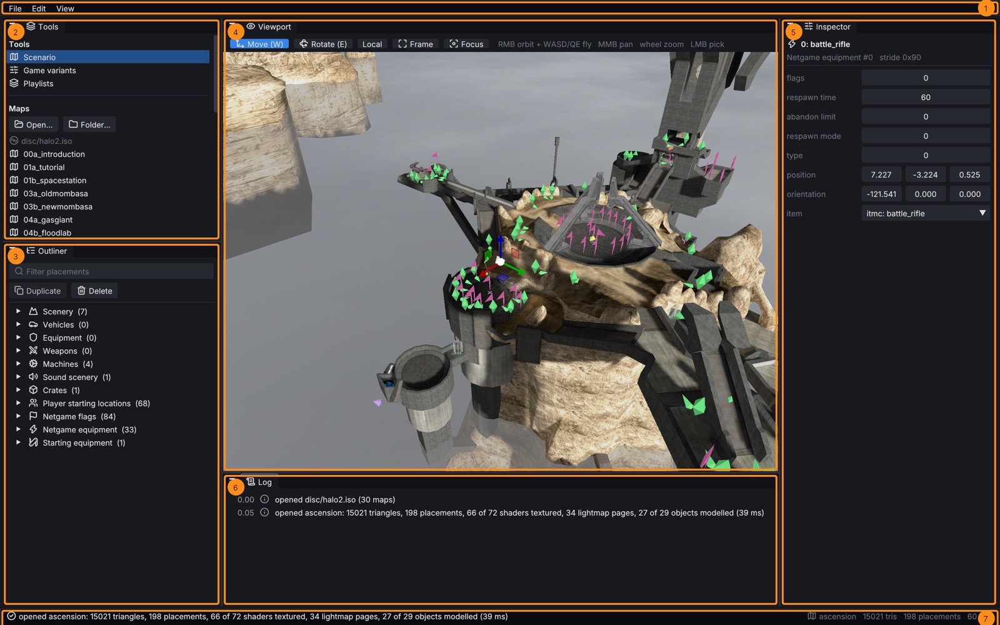

# h2-editor

Status: Built. Code: `crates/apps/studio/src`. Tests: in-source unit tests.
Switch: none.

To *use* the editor (open a map, move a weapon, make a game variant, edit
a playlist), read the user guide, [editor-guide.md](editor-guide.md).
This page is for developers.

`h2-editor` (`crates/apps/studio`) is a native editor suite for the files
h2recomp's game reads, in the spirit of the original tools' Sapien, with
a game-tool look (Unreal, RenderDoc, Tracy). It is a Rust app on Dear
ImGui's docking branch: `dear-imgui-rs` for the UI, `dear-imgui-wgpu` on
the workspace's wgpu 30, `dear-imgui-winit` for the window,
`dear-imguizmo` for the 3D gizmo, `rfd` for the system's file dialogs. No
web views, no scripting. It runs unbundled, so it sets its own Dock icon
(`app_icon::set_dock_icon`, [art/app-icon](../../art/app-icon/README.md)).
It hosts six tools:

- **Scenario**: the scenario editor (`crates/tools/scenario-edit`,
  [scenario-editor.md](scenario-editor.md)): placements on a map, in a 3D
  viewport, saved as a map package or a whole `.map`.
- **Tags**: every field of every tag of the open map, labelled and
  edited in place, saved with the map (below).
- **Game variants**: the game variant editor (`crates/formats/variants`,
  [variants.md](variants.md)).
- **Playlists**: `multiplayer_hopper.dat`, the 16 matchmaking playlists
  the game downloads from Live (`crates/tools/hopper-edit`, below).
- **UI Screens**: our native game screens drawn, stepped and checked
  offline (`boot::ui_kit`, [ui-builder.md](../game/ui-builder.md);
  below).
- **HUD**: a map's HUDs (`nhdt`) drawn as the engine places them, checked
  for overlaps and spills, edited and saved as a patched `.map`
  (`crates/tools/hud-edit`, [hud-editor.md](hud-editor.md)).

Nothing in the editor contains game data. Map names and everything else
it shows come from your own disc at run time.

Agents drive the editor through its agent API, [agent-api.md](agent-api.md):
every edit the window makes as a JSON method on a local socket, answered
by the open window (the user sees the edits land) or by `h2-editor
--serve` with no window; `h2 studio` is the client.

## Running it

```
cargo run --release -p studio -- [--disc <iso> | --map <file.map> | --folder <maps dir>] [--halo1 <iso|maps dir>] [--mappack <iso|folder>] [--hopper <file>|default] [--data <dir>]
```

The package is `studio`; its binary is `h2-editor`. With no source it
opens `H2_DISC`, else `disc/halo2.iso` when it exists
(`editor_core::default_disc`); with none, it starts empty and **File >
Open disc or map...** opens one later. A disc image lists every
`/maps/*.map`; a loose `.map` lists itself, and its directory's
`mainmenu.map`, `shared.map` and `single_player_shared.map` serve as the
shared caches. The source is read-only.

A Halo 1 source opens beside it: `--halo1`, else `$H1_ISO`, `$H1_MAP_DIR`
or the repository's `disc/halo1.iso` (`editor_core::halo1::default_source`).
**Open...** and a dropped path try Halo 1 first (`H1Source::open`: a disc
whose XBE is Halo: Combat Evolved's, a Halo 1 `.map`, or a folder holding
any), then Halo 2.

The Halo 2 Map Pack opens beside the disc, as its own **Map Pack** group
in the Maps list (`editor_core::mappack`): `--mappack`, else
`$H2_MAPPACK_ISO` (`$H2_MAPPACK` is `h2 play`'s on/off switch, and `0`,
`false`, `no` or `off` turns the lookups below off too), else
`mappack.iso` beside the Halo 2 disc that was opened (any case, else the
first other `.iso` there whose contents are the map pack's; so it works
outside the repository), else the repository's `disc/mappack.iso`. A map
pack is told by its contents, never its name: an XISO whose
`/demos/dlc/<8 hex digits>/` directories hold a `ContentMeta.xbx` and
`.map` files (`xiso::mappack`, the layout in
[map-pack.md](../game/map-pack.md) section 1), or a folder with the same
tree (an extracted disc, or its `dlc` directory). **Open...** and a
dropped path try it first, so opening the map pack ISO by hand adds it
and leaves the Halo 2 source as it was. Its nine maps are ordinary Halo 2
cache maps: they open and edit like the disc's, and read their shared
caches (`shared`, `mainmenu`, `single_player_shared`) from the open Halo 2
source (`MapSource::shared`, used by `geometry::shared_sources`), so open
the Halo 2 disc too for their textures and geometry.

`--data` is the runtime's data root, as `h2 play --data`; the default is
the runtime's, `~/Library/Application Support/h2recomp/data` (`content::store::default_data_root`).
Saved game variants (`U:`) and map packages (`maps/`) go there, so a run
with the same `--data` finds them. The dock layout persists in
`<default data root>/h2-editor.ini`, whatever `--data` says (View > Reset
layout restores the default).

## The window



*The panels: (1) main menu bar, (2) Tools, (3) outliner, (4) the centre
window (the viewport here), (5) inspector, (6) log, (7) status bar. The
boxes and numbers are drawn by the headless renderer's `--callout`.*

- **Main menu**: File (open a disc or map, open a folder of maps, save the
  map as a new `.map`, save as or open a package, the variant and
  playlist tools' file commands, quit), Edit (undo, redo, duplicate,
  delete, allow growing full blocks), View (frame the map, frame the
  selection, gizmo mode (move, rotate, scale) and local or world axes,
  grid and angle snapping, reset layout).
- **Tools** (left, top): the tools (Scenario, Tags, Game variants,
  Playlists, UI Screens; a
  `*` marks one with unsaved edits), then **Maps**: the opened source and
  its maps. The outliner, centre and inspector windows show the active
  tool: below for the scenario tool, then [Game variants](#game-variants)
  and [Playlists](#playlists). Each tool's windows keep their dock slot
  (`WindowKey::label` retitles a window without changing its ID).
- **Outliner** (left, bottom, `ui/outliner.rs`): the placement blocks as
  a tree, a filter (every word must match the block, the tag name or
  `#<index>`; blocks with no match hide, the rest open, with "x of y"
  counts), Duplicate and Delete. Click selects one entry, Cmd/Ctrl+click
  adds or removes one, Shift+click takes the shown run from the selected
  entry. Right-click an entry for Duplicate, Delete, Add and "Place a
  copy with the mouse"; right-click a block for Add and "Place new with
  the mouse" (the next click in the viewport puts it where the cursor
  meets the level). A button is disabled, with the reason as its
  tooltip, when the editor refuses (scenario-editor.md §6). Double-click
  an entry to frame the camera on it.
- **Viewport** (centre): the map's art, its sky and a marker per
  placement, drawn by `scenario_edit::render::Viewport` into an offscreen
  texture that ImGui shows as an image. Left click picks, Cmd/Ctrl+click
  adds to or takes from the selection, double-click focuses (a
  placement, or the point of the level under the cursor). The camera
  (`camera.rs`, plain maths with unit tests): hold the right button to
  look and fly with WASD, Q down and E up, the wheel setting the fly
  speed (shown in the status bar) and Shift four times faster; Alt+left
  drag orbits about the selection, else about the point of the level
  under the cursor; middle drag pans; the wheel dollies; F frames the
  selection to its size. Motion eases in and out by elapsed time, the
  same at any frame rate, and the camera glides to a new focus. The
  selection has an ImGuizmo gizmo: W moves, E rotates (facing-only
  placements turn about z), R scales (objects with a scale field); X
  switches local and world axes. Grid and angle snapping (toolbar
  toggles, right-click one for its step) apply to the gizmo and to
  placing with the mouse. Other selected placements ride along with the
  primary's move and turn; one drag is one undo step.
- **Inspector** (right, `ui/inspector.rs`): the selection's typed fields
  under Transform, Object, Spawn and Settings. Position is x, y, z;
  rotation yaw, pitch and roll in degrees; facing in degrees; the
  palette index and tag references are searchable combos of tag names;
  flags are a checkbox per bit and the netgame flag type a named combo;
  other integers are bounded drags (team, respawn time). Read-only fields
  are disabled; each field's tooltip gives its offset and evidence. With
  several placements selected it shows the fields they all have; a field
  whose values differ is marked `*`, and an edit (one component, one bit
  or the whole value) applies to all of them as one undo step
  (`Session::edit_selection`).
- **Log** (bottom): every action's result, errors in red.
- **Status bar**: the last message, unsaved state, a summary of what is
  open, the camera's fly speed, frame rate.
- **Unsaved changes**: anything that would drop a tool's unsaved edits
  asks first, naming the tool: another source or map (scenario), another,
  new or imported variant, or an entry's variant opened from a playlist
  (variants), another or new playlist file (playlists). Save (Save as...
  for a map, or a playlist file with no path yet), Discard or Cancel.
  Quitting asks about each tool with unsaved edits in turn.

Shortcuts: Cmd/Ctrl+O open, Cmd/Ctrl+S save (the map as a new file, the
variant, the playlist file), Cmd/Ctrl+Z undo and Shift+Cmd/Ctrl+Z or
Cmd/Ctrl+Y redo (in the active tool), and in the scenario tool
Cmd/Ctrl+D duplicate and Delete or Backspace delete (the whole
selection), F frame the selection, Home frame all, W/E/R gizmo mode, X
local or world axes, F5 Play and Shift+F5 stop the game, T (over the
viewport, paired) teleport the player to the cursor; Cmd/Ctrl+Q quit.
Dropping a disc image, map or folder on the window
opens it.

## Scenario

Picking a map in **Maps** opens it, unless the open map has unsaved edits
(the guard asks). **Save map as...** always asks for a new path (a whole
`.map`, the export): the source map is never overwritten. **Save as
package...** and **Open package...** save and open map packages in
`<data>/maps` (scenario-editor.md §5, [maps.md](../game/maps.md) §8).

### Packages and Halo 1 in the Maps list

Below the source's maps, **Maps** lists the **Map Pack**'s maps (the
open map pack disc's, else the installed ones), then what is under
`<data>/maps`
(`editor_core::packages::list`, re-read when the data root changes and
after a save), then Halo 1. Every row has the map's card, its name,
picture and description as the game's menus show them ("The Maps list's
cards", below):

- **Map Pack**: the nine multiplayer maps, named, ordered and pictured as
  the game's Select Map shows them ("The Map Pack", below), opened like
  the disc's. A package that edits one of them opens that map, then the
  package over it, as for a disc map. **Save as
  package...** writes a package with the pack's map as its base
  ([maps.md](../game/maps.md) section 4).

- **Packages**: edits of disc maps and new maps, by `[package] name`.
  An edit opens its disc map, then the package over it
  (`Session::open_package`, through `content::Library`); it needs a source
  with that map. A new map (`[base] derived = true`) opens from its
  resolved bytes (`Session::open_derived`), with the open disc's
  `shared.map` region as the place the shared caches come from. Saving
  either replaces that package.
- **Halo 1**: maps converted by the Halo 1 import
  ([multiplayer.md](../halo1/multiplayer.md)), one entry per sandbox
  variant, `Blood Gulch (H1 sandbox)` and `(H2 sandbox)`. Then, with a
  Halo 1 source open, its maps, read-only.

**What marks a converted map** is decided in one function,
`editor_core::packages::halo1_origins`: an `origin` table with
`game = "halo1"` (and `map`, `sandbox = "h1" | "h2"`, `source_sha256`),
either at the top of the manifest or in each entry of a top-level array
of tables (one per variant, each with its own `file`). That covers what
`content::Manifest` writes for converted maps: `[[variant]]` entries
with `file`, `sha256` and an `[variant.origin]` sub-table
(`packages::tests::the_converters_serialized_manifest_lists_both_variants`
feeds it `Manifest::to_toml`'s output). The manifest is read there as
plain TOML so that packages from builds with other fields still list; a
variant's own `file` is read directly, anything else through the
resolver, and a derived package the resolver refuses is read only when
its single layer is the whole map.

A converted variant opens as a new map and saves as a **new** package
(`<map>-edit`): the import's package holds both variants and their
origins, and the editor does not rewrite it. A derived package saved by
the editor carries the unedited map as its first layer and the edit as
the second (`package::save_package` with `derived`), so the resolver
rebuilds it without the import.

**Halo 1 maps, read-only.** `editor_core::halo1` reads a map through
`h1map`: every structure BSP's rendered triangles (each lightmap
material's render surfaces over its own vertices) and the multiplayer
placements (starting locations, netgame flags, netgame equipment,
vehicles), each with its fields as text. The studio shows them as a
`scenario_edit::Reference`: the session's world and markers with no
scenario, so the viewport, picking and framing are the same and nothing
can be edited.

The BSP is drawn textured and lightmapped through the same scene and
renderer as Halo 2's (`editor_core::halo1_art`, then
`scenario_edit::scene::reference_scene`):

- **Base maps.** Each lightmap material's shader names its base map at
  a place that depends on its group, past the 0x28-byte `shdr` header:
  `senv` +0x88 (flags +0x28, bit 0 alpha-tested: cut out), `soso`
  +0xa4, `swat` and `smet` +0x4c, `sgla` +0xac (else +0x158), `spla`
  +0xd4, and the first map of a maps block at +0x54 for `schi` (0xdc
  each, map at +0x6c) and `sotr`, Xbox's generic transparent shader
  (0x64 each, map at +0x1c); `scex` is read as `schi` but no
  multiplayer map has one. Every tag of those groups on five maps
  resolves a `bitm` there. The base map is the bitmap's first image,
  decoded by `h1bitmaps` at the first mip no larger than 512. Every
  group but `senv` and `soso` is drawn see-through.
- **Lightmaps.** `h1bitmaps::lightmap_pages` gives each lightmap's page
  (R5G6B5, no palette); a material with lightmap vertices draws with
  that page at its page-relative coordinates, as a Halo 2 lightmap is
  (base map × lightmap × 2 in gamma space), the page halved first
  (`halo1_art::to_halo2_light`): a Halo 1 page is the base map's
  multiplier itself, so the ×2 alone drew Halo 1's full light doubled
  (`h1bitmaps::atlas::to_halo2_light`, the converter's pages). The rest (sky, unlit
  surfaces) keep the sun.
- **Winding.** Halo 1's surfaces turn the other way from the
  renderer's front faces; each triangle is turned to face its vertex
  normals.
- `editor_core::halo1_art::tests::disc_multiplayer_maps_are_textured_and_lightmapped`
  (ignored; needs the Halo 1 disc) checks all 13 multiplayer maps: at
  least 90 % of each map's shaders textured (all but four shaders over
  the 13: three glass shaders and a monitor glow name no base map) and
  some parts lit.

Not drawn yet: the sky and scenery models (a Halo 1 map's sky is a
`mod2` model behind its `sky ` tag; `editor_core::halo1` has no reader
for either yet, so the gradient stands in), detail and bump maps, and
`senv`'s blended types (the base map's alpha blends two detail maps,
which shows as dark patches on Sidewinder's snow, for example).

**Convert to Halo 2** (`app/convert.rs`). The inspector of a Halo 1 map
offers the sandbox (Halo 2, or Halo 1, whose `Error::Halo1Sandbox` is
shown as it comes) and a button that builds a new map, `h1_<map>`, from
scratch (`convert::from_scratch`: `prepare_halo2` or `prepare_halo1`,
`structure_mopp`, then `build_fresh`). The new map still takes Halo 2's
shaders, objects and globals from a retail multiplayer map, read
silently from the open Halo 2 source (`retail_sources`: `known`'s
default for the map, else any multiplayer map the source has); the user
never picks one, and without a Halo 2 source the button is disabled
with the reason. A thread reads those bytes, builds the map, and writes
it as `h2 h1 convert` does: `<data>/maps/h1_<map>/<sandbox>/h1_<map>.map`
and the `Converted` manifest, keeping the other sandbox's `[[variant]]`
from a manifest already there. When the Halo 1 source has its `ui` map,
the map's card (its picture, name and description, `h1convert::ui`)
goes in as `preview.png` and the package's name, description and image;
the converter's notes (a structure that fell back) are logged. Each
frame `poll_convert`
picks up the result: the Maps list is re-read and the new variant opened
(`OpenPackageEntry`, guarded as usual), or the error is logged and shown
under the button in plain words (`explain`: `TooManySurfaces(n)` is
"This level has n surfaces; Halo 2 holds at most 65,536", any other error
its own text). The converter is a function pointer
(`App::set_converter`) so the tests run the whole flow with a stub;
`disc_maps_convert_open_and_find_their_source` (ignored) runs the real
one on the owner's discs, end to end.

**The Halo 1 overlay.** Opening a converted variant looks for its
`[origin] map` in the open Halo 1 source, then `$H1_MAP_DIR`, and checks
the stored file's SHA-256 against `source_sha256`. When it matches, View >
Halo 1 overlay (and the viewport toolbar's toggle) draws the Halo 1 BSP
and placement glyphs in orange at 35 % over the converted map, through
everything (`render::Viewport::set_overlay`), to check a conversion by
eye. The inspector says where the map came from, and why there is no
overlay when there is none.

### The Maps list's cards

Every row of the Maps list is drawn the same way (`ui::map_list::Row`):
a map with a card shows a thumbnail of its picture (18 pt tall) beside
the game's name for it, and on hover the whole picture (shrunk to 260 pt
wide when larger), the name, the description wrapped at 260 pt, and a
dim line with the file and where it comes from
(`03a_oldmombasa.map, on the Halo 2 disc`). A map with no card keeps its
file name and icon, and its tooltip says what it is: `mainmenu`,
`shared` and `single_player_shared` are not levels
(`map_cards::halo2_note`, `halo1_note`). The pictures go to the GPU once
each, in one cache for every group keyed by the row
(`MapListUi::texture`: `map-<name>`, `pack-<map>`, `pkg-<key>`,
`h1-<name>`), and are replaced when a card's picture changes.

Where each group's cards come from (`app::map_cards`; nothing of them is
in the repository, all are read from the user's files):

| Group | Name and description | Picture |
|---|---|---|
| Halo 2 (the open disc or folder) | `mainmenu.map`'s level lists in the globals tag (`tags::ui_levels`): the multiplayer list Select Map shows (`matg +0x178` element 0, block `+0x10`, `0xc64`-byte slots: name `+0xc`, description `+0x24c`) and the campaign levels Select Level shows (the start list `matg +0x170` joined with the level select's entries, block `+0x8`, `0xb50` bytes: name `+0x10`, description `+0x250`); keyed by the stem of each entry's scenario path, English | the bitmap tag each entry references (multiplayer `+0x4`, campaign `+0x8`), its first image decoded with `assets::decode_image` from `mainmenu.map` and `shared.map`, else read as a linear `ARGB8888` image (`rgba_bitmap::Template::rgba`) |
| Map Pack | the installed `patch.lvl` records (below) | the record's preview |
| Packages and converted Halo 1 maps | the package's name; `[package] description` | `[package] image`, a PNG or JPEG inside the package (`content::manifest::relative`); a conversion writes Halo 1's card there (`preview.png`) |
| Halo 1 (an open Halo 1 disc or folder) | `ui.map`'s map and level lists (`h1convert::ui::mp_card`, `campaign_card`) | the same lists' bitmaps, the picture's corner of each |

`tags::ui_levels` is the one reader of the main menu's lists: the boot's
map select (`map_select::map_of_slot`) and the Live catalog
(`cli::live_catalog::levels`, `campaign_levels`) read through it too.

The cards are read off the UI thread (`map_cards::CardSet`, one thread
a group): the Halo 2 source's when it opens and has a `mainmenu.map`, the
Halo 1 source's when it opens and has `ui.map`, the packages' pictures
whenever the packages are listed and one names an image. Until a reader
finishes its group shows file names (a Halo 2 row's tooltip says the
lists are being read); each frame takes the finished ones
(`App::poll_cards`), and a failed reader is logged once. Screenshots
(`--screenshot`) wait for them (`App::wait_cards`).

**What each group drew** is kept for scripts and tests in
`MapListUi::shown` (`Studio::map_list`): for each group, the hint, or a
row a map with its label and whether its picture was shown.

Tests (`app::map_cards_tests`, an invented main menu map built with
`map::build`: a campaign level and a multiplayer map with pictures of
their own, a free slot; the fixture map under invented level names; a
package with a PNG):
- `the_main_menu_s_lists_name_and_picture_the_halo_2_maps`: opening the
  folder reads both cards on the side, with names, descriptions, kinds
  and the menu's exact pixels; any case of the stem finds them; the
  shared cache and the menu have none;
- `a_source_without_a_main_menu_has_no_cards`: no reader starts;
- `cards_take_each_picture_once_and_the_first_card_of_a_map`: each
  picture decoded once; a stem in both lists keeps the campaign card;
  entries with no name or path are left out; a failed or misshapen
  picture leaves the card without one;
- `a_package_s_image_is_its_picture`: the image read from inside the
  package, the manifest's description and image listed; paths out of the
  package are not followed.

`tags` `ui_levels::tests`: both lists from invented tag memory (English
only, free slots and unnamed levels left out, the join on campaign and
map id), clean failures, and the lists of a built main menu map naming
their bitmaps' datums.

Headless (`headless::tests::the_maps_list_names_and_pictures_every_group`):
the folder's level and map by the menu's names with their thumbnails,
the shared cache and the menu by file name, the package with its
picture, the Map Pack's hint; a click on a named map opens it. The Halo 1
cards have no synthetic test (no invented `ui.map`); they are
`h1convert::ui`'s cards, which the conversion already uses.

### The Map Pack

The **Map Pack** group (`app::map_pack`, drawn by `ui::map_pack` with
`ui::map_list`'s rows, under the source's maps) has two places to take
the maps from:

- the map pack disc or folder opened beside the Halo 2 disc
  (`editor_core::mappack`, above): when it is open, the group lists its
  maps;
- otherwise the copy the game installed under the data root (`h2
  import-mappack` or `h2 play`'s automatic install,
  [map-pack.md](../game/map-pack.md) §4, §5): one content package a map at
  `<data>/disk/Partition1/TDATA/4D530064/$c/<offer ID>/` (`T:\$c` to the
  game, `vfs::Config::title_data_dir` + `vfs::CONTENT_DIR`), each holding
  `<map>.map` and a version 2 `patch.lvl`. So the maps are there without
  the map pack ISO.

Either way the group names, orders and pictures the maps as the game's
Select Map does, from the installed records, read with the game's own
code (`boot::map_select`): `map_of_package` reads each record,
`category_of` keeps the offers in the Map Pack's range (`0x0101..=0x03ff`;
new maps' packages, whose offers have the top bit set, stay out), and
`Catalogue` orders them by sort order, then id. Names, descriptions and
pictures are the records' (the `A8R8G8B8` preview turned to RGBA). A disc
map with no installed record keeps its file name and goes last. A record
whose map file is missing is left out and logged once. The group is
rebuilt with the packages (data root change, save, `refresh_packages`)
and when a map pack opens. With neither, it shows one line on how to
install the pack.

`Action::OpenMapPack(<map>)` (the map name, or an installed package's
offer directory) opens a pack map through `select_map`, as `SelectMap`
does: its bytes from the disc (`MapPack::location`) or the installed file
(`App::pack_location`), the shared caches from the open Halo 2 source
(`MapSource::shared`, see above). The pack ships no shared map of its
own. Re-picking the open map keeps its edits; another one asks first.
Every tool reads the session's document, so the Tags tool, the viewport
and later tools see a pack map as they see a disc map. The UI Screens
tool draws the disc's screens and has nothing per map.

Every tag a map uses has its metadata in that map
([map-builder.md](../formats/map-builder.md)); shared maps are reached
only through raw pointers, whose top two bits pick the map. The Tags
tool counts the selected tag's raw pointers by map through its layout
(`app::shared_refs::raw_homes`) and shows a line such as `raw data lives
in a shared map: shared.map (3)` when any is outside this map.

Saving never writes the installed files:

- **Save as package** writes a package over the pack map (its base, by
  hash), as for a disc map. Its **Packages** tooltip names the pack map.
- **Save map as** writes the patched `.map` (`save::save_as`) anywhere
  but the installed content: `App::save_refusal` refuses a path inside
  `T:\$c` on the host, or any installed pack map file (whatever the data
  root).

Tests (`app::map_pack_tests`, a synthetic install of the fixture map
under invented names and records):
- the listing and its order, pictures, missing files, the empty group;
- the map pack disc's maps named and ordered from the install, and
  opened from the disc;
- opening in the Scenario and Tags tools, the unsaved-edits guard;
- Save map as: byte-exact when unedited; with one edit, only the edited
  field and the checksum differ, the same as the same edit on the map
  opened loose; refused inside `$c`;
- a package based on the pack map that reopens with the edit and
  resolves to the pack map plus the edit.

Headless (`headless::tests::the_map_pack_group_lists_and_opens_a_pack_map`):
the hint, then the row with its picture on screen, clicked open. With
the owner's install:

```sh
H2_MAPPACK_DATA=<data root> cargo test -p studio --release installed_map_pack -- --ignored
```

lists the nine maps, opens the first and last with every section loaded
from the disc's shared maps, finds tags with raw data in `shared.map`,
and saves one edit.

### What the viewport shows, and what it does not yet

`scenario_edit::scene` builds the map's art when it opens, from your own
disc at run time (about 30 to 150 ms for a multiplayer map in a release
build), and keeps the last four maps' scenes so reopening one is instant.

- **The structure BSP, textured.** Clusters and instanced geometry
  (`geometry::world_parts`) carry their vertex UVs and normals; each
  part's shader (`sbsp +0xa4`) gives its base map, the first bitmap of the
  compiled postprocess whose name reads as diffuse (the Live site's rule,
  docs/live/live-art.md). Bitmaps are decoded once by
  `assets::decode_image` (`scene::resource_files` gives it the map's own
  file for local raw pointers: a map held in memory, a package or a
  converted map, is read from its bytes, never from the disc map its
  source names; a converted map's source names `shared`, whose bytes
  drew as noise, `app::tests::disc_converted_textures_decode_as_their_bases`),
  shrunk to 512 a side, given a mip chain and
  lifted when very dark (the game draws them under detail maps and
  lightmaps) where no lightmap lights them.
- **Lightmaps.** A BSP is lit by its lightmap's **first** group when that
  group carries the BSP's checksum and a bitmap, as the engine and the
  native renderer pick it (`geometry::select_group`, after
  `native_render::load::load_world`). Each cluster's and instance's
  lightmap page (the group's render info: an image of the lightmap
  bitmap and a palette) is decoded from `P8` through the group's
  palette, and its parts draw with their `1f` lightmap coordinates: base
  map × lightmap × 2 in gamma space, plus a faint fill light so no texel
  is pure black. A placed instance's coordinates are its own, from its
  run in the group's buckets (`native_render::load::{bucket_streams,
  instance_run, bucket_slice}`), not its definition's, which every
  placement shares; the definition's only when the instance has none.
  Each BSP's lighting is reported (`geometry::BspLighting`: lightmapped,
  no lightmap, an empty group, another BSP's group, or a lightmap that
  does not decode), in the status line when a BSP is not lightmapped and
  in `view.stats`.
- **Unlit BSPs.** mainmenu's one BSP was never lightmapped: its
  lightmap's one group is empty (checksum 0, no bitmap, no palettes), so
  its log line reads `0 lightmap pages (mainmenu: empty lightmap group,
  lit by its sky's sun)`. The game draws such a BSP with each shader's
  implementation for a BSP without a lightmap group
  (`native_render::look::UNLIT_BSP_IMPLEMENTATION`, lit from engine
  vectors). The viewport lights it, and every part without a page, with
  the map's sun: one sun and the sky, with dark base maps lifted.
- **The map's sun and fog.** The first of the scenario's skies that
  reads (`h1_assets::sky::h2::Sky`, `SceneBuilder::atmosphere`) gives
  them. Its first light with parameters is the sun: its direction from
  the light's yaw and pitch (`scene::sun_direction`, turned above the
  horizon) and its hue (`scene::sun_tint`, the colour scaled so its
  brightest channel is 1; the viewport keeps its own brightness). Its
  first `fog_a` element is the fog, checked as the engine checks it
  (`scene::fog_of`, after `0x001301c0`: no density is no fog; colour
  clamped to 0..1, density to 1, the opaque distance at least a unit past
  the start), and drawn over the level and its objects, not the sky:
  none before its start, rising evenly to its density at its opaque
  distance (`scene::fog_amount`; the shader that consumes the engine's
  fog state is not traced, so the ramp is the viewport's). A map whose
  sky has neither keeps the editor's sun and no fog.
- **Objects.** A placed object is lit by the lightmap of the floor it
  stands on: the highest lightmapped solid triangle under its origin (at
  most half a unit above it, 64 below; `scene::LightFloor`, a grid of
  the world's lightmapped triangles by column), sampled there as the
  floor itself is (`Scene::light_at`, bilinear, in linear light) and
  applied as the placement's tint (`render::object_light`). An object
  with no lightmapped floor under it keeps the sun alone.
- **Sky.** The scenario's sky (its skies block, `scnr +0x8`: the first
  `sky ` whose render model builds, `scene::scenario_skies` and
  `Scene::sky`) is drawn at infinity in its own pass before the level:
  the view's translation is dropped (`Camera::sky_view_proj`, an
  infinite far plane), so it turns with the camera and never comes
  nearer, and the level's pass clears depth over it. Its parts are
  textured as object models are; see-through parts blend over the
  opaque ones. Behind it, or alone when there is none, a gradient from
  the zenith to a pale horizon. `tests::skies_are_read_from_the_scenario_root`,
  `tests::the_sky_turns_with_the_camera_and_never_comes_nearer` and
  `tests::the_sky_model_is_drawn_behind_the_level_wherever_the_eye_is`
  (GPU) hold it. Solid surfaces are
  one-sided, as in the game, so the camera sees into a level through the
  backs of the cliffs and walls around it.
- **Blends.** Templates in a `transparent` or `water` folder, plain
  `overlay` decals and part kind 4 are drawn see-through after everything
  else and are neither framed nor picked; `alpha_test` templates are cut
  out. A see-through shader composites as its material's first blended
  pass says (`scene::material_blend`: the pass's render states through
  the native renderer's decoder, `native_render::pass_state::pass_state`,
  read by `scene::blend_of_state`), else as its template's name says
  (`scene::template_blend`: the word `add` adds, `mult` multiplies,
  `alpha` blends by the picture's alpha): **additive** (lights, light
  shafts, glows; without a picture it adds nothing), **alpha** (clouds,
  glass), **multiply**, **double** (twice the picture times what is
  behind it, as the game's gamma-space modulation: mid-grey changes
  nothing), or **translucent** at a fixed opacity (water, and templates
  neither says). A see-through shader whose bitmaps have no diffuse name
  draws its first own bitmap. mainmenu's light shafts
  (`one_add_illum_detail`, about a third of its BSP's materials) add
  light; drawn at a fixed opacity they would lay grey sheets over its
  city. The fog fades an added surface to nothing, a multiplied one to
  white.
- **Self-illumination.** The `opaque\illum` template's picture is its
  own light (mainmenu's lit windows): drawn as it is, unshaded
  (`scene::template_emits`, `Look::emissive`).
- **Object models.** Every palette entry (and netgame equipment's item
  collection, by its first entry) resolves object → `hlmt` → `mode`
  through `tags::object`; each region's first permutation at its best LOD
  is drawn at the placement's position, rotation and scale, instanced per
  model. Clicking a model picks it (ray against its triangles); the
  selection is tinted and keeps its marker.
- **Glyphs.** Placements without a model get a glyph in their block's
  colour: a standing pawn with an arrow for player spawns, a pole and
  pennant for netgame flags, a diamond for the rest. Past 40 units from
  the eye glyphs grow with distance, so they stay readable when the whole
  map is framed, and their pick spheres grow with them.
- **Framing.** Frame (Home) frames the placements, padded, when there are
  a few, dropping the 4 % at each end of each axis (Lockout keeps a few
  far outside the level): distant scenery and sky geometry no longer
  shrink the level. `tests::disc_lockout_frames_its_level_not_its_outliers`
  (ignored) holds it.

Ascension used to draw only "its ground plane and rocks": its BSP has a
700-unit transparent cloud deck (part kind 4,
`transparent\sky_two_alpha_clouds`) at z = -14.5 under the structure,
drawn opaque and framed, which hid the lower half of the structure and
made the rest a speck. `tests::disc_ascension_frames_its_structure_not_its_cloud_deck`
(ignored; needs the disc) holds the fix.

Coagulation's bases and Midship's hull used to come out black. Their
lightmaps were never black (the pages, palettes and coordinates match
what the engine binds); the window was. The viewport renders into an
sRGB texture, and Dear ImGui's shader treats every texel it samples as
sRGB-encoded, raising it to the power 2.2 before its sRGB framebuffer
encodes it again. Given the texture's sRGB view it sampled linear
values and showed them as encoded ones, so a dim wall at linear 0.05
(sRGB 63) showed as 13. `Viewport::ui_view` hands the UI an `Rgba8Unorm`
view of the same pixels instead. `headless::tests::the_viewport_shows_what_it_rendered`
compares the window's pixels with the viewport's own, and
`headless::tests::disc_coagulation_bases_and_midship_hull_are_lit`
(ignored; needs the disc) checks that under 2 % of either map's
viewport is black (a quarter of Coagulation's was).

Colour: base maps and lightmap pages are uploaded as sRGB textures and
sampled in linear light, and the viewport renders into an sRGB target,
so a picture's colours come through as stored. Lightmapped surfaces are
not lifted; only surfaces the sun lights have dark base maps brightened.

`view.stats` (docs/editor/agent-api.md) reports all of the above for the
open map: lightmap pages and each BSP's lighting, the world's triangles
by blend and how many solid ones a lightmap lights, every material with
its template, blend (and whether its passes said it) and picture, and the
sky's sun and fog. `view.snapshot` renders the same view to a PNG.
`scene::tests` hold the pure parts (blends from names and states, the
sun, the fog check, colour conversion and bilinear samples, the floor
under a point), `tests::the_first_lightmap_group_lights_a_bsp_with_its_checksum`
the group choice, and `api::view::tests` the stats.

Not yet: the shaders' own passes (the native renderer translates each
material's layer-3 pass and its unlit-BSP implementation; the viewport
draws a base map, its detail maps and a lightmap, so bump, environment
and specular layers, and the engine lighting vectors of an unlit BSP, are
missing); the bucket streams (types `2f` and `30`: per-vertex colour and
light direction, not interpreted); the lightmap's light probes and the
sky's fallback object-lighting colour (reported, not drawn); fog B,
patchy fog and the BSP's fog planes; the sky's node transforms, its tag's
rotation and scale, and skies after the first; animated shaders, model
variants and permutations other than the first, and node transforms of
skinned models (models are drawn in their bind pose).

## Play and pair

The **Game** panel (a tab beside the log, scenario tool) starts the game
on the map being edited, or attaches to a game already running, through
the game's agent socket ([agent-api.md](../runtime/agent-api.md)). The
code is `studio::play` (`play.rs`, `play/{launch,link,sync}.rs`) and
`ui/play.rs`; nothing of it runs the game in the editor's process.

**Play** (F5; Shift+F5 stops the game Play started) runs, in its own
window:

```
H2_AGENT=<cache>/h2recomp/editor-<pid>-<n>.sock H2_MAP_DIR=$TMPDIR/h2-editor-play-<pid>/maps \
  h2 play <disc> --data <data root> --level <map> --title 'Halo 2 - <map> (h2-editor)'
```

- `h2` is the panel's path, else `$H2_BIN`, else `~/.cargo/bin/h2`, else
  `h2` on the `PATH` (`launch::find_h2`). The editor never builds it.
- The disc is the open disc image, else `H2_DISC` or the repository's
  `disc/halo2.iso` (`editor_core::default_disc`). For a Map Pack map this
  is still the Halo 2 disc: `h2 play` installs the map pack itself from
  `mappack.iso` beside that disc (`mappack_cmd::auto_install`) and the
  editor's copy plays through the override. When the open pack is
  elsewhere, the editor logs that `h2 play` will not install it (it does
  not run `h2 import-mappack` itself).
- The editor's bytes, edits included, are written as `<map>.map` to the
  scratch directory (`scenario_edit::save::save_as`, which is not a save:
  the map stays unsaved) and served with `H2_MAP_DIR` as a whole-file
  override of the retail path. Installed packages have their own content
  paths. [Map packages](../game/maps.md#8-saving-packages-from-the-editor) A new map (a
  derived package, such as a converted Halo 1 map) plays from its
  package: save it first.
- `--level` boots the level with one default player
  ([level-boot.md](../runtime/level-boot.md)).
- **Spawn**: the level's own, the ground under the editor camera's focus,
  or the selected placement. Once the game reports gameplay 30 ticks
  into the map, the editor moves player one there with `sim.state.set
  {player, pos}`.
- The game's output goes to `play-<n>.log` in the scratch directory (the
  panel shows the path); the editor waits up to 20 minutes for the
  socket, since `h2 play` may build its image first.

**Pair** attaches to a running `h2 serve` or `h2 play` started with
`H2_AGENT`: a path typed (or `tcp://HOST:PORT`), or one of the sockets
**Find** lists (`$H2_AGENT`, the default socket, and every socket in the
agent's cache directory, where Play puts its own). An empty path pairs
with the default socket. The game is then taken to hold the map as the
editor shows it at that moment.

While paired (`play::Play`, on a link thread that polls `session.status`
and `world.query` four times a second):

- **Status chip** in the status bar: the connection, the game's map, its
  phase (playing, paused, loading, menu, cinematic) and tick.
- **Live objects** drawn over the viewport: players (green, with names),
  AI (red), vehicles (blue), machines and bodies, each with a facing
  line. Turrets, whose positions are relative to their vehicle, are left
  out.
- **Edits sent live.** Every 200 ms the editor compares the placements
  with what the game is taken to hold (`sync::Baseline`) and sends each
  changed field of a placement with `edit.set` on the game's `scnr`,
  through a raw block path (`+<block>/<stride>[i].+<field>:bytes[n]`,
  the field's exact bytes; `hot-tags` gained raw blocks for this,
  [hot-iteration.md](../graphics/hot-iteration.md)). Undo sends the old
  bytes back. The game reads a placement when it makes the object, so an
  edit shows when the object is made again: a respawn (multiplayer weapon
  and vehicle spawns, player starting locations at the next spawn), a
  checkpoint revert, or Play again. Objects already in the world don't
  move. Adding or removing entries can't be sent (the game's block is
  laid out where the map put it): the panel says the block needs Play
  again. The panel always says why edits are not being sent: not paired,
  another map in the game, the scenario not found, or the session.
- **Go to player** puts the camera's focus on player one, looking the way
  they face. **Teleport player here** moves them to the ground under the
  camera's focus; **T** over the viewport moves them to the point under
  the cursor (`sim.state.set`).
- **Pause**, **Step** (1 to 600 ticks) and **Resume** (`session.claim`,
  `pause` with the 10-minute limit, `step`, `resume`, then `release`, so
  other clients may act again). In `h2 play` a pause also stops the
  window's event loop (agent-api.md).
- **Co-op.** In a synchronous session (co-op host or guest), as a
  multiplayer client, or when the session can't be read, the editor
  sends no edits, no teleport and no spawn (`SessionKind::writes`, the
  rule `sim.state.set` already enforces in the game): a write on one
  machine desyncs the others.

Tests (`play::tests`, against the agent crate's server and executor with
an invented game behind them, no game data): pairing and the polled
objects, Go to player, a moved placement as one `edit.set` with its path
and bytes, the warning when the game's copy differed, undo, an added
entry as a reload, teleport and the spawn, no writes in co-op or with
another map loaded, pause/step/resume and control given back, a lost game,
nothing listening, and the play copy of the map (an edit in it, the map
still unsaved). `play::sync::tests` and `play::launch::tests` cover the
diff and the command line.

Not yet:

- **Moving live objects.** Placements reach the game's scenario, not the
  objects already made from them. Moving one means writing the object's
  own position and letting the engine re-cluster it, which needs the
  object update path read first (hot-iteration.md, "What is left"). An
  agent method for it (`world.object.set {id, pos}`) would let a moved
  vehicle or weapon follow at once.
- **Fields beyond placements.** Only the scenario's placement blocks are
  compared. Other tags (`shad` and the rest `edit.*` names) are edited
  with `h2 agent edit` today.
- **Checking the game's copy.** Pairing trusts that the game runs the map
  as the editor shows it; a field whose `old` differs is reported once.
  Reading the game's placements back (`edit.get` per block) would show
  the difference before the first edit.

### Embedded play (not built)

Showing the game's picture inside the viewport, rather than in its own
window, could be done two ways:

- **In process.** Link the runtime into the editor and run the game on a
  thread, its renderer drawing into a wgpu texture the editor registers
  with ImGui, as the viewport does. The editor and game would share one
  device. That means the editor depends on the boot crate's whole game
  host (image loading, audio, input, the dylib), takes on its process-wide
  state (one game per process, its signal handlers and memory map), and a
  game crash takes the editor down. Input would have to be routed from
  ImGui to the game's XAPI pads. It is the lowest latency but the most
  coupling; not cheap.
- **Frames over the socket.** The game, run as now, encodes its presented
  frame (downscaled, JPEG or raw RGBA in shared memory) when a client
  asks, and the editor uploads it to a texture each time it arrives. The
  agent has `render.frame` for pass and draw records, not pixels; a
  `render.picture {width, every}` subscription streaming frames as events,
  or a shared-memory ring for local clients, would be the new piece. It
  keeps the processes apart and works with `h2 serve`, at the cost of a
  copy per frame and a frame or two of latency; input stays in the game's
  window (or goes over `input.pad`). This is the one to build if embedded
  play is wanted.

## Game variants

The variant editor of [variants.md](variants.md), in the same windows:

- **Variants** (the outliner's place): New (pick a game type; a new
  variant has the type's defaults), the saved variants, the built-ins.
- **Settings** (centre): the open variant's name and its settings in the
  game's pages, each a combo of the values the game offers, a checkbox or
  a bounded number; a setting changed from the type's default is bold,
  and its help and default are on hover. Built-ins are read-only, as in
  the game: Copy makes a named, editable copy.
- **Inspector**: Save (to the game's save storage under the data root),
  Revert, Delete, Export... (a portable `.h2variant` file), Import... (a
  file, or pasted text), whether the game would accept it, and the
  changes from the type's defaults.

The schema comes from the disc's `mainmenu` map (the built-in model
without a disc); save names come from the XBE (`H2_XBE`, else
`default.xbe` beside the disc image) (`editor_core::variant_sources`).
Saves go to the runtime's save storage (`U:` under `<data>`), so there is
no Save As; use Export to share. Every edit undoes; typing a name is one
step.

## Playlists

The native form of the web admin's playlist builder (docs/live/live-admin.md
§3, `web/src/admin/HopperBuilder.tsx`), working on a file instead of the
server's copy:

- **Playlists** (the outliner's place): New (an all-zero image, every
  playlist empty), Default lineup (the playlists a Live server serves
  before any file is published), Open..., Save, Save as..., then the 16
  playlists (a mark on those that would not save). Open reads either form
  of `multiplayer_hopper.dat`: the raw 0x162cc0-byte image the console
  caches, or the download envelope (header, size, zlib) the server
  publishes. Save writes the same form back. An envelope larger than the
  game's 128 KiB download buffer is refused (the game would keep its
  built-in playlists).
- **Entries** (centre): the playlist's title (15 bytes) and description
  (127 bytes) and its entries: the map (a picker of the disc's
  multiplayer maps, by name; numbers without a disc), the game variant,
  Edit, the weight (1..1000) and the resulting chance, and move,
  duplicate, remove; Add an entry (copies the last). A playlist keeps
  1..100 entries. Validation errors are listed below.
- **Inspector**: start from a historical preset, the variant picker's
  sources (load a `.h2variant` file, re-read the saves), and **Advanced:
  raw fields** (the raw name, type, status, the three range fields, each
  entry's raw string, flags and second dword).

**Game variants.** Each entry shows its game variant (name, game type,
teams), decoded from the 0x130 bytes its slot will carry, with
"(picked)" once changed. Its combo offers the disc's built-in variants
(built the way the game builds them: the type's defaults, the name, the
description number, the variant's own settings, and the built-in flag
set, as the variant editor lists them), your saved variants (the
runtime's save storage, re-read with **Refresh saved**) and
`.h2variant` files loaded this session (typed path and **Load**, or
**Browse...**). Picking one copies its `GameVariant::to_bytes()` over
the slot's `+0x24c..+0x37c`; the map id, weight and every byte before
the variant stay as they were. A variant the game's clean-up would
change (`variants::record::check`) is disabled with the reasons on hover,
and is refused if picked another way. **Edit** opens a copy of the
entry's variant in the variant tool, as a new unsaved variant there (the
guard asks first when that tool has unsaved edits); to use the edited
variant, save it there and pick it from **Saved**.

**Start from a preset**: the web builder's historical lineups, resolved
against the disc's maps and the entries already in the file (each new
entry copies a whole published entry of the same game type, preferring
the named variant, then the same team play). What does not resolve is
listed as unavailable.

Each change is one undo step (typing in a field or dragging a weight is
one), and undo walks back past a save.

The editing logic (`crates/tools/hopper-edit/src/model.rs`, driven through
`hopper_edit::HopperSession`) mirrors the server's `apply_patch`: every
entry remembers the slot its bytes come from, and writing back copies
that whole 0x37c-byte slot (game variant and unknown blobs) before
setting the edited fields, so reorders and copies lose nothing. It is
stricter about untouched bytes than the server: an unchanged playlist is
not rewritten at all, and in a changed one the title and description
(written to all nine language slots) are rewritten only if they changed.
An unedited file saves to the identical image. Only changed playlists are
validated, with the server's rules.

A picked game variant is kept as the whole 0x130-byte record beside the
entry's source slot; `model::slot_bytes` builds the slot (source bytes,
then the picked variant over the tail, then the editable fields) both
for the save and for what the table shows. The raw string, flags and
second dword of **Advanced: raw fields** lie inside the variant (at its
`+0x00`, `+0x48` and `+0x58`), so picking re-reads them from the new
record, and editing them afterwards edits the picked variant: the save
then checks the result with the clean-up rules again. Variants that came
with the file are written back as they are, never judged.

Map names come from the disc's main menu map (the globals' multiplayer
level list, as `h2 live assets extract` reads it for `catalog.json`).
The presets' playlist texts are the preset's own; the disc's
`matchmaking_hopper_descriptions` strings are not read yet.

To put a saved file on a Live server, run `h2 live hopper import <file>`
on the server's machine (docs/live/live-admin.md); the editor does not
publish by itself.

## Tags

Every field of any tag of the open map (a disc map, a package, a
converted Halo 1 map), labelled, with a widget per type. Edits save with
the map: **Save map as...** and **Save as package...** write them through
the same lossless `MapEditor` path as the scenario's.

### The field registry

`tags::registry` (`crates/formats/tags/src/registry.rs`) gives every group's root
and block elements as fields tiling every byte, merged from:

- the **schema** (`tags::schema`, `schema/layouts.txt`, inferred from
  retail data): every group's structure (element sizes, blocks, data
  references, tag references, datums, string IDs, raw pointers), no names;
- the **definitions** (`tags::defs`, `defs/*.txt`): typed, named fields
  for the groups the converters use (28 groups), with their evidence.

A definition's field is used where its size matches the schema's
element; its name counts as a name unless it is only its type and offset
(`string_1c`). A schema field no definition covers keeps the schema's
type, labelled by type and offset (`tagref +0x3c`). Every byte nothing
describes becomes an unnamed span labelled by its offset (`+0x14`), in
words where the alignment allows; the panel shows it as its value
suggests (a float, an integer, hex) and its context menu switches. Float
arrays get a hint from their name and note: colours (`colour`/`color`,
3 floats), angles (`angle`, `field_of_view`, `_yaw`, `_pitch`, or
"radians" in the note; shown in degrees), bounds (`bounds`, `_range`, 2
floats). Names come only from our definitions (their evidence is the
XBE's readers and the disc), never from community tools or plugins.

Definitions name fields in 53 of the registry's 78 groups. On the disc
(`tests/tag_defs.rs`, opt-in) every tag of those groups decodes, and the
share of their bytes that is named runs from 1.6% (`vrtx`, mostly
compiled shader data) to 100% (`wgtz`): over 85% for `coll`, `lsnd`,
`itmc`, `vehc`, `sily`, `spas` and `stem`; about half for `snd!`; under
15% for `bipd`, `vehi`, `weap` and `sbsp` (`sbsp` is mostly data
references and child blocks still typed only). `registry::tests::coverage_counts_every_byte_once`
prints the registry's totals (named, typed, padding and unknown bytes)
with `--nocapture`. The names grow as definitions do: a name added to
`defs/*.txt` shows in the editor with no other change.

### The document

`app/tag_doc.rs` (`TagDoc`) holds the open map's tags and its ordinary
metadata, read once when the tool is first shown for a map
(`App::sync_tags`, keyed by the session's map revision), with the edits
as a byte overlay. Every edit is an undo step (a drag is one step: writes
merge by key until `TagAction::Seal`); each change hands every changed
run to the session (`Session::set_tag_patches`), which keeps them on the
scenario (`Scenario::set_tag_patches`) so `changes()` includes them: the
map's dirty mark, map files and packages all count them. Undo and redo in
the Tags tool step the tag edits only.

What can be written, and what not (the reason shows in the panel and as
the refusal's text):

| What | Why |
| --- | --- |
| Fields of any tag in the ordinary metadata whose group has a layout | Editable: fixed-length patches in place. |
| Counts, addresses, raw pointers and sizes, BSP descriptors | Shown only: changing them by hand corrupts the map. Blocks change through add / remove / duplicate. |
| The scenario tag | Read-only: its bytes belong to the Scenario tool (its placement edits would overlap). Shown as in the source. |
| Tags in a structure BSP region (`sbsp`, `ltmp`) | Not shown yet: they have their own address space. |
| Tags with no data in the map (shared-map tags) | Nothing to show. |
| A group with no layout, a tag shorter than its layout | Read-only (hex only without a layout). |
| String IDs | Any string the map's string table has, or new text: a string the map lacks is added after its own (below). |
| Data references | Their bytes, in place (same length), up to 4 KiB shown and edited. |

**Blocks**: remove moves later elements down (the last slot keeps its
bytes, dead until re-added), duplicate inserts a copy after the element,
add appends a blank one (zero, null references). Within the elements it
had in the source (and while it still points where it did) a block
changes in place. Past that it is full, and grows only while **Edit >
Allow growing full blocks** is on (the session's switch, shared with the
Scenario tool; off by default because the engine's headroom for more tag
memory is not established, [scenario-editor.md](scenario-editor.md) §6).
A grown block's elements are copied, with the new one, to room past the
end of the metadata (provisional addresses only the document uses, with
room for twice the elements so the next adds fit there) and its pair
points there; undo points it back. On save each grown block is appended
to the metadata through `MapEditor::append_metadata` and its `(count,
address)` pair patched to the real address
(`scenario_edit::TagGrown`, `Changes::tag_grown`); the old elements
stay as dead bytes, and the elements' own child blocks keep pointing
where they did. A block inside grown elements does not grow until the
map is saved and reopened. Growth needs the metadata to end the file (as
on retail maps) and the engine's size limits to hold; the save refuses
otherwise. An element with nonempty child blocks or data is not
duplicated: the copy would share them. Elsewhere in the map, indices into
a block are not updated when its elements move.

**New string IDs**: typing text the map's string table lacks into a
string ID field (or `set_field` with it) adds the string after the map's
own, with the value its index and length encode (index in the low 24
bits, byte length in the top 8), as one undo step with the write; undo
takes the string back. Under 128 bytes (the fixed slot), no NUL. On save
`MapEditor::add_string` rewrites the three string tables (the 0x80-byte
fixed slots, the offset index, the blob) whole at the end of the file,
the source's entries first and unchanged, and points the header's
`+0x160..+0x174` at them; the old tables stay as dead bytes. Maps written
so have not been loaded by the game yet. The string tables then follow
the metadata, so a map saved with new strings cannot grow blocks until it
is rebuilt.

### The windows and the panel

`ui/tags.rs` draws the tool: the **tag tree** (groups, then tags, with a
search on group or name; `*` marks an edited tag), the **fields** of the
selected tag, and the **bytes** of the element under the mouse with the
hovered field lit and edited bytes marked.

`fields.rs` is the field panel, reusable by any tool:
`fields::panel(ui, &app.tags, tag, path, &mut PanelState, &mut actions)`
draws the element at `path` (per step, a block field's offset and the
element index; empty is the root) and pushes `Action::Tag` commands.
Numbers drag; enums are combos; flags are checkboxes (unnamed bits that
are set show as `bit N`); colours pick; angles show degrees; bounds drag
as a pair; string IDs are text; tag references and datums pick from the
map's tags of the allowed groups (and their child groups) with a button
to show the tag; blocks are tree nodes with an element picker and Add,
Duplicate and Remove (disabled with the reason as tooltip); data is hex.

`app/tag_api.rs` is the same editor as plain functions, for scripts and
the agent API: `read_tag(doc, tag)` (the fields as JSON by name),
`resolve(doc, tag, "parts[1].speed")`, `set_field(doc, tag, path, json)`
and `block(doc, tag, path, BlockOp)` build the `TagAction` to dispatch,
`find_tag(doc, "weap:objects\\...")`.

Tests: `tags::registry::tests` (every schema group's fields tile every
byte of every element at every depth with the schema's fields at their
offsets; the definitions merge with no conflict; named definition fields
sit at their offsets; an invented group), `tests/tag_registry.rs`
(opt-in, `H2_DISC`: every tag of every disc map walks through the
registry with its blocks inside the metadata),
`scenario_edit::tests::other_tags_patches_save_with_the_scenario_s`,
`scenario_edit::tests::another_tags_grown_block_is_appended_and_repointed`,
`scenario_edit::tests::new_string_ids_save_with_the_patches_that_use_them`,
`map::tests::added_string_ids_follow_the_maps_own`,
`app::tag_tests` (listing and refusals, a field edit saved byte-exactly
then undone, drag merging, blocks within capacity, a full block grown
and saved appended, a new string ID added, saved and undone; opt-in
`disc_a_retail_tag_field_saves_byte_exactly`), and
`headless::tests::the_tags_tool_edits_a_field_through_its_widgets`,
which clicks the tree and a flag through the test-engine hooks.

## UI Screens

The UI builder's preview, checks and pages (docs/game/ui-builder.md) in
the editor. `app/ui_screens.rs` (`UiScreens`) holds the state, with no
UI; `ui/ui_screens.rs` draws it.

- **The tree**: `boot::ui_kit::screens::NAMES`, each with its page's
  named states (`Page::states`), then the disc's retail screens
  (`preview::Disc::retail_screens`, every `wgit` tag of `mainmenu.map`).
- **The picture**: a native pick is `screens::live(name)` gone to its
  state; its spec becomes a `View` (`view_of`) drawn by
  `preview::render_view` from the editor's disc (`App::sync_ui_disc`: the
  open source when it is a disc image) or the synthetic source. A retail
  pick is `Disc::render_retail` (pane 0, the tag's own texts), not
  checked. The canvas goes to a `Rgba8Unorm` texture registered with the
  renderer (not sRGB, as the viewport's), re-uploaded when the shot's
  `rev` changes.
- **Overlays**, clipped to the picture: widget rectangles
  (`Widget::pixels`), the rules' title-safe and reserved areas, and the
  findings' widgets (`layout::Issue::ids`) in red; a finding hovered in
  the inspector outlines its widgets thicker. The widget under the mouse
  is the topmost whose rectangle holds it (`UiScreens::widget_at`); the
  inspector shows its entry of `View::json`.
- **The pad** sends `Action::UiPress(Input)` to the `Live` page; the
  effect goes to the log. List screens step their real `ListClass`
  over an in-memory profile store, so nothing is written.
- **Export** (`Action::UiExport(dir)`): the PNG, the JSON and
  `preview::write_sheet`'s files, refused inside a Git checkout (any
  folder with `.git` at or above it).

**Why the studio depends on `boot`.** The pure parts (view, spec,
preview, checks) could move to a crate of their own, but the pages can't:
a list page steps the screen's real `ListClass`, rows and stores, which
are `boot`'s. Moving them all would split the screens from their glue, so
the studio takes `boot` as a library (it already builds for `h2`; no
game module is built or loaded).

`--ui-screen <screen>/<state>` (the state defaults to the first) and
`--ui-press up,a,...` set the tool up for a headless screenshot.

Tests: `app::ui_screens::tests` (the tree, drawing without a disc,
presses, hover and JSON, findings with their widgets, export and its
refusal; `with_the_disc` is ignored without `H2_DISC`), and
`headless::tests::the_ui_screens_tool_steps_a_page_through_its_widgets`,
which clicks the tree, the pad and hovers the title through the
test-engine hooks.

## HUD

The developer's page is [hud-editor.md](hud-editor.md): the placement
rules and their proof, the checks, the save, and how the widget fields
use the generic field panel (`fields.rs`, named by
`tags/src/defs/nhdt.txt`) with the HUD tool's own history. `app/hud.rs` (`HudTool`) holds the tool's state
and its `Hud*` actions; `ui/hud.rs` draws it; the logic is
`crates/tools/hud-edit`.

## Code

The tools' logic lives in UI-free crates with their own tests; the
studio crate only draws them and turns input into actions.

- `crates/tools/editor-core`: map sources (`MapSource`: a disc image, a loose
  `.map` with its siblings, or a folder of maps; `map_names()`,
  `open_map(name)`, `resources(name)`), the snapshot `UndoStack`
  (coalescing by `u64` keys), `Status`, `variant_sources` (the
  variant schema, XBE save names and save storage for a source),
  `packages` (the packages under a data root, Halo 1 origins) and
  `halo1` (Halo 1 sources and what is shown of a map).
- `crates/tools/scenario-edit`: `Session` holds the scenario editor's state and
  every command (open, select, add, remove, plane drags, gizmo gestures,
  undo, save, packages); `session/multi.rs` holds the multi-selection
  and its edits (`edit_selection`, `remove_selection`,
  `duplicate_selection`, `add_entry_at`, `surface_hit`). `render` and `geometry` draw it offscreen with
  wgpu (the camera gives separate view and projection matrices for
  ImGuizmo; `geometry::decompose` turns a gizmo matrix back into position
  and yaw/pitch/roll).
- `crates/formats/variants`: the variant record, schema, saves and
  `VariantEditor` (state and commands).
- `crates/tools/hud-edit`: the HUD tool's logic (the `nhdt` layout and field
  tables, placement, the preview, checks, `HudSession`;
  [hud-editor.md](hud-editor.md)).
- `crates/tools/hopper-edit`: the playlist editor's logic (working copy,
  validation, presets, catalog, the variant picker's sources) and
  `HopperSession` (file handling, undo).
- `crates/apps/studio`:
  - `app.rs`: `App`, the state (each tool's session) and `Action`s
    (open, select map, save, packages, undo/redo, select, delete,
    duplicate, add; variants; playlist files and entries; quit), with the
    unsaved-changes guard (`dispatch` holds an action that would drop a
    tool's edits; `resolve` answers and re-dispatches it). `app/library.rs`
    holds the packages, the Halo 1 source and the overlay. Tested without
    a window (`app/tests.rs`).
  - `ui.rs`: the ImGui shell and the scenario tool's windows; it only
    turns input into `Action`s and draws `App`. `ui/inspector.rs` and
    `ui/outliner.rs` hold the inspector's typed fields and the
    outliner's filter and click rules; `ui/variants.rs`,
    `ui/playlists.rs`, `ui/ui_screens.rs` and `ui/tags.rs` draw the
    other tools.
  - `app/tag_doc.rs`, `app/tag_api.rs`, `fields.rs`: the Tags tool's
    document, its plain-function API and the reusable field panel
    ([Tags](#tags)).
  - `app/convert.rs`: Convert to Halo 2 (the background build of a new
    map and its plain-words errors). `app/editing.rs`: multi-selection
    delete and duplicate, placing at the cursor, framing the selection.
  - `camera.rs`: the camera controller's maths (fly, orbit, pan, dolly,
    easing, framing), with unit tests and no UI.
  - `viewport.rs`: the viewport texture (`register_external_texture`),
    camera input, picking, placing, snapping and the gizmo.
  - `play.rs` and `play/`: Play and pair (above): the `h2 play` command
    and socket discovery (`launch`), the agent link thread (`link`), the
    placement diff sent as `edit.set` (`sync`); `ui/play.rs` draws the
    Game panel, the live objects over the viewport and the status chip.
  - `theme.rs`: colours, spacing, fonts (Inter 15 pt with a Lucide icon
    subset merged in; Dear ImGui 1.92 rasterises at the framebuffer scale,
    so text is crisp on HiDPI).
  - `headless.rs`: renders real frames of the UI offscreen and writes PNGs.
  - `script.rs`, `probe.rs`: the `--do` steps and the widget lookup behind
    them (below).

## Headless screenshots

```
cargo run --release -p studio -- --disc <iso> --pick <map> --screenshot out.png [--size 1600x1000] [--scale 2]
```

renders six frames of the real UI offscreen (no window) and writes the
last. The flags that set the scene up:

| Flag | Effect |
| --- | --- |
| `--pick <map>` | open this map in the scenario tool |
| `--tool tags --tag <group>:<path>` | show a tag of the open map in the Tags tool |
| `--halo1 <iso\|dir>` | open a Halo 1 source (else `$H1_ISO`, `$H1_MAP_DIR`, `disc/halo1.iso`) |
| `--mappack <iso\|dir>` | open the Map Pack (else `$H2_MAPPACK_ISO`, `mappack.iso` beside the disc, `disc/mappack.iso`) |
| `--halo1-map <map>` | show a map of it, read-only |
| `--package <dir>[#H1\|#H2]` | open a package from the Maps list (a converted map's variant by its sandbox) |
| `--convert h2\|h1` | with `--halo1-map`, run Convert to Halo 2 with that sandbox, wait for it and open the result (writes under `--data`) |
| `--overlay on\|off` | switch the Halo 1 overlay |
| `--select <block>:<index>` | select a placement (`vehicles:0`, `netgameequipment:3`) |
| `--focus` | frame the camera on the selection (F) |
| `--camera <yaw>,<pitch>,<distance>` | orbit the camera (degrees, world units), after `--focus` |
| `--tool scenario\|variants\|playlists\|ui-screens\|hud` | show that tool |
| `--hud-map <map>`, `--hud-package <key>` | open a map of the source (or a package) in the HUD tool |
| `--hud <nhdt>` | show that HUD (its full name, or its last part: `masterchief`) |
| `--hud-widget <name>` | select that widget |
| `--ui-screen <screen>/<state>` | show a screen of ours in the UI Screens tool |
| `--ui-press <inputs>` | then press these on it (`up,right,a`) |
| `--variant <n>` | open built-in variant `n` |
| `--copy-variant <name>` | copy it to an editable variant named `<name>` |
| `--hopper <file>\|default --playlist <1..16>` | open a playlist file (or the default lineup) at a playlist |
| `--preset <n>` | pick historical preset `n` for that playlist |
| `--dialog package\|unsaved` | open the Save as package window, or nudge the selection and ask to quit (the unsaved-changes window) |
| `--nudge <x>,<y>,<z>` | move the selection by that much, as an edit |
| `--page <title>` | in the variant tool, open only the settings pages whose title contains it |
| `--no-disc` | open no disc and no Halo 1 source (the first run) |

Then, to show a state the flags can't set up, scripted input runs over
the settled frames, and the written frame can be cropped and annotated:

| Flag | Effect |
| --- | --- |
| `--do '<step>; <step>...'` | `hover`, `click`, `rclick`, `dclick` or `move` a target; `down`, `up` (the left button, for drags); `type <text>`; `key <name>[*n]`; `wait <frames>`; `sleep <ms>` (wall time, for background work such as a conversion); `wheel <dy>` |
| `--crop <target>` (repeatable) | write only the union of these targets' rectangles |
| `--pad <points>` | grow the crop by this much (default 8) |
| `--crop-height <points>` | make the crop this tall from its top |
| `--callout <target>=<badge>` (repeatable) | draw an orange box round the target with the badge (a number) on it |

A target (`studio::script`) is a point `x,y`, a window `win:<name>`
(`win:###inspector`, `win:##Menu`, `win:##Tooltip`, `win:##Combo`,
`win:##Popup`), or a widget by label, `[<window>>]<label>[#n]` (`View`,
`Rotate (E)`, `##setting-2`, `###viewport>Edit#0`), each optionally
`@dx,dy` from its top left rather than its centre. Widgets are found by
label through Dear ImGui's test-engine hooks (`studio::probe`; the
`test-engine` feature of `dear-imgui-rs`): `ItemAdd` gives each item's
rectangle and window, `ItemInfo` its label. Combos never report a label,
so the labels a script names are also hashed on each item's window ID
stack and matched by ID. The hooks only record in headless renders. Set
`H2_EDITOR_PROBE=1` to print every window and widget the last frame drew,
to write a script against.

```
h2-editor --disc disc/halo2.iso --pick ascension --select netgameequipment:0 \
  --do 'click View; hover Rotate gizmo' --crop View --crop 'win:##Menu' --screenshot menu-view.png
```


*What that command writes: the View menu opened and an item hovered by
the script, cropped to the menu.*

`scripts/editor-screenshots.sh` renders the user guide's pictures this way
from your disc, into `docs/images/editor/` (editor-guide.md §12).
`headless::tests::renders_the_studio_offscreen` does the same over the
scenario crate's invented test map, and skips when the machine has no
wgpu adapter.
