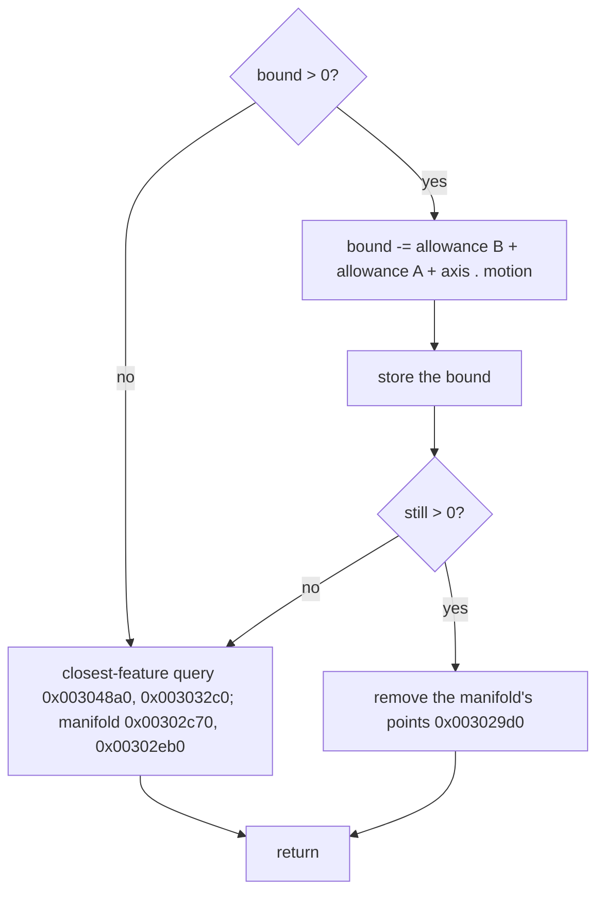

# The Havok convex agent: separated pairs

Status: Partly built. The separated-pair path of the convex agent's process call `0x002eeb40` runs as a take-over arm; seven leaves of the closest-feature query are ported and compared with the lifted code; the query, the manifold update and the contact commit stay guest code.
Code: `crates/rewrites/sim-havok/src/convex.rs` (`process`), `crates/rewrites/sim-havok/src/gjk.rs` (the query's leaves), `crates/rewrites/engine/src/sim_physics/convex_agent.rs` (the capture), `crates/rewrites/engine/src/sim_physics/parity.rs` (`physics.agent.convex`). Tests: `crates/rewrites/engine/tests/sim_havok_differential.rs` (seeded pairs, the arm, the declines) and the unit tests in `convex.rs`.
Switch: `impl.sim.native.physics`, listed in [switches.md](../runtime/switches.md).

A convex pair's agent keeps a separating axis and a bound on the
distance along it ([havok-runtime.md](havok-runtime.md), "Convex child
state"). While the bound stays positive after both bodies' motion is
projected onto the axis, the pair is still apart and the call does no
query. Slice 5 of [sim-rewrite-havok.md](sim-rewrite-havok.md) starts
with that path, bit-exact; the query and the contact work behind it are
the rest of the slice.

Evidence: read with `h2 disasm` (**E**), **S** supposed.

## Who calls it

| Caller | How |
|---|---|
| the convex agent `0x00412c48` | its `vt[+0x10]`, from the island's pair pass |
| the biped wrapper's agent `0x00412290` (`0x002db2b0`) | a direct call at `0x002db5e0`, after its sweep and feature reseed |

Thiscall on the agent, then collidable A, collidable B, the collision
input and the result collector; `ret 0x10`. **E**

## The call

| Read | Where |
|---|---|
| the bound | agent `+0x2c`, x87, compared with `0.0` at `0x0045dbd8`; `test ah,0x41` continues only when ordered and above |
| the axis | agent `+0x20`, `movaps` |
| each body's motion | collidable `+0x08`; positions at `+0x00` and `+0x10`, the allowance at `+0x0c` (**S**: the step's two positions and a rotation allowance) |
| the point count, the manager | agent `+0x18`, `+0x08` |

- The projection is packed SSE: `(B.to - B.from) - (A.to - A.from)`,
  times the axis, summed `y + x` then `z + that` (`0x002eebe4`). The `w`
  lanes are computed and dropped.
- The x87 chain is `(allowance B + allowance A) + t`, then `bound -` that
  (`fsubr`), in binary64 under the control word. The store rounds to
  binary32; the second test compares the register value, not the stored
  one (`0x002eec1b`, `0x002eec1e`).
- The bound is stored before the second test, so a pair that comes within
  reach leaves the reduced bound for the query path.
- With no points the removal call returns at once; with points it calls
  the manager's `vt[+0x08]` for each, last first.

**The port.** `sim_havok::convex::process` on a journal, the engine's
`sim_physics/convex_agent.rs` capture, and `parity`'s
`physics.agent.convex` arm answering once proven (sim-rewrite-havok.md
§9.5). The answer is the bound's store with eax the point-count address,
ecx the monitor head, edx the manager word, ebx, ebp, esi and edi, and
esp past the four arguments. The x87 condition codes, the sticky
exception flags and the XMM registers are not modelled. Declines,
counted by reason (`convex::fallbacks`, `havok.islands`'s `convex`):

| Reason | When |
|---|---|
| `memory` | a word is unmapped or unaligned, a vector not 16-byte aligned, a store unwritable |
| `closest` | the bound is not above zero before or after the projection |
| `points` | the pair is apart but its manifold holds points |
| `float` | an unmasked exception, an x87 stack not empty, a non-finite x87 load or projection |
| `monitor` | the monitor stream is on |
| `unobserved` | an audited return could not be observed |

## The query path

When the bound does not hold, the call builds B's transform in A's
frame and runs the closest-feature query. **E**

| Function | Does | Ported |
|---|---|---|
| `0x002da4d0` (thiscall out; A, B; `ret 8`) | B's four columns by A's transposed rotation, then A's translation taken off | `gjk::relative` |
| `0x003048a0` (thiscall state; shape A, shape B, transform, feature cache, out; `ret 0x14`) | the query: seeds the simplex from the cached feature IDs through each shape's `vt[+0x34]`, then a case per simplex size pair (`(nA << 3 \| nB) - 9`, a 25-entry table at `0x0030567c`), new support points through `vt[+0x30]` | no |
| `0x003037a0` (thiscall state; segment, triangle, segment count, triangle count, fresh, feature; `ret 0x18`) | the edge case, a segment against a triangle: fresh, the triangle's own normal, else the state's normal and sides; a crossing inside answers 1; the nearer end (fresh) or the second vertex inside drops the segment to it, 0; else `t2` overwrites the vertex off the nearer edge (by `gjk::segments` fresh, by the edge mask and the old sides otherwise), 2 | `gjk::edge` |
| `0x00303dd0` | the query's triangle case, with the penetration path `0x00303b80`, `0x0030a6b0` | no |
| `0x00303540` (eax the four vertices, ebx the point, one stack word `s`; `ret`), with `0x00303110` (edi the vertices; point, tests) | the tetrahedron face the point lies beyond: each face's `n . s (p - v3)` signed-squared over `\|n\|^2`; `-1` below `1e-6`, the largest past `1.1` times the next, else `0x00303110` strikes edges by projection | `gjk::tetrahedron` |
| `0x00303360` (thiscall state; point, triangle, orient; `ret 0xc`) | the triangle's normal and the point's three edge signs (mask in eax); with `orient`, the normal faces the support difference, swapping the first two vertices to do it | `gjk::triangle` |
| `0x00308590` (cdecl; p1, d1, p2, d2, out) | the closest points of two segments, x87 solve, flags for each clamp | `gjk::segments` |
| `0x003032c0` (thiscall state; cache, separation, out; `ret 0xc`; the cache is not read) | the contact: the negated direction, the distance, and A's support point (A's simplex one vertex, weight 1.0), B's moved back by the distance (B's one vertex, 0.0) or the state's midpoint `+0x130` (0.5) | `gjk::contact` |
| `0x002da6e0` (thiscall out; transform, vector; `ret 8`) | the separating direction back into the world | `gjk::rotate` |
| `0x00302c70`, `0x00302eb0` | the manifold: add a point through the manager's `vt[+0x04]` (then Halo's contact callback), refresh and drop points through `vt[+0x08]` | no |

The ported leaves are compared with the lifted functions in
`sim_havok_differential.rs`. The arm still declines the query path
(`closest`): it answers only when the query, every shape class's support
virtuals and the manifold calls it makes are in Rust, and a call that
adds or removes a point runs Halo's callback, which stays the guest's.

## Not verified

- How many of a match's convex calls take the separated path; `closest`
  and `answered` on `havok.islands` give it.
- What the motion's two positions and allowance are (**S**).

## Related

- [havok-runtime.md](havok-runtime.md): the agents and the convex child state.
- [havok-step.md](havok-step.md): the agent census.
- [sim-rewrite-havok.md](sim-rewrite-havok.md): slice 5 and §9.5.
