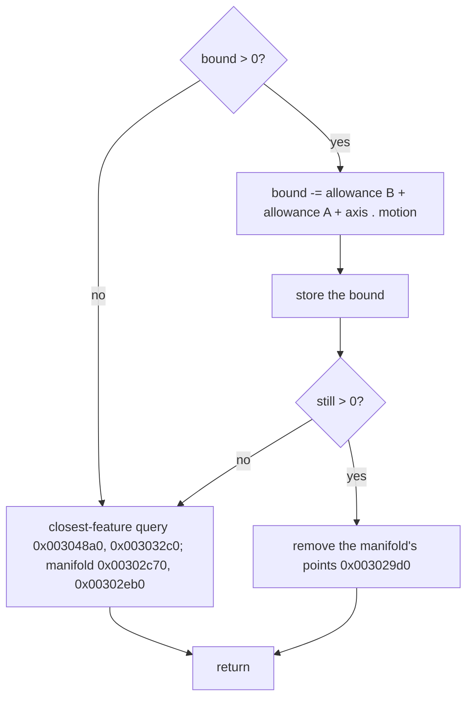
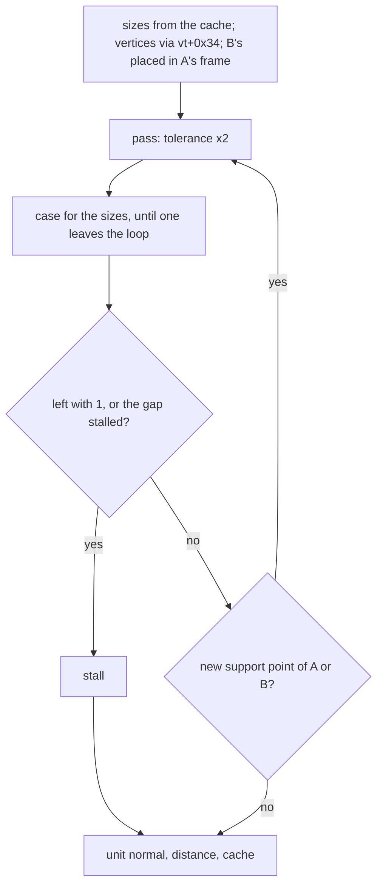
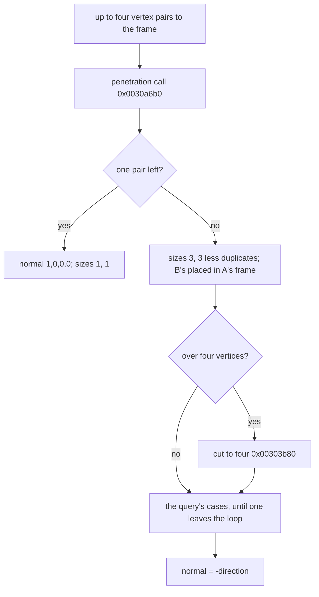

# The Havok convex agent: separated pairs

Status: Partly built. The separated-pair path of the convex agent's process call `0x002eeb40` runs as a take-over arm; the closest-feature query `0x003048a0` with its seven leaves, its triangle case `0x00303dd0`, three shape types' support virtuals and two types' vertex virtuals are ported and compared with the lifted code; so is the manifold refresh `0x00302eb0`; the triangle case's penetration call `0x0030a6b0`, the add-point call `0x00302c70` and the contact commit stay guest code, and no arm calls the query or the refresh yet.
Code: `crates/rewrites/sim-havok/src/convex.rs` (`process`), `crates/rewrites/sim-havok/src/gjk.rs` (the query, its leaves and the triangle case), `crates/rewrites/sim-havok/src/shape_support.rs` (the support and vertex virtuals), `crates/rewrites/sim-havok/src/manifold.rs` (the refresh), `crates/rewrites/engine/src/sim_physics/convex_agent.rs` (the capture), `crates/rewrites/engine/src/sim_physics/parity.rs` (`physics.agent.convex`). Tests: `crates/rewrites/engine/tests/sim_havok_differential.rs` (seeded pairs, the arm, the declines) and the unit tests in `convex.rs`, `gjk.rs`, `shape_support.rs` and `manifold.rs`.
Switch: `impl.sim.native.physics`, listed in [switches.md](../runtime/switches.md).

A convex pair's agent keeps a separating axis and a bound on the
distance along it ([havok-runtime.md](havok-runtime.md), "Convex child
state"). While the bound stays positive after both bodies' motion is
projected onto the axis, the pair is still apart and the call does no
query. Slice 5 of [sim-rewrite-havok.md](sim-rewrite-havok.md) starts
with that path, bit-exact; the query and the contact work behind it are
the rest of the slice.

Evidence: read with `h2 disasm` (**E**), **S** supposed.

## Who calls it

| Caller | How |
|---|---|
| the convex agent `0x00412c48` | its `vt[+0x10]`, from the island's pair pass |
| the biped wrapper's agent `0x00412290` (`0x002db2b0`) | a direct call at `0x002db5e0`, after its sweep and feature reseed |

Thiscall on the agent, then collidable A, collidable B, the collision
input and the result collector; `ret 0x10`. **E**

## The call

| Read | Where |
|---|---|
| the bound | agent `+0x2c`, x87, compared with `0.0` at `0x0045dbd8`; `test ah,0x41` continues only when ordered and above |
| the axis | agent `+0x20`, `movaps` |
| each body's motion | collidable `+0x08`; positions at `+0x00` and `+0x10`, the allowance at `+0x0c` (**S**: the step's two positions and a rotation allowance) |
| the point count, the manager | agent `+0x18`, `+0x08` |

- The projection is packed SSE: `(B.to - B.from) - (A.to - A.from)`,
  times the axis, summed `y + x` then `z + that` (`0x002eebe4`). The `w`
  lanes are computed and dropped.
- The x87 chain is `(allowance B + allowance A) + t`, then `bound -` that
  (`fsubr`), in binary64 under the control word. The store rounds to
  binary32; the second test compares the register value, not the stored
  one (`0x002eec1b`, `0x002eec1e`).
- The bound is stored before the second test, so a pair that comes within
  reach leaves the reduced bound for the query path.
- With no points the removal call returns at once; with points it calls
  the manager's `vt[+0x08]` for each, last first.

**The port.** `sim_havok::convex::process` on a journal, the engine's
`sim_physics/convex_agent.rs` capture, and `parity`'s
`physics.agent.convex` arm answering once proven (sim-rewrite-havok.md
§9.5). The answer is the bound's store with eax the point-count address,
ecx the monitor head, edx the manager word, ebx, ebp, esi and edi, and
esp past the four arguments. The x87 condition codes, the sticky
exception flags and the XMM registers are not modelled. Declines,
counted by reason (`convex::fallbacks`, `havok.islands`'s `convex`):

| Reason | When |
|---|---|
| `memory` | a word is unmapped or unaligned, a vector not 16-byte aligned, a store unwritable |
| `closest` | the bound is not above zero before or after the projection |
| `points` | the pair is apart but its manifold holds points |
| `float` | an unmasked exception, an x87 stack not empty, a non-finite x87 load or projection |
| `monitor` | the monitor stream is on |
| `unobserved` | an audited return could not be observed |

## The query path

When the bound does not hold, the call builds B's transform in A's
frame and runs the closest-feature query. **E**

| Function | Does | Ported |
|---|---|---|
| `0x002da4d0` (thiscall out; A, B; `ret 8`) | B's four columns by A's transposed rotation, then A's translation taken off | `gjk::relative` |
| `0x003048a0` (thiscall state; shape A, shape B, transform, feature cache, out; `ret 0x14`) | the query: seeds the simplex from the cached feature IDs through each shape's `vt[+0x34]`, then a case per simplex size pair (`(nA << 3 \| nB) - 9`, a 25-entry table at `0x0030567c`), new support points through `vt[+0x30]` ("The query" below) | `gjk::query` |
| `0x003037a0` (thiscall state; segment, triangle, segment count, triangle count, fresh, feature; `ret 0x18`) | the edge case, a segment against a triangle: fresh, the triangle's own normal, else the state's normal and sides; a crossing inside answers 1; the nearer end (fresh) or the second vertex inside drops the segment to it, 0; else `t2` overwrites the vertex off the nearer edge (by `gjk::segments` fresh, by the edge mask and the old sides otherwise), 2 | `gjk::edge` |
| `0x00303dd0` (thiscall state; shape A, shape B, transform, cache; `ret 0x10`; the cache is not read), with `0x00303b80` (thiscall state; `ret`) | the query's triangle case, for a stalled query with the state's `+0x0c` byte clear ("The triangle case" below) | `gjk::triangle_case`; its call `0x0030a6b0` is not (`gjk::Penetration`) |
| `0x00303540` (eax the four vertices, ebx the point, one stack word `s`; `ret`), with `0x00303110` (edi the vertices; point, tests) | the tetrahedron face the point lies beyond: each face's `n . s (p - v3)` signed-squared over `\|n\|^2`; `-1` below `1e-6`, the largest past `1.1` times the next, else `0x00303110` strikes edges by projection | `gjk::tetrahedron` |
| `0x00303360` (thiscall state; point, triangle, orient; `ret 0xc`) | the triangle's normal and the point's three edge signs (mask in eax); with `orient`, the normal faces the support difference, swapping the first two vertices to do it | `gjk::triangle` |
| `0x00308590` (cdecl; p1, d1, p2, d2, out) | the closest points of two segments, x87 solve, flags for each clamp | `gjk::segments` |
| `0x003032c0` (thiscall state; cache, separation, out; `ret 0xc`; the cache is not read) | the contact: the negated direction, the distance, and A's support point (A's simplex one vertex, weight 1.0), B's moved back by the distance (B's one vertex, 0.0) or the state's midpoint `+0x130` (0.5) | `gjk::contact` |
| `0x002da6e0` (thiscall out; transform, vector; `ret 8`) | the separating direction back into the world | `gjk::rotate` |
| `0x00302c70` (cdecl; A, B, input, contact, manager, slots, count) | add a point: a slot within the match radius takes it in place, else a new slot and an ID from the manager's `vt[+0x04]` (then Halo's contact callback); past four slots `0x00302a10` cuts back to four | no |
| `0x00302eb0` (cdecl; A, B, input, floor, slots, count, collector, manager) | refresh: each point kept as a contact in the collector's array or dropped through the manager's `vt[+0x08]` ("The manifold" below) | `manifold::refresh` |

The ported functions are compared with the lifted ones in
`sim_havok_differential.rs`. The arm still declines the query path
(`closest`): it answers only when the query, every shape class's support
virtuals and the manifold calls it makes are in Rust, and a call that
adds or removes a point runs Halo's callback, which stays the guest's.

## The query

`gjk::query` runs `0x003048a0` on a journal. The calls it makes out,
each shape's `vt[+0x34]` and `vt[+0x30]` and the triangle case, go
through the caller's `gjk::Calls`. **E**

| Sizes (A, B) | At | Case |
|---|---|---|
| (1, 1) | `0x003051c3` | the normal is `B0 - A0`; out with 0 |
| (1, 2), (2, 1) | `0x00304fd6`, `0x003050e5` | ends either side: the segment's perpendicular toward the point; else the segment drops to an end |
| (1, 3), (3, 1) | `0x00304ae6`, `0x00304c43` | `gjk::triangle` (orient 1 and -1): inside, out with 0; past one edge, a vertex drops and (1, 2) runs; past a vertex, the triangle drops to an edge or the vertex |
| (1, 4), (4, 1) | `0x00304aa1`, `0x00304c12` | `gjk::tetrahedron` (`s` -1 and 1): no face, out with 1; else that face and (1, 3) |
| (2, 2) | `0x003049fe` | `gjk::segments` into `+0x130`: unclamped, the edges' cross product toward B; else each clamped segment drops to its end |
| (2, 3), (3, 2) | `0x003049ae`, `0x003049cc` | `gjk::edge` (feature 1 and -1, fresh when `+0x08` is 2): 1 out with 1, 2 the (2, 2) case, 0 out with 0 |
| any other | | out with 1 |

- Out with 0 also stores B's size at `+0x08`.
- The tolerance starts at `0x2edbe6ff` (about `1e-10`) and doubles on
  every pass (x87, stored to binary32). `FLT_EPSILON` is at `0x0041359c`.
- Odd passes try A's support point first, even ones B's. A's direction
  is the normal; B's is the normal into B's frame, negated. A point
  joins its simplex when `|d| d` beats `|n|^2` times the tolerance, `d`
  its offset from vertex 0 along the direction, and does not fall below
  it against vertex 1 (a simplex of two) or vertices 2 and 1 (three). A side at its cached limit (`+0x0a`,
  `+0x0b`) or the feature word `+0x10` (1 for A, -1 for B) is skipped.
- The gap stalls when its cube is not below the tolerance times
  `FLT_EPSILON` times `|n|^2` (x87, `fcompp`).
- A stall with the `+0x0c` byte clear calls the triangle case, whose
  eax the query returns. Set, sizes over four become (3, 1) or (1, 3)
  and eax is 3.
- The end: the normal scaled by one Newton step on `rsqrtss`, the
  distance in `w`, the sizes and each vertex's ID (its `w`, low 16 bits)
  back in the cache. ecx is B's size and edx how many IDs B wrote.

| State word | Holds |
|---|---|
| `+0x00`, `+0x04` | the sizes |
| `+0x08`, `+0x0c` | B's size at the last case exit, the stall byte |
| `+0x10` | the feature word `gjk::edge` sets |
| `+0x20`, `+0x60` | A's vertices, a parallel array |
| `+0xa0`, `+0xe0` | B's vertices in A's frame and in B's |
| `+0x120`, `+0x130`, `+0x160` | the normal, the closest points, the edge tests |

## The manifold

`manifold::refresh` runs `0x00302eb0` on a journal. Its two calls out go
through the caller's `manifold::Calls`. **E**

| Step | Does |
|---|---|
| reserve | the array's size plus the count past its capacity (top bit masked): `0x002d9160` to the larger of twice the capacity and the need |
| size | raised by the count before the loop |
| place | each slot's A and B points through their motions' transforms (`+0x20` columns, `+0x50` translation), `(c0 x + c1 y) + (c2 z + t)` |
| test | `d = (A - B) . n`; kept when `d` is below the input's `+0x08`, above the floor, and `\|A - (B + d n)\|^2` below the drift radius squared (input `+0x0c` then `+0x08`, squared on the x87 and stored) |
| keep | `w A + (1 - w) B` with `d` in `w`, the normal, the 16-bit ID at `+0x20`; the element's other bytes are not written |
| drop | the manager's `vt[+0x08]` with the ID, the count down one, the last slot copied over this one (which is tested next), the array's size down one |

- Every compare is ordered (`fcomp`, `test ah,5` or `0x41`): a NaN
  drops. The port declines a non-finite x87 load (`float`).
- At the return, eax is the last kept point's weight (or the array after
  a drop, the count with no points), ecx and edx the kept count (edx the
  slots after a drop; the array and its data with no points).
- `sim_havok_differential.rs` compares it with the lifted function, 1024
  seeds of zero to four points, the removals answered by a stub. The
  seeds leave the array room; the lifted reserve calls the system
  allocator.

## The triangle case

`gjk::triangle_case` runs `0x00303dd0` on a journal. Its one call out,
the penetration call `0x0030a6b0` (cdecl; shape A, shape B, transform,
simplex, differences, direction; a profiled wrapper of `0x00309b50`),
goes through the caller's `gjk::Penetration`. **E**

| Sizes at entry | Pairs handed over (A's vertex, B's) |
|---|---|
| B three or more | `(A0, Bi)` for B's first three, then `(A0, B3)` (B four) or `(A1, B0)` (A two or more) |
| A three or more | `(Ai, B0)` for A's first three, then `(A3, B0)` (A four) or `(A0, B1)` (B two or more) |
| otherwise | `(A0, B0)` |

- The frame holds A's four vertices at `+0x20`, B's four in B's frame
  at `+0x60`, the count at `+0xa0`, `A - B` (B's in A's frame) at
  `+0xd0` and the direction at `+0x110` (`gjk::tri_frame`).
- After the call A's and B's first three vertices come back from the
  frame; A's parallel array and B's placed vertices do not.
- Duplicates: two vertices are one when `cmpltps` finds no lane of `x`,
  `y`, `z` of their difference's magnitude past the vector at
  `0x004801e0`. A's third against its second, else its first, drops it;
  then its first against its second gives the first the last vertex's
  place. B's the same in B's frame, the last test only with two left.
- The cut (`0x00303b80`, more than four vertices): a vertex inside the
  other side's triangle (`gjk::triangle`, not oriented, A's first) is
  that side's only vertex. Otherwise every pair of edges, one of each
  side, goes to `gjk::segments`; the nearest pair (strictly, first on a
  tie) keeps its triangle edges and each triangle's third vertex takes
  its last's place. B's arrays both follow.
- The cases are the query's table (the jump table at `0x0030484c` by the
  bytes at `0x00304878`), with the feature word cleared once before the
  first. Out with 0 stores B's size at `+0x08`, as in the query.
- Every exit but the one-pair one stores the direction, negated, as the
  normal. eax is the penetration call's.

`sim_havok_differential.rs` compares it with the lifted function, 512
seeds of capsules and polygons over every pair of sizes up to four, the
penetration call run lifted for both sides.

## Support virtuals

The query takes new support points through each shape's `vt[+0x30]`
(thiscall shape; direction, out; `ret 8`). A shape's type is its
`vt[+0x14]`, a `mov eax, type; ret`. **E**

| Type | Vtable, support | Does | Leaves | Ported |
|---|---|---|---|---|
| 7, capsule | `0x00455500` (Halo's), `0x00455458` (Havok's); `0x002ddd30` | `(B - A) . d` (packed, `y + x` then `z +`), spilled and compared with `0.0` on the x87 (`fcomp`); end A `+0x10` only when below, else end B `+0x20` (equal and unordered too); the end to `out`, `w` the ID `0x3f000000` (A) or `0x3f000010` (B) | eax the ID, ecx `out` | `shape_support::capsule` |
| `0x17`, biped wrapper | `0x004122f0`; `0x002dbd40` | the pill at `+0x30` answers through its own `vt[+0x30]`; then when `offset . d` is above zero (`test ah, 0x41`), the offset `+0x10` is added to `out`, all four lanes, and `out.w` goes back through `fld`, `fstp` as the child left it | ax the x87 status word over the child's eax, ecx the aligned frame word, the child's edx | `shape_support::biped` |
| `0x18`, convex polygon | `0x004560b8`; `0x001ee350` | over the signed count `+0x14`, the vertex at `+0x20 + 16 i` whose `v . d` `comiss`es above the best so far, starting at `-FLT_MAX` (`0x004409d4`): the first on ties, none for NaN; no vertices reads vertex 0 | eax `out`, ecx the shape, edx the count | `shape_support::polygon` |

The query seeds its simplex through `vt[+0x34]` (thiscall shape; IDs,
count, out; `ret 0xc`), a vertex per 16-bit ID. **E**

| Type | `vt[+0x34]` | Does | Ported |
|---|---|---|---|
| 7, capsule | `0x002dddb0` | the end at `+0x10 + id`, `w` the ID with `0x3f000000` | `shape_support::capsule_vertices` |
| `0x17`, biped wrapper | `0x002dbdb0` | the child's, then the offset added to each (`w` through the x87) | no |
| `0x18`, convex polygon | `0x001ee3d0` | vertex `id` whole, last ID first | `shape_support::polygon_vertices` |

- The biped wrapper takes its child as a callback; the port answers for
  whichever child the caller dispatches, and the differential test gives
  it a capsule.
- The x87 work runs through the `x87::abi` helpers on the guest's state,
  so the status word, the tags and the popped registers match. A
  polygon count over 256 declines.

The support virtuals are compared with the lifted functions in
`sim_havok_differential.rs`, 1024 seeds each; the vertex virtuals run
inside the query's comparison, 1024 seeds of capsules and polygons, where
a stall that reaches the triangle case declines. No arm calls them yet.

## Not verified

- How many of a match's convex calls take the separated path; `closest`
  and `answered` on `havok.islands` give it.
- What the motion's two positions and allowance are (**S**).

## Related

- [havok-runtime.md](havok-runtime.md): the agents and the convex child state.
- [havok-step.md](havok-step.md): the agent census.
- [sim-rewrite-havok.md](sim-rewrite-havok.md): slice 5 and §9.5.
