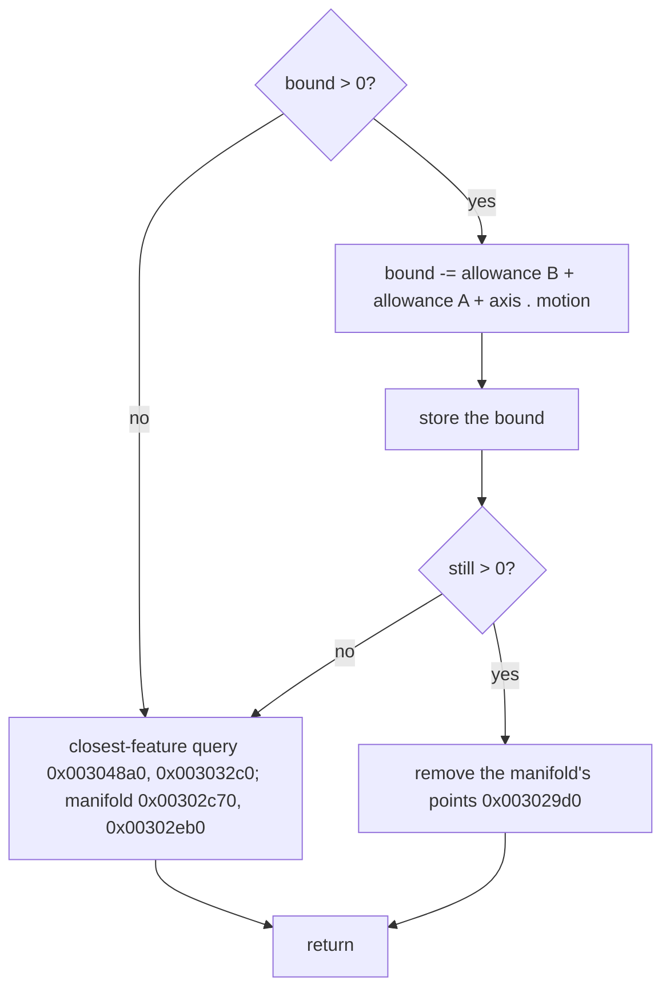
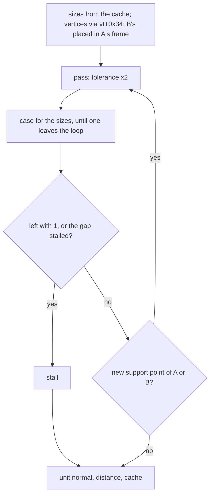
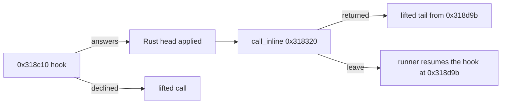
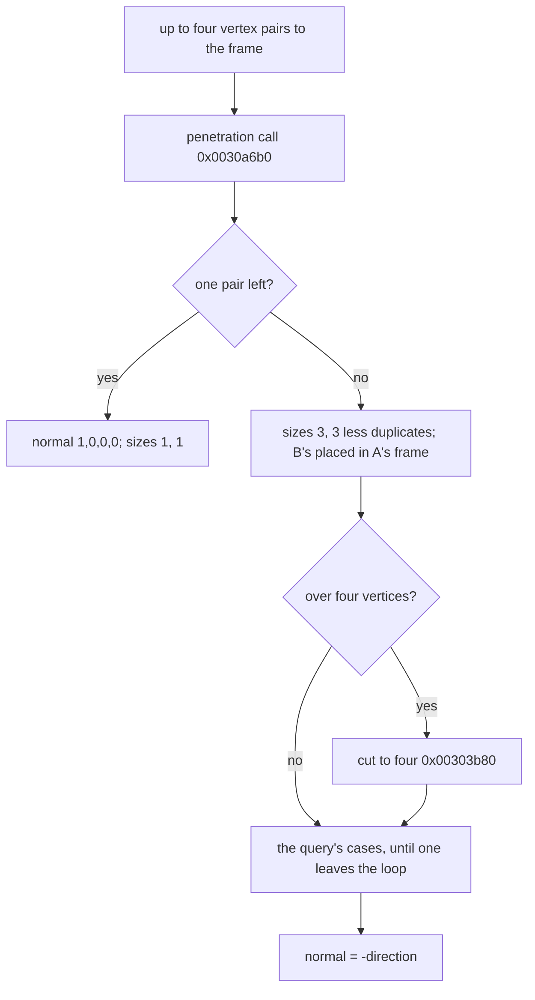
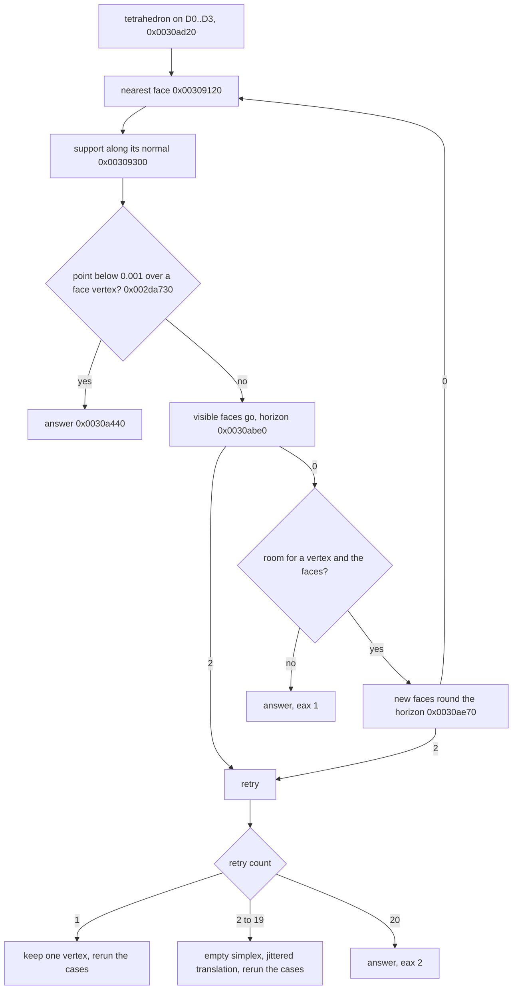

# The Havok convex agent

Status: Partly built. Three answering arms: the convex agent's process call `0x002eeb40` on separated pairs; the closest-feature query `0x003048a0` whole, its shapes' virtuals (capsule, biped wrapper, convex polygon), its triangle case `0x00303dd0` and the penetration call `0x0030a6b0` all in Rust; the add-point call `0x00302c70` on a point that moves its slot; and the contact commit `0x00318c10` (the manager's add) to its listener walk, the walk with Halo's contact callback and the tail staying lifted. The manifold refresh `0x00302eb0`, the add-point call's other paths with its cut `0x00302a10` and the whole commit are ported and compared with the lifted code; a constraint's first point (`0x0030d2b0`), array growth and the manager's removal stay guest code.
Code: `crates/rewrites/sim-havok/src/convex.rs` (`process`), `crates/rewrites/sim-havok/src/gjk.rs` (the query, its leaves and the triangle case), `crates/rewrites/sim-havok/src/shape_support.rs` (the support and vertex virtuals), `crates/rewrites/sim-havok/src/manifold.rs` (the refresh, the add-point call and its cut), `crates/rewrites/sim-havok/src/penetration.rs` (the penetration call), `crates/rewrites/sim-havok/src/closest.rs` (the query with every call out in Rust), `crates/rewrites/sim-havok/src/contact_point.rs` (the add-point arm's model), `crates/rewrites/sim-havok/src/commit.rs` (the contact commit); `crates/rewrites/engine/src/sim_physics/convex_agent.rs`, `convex_query.rs`, `contact_point.rs` and `contact_commit.rs` (the captures), `crates/rewrites/engine/src/sim_physics/parity.rs` (`physics.agent.convex`, `physics.agent.query`, `physics.agent.point`, `physics.contact.commit`), `crates/rewrites/sim-bridge/src/sim_physics.rs` (the hooks). Tests: `crates/rewrites/engine/tests/sim_havok_differential.rs` (seeded pairs, the arms, the declines) and the unit tests in `convex.rs`, `gjk.rs`, `shape_support.rs`, `manifold.rs`, `penetration.rs`, `closest.rs`, `contact_point.rs` and `commit.rs`.
Always installed: the physics entries have no switch.

A convex pair's agent keeps a separating axis and a bound on the
distance along it ([havok-runtime.md](havok-runtime.md), "Convex child
state"). While the bound stays positive after both bodies' motion is
projected onto the axis, the pair is still apart and the call does no
query. Slice 5 of [sim-rewrite-havok.md](sim-rewrite-havok.md) ports
that path, the query and the contact work behind it, bit-exact.

Evidence: read with `h2 disasm` (**E**), **S** supposed.

## Who calls it

| Caller | How |
|---|---|
| the convex agent `0x00412c48` | its `vt[+0x10]`, from the island's pair pass |
| the biped wrapper's agent `0x00412290` (`0x002db2b0`) | a direct call at `0x002db5e0`, after its sweep and feature reseed |

Thiscall on the agent, then collidable A, collidable B, the collision
input and the result collector; `ret 0x10`. **E**

## The call

| Read | Where |
|---|---|
| the bound | agent `+0x2c`, x87, compared with `0.0` at `0x0045dbd8`; `test ah,0x41` continues only when ordered and above |
| the axis | agent `+0x20`, `movaps` |
| each body's motion | collidable `+0x08`; positions at `+0x00` and `+0x10`, the allowance at `+0x0c` (**S**: the step's two positions and a rotation allowance) |
| the point count, the manager | agent `+0x18`, `+0x08` |

- The projection is packed SSE: `(B.to - B.from) - (A.to - A.from)`,
  times the axis, summed `y + x` then `z + that` (`0x002eebe4`). The `w`
  lanes are computed and dropped.
- The x87 chain is `(allowance B + allowance A) + t`, then `bound -` that
  (`fsubr`), in binary64 under the control word. The store rounds to
  binary32; the second test compares the register value, not the stored
  one (`0x002eec1b`, `0x002eec1e`).
- The bound is stored before the second test, so a pair that comes within
  reach leaves the reduced bound for the query path.
- With no points the removal call returns at once; with points it calls
  the manager's `vt[+0x08]` for each, last first.

**The port.** `sim_havok::convex::process` on a journal, the engine's
`sim_physics/convex_agent.rs` capture, and `parity`'s
`physics.agent.convex` arm answering every call it captures from the first (sim-rewrite-havok.md
§9.5). The answer is the bound's store with eax the point-count address,
ecx the monitor head, edx the manager word, ebx, ebp, esi and edi, and
esp past the four arguments. The x87 condition codes, the sticky
exception flags and the XMM registers are not modelled. Declines,
counted by reason (`convex::fallbacks`, `havok.islands`'s `convex`):

| Reason | When |
|---|---|
| `memory` | a word is unmapped or unaligned, a vector not 16-byte aligned, a store unwritable |
| `closest` | the bound is not above zero before or after the projection |
| `points` | the pair is apart but its manifold holds points |
| `float` | an unmasked exception, an x87 stack not empty, a non-finite x87 load or projection |
| `monitor` | the monitor stream is on |
| `unobserved` | kept on the wire; no call is audited, so it reads 0 |

## The query path

When the bound does not hold, the call builds B's transform in A's
frame and runs the closest-feature query. **E**

| Function | Does | Ported |
|---|---|---|
| `0x002da4d0` (thiscall out; A, B; `ret 8`) | B's four columns by A's transposed rotation, then A's translation taken off | `gjk::relative` |
| `0x003048a0` (thiscall state; shape A, shape B, transform, feature cache, out; `ret 0x14`) | the query: seeds the simplex from the cached feature IDs through each shape's `vt[+0x34]`, then a case per simplex size pair (`(nA << 3 \| nB) - 9`, a 25-entry table at `0x0030567c`), new support points through `vt[+0x30]` ("The query" below) | `gjk::query` |
| `0x003037a0` (thiscall state; segment, triangle, segment count, triangle count, fresh, feature; `ret 0x18`) | the edge case, a segment against a triangle: fresh, the triangle's own normal, else the state's normal and sides; a crossing inside answers 1; the nearer end (fresh) or the second vertex inside drops the segment to it, 0; else `t2` overwrites the vertex off the nearer edge (by `gjk::segments` fresh, by the edge mask and the old sides otherwise), 2 | `gjk::edge` |
| `0x00303dd0` (thiscall state; shape A, shape B, transform, cache; `ret 0x10`; the cache is not read), with `0x00303b80` (thiscall state; `ret`) | the query's triangle case, for a stalled query with the state's `+0x0c` byte clear ("The triangle case" below) | `gjk::triangle_case`; its call `0x0030a6b0` through `gjk::Penetration`, answered by `penetration::Port` ("The penetration call" below) |
| `0x00303540` (eax the four vertices, ebx the point, one stack word `s`; `ret`), with `0x00303110` (edi the vertices; point, tests) | the tetrahedron face the point lies beyond: each face's `n . s (p - v3)` signed-squared over `\|n\|^2`; `-1` below `1e-6`, the largest past `1.1` times the next, else `0x00303110` strikes edges by projection | `gjk::tetrahedron` |
| `0x00303360` (thiscall state; point, triangle, orient; `ret 0xc`) | the triangle's normal and the point's three edge signs (mask in eax); with `orient`, the normal faces the support difference, swapping the first two vertices to do it | `gjk::triangle` |
| `0x00308590` (cdecl; p1, d1, p2, d2, out) | the closest points of two segments, x87 solve, flags for each clamp | `gjk::segments` |
| `0x003032c0` (thiscall state; cache, separation, out; `ret 0xc`; the cache is not read) | the contact: the negated direction, the distance, and A's support point (A's simplex one vertex, weight 1.0), B's moved back by the distance (B's one vertex, 0.0) or the state's midpoint `+0x130` (0.5) | `gjk::contact` |
| `0x002da6e0` (thiscall out; transform, vector; `ret 8`) | the separating direction back into the world | `gjk::rotate` |
| `0x00302c70` (cdecl; A, B, input, contact, manager, slots, count) | add a point: a slot within the match radius takes it in place, else a new slot and an ID from the manager's `vt[+0x04]` (then Halo's contact callback); past four slots `0x00302a10` cuts back to four ("The add-point call" below) | `manifold::add_point`, `manifold::cut` |
| `0x00302eb0` (cdecl; A, B, input, floor, slots, count, collector, manager) | refresh: each point kept as a contact in the collector's array or dropped through the manager's `vt[+0x08]` ("The manifold" below) | `manifold::refresh` |

The ported functions are compared with the lifted ones in
`sim_havok_differential.rs`. The process call's arm declines the query
path (`closest`); the query and the add-point call answer from their own
arms inside the guest's process call ("The query arm", "The add-point
arm"). A point that needs a new slot runs the add-point call lifted,
and its manager's add answers from the commit arm ("The commit arm").

## The query

`gjk::query` runs `0x003048a0` on a journal. The calls it makes out,
each shape's `vt[+0x34]` and `vt[+0x30]` and the triangle case, go
through the caller's `gjk::Calls`. **E**

| Sizes (A, B) | At | Case |
|---|---|---|
| (1, 1) | `0x003051c3` | the normal is `B0 - A0`; out with 0 |
| (1, 2), (2, 1) | `0x00304fd6`, `0x003050e5` | ends either side: the segment's perpendicular toward the point; else the segment drops to an end |
| (1, 3), (3, 1) | `0x00304ae6`, `0x00304c43` | `gjk::triangle` (orient 1 and -1): inside, out with 0; past one edge, a vertex drops and (1, 2) runs; past a vertex, the triangle drops to an edge or the vertex |
| (1, 4), (4, 1) | `0x00304aa1`, `0x00304c12` | `gjk::tetrahedron` (`s` -1 and 1): no face, out with 1; else that face and (1, 3) |
| (2, 2) | `0x003049fe` | `gjk::segments` into `+0x130`: unclamped, the edges' cross product toward B; else each clamped segment drops to its end |
| (2, 3), (3, 2) | `0x003049ae`, `0x003049cc` | `gjk::edge` (feature 1 and -1, fresh when `+0x08` is 2): 1 out with 1, 2 the (2, 2) case, 0 out with 0 |
| any other | | out with 1 |

- Out with 0 also stores B's size at `+0x08`.
- The cache holds four 16-bit IDs before its sizes at `+0x08`, so the
  sizes it hands over sum to four at most; a fifth ID would be read from
  the sizes (for a capsule, an unaligned end, which declines `memory`).
- The tolerance starts at `0x2edbe6ff` (about `1e-10`) and doubles on
  every pass (x87, stored to binary32). `FLT_EPSILON` is at `0x0041359c`.
- Odd passes try A's support point first, even ones B's. A's direction
  is the normal; B's is the normal into B's frame, negated. A point
  joins its simplex when `|d| d` beats `|n|^2` times the tolerance, `d`
  its offset from vertex 0 along the direction, and does not fall below
  it against vertex 1 (a simplex of two) or vertices 2 and 1 (three). A side at its cached limit (`+0x0a`,
  `+0x0b`) or the feature word `+0x10` (1 for A, -1 for B) is skipped.
- The gap stalls when its cube is not below the tolerance times
  `FLT_EPSILON` times `|n|^2` (x87, `fcompp`).
- A stall with the `+0x0c` byte clear calls the triangle case, whose
  eax the query returns. Set, sizes over four become (3, 1) or (1, 3)
  and eax is 3.
- The end: the normal scaled by one Newton step on `rsqrtss`, the
  distance in `w`, the sizes and each vertex's ID (its `w`, low 16 bits)
  back in the cache. ecx is B's size and edx how many IDs B wrote.

| State word | Holds |
|---|---|
| `+0x00`, `+0x04` | the sizes |
| `+0x08`, `+0x0c` | B's size at the last case exit, the stall byte |
| `+0x10` | the feature word `gjk::edge` sets |
| `+0x20`, `+0x60` | A's vertices, a parallel array |
| `+0xa0`, `+0xe0` | B's vertices in A's frame and in B's |
| `+0x120`, `+0x130`, `+0x160` | the normal, the closest points, the edge tests |

## The manifold

`manifold::refresh` runs `0x00302eb0` on a journal. Its two calls out go
through the caller's `manifold::Calls`. **E**

| Step | Does |
|---|---|
| reserve | the array's size plus the count past its capacity (top bit masked): `0x002d9160` to the larger of twice the capacity and the need |
| size | raised by the count before the loop |
| place | each slot's A and B points through their motions' transforms (`+0x20` columns, `+0x50` translation), `(c0 x + c1 y) + (c2 z + t)` |
| test | `d = (A - B) . n`; kept when `d` is below the input's `+0x08`, above the floor, and `\|A - (B + d n)\|^2` below the drift radius squared (input `+0x0c` then `+0x08`, squared on the x87 and stored) |
| keep | `w A + (1 - w) B` with `d` in `w`, the normal, the 16-bit ID at `+0x20`; the element's other bytes are not written |
| drop | the manager's `vt[+0x08]` with the ID, the count down one, the last slot copied over this one (which is tested next), the array's size down one |

- Every compare is ordered (`fcomp`, `test ah,5` or `0x41`): a NaN
  drops. The port declines a non-finite x87 load (`float`).
- At the return, eax is the last kept point's weight (or the array after
  a drop, the count with no points), ecx and edx the kept count (edx the
  slots after a drop; the array and its data with no points).
- `sim_havok_differential.rs` compares it with the lifted function, 1024
  seeds of zero to four points, the removals answered by a stub. The
  seeds leave the array room; the lifted reserve calls the system
  allocator.

## The add-point call

`manifold::add_point` runs `0x00302c70` on a journal. Its calls out, the
manager's add (`vt[+0x04]`, thiscall `(A, B, input, contact)`, `ret 0x10`)
and removal (`vt[+0x08]`), go through the caller's
`manifold::PointCalls`. **E**

| Step | Does |
|---|---|
| radius | the tolerances' `+0x04` squared on the x87 and kept on the stack, unrounded |
| match | each slot: `\|slot A - point A\|^2` (stored to binary32) below the best so far, and `\|slot n - point n\|^2` below `0.01` (`0x0045e02c`); both strict and ordered, a NaN never matches; the best becomes that slot's distance |
| moved | the last match takes the point's A, B and normal, the distance at `+0x2c`, the weight at `+0x0c`; its ID word `+0x1c` goes through an x87 load and store (an SNaN comes back quiet); eax the slot, ecx and edx the distance and weight words |
| new slot | the slot past the count, or a frame slot with four or more, takes the same words; both points placed by `0x002da610` (`(c0 x + c1 y) + (c2 z + t)`), `w A + (1 - w) B` with the distance in `w` and the normal go to the manager's add |
| ID | `0xffff` returns the add's eax, the slot written, the count not; else the ID with `0x3f000000` to `+0x1c` and the count up one (eax and ecx the count, edx the ID word) |
| cut | past four, `0x00302a10` with the four slots and the new one; the count is its eax |

The cut (`0x00302a10`, cdecl `(slots, A, B, manager)`, five slot
pointers) marks four, each search strictly above a best starting at
`0.0` (`test ah, 0x41`) over the unmarked slots:

1. the farthest from slot 0, skipping the slot it holds as best (slot 0 to begin with);
2. the farthest from the first;
3. the widest `\|(s2 - s) x (s1 - s2)\|^2`, starting from the second;
4. the farthest from the third.

A search that finds nothing above `0.0` marks its start again, so fewer
than four can be marked. Each unmarked slot, first to last, goes to the
removal and the last pointer's three vectors take its place; eax is the
count left.

`sim_havok_differential.rs` compares the call with the lifted one, 1024
seeds of zero to five slots under every rounding mode: moved, taken,
refused (`0xffff`) and cut, the manager's add and removal answered by
stubs that log their arguments and the contact.

## The contact commit

`commit::add` runs the manager's add `0x00318c10` (thiscall on the
manager; A, B, input, contact; `ret 0x10`) on a journal. Its calls out,
the first point's world add `0x0030d2b0`, the array growth `0x002d9160`
and `0x002d91d0`, each listener's `vt[+0x00]` and the manager's removal
`vt[+0x08]`, go through `commit::Calls`. **E**

| Step | Does |
|---|---|
| frame | `push ebp`, `and esp,-16`, `sub esp,0x74`, three pushes: `F` is 16-aligned |
| limit | more than 250 properties (`+0xa4`, signed): eax `\| 0xffff`, return |
| bodies | each collidable's `+0x0c` to its root, the root's `+0x20` the entity |
| first | no property yet: `0x0030d2b0` adds the constraint (`+0x10`) to the world |
| point | `0x0031be80`: the island's `vt[+0x08]` (`0x00315f60`) gets `(0x30 n + 0xb0, 0x30, 4, 1)`, or `(0x30 n + 0xb0, 0x50, 8, 2)` with one property; flags `+0x50 \| 6`; a point appended (`+0x34`, `0x20` bytes); a property inserted at the old point count (`+0x90`, `0x1c` bytes; those past it move up, last first), `+0x00` and `+0x04` zero, half-word `+0x18` one when the one before it is zero; the ID from `0x0031be20` (the last `0xff` byte of `+0x20`, else appended) |
| speed | each motion's `vt[+0x58]` (`0x003198b0`: `w x (p - c) + v`, the cross product stored first) at the contact; `(vB - vA) . n` by `subps`, `mulps`, `y + x`, `z + that` |
| combine | friction `sqrt(fB fA)` and restitution `sqrt(rB rA)` on the x87 to `+0x08`, `+0x0c` |
| copy | the contact's two vectors to the point, its `w` through an x87 load and store |
| event | `F+0x5c`: the ID (16 bits), manager, A, B, owner, point, property, speed, reject `0` |
| walks | the world's listeners (`+0xb4`, `0x00318320`), then each entity's with any (`+0x60`, `0x00315d20`): owner to the event, last to first, then null entries dropped |
| reject | the event's `+0x20` is 1: the removal, eax `\| 0xffff` |
| seed | `+0x04` `= r k v 1.3` (`k` the input's `+0x30`), `+0x14` `= that + d`, `+0x00` `= (1 / (mB + mA + ε)) (1 + r) v 0.2`; eax the property's high half and the ID |

`sim_havok_differential.rs` compares it with the lifted call, 1024 seeds
added, rejected and past the limit under every rounding mode, the
listeners and the removal answered by stubs (a listener can reject,
clear its own entry or change the restitution).

## The commit arm

`physics.contact.commit` at `0x00318c10`, answering from the first call as the process call does, to the world listener walk only: the walk
calls Halo's contact callback (`0x00277a00` → `0x00277b80`). The model
is `commit::head`; its answer is every store up to the walk (the frame,
the walk's two arguments and its return to `0x00318d9b` included) with
eax, ecx, edx, ebx, ebp, esi, edi and esp at the walk's entry.

- The x87 stack is empty at the walk; the x87 condition codes, the sticky
  exception flags and the XMM registers are not modelled.

| Reason | When |
|---|---|
| `memory` | a word is unmapped or unaligned, a store unwritable |
| `full` | more than 250 properties |
| `first` | the constraint's first point: the world add runs |
| `grow` | the point, property or ID array is full |
| `motion` | a motion's `vt[+0x58]` is not `0x003198b0` |
| `island` | the island's `vt[+0x08]` is not `0x00315f60` |
| `float` | an unmasked exception, an x87 stack not empty, a non-finite x87 load |
| `unobserved` | kept on the wire; no call is audited, so it reads 0 |

`sim_havok_differential.rs` checks the prediction against the lifted
call at its walk, and the lifted walk and tail run from an applied answer
against the lifted call whole.

## The triangle case

`gjk::triangle_case` runs `0x00303dd0` on a journal. Its one call out,
the penetration call `0x0030a6b0` (cdecl; shape A, shape B, transform,
simplex, differences, direction; a profiled wrapper of `0x00309b50`),
goes through the caller's `gjk::Penetration`. **E**

| Sizes at entry | Pairs handed over (A's vertex, B's) |
|---|---|
| B three or more | `(A0, Bi)` for B's first three, then `(A0, B3)` (B four) or `(A1, B0)` (A two or more) |
| A three or more | `(Ai, B0)` for A's first three, then `(A3, B0)` (A four) or `(A0, B1)` (B two or more) |
| otherwise | `(A0, B0)` |

- The frame holds A's four vertices at `+0x20`, B's four in B's frame
  at `+0x60`, the count at `+0xa0`, `A - B` (B's in A's frame) at
  `+0xd0` and the direction at `+0x110` (`gjk::tri_frame`).
- After the call A's and B's first three vertices come back from the
  frame; A's parallel array and B's placed vertices do not.
- Duplicates: two vertices are one when `cmpltps` finds no lane of `x`,
  `y`, `z` of their difference's magnitude past the vector at
  `0x004801e0`. A's third against its second, else its first, drops it;
  then its first against its second gives the first the last vertex's
  place. B's the same in B's frame, the last test only with two left.
- The cut (`0x00303b80`, more than four vertices): a vertex inside the
  other side's triangle (`gjk::triangle`, not oriented, A's first) is
  that side's only vertex. Otherwise every pair of edges, one of each
  side, goes to `gjk::segments`; the nearest pair (strictly, first on a
  tie) keeps its triangle edges and each triangle's third vertex takes
  its last's place. B's arrays both follow.
- The cases are the query's table (the jump table at `0x0030484c` by the
  bytes at `0x00304878`), with the feature word cleared once before the
  first. Out with 0 stores B's size at `+0x08`, as in the query.
- Every exit but the one-pair one stores the direction, negated, as the
  normal. eax is the penetration call's.

`sim_havok_differential.rs` compares it with the lifted function, 512
seeds of capsules and polygons over every pair of sizes up to four, the
penetration call run lifted for both sides.

## The penetration call

`penetration::penetration` runs `0x0030a6b0` on a journal. With the
monitor stream off (else `monitor`) it builds the solver's state on its
frame and calls the solver `0x00309b50` (thiscall state; out; `ret 4`),
`penetration::solve`. The shapes' `vt[+0x30]` go through the caller's
`penetration::Calls`. **E**

| State | Holds |
|---|---|
| `+0x00` to `+0x30` | B's transform in A's frame, copied |
| `+0x40`, `+0x44` | shape A, shape B |
| `+0x48`, `+0x50` | the simplex (A's four, B's four in B's frame, the count at `+0x80`), the differences `A - B` |
| `+0x4c` | the polytope's retry count, 0 |

The solver's jump table (`0x0030a698`) picks a case by the simplex
count. Each case either grows the simplex by a support point or, when
its simplex is flat, drops the count and falls to the case below. `edi`
remembers how far the simplex has grown.

| Count | Flat when | Not flat |
|---|---|---|
| 4 | `\|(D3 - D0) . n\|` not above `0x0045dc70` | the expanding polytope `0x00309e2e` ("The expanding polytope" below) |
| 3 | `\|n\|^2` is 0, `n = (D0 - D1) x (D1 - D2)` | `0x003093e0` along `n`: below `0x0045dc70` over the plane, the plane exit; else the point joins, count 4 |
| 2 | `\|D0 - D1\|^2` not above `1e-6` | `0x00309700`: count 3 |
| 1 | `\|D0\|^2` not above `1e-6` | `0x00309610`: count 2 |
| 0 | | `0x003094d0`, which can end the call with 0 |

| Function | Does | Ported |
|---|---|---|
| `0x00309300` (thiscall state; direction, out; `ret 8`) | A's support along the direction, B's against it (rotated into B's frame), B's placed in A's frame | `Solver::support` |
| `0x00309200` (thiscall state; triple; `ret 4`) | a triple joins: `A - B` to the differences, A's and B's own to the simplex, count up one | `Solver::append` |
| `0x003093e0` (thiscall state; direction, triangle, out; `ret 0xc`) | the supports along and against the direction; the higher over the triangle's first difference stays, its height at `+0x30` | `Solver::tri_support` |
| `0x00309610` (thiscall state; `ret`) | the supports along and against `D0`; the farther from `D0` joins | `Solver::grow_point` |
| `0x00309700` (thiscall state; `ret`) | the edge's perpendicular (the smallest of `\|u\|`'s lanes zeroed, the other two swapped, one negated) and `u` crossed with it, both unit; the higher `0x003093e0` joins | `Solver::grow_segment` |
| `0x003094d0` (thiscall state; flag, out; `ret 8`) | the support along the translation negated (`+y` when tiny) joins; a tiny `D0` ends the call: `out` gets the direction, A's point, `\|D0\|`, weight 0.5 | `Solver::first` |
| `0x00308260` (cdecl; p, a, b, c, out) | `p`'s weights on the triangle: the plane solve on the x87 when the determinant is above 0, else the longest edge's projection | `penetration::barycentric` |

- Flat after growing past its size, a simplex returns 2. A flat
  triangle after a grown segment takes the line exit `0x0030a162`:
  normal the edge's unit perpendicular, point between A's first two
  vertices at `a / ((a + a) + c)`, `a` the taxicab length of `D0` and
  `c` the word at `0x004136c4`.
- The plane exit `0x0030a2f3`: normal the triangle's unit normal, point
  A's vertices by `0x00308260`'s weights of the vector at `0x004801e0`
  on the differences' triangle.
- Both exits store distance 0 and weight 0.5 and return 0.
- The units are one Newton step on `rsqrtss`. The perpendicular's `w` is
  a frame word the guest never stores; only stack words see it.
A count over four also goes to the polytope (`ja 0x00309e2e`).

### The expanding polytope

`Solver::polytope` runs `0x00309e2e` to `0x0030a150` and `0x0030a440`
to `0x0030a694`. The polytope object (`0x00309a50`, at `esp+0x820`),
its faces, vertices and free list, and the two point arrays are the
solver's frame objects, dead at its return, so they are Rust values;
only the support call's direction (the face's normal, at the face's own
slot) and the stack words the guest reads back go through the journal.
**E**

| Object | Holds |
|---|---|
| polytope `+0x00`, `+0x04` | the visibility margin (`1e-5` each round) and the nearest visible height (`FLT_MAX`) |
| `+0x08` | the free list of face slots, 100 inline |
| `+0x1b0` | the faces, 100 inline, `0x50` bytes: unit normal, distance at `+0x10`, three edges of (start vertex, next edge, twin edge, face) from `+0x14`, flag byte `+0x44` |
| `+0x2100` | the vertices, 55 inline, `0x20` bytes: the difference, the horizon edge starting there at `+0x10` |
| `esp+0x4a0`, `esp+0x120` | A's points and B's in B's frame, one per vertex, 55 inline |

| Function | Does | Ported |
|---|---|---|
| `0x0030ad20` | four faces from the table at `0x00413700`; vertices 0 and 1 swap when vertex 0 is above face 3 | `Solver::tetrahedron` |
| `0x0030a9d0` (thiscall face) | normal `(V0 - V1) x (V1 - V2)`, one Newton step on `rsqrtss`; distance `n . V0` | `Solver::face_plane` |
| `0x00309120` (thiscall polytope) | the least distance, the first on a tie, freed faces (`FLT_MAX`) included | `Solver::nearest_face` |
| `0x0030a770` (thiscall face; point, margin, nearest; `ret 0xc`) | height above the margin: 1, the nearest lowered to it; else 2, the margin raised to the height plus `1e-5` (x87) when that is above it; 4 when the margin is not below the nearest | `Solver::visible` |
| `0x0030abe0`, `0x0030a880` (thiscall polytope; count, last, face, point; `ret 0x10`) | from the nearest face, each untested twin tested and a visible one recursed into; a twin not visible gives a horizon edge (counted, the last kept, stored at its start vertex); a 4 stops with 2; each visible face is freed | `Solver::expand_from`, `Solver::horizon` |
| `0x0030ae70`, `0x0030a950`, `0x0030ac50` (thiscall polytope; count, last, point; `ret 0xc`) | the point joins as a vertex; face slots from the free list's end, then new; round the horizon from the last edge, each slot the face (edge end, edge start, new vertex) with its twins and plane; 0 when the ring closes | `Solver::add_vertex` |
| `0x0030a810` (thiscall polytope) | every face flag and vertex horizon cleared | `Solver::clear` |
| `0x0030aac0` (thiscall polytope; face; `ret 4`) | across the first edge whose `(e x n) . V` is below `-1e-4` when the starting face's distance is not above 0, or its `0.9` share is not above the twin's; a face walked before ends it | `Solver::walk` |
| `0x00309270` (cdecl; seed, lo, hi, out) | `x`, `y`, `z` of `(0x3039 - s * 0x3e39b193) & 0x7fffffff` times `2^-31`, plus `lo`, times `hi - lo` (x87); `w` not written | `Solver::jitter` |
| `0x002da730` (thiscall out; rows, v; `ret 8`) | the three rows dotted with `v`, `w` the third's | inline in `Solver::polytope` |

- Converged: any of `(P - Vk) . n` below the vector at `0x00461f20`
  (`cmpltps`, `0.001`).
- The answer: the face's vertices to the first three differences, then
  `0x00308260`'s weights of the vector at `0x004801e0` on them. A weight
  below 0 walks the face, ten walks at most; the tenth face keeps the
  ninth's differences and weights. A's and B's points of the face's
  vertices become the simplex of three. `out` gets the normal negated,
  the point `(w0 A0 + w1 A1) + w2 A2` and the distance negated; its
  weight stands. eax 0, 1 (an array would fill: 55 vertices, or fewer
  free face slots than horizon edges) or 2 (twenty retries).
- A retry adds one to the state's `+0x4c`: the first keeps the simplex's
  first vertex, the next eighteen empty it and add `0x00309270`'s
  jitter (seeded by the count, `-1e-4` to `1e-4`) to the translation,
  `w` included from the frame word the jitter leaves.
- The arrays are inline and never grow: the guest checks the vertex and
  face room before a round, so the allocator's `vt[+0x14]` frees never
  run. A face array or slot list past 100 declines (`memory`).

`sim_havok_differential.rs` compares the call with the lifted one, 1024
seeds of capsules and polygons, one to four pairs, some repeated, some
pairs apart; the only decline is `monitor`.

## Support virtuals

The query takes new support points through each shape's `vt[+0x30]`
(thiscall shape; direction, out; `ret 8`). A shape's type is its
`vt[+0x14]`, a `mov eax, type; ret`. **E**

| Type | Vtable, support | Does | Leaves | Ported |
|---|---|---|---|---|
| 7, capsule | `0x00455500` (Halo's), `0x00455458` (Havok's); `0x002ddd30` | `(B - A) . d` (packed, `y + x` then `z +`), spilled and compared with `0.0` on the x87 (`fcomp`); end A `+0x10` only when below, else end B `+0x20` (equal and unordered too); the end to `out`, `w` the ID `0x3f000000` (A) or `0x3f000010` (B) | eax the ID, ecx `out` | `shape_support::capsule` |
| `0x17`, biped wrapper | `0x004122f0`; `0x002dbd40` | the pill at `+0x30` answers through its own `vt[+0x30]`; then when `offset . d` is above zero (`test ah, 0x41`), the offset `+0x10` is added to `out`, all four lanes, and `out.w` goes back through `fld`, `fstp` as the child left it | ax the x87 status word over the child's eax, ecx the aligned frame word, the child's edx | `shape_support::biped` |
| `0x18`, convex polygon | `0x004560b8`; `0x001ee350` | over the signed count `+0x14`, the vertex at `+0x20 + 16 i` whose `v . d` `comiss`es above the best so far, starting at `-FLT_MAX` (`0x004409d4`): the first on ties, none for NaN; no vertices reads vertex 0 | eax `out`, ecx the shape, edx the count | `shape_support::polygon` |

The query seeds its simplex through `vt[+0x34]` (thiscall shape; IDs,
count, out; `ret 0xc`), a vertex per 16-bit ID. **E**

| Type | `vt[+0x34]` | Does | Ported |
|---|---|---|---|
| 7, capsule | `0x002dddb0` | the end at `+0x10 + id`, `w` the ID with `0x3f000000` | `shape_support::capsule_vertices` |
| `0x17`, biped wrapper | `0x002dbdb0` | the child's, whatever the count; then for each of `count` vertices (none when `count - 1` is below zero) the offset added, all four lanes, `w` through the x87 as the child left it | `shape_support::biped_vertices` |
| `0x18`, convex polygon | `0x001ee3d0` | vertex `id` whole, last ID first | `shape_support::polygon_vertices` |

- The biped wrapper takes its child as a callback; the port answers for
  whichever child the caller dispatches, and the differential test gives
  it a capsule.
- The x87 work runs through the `x87::abi` helpers on the guest's state,
  so the status word, the tags and the popped registers match. A
  polygon count over 256 declines.

The support virtuals and the biped wrapper's `vt[+0x34]` are compared
with the lifted functions in `sim_havok_differential.rs`, 1024 seeds
each; the vertex virtuals also run inside the query's comparisons. The
query arm calls them all.

## The query arm

`physics.agent.query` at `0x003048a0` (thiscall on the state; shape A,
shape B, transform, cache, out; `ret 0x14`), answering from the first call as the process call does (sim-rewrite-havok.md §9.5). Six call sites
reach it, `0x002ee47a` to `0x002ef02a`. `closest::query` runs
`gjk::query` with every call out in Rust (`closest::Ported`):

| Call | Answered by |
|---|---|
| a shape's `vt[+0x30]`, `vt[+0x34]` | the port of the function its vtable holds, picked by address: capsule, biped wrapper (its child the same way, four deep at most), convex polygon |
| the triangle case `0x00303dd0` | `gjk::triangle_case` |
| its penetration call `0x0030a6b0` | `penetration::Port`, the support virtuals as above |

- Each support or vertex virtual runs on a fresh x87 state under the
  entry's control word and the entry's MXCSR: the query reads no
  register, flag or x87 state a call leaves.
- The answer: every store above the entry's esp, with eax, ecx and edx
  the query's, ebx, ebp, esi, edi, and esp past the five arguments. The
  frames below esp (`0x10000` bytes: the solver's `_alloca` alone takes
  `0x3004`) are left out. The x87 condition codes, the sticky exception
  flags and the XMM registers are not modelled.
- Declines, counted by reason (`closest::fallbacks`, `havok.islands`'s
  `query`):

| Reason | When |
|---|---|
| `memory` | a word is unmapped or unaligned, a store unwritable, an array past the port's bounds (256 simplex vertices, the polytope's 100 face slots) |
| `shape` | a shape's `vt[+0x30]` or `vt[+0x34]` has no port |
| `float` | an unmasked exception, an x87 stack not empty at the entry |
| `monitor` | the monitor stream is on |
| `unobserved` | kept on the wire; no call is audited, so it reads 0 |

`sim_havok_differential.rs` runs the arm against the lifted query with
every callee lifted, 1024 seeds of capsules, polygons and biped wrappers
over every pair, the stall byte clear in one of four.

## The add-point arm

`physics.agent.point` at `0x00302c70` (cdecl, seven arguments), answering from the first call. `contact_point::answer` runs
`manifold::add_point` and answers only a point that moves its slot,
which calls nothing out; eax the slot, ecx and edx the distance and
weight words, ebx, ebp, esi, edi, and esp past the return. The two
callers (`0x002eede4`, `0x002fa965`) write eax, ecx and edx before they
read them. Declines (`contact_point::fallbacks`, `havok.islands`'s
`point`):

| Reason | When |
|---|---|
| `memory` | a word is unmapped or unaligned, a store unwritable, a count past 256 |
| `commit` | no slot matches: the manager's add runs (the commit arm answers it) |
| `float` | an unmasked exception, an x87 stack not empty at the entry |
| `unobserved` | kept on the wire; no call is audited, so it reads 0 |

The add-point call writes no monitor entry, so the monitor stream does
not decline it.

## Not verified

- How many of a match's convex calls take the separated path; `closest`
  and `answered` on `havok.islands` give it.
- What the motion's two positions and allowance are (**S**).
- The penetration call's retries add a frame word the jitter leaves to
  the translation's `w`; the port reads that word from its own frame
  writes, the guest from whatever its calls left there. The penetration
  comparison did not tell the two apart; a comparison of the query arm would.
- Whether any listener Halo registers writes the constraint, the
  property or the frame before the walk returns: the commit arm's tail
  is lifted, so the arm does not depend on it, and a Rust tail would.
- How often a match's commits are a constraint's first point (`first`
  on `havok.islands`'s `commit`).
- How many query and add-point calls a match's shapes let answer:
  `shape` and `commit` on `havok.islands` give it. Other shape classes
  (spheres, boxes, triangles) have no port.

## Related

- [havok-runtime.md](havok-runtime.md): the agents and the convex child state.
- [havok-step.md](havok-step.md): the agent census.
- [sim-rewrite-havok.md](sim-rewrite-havok.md): slice 5 and §9.5.
