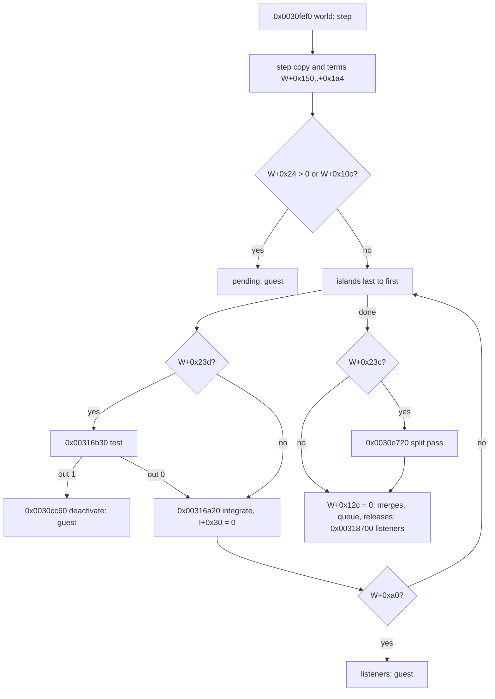

# The Havok integrate phase: deactivation and the island integrate

Status: Partly built. The integrate phase `0x0030fef0`, the deactivation test `0x00316b30` and the island integrate `0x00316a20` run as answering arms on the paths below; the paths they decline, the runs and lanes across islands and the worker solves are not built.
Code: `crates/rewrites/sim-havok/src/{integrate_phase,deactivation,island_integrate}.rs` (the models), `crates/rewrites/engine/src/sim_physics/{integrate_phase,deactivation,island_integrate,answer}.rs` (the arms' captures), `crates/rewrites/engine/src/sim_physics/parity.rs` (the arms). Tests: `crates/rewrites/engine/tests/sim_havok_differential.rs` and the models' unit tests.
Always installed: the physics entries have no switch.

Phase 5's integrate phase, entry by entry: what each reads and writes,
the path its Rust model covers and what it declines. The models are
bit-exact with retail on the paths they cover; everything else goes to
the guest, counted by reason. The step tree and the censuses are
[havok-step.md](havok-step.md)'s; the arms are
[sim-rewrite-havok.md](sim-rewrite-havok.md) §9.5.

Evidence: as havok-step.md (**E** read with `h2 disasm`, **Code**, **S**
supposed).

## The integrate phase

`0x0030fef0`, thiscall on the world, one stack argument (the step
`{dt, 1/dt}`), `ret 4`, in order (**E**):

1. `W+0x150`/`+0x154` = the step. `W+0x170` = `W+0x180` dt and `W+0x174`
   = `W+0x17c` (an integer) 1/dt, each x87 then stored as binary32;
   `W+0x198`/`+0x19c` copy them; `W+0x1a0` = `W+0x17c` `W+0x170`,
   `W+0x1a4` = `W+0x180` `W+0x174`.
2. `0x00175f40` (a bare `ret`); `0x0030f6b0` while `W+0x24 > 0`;
   `0x0030ce20` when `W+0x10c != 0`. Then `W+0x10c = 0` and the lock
   byte `W+0x12c = 1`.
3. The count `W+0xc` once, then each island `[W+8][i]` from the last: the
   deactivation test when `W+0x23d` is set (out 1 calls `0x0030cc60`
   instead of the integrate), else the island integrate and
   `I+0x30 = 0`; `0x00318830` per island while `W+0xa0 != 0`.
4. `0x0030e720` when `W+0x23c` is set. It leaves an island alone when
   `I+0x40 != 0` and the byte `I+0x28` is clear; otherwise it removes
   the island or splits it. Its frame links `fs:[0]` and restores it.
5. `W+0x12c = 0`; `0x0030fc30` when `W+0xf4 != 0`; `0x0030cda0` when
   `W+0x100 != 0`; `0x0030d400` and a release over `W+0x114` while
   `W+0x118 > 0`, then `W+0x118 = 0`.
6. `0x00318700`: the step listeners `W+0x84` (count `W+0x88`), each
   `vt[+0x04]`, from the last, then the array compacted; then
   `0x0030c180` returns `W+0xc0`, and a non-zero one is called through
   `vt[+0x04]`.

On return eax and ecx are the monitor words `[0x00480158]` and
`[0x00480154]`, edx is `[W+0x88] - 1`, ebx, ebp, esi and edi are as on
entry, and the flags are those of `cmp ecx, eax`. Its one caller, the
world step's resume `0x00311116`, pops and returns. **E**

**The port.** `sim_havok::integrate_phase::phase` runs the entry on one
journal, the deactivation test and the island integrate of every island
in the phase's order, so each island reads what the one before it left,
the solver buffer included. The engine's `sim_physics/integrate_phase.rs`
captures the journal and the registers above, with edx `0xffffffff`, and
`parity`'s `physics.integrate` arm answers with it from the first call. The out
byte of each test lands in the phase's own argument slot, dead at the
return, and is not stored. A call declines, counted by reason
(`integrate_phase::fallbacks`, `havok.islands`'s `phase`):

| Reason | When |
|---|---|
| `memory` | a word is unreadable or unaligned, more than 65,536 islands, a store unwritable, or two stores share physical bytes |
| `pending` | `W+0x24 > 0`, `W+0x10c`, `W+0xf4` or `W+0x100` non-zero, or `W+0x118 > 0` |
| `deactivate` | an island's test returns 1 |
| `listener` | `W+0xa0`, `W+0x88` or `W+0xc0` non-zero |
| `split` | the split pass would remove or split an island |
| `island` | the test or the integrate declines an island; the guest's own call to it counts the reason in that arm |
| `float` | an unmasked exception, a non-empty x87 stack, or a non-finite float the x87 code loads |
| `monitor` | the monitor stream is on |
| `unobserved` | kept on the wire; no call is audited, so it reads 0 |

When the phase declines, the lifted phase runs and reaches the test and the
integrate through the dispatcher, so their arms answer inside it.

## The deactivation test

`0x00316b30`, thiscall on the island, two stack arguments (the out byte's
address, the step), `ret 8`; eax is the out pointer, which the caller
reads (`0x0030ffee`). ecx and edx are scratch: the caller writes both
before reading them. **E**

| Step | Reads | Writes |
|---|---|---|
| Timers | dt, `I+0x34`, `I+0x38` | `I+0x34 += dt`, `I+0x38 += dt` (x87, stored binary32) |
| First period fires: `I+0x34 > W+0x30` (ordered) | | `I+0x34 -= W+0x30`; every entity's deactivator slot `+0x14`; all at rest: the signed byte `I+0x2c` below 5 counts up and out is 0, else `I+0x2c = 0` and out is 1 |
| Else second period: `I+0x38 > W+0x34` | | `I+0x38 -= W+0x34`; slot `+0x18`; out is 1 when all are at rest |
| Neither | | out 0 |

Every entity runs, none skipped; a null deactivator `entity+0x54` counts
as awake. The count `I+0x40` is read again after each call. The step's
argument slot holds the second timer and the deactivators' out bytes, and
is dead at the return. **E**

**The port.** `sim_havok::deactivation::test` on a journal; the engine's
`sim_physics/deactivation.rs` captures it with eax, ebx, ebp, esi, edi
and esp, and `physics.island.deactivation` answers with it from the first call.
Declines (`deactivation::fallbacks`, `havok.islands`'s `deactivation`):
`memory`, `deactivator` (a slot target below does not list), `object`
(Halo's check reaches `0x000e4050`), `float`, `monitor`, `unobserved`.

## Deactivators

| Slot target | Vtable | Test |
|---|---|---|
| `0x003192a0` (both slots) | `0x00415100`, always active | out 0 |
| `0x003144b0` / `0x00314580` | `0x00414abc` | Havok's: the centre and orientation against reference A (`+0x10`, `+0x20`, radius `+0x50`, angle `+0x54`) or B (`+0x30`, `+0x40`, `+0x58`, `+0x5c`) |
| `0x001d1870` / `0x001d18c0` | `0x00455950`, Halo's | Halo's object check `0x001d1910`; awake gives out 0, else Havok's test |

Havok's test, for motion `m = entity+0x3c` (**E**):

1. `d²` = the SSE horizontal sum `z + (y + x)` of (reference centre
   - `m+0xb0`)², stored binary32; `r²` the x87 square of the radius.
2. When `d² < r²` (strict, ordered): `q` = the four-lane sum of
   (reference orientation - `m+0x30`)² in the `0x4e`, `0xb1` shuffle
   order; at rest when the x87 `angle²` is above `q` times the scale
   `+0x08` (ordered).
3. Otherwise the reference orientation becomes `m+0x30` and the centre
   `m+0xb0`, read again after that store, and out is 0.

Halo's check `0x001d1910` reads the object of the deactivator's handle
`+0x60` through `[[0x004e0300]+0x44]` (12-byte entries) and a pinned byte
through the object's definition (`[[0x0051e9b8]+0x44]`, `+0xa0` each,
`+0x70`) at node `+0x64` (`0x60` each, `+0x44`). By the entry's type byte
`+3`: type 0 is not awake when the object's byte `+0x34b` is 1, awake when
pinned, else `0x000e5240` (awake never, unless the byte `+0x3dc` is 1,
which tail-calls `0x000e4050`); type 1 is awake when pinned or when
`0x000efb60` finds a tag-flagged speed not zero (`ucomiss`, unordered
counting as not zero; DAZ ignored, as on the Pentium III); any other type
is awake when pinned. **E**

## The island integrate

`0x00316a20`, thiscall on the island, one stack argument (the step input
`W+0x140`), `ret 4`; ecx is pushed and popped, so ebx, ebp, esi, edi and
ecx are as on entry. Its one caller `0x0030fef0` stores `I+0x30 = 0` and
loads eax from `W+0xa0` right after (`0x0031000b..0x0031000f`), and ecx
and edx are written before any read on every path out of it, so eax, edx
and the flags it leaves are dead. **E**

In order (**E**):

1. The actions `I+0x4c` (count `I+0x50`), each `vt[+0x14]` with
   `W+0x150`. None exist ([havok-step.md](havok-step.md), "Actions").
2. With constraints (`I+0x5c != 0`): `0x0031c100` with step `input+0x10`,
   parameters `input+0x20`, pair words `input+0x50`, gravity
   `[I+0x20]+0xe0`, the island, `I+0x3c`, `I+0x40`, `I+0x58`, `I+0x5c`.
3. Without: a timer record (monitor on only), then for each entity from
   `I+0x40 - 1` down to 0, the array, the motion and the world read again,
   `vt[+0x08]` (step, gravity) then `vt[+0x04]` (step), then a timer
   record.

The two unconstrained virtuals of each type, instruction for instruction
(**E**):

| Types | Forces `vt[+0x08]` | Pose `vt[+0x04]` |
|---|---|---|
| 2, 3 | `0x00319cd0`: the first half of `0x00319df0` (force `+0xc0`, torque `+0xd0`, both zeroed) | `0x00319f70`: velocities saved to `+0xe0`, `+0xf0`, then the pose step, the local centre taken off through the new basis |
| 4, 5 | `0x0031b1c0`: the first half of `0x0031b300` (force `+0xf0`, torque `+0x100` while its `w` is nonzero) | `0x0031b060`: velocities saved to `+0xc0`, `+0xd0`, then the same pose step |
| 6 | none | `0x003195d0`: the pose step, the local centre taken off through the quaternion (`0x002db7a0`) |
| 7 | none | none |

The pose step is the exports' ([havok-step.md](havok-step.md), "Solve and export"): the previous
centre with the swept radius, the centre, the orientation by its rate and
one Newton step, the basis, the translation, and `w` of the centre set
to 1. So types 2 and 3 take the translation through the basis here, where
type 3's export takes it through the quaternion.

**The port.** `sim_havok::island_integrate::integrate` runs the entry on
a write journal: the solve stage of `island_solve`, or `motion_solve`'s
`forces` and `pose` per entity, which share their float code with
`accumulate` and `export`. The engine's
`sim_physics/island_integrate.rs` captures the journal, the callee-saved
registers, ecx and esp, and `parity`'s `physics.island.integrate` arm
answers with it from the first call (sim-rewrite-havok.md §9.5). A call declines
to the guest, counted by reason (`island_integrate::fallbacks`, read with
`havok.islands`), when the island holds actions (`action`), a motion's
unconstrained slots are not one of the four pairs above (`motion`), the
x87 stack is not empty, rounding is not nearest or a float would trap
or load non-finite (`float`), the solve declines (`solve`, its own
reason counted by the solve when the guest calls it), the monitor stream
is on (`monitor`), a word is unreadable or a store unwritable or two
stores share physical bytes (`memory`), or (`unobserved`, kept on the wire and 0).

## Not verified

- How often a match takes each phase decline: `havok.islands`'s `phase`
  in a run. The step listeners `W+0x84` have no census row
  ([havok-step.md](havok-step.md), "Listeners").
- That Halo's check never reaches `0x000e4050` in a match (`object`).
- Worker solves and lanes across islands: each island's solve reads the
  buffer bytes the island before it left (the fixed accumulators' flags),
  so islands of a run are not independent without a read check.

## Related

- [havok-step.md](havok-step.md): the step tree, the censuses, the island solve.
- [sim-rewrite-havok.md](sim-rewrite-havok.md): §7.5, §9.5 and slice 3.
- [agent-api.md](../runtime/agent-api-world.md#havok-the-physics-world): `havok.islands`.
