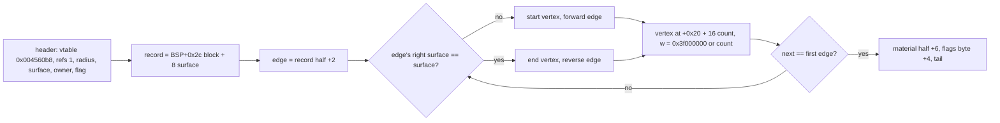

# The Havok structure polygon: the level's child shapes

Status: Partly built. The polygon builder `0x001edd00`, which every child-shape getter of the structure's containers calls, runs as a answering arm; the per-structure polygon cache (`StructureGeo`) and the MOPP through phase 2's decode wait for the narrowphase slices that read them.
Code: `crates/rewrites/sim-havok/src/structure.rs` (`build`), `crates/rewrites/engine/src/sim_physics/structure_polygon.rs` (the capture), `crates/rewrites/engine/src/sim_physics/parity.rs` (`physics.structure.polygon`). Tests: `crates/rewrites/engine/tests/sim_havok_differential.rs` (seeded surfaces, the arm, the declines, the disc sweep) and the unit tests in `structure.rs`.
Always installed: the physics entries have no switch.

A level's collision is a MOPP tree whose keys of type 1 name collision
BSP surfaces. A pair's child agent asks the container for the key's
shape, and the container builds a convex polygon from the surface's
edge ring into a buffer the caller owns. Slice 4 of
[sim-rewrite-havok.md](sim-rewrite-havok.md) ports that builder
bit-exact; the agents that call it stay guest until slices 5 and 6.

Evidence: as [havok-step.md](havok-step.md) (**E** read with `h2 disasm`
and a scan of the XBE, **Code**, **S** supposed).

## Who builds a polygon

| Caller | Container | Builder arguments |
|---|---|---|
| `0x001ee4d0`, `vt[+0x34]` (get child shape: key, buffer; `ret 8`) of the collection vtable `0x00456194` | `[this+0x0c]` the BSP, `[this+0x30]` the owner | transform none, flag 0, the key as the surface, tail 0 |
| `0x001ee500` (eax the container, ecx the buffer, edx the tail, edi the transform; `ret 4`), from `0x001efa79` | as above | flag 0 |
| `0x001ef99b` | `[0x004e0340]`, the structure BSP | flag from edx, owner `-1`, tail from esi, transform none |

The collection's other virtuals are the child count `0x001ee470`
(`vt[+0x28]`) and the key walk `0x001ee490`/`0x001ee4a0`. A null buffer
returns 0 without a build. **E**

## The builder

`0x001edd00`: ecx the shape buffer, edi the transform or 0, five stack
words (BSP, flag byte, owner, surface, tail), `ret 0x14`; eax is the
shape. ebx, ebp and esi are saved; edx is the tail at the return. **E**

| Shape field | Value |
|---|---|
| `+0x00` | `0x004560b8`, the convex polygon vtable (type `0x18`) |
| `+0x06` (half) | 1 |
| `+0x08` | 0, then the tail at the end |
| `+0x0c` | the word at `0x0047f068` |
| `+0x10` | the surface argument |
| `+0x14` | the vertex count |
| `+0x18` (half), `+0x1a`, `+0x1b` | the surface record's half `+6`, its byte `+4`, the flag argument |
| `+0x1c` | the owner argument |
| `+0x20 + 16 i` | vertex `i`: `x, y, z` as stored (or transformed), `w` the feature ID `0x3f000000 or i` |

- The edge's right surface (`+0x0a`) is sign-extended before it is
  compared with the 32-bit surface argument; a match takes the end vertex
  (`+0x02`) and the reverse edge (`+0x06`), else the start (`+0x00`) and
  the forward edge (`+0x04`). The ring ends when the next edge is the
  record's first edge.
- With a transform, each vertex is scaled unless `ucomiss` finds the scale
  equal to `1.0` (`0x0045dbc0`), then rotated by the basis at `+0x04`
  (by input axis, `z` term first) and translated by `+0x28`, all scalar
  SSE under the MXCSR. Without one the words are copied, NaN payloads
  included.
- The builder bounds nothing: a ring longer than the buffer overruns it.

**The port.** `sim_havok::structure::build` on a journal, the engine's
`sim_physics/structure_polygon.rs` capture with eax and ecx the shape,
edx the tail, ebx, ebp, esi and edi, and `parity`'s
`physics.structure.polygon` arm answering every call from the first (sim-rewrite-havok.md
§9.5). Declines, counted by reason (`structure::fallbacks`,
`havok.islands`'s `polygon`):

| Reason | When |
|---|---|
| `memory` | a word is unmapped, a half-word straddles a word, a store unaligned or unwritable, or two stores share physical bytes |
| `ring` | more than 256 vertices, or a ring that does not close |
| `float` | a transform under an MXCSR that does not mask every exception |
| `unobserved` | kept on the wire; no call is audited, so it reads 0 |

The disc sweep `every_disc_surface_polygon_matches_the_lifted_builder`
(`#[ignore]`, `H2_DISC` and `H2_XBE`) builds every surface of every
collision BSP of every map, structure and object tags, as `0x001ee4d0`
does, and compares the shape with the lifted builder's.

## Not verified

- That nothing keeps a pointer to a built polygon past the agent call
  that asked for it (sim-rewrite-havok.md §12, "The polygon builder's output").
- How often a match calls the builder with a transform (`0x001ee500`).
- The meaning of the owner word and the tail.

## Related

- [havok-runtime.md](havok-runtime.md): the BV-tree agents and the keys.
- [sim-rewrite-havok.md](sim-rewrite-havok.md): slice 4 and §9.5.
- [MOPP keys](../formats/mopp.md#keys).
