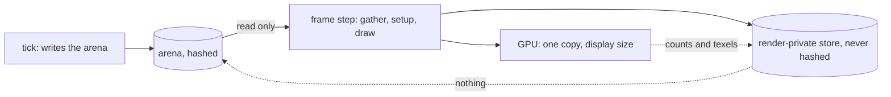

# Sim and render split

Status: Design. The render random stream, the gather-lens exit, the frame guard (slice 1), the tick-end node matrices (slice 4) and the flare store (slice 6) are built; every other row is a slice below.
Code: `crates/extensions/game/src/render_rng.rs` (the private stream), `crates/extensions/game/src/flare_store.rs` (the flare store), `crates/extensions/lockstep/src/frame_guard.rs` and `frame-guard.toml` (the frame guard and its allowlist), `crates/rewrites/engine/src/tick_poses.rs` (the tick-end node matrices), `crates/rewrites/render-bridge/src/native_scene_lists/setup.rs` (`outside_gather_lens`, the object setup seam), `crates/platform/d3d/src/scaled.rs` (`ScaledBackend`, the reference copy), `crates/extensions/game/src/d3d_glue.rs` (`protected_readbacks`, `single_copy`). Tests: `crates/platform/d3d/tests/render_scale.rs`, the unit tests in `frame_guard.rs`.
Switch: `impl.sim.frame-guard` (off, **Code**) and `film.verify` (off, Design, added to [switches.md](../runtime/switches.md) by slice 12).

The simulation is a function of its inputs and its own state. The frame step reads the arena and writes only a render-private store, and no GPU result reaches memory the tick reads. Films and network games are then deterministic whatever the window, lens, scale or frame rate, and the 640x480 reference copy that exact mode draws beside the display ([high-resolution.md](../graphics/high-resolution.md), "Exact mode: reference and view") has no reader.

Evidence labels as in [docs-style.md](../meta/docs-style.md): **E**, **Code**, **Test**, **S**, **Design**. Addresses are research points; no game data is in the repo.

## The one rule

| Rule | Enforced by |
|---|---|
| A frame step leaves every hashed byte as it found it | `impl.sim.frame-guard`: the arena's dirty pages across the frame step, named by page and writer (slice 1) |
| The tick never reads a byte a frame step wrote | the reader census of each render-private field (slices 2 and 8) |
| A run's hash series is the same with the render skipped and with it drawn in any window | the render-blind gate ([The proof](#the-proof)) |

Exact mode answers the second rule by drawing a second, retail-shaped frame for the guest to read. `ScaleStats::reference_draws` equals `display_draws` in such a session (**Code**: `crates/platform/d3d/src/scaled.rs`), and boot selects it for every network, film, input-tape and lockstep session (`d3d_glue::protected_readbacks`). Films record by default, so the second frame is drawn in ordinary play.

## Couplings

Sources: [high-resolution.md](../graphics/high-resolution.md), "Determinism"; [sim.md](../runtime/sim.md), "What the render writes that the sim reads"; [framescene.md](../graphics/framescene.md), "5.2 Writes the tick reads".

| # | Coupling | Guest site | Reaches the sim through | Owner at the end |
|---|---|---|---|---|
| 1 | Animation variant pick | object setup `0x00133790` -> pose request `0x000bd610` -> animate `0x000bdb60` -> overlays `0x000bd970` -> channel select `0x001cb410` (flags `0x7f`) -> selector `0x001dd630` | a stack channel, so only the seed draw at `0x001dd6e1` (gameplay bit set) and the pose it feeds | couplings 2 and 3 ([1](#1-animation-variant-picks)) |
| 2 | Node matrices | `0x000bd610`: the section test at `0x000bd750`, the evaluation at `0x000bd7b2` | shared node matrices, body flag bit 30 cleared; marker lookup reads them | built: `tick_poses.rs` ([2](#2-node-matrices)) |
| 3 | Shared random seed | object code `0x001032a0` reached from the render; `[0x004e7408]` | the tick's next random numbers | built: `render_rng.rs` ([3](#3-the-random-stream)) |
| 4 | Flare visibility byte | writer `0x00020bb0`, reader `0x00020770` (its count read at `0x000207b0`'s call `0x00020840`) | a GPU sample count smoothed into byte 3 of each entry of the array at `0x0051f40c`. No tick code reads the byte; `object_new` reads the entries' heads to free an owner's flares | the renderer ([4](#4-the-flare-visibility-byte)) |
| 5 | Push-buffer callback texels | insert `0x0002460e` in `0x000245c0`, callback `0x00024970`, texels through `0x003fdbc0` and `0x00024a70` | none: the one call passes mode 0, so the insert is never reached | nobody, dead code ([5](#5-the-push-buffer-callback)) |
| 6 | Render scratch in the arena | the gathers and the setup: object visit marks, object `+0xcc`, light render fields, lighting cache | the arena hash only (census class a: the tick does not read them) | the render-private store ([6](#6-render-scratch-and-stamps)) |
| 7 | Particle view stamps | per-view update `0x00174420` | system `+0x0d` bit 2 and `+0xc` bit `0x400`, particle `+0x30` | the render-private store ([6](#6-render-scratch-and-stamps)) |
| 8 | Animation cache | get `0x001237e0` from the render, request `0x001236f0` from the tick | use stamps `+0x14`; which clips are resident when the tick samples | the clip store ([6](#6-render-scratch-and-stamps)) |
| 9 | Frame counters | present `0x00013f10` (`0x00485aa0`), `render_views` (`0x004ba034`, byte `0x004e6098`) | the tick's effect and particle code | the tick driver ([7](#7-frame-counters)) |
| 10 | Game-time bracket | `0x00146de0`, `0x00146b80` around `render_views` | not identified (**S**) | settled by the frame guard |

Frame timing (`0x0012b2e0`, the vblank count) is the logical clock, not the render, and stays as it is ([d3d-timing.md](../graphics/d3d-timing.md)).

### 1. Animation variant picks

| | |
|---|---|
| Guest | The pose request `0x000bd610` calls the animate `0x000bdb60` at `0x000bd7ba`, as the tick's `0x000bd090` does at `0x000bd358`. Its overlay loop `0x000bd970` builds a channel on its own stack (`esp+0x24`, `0x20` bytes, at `0x000bd98d`..`0x000bd9cc`) and binds each overlay into it with `0x001cb410`, flags `0x7f` (bit `0x10` remaps through `0x001dd630`, `0x000bda53`), then samples it (`0x001c6f60`). The facial update `0x0010e530` binds with flags 0 (`0x0010e822`), so it never reaches the selector (**E**, lifted image; **Code**: `sim_anim/manager/tracks/bind.rs`). |
| Why it couples | Every evaluation picks again into a channel that dies with the frame, so no pick is left in a shared channel. What the render's extra evaluation changes is the seed (a draw when the manager's gameplay bit is set) and the node matrices the pick feeds. |
| Move | None of its own. The draw is coupling 3, closed for every session by slice 5; the matrices are coupling 2, closed by slice 4. With both, the render's evaluation reads a pose the tick built and draws only from the render stream. |
| Bar | Contract D, as slices 4 and 5 ([sim-rewrite.md](sim-rewrite.md), section 3). |
| Proof | Run: `sim.render_writes` reports zero gameplay-bit seed draws inside a frame (slice 5's error) and zero setup-time pose evaluations (slice 4). |

**S**: the object type's own animate, `[type +0x6c]` from the table at `0x00468630` (the indirect call at `0x001090a5`), for types other than the unit; the unit's (`0x00112070`) binds without bit `0x10` (`sim_native/unit/tail.rs`, `0x00112cd8`). A type whose animate remaps into the object's own manager channels would leave a pick in the arena; slice 0's selector counter names it if one exists.

### 2. Node matrices

| | |
|---|---|
| Guest | At `0x000bd750` the selected section bytes index the pose-section bitset at the model definition's `+0xc4`. On a hit, with body flag bit 30 set and bit 29 clear, `0x000bd7b2` evaluates the pose into the object's shared node matrices and clears bit 30 (**E**; **Code**: `native_scene_lists/setup/palette.rs::object_pose`, `object_lod.rs`). The tick's own build is `0x000bd090`, which also clears bit 30 ([sim-rewrite-objects.md](sim-rewrite-objects.md)). |
| Why it couples | Marker lookup (`sim_native/marker.rs`) reads those matrices. A listed object has fresh ones and an unlisted one stale ones, so a marker position depends on the camera. A headless host never evaluates them at all. |
| Move | `engine::tick_poses` runs after the record's close in the tick driver (`sim-bridge/src/tick.rs`, before the sound phase). It builds the matrices of every object left with bit 30 set and bit 29 clear by calling `0x000bd090` (`sim_objects/pose.rs` when the native walk holds it), in object index order with an object's pending parents (body `+0x14`) first, so bit 30 is clear on every object when the frame step runs (**Code**). The frame step reads matrices and never writes them. A display-only pose (interpolation, a display LOD) stays on the private overlay of `native_scene_lists/setup.rs`. |
| Cost | Bounded by the census: objects carrying bit 30 at tick end, per map. Hosts pay it too, and get the markers a rendered client has. |
| Proof | Unit (**Test**): `after_the_tick_end_build_the_setup_reads_every_pose_and_writes_none` (the gather-lens fixture reversed, `native_scene_lists/setup.rs`), `every_pending_object_is_built_at_tick_end_whatever_the_view_listed` (`tick_poses/tests.rs`), `the_tick_ends_with_the_dirty_poses_built` (`sim-bridge/src/tick.rs`). Differential: `sim_objects_differential.rs` covers `0x000bd090`. Run: zero `0x000bd7b2` evaluations from the setup in `sim.render_writes`; `Refusal::Palette` for a dirty pose counts zero; `tick_poses::stats().left_dirty` is zero. |

After this slice the gather-lens exit (`outside_gather_lens`) is a cost saving only. A game of several machines can then take the window's frustum, which is open slice 2 of [high-resolution.md](../graphics/high-resolution.md).

### 3. The random stream

| | |
|---|---|
| Guest | The render steps the shared seed through object code (`0x001032a0`). |
| Built | `RENDER_FRAME` swaps the seed for a private stream and restores the simulation's at the frame's end (`render_rng.rs`, `Seeds::enter`, `Seeds::leave`). Every session that renders registers it, lockstep and tapes included. |
| Move | Built: registered for every session that renders. Open: the private seed lives in the render-private store. Once slices 3 and 4 land, a gameplay-bit draw inside a frame is a named error under the frame guard. |
| Proof | Test: the seed bytes before `RENDER_FRAME` equal the bytes after it for a frame that draws N times. Run: the render-blind gate. |

### 4. The flare visibility byte

| | |
|---|---|
| Guest | The writer `0x00020bb0` counts samples of a quad per flare; the reader `0x00020770` divides the count from two frames back by the quad's area and smooths the entry's byte ([d3d-visibility.md](../graphics/d3d-visibility.md)). The draw pass `0x0002df00` reads the byte. |
| Sim readers | None known: the byte gates flare draws, and the scripted look tests pass on their own conditions (**S**, from the static trace in d3d-visibility.md). Slice 2 proves it: a read census of the array with the tick's code as the reader set ([pipelined-render-census.md](../graphics/notes/pipelined-render-census.md) has the tool), zero reads expected. |
| Move | The flare state `0x0051f408..0x005234c8` is render state (**Code**: `crates/extensions/game/src/flare_store.rs`). Around every `RENDER_FRAME` the region holds the render's copy; at the frame's end the copy goes to the render-private store and the simulation's bytes are put back, as the render stream does for the seed. The guest's registration, query, reader and draw pass, the water's class 5 query included, run on the render's copy. A headless run has no entries, and a drawn run's region holds the same bytes. When the simulation's bytes or the loaded map's name (`0x00547898`) change between frames, the copy is dropped. The native query counts on the display copy's depth, one sample per guest pixel, and keeps the reference copy's count only when the display is drawn through a wider lens than the quads (`native_flare_query_glue::counts_on`; **Test**: `single_copy_visibility_counts_guest_pixels`). |
| The tick's free | `object_new` (`0x000b7b40`) calls `0x0002e1e0`, which frees through `0x00020e50` every in-use entry (head bit 4) whose owner (bits 6 to 17) is the new object's index. In the simulation's bytes no entry is in use, so it writes nothing. The store keeps each in-use entry's owner salt at a frame's end and, before the next frame, frees an entry whose owner slot holds a live object of another salt (`Store::enter`). |
| If the census finds a tick reader | That reader gets a value made from sim state: the flare's marker tested against the collision world from the listener's camera, in the tick. No pixel count reaches it. |
| Proof | The census result as a note. **Test**: `flare_store::a_frame_leaves_the_flare_state_as_the_simulation_left_it` (the region's bytes equal across a frame with a flare fully visible and fully hidden), `a_reused_owner_slot_frees_its_flares`; boot's `every_rendering_session_keeps_the_flare_state_out_of_the_arena`. |

### 5. The push-buffer callback

| | |
|---|---|
| Guest | `render_screen_effects` (`0x00013870`) runs `0x000245c0` on the screen record `[0x00485890]` (ESI) and the histogram `0x0051ecf0` (EAX), with the mode in BX. A mode of 1 to 3 every eighth call draws the view into a 64x48 target (`0x000249f0`) and inserts `0x00024970` at `0x0002460e`. The callback builds a 256-float histogram of the block's first byte (`0x00024a70`), normalises it (`0x00024b80`) and writes six floats to the record (`0x00024c70`). Any other mode takes the reset at `0x00024642`: the record gets `{0, [0x0045dc2c], [0x0045dd30]}` (0, 0.75, 0.4) twice and the counter `+0x20` is 0. |
| Sim readers | None. The record is read only by render code (`0x00013870`, `0x000245c0`, `0x00024ee0`), and the callback never runs: the one call of `0x000245c0` (`0x000138a8`) clears EBX first (`0x000138a1`), so every frame takes the reset. Nothing else branches to `0x000245c0` or holds its address, and `0x00024970` appears only as the insert's immediate (`0x00024617`). |
| Move | None. The record's values are the reset's constants, written by the guest every frame, so the native renderer has no value to make and no texel is read back. The insert and the callback are dead guest code; the device's callback delivery (`runtime_glue::deliver_push_callback`) has no caller in Halo. |
| Proof | Test: `engine/tests/screen_record_differential.rs` (needs the XBE): the call site and references by a scan of the image, and `0x000245c0` lifted from any record with BX 0 reaching the call of `0x00024ee0` with the reset's six floats, while BX 1 to 3 takes the insert path. |

### 6. Render scratch and stamps

| State | Move | Proof |
|---|---|---|
| Object visit marks, object `+0xcc`, light render fields, lighting cache, palettes, records | The setup's private overlay is the only writer's target (`native_scene_lists/setup.rs` keeps the display's there already). A guest body that still writes them runs against the overlay's copy. | frame guard: no dirty page under the object, light and cache pools |
| Particle view stamps (`0x00174420`) | The stamps go to a side table keyed by the system's datum (`effects_shadow::view_update` already makes them in Rust). The tick's particle ageing reads no stamp: every system ages as if seen. | frame guard; unit test that ageing is equal for a seen and an unseen system |
| Animation cache use stamps and residency | The tick samples from the clip store (`sim-rewrite.md`, section 2, static data), which holds every clip of the map. The guest cache serves only the render, and its stamps are render-private. | cache-cold arm of the verification ladder, with the guest animation cache emptied each tick |
| Texture and geometry residency, the async I/O pool | Render only (collision is in the tags). | none needed |

**S**: which of these fields lie inside `SimRegion::HALO2`. The frame guard's first run lists them.

### 7. Frame counters

`engine::render_loop::tick_writes` makes the present counter, the render-frame counter and the one-shot byte for a skipped frame ([sim.md](../runtime/sim.md)). It becomes their only writer in every mode, on the logical frame clock, and a drawn frame's present does not add to them. Proof: the existing check on rendered frames, turned from a comparison into the single write, and the render-blind gate at two frame rates.

## The render-private store

| Holds | Keyed by | Lifetime |
|---|---|---|
| the render random seed | process | a session |
| the flare state `0x0051f408..0x005234c8` and the owners' salts | entry | a map: dropped when the simulation's bytes or the map's name change |
| object overlay: pose for display, palettes, records, lighting, visit marks | object datum | a frame, or until the datum is reused |
| particle view stamps | system datum | until the datum is reused |

It is host memory, outside guest RAM: no checkpoint, film, keyframe or hash holds it. A revert or a film seek drops it, and the next frame rebuilds it. **Design.**

## The proof

| Check | What runs | Pass |
|---|---|---|
| Frame guard (`impl.sim.frame-guard`) | at the entry of `0x00223240` the write watch over the arena's pages is drained, the arena copied and the access trap armed for writes on it; at the exit each written page is compared with the copy, and the `SimExt` digest with its entry value | no changed page outside the allowlist; a failure names the page, the pools its changed bytes lie in and the first writer's `pc` (or the host). The allowlist is `frame-guard.toml`, by pool, each entry naming the slice that empties it; it only shrinks (`MAX_ALLOWED`), like `tick-ledger.toml`, and the game-end line names entries no frame wrote |
| Census (`sim.render_writes`, agent API) | counters per frame: setup-time selector calls, setup-time pose evaluations, gameplay-bit seed draws inside a frame, objects with bit 30 at tick end, guarded pages dirtied | all zero but the tick-end count |
| Render-blind gate | one input tape, seed 7, 1,800 ticks, Lockout and Waterworks and one campaign level, in five arms: render skipped (`h2 sim`); 640x480; a 32:9 window at 4x; Theater's free camera; 30 and 120 display frames a second | every `state_hashes_v1` row and arena block equal on every tick; `h2 sim diff` prints nothing |
| Cross-machine | the gate's skipped arm on arm64 and x86-64 against a drawn arm on the other | equal hash series |

The gate is step 4 of the verification ladder in [sim-rewrite.md](sim-rewrite.md) with the render as the variable. It joins the ladder as a step every later phase climbs.

## Slices

Each is one lane of a day or less. A slice lands when its proof row passes; 11 waits for 10.

| # | Slice | Model | Lands |
|---|---|---|---|
| 0 | Census counters and `sim.render_writes`, with a note of the counts per map | Sonnet | the numbers that size 3, 4 and 8 |
| 1 | Frame guard and its shrinking allowlist | Opus | the rule as a test mode |
| 2 | Reader census for the flare array and the callback's stores; static trace of `0x00024970` | Opus | couplings 4 and 5: no tick reader of the byte or the callback's stores; the tick's flare free named |
| 3 | Folded into 4 and 5: the render's variant picks land in a stack channel | none | coupling 1, with 4 and 5 |
| 4 | Node matrices at tick end; the setup's pose path read-only | Opus | coupling 2 |
| 5 | Render stream for every session; gameplay-bit draw in a frame is an error | Sonnet | coupling 3 |
| 6 | Flare array and query in the render-private store, counts from the display depth | Opus | coupling 4 |
| 7 | Callback reach: the one call passes mode 0, so the insert is dead | Opus | coupling 5 closed, nothing to move |
| 8 | Object, light and cache scratch onto the overlay | Opus | coupling 6 |
| 9 | Particle stamps to a side table; animation sampling off the guest cache | Opus | couplings 7 and 8 |
| 10 | Counters from the tick driver in every mode; the render-blind gate in `h2 sim` and the ladder | Sonnet | coupling 9, the gate, coupling 10's answer |
| 11 | Delete exact mode | Opus | the end state below |
| 12 | Film compare behind `film.verify` | Sonnet | the end state below |

Slices 0 to 2 run together. 4 follows 0; 6 and 7 follow 2; 5, 8 and 9 follow 1.

## End state

| Thing | State |
|---|---|
| The reference copy | deleted: `ScaledBackend`'s reference backend, its paired handles, `present_reference`, the resync and proxy-depth repairs, `frame-NNNNN-1x.png` |
| Exact mode | gone: `protected_readbacks`, the `graphics.single_copy` setting and `H2_SINGLE_COPY`. One copy is drawn, at display size, in every session. Relit pixels feed no guest readback, so lighting places no limit on the policy |
| Guest readbacks | none the tick reads. Counts and texels stay in the render-private store |
| Camera | every session takes the window's lens; lockstep and tapes register the fit |
| Films | record and replay without a reference; a film replays in any window. The per-tick gameplay hash and the arena hash run only under `film.verify`, which the gate and CI set |
| Hosts | compute the same picks, matrices and counters as a client that draws |
| Renderer's view of the sim | `&dyn SimRead` ([sim-rewrite.md](sim-rewrite.md), section 7): the compiler holds the rule once the guest front-end is gone |

## Not verified

- Who sets body flag bit 30, and how many objects carry it at tick end.
- That `0x000bd090` gives the matrices `0x000bd7b2` gave for the same object, machines included: the post update (`0x000bc820`) skips `0x000bd090` for type 7, and the tick-end build does not.
- How a pending variant is marked in a channel, and whether an eager pick alters a channel the tick would have replaced before playing it.
- That no tick code reached through an indirect call reads the flare state: the static census follows direct calls and tail transfers only. The run-time census answers it.
- Which render-written fields lie inside the hashed region: the frame guard has not run on a game, so its first findings, and whether the seed's four pools are written in a frame step, are open.
- Arena writes made through another alias of a page: the watch sees them, the trap does not, so their writer reads `unseen`.
- What the game-time bracket writes.
- The tick-end phase's cost on a full campaign level and on a dedicated host.

## Related

[high-resolution.md](../graphics/high-resolution.md), [native-renderer.md](../graphics/native-renderer.md), [sim-rewrite.md](sim-rewrite.md), [sim.md](../runtime/sim.md), [framescene.md](../graphics/framescene.md), [native-objects.md](../graphics/native-objects.md), [film-format.md](../game/film-format.md).
