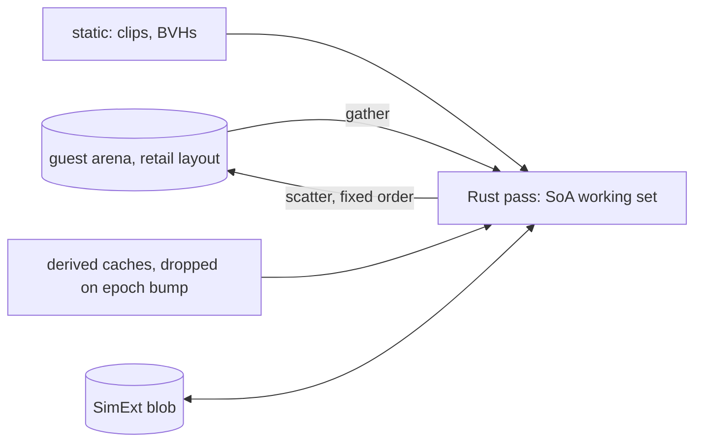
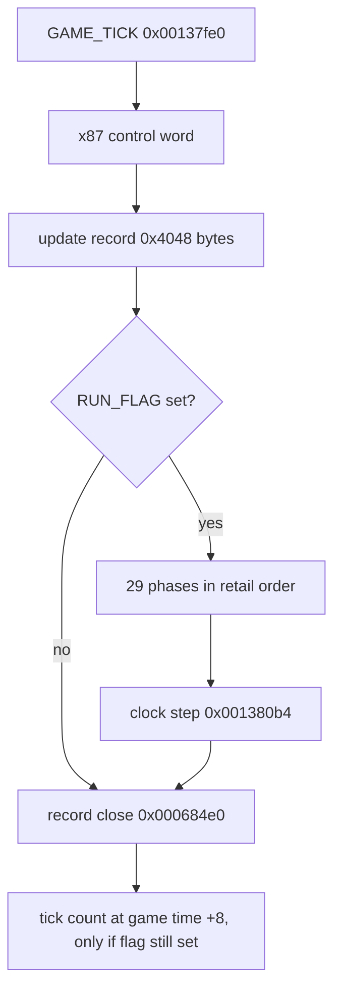
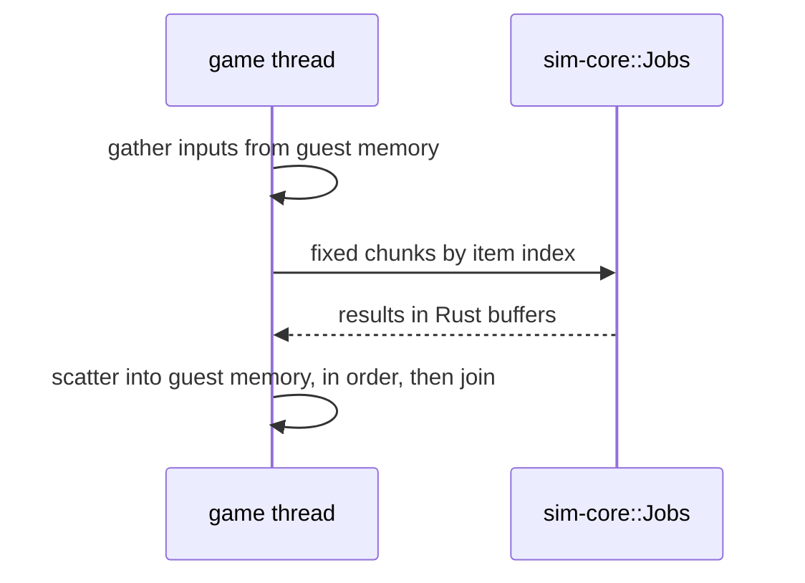

# Simulation rewrite: plan

Status: plan (partly built; the table gives each phase).

```text
guest memory (retail layout, persistent truth)
   ^ scatter                      | gather
   |                              v
Rust subsystem: static + derived + transient + extension state
   phases 1..7, one switch each: impl.sim.native.<subsystem>
```

| Piece | State | Open |
|---|---|---|
| `SimExt` blob (section 2) | partly built, tests only | no feature stores a record yet |
| 1b skeleton walk, `bd090` ([skeleton-walk.md](skeleton-walk.md)) | built, tests only | |
| 1b graph walk, `1dd1c0` | built, native only: the Rust body answers every call its plan accepts; a plan decline is a guest call counted by reason (`anim.graph_walk`) | the plan declines |
| 1c bodies | [markers](markers.md), [first-person palette](palette.md), [unit pose](unit-pose.md), unit aim (`c7840`), [first-person filters](first-person-filters.md) (`166d75`, including `11eed0`) | |
| 1d | the six [channel manager and graph entries](animation-manager.md) answer in Rust; a segment the kernel declines runs its original selector, counted per entry (`anim.manager`) | the segment declines; cumulative 1.2 ms/tick gate |
| 2 collision | answers point, location and MOPP box queries, the object-reference sphere pretest and exact exits in the BSP walk, instance trace, cluster flood and object visit. The whole-query planner follows structure, liquid, instances and object models. It compares its answer at the lifted return and supplies the read-only `collision.trace` method. The [collision entry contracts](collision-queries.md) list each exit | the general Havok ray stays under live parity; exit ladder (run hashes, cold-cache comparison, cross-architecture results, timing) |
| 3 objects | native only, no switch: register-level bodies over the retail frames ([sim-rewrite-objects.md](sim-rewrite-objects.md)), the damage update `d5de0`, lights `c1400` and `c0c80`, function values `bab40` and the pose and after-root dispatchers included. A call outside the float environment is counted and the Rust still answers (`objects.walk.<entry>`). The curve evaluator `13b390` is the kernel in `crates/rewrites/sim-objects`, answering from the first call (`engine::sim_objects::functions::parity`) | curve kinds 9 and 10 and off-path floats run the register-level port `function_eval` (`objects.curve` counts them as answered) |
| 4 sound | opt-in sound arm, and the sound events arm (`impl.sim.sound-events`, [sound-sim.md](sound-sim.md)): a sound ends on a tick computed from its tag, the sound phase makes no guest call until the engine's admission enters an instance, and refusals are ledger counters; a synthetic differential harness compares the guest and Rust sound bodies at each call and return | owner-image, match, campaign, cross-architecture and timing results |
| 5 Havok | kernels and arms ([sim-rewrite-havok.md](sim-rewrite-havok.md)). `impl.sim.native.physics` installs the world step, island collide and island integrate entries, the integrate phase, the deactivation test, the structure polygon builder, the convex agent's process call, the closest-feature query, the add-point call, the island solve and the allocator. The broadphase batch update, the island integrate (the island solve, or each body's forces and pose), the deactivation test, the integrate phase (every island's test and integrate in order, declining pending work, listeners, splits and deactivating islands by reason), the structure polygon builder, the convex agent's separated pairs, the closest-feature query (its triangle case and penetration call included) and the add-point call on a point that moves its slot answer their calls once their capture arms are proven (one call in 64 still compared, the guest on any difference until the next map load). The two unconstrained-motion methods and the MOPP box query run as capture arms compared with the guest. The Havok heap digest (`havok.digest`, the sim report's `havok.world` component) covers what the arena hash cannot. The per-function Havok and MOPP box switches are retired | run ladder; timing gate |
| 6 effects | [effects-parts.md](effects-parts.md), always on: the tick driver runs the effect walk of `176e40` in Rust (the `effects` phase has no guest call in `sim.ledger`). The part switch `17a8a0` runs in Rust: every part class the switch handles (`jpt!`, `obje`, `snd!`, `char`, `coln`, `deca`, `ligh`) is an arm, each compared with the guest until it has matched 4096 parts, then answering with one audit in 64 (the object and decal arms call retail's leaves in order and Rust makes the `coln` and decal draws on the guest's x87 state, so every draw keeps its place); decal, light and flare parts are scene events outside the arena. The walk's per-effect callees `1794e0`, `179730` and `1774f0` are Rust bodies that answer every call; `1792b0` is its port's. The exact ports under the phase ([sim-effects.md](sim-effects.md)) always install; a call outside the float environment is counted and still runs in Rust | groups with no arm are the guest's (named counters); whole-run `h2 sim diff` |

The plan replaces the verdict in [feature-engine.md](feature-engine.md)
("Subsystem map and ranking", rows 15-18) that objects, AI and physics "stay
recompiled": whole subsystems are rewritten, not single functions. The
per-function ports in `crates/rewrites/engine/src/sim_native` and
`crates/rewrites/engine/src/sim_physics` are bit-exact, register-level ports.
They serve as reference and test oracles, not as the architecture.

Numbers come from [sim-attribution.md](../perf/sim-attribution.md), which
gives every sample of the [sim-budget.md](../perf/sim-budget.md) profile an
owner (Waterworks, four local bots, 14.12 ms/tick), unless another source is
named. "All-in" is a family's own guest code plus its emulation, ABI and
runner cost. Addresses are guest virtual addresses already named in the repo
docs.

## Decision summary

| Decision | Choice |
|---|---|
| State | guest memory stays the persistent truth; Rust owns the work |
| Exactness | contract D for every build; bar E (bit-exact with lifted) for verification |
| Order | animation, collision, objects, sound, Havok, effects, seats |
| Switches | one `impl.sim.native.<subsystem>` each |


- **State.** Guest-layout memory stays the persistent truth: the
  `0x3fe000`-byte checkpoint arena and the tag data. Rust owns the *work*:
  how a pass runs, its data layout, and its batching. Rust also owns the state
  that is not persistent truth:
  - **static** data built from tags and the map (decoded clips, collision
    BVHs);
  - **derived** caches that can be thrown away;
  - **transient** per-tick working sets, which a pass gathers from guest
    memory and scatters back to it;
  - **extension** state for new features, in a serialised side arena.

  This is option (c), hybrid, with one fixed rule rather than a separate
  choice per subsystem. Checkpoints, revert, saves, the arena hash, lockstep,
  films and snapshots keep working unchanged.
- **Exactness.** Product contract: the same build and switches give identical
  results on every platform. Matching retail bit for bit is not a product
  requirement, because no feature talks to a retail peer. It is the
  **verification bar** for every phase up to and including objects. With it,
  `h2 sim diff` against the lifted build proves a rewrite. Physics (Havok) is
  the first subsystem allowed to be deterministic but not exact, and only once
  the user signs it off.
- **Order.** Animation and pose first, then collision and spatial queries,
  then the object update, then the sound sim, then Havok, then effects, then
  the per-seat work. The attribution puts animation at 15% of the
  thread and sound at 8.4% plus 2.5% of HLE, and phases 1 to 3 plus Havok end
  near 8.9 ms/tick, short of the target. The phase 0
  census (a phantom roster and a co-op campaign level) runs alongside
  phase 1 and can still reorder everything after phase 3.
- **Switches.** Each subsystem gets one switch, `impl.sim.native.<subsystem>`.
  `-impl.sim.native` turns them all off, because `Switches::implementation`
  falls back up the dotted key. Each new switch retires the per-function
  `impl.sim.native_*` switches it covers. Once its exit criteria hold, the
  switch is removed.

## 1. Goals, non-goals, done

**Goals.** Replace the costly sim families with Rust subsystems that own
their data layout and batch their work. Each must also benefit at least one
of the areas below.

| Area | "Done" means (measured) |
|---|---|
| Frame rate | Waterworks 4-bot sim **≤ 7.5 ms/tick** (from 14.12; the sim-budget target). The attribution's model reaches it after phase 6 if rewritten code runs 3.3× faster than lifted code, and after phase 7 otherwise (section 5). Campaign: guest CPU **≤ 12 ms** of the frame where it is ~23 ms at 4x (needs the phase 0 census to set per-level numbers). Every phase lands with its own ms/tick delta from three unprofiled medians. |
| Host cost | Matches per core **≥ 1.8×** the current count on the light profile (follows ms/tick). Incremental RSS per match process **≤ +32 MiB** for all Rust sim state. Static caches are shared read-only across processes on one machine (mmapped, content-addressed, in the user cache dir, never committed). No worker threads on hosts by default; parallel matches use the cores. |
| Theater and film | Films stay exact (same build). Rust state adds nothing to a film beyond the arena plus the extension arena. A keyframe is the arena plus the extension blob, ≤ 2 ms to take. Seek in a 10-minute film within 1 s, from keyframes every 10 s instead of restarting from boot. Poses come from animation state plus the shared clip store, so the web viewer and theater need no stored poses. |
| Stats | New consumers read typed state and events from a `sim-state` API, with no raw offsets. Kill and damage events come from the subsystem that applies them, not from memory scraping. |
| Engine expansion | New gameplay is written in Rust against the subsystem APIs, with its state in the extension arena and saved with checkpoints. First consumer: Halo 1 health ([halo1/health.md](../halo1/health.md), campaign.md §6). Converted Halo 1 content runs through the same Rust paths. |

**Non-goals.**

- Matching the Xbox's code shape, call graph or register state inside a
  subsystem.
- Retail-console interoperability. None exists
  ([live.md](../live/live.md)), and co-op requires the same image stamp
  ([live-coop.md](../live/live-coop.md)).
- Rewriting the network replication protocol (0.91% of guest time; it is
  the multiplayer contract).
- Running several *guest* threads in parallel
  ([2026-11-16-frame-time.md](../reviews/2026-11-16-frame-time.md), "More game
  threads in parallel?": no).
- Rewriting the renderer. The native renderer is a separate lane, and it
  consumes this work's outputs.

## 2. Who owns state



Every reader goes through guest memory: HaloScript, AI, replication,
checkpoints (`0x123e20` snapshot, `0x123f60` revert, `0x124380` full restore,
writer `0x2151f0`), the renderer, theater (`lockstep::hash_sim(SimRegion::HALO2)`
every 30 ticks), telemetry, and the agent API.

### Options

| Option | For | Against | Verdict |
|---|---|---|---|
| (a) Rust structs are the truth, guest layout a synchronised mirror | cleanest Rust, freest layout | every guest reader needs the mirror current when it reads (about 995 readers of published structures in loading alone; object fields are read inline all over the image). A revert is a guest `memcpy` of the arena that Rust never sees. Two truths mean desync bugs and a per-tick write-back that costs about what it saves | reachable per structure once every reader of it is Rust (stage 3, feature-engine.md "State") |
| (b) Rust works on guest memory through typed zero-copy views | no synchronisation; checkpoints and hashes untouched | keeps the Xbox's array-of-structs, 32-bit-handle, pointer-chasing shape; batching and SIMD across objects get hard; static data stays in retail encodings | the right access mechanism, not enough alone |
| (c) Hybrid | both | one fixed rule instead of a choice per subsystem | chosen |

### Recommendation: (c), one rule

> At every point where guest code can run, and at every tick boundary, guest
> memory holds the complete persistent sim state in its retail layout.
> Rust state is allowed in four kinds only.

| Kind | Example | Lifetime | Checkpoint, revert, snapshot |
|---|---|---|---|
| **Static** | Decoded animation clips, collision BVHs built from BSP and MOPP, marker tables, object-function tables | per map load; content-addressed; shareable across processes | nothing to save; rebuilt from the map |
| **Derived** | Per-channel key cursors, last-pose caches, spatial-index acceleration | any time; must never change a result | dropped on an **epoch bump**: map load, revert `0x123f60`, full restore `0x124380`, snapshot load, or tick regression |
| **Transient** | The SoA working set of one pass (gather, compute, scatter) | inside one Rust call | none |
| **Extension** | State for new features (Halo 1 health) that has no retail home | the match or campaign | serialised into a versioned `SimExt` blob, saved and restored next to the arena by hooks on `0x123e20`, `0x123f60` and `0x124380`, carried in snapshots and films, and folded into the sim hash when present ("The `SimExt` blob", below) |

#### The `SimExt` blob

Partly built, tested on synthetic memory only; no feature stores a record
yet. Code: `crates/rewrites/sim-ext` (the container and its byte form),
`crates/rewrites/sim-bridge/src/sim_ext.rs` (the hooks, feature `sim-ext`,
registered in every run by `crates/apps/boot/src/registration.rs`),
`lockstep::fold_ext` (the hash).

- **Records.** A feature registers a `sim_ext::Kind` (name, layout
  version, cap) and stores its record as bytes it encodes itself.
  `RULES` (`RulesExt`, 64 KiB) and `FORGE` (`ForgeExt`, 64 KiB) are
  registered from the start. `RULES` holds `rules::RulesExt::encode`,
  which the rules host runtime sets at a script game's start and removes
  at its end ([rules-engine.md](../game/rules-engine.md#the-host-runtime));
  `FORGE` is opaque until its owner lands. The container is at most
  256 KiB.
- **Bytes.** No records is zero bytes. Otherwise `"SEXT"`, the format
  (`sim_ext::FORMAT`, 1), the record count, the records in name order
  (name, version, length, bytes) and a CRC-32 of all of it. The form is
  canonical: a restore refuses another format, an unregistered kind, a
  record of another version, a record over its cap, a bad CRC and any
  non-canonical order, and changes nothing when it refuses.
- **Checkpoints.** The guest's slot index is the `u16` at `0x004e3b64`
  (`u16::MAX` before the first save; `crates/platform/xapi/tests/checkpoints.rs`
  reads it after each commit and sets it before each revert). An
  observer before `0x123e20` copies the records into the slot the save
  writes (the other one, slot 0 first). An observer before `0x123f60`
  reads the slot, and the first observer after it restores that slot's
  copy. A revert to a slot no save was seen for (one written by an
  earlier process) clears the records, with a `sim-ext:` line when there
  were any. A full restore at `0x124380` reads a save
  file that has no records beside it, so the observer after it clears
  them, with a line when there were any.
- **Snapshots and films.** The feature's snapshot section holds the live
  records and both slot copies, and is empty when all three are. Film
  keyframes are machine snapshots ([film-format.md](../game/film-format.md)),
  so they carry the same section.
- **The hash.** `lockstep::hash_sim`, `hash_sim_buffered` and
  `hash_sim_blocks` fold the records' FNV-1a digest into the arena hash
  when there is a record, and return the arena hash unchanged when there
  is none. So `HASH` chunks, `impl.sim.arena-hash` and `h2 sim diff` see
  it. The per-block hashes of `h2 sim diff` cover the arena only, so a
  difference in extension state alone shows in the whole hash.
- **Not covered.** A full restore from a save file loses the records
  (campaign save-and-quit). The blob is one per process
  (`sim_ext::global`), and nothing clears it between matches; each owner
  sets or removes its record when its game starts.

Why this holds up:

- **Checkpoints and saves.** These are arena bytes, so they need nothing new.
  Saves made by older builds load, because the layout is the retail one.
  Revert is the dangerous case: a raw `memcpy` that Rust never sees. The
  epoch bump on the revert and restore entry points makes it safe. So does
  the rule that derived state never changes results. A test enforces that
  rule: cold-cache results must equal warm-cache results.
- **Lockstep, co-op and films.** The inputs to guest memory are deterministic
  (section 3), and Rust adds no hidden persistent state. So the same build
  produces the same arena on every peer. The arena hash
  (`lockstep::hash_sim`, `impl.sim.arena-hash`, `HASH` chunks in films)
  keeps its meaning without change.
- **Snapshots.** Rust subsystems hold no continuations across ticks and are
  quiescent at tick boundaries by construction
  ([snapshots.md](../runtime/snapshots.md), "The rule"). A snapshot saves the
  extension blob and drops derived state.
- **Static data is where most of the win is.** Retail decodes compressed tag
  encodings (animation codecs, MOPP bytecode) on every query; a Rust
  subsystem decodes each once into a hot layout. When every reader of a
  structure is Rust, that subsystem can keep a Rust-native copy and write the
  arena form at tick end, so the path to (a) stays open.

The scheduler clock is counted in guest memory accesses
([2026-11-16-frame-time.md](../reviews/2026-11-16-frame-time.md), change 2). Rust
code makes fewer of them, so slice ends move. That is the same for every run
of a build, so it does not affect determinism. It does mean whole-RAM traces
compare only within one switch set, which `exact` fingerprints already
handle.

## 3. Determinism and exactness

### Where each bar applies

| Consumer | Needs | Why |
|---|---|---|
| Co-op (synchronous path and below-game lockstep) | same build on all peers | the image stamp must match (live-coop.md) |
| Dedicated host and its clients | same build | replication is host-authoritative; clients run our build |
| Films | same build, and same results on another machine and architecture | Linux x86-64 hosts record; Mac arm64 players watch |
| Checkpoints and campaign saves | load across our builds | the arena layout is unchanged, so they do |
| Sim training, `h2 sim diff`, A/B | same build plus switches; exact against lifted while a subsystem is being proven | parity is the proof |
| Retail Xbox | nothing | no interop |

**Contract D (always):** the same build and switches give bit-identical
results on arm64 and x86-64, on macOS, Linux and Windows, and whatever the
worker-thread count.

**Bar E (verification, every phase; decision 8.1 keeps physics on it too):** a rewritten subsystem produces the same
bits as the lifted code for every guest-visible write. The win comes from
structure, not from reordering floats. With E, `h2 sim diff` and the arena
digests prove a phase against `-impl.sim.native`, with no tolerance and no
judgement calls.

Getting the animation codecs and pose math exact is cheap: the guest does
them in SSE with a fixed operation order, and the existing ports already
match it with NEON and SSE2 lanes. Where retail uses x87, the Rust kernel uses the `x87` crate's exact operations, or proves the double
result equals the ext80 one, as `sse-native` does.

**Relaxing to D only (not planned; per subsystem, with user sign-off):**
the kernel may reorder floats, use SIMD across bodies and solve islands in
parallel. Verification then moves to behaviour and statistics (below), and
films and goldens get re-recorded per build.

### Float rules for every Rust sim kernel (enforced in `sim-core`)

- IEEE `f32` and `f64` add, sub, mul, div and sqrt only. Those are correctly
  rounded and identical on NEON and SSE2.
- No `mul_add` or FMA, and no compiler fast-math. Rust never contracts on its
  own, and `sim-core` lints against `mul_add`.
- No hardware `rcp` or `rsqrt` estimates, and no platform `libm` (`sin`,
  `atan2`, `exp`, `powf`). Transcendentals come from `sim-core::det`
  (exact-x87 routines from the `x87` crate where bar E applies, fixed
  polynomials where D applies).
- A known host float environment: round to nearest, no flush to zero. The
  pass checks it once at entry; it does not reset it per operation.
- Reductions and accumulation run in a fixed order: object index order, never
  worker order. No `HashMap` iteration feeds results.
- Every RNG draw (`[0x4e7408]` words) stays on the game thread, in retail
  call order.

### Verification ladder (every phase climbs all of it)

1. **Unit tests** on synthetic data in the subsystem crate: every codec,
   shape and edge case. No game data.
2. **Differential tests** (`crates/rewrites/engine/tests/differential.rs`,
   `differential` feature, owner's XBE, skipped without it). Each taken-over
   entry runs against the lifted code on the IR interpreter from the same
   guest state; compare all memory, return value and registers outside the
   clobber list. The old per-function ports join as extra oracles.
3. **Disc sweep** (`#[ignore]`, owner's disc). Run the subsystem over every
   relevant tag on every map (for animation: all 77,856 animations at
   frame 0, a middle frame, the last frame and a fractional frame) against
   the lifted path. Results stay local.
4. **Run parity.** The sim-budget A/B with `-impl.sim.native.<x>` against
   on: Lockout local, Waterworks local and Waterworks mixed, seed 7, 1,800
   ticks, `impl.sim.arena-hash` on. Every `state_hashes_v1` row and arena
   block must match, and `h2 sim diff` must print nothing. Add a headless
   campaign level through the agent API, with arena hashes.
4b. **Render-blind arm.** The same tape from one snapshot with the render
   skipped and drawn in five windows, lenses and frame rates must give
   identical hashes: `scripts/render-blind-gate.sh`
   ([sim-render-split.md](sim-render-split.md), "Running the gate").
5. **Cache-cold arm.** The same runs with derived caches dropped every tick
   must give identical hashes.
6. **Cross-architecture.** The same match on arm64 and x86-64 gives identical
   hash series (the coordinator's Linux host toolchain).
7. **Behaviour suites**, required for the Havok phase and the only bar for a
   subsystem relaxed to D:
   - the headless Halo 1 behaviour suite the coordinator runs before play;
   - the superbounce regression ([high-framerate.md](../game/high-framerate.md) §4);
   - bot match outcome distributions across N seeds (kills, deaths, time
     alive, within a stated tolerance);
   - golden films re-recorded and replayed hash-clean.

The agent method `sim.arms` is the gate read for turning a phase on by default: it reports every subsystem's shadow and authority arms (`checked`, `matched`, `mismatched`, `answered`, `declined`) and `clean` when `checked > 0` and `mismatched == 0` ([agent-api.md](../runtime/agent-api-checks.md#simarms-the-native-sim-gate-read)).

## 4. Subsystem map

The shares are from sim-attribution.md, which owns every sample: the old
"Unreached" 37.5% and "Multiple" 14.3% are gone. Both columns are shares of
the thread. "All-in" charges shared math and CRT helpers to the family that
called them and adds its emulation, ABI and runner cost. "Win" is the
attribution's model at own code 3× faster (range 2× to 4×), on 14.12
ms/tick. Guest own code is 55.7% of the thread, translation tax 32.0%, and
host-only work 12.4% (the bots' Rust brain is 6.8% of that; it was counted
as runtime before).

| Subsystem | Own code | All-in | Data owner today | Readers to keep fed | Risk | Win (Waterworks) |
|---|---:|---:|---|---|---|---|
| Animation and pose (sampling, codecs, manager, graph resolve, node matrices, unit pose, first person, markers) | 9.03% | **15.27%** | channel state in object data; clips in cached resources | node matrices `[body+0x116]` (Havok fetch `1ef070`, markers, render, bounding sphere `bdf90`) | **low** (pure sampling, SSE math) | 1.5 ms (1.3-1.6) |
| Collision and spatial queries, with the Havok ray path | 4.39% | 6.33% | BSP and MOPP tags, cluster and visit marks | objects, weapons, sound, camera (32% of queries, 82% of ray casts), AI | medium | 0.56 ms (0.46-0.61) |
| Objects and types (object core, units, bipeds, vehicles, weapons, lights, damage, tag functions) | 13.49% | **20.59%** | object datums in the arena; object type descriptors | everything: scripts, AI, replication, render, telemetry | high (per-type callbacks) | 1.9 ms (1.6-2.1) |
| Sound sim | 5.21% | 8.37%, plus 2.47% in the audio clock and DirectSound HLE | sound records, listeners | voice scheduling, completion events | medium | 0.77 ms (0.64-0.83), more if the HLE calls go |
| Havok world and its glue, without the ray path | 9.21% | 13.27% | Havok world `0x51e9a4` (in the arena) | objects, bipeds, vehicles | very high (bit-exact) | 1.2 ms (1.0-1.3) |
| Effects, particles, decals | 3.31% | 5.46% | effect and particle datums | the shared RNG (`249170`), damage from effect parts | medium | 0.51 ms (0.43-0.55) |
| Seats and rules (players, aim assist, camera, HUD state, input, game engine) | 7.33% | 12.19% | player and per-seat records | scoring, replication, particles (view scale), camera collision | medium; **roster-dependent** | 1.1 ms (1.0-1.2) on four local seats; unknown on phantoms |
| Cache, main loop, render front-end | 2.43% | 4.22% | resource caches | everything | low | 0.4 ms, mostly small fixes |
| Network replication | 0.97% | 1.46% | the sim record `682e0` | peers | very high | none: stays |
| AI and scripts | 0.29% | 0.47% (bots, no actors) | actors, squads, HS threads | campaign: unknown | very high | **campaign census needed** |

### Sketches

The data, entries, guest boundary and exactness bar of phases 1 to 5 and the
campaign subsystems are in [sim-rewrite-sketches.md](sim-rewrite-sketches.md).
Effects, seats and replication follow here.

**Effects (phase 6).** 5.46% all-in. Particle and effect state can become
fully Rust-owned (stage 3), because only the renderer reads it. The RNG
draws in `249170` must keep retail order.

**Seats and rules (phase 7).** Players, player control and aim assist
(4.55%), the observer and cameras (3.29%), per-user HUD state (1.75%), input
and the game engine. With the animation and collision they ask for, four
local seats drive 16% of the thread. Phantom seats may not run most of it,
so census A's phantom arm decides whether this phase matters to hosts or
only to players.

Built behind `impl.sim.native.seats` (`crates/rewrites/engine/src/sim_seats`,
one entry per function):

| Entry | Function |
|---|---|
| `171d90` | observer camera |
| `185b30` | look curve |
| `185be0` | player-control update: the unbound entry, which the phantom seats take, the bound controller's device read (through its kernel arm, below), and every segment from the first look-curve return on |
| `1505f0`, `150790`, `c6de0` | action, neutral and unit control packet builders |
| `13a838` | HUD per-seat update |
| `1a66f0` | target comparator |
| `16e5e0` | observer resource walk |
| `1a5370`, `1a4900`, `1a4c00` | target search, follow update, shot aim: proven on the disc by the shadow arm rather than the synthetic differential |

The entries install as the shadow's guest-authoritative arm: `shadow.enable`
on, the original answers and each body is checked against it on a copy;
checks off, the bodies answer. The switch retires `native_observer_camera`.

The aim-assist cone, the bound controller's device read and the eight leaf
callees are kernels with their own arms, described in
[sim-rewrite-sketches.md](sim-rewrite-sketches.md#seats-and-rules-phase-7-kernels).

`observer-resources` (the trim that spares the headless host most of the
prediction walk) stays on by default until the seats are promoted. With the
seats on it stands down, because the seats' resource walk covers its point;
with them off it keeps hosts fast. It goes when the seats default on.

**Network replication.** Stays guest. Rust subsystems feed it the same arena
state.

## 5. Roadmap

Each phase ships on its own and defaults on once its exit criteria hold.
Then its switch is deleted, along with the per-function `impl.sim.native_*`
ports it replaces; their bodies stay only as differential oracles if a test
still uses them.

| Phase | Scope | Switch | Exit criteria |
|---|---|---|---|
| **0** (alongside 1) | Census A and B in [sim-attribution.md](../perf/sim-attribution.md): Waterworks with local and phantom rosters, with dispatch counts; co-op campaign on `03a_oldmombasa` and `05a_deltaapproach`. `sim-core` crate. Switch-tree change. Profiler `host` category. The map status poll and damage hook fixes. | none | Attribution tables for both rosters and one co-op level committed. Phase order after 3 decided. |
| **1a** | Animation sampling (detailed below). 3.5% of the thread. | none (native only) | Ladder steps 1-6 clean. Waterworks ≥ 0.3 ms/tick faster. Evaluator family self samples down ≥ 80%. Retires `native_rotation_codec` and `native_animation_stream`. This delta calibrates the model's *k*. |
| **1b** | Node-matrix build (`1421f0`, `142a60`, `141e10`, the loop that drives them in `bd090`'s pose step, and `1dd1c0`). 2.9%. | none; the `bd090` walk always runs in Rust | Ladder clean. Cumulative ≥ 0.6 ms. Retires `native_transform_compose` and `native_pose_matrix`. |
| **1c** | Unit pose and overlays (`112070` with its aim channels and aim angles), the unit aim update `c7840`, first-person pose and filters (`16760c`, `166d75` with its filter step `11eed0`), model nodes and marker transforms (`b8d30`, `1d8f00`, `1d8f50`). 3.9%. | none | Ladder clean. Cumulative ≥ 0.9 ms. Retires `native_unit_pose`, `native_marker_transforms`, `native_first_person_pose`, `native_first_person_filters` and `native_unit_aim`. |
| **1d** | Animation manager and graph resolve (`1c66a0`, `1c6f60`, `1cd590`, `1daea0`, `1dd9d0`, `1ddb40`). 3.4%. | none | Ladder clean. Cumulative **≥ 1.2 ms**. The animation group owns graph resolution. |
| **2** | Collision world and queries, with the Havok ray path | `impl.sim.native.collision` | Ladder clean. ≥ 0.45 ms more. Retires `native_point_to_leaf`, `native_geometry_test`, `native_bsp_segment`, `native_collision_query`, `native_mopp_ray`, `native_spatial_visit` and `native_spatial_portal`. The subsystem owns collision dispatch and the per-function bodies serve as differential oracles. |
| **3** | Object update walk, function evaluator, lights, per-type callbacks type by type (the walks, the per-object updates, units, bipeds, weapons, items, vehicles, projectiles, scenery, devices, machines, crates and creatures in Rust, on by default; then the pose and after-root slots) | none (native only) | Ladder clean. ≥ 1.5 ms more. Retires `native_object_import`, `native_object_value`, `native_base_object_import`, `native_object_pre_update`, `native_object_post_update`, `native_objects_pre_physics`, `native_objects_post_physics`, `native_object_change_colors`, `native_unit_update`, `native_light_record` and `static-light`. |
| **4** | Sound sim | `impl.sim.native.sound` | Opt-in native arm; the voice update is its shadow arm (`sound.voices` in `sim.arms`). Promote after the ladder matches, including voice start and completion order per tick (`sound.voices` clean with answers), and Waterworks saves ≥ 0.6 ms/tick. |
| **5** | Havok world and glue, with the MOPP box query | `impl.sim.native.physics` | Bar E (decision 8.1). Behaviour suites pass. Cross-arch hashes identical. ≥ 1.0 ms more. Retires `native_havok_solver`, `native_havok_support_vertices`, `native_havok_weld` and `native_mopp_box`. |
| **6** | Effects, particles, decals | none (native only) | Ladder clean. ≥ 0.4 ms more. **Waterworks ≤ 7.5 ms/tick** if *k* ≥ 3.3; otherwise after phase 7. |
| **7** | Seats and rules: observer and cameras, player control, aim assist, HUD state | `impl.sim.native.seats` (built) | Ladder clean. ≥ 0.9 ms more on four local seats. Retires `native_observer_camera` (done) and, when the seats default on, `observer-resources`. Skipped for hosts if phantom seats do not run it. |
| **campaign** | HaloScript VM, AI, pathfinding, in the order census B gives; may move ahead of 4 | one per subsystem | Campaign guest CPU ≤ 12 ms at the user's 4x case. |

Projected Waterworks ms/tick after each phase, from the attribution's model
(own code *k* times faster, emulation and runner cost removed inside the
boundary, 40% of x87 kept, 10% boundary cost):

| After | 1 | 2 | 3 | 4 | 5 | 6 | 7 |
|---|---:|---:|---:|---:|---:|---:|---:|
| *k* = 2 | 12.83 | 12.37 | 10.77 | 10.13 | 9.13 | 8.70 | 7.74 |
| *k* = 3 | 12.62 | 12.06 | 10.14 | 9.37 | 8.16 | 7.65 | 6.52 |
| *k* = 4 | 12.51 | 11.90 | 9.82 | 8.99 | 7.67 | 7.12 | 5.90 |

The exit criteria above are the *k* = 2 column rounded down. The bots' Rust
brain (0.96 ms on this roster) is outside every phase and belongs to the
bots lane.

### Phase 1: animation

Slices 1a to 1d (sampling, node matrices, unit pose, markers, first-person bodies, manager and graph resolve) are in [sim-rewrite-phase-1.md](sim-rewrite-phase-1.md).

## The tick driver



`GAME_TICK` (`0x00137fe0`) runs from Rust (`engine::sim_tick::run`, installed
by `sim_bridge::tick::TickDriver`) and keeps the original's order: the x87
control word, the `0x4048`-byte update record, the 29 phases, the clock step,
the record's close and the tick count. Every `GAME_TICK` hook fires at the same
point around it. The steps, the phase owners, the presentation phases
(`impl.sim.present`), the ledger (`sim.ledger`, the ratchet that only falls)
and the proof are in [sim-rewrite-tick.md](sim-rewrite-tick.md).

## AI: the port plan

`ai_update` `0x1c83c0`, tick phase 3, is Rust (`engine/src/ai_update.rs`);
its seven systems are still lifted, one guest call each. Under them sit 326
functions no other phase reaches: about 272k lifted C lines, 85 leaves, 18
indirect sites, 208k of it the actor update `0x1e2f50` (all listed in
[notes/2026-11-28-ai-function-list.md](notes/2026-11-28-ai-function-list.md)).
A case a port can't take yet is `unimplemented!("ai: <cause>")`.

| Step | Port | Held by |
|---|---|---|
| 1 | the small systems whole: `1c81c0`, `20fb30`, teardown `1e3240`, `293830`, `268510` | a differential per system, as `ai_update_matches_lifted` |
| 2 | the actor update's leaves (datum and field reads such as `26be00`) | a differential per leaf |
| 3 | squads `201c80`, then `1e2f50` one callee subtree per slice, its behaviour vtables named per target | the same |
| 4 | the actor and squad arrays leave guest memory (section 2's rule) | the sim ladder |

## 6. Threading inside a tick



- One host thread still runs every guest thread. Rust parallelism happens
  only **inside one Rust call**. The game thread gathers inputs, workers
  compute into Rust buffers, and the game thread scatters into guest memory
  in fixed order and joins before returning to guest code. Workers never
  touch guest memory or call guest code.
- `sim-core::Jobs` is a persistent pool with **fixed chunking by item
  index**. Results do not depend on the worker count; a test runs one, two
  and eight workers and compares bits.
- The worker count comes from settings. It defaults to 1 on hosts and sims,
  where parallel matches use the cores, and to `cores / 2` (capped at 4) for
  `h2 play`.
- Parallel work needs batches, and batches come with phase 3 (the object
  walk). Candidates:
  - pose sampling and matrices per object, in hierarchy waves (roots, then
    children, which compose with parent node matrices, `ba160`);
  - phase 5 islands;
  - effect and particle aging.
- Synchronous guest-driven queries (collision in phase 2) stay serial and
  get cheaper per call instead.
- RNG draws, event emission and anything replication reads happen on the
  game thread, in retail order.

## 7. Interfaces for theater, film, stats and Live

| Consumer | Reads | Source |
|---|---|---|
| Theater and film | `Keyframe`, `HASH` chunks | `sim-state` |
| Stats | `SimEvent` | the subsystem that applies the event |
| Live and hosts | scoreboard, events, shared static caches | `sim-state`, mmapped cache |

The other session (`bed6c8dc`: Live, bots, theater, film) owns the internals.
This is only the surface this work offers. It goes in a new `sim-state` crate
that depends on `sim-core` and the guest views. It is read-only, and is
called at tick end on the game thread.

```rust
pub trait SimRead {
    fn tick(&self) -> u32;
    fn players(&self) -> &[PlayerView];        // typed, from the arena
    fn objects(&self) -> ObjectIter<'_>;       // id, type, tag, transform, parent
    fn anim(&self, object: ObjectId) -> Option<AnimState>; // graph, animation, frame per channel
    fn pose(&self, object: ObjectId, out: &mut [NodeMatrix]) -> bool; // sampled via ClipStore
    fn events(&self) -> &[SimEvent];           // this tick: Kill, Damage, Spawn, Pickup, Score
}
pub struct Keyframe { pub tick: u32, pub arena: Bytes, pub ext: Bytes } // 4 MiB + ext
pub fn keyframe(&self) -> Keyframe;           // no Rust-only state beyond ext
pub fn sim_hash(&self) -> u64;                // hash_sim(HALO2) ⊕ ext, when ext non-empty
```

- **Theater and film.** `HASH` chunks keep `hash_sim`. `KEYF` (reserved
  today) can be `Keyframe`. Arena deltas against the previous keyframe use
  the existing 4 KiB write tracker, which keeps keyframes small. Seek: load
  the keyframe, then replay `NETR` and `RAND` forward. The machine-snapshot
  quiescence rules still apply to the guest side. Rust subsystems add no
  blockers.
- **Stats.** `SimEvent` comes from the Rust subsystem that applies the event,
  once that subsystem is Rust. Until then it comes from the existing hooks
  (`0x15ce70` kill and `0xd9640` damage report, live-gamestate.md).
  live-telemetry's raw readers can move onto `SimRead` at their own pace.
- **Live and hosts.**
  - Static caches (clip store, collision world) are content-addressed
    (`map digest + cache format version`). They are written once to
    `~/Library/Caches/h2recomp` (or the platform equivalent) and mmapped by
    every match process, so a per-match host pays decode once per machine.
  - `Jobs` stays at 1 on hosts.
  - `sim-state` gives a dedicated host the scoreboard and events without
    memory scraping.

## 8. Decisions

| # | Decision |
|---|---|
| 1 | Physics stays bit-exact with retail |
| 2 | Films replay across architectures |
| 3 | Co-op campaign measures frame rate and host density |
| 4 | Per-function switches go as each subsystem lands |
| 5-7 | Review outcomes: both routes run, Havok stays bit-exact, recompiler contract changes |


1. **Physics stays bit-exact with retail.** The Havok phase (phase 5) replaces Havok with a structural port held to
   bar E. Films and goldens stay valid across builds;
   the win is smaller than a free rewrite would give.
2. **Films replay across architectures.** A film recorded on a Linux x86-64
   host must replay on a Mac arm64 build. The `sim-core` float rules are
   mandatory, and every phase's exit criteria include matching x86-64 and
   arm64 tick hashes.
3. **After phase 2, both campaign frame rate and host density, measured on
   co-op campaign.** Co-op campaign carries AI, scripts and actors and also
   runs as a hosted, lockstepped match, so one census and one benchmark
   cover both goals. The phase 0 census and the exit timings for phase 3 and
   later use a co-op campaign run as well as Waterworks.
4. **Per-function switches go as each subsystem lands.** The 32
   `impl.sim.native_*` switches are deleted when their subsystem's switch
   replaces them. Their bodies stay only as test oracles.

### Review outcomes

5. **Both routes run.** The sim-tier experiment from
   [2026-11-20-sim.md](../reviews/2026-11-20-sim.md) (the tick closure recompiled under a
   looser contract, checked by per-phase arena hashes) runs alongside the
   hand rewrites in this plan. Neither waits on the other. The experiment's
   one-week gate (four leaf families, 5x) decides how far it goes; a hand
   rewrite that the tier later covers is kept only if it is still faster.
6. **Havok stays bit-exact (decision 1 stands).** Halo's physics,
   superbounces included, are part of the game. The sim review's advice to
   drop the bit-exact port is declined. Superbounces must also survive at
   120 fps: the tick stays 30 Hz and only the picture is interpolated
   ([high-framerate.md](../game/high-framerate.md),
   [superbounce.md](../game/superbounce.md)). No phase may raise the tick
   rate or change `dt` for physics.
7. **The recompiler contract changes, starting with thin transfers and
   flat RAM.** From [2026-11-20-architecture.md](../reviews/2026-11-20-architecture.md):
   cheaper guest/host transfers, and flat RAM as the only memory model.
   The other items in that review wait.
