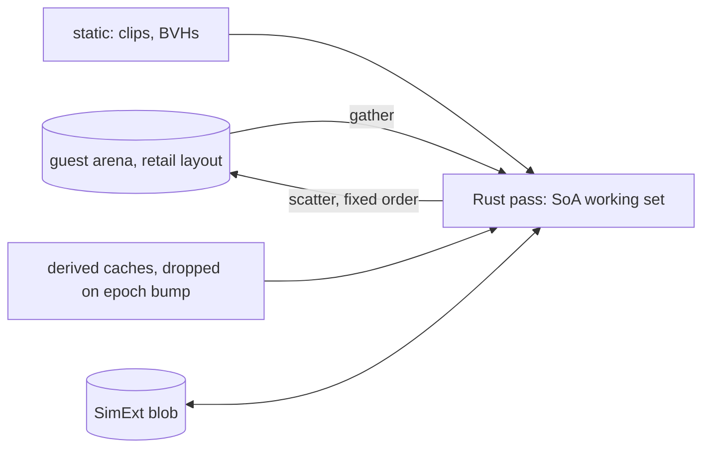
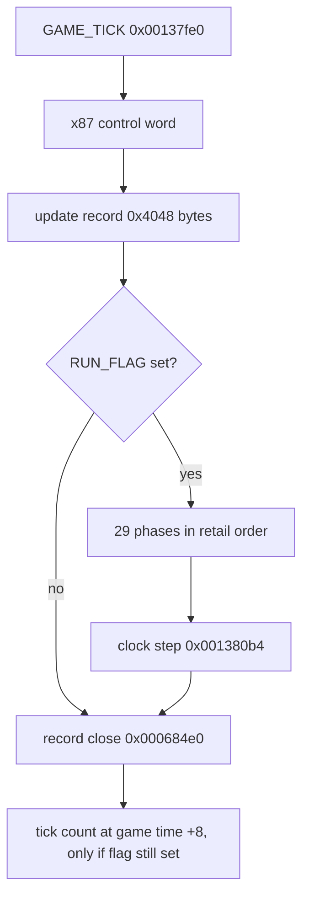
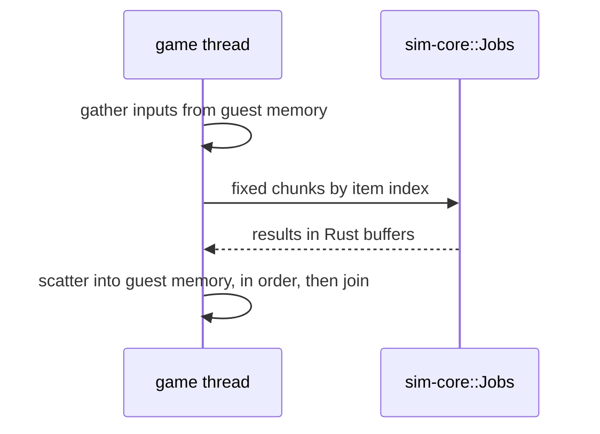

# Simulation rewrite: plan

Status: plan (partly built; the table gives each phase).

```text
guest memory (retail layout, persistent truth)
   ^ scatter                      | gather
   |                              v
Rust subsystem: static + derived + transient + extension state
   phases 1..7, one switch each: impl.sim.native.<subsystem>
```

| Piece | State | Open |
|---|---|---|
| `SimExt` blob (section 2) | partly built, tests only | no feature stores a record yet |
| 1b skeleton walk, `bd090` ([skeleton-walk.md](skeleton-walk.md)) | built, tests only | |
| 1b graph walk, `1dd1c0` | built, runs as an arm: the guest answers and the Rust result is compared with it until the arm is proven. Then the Rust body answers and one call in 64 is still compared | |
| 1c bodies | [markers](markers.md), [first-person palette](palette.md), [unit pose](unit-pose.md), unit aim (`c7840`), [first-person filters](first-person-filters.md) (`166d75`, including `11eed0`) | |
| 1d | compares all six [channel manager and graph entries](animation-manager.md) with the guest at their entry and return selectors. The guest supplies the result | verification ladder; cumulative 1.2 ms/tick gate |
| 2 collision | answers point, location and MOPP box queries, the object-reference sphere pretest and exact exits in the BSP walk, instance trace, cluster flood and object visit. The whole-query planner follows structure, liquid, instances and object models. It compares its answer at the lifted return and supplies the read-only `collision.trace` method. The [collision entry contracts](collision-queries.md) list each exit | the general Havok ray stays under live parity; exit ladder (run hashes, cold-cache comparison, cross-architecture results, timing) |
| 3 objects | `impl.sim.native.objects`: register-level bodies over the retail frames ([sim-rewrite-objects.md](sim-rewrite-objects.md)). The curve evaluator for the tag-function curves (`13b390`, which every function value, light and screen effect flows through) runs as an idiomatic kernel in `crates/rewrites/sim-objects`. It is compared with the guest until it has matched 4096 calls, then answers them with an audit of every 64th (`engine::sim_objects::functions::parity`) | |
| 4 sound | opt-in sound arm; a synthetic differential harness compares the guest and Rust sound bodies at each call and return | owner-image, match, campaign, cross-architecture and timing results |
| 5 Havok | kernels and arms ([sim-rewrite-havok.md](sim-rewrite-havok.md)). `impl.sim.native.physics` installs the world step, island collide and island integrate entries. The broadphase batch update answers its calls once its capture arm is proven (one call in 64 still compared). The two unconstrained-motion methods and the MOPP box query run as capture arms compared with the guest. The Havok heap digest (`havok.digest`, the sim report's `havok.world` component) covers what the arena hash cannot. The per-function Havok and MOPP box switches are retired | run ladder; timing gate |

The plan replaces the verdict in [feature-engine.md](feature-engine.md)
("Subsystem map and ranking", rows 15-18) that objects, AI and physics "stay
recompiled". The user asked on 2026-11-16 and 2026-11-17 for whole-subsystem
rewrites, not per-function patches.

The per-function ports in `crates/rewrites/engine/src/sim_native` and
`crates/rewrites/engine/src/sim_physics` are bit-exact, register-level ports of
single functions. They serve as **reference and test oracles**. They are not
the architecture.


Numbers come from [sim-attribution.md](../perf/sim-attribution.md), which
gives every sample of the [sim-budget.md](../perf/sim-budget.md) profile an
owner (Waterworks, four local bots, 14.12 ms/tick), unless another source is
named. "All-in" is a family's own guest code plus its emulation, ABI and
runner cost. Addresses are guest virtual addresses already named in the repo
docs.

## Decision summary

| Decision | Choice |
|---|---|
| State | guest memory stays the persistent truth; Rust owns the work |
| Exactness | contract D for every build; bar E (bit-exact with lifted) for verification |
| Order | animation, collision, objects, sound, Havok, effects, seats |
| Switches | one `impl.sim.native.<subsystem>` each |


- **State.** Guest-layout memory stays the persistent truth: the
  `0x3fe000`-byte checkpoint arena and the tag data. Rust owns the *work*:
  how a pass runs, its data layout, and its batching. Rust also owns the state
  that is not persistent truth:
  - **static** data built from tags and the map (decoded clips, collision
    BVHs);
  - **derived** caches that can be thrown away;
  - **transient** per-tick working sets, which a pass gathers from guest
    memory and scatters back to it;
  - **extension** state for new features, in a serialised side arena.

  This is option (c), hybrid, with one fixed rule rather than a separate
  choice per subsystem. Checkpoints, revert, saves, the arena hash, lockstep,
  films and snapshots keep working unchanged.
- **Exactness.** Product contract: the same build and switches give identical
  results on every platform. Matching retail bit for bit is not a product
  requirement, because no feature talks to a retail peer. It is the
  **verification bar** for every phase up to and including objects. With it,
  `h2 sim diff` against the lifted build proves a rewrite. Physics (Havok) is
  the first subsystem allowed to be deterministic but not exact, and only once
  the user signs it off.
- **Order.** Animation and pose first, then collision and spatial queries,
  then the object update, then the sound sim, then Havok, then effects, then
  the per-seat work. Revised 2026-11-20 from the full attribution: animation
  is 15% of the thread, not 5%; sound is 8.4% plus 2.5% of HLE; and phases 1
  to 3 plus Havok end near 8.9 ms/tick, short of the target. The phase 0
  census (a phantom roster and a co-op campaign level) runs alongside
  phase 1 and can still reorder everything after phase 3.
- **Switches.** Each subsystem gets one switch, `impl.sim.native.<subsystem>`.
  `-impl.sim.native` turns them all off, because `Switches::implementation`
  falls back up the dotted key. Each new switch retires the per-function
  `impl.sim.native_*` switches it covers. Once its exit criteria hold, the
  switch is removed.

## 1. Goals, non-goals, done

**Goals.** Replace the costly sim families with Rust subsystems that own
their data layout and batch their work. Each must also benefit at least one
of the areas below.

| Area | "Done" means (measured) |
|---|---|
| Frame rate | Waterworks 4-bot sim **≤ 7.5 ms/tick** (from 14.12; the sim-budget target). The attribution's model reaches it after phase 6 if rewritten code runs 3.3× faster than lifted code, and after phase 7 otherwise (section 5). Campaign: guest CPU **≤ 12 ms** of the frame where it is ~23 ms today at 4x (needs the phase 0 census to set per-level numbers). Every phase lands with its own ms/tick delta from three unprofiled medians. |
| Host cost | Matches per core **≥ 1.8×** today on the light profile (follows ms/tick). Incremental RSS per match process **≤ +32 MiB** for all Rust sim state. Static caches are shared read-only across processes on one machine (mmapped, content-addressed, in the user cache dir, never committed). No worker threads on hosts by default; parallel matches use the cores. |
| Theater and film | Films stay exact (same build). Rust state adds nothing to a film beyond the arena plus the extension arena. A keyframe is the arena plus the extension blob, ≤ 2 ms to take. Seek in a 10-minute film within 1 s, from keyframes every 10 s instead of restarting from boot. Poses come from animation state plus the shared clip store, so the web viewer and theater need no stored poses. |
| Stats | New consumers read typed state and events from a `sim-state` API, with no raw offsets. Kill and damage events come from the subsystem that applies them, not from memory scraping. |
| Engine expansion | New gameplay is written in Rust against the subsystem APIs, with its state in the extension arena and saved with checkpoints. First consumer: Halo 1 health ([halo1/health.md](../halo1/health.md), campaign.md §6). Converted Halo 1 content runs through the same Rust paths. |

**Non-goals.**

- Matching the Xbox's code shape, call graph or register state inside a
  subsystem.
- Retail-console interoperability. None exists today
  ([live.md](../live/live.md)), and co-op requires the same image stamp
  ([live-coop.md](../live/live-coop.md)).
- Rewriting the network replication protocol (0.91% of guest time; it is
  the multiplayer contract).
- Running several *guest* threads in parallel
  ([2026-11-16-frame-time.md](../reviews/2026-11-16-frame-time.md), "More game
  threads in parallel?": no).
- Rewriting the renderer. The native renderer is a separate lane, and it
  consumes this work's outputs.

## 2. Who owns state



Today every reader goes through guest memory: HaloScript, AI, replication,
checkpoints (`0x123e20` snapshot, `0x123f60` revert, `0x124380` full restore,
writer `0x2151f0`), the renderer, theater (`lockstep::hash_sim(SimRegion::HALO2)`
every 30 ticks), telemetry, and the agent API.

### Options

**(a) Rust structs are the truth; guest layout is a synchronised mirror.**

- Pros: the cleanest Rust, and the most freedom of layout.
- Cons: every remaining guest reader needs the mirror current at the moment
  it reads. About 995 readers of published structures are known in loading
  alone, and object fields are read inline all over the image. A checkpoint
  revert is a guest `memcpy` of the whole arena, so Rust state goes stale
  without warning. Saves are arena bytes. Two copies of the truth means a
  whole class of desync bugs, plus a write-back on every tick that costs
  about what we save.
- Verdict: only reachable per structure once every reader of that structure
  is Rust (stage 3 in feature-engine.md "State").

**(b) Rust operates on guest memory through typed zero-copy views.**

- Pros: no synchronisation. Checkpoints and hashes are untouched.
- Cons: the work keeps the Xbox's array-of-structs, 32-bit-handle,
  pointer-chasing shape. Batching and SIMD across objects get hard. Static
  data stays in its compressed retail encodings.
- Verdict: the right *access* mechanism, but not enough on its own.

**(c) Hybrid.**

### Recommendation: (c), one rule

> At every point where guest code can run, and at every tick boundary, guest
> memory holds the complete persistent sim state in its retail layout.
> Rust state is allowed in four kinds only.

| Kind | Example | Lifetime | Checkpoint, revert, snapshot |
|---|---|---|---|
| **Static** | Decoded animation clips, collision BVHs built from BSP and MOPP, marker tables, object-function tables | per map load; content-addressed; shareable across processes | nothing to save; rebuilt from the map |
| **Derived** | Per-channel key cursors, last-pose caches, spatial-index acceleration | any time; must never change a result | dropped on an **epoch bump**: map load, revert `0x123f60`, full restore `0x124380`, snapshot load, or tick regression |
| **Transient** | The SoA working set of one pass (gather, compute, scatter) | inside one Rust call | none |
| **Extension** | State for new features (Halo 1 health) that has no retail home | the match or campaign | serialised into a versioned `SimExt` blob, saved and restored next to the arena by hooks on `0x123e20`, `0x123f60` and `0x124380`, carried in snapshots and films, and folded into the sim hash when present ("The `SimExt` blob", below) |

#### The `SimExt` blob

Partly built, tested on synthetic memory only; no feature stores a record
yet. Code: `crates/rewrites/sim-ext` (the container and its byte form),
`crates/rewrites/sim-bridge/src/sim_ext.rs` (the hooks, feature `sim-ext`,
registered in every run by `crates/apps/boot/src/registration.rs`),
`lockstep::fold_ext` (the hash).

- **Records.** A feature registers a `sim_ext::Kind` (name, layout
  version, cap) and stores its record as bytes it encodes itself.
  `RULES` (`RulesExt`, 64 KiB) and `FORGE` (`ForgeExt`, 64 KiB) are
  registered from the start. `RULES` holds `rules::RulesExt::encode`,
  which the rules host runtime sets at a script game's start and removes
  at its end ([rules-engine.md](../game/rules-engine.md#the-host-runtime));
  `FORGE` is opaque until its owner lands. The container is at most
  256 KiB.
- **Bytes.** No records is zero bytes. Otherwise `"SEXT"`, the format
  (`sim_ext::FORMAT`, 1), the record count, the records in name order
  (name, version, length, bytes) and a CRC-32 of all of it. The form is
  canonical: a restore refuses another format, an unregistered kind, a
  record of another version, a record over its cap, a bad CRC and any
  non-canonical order, and changes nothing when it refuses.
- **Checkpoints.** The guest's slot index is the `u16` at `0x004e3b64`
  (`u16::MAX` before the first save; `crates/platform/xapi/tests/checkpoints.rs`
  reads it after each commit and sets it before each revert). An
  observer before `0x123e20` copies the records into the slot the save
  writes (the other one, slot 0 first). An observer before `0x123f60`
  reads the slot, and the first observer after it restores that slot's
  copy. A revert to a slot no save was seen for (one written by an
  earlier process) clears the records, with a `sim-ext:` line when there
  were any. A full restore at `0x124380` reads a save
  file that has no records beside it, so the observer after it clears
  them, with a line when there were any.
- **Snapshots and films.** The feature's snapshot section holds the live
  records and both slot copies, and is empty when all three are. Film
  keyframes are machine snapshots ([film-format.md](../game/film-format.md)),
  so they carry the same section.
- **The hash.** `lockstep::hash_sim`, `hash_sim_buffered` and
  `hash_sim_blocks` fold the records' FNV-1a digest into the arena hash
  when there is a record, and return the arena hash unchanged when there
  is none. So `HASH` chunks, `impl.sim.arena-hash` and `h2 sim diff` see
  it. The per-block hashes of `h2 sim diff` cover the arena only, so a
  difference in extension state alone shows in the whole hash.
- **Not covered.** A full restore from a save file loses the records
  (campaign save-and-quit). The blob is one per process
  (`sim_ext::global`), and nothing clears it between matches; each owner
  sets or removes its record when its game starts.

Why this holds up:

- **Checkpoints and saves.** These are arena bytes, so they need nothing new.
  Saves made by older builds load, because the layout is the retail one.
  Revert is the dangerous case: a raw `memcpy` that Rust never sees. The
  epoch bump on the revert and restore entry points makes it safe. So does
  the rule that derived state never changes results. A test enforces that
  rule: cold-cache results must equal warm-cache results.
- **Lockstep, co-op and films.** The inputs to guest memory are deterministic
  (section 3), and Rust adds no hidden persistent state. So the same build
  produces the same arena on every peer. The arena hash
  (`lockstep::hash_sim`, `impl.sim.arena-hash`, `HASH` chunks in films)
  keeps its meaning without change.
- **Snapshots.** Rust subsystems hold no continuations across ticks and are
  quiescent at tick boundaries by construction
  ([snapshots.md](../runtime/snapshots.md), "The rule"). A snapshot saves the
  extension blob and drops derived state.
- **Static data is where most of the win is.** Retail code decodes
  compressed tag encodings (animation codecs, the MOPP bytecode) on every
  query. A Rust subsystem decodes each one once into a hot layout.
- **The path to (a) stays open.** When every reader of a structure is Rust
  (for example, animation channel state after phase 3), that subsystem can
  keep a Rust-native copy and write the arena form only at tick end. The
  arena stays the checkpoint format.

The scheduler clock is counted in guest memory accesses
([2026-11-16-frame-time.md](../reviews/2026-11-16-frame-time.md), change 2). Rust
code makes fewer of them, so slice ends move. That is the same for every run
of a build, so it does not affect determinism. It does mean whole-RAM traces
compare only within one switch set, which `exact` fingerprints already
handle.

## 3. Determinism and exactness

### Where each bar applies

| Consumer | Needs | Why |
|---|---|---|
| Co-op (synchronous path and below-game lockstep) | same build on all peers | the image stamp must match (live-coop.md) |
| Dedicated host and its clients | same build | replication is host-authoritative; clients run our build |
| Films | same build, and same results on another machine and architecture | Linux x86-64 hosts record; Mac arm64 players watch |
| Checkpoints and campaign saves | load across our builds | the arena layout is unchanged, so they do |
| Sim training, `h2 sim diff`, A/B | same build plus switches; exact against lifted while a subsystem is being proven | parity is the proof |
| Retail Xbox | nothing | no interop |

**Contract D (always):** the same build and switches give bit-identical
results on arm64 and x86-64, on macOS, Linux and Windows, and whatever the
worker-thread count.

**Bar E (verification, every phase; decision 8.1 keeps physics on it too):** a rewritten subsystem produces the same
bits as the lifted code for every guest-visible write. The win comes from
structure, not from reordering floats. With E, `h2 sim diff` and the arena
digests prove a phase against `-impl.sim.native`, with no tolerance and no
judgement calls.

Getting the animation codecs and pose math exact is cheap: the guest does
them in SSE with a fixed operation order, and the existing ports already
match it with NEON and SSE2 lanes. Where retail uses x87, the Rust kernel uses the `x87` crate's exact operations, or proves the double
result equals the ext80 one, as `sse-native` does.

**Relaxing to D only (not planned; per subsystem, with user sign-off):**
the kernel may reorder floats, use SIMD across bodies and solve islands in
parallel. Verification then moves to behaviour and statistics (below), and
films and goldens get re-recorded per build.

### Float rules for every Rust sim kernel (enforced in `sim-core`)

- IEEE `f32` and `f64` add, sub, mul, div and sqrt only. Those are correctly
  rounded and identical on NEON and SSE2.
- No `mul_add` or FMA, and no compiler fast-math. Rust never contracts on its
  own, and `sim-core` lints against `mul_add`.
- No hardware `rcp` or `rsqrt` estimates, and no platform `libm` (`sin`,
  `atan2`, `exp`, `powf`). Transcendentals come from `sim-core::det`
  (exact-x87 routines from the `x87` crate where bar E applies, fixed
  polynomials where D applies).
- A known host float environment: round to nearest, no flush to zero. The
  pass checks it once at entry; it does not reset it per operation.
- Reductions and accumulation run in a fixed order: object index order, never
  worker order. No `HashMap` iteration feeds results.
- Every RNG draw (`[0x4e7408]` words) stays on the game thread, in retail
  call order.

### Verification ladder (every phase climbs all of it)

1. **Unit tests** on synthetic data in the subsystem crate: every codec,
   shape and edge case. No game data.
2. **Differential tests** (`crates/rewrites/engine/tests/differential.rs`,
   `differential` feature, owner's XBE, skipped without it). Each taken-over
   entry runs against the lifted code on the IR interpreter from the same
   guest state; compare all memory, return value and registers outside the
   clobber list. The old per-function ports join as extra oracles.
3. **Disc sweep** (`#[ignore]`, owner's disc). Run the subsystem over every
   relevant tag on every map (for animation: all 77,856 animations at
   frame 0, a middle frame, the last frame and a fractional frame) against
   the lifted path. Results stay local.
4. **Run parity.** The sim-budget A/B with `-impl.sim.native.<x>` against
   on: Lockout local, Waterworks local and Waterworks mixed, seed 7, 1,800
   ticks, `impl.sim.arena-hash` on. Every `state_hashes_v1` row and arena
   block must match, and `h2 sim diff` must print nothing. Add a headless
   campaign level through the agent API, with arena hashes.
5. **Cache-cold arm.** The same runs with derived caches dropped every tick
   must give identical hashes.
6. **Cross-architecture.** The same match on arm64 and x86-64 gives identical
   hash series (the coordinator's Linux host toolchain).
7. **Behaviour suites**, required for the Havok phase and the only bar for a
   subsystem relaxed to D:
   - the headless Halo 1 behaviour suite the coordinator runs before play;
   - the superbounce regression ([high-framerate.md](../game/high-framerate.md) §4);
   - bot match outcome distributions across N seeds (kills, deaths, time
     alive, within a stated tolerance);
   - golden films re-recorded and replayed hash-clean.

The agent method `sim.arms` is the gate read for turning a phase on by default: it reports every subsystem's shadow and authority arms (`checked`, `matched`, `mismatched`, `answered`, `declined`) and `clean` when `checked > 0` and `mismatched == 0` ([agent-api.md](../runtime/agent-api.md#simarms-the-native-sim-gate-read)).

## 4. Subsystem map

The shares are from sim-attribution.md, which owns every sample: the old
"Unreached" 37.5% and "Multiple" 14.3% are gone. Both columns are shares of
the thread. "All-in" charges shared math and CRT helpers to the family that
called them and adds its emulation, ABI and runner cost. "Win" is the
attribution's model at own code 3× faster (range 2× to 4×), on 14.12
ms/tick. Guest own code is 55.7% of the thread, translation tax 32.0%, and
host-only work 12.4% (the bots' Rust brain is 6.8% of that; it was counted
as runtime before).

| Subsystem | Own code | All-in | Data owner today | Readers to keep fed | Risk | Win (Waterworks) |
|---|---:|---:|---|---|---|---|
| Animation and pose (sampling, codecs, manager, graph resolve, node matrices, unit pose, first person, markers) | 9.03% | **15.27%** | channel state in object data; clips in cached resources | node matrices `[body+0x116]` (Havok fetch `1ef070`, markers, render, bounding sphere `bdf90`) | **low** (pure sampling, SSE math) | 1.5 ms (1.3-1.6) |
| Collision and spatial queries, with the Havok ray path | 4.39% | 6.33% | BSP and MOPP tags, cluster and visit marks | objects, weapons, sound, camera (32% of queries, 82% of ray casts), AI | medium | 0.56 ms (0.46-0.61) |
| Objects and types (object core, units, bipeds, vehicles, weapons, lights, damage, tag functions) | 13.49% | **20.59%** | object datums in the arena; object type descriptors | everything: scripts, AI, replication, render, telemetry | high (per-type callbacks) | 1.9 ms (1.6-2.1) |
| Sound sim | 5.21% | 8.37%, plus 2.47% in the audio clock and DirectSound HLE | sound records, listeners | voice scheduling, completion events | medium | 0.77 ms (0.64-0.83), more if the HLE calls go |
| Havok world and its glue, without the ray path | 9.21% | 13.27% | Havok world `0x51e9a4` (in the arena) | objects, bipeds, vehicles | very high (bit-exact) | 1.2 ms (1.0-1.3) |
| Effects, particles, decals | 3.31% | 5.46% | effect and particle datums | the shared RNG (`249170`), damage from effect parts | medium | 0.51 ms (0.43-0.55) |
| Seats and rules (players, aim assist, camera, HUD state, input, game engine) | 7.33% | 12.19% | player and per-seat records | scoring, replication, particles (view scale), camera collision | medium; **roster-dependent** | 1.1 ms (1.0-1.2) on four local seats; unknown on phantoms |
| Cache, main loop, render front-end | 2.43% | 4.22% | resource caches | everything | low | 0.4 ms, mostly small fixes |
| Network replication | 0.97% | 1.46% | the sim record `682e0` | peers | very high | none: stays |
| AI and scripts | 0.29% | 0.47% (bots, no actors) | actors, squads, HS threads | campaign: unknown | very high | **campaign census needed** |

### Sketches

**Animation and pose (phase 1).**

- *Data.* Clips are decoded once into SoA per channel. Static frames are
  dense `[i16; 4]` or `[f32; 3]` runs. Keyframed channels become
  `times: [u16]` plus `values` with a per-channel key range. Flag arrays are
  replaced by precomputed node-to-slot maps. The output is the retail 32-byte
  local record, so scatter is a plain copy.
- *Passes.* Sample a mask of nodes in one call, with no codec table dispatch
  per channel and none of the evaluation globals `0x504460..0x5044c0`. Then
  build node matrices for a whole object in one SIMD pass over the parent
  order. Later, batch across all objects in the post-physics walk.
- *Parallelism.* Per object, once the walk is batched (phase 3).
- *Manager and graph (slice 1d).* The channel manager (`1c6440..1c7450`,
  `1cb000..1ce000`) and graph resolve (`1daea0`, `1dd9d0`, `1ddb40`,
  `1dd560`) cost 3.4% of the thread, as much as sampling and codecs. They
  come over once sampling and matrices are Rust: resolve becomes a table
  built per graph tag, and the per-tick channel advance runs over the
  object's channels in one call. The cache request `1236f0` and its RNG
  draw at `1dd6e1` keep retail order.
- *Benefits.* Theater and the web viewer sample the same store; Halo 1 models
  convert into the same codecs.

**Collision and spatial queries (phase 2).**

- *Data.* A Rust collision world per loaded BSP and per collision model:
  - surfaces, planes and leaves as flat arrays;
  - MOPP programs pre-decoded (the `mopp` crate already holds the interpreter
    as a query model and an offline compiler);
  - a decoded portal graph and a per-query traversal of the live object
    reference lists, preserving visit order and guest stamps.
- *Entries:*
  - collision query `1697c0`;
  - BSP segment `1de630` and `1de6d0`;
  - point to leaf `14a280`;
  - geometry test `11e5e0` at the whole query's object-reference call site;
  - float MOPP ray `3009e0` with its Havok path `244980` → `2df720` →
    `301800` (1.80% of the thread, no caller inside the world step); the
    native walk (`sim_collision::mopp::ray`) follows `301800` as a parity
    arm that counts matches and the first mismatch, while the guest's
    answer stands until it shows parity
    ([collision-queries.md](collision-queries.md), "Entry I");
  - the datum walk `b89b0`;
  - spatial query `14a370` and the cluster walk `14a5b0`.
- *Havok boxes.* The collision world answers the box wrapper `300150`.
  Its inner integer interpreter `2ff8b0` and contact-agent callers also
  belong to the Havok world-step census in phase 5.
- *Callers.* The observer camera asks for 32% of the queries and 82% of the
  ray casts (`16f280` → `170fd0` → `171830`), sound 19% (listener leaf
  `11bed0`, obstruction `221e30`), the object spatial marks 24% and aim
  assist 11%. So this phase also pays for most of the per-seat camera cost.
- *Exactness.* Bar E: hit choice and `t` must match bit for bit. That is
  feasible because the integer MOPP is exact by construction and the float
  paths are short SSE sequences.
- *Parallelism.* Little: queries arrive synchronously from guest callers. The
  win is cost per query, and later batched queries once phase 3 owns the
  callers.

**Objects and units update (phase 3).**

- *Orchestration.* Rust runs the pre-physics `b6f10`, post-physics `b7060`
  and final walks, `bc470` and `bc820`, with `bd090` per object, over an SoA
  gather of the transform, parent, flags and channel state. Per-type
  descriptor callbacks (unit `+0x40`, `c6b30`, and the others) stay guest at
  first and are called through the async boundary
  ([feature-engine.md](feature-engine.md), "Calling code that is still
  recompiled"). They come over type by type, biped and weapon first.
- *Also in this phase:* the object-function evaluator (`bab40`, `108d90`,
  `bcc20`) and lights (`c1400`, `c0c80`, which subsume
  `impl.sim.static-light`'s bypass); the markers `b8d30` belong to
  phase 1c ([markers.md](markers.md)).
- *The function evaluator.* `sim-objects/src/functions/evaluator.rs` is
  `bab40`, `ba8c0`, `108d90`, `bcc20` and `13bb90`'s output range as plain
  Rust over Rust-owned data, on the curve kernel `functions/curve.rs`:

  | Data | Owner | Lifetime |
  |---|---|---|
  | Exports and function blobs per definition | `Library` | decoded at first use; again when the count or table moves; dropped at map load |
  | Shape (8) and wave (12) tables, image constants and string IDs | `Library` | read at the map's first call |
  | Body fields, parent, type levels, world globals, game time | guest | read per call |

  It answers a call only when every step is Rust: the built-in names, the
  base level's own values, every matching export with its scale and gate,
  the parent. It declines, by reason, an override (body `+c0` bit 9), an
  import a type level or a base callout answers, curve kinds 9 and 10, an
  operand off the exact path, a fault and a recursion past 16.
  `engine::sim_objects::functions::arm` runs it as a shadow arm at each
  `bab40` entry the objects driver runs, behind
  `impl.sim.native.objects.functions` (off):

  ```
  entry -> evaluate -> declined?  -> guest answers                  (declined[reason])
                    -> unproven or slot % 64 == 0
                                  -> guest answers, compare at return (checked, matched, mismatched)
                    -> else       -> Rust answers: out, al, ecx, xmm0  (answered)
  ```

  Proof is 4096 matches with no mismatch, per map. A mismatch hands every
  call back to the guest until the next map. A compared call whose return
  the driver never sees is `dropped`. `sim.arms` reports it as
  `objects.function`.
- *Parallelism.* Pose and matrix passes run per object in hierarchy waves.

**Sound sim (phase 4).**

- *Why here.* 8.37% of the thread all-in plus 2.47% in the audio clock and
  DirectSound HLE, on every silent host. No float exactness problem beyond
  its x87 gain curves (0.13 ms), and its BSP queries arrive with phase 2.
- *Scope.* The source and listener update (`125b40`, `127400`, `1293f0`,
  `128ca0`, `129aa0`), game sound for objects and loops (`18a7b0`, `18c060`,
  `18d730`), gain and filter conversion (`2195f0`, `21fa80`, `21a250`), and
  environment and obstruction (`221a70`, `221da0`).
- *Guest boundary.* Sound records and the listener stay in guest layout.
  Voice start, pitch, completion order and the callback grid must match,
  because completion feeds the guest ([sim-budget.md](../perf/sim-budget.md),
  "Headless guest dependencies").
- *Implementation.* `sim-sound` owns the working data for a sound update,
  including listener axes, channel levels, track selection and obstruction
  weights. The engine adapters gather each set of inputs from the current
  guest state. They submit the results to the existing mixer and reload live
  records across callbacks. The driver fuses calls between sound bodies and
  uses the original stack at calls to other systems. Reverting an arena
  restores the persistent sound records directly.
- *Channel choice.* The census (`128500`), class ranking (`128b90`), pick
  (`128700`), pressure scan (`128920`) and per-class ceiling (`128a60`) run
  as bodies in `native_sound_sources/channels.rs`, deciding through
  `sim_sound::{sources::VoicePriority, scheduling::CappedSelection}`. Their
  synthetic differential cases are in `tests/sim_sound_differential/channel_choice.rs`.
- *Voice update.* `sim_sound::voices::Voices` owns the running voices: a
  one-shot plays out on `end_tick(start, ms)`, a loop (or flags `+4` without
  bits 9 and 6) never does, and a stop or a finish for another reason than
  2 interrupts it. Each tick it reports its starts in admission order and
  its play-outs in pool slot order, the order of the walk `128020`. The arm
  (`sim_sound/voice_arm.rs`) feeds it the admissions (`126000`, after), the
  stops (`126360`) and the finishes (`127320`) and compares per tick:

  | Tick | Turn | Counted |
  |---|---|---|
  | `tick % 64 == 0` | compare the whole report | `matched`, `mismatched`, `quiet` (no voices), `declined` (a voice it never saw start, or of unknown length) |
  | other, not proven | the update steps only | `skipped` |
  | other, proven (64 matched ticks with voices, no difference) | the update finishes its play-outs at the service `125b40`, then the guest's report must hold the rest | `answered`, `stale`, `mismatched` |

  Interruptions are counted (`interrupted`) and are inputs, never
  differences. One difference ends the answers for the process. The voices
  are saved with snapshots; the tick going back forgets them.
- *Verification.* Full sim reports with arena hashes include the ordered
  `sound.voices` component. Compare complete reports from the lifted and
  native arms with `h2 sim diff`. A quiet tick has an empty event list.
  The clock-only arm still submits the room and filter parameters and
  delivers any callbacks at the setters. [Sound reporting](../runtime/sim.md#finding-the-first-differing-state)
- *Hosts.* Per-voice DirectSound submissions still drive the silent clock. Replacing
  a submission requires preserving its completion and callback order.

**Havok world (phase 5).**

- *Data.* A Rust rigid-body world in SoA, with its own broadphase, contact
  manifolds against the phase-2 collision world, and a solver: in place of
  `1c3d30` → `311100` → `30fef0` → `316a20` → `31c100`, the welding and
  BV-tree agents (`2fa2f0`, `2faa60`), the convex agents (`2ee610`,
  `3048a0`), the integer MOPP box query (`2ff8b0`) and the game-side glue:
  object bodies `1ce000..1d5000`, structure shape callbacks
  `1edd00..1eff40` and character physics `1f19c0`, `1f2250`. By stage:
  convex agents 1.91% of the thread, weld agent 1.24%, solver 0.96%,
  character physics 0.80%, box query 0.79%, shape callbacks 0.76%, other
  library 2.61%, other glue 2.52%.
- *Guest boundary.* The guest-visible body and contact layout
  ([havok-runtime.md](havok-runtime.md)) stays the arena truth, written at
  step end. Islands are solved in parallel with fixed ordering.
- *Exactness.* Bar E by decision 8.1. Must also pass the superbounce
  regression and the vehicle, grenade and ragdoll behaviour cases. Havok
  holds 0.16 ms of x87 work that stays unless proven equal in double.
- *Risk.* The biggest win and the biggest risk. It opens up physics features
  and, eventually, a host with no Havok code at all.

**AI, actors, pathfinding and HaloScript (campaign; slot set by census B).**

- *HaloScript.* Under `impl.sim.native.hs` the [Rust VM](hs_vm.md#live-comparison)
  compares supported whole threads, scheduling order, expression results,
  global cells and builtin argument dispatch against the guest. The guest
  is authoritative. Promotion requires engine-call and suspension coverage
  plus campaign arena-hash parity through the verification ladder.
- *Pathfinding.* `crates/formats/pathfind` decodes and generates the data.
- *AI.* `AI_TARGET_SCORE` `265d30` is already a named hot point.
- *Order.* Set by the phase 0 campaign census, not guessed here.

**Effects (phase 6).** 5.46% all-in. Particle and effect state can become
fully Rust-owned (stage 3), because only the renderer reads it. The RNG
draws in `249170` must keep retail order.

**Seats and rules (phase 7).** Players, player control and aim assist
(4.55%), the observer and cameras (3.29%), per-user HUD state (1.75%), input
and the game engine. With the animation and collision they ask for, four
local seats drive 16% of the thread. Phantom seats may not run most of it,
so census A's phantom arm decides whether this phase matters to hosts or
only to players.

Built behind `impl.sim.native.seats` (`crates/rewrites/engine/src/sim_seats`,
one entry per function):

| Entry | Function |
|---|---|
| `171d90` | observer camera |
| `185b30` | look curve |
| `185be0` | player-control update: the unbound entry, which the phantom seats take, and every segment from the first look-curve return on; the bound controller's device reading stays guest |
| `1505f0`, `150790`, `c6de0` | action, neutral and unit control packet builders |
| `13a838` | HUD per-seat update |
| `1a66f0` | target comparator |
| `16e5e0` | observer resource walk |
| `1a5370`, `1a4900`, `1a4c00` | target search, follow update, shot aim: proven on the disc by the shadow arm rather than the synthetic differential |

The entries install as the shadow's guest-authoritative arm: `shadow.enable`
on, the original answers and each body is checked against it on a copy;
checks off, the bodies answer. The switch retires `native_observer_camera`.

*The aim-assist cone.* `1a50a0` is not a seat entry. The kernel
`sim-objects/src/aim_assist.rs` is the cone and its three callees (the zoom
magnification `101090`, the tracking test `1011d0`, the acquisition test
`101160`) as plain Rust over Rust-owned data. Only the zoom's x87 sequence
around the image's `pow` comes from the caller (`Magnify`), run on the x87
model.

| Data | Owner | Lifetime |
|---|---|---|
| The unit's two slots, each weapon's cone, class, flags and zoom range, the primary's trigger states and kinds | `Input` | copied from the guest per call |
| The image's 1.0, the x87 state the zoom's `pow` runs on | `Input`, the arm's x87 model | per call |

`engine::sim_seats::aim::arm` runs it as a shadow arm at each `1a50a0`
entry, behind `impl.sim.aim-assist` (off; installed by
`sim-bridge/src/present.rs`):

```
entry -> predict -> declined?  -> guest answers                  (declined[float, triggers, fault])
                 -> unproven or slot % 64 == 0
                               -> guest answers, compare at return (checked, matched, mismatched)
                 -> else       -> Rust answers: record, al, eax, ecx, edx, xmm0-3, x87, ret 4 (answered)
```

An answer leaves what retail leaves except the arithmetic flags, the x87
last-instruction pointers and the dead stack below the return: `ecx` is the
first bend (retail's `push ecx` slot holds it), `eax` and `edx` the values
the exit path last loaded. Proof is 4096 matches with no mismatch, per map;
a mismatch hands every call back to the guest until the next map.
`sim.arms` reports it as `seats.aim`. `aim_assist_matches_lifted`
(`engine/tests/sim_seats_differential.rs`) runs the arm's applied answer
against the lifted original with its real callees, `pow` included. The
register-level port stays as the differential oracle
`sim_seats::PARAMS_ORACLE`.

`observer-resources` (the trim that spares the headless host most of the
prediction walk) stays on by default until the seats are promoted. With the
seats on it stands down, because the seats' resource walk covers its point;
with them off it keeps hosts fast. It goes when the seats default on.

**Network replication.** Stays guest. Rust subsystems feed it the same arena
state.

## 5. Roadmap

Each phase ships on its own and defaults on once its exit criteria hold.
Then its switch is deleted, along with the per-function `impl.sim.native_*`
ports it replaces; their bodies stay only as differential oracles if a test
still uses them.

| Phase | Scope | Switch | Exit criteria |
|---|---|---|---|
| **0** (now, alongside 1) | Census A and B in [sim-attribution.md](../perf/sim-attribution.md): Waterworks with local and phantom rosters, with dispatch counts; co-op campaign on `03a_oldmombasa` and `05a_deltaapproach`. `sim-core` crate. Switch-tree change. Profiler `host` category. The map status poll and damage hook fixes. | none | Attribution tables for both rosters and one co-op level committed. Phase order after 3 decided. |
| **1a** | Animation sampling (detailed below). 3.5% of the thread. | `impl.sim.native.anim` | Ladder steps 1-6 clean. Waterworks ≥ 0.3 ms/tick faster. Evaluator family self samples down ≥ 80%. Retires `native_rotation_codec` and `native_animation_stream`. This delta calibrates the model's *k*. |
| **1b** | Node-matrix build (`1421f0`, `142a60`, `141e10`, the loop that drives them in `bd090`'s pose step, and `1dd1c0`). 2.9%. | same switch; the `bd090` walk also has `impl.sim.native.anim.skeleton` (on) | Ladder clean. Cumulative ≥ 0.6 ms. Retires `native_transform_compose` and `native_pose_matrix`. |
| **1c** | Unit pose and overlays (`112070` with its aim channels and aim angles), the unit aim update `c7840`, first-person pose and filters (`16760c`, `166d75` with its filter step `11eed0`), model nodes and marker transforms (`b8d30`, `1d8f00`, `1d8f50`). 3.9%. | same switch | Ladder clean. Cumulative ≥ 0.9 ms. Retires `native_unit_pose`, `native_marker_transforms`, `native_first_person_pose`, `native_first_person_filters` and `native_unit_aim`. |
| **1d** | Animation manager and graph resolve (`1c66a0`, `1c6f60`, `1cd590`, `1daea0`, `1dd9d0`, `1ddb40`). 3.4%. | same switch | Ladder clean. Cumulative **≥ 1.2 ms**. The animation switch owns graph resolution. |
| **2** | Collision world and queries, with the Havok ray path | `impl.sim.native.collision` | Ladder clean. ≥ 0.45 ms more. Retires `native_point_to_leaf`, `native_geometry_test`, `native_bsp_segment`, `native_collision_query`, `native_mopp_ray`, `native_spatial_visit` and `native_spatial_portal`. The subsystem owns collision dispatch and the per-function bodies serve as differential oracles. |
| **3** | Object update walk, function evaluator, lights, per-type callbacks type by type (units, then bipeds, vehicles, weapons) | `impl.sim.native.objects` | Ladder clean. ≥ 1.5 ms more. Retires `native_object_import`, `native_object_value`, `native_base_object_import`, `native_object_pre_update`, `native_object_post_update`, `native_objects_pre_physics`, `native_objects_post_physics`, `native_object_change_colors`, `native_unit_update`, `native_light_record` and `static-light`. |
| **4** | Sound sim | `impl.sim.native.sound` | Opt-in native arm; the voice update is its shadow arm (`sound.voices` in `sim.arms`). Promote after the ladder matches, including voice start and completion order per tick (`sound.voices` clean with answers), and Waterworks saves ≥ 0.6 ms/tick. |
| **5** | Havok world and glue, with the MOPP box query | `impl.sim.native.physics` | Bar E (decision 8.1). Behaviour suites pass. Cross-arch hashes identical. ≥ 1.0 ms more. Retires `native_havok_solver`, `native_havok_support_vertices`, `native_havok_weld` and `native_mopp_box`. |
| **6** | Effects, particles, decals | `impl.sim.native.effects` | Ladder clean. ≥ 0.4 ms more. **Waterworks ≤ 7.5 ms/tick** if *k* ≥ 3.3; otherwise after phase 7. |
| **7** | Seats and rules: observer and cameras, player control, aim assist, HUD state | `impl.sim.native.seats` (built) | Ladder clean. ≥ 0.9 ms more on four local seats. Retires `native_observer_camera` (done) and, when the seats default on, `observer-resources`. Skipped for hosts if phantom seats do not run it. |
| **campaign** | HaloScript VM, AI, pathfinding, in the order census B gives; may move ahead of 4 | one per subsystem | Campaign guest CPU ≤ 12 ms at the user's 4x case. |

Projected Waterworks ms/tick after each phase, from the attribution's model
(own code *k* times faster, emulation and runner cost removed inside the
boundary, 40% of x87 kept, 10% boundary cost):

| After | 1 | 2 | 3 | 4 | 5 | 6 | 7 |
|---|---:|---:|---:|---:|---:|---:|---:|
| *k* = 2 | 12.83 | 12.37 | 10.77 | 10.13 | 9.13 | 8.70 | 7.74 |
| *k* = 3 | 12.62 | 12.06 | 10.14 | 9.37 | 8.16 | 7.65 | 6.52 |
| *k* = 4 | 12.51 | 11.90 | 9.82 | 8.99 | 7.67 | 7.12 | 5.90 |

The exit criteria above are the *k* = 2 column rounded down. The bots' Rust
brain (0.96 ms on this roster) is outside every phase and belongs to the
bots lane.

### Phase 1a, ready to hand to a lane

**Boundary.** Override the three evaluation wrappers: `0x00279d80` (plain
frame), `0x00279e40` (positional blend) and `0x0027a060` (interpolated).
Everything below them goes:

- `2798a0`;
- the ~60 per-node evaluators `27a6e0..28c090`;
- every codec function (`28c470`, `28c530`, `28c9e0`, `28cdb0`, `28d560` and
  the others listed in engine-map.md, "Evaluation and the codec table");
- the codec table dispatch at `1c73a8`.

The callers have already resolved the resource: each wrapper receives the
12-byte view built by `1ddb40` (data pointer, sizes pointer `&element[+0x3c]`,
node count, frame-info type, frame count). So the boundary makes **no
resource-cache calls** and nothing inside it calls guest code. The bodies are
plain `fn`s.

Slice 1d owns `1c6f60` and the preload at `1dd9d0`. Cache request and get
(`1236f0`, `1237e0`) and `1dd630` (with its RNG draw at `1dd6e1`) stay guest.

**Step 0 (research, about half a day, static reading with `h2 disasm`):**

- the argument ABI of the three wrappers;
- every memory write under them;
- a cross-reference census of `0x504460..0x5044c0`.

If any address outside the family reads those globals, the Rust body writes
their final values. Otherwise it leaves them. Record all of this in a new
contract page, `docs/engine/anim-sampling.md` (the engine README format),
including the exact retail operation order for normalisation and blending.

**Crates and modules (new):**

- `crates/rewrites/sim-core`: no `runtime` dependency.
  - `math`: `Quat`, `Vec3` and `NodeMatrix`. `NodeMatrix` is `#[repr(C)]`
    with the 0x34-byte `real_matrix4x3` layout from native-renderer.md:
    scale `+0`, forward `+4`, left `+0x10`, up `+0x1c`, position `+0x28`.
  - `lanes`: the exact SSE-order f32x4 operations, moved from
    `crates/rewrites/engine/src/sim_native/lanes.rs` so both use one copy.
  - `det`: the float rules and the environment check.
  - `Epoch`: the derived-state invalidation counter.
- `crates/rewrites/sim-anim`: depends on `sim-core`, and on `tags` for the codec enum
  and flag-array layout only. The `tags` sampler deliberately differs from the
  engine (it holds the first key and rejects some data), so it is not reused
  for values.
  - `ClipStore`: a dense table keyed by `(map epoch, sizes-pointer address)`.
    The sizes pointer is tag data, fixed for the map's lifetime, and names
    exactly one animation. Entries are `Arc<Clip>`. The table is cleared on
    map load.
  - `Clip::decode(view_bytes, sizes, nodes, frames)` builds from the
    guest-resident blob the first time the clip is sampled. It decodes the
    bytes the guest would read, with no separate map read, so it cannot
    disagree with the guest.
  - `Clip` fields:
    - `nodes` and `frames`;
    - up to two streams, each holding its codec, per-node slot maps for
      rotation, translation and scale (`u16::MAX` = none), and channel
      storage by codec: dense frame runs for 1, 2, 3 and 8; `times` plus
      `values` plus `key_range` per channel for 4 to 7, with u8 times
      widened to u16.
  - `sample(&Clip, Frame { index, next, blend, kind }, mask: &[u32], out: &mut [LocalNode])`.
    `LocalNode` is the retail 32-byte record: rotation `[f32; 4]` at `+0`,
    translation `[f32; 3]` at `+0x10`, scale `f32` at `+0x1c`. The static
    stream is applied first, then the animated stream. Arithmetic follows the
    retail operation order through `sim-core::lanes`.
- `crates/rewrites/engine/src/sim_anim.rs`: the adapter.
  - Reads the wrapper arguments.
  - Gets or builds the clip.
  - Calls `sample`.
  - Writes the output records, and the globals only if step 0 says so.
  - Sets the return registers.
  - Faults the way the guest would on an unmapped view: it reads the view
    before writing any output.
- `crates/rewrites/sim-bridge/src/sim_native.rs`: installs the three entries under
  `impl.sim.native.anim` (hierarchical, default off until exit) and removes
  the `native_rotation_codec` and `native_animation_stream` entries.
- `crates/hooking/guest-layout/src/points.rs`: the three wrapper points, with ABIs from
  step 0.
- `crates/hooking/hooks/src/switches.rs`: no new mechanism, because hierarchical
  lookup already exists.

**Guest readers still fed (unchanged):** the output records, which `112070`,
`16760c` and the object pose path then compose into node matrices at
`[body+0x116]`. Havok's rigid-body fetch `1ef070`, the markers, the
bounding-sphere update and the renderer all read those matrices.

**Verification:**

- **Unit tests in `sim-anim`.** Use synthetic streams for codecs 1-8:
  - frames 0, last, fractional, and exactly on a key;
  - masks of 0, 1 and all nodes, crossing an 8-node flag byte;
  - both streams present;
  - codec 8 alignment.
- **Differential test per wrapper.** Use synthetic views written into guest
  memory, with random frames and masks. The lifted wrappers run on the IR
  interpreter. Memory and registers must be bit-identical, with
  `impl.sim.native_simd` lanes on and off.
- **Disc sweep (`#[ignore]`).** Every animation on every map, at four
  frames, against the lifted path.
- **Run parity and the cache-cold arm.** The sim-budget A/B with
  `-impl.sim.native.anim` against `impl.sim.native.anim`, all three cases:
  identical hash series, and `h2 sim diff` prints nothing. Then the same with
  the `ClipStore` cleared every tick.
- **Cross-arch and campaign.** The same Waterworks case on x86-64 (cross-arch
  hashes), and one campaign level headless with arena hashes.
- **Timing.** Three unprofiled medians per arm, plus one profiled pair to
  confirm the evaluator family's self samples dropped.

**Lane ownership:**

- new: `crates/rewrites/sim-core`, `crates/rewrites/sim-anim`, `crates/rewrites/engine/src/sim_anim.rs`,
  `docs/engine/anim-sampling.md`;
- edited: `crates/rewrites/sim-bridge/src/sim_native.rs`, `crates/hooking/guest-layout/src/points.rs`,
  the workspace `Cargo.toml`, `crates/rewrites/engine/Cargo.toml`.

It touches nothing owned by Live, bots, theater or film.

**Phase 1b, 1c and 1d follow-on:** the local-record-to-node-matrix loop
is inline in `bd090`, whose register-level port runs it; at the loop's
entry the port calls `sim_anim::build_matrices` through
`engine::sim_anim::skeleton`, so one Rust call builds every matrix of an
object ([skeleton-walk.md](skeleton-walk.md)). `1dd1c0` runs the same
leaves for the animation graph's own callers (219 and 182 visible samples
into `1421f0` and `142a60`) over a queue of child and sibling links.
`sim_anim::graph_matrices` computes it in one call
([skeleton-walk.md](skeleton-walk.md#the-graph-walk-1dd1c0)). Under
`impl.sim.native.anim` it runs as an arm: `engine::sim_anim::graph_walk`
plans each call at the entry. Until 4096 calls have matched with no
mismatch, the guest answers and the plan is compared with its result,
counted and the first mismatch named (`anim.graph_walk`). Then the body
answers, one answerable call in 64 is still compared, and a mismatch
returns every call to the guest for good.
`native_transform_compose` and `native_pose_matrix` retire once the ladder
is clean.

Each 1c slice has the same shape: a gather, one Rust kernel call, a
scatter. The table names the port that stays the vehicle and the Rust entry
it calls.

| Slice | Guest function | Port (vehicle) | Rust entry | Page |
|---|---|---|---|---|
| Markers | `b8d30`; scan `1d8f00`, transform fill `1d8f50`, basis leaf `141e10` | `sim_native::marker` | `sim_anim::model_markers` through `engine::sim_anim::markers` | [markers.md](markers.md) |
| First-person palette | `16760c` | `sim_physics::first_person` | `sim_anim::palette` through `engine::sim_anim::palette` | [palette.md](palette.md) |
| Unit pose | `112070` | `sim_native::unit::run` | plans the base and aim channels, angle projections and overlay tail one guest call at a time | [unit-pose.md](unit-pose.md) |
| Unit aim | `c7840` (nine return sites) | checked segment plan | `sim_anim::unit_aim` | |
| First-person filters | `166d75` (40 return sites; five calls to `11eed0` can run within the segment) | checked segment plan | `sim_anim::first_person_filters` | [first-person-filters.md](first-person-filters.md) |

The [channel manager](animation-manager.md) receives the unit pose's calls
through the dispatcher. Its contract describes the channel writes, callback
frames and sampling view that the phase 1d arms compare.

Unit aim projects the directions into joint space, enforces yaw and pitch
limits and updates direction and angular velocity. First-person filters
advance four seat axes and visit both weapon slots, including their motion
tracks and idle timers.

Each body resumes after a guest callee using the live guest frame. A declined
segment starts the original at its entry or return selector. An image must
export the entry and every return selector for that body.

The differential in
`engine/tests/sim_physics_differential.rs` checks the transfer, CPU and memory
at the boundaries and requires every site. The phase 1c ladder and cumulative
timing gate are in the table above.

The unit animation state `111650` is a body of the object update (slice 6c,
[object-update.md](object-update.md)).

## The tick driver



`GAME_TICK` (`0x00137fe0`) runs from Rust: `engine::sim_tick::run`, installed
by `sim_bridge::tick::TickDriver` as the body of the point with
`implement_async`. There is no switch. It does what the original does, in the
original's order:

1. the x87 control word through the CRT (`0x003212d6`, `_controlfp` with new
   word `0x9001f` and mask `0xfffff`);
2. the `0x4048`-byte update record on the guest stack below the entry `ESP`,
   built by `0x000682e0` and applied by `0x000683a0`;
3. the run flag, the byte at record `+4` (`RUN_FLAG`). When it is clear the
   phases and the clock step are skipped;
4. the 29 phases of [the sim review](../reviews/2026-11-20-sim.md) section 2.1
   (`engine::sim_tick::PHASES`). Phase 1 (`0x0014d3a0`) takes the record as
   its one stack argument (`ret 4`) with `ECX` = record; phases 2-29 take no
   argument and see `EBX` = record (`Form`; `0x00138db0` reads it);
5. the clock step (`0x001380b4`), inside the run branch: `[*TICK_CLOCK + 0x14]`
   falls by one to zero and `[*TICK_CLOCK + 4]` gains the f32 tick length
   `[*GAME_TIME + 4]`;
6. the record's close `0x000684e0` (`ESI` = record), which runs whether or
   not the flag was set;
7. the tick count at game time `+8`, which advances only if the flag is still
   set after the close.

Each phase has an owner. A guest phase is a guest call (`GuestCall`, awaited,
with the record's bytes reserved below the call's stack); a Rust phase is a
body in the driver. Every phase is still a guest call today. The in-place
call that avoids the unwind per phase is a later speed-up, not a
prerequisite.

**Presentation phases.** Phases 26 (first person `0x165dc1`), 28 (HUD
`0x1917b2`) and 29 (the camera neighbourhood `0x16f200`) are the seats'
views (`impl.sim.present`, on; `Present::LocalOnly`):

| Local users mapped | The three phases | Their random draws |
|---|---|---|
| none (phantoms, hosts) | not called; 0 calls and 0 ns in the ledger | none |
| one or more | called in retail order | from `PRESENT_SEEDS`, the presentation's own copy of both shared seeds `[0x4e7408]` `+0` and `+4`, swapped in before each phase and the sim's put back after |

So the sim's draws, and the hash, are the same with 0 and 4 views
(`hash_equal_with_0_and_4_views`, `sim-bridge/src/present.rs`). The stream
starts as the sim's seeds, lives for the process and is not saved. A phase
whose seed words do not read runs on the sim's seeds, counted by
`sim_tick::unisolated`.

The hooks on `GAME_TICK` run as before: the driver takes the original's place
in the chain, so each `observe_before`, `before`, `after` and
`observe_after` hook (lockstep's hash, telemetry, the agent's queued calls,
actor-net, cheats, skulls, co-op, firefight) fires at the same point around
it, and a `before` that returns skips the body. `existing_tick_hooks_still_fire`
(`sim-bridge/src/tick.rs`) pins the order in the plan text.

**The ledger.** `sim_bridge::tick::LEDGER` counts each guest call per phase
(`engine::sim_tick::Ledger`) and times it: nanoseconds per phase as a
running total and for the last tick, the tick body's, and the loop's (tick
entry to the next entry, which holds the sound that runs outside the 29
phases).

The clock is `Instant`, read once after each phase and three times per tick;
the phases' times are consecutive spans, so they sum to at most the tick's.
`sim.ledger` ([the agent API](../runtime/agent-api.md)) reads
it, `profile.counters` carries it as `sim_tick_phase_<n>_ns`, and the sim
report's `tick_phases` block holds the per-match means. Wave benches read
the phases there. The ratchet is
`crates/rewrites/sim-bridge/tick-ledger.toml`: the number of guest phases per
map kind, which only falls. `ledger_ratchet_does_not_grow` fails when the
phase table owns more guest phases than the file allows, and a slice that
moves a phase to Rust lowers the number in the same commit. The goal is 0:
only our own simulation.

**Proof.** `tests/sim_tick_differential.rs` (engine, `differential`) runs the
lifted body on the IR interpreter: `phases_run_in_retail_order` compares its
calls with `PHASES` (the odd entries `0x00165dc1` and `0x001917b2` are the
targets the body reaches), and `tick_matches_lifted` compares the
envelope's registers and stack arguments (the control word's mask included),
the phases' `ECX`, `EBX` and stack argument, and the game-time page, which
holds the clock step's writes. Both runs set the run flag at the before step.
`sim-bridge/src/tick.rs` covers a clear flag (no phases, the close still
runs, the tick holds) and a close that clears it.

## 6. Threading inside a tick



- One host thread still runs every guest thread. Rust parallelism happens
  only **inside one Rust call**. The game thread gathers inputs, workers
  compute into Rust buffers, and the game thread scatters into guest memory
  in fixed order and joins before returning to guest code. Workers never
  touch guest memory or call guest code.
- `sim-core::Jobs` is a persistent pool with **fixed chunking by item
  index**. Results do not depend on the worker count; a test runs one, two
  and eight workers and compares bits.
- The worker count comes from settings. It defaults to 1 on hosts and sims,
  where parallel matches use the cores, and to `cores / 2` (capped at 4) for
  `h2 play`.
- Parallel work needs batches, and batches come with phase 3 (the object
  walk). Candidates:
  - pose sampling and matrices per object, in hierarchy waves (roots, then
    children, which compose with parent node matrices, `ba160`);
  - phase 5 islands;
  - effect and particle aging.
- Synchronous guest-driven queries (collision in phase 2) stay serial and
  get cheaper per call instead.
- RNG draws, event emission and anything replication reads happen on the
  game thread, in retail order.

## 7. Interfaces for theater, film, stats and Live

| Consumer | Reads | Source |
|---|---|---|
| Theater and film | `Keyframe`, `HASH` chunks | `sim-state` |
| Stats | `SimEvent` | the subsystem that applies the event |
| Live and hosts | scoreboard, events, shared static caches | `sim-state`, mmapped cache |

The other session (`bed6c8dc`: Live, bots, theater, film) owns the internals.
This is only the surface this work offers. It goes in a new `sim-state` crate
that depends on `sim-core` and the guest views. It is read-only, and is
called at tick end on the game thread.

```rust
pub trait SimRead {
    fn tick(&self) -> u32;
    fn players(&self) -> &[PlayerView];        // typed, from the arena
    fn objects(&self) -> ObjectIter<'_>;       // id, type, tag, transform, parent
    fn anim(&self, object: ObjectId) -> Option<AnimState>; // graph, animation, frame per channel
    fn pose(&self, object: ObjectId, out: &mut [NodeMatrix]) -> bool; // sampled via ClipStore
    fn events(&self) -> &[SimEvent];           // this tick: Kill, Damage, Spawn, Pickup, Score
}
pub struct Keyframe { pub tick: u32, pub arena: Bytes, pub ext: Bytes } // 4 MiB + ext
pub fn keyframe(&self) -> Keyframe;           // no Rust-only state beyond ext
pub fn sim_hash(&self) -> u64;                // hash_sim(HALO2) ⊕ ext, when ext non-empty
```

- **Theater and film.** `HASH` chunks keep `hash_sim`. `KEYF` (reserved
  today) can be `Keyframe`. Arena deltas against the previous keyframe use
  the existing 4 KiB write tracker, which keeps keyframes small. Seek: load
  the keyframe, then replay `NETR` and `RAND` forward. The machine-snapshot
  quiescence rules still apply to the guest side. Rust subsystems add no
  blockers.
- **Stats.** `SimEvent` comes from the Rust subsystem that applies the event,
  once that subsystem is Rust. Until then it comes from the existing hooks
  (`0x15ce70` kill and `0xd9640` damage report, live-gamestate.md).
  live-telemetry's raw readers can move onto `SimRead` at their own pace.
- **Live and hosts.**
  - Static caches (clip store, collision world) are content-addressed
    (`map digest + cache format version`). They are written once to
    `~/Library/Caches/h2recomp` (or the platform equivalent) and mmapped by
    every match process, so a per-match host pays decode once per machine.
  - `Jobs` stays at 1 on hosts.
  - `sim-state` gives a dedicated host the scoreboard and events without
    memory scraping.

## 8. Decisions

| # | Decision |
|---|---|
| 1 | Physics stays bit-exact with retail |
| 2 | Films replay across architectures |
| 3 | Co-op campaign measures frame rate and host density |
| 4 | Per-function switches go as each subsystem lands |
| 5-7 | Review outcomes: both routes run, Havok stays bit-exact, recompiler contract changes |


1. **Physics stays bit-exact with retail.** The Havok phase (phase 5 since
   the 2026-11-20 reorder) replaces Havok with a structural port held to
   bar E. Films and goldens stay valid across builds;
   the win is smaller than a free rewrite would give.
2. **Films replay across architectures.** A film recorded on a Linux x86-64
   host must replay on a Mac arm64 build. The `sim-core` float rules are
   mandatory, and every phase's exit criteria include matching x86-64 and
   arm64 tick hashes.
3. **After phase 2, both campaign frame rate and host density, measured on
   co-op campaign.** Co-op campaign carries AI, scripts and actors and also
   runs as a hosted, lockstepped match, so one census and one benchmark
   cover both goals. The phase 0 census and the exit timings for phase 3 and
   later use a co-op campaign run as well as Waterworks.
4. **Per-function switches go as each subsystem lands.** The 32
   `impl.sim.native_*` switches are deleted when their subsystem's switch
   replaces them. Their bodies stay only as test oracles.

### Review outcomes

5. **Both routes run.** The sim-tier experiment from
   [2026-11-20-sim.md](../reviews/2026-11-20-sim.md) (the tick closure recompiled under a
   looser contract, checked by per-phase arena hashes) runs alongside the
   hand rewrites in this plan. Neither waits on the other. The experiment's
   one-week gate (four leaf families, 5x) decides how far it goes; a hand
   rewrite that the tier later covers is kept only if it is still faster.
6. **Havok stays bit-exact (decision 1 stands).** Halo's physics,
   superbounces included, are part of the game. The sim review's advice to
   drop the bit-exact port is declined. Superbounces must also survive at
   120 fps: the tick stays 30 Hz and only the picture is interpolated
   ([high-framerate.md](../game/high-framerate.md),
   [superbounce.md](../game/superbounce.md)). No phase may raise the tick
   rate or change `dt` for physics.
7. **The recompiler contract changes, starting with thin transfers and
   flat RAM.** From [2026-11-20-architecture.md](../reviews/2026-11-20-architecture.md):
   cheaper guest/host transfers, and flat RAM as the only memory model.
   The other items in that review wait.
