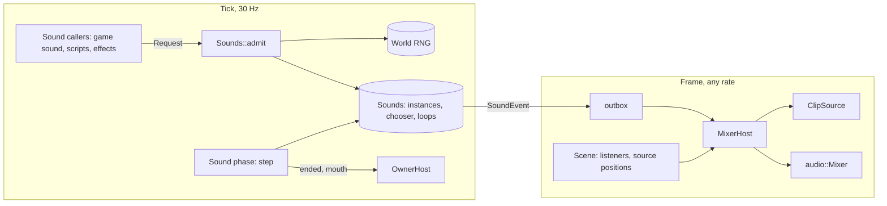
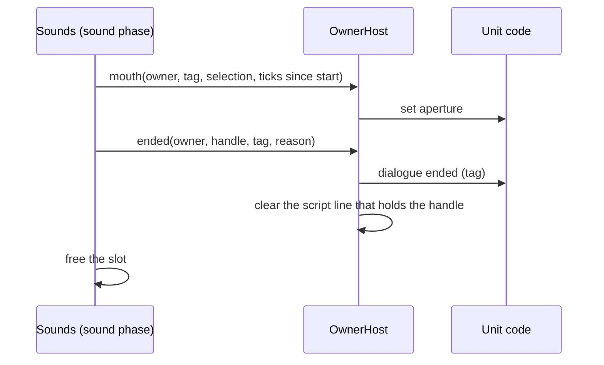

# Sound instances: the Rust table

Status: Design, slice 2 built: `Sounds`, the chooser and the owners exist and pass their differential, wired to nothing. [sound-sim.md](sound-sim.md) states what runs: the engine's own instance pool with a Rust schedule beside it.
Code: `crates/rewrites/sim-sound/src/{instances,chooser,owners,looping}.rs`, `crates/rewrites/sim-bridge/src/sim_sound/{entries,owner_host,mixer_feed}.rs`, `crates/platform/sound-clips`. Tests: the same files, named in [Slices](#slices).
Switch: none. The table replaces `impl.sim.sound-events` and `impl.sim.native.sound` ([switches.md](../runtime/switches.md)).



The sim owns every sound as a record in a Rust table: which sounds run, which permutation each drew, who owns it and the tick it ends on. Nothing in the sim knows of a channel, a voice or a device. The host mixer hears events and plays decoded clips. The rule that must hold: the table's hash, and every draw it takes from the shared RNG, are the same with any host or none.

## What the engine does today

| Part | Retail | Why it cannot stay |
|---|---|---|
| Instance pool | 384 records of `0xBC` bytes, salted handles (`SOUND_INSTANCES`; `audio_loops.rs` `SOUND_SLOTS`) | 47 functions read it in place (E, below) |
| Admission `0x126000` | three kinds of draw from the game's seed, two rejections, then the channel and cache requests | the draws are sim state; the cache and channel are device state |
| End of a one-shot | the device's channel stops, the per-instance walk `0x128040` finishes it with reason 2 | wall-clock driven, so the pool's fill differs between runs |
| Owner callbacks | a table of function pointers at `+0x14`, the owner at `+0x10` | the finish callback `0x18c8c0` reads the pool for the tag |
| Sound frame `0x125b40` | once a rendered frame: clock, listeners, loops, instances, channels, streams | frame rate decides how often admissions from loops draw |

**E.** 47 functions name the pool global. 46 are sound code in three ranges: the manager (`0x1253d0` to `0x12a810`), the looping sounds (`0x21a250` to `0x21c400`) and the start layer (`0x21d5a0` to `0x21db80`). The one outside is the dialogue finish `0x18c8c0`. Method: `h2 disasm 0x12000 1500000`, lines naming the global, grouped by `h2 analyze --functions`.

**Code.** With `impl.sim.sound-events` on (the switch table's default), `sim_sound::service` implements `SOUND_UPDATE` and never calls the guest's frame, and boot installs `SimSoundEvents::headless()` with a `NullHost` (`crates/apps/boot/src/registration.rs`). So the loops' update, the channels and the manager's DirectSound calls do not run in that arm.

## The table

`sim_sound::instances::Sounds` is the `kind::SOUND` store of the `World` ([sim-world.md](sim-world.md)). It holds three things, all saved and hashed.

| Member | Type | Replaces |
|---|---|---|
| `instances` | `sim_world::Pool<Instance>`, capacity 384 | the guest pool |
| `chooser` | `Chooser`: per pitch range `last`, `next` and a used set | the gestalt's runtime bytes (range `+4`, `+5`, the bit array at gestalt `+0x3C`) |
| `loops` | `Pool<Looping>`, capacity 128, three `Track`s each (slice 3) | the looping-sound array (`0x21a0c0`) |

`Sounds::encode` is the section body: the pool's bytes, then the chooser's ranges in index order. A range at the default history (`last` and `next` none, an empty set) is not stored, so equal states save to equal bytes. `Sounds::section_hash` is the fnv64 of it.

A handle is `sim_world::Handle`: the same salt and slot retail's `datum_new` gives, so callers that keep a handle see the values they see today. The pool's name is retail's, `"sound instances"` (`0x4534b8`), so the first salt is `0xef73`.

### An instance

| Field | Type | Retail home |
|---|---|---|
| `tag` | `TagIndex` | `+0xC` |
| `owner` | `Owner` | `+0x10` owner, `+0x14` table, `+0x5C` payload |
| `selection` | `Selection { range, permutation }` (`sim_sound::impulse`) | `+0x9C`, `+0x9D` |
| `gain` | `f32`, the gain draw | `+0x94` |
| `pitch` | `f32`, the pitch draw | `+0x90` |
| `seed` | `u32`, the seed word after the pitch draw | `+0x98` |
| `source` | `SourceParams`: the request's 17 words (position, flags, scale) | `+0x18` to `+0x5B` |
| `options` | `Options`: the record's words at `+4` and `+8`, its optional fields (flags 6, 8 and 9) and its rule and channel bytes, as retail stores them | `+4`, `+6`, `+8`, `+0xA0` to `+0xA4` |
| `start` | tick | `+0x8C` (the mixer clock in ms) |
| `end` | `Option<u32>` tick; `None` for a loop segment | none: the channel decides |
| `phase` | `Playing`, `Fading { since }` | flags `+4` bit 7, `+0xB0` to `+0xB8` |
| `track` | `Option<(Handle, u8)>`: the loop and track that hold it | `+0x60`, `+0x6C`, `+0xA8` |

Not kept: the chunk (`+0x9E`), the channel (`+0xAC`), the pin flag (`+4` bit 1) and the delayed-start flag (`+4` bit 0). They are the device's and belong to the mixer host.

### Admission

`Sounds::admit(&mut self, rng: &mut Rng, tags: &dyn SoundTags, request: Request, tick: u32) -> Result<Handle, Rejected>`.

| Step | Retail site | Draws | Leaves |
|---|---|---|---|
| 1. Gain draw: `base + (gain + range * r)`, `r` the draw's top 16 bits times `[0x45dc50]` | `0x125260` | 1 | always, before any test |
| 2. Level test: the request's `level` plus the gain at or under -64 (`[0x44a0b4]`), or unordered | `0x126060` | 0 | `Rejected::Silent` |
| 3. Slot | `0x16b840` on the pool | 0 | `Rejected::Full` |
| 4. Pitch draw: `lo + (hi - lo) * r` on the x87 under control word `0x027f`, stored as an `f32`; `seed` is the seed word after it | `0x1252f0`, `0x126116` | 1 | |
| 5. Owner, source, options copied from the request | `0x1260df` to `0x1261f8` | 0 | |
| 6. Selection: a rule's promoted range (`promoted_range`), else the range that plays the scaled pitch (`pitch_range`), then `Chooser::choose` | `0x218f10` or `0x218f50` for the range, then `0x219070` | 0 or more | explicit selection (request flag bit 10) draws nothing |
| 7. `start = tick`, `end = start + duration_ticks(permutation ms)` | `0x1262dd`, `schedule::end_tick` | 0 | |

`SoundTags` is a trait over static data built from the map once (`TagTable` is the plain form): per tag its flags, its class's flags, its playback row, first range, range count, scale and promotion bank; per range its bounds, first permutation and count; per permutation its skip fraction and length; the scale rows and promotion banks. It reads no guest memory.

`Request::level` is `0x1251e0`'s value for the request: the tag's and class's level for its scale. It reads the class's runtime state (`0x127010`), so the bridge computes it and the table takes it as given. It draws nothing (no step of the seed word in it or its callees), so taking it as an input keeps the draw order.

A refusal after the slot is taken (`Rejected::NoScale`, `NoPromotion`, `Choose`) frees the slot. Retail reads past its tables in those cases, so there is no retail behaviour to keep; the draws already taken stay taken.

## RNG order kept

```text
admit:  gain ─┬─ reject (silent) ── stop: 1 draw
              └─ slot ─┬─ reject (full) ── stop: 1 draw
                       └─ pitch ── selection ── 2 draws + chooser draws
chooser (0x219110), per try:  index draw ─ redraw while the index is in the used set
                              skip draw  ─ taken unless under the permutation's skip fraction
                              at most 2 x count tries
```

| Rule | Evidence |
|---|---|
| Every draw is `World::rng`, retail's seed word at `[RANDOM_SEEDS] + 4` | E: `0x125260`, `0x1252f0`, `0x219110` all step that word |
| A rejected request has already taken the gain draw | E: `0x12603f` precedes the test at `0x126060` |
| A range with a queued `next` draws nothing and clears it | E: `0x219070`, the branch on `0x2193d0` |
| A full used set is cleared, then keeps only `last` when the range has more than one permutation | E: `0x219196` to `0x2191b2` |
| A class flag turns the history off: `last` reads none and the used set reads empty | E: the test in `0x219370`, `0x2194c0` |
| The chooser is called outside admission too: script lines pick first, then admit with an explicit selection | E: `0x219110` from `0x20b140`, `0x219070` from `0x236299` |
| The pool's fill decides draws (a full pool stops after one), so ends are computed ticks and never the device's | Design |
| Propagation delay (`0x127e20`, listener distance) does not move `start` or `end`; the host delays the clip | Design: a listener is one machine's camera |
| The frame's sim work runs once per tick, after the tick body: retail's order at 30 frames a second | Design |

The last row fixes what "retail order" means for admissions that retail makes from the frame (loop segments and detail sounds). At any frame rate the sim takes them once per tick, in slot order.

## Owners



Retail keeps a pointer to a table of functions per instance. The table is a closed set, so the Rust form is an enum and one trait.

| Retail slot | When | Rust |
|---|---|---|
| `+0` | per-instance walk; false ends the sound with reason 3 | `OwnerHost::alive(&Owner) -> bool` |
| `+8` | once a service run per running instance (`0x129593`) | `OwnerHost::mouth(..)`, once per tick |
| `+0x10` | in the finish `0x127320`, before the slot is freed | `OwnerHost::ended(.., Reason)` |
| `+0x14` | in the stop `0x126360`, before the fade starts | `OwnerHost::stopping(..)` |

| `Owner` | Retail table | `ended` does | `mouth` does |
|---|---|---|---|
| `None` | no table | nothing | nothing |
| `Unit(object)` | finish `0x18c8c0`, update `0x18c6a0` | tells the unit its line ended, with the tag (`0xd0dc0`), when dialogue is on and the object is a unit | samples the permutation's mouth curve at the tick (`tags::sound::Gestalt::mouth_curve`, one byte per tick) and sets the unit's aperture (`0x18c9b0`) |
| `ScriptLine(Option<object>)` | finish `0x18c910` | the `Unit` work when it has one, then clears the line slot that holds the handle (16 slots at `[0x4ed288] + 0x128`) | as `Unit` |
| `Loop { looping, track }` | the track's list (`+0x6C`) | unlinks the instance from its `Track` | nothing |

Order is retail's: `ended` runs with the instance still in the pool (it gets `&Sounds`), and the slot is freed after (`0x127390`). The host is called for `Unit` and `ScriptLine` owners only; `None` and `Loop` are the table's own. `Reason` is an enum of the engine's reasons: `PlayedOut` (2), `OwnerGone` (3), `Faded` (4), `Superseded` (0xF) and the start failures.

`sim_bridge::sim_sound::owner_host::GuestUnits` implements `OwnerHost` while unit and script state live in guest memory. Its unit calls are guest calls and its line-table clear is a guest write; both are counted ([Counters](#counters)). They become plain Rust calls when the object store lands, with no change to `Sounds`.

## The sound phase

The tick driver gains a 30th phase, `sound`, owned by Rust and in `sim.ledger` ([sim-rewrite.md](sim-rewrite.md), "The tick driver"). In order:

1. `loops.step`: each looping sound in slot order picks its segments and detail sounds and admits them (draws included).
2. `Sounds::step`, each instance in slot order (the walk `0x128020`): a fade whose ramp is done (`owners::ramp_done`) ends with `Faded`; else an owner `alive` calls gone ends with `OwnerGone`; else an `end` that has come ends with `PlayedOut`.
3. `mouth` for each running owned instance, with the ticks since its start.
4. Events to the outbox (`events::TableEvent`): starts and stops in call order, then ends in slot order.

The frame service does no sim work. It hands the outbox and a read-only `Scene` to the host.

## Entries

The guest keeps calling sound code until its callers are Rust. Each entry below is implemented by a Rust body over `Sounds`; nothing behind them is reached.

| Entry | Direct callers | Body |
|---|---|---|
| `0x1253d0`, `0x125600` | `0x12000`, `0x12080` | make and drop `Sounds`; the pool and channel globals hold 0 |
| `0x125b40` `SOUND_UPDATE` | main loop `0x12b450` | frame service |
| `0x125f10`, `0x21d110`, `0x21d390`, `0x21d630`, `0x21d2c0`, `0x21d360` | `0x18a3e0`, `0x2a9d70`, `0x189fe0`, `0x18c060`, `0x225b60`, `0x225df0`, `0x225ef0` | read the request record, `admit` |
| `0x126360` `SOUND_STOP_INSTANCE` | `0x166992`, `0x189ee0`, `0x18a380`, `0x22beb5` | `stopping`, then `Fading` |
| `0x126400` | `0x159e20` | finishes instances in a pool walk (it calls `0x127320`) |
| `0x126660`, `0x1272c0`, `0x125360`, `0x125a90`, `0x125d60` | `0x18bb80`, `0x18c060`, `0x18c3b0`, loaders | read from their bodies in slice 4; each gets a named body |
| `0x127400` `SOUND_LISTENERS_UPDATE` | `0x18c060` | writes the `Scene`'s listeners |
| `0x21a250`, `0x219c30` | object sound update `0x18a7b0` | the looping sounds' entries, on `loops` |
| `0x219070`, `0x219110`, `0x219430`, `0x2194a0` | `0x236299`, `0x20b140`, `0x20afb0` to `0x20b660`, `0x18d090` | `Chooser` |

Tag readers with no state (`0x218c60` length, `0x218e50` mouth sample, `0x221810` class) stay guest code: they read tags only.

**Design.** After `0x1253d0`'s Rust body, `[SOUND_INSTANCES]` is 0. A guest function that still reads the pool faults at once with its address, which is the named error for an entry this table missed.

## Pool readers

| Reader | Reads today | Moves to |
|---|---|---|
| `extensions/game/src/audio_loops.rs` (`audio.loops`) | loop array, instance, channel and stream records | `Sounds::loops()` and `instances()` for datum, segment, range and permutation; the play position from `MixerHost::voice(handle)` |
| `extensions/game/src/h1_conversation.rs` (`sound_live`, starts, stop) | pool row `+2`; guest calls to `0x1891d0`, `0x189fe0`, `0x126360` | `Sounds::live(handle)`; the starts keep calling game sound, which reaches the entries above |
| `extensions/game/src/sim_glue/voices.rs` (`sound.voices` series) | pool and channel rows at six observers | deleted; the series is the table's events as `sound.table` (handle, tag, range, permutation, reason) |
| Dialogue callbacks `0x18c8c0`, `0x18c910`, `0x18c6a0` | pool row for the tag | `GuestUnits` |
| `sim_bridge::sim_sound::owners` | pool rows, gestalt | deleted with the schedule's `Live` map |
| `sim_bridge::sim_sound::voice_arm`, `engine/src/native_sound_*` (5,555 lines) and `tests/sim_sound_differential` | whole records, register by register | oracles for slices 2 and 3, then deleted in slice 5 |

## Clip source

```text
tags::sound (header, Gestalt) ─┐
assets::ResourceFiles ─────────┼─> sound-clips ─> Clip { rate, channels, pcm: Arc<[i16]> }
audio::adpcm, wma::Tables ─────┘        ^ Studio audition, h2 sound, MixerHost
```

`crates/platform/sound-clips` is the one decoder. It takes Studio's `decode`, `decode_permutation`, `load_tables`, `needs_executable`, `Clip` and the `Raw` resource reader out of `crates/apps/studio/src/app/audition.rs`, and the copies `wma_pcm` and `codec_stream` out of `crates/apps/cli/src/sound.rs`. Studio keeps its `Output` and `Playback`.

| Type | Does |
|---|---|
| `ClipKey { tag, range, permutation }` | names one permutation |
| `ClipError::{Refused, Failed}` | Studio's `SoundError`, with the reason as text |
| `ClipSource::get(key) -> Ready(Arc<Clip>) \| Pending \| Err` | decodes on a worker thread, once per key; cached by decoded bytes, never dropping a clip a voice holds |
| `ClipSource::stream(key) -> ChunkReader` | a long permutation chunk by chunk, for `audio::Stream` |

Codec streams need the executable's tables. Boot already loads them for the XWMA shim (`dsound::xwma`, `wma::Tables::load`) and shares that `Arc`. A codec stream with no tables is `Refused` and counted, never silent by default.

## Mixer feed

`SoundEvent::Started` carries what the host needs: `handle`, `tag`, `selection`, `gain`, `pitch`, `source`, `looping`, `tick`. `Stopped` carries the fade length; `Ended` the reason. The host picks nothing the sim drew.

| Host concern | Where | Source of truth |
|---|---|---|
| Clip | `ClipSource::get(ClipKey)` | the event's selection |
| Position, velocity | `Scene`, read once a frame | the object's interpolated marker; listeners from `0x127400`'s body |
| Distance, obstruction, room send | `audio::Listener::spatial`, the class's distances | [dsound.md](../audio/dsound.md), "Positioned sound" |
| Voice limit and class ceilings | `sim_sound::sources::VoicePriority`, `scheduling::CappedSelection` | run in the host; a culled voice changes nothing in the sim |
| Propagation delay | the buffer's start offset | distance at the start |
| Fade | the buffer's volume ramp | the `Stopped` event |
| Late clip | `Pending` at the start plays from the right offset when ready, inside 250 ms; later it is dropped and counted | Design |

`MixerHost` implements `sim_sound::feed::Host`. It reads events and the `Scene`, and writes only the `audio::Mixer`. `NullHost` drops both.

## DirectSound cut

| Stage | State | Gate |
|---|---|---|
| D0 | guest pool; frame replaced by the event service; `NullHost` | none (today) |
| D1 | `Sounds` owns every instance; entries are Rust; pool global 0 | `sound.pool_reads == 0`, `sound.unported_entries == 0`, `dsound.manager_calls == 0` over one campaign level and one match |
| D2 | `MixerHost` at boot; the game is heard through the feed | `feed.started == sound.admitted` less `feed.culled`; `feed.clip_refused == 0` on retail maps |
| D3 | `native_sound_*`, the differential tests, `voice_arm`, `sim_glue/voices.rs` and both switches deleted; the sound core's DirectSound objects (mix-ins, submixes, streams) no longer registered | `dsound.manager_calls` removed with its code; `dsound.calls` names only Bink and voice |

Bink and voice chat still reach DirectSound after D3. Their cut belongs to [bink-hle.md](../audio/bink-hle.md) and the voice pages.

### Counters

One ledger, `SoundLedger`, read by `sim.ledger` and carried in `profile.counters`.

| Counter | Counts | Healthy |
|---|---|---|
| `sound.admitted`, `sound.rejected_silent`, `sound.rejected_full` | admissions by outcome | any |
| `sound.draws` | RNG draws taken by sound | equal in both runs of a diff |
| `sound.ended.<reason>` | finishes by reason | any |
| `sound.owner_guest_calls`, `sound.owner_guest_writes` | `GuestUnits`' calls and line-table clears | 0 once units are Rust |
| `sound.pool_reads` | our reads of the guest pool | 0 from D1 |
| `sound.unported_entries` | an entry reached with no named body (the call is refused with its address) | 0 |
| `sound.refused_unknown_owner` | a request whose callback table is not one of the known tables | 0 |
| `sound.refused_no_length` | a permutation with no length in the tag | 0 |
| `dsound.manager_calls` | DirectSound entries whose return address is sound code | 0 from D1 |
| `feed.started`, `feed.culled`, `feed.clip_pending_dropped`, `feed.clip_refused` | the host's outcomes | refused and dropped 0 on retail maps |

A refusal never plays or admits something else in its place. An unknown owner refuses the request (the caller gets no handle); a missing length ends the sound on its start tick.

## Rules and limits

- `Sounds` reads no guest memory and no device. The bridge reads request records and writes results; `GuestUnits` is the only writer of guest state.
- No `HashMap` feeds the save, the hash or an event's order. Walks are in slot order; starts in admission order.
- A checkpoint revert does not restore `Sounds`: retail's pool lies outside the checkpoint arena. A machine snapshot saves it as its `World` section.
- Culling under load and the device's own end of a clip do not exist in the sim. A sound the host culled still runs its ticks and its callbacks.
- The save belongs to the build that wrote it ([sim-world.md](sim-world.md)).

## Slices

| # | Slice | Model | Depends on | State |
|---|---|---|---|---|
| 1 | `sound-clips` crate | Sonnet | none | |
| 2 | Instances, chooser, owners (pure) | Opus | none | built |
| 3 | Looping sounds on the table (pure) | Opus | 2's types | |
| 4 | The flip: entries, sound phase, readers, counters | Opus | 2, 3 | |
| 5 | Mixer feed, boot wiring, deletions | Opus | 1, 4 | |

### 1. `sound-clips`

- Files: `crates/platform/sound-clips/{Cargo.toml,src/lib.rs,src/source.rs}` (new); `crates/apps/studio/src/app/audition.rs`, `crates/apps/cli/src/sound.rs` (use it); `Cargo.toml` (workspace dependency); `docs/audio/audio.md` ("Formats").
- Tests: `an_adpcm_permutation_decodes_at_the_headers_rate`, `a_codec_stream_without_tables_is_refused_by_name`, `an_unknown_compression_is_refused_not_guessed`, `a_key_is_decoded_once_and_shared`, `the_cache_never_drops_a_clip_a_voice_holds`, `a_long_permutation_streams_chunk_by_chunk`.
- Exit: Studio's audition tests and `h2 sound`'s tests pass on the crate; no app crate holds a decoder.

### 2. Instances, chooser, owners

- Files: `crates/rewrites/sim-sound/src/{instances,chooser,owners}.rs`, `instances/tests.rs`, `events.rs` (`TableEvent`), `lib.rs`, `Cargo.toml` (`sim-world`); `crates/rewrites/engine/tests/sim_sound_differential/table.rs`.
- Types slice 3 builds on: `instances::{Sounds, Instance, Request, Options, SourceParams, TagIndex, SoundTags, TagTable, SoundTag, PitchRange, Permutation, Playback, Scale, Rejected, Counters}`, `chooser::{Chooser, History, Pick, pick}`, `owners::{Owner, OwnerHost, NullOwners, Reason, Phase, ramp_done}`, `events::TableEvent`. `Sounds::finish` is the one way an instance ends.
- Tests: `a_silent_request_takes_the_gain_draw_and_no_slot`, `a_full_pool_stops_after_one_draw`, `an_explicit_selection_draws_no_permutation`, `the_chooser_redraws_past_used_permutations`, `a_full_used_set_keeps_only_the_last`, `a_queued_next_is_taken_without_a_draw`, `a_one_shot_ends_on_its_computed_tick_in_slot_order`, `ended_runs_before_the_slot_is_free`, `a_stop_fades_then_ends_with_faded`, `handles_match_datum_new`, `save_round_trips_instances_and_history`.
- Differential: `the_table_draws_what_the_engines_admission_draws` runs 4,096 random tags, histories, pool fills and requests through `native_sound_impulse`'s body, with the draws, the chooser, the class lookup and `datum_new` run as the lifted original, and through `Sounds::admit`. It compares the seed after, the handle, the selection, the instance's words and every range's history. It needs the base image (`H2_XBE`, or `disc/default.xbe`).
- Exit: both green; nothing wired at boot.

### 3. Looping sounds

- Files: `crates/rewrites/sim-sound/src/looping.rs` (new; folds in `loops.rs`, `segments.rs`); `crates/rewrites/engine/tests/sim_sound_differential/looping.rs` (new).
- Tests: `a_loop_plays_in_then_loop_then_out`, `the_alternate_swaps_segments_with_overlap`, `a_detail_sound_starts_on_its_drawn_deadline`, `a_stopped_loop_fades_every_track_instance`, `loops_step_in_slot_order`, `a_track_drops_an_instance_when_it_ends`.
- Differential: `the_loop_step_admits_what_the_engines_update_admits` against `native_sound_loops` over 1,024 random loop states: same admissions in the same order, same seed after.
- Exit: both green.

### 4. The flip

- Files: `crates/rewrites/sim-bridge/src/sim_sound.rs` (the store, the snapshot section, the phase), `sim_sound/{entries,owner_host,request}.rs` (new), `tick.rs` (phase 30); `crates/apps/boot/src/registration.rs`; `crates/extensions/game/src/{audio_loops.rs,h1_conversation.rs}`; delete `sim_sound/{owners,voice_arm}.rs`, `extensions/game/src/sim_glue/voices.rs`; `crates/hooking/hooks/src/switches/table.rs` (both switches removed); docs: [sound-sim.md](sound-sim.md) rewritten to the table, [switches.md](../runtime/switches.md), [agent-api.md](../runtime/agent-api.md) (`audio.loops`), [sim-determinism.md](../runtime/sim-determinism.md) (`sound.table`).
- Tests: `every_outside_entry_has_a_rust_body`, `a_request_record_reads_into_a_request`, `an_unknown_callback_table_refuses_the_request`, `a_unit_line_end_calls_the_unit_once_with_the_tag`, `a_script_line_end_clears_its_slot`, `the_pool_global_is_zero_after_start`, `the_sound_phase_runs_once_per_tick_number`, `the_hash_is_the_same_with_any_host`, `audio_loops_rows_come_from_the_table`, `a_conversation_poll_sees_an_ended_sound_as_gone`.
- Exit: `h2 sim diff` of the same match twice is identical with `sound.table` in the series; D1's counters hold on a campaign level and a match through `sim.ledger`.

### 5. Mixer feed and deletions

- Files: `crates/rewrites/sim-bridge/src/sim_sound/{mixer_feed,scene}.rs`; `crates/extensions/game/src/dsound_glue.rs` (the shared mixer and tables); `crates/apps/boot/src/registration.rs`; delete `crates/rewrites/engine/src/native_sound_*`, `crates/rewrites/engine/tests/sim_sound_differential`, the sim-sound kernels nothing calls; `crates/platform/dsound` (the sound core's registrations); docs: [dsound.md](../audio/dsound.md), [audio.md](../audio/audio.md), [sim-rewrite.md](sim-rewrite.md) (phase 4).
- Tests: `a_start_plays_the_drawn_permutation`, `a_stop_ramps_the_buffer_down_over_the_fade`, `a_culled_voice_changes_no_sim_state`, `a_late_clip_starts_at_the_elapsed_offset`, `a_clip_later_than_the_limit_is_dropped_and_counted`, `a_refused_clip_is_counted_and_nothing_else_plays`, `a_moving_source_follows_its_marker`, `a_music_track_streams_from_chunks`.
- Exit: D2's and D3's gates; the game is heard on the owner's machine with `dsound.manager_calls` gone and `feed.clip_refused == 0` on a retail level.

## Evidence

| Label | Fact | Source |
|---|---|---|
| E | The admission's order of draws, tests and copies | `0x126000` to `0x126352`; `crates/rewrites/engine/src/native_sound_impulse.rs` is its port |
| E | The stop calls the owner's `+0x14`, records the ramp and sets the fade | `0x126360` |
| E | The finish releases the channel and chunk, calls `+0x10` with owner, handle and reason, then frees | `0x127320`, `0x127390`; `native_sound_sources/completion.rs` |
| E | `0x18c8c0` reads the instance's tag from the pool and calls the unit; `0x18c910` adds the line-table clear | their bodies |
| E | The frame's calls, in order | `0x125b40`; `native_sound_tick.rs` names them |
| Code | The table default of `impl.sim.sound-events` is on | `crates/hooking/hooks/src/switches/table.rs` |
| S | The pool lies outside the checkpoint arena (it is built by `0x11cc20` beside the arena at `0x510800`) | compare `[SOUND_INSTANCES]` with `arena_base` on a running game |
| S | Two owner tables exist | `sound.refused_unknown_owner` staying 0 over the campaign |

## Not verified

- The entry list. It comes from direct calls; a call through a pointer or a table is not in it. The zero pool global and `sound.unported_entries` catch one at run time.
- The bodies of `0x126660`, `0x1272c0`, `0x125360`, `0x125a90`, `0x125d60`, `0x219c30`, `0x219430` and `0x2194a0`, and what `0xd0dc0` and `0x18c9b0` write in the unit.
- The readers of instance `+0x98`, `+8` and `+0xA0` to `+0xA4`, and the layout of the owner payload at `+0x5C`.
- Whether `h2 sim` runs initialise the sound manager (globals `+0x78` to `+0x7A`). The sound parity reference run is a local match with a listener either way.
- That one sound step per tick gives the same draws as retail at 30 frames a second on a map with looping sounds and detail sounds. Once a tick is the parity target.
- That the game thread's x87 control word is `0x027f` when the pitch draw runs. The differential runs both sides under it; under 53-bit precision the draw equals `f64` arithmetic.
- That `0x2226b0` (called before the slot) changes nothing the table keeps. The differential stands in for it.
- That every sound a level admits decodes from the host's map files, converted Halo 1 maps and injected tags included.
- Whether the game is silent today with `impl.sim.sound-events` on. The code says the manager's sounds are.

## Related

[sound-sim.md](sound-sim.md) (what runs), [sim-world.md](sim-world.md) (pools, save, hash, RNG), [sim-rewrite.md](sim-rewrite.md) (the tick driver), [dsound.md](../audio/dsound.md) and [audio.md](../audio/audio.md) (the mixer), [retire-d3d.md](../graphics/retire-d3d.md) (the same cut for rendering).
