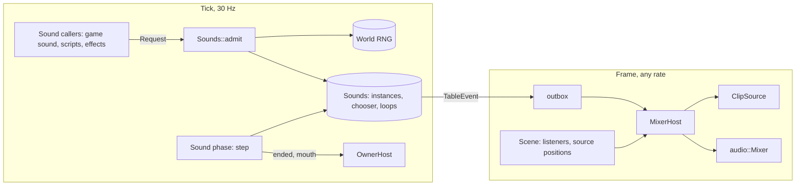
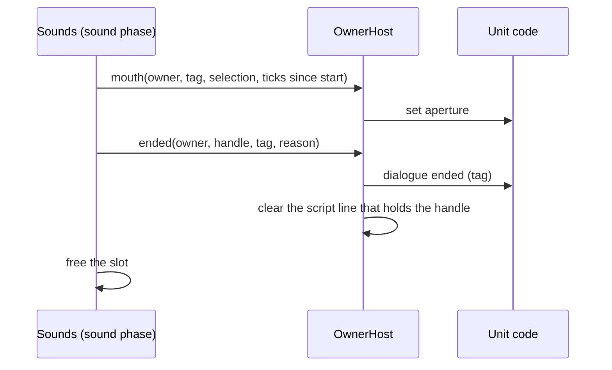

# Sound instances: the Rust table

Status: Slices 1 to 4 built, slice 5 in progress (the exact port, its differential oracles, the events arm and the guest pool's voice trace are deleted; the feed's open items are left): `sound-clips` decodes and caches clips; `Sounds`, the chooser, the owners and the looping sounds exist in `sim-sound`; the bridge's entry bodies, the sound phase, `SoundLedger` and the mixer feed (stage D2) run at boot on every run, and the table's `Sounds` are the `World`'s sound store, saved in its snapshot section (`sim-bridge/src/world.rs`, [sim-world.md](sim-world.md)). Boot's table reads the map's tags (`guest_tags::Snapshot`) and levels (`GuestLevels`) from guest memory; the loop entries run on the table's loops with the `lsnd` reader (`guest_tags::loop_tag`); the start layer runs on the table's rows (`Sounds::starts`, `starts::plan`, `entries::start_layer`).
Code: `crates/rewrites/sim-sound/src/{instances,chooser,owners,looping,starts,levels,feed}.rs`, `crates/rewrites/sim-bridge/src/sim_sound/{entries,owner_host,levels,gate,playback,promotion,ambience,clock,units,mixer_feed,scene}.rs`, `crates/rewrites/sim-bridge/src/world.rs`, `crates/platform/sound-clips`, `crates/extensions/game/src/sound_feed.rs`. Tests: the same files, named in [Slices](#slices).
Switch: none; the table runs on every run.



The sim owns every sound as a record in a Rust table: which sounds run, which permutation each drew, who owns it and the tick it ends on. Nothing in the sim knows of a channel, a voice or a device. The host mixer hears events and plays decoded clips. The rule that must hold: the table's hash, and every draw it takes from the shared RNG, are the same with any host or none.

## What retail does

| Part | Retail | Why it cannot stay |
|---|---|---|
| Instance pool | 384 records of `0xBC` bytes, salted handles (`SOUND_INSTANCES`; `audio_loops.rs` `SOUND_SLOTS`) | 47 functions read it in place (E, below) |
| Admission `0x126000` | three kinds of draw from the game's seed, two rejections, then the channel and cache requests | the draws are sim state; the cache and channel are device state |
| End of a one-shot | the device's channel stops, the per-instance walk `0x128040` finishes it with reason 2 | wall-clock driven, so the pool's fill differs between runs |
| Owner callbacks | a table of function pointers at `+0x14`, the owner at `+0x10` | the finish callback `0x18c8c0` reads the pool for the tag |
| Sound frame `0x125b40` | once a rendered frame: clock, listeners, loops, instances, channels, streams | frame rate decides how often admissions from loops draw |

**E.** 47 functions name the pool global. 46 are sound code in three ranges: the manager (`0x1253d0` to `0x12a810`), the looping sounds (`0x21a250` to `0x21c400`) and the start layer (`0x21d5a0` to `0x21db80`). The one outside is the dialogue finish `0x18c8c0`. Method: `h2 disasm 0x12000 1500000`, lines naming the global, grouped by `h2 analyze --functions`.

**Code.** Boot installs `SoundTable::process()` and `world::SimWorld::process()` on every run (`crates/apps/boot/src/registration.rs`): the table answers `SOUND_UPDATE` and every entry above, so the loops' update (`0x21b0e0`), the channel update (`0x1282d0`), the voice update (`0x1293f0`) and the manager's DirectSound calls never run.

## The table

`sim_sound::instances::Sounds` is the `kind::SOUND` store of the `World` ([sim-world.md](sim-world.md)). It holds four things, all saved and hashed.

| Member | Type | Replaces |
|---|---|---|
| `instances` | `sim_world::Pool<Instance>`, capacity 384 | the guest pool |
| `chooser` | `Chooser`: per pitch range `last`, `next` and a used set | the gestalt's runtime bytes (range `+4`, `+5`, the bit array at gestalt `+0x3C`) |
| `loops` | `Pool<Looping>`, capacity 128 (`"looping sounds"`, `0x4570ec`), up to three `Track`s each | the looping-sound array (`0x21a0c0`) |
| `starts` | `Pool<Start>`, capacity 16 (`"sounds effects"`, `0x4570fc`) | the start layer's array (`[0x51ebe0]`, `0x21d490`), [The start layer](#the-start-layer) |

`Sounds::encode` is the section body: the instance pool's bytes, the chooser's ranges in index order, then the loop pool's bytes, then the start pool's. A range at the default history (`last` and `next` none, an empty set) is not stored, so equal states save to equal bytes. `Sounds::section_hash` is the fnv64 of it.

A handle is `sim_world::Handle`: the same salt and slot retail's `datum_new` gives, so callers that keep a handle see the values they see today. The pool's name is retail's, `"sound instances"` (`0x4534b8`), so the first salt is `0xef73`.

### An instance

| Field | Type | Retail home |
|---|---|---|
| `tag` | `TagIndex` | `+0xC` |
| `owner` | `Owner` | `+0x10` owner, `+0x14` table, `+0x5C` payload |
| `selection` | `Selection { range, permutation }` (`sim_sound::impulse`) | `+0x9C`, `+0x9D` |
| `gain` | `f32`, the gain draw | `+0x94` |
| `pitch` | `f32`, the pitch draw | `+0x90` |
| `seed` | `u32`, the seed word after the pitch draw | `+0x98` |
| `source` | `SourceParams`: the request's 17 words (position, flags, scale) | `+0x18` to `+0x5B` |
| `options` | `Options`: the record's words at `+4` and `+8`, its optional fields (flags 6, 8 and 9) and its rule and channel bytes, as retail stores them | `+4`, `+6`, `+8`, `+0xA0` to `+0xA4` |
| `start` | tick | `+0x8C` (the mixer clock in ms) |
| `end` | `Option<u32>` tick, loop segments included | none: the channel decides |
| `phase` | `Playing`, `Fading { since }` | flags `+4` bit 7, `+0xB0` to `+0xB8` |
| `track` | `Option<(Handle, u8)>`: the loop and track that hold it | `+0x60`, `+0x6C`, `+0xA8` |

Not kept: the chunk (`+0x9E`), the channel (`+0xAC`), the pin flag (`+4` bit 1) and the delayed-start flag (`+4` bit 0). They are the device's and belong to the mixer host.

### Admission

`Sounds::admit(&mut self, rng: &mut Rng, tags: &dyn SoundTags, request: Request, tick: u32) -> Result<Handle, Rejected>`.

| Step | Retail site | Draws | Leaves |
|---|---|---|---|
| 1. Gain draw: `base + (gain + range * r)`, `r` the draw's top 16 bits times `[0x45dc50]` | `0x125260` | 1 | always, before any test |
| 2. Level test: the request's `level` plus the gain at or under -64 (`[0x44a0b4]`), or unordered | `0x126060` | 0 | `Rejected::Silent` |
| 3. Slot | `0x16b840` on the pool | 0 | `Rejected::Full` |
| 4. Pitch draw: `lo + (hi - lo) * r` on the x87 under control word `0x027f`, stored as an `f32`; `seed` is the seed word after it | `0x1252f0`, `0x126116` | 1 | |
| 5. Owner, source, options copied from the request | `0x1260df` to `0x1261f8` | 0 | |
| 6. Selection: a rule's promoted range (`promoted_range`), else the range that plays the scaled pitch (`pitch_range`), then `Chooser::choose` | `0x218f10` or `0x218f50` for the range, then `0x219070` | 0 or more | explicit selection (request flag bit 10) draws nothing |
| 7. `start = tick`, `end = start + duration_ticks(permutation ms)` | `0x1262dd`, `schedule::end_tick` | 0 | |

`SoundTags` is a trait over static data from the map (`TagTable` is the plain form): per tag its flags, its class's flags, its playback row, first range, range count, scale and promotion bank; per range its bounds, first permutation and count; per permutation its skip fraction and length; the scale rows and promotion banks. `Sounds` reads no guest memory. The bridge's `guest_tags::Snapshot` reads the rows one call needs from the loaded map (the table of addresses is in `sim_sound/guest_tags.rs`); the map is static while loaded, so a per-call read needs no invalidation on a map change.

`Request::level` is `0x1251e0`'s value for the request: the tag's and class's level for its scale ([Levels](#levels)). It reads the class's runtime state (`0x127010`), so the bridge computes it and the table takes it as given. It draws nothing (no step of the seed word in it or its callees), so taking it as an input keeps the draw order.

A refusal after the slot is taken (`Rejected::NoScale`, `NoPromotion`, `Choose`) frees the slot. Retail reads past its tables in those cases, so there is no retail behaviour to keep; the draws already taken stay taken.

### Levels

`sim_sound::levels::level` is `0x1251e0` on inputs; `GuestLevels` (`sim_bridge::sim_sound::levels`) reads them from guest memory and implements `instances::Levels`.

```text
lo = scale row +0 + class +0x20        (0x218d70, SSE)
hi = scale row +4 + class +0x24        (0x218de0, SSE)
mix = L(lo) + (L(hi) - L(lo)) * scale  (0x2195f0: L = 10^(clamp(dB, -64, 0) / 20), x87)
level = dB(mix) + (class level + offset)   (0x2197f0, 0x127010, SSE)
```

| Input | Where `GuestLevels` reads it |
|---|---|
| class, scale row | tag `+2`, `+0xB` (`[0x4e3b44] + 16 * (tag & 0xffff) + 8`) |
| class row | the globals tag's sound globals reference, its tag `+4`, `0x5C` a class (`0x221810`) |
| scale row | `[0x51ebd4] + 0xC`, 20 bytes a row |
| class level, flags | `[0x502118] + 16 * class`, `+4` and `+0xC` |
| duck state | `[0x4e6380] + 0x1f8`: current index and time, previous index and time |
| duck rows | class `+0x28`, 16 bytes a row: level, rise, hold, fall |
| scale, offset | source words 1 and 2 (request `+0x10`, `+0x14`) |

`0x127010` adds the class's ducks unless the class's flag bit 0 is set. One duck in both slots fades in over `rise`, holds for `hold`, then follows `fall`; otherwise the previous duck fades out and the current one fades in. Rises and falls under `0x45dc70` (0.001) count as none.

The x87 steps run under `FPU_CONTROL`; the image constants are `Constants::RETAIL`. A read fault plays the sound at -64 dB and counts in `GuestLevels::faults`.

## RNG order kept

```text
admit:  gain ─┬─ reject (silent) ── stop: 1 draw
              └─ slot ─┬─ reject (full) ── stop: 1 draw
                       └─ pitch ── selection ── 2 draws + chooser draws
chooser (0x219110), per try:  index draw ─ redraw while the index is in the used set
                              skip draw  ─ taken unless under the permutation's skip fraction
                              at most 2 x count tries
```

| Rule | Evidence |
|---|---|
| Every draw is `World::rng`, retail's seed word at `[RANDOM_SEEDS] + 4` | E: `0x125260`, `0x1252f0`, `0x219110` all step that word |
| A rejected request has already taken the gain draw | E: `0x12603f` precedes the test at `0x126060` |
| A range with a queued `next` draws nothing and clears it | E: `0x219070`, the branch on `0x2193d0` |
| A full used set is cleared, then keeps only `last` when the range has more than one permutation | E: `0x219196` to `0x2191b2` |
| A class flag turns the history off: `last` reads none and the used set reads empty | E: the test in `0x219370`, `0x2194c0` |
| The chooser is called outside admission too: script lines pick first, then admit with an explicit selection | E: `0x219110` from `0x20b140`, `0x219070` from `0x236299` |
| The pool's fill decides draws (a full pool stops after one), so ends are computed ticks and never the device's | Design |
| Propagation delay (`0x127e20`, listener distance) does not move `start` or `end`; the host delays the clip | Design: a listener is one machine's camera |
| The frame's sim work runs once per tick, after the tick body: retail's order at 30 frames a second | Design |

The last row fixes what "retail order" means for admissions that retail makes from the frame (loop segments and detail sounds). At any frame rate the sim takes them once per tick, in slot order.

## Owners



Retail keeps a pointer to a table of functions per instance. The table is a closed set, so the Rust form is an enum and one trait.

| Retail slot | When | Rust |
|---|---|---|
| `+0` | per-instance walk; false ends the sound with reason 3 | `OwnerHost::alive(&Owner) -> bool` |
| `+8` | once a service run per running instance (`0x129593`) | `OwnerHost::mouth(..)`, once per tick |
| `+0x10` | in the finish `0x127320`, before the slot is freed | `OwnerHost::ended(.., Reason)` |
| `+0x14` | in the stop `0x126360`, before the fade starts | `OwnerHost::stopping(..)` |

| `Owner` | Retail table | `ended` does | `mouth` does |
|---|---|---|---|
| `None` | no table | nothing | nothing |
| `Unit(object)` | finish `0x18c8c0`, update `0x18c6a0` | tells the unit its line ended, with the tag (`0xd0dc0`), when dialogue is on and the object is a unit | samples the permutation's mouth curve at the tick (`tags::sound::Gestalt::mouth_curve`, one byte per tick) and sets the unit's aperture (`0x18c9b0`) |
| `ScriptLine(Option<object>)` | finish `0x18c910` | the `Unit` work when it has one, then clears the line slot that holds the handle (16 slots at `[0x4ed288] + 0x128`) | as `Unit` |
| `Loop { looping, track }` | the track's list (`+0x6C`) | unlinks the instance from its `Track` | nothing |
| `Start { start, own }` | `0x44a1c0`, wrapping the request's own table | `own` hears it, then the start stops ([The start layer](#the-start-layer)); the stop-all tells no one | `own`'s |
| `Started(start)` | `0x44a1e0` (alive `0x21d970` only) | nothing | nothing |

Order is retail's: `ended` runs with the instance still in the pool (it gets `&Sounds`), and the slot is freed after (`0x127390`). The host is called for `Unit` and `ScriptLine` owners only, a `Start`'s `own` included (`Owner::host`); `None`, `Loop`, `Started` and the start part of `Start` are the table's own. `Reason` is an enum of the engine's reasons: `PlayedOut` (2), `OwnerGone` (3), `Faded` (4), `Superseded` (0xF) and the start failures.

`sim_bridge::sim_sound::owner_host::GuestUnits` implements `OwnerHost` while unit and script state live in guest memory. A line's end runs in Rust over guest memory (`sim_bridge::sim_sound::units::line_end`); so does a mouth (`0x18c6a0`, `sim_bridge::unit_mouth`, counted as `sound.mouth_calls`; [The unit mouth](#the-unit-mouth)); the line-table clear is a counted guest write ([Counters](#counters)). They move to the object store when it lands, with no change to `Sounds`.

## The sound phase

The tick driver runs a 30th phase, `sound`, owned by Rust, after the 29 (`sim_bridge::tick::run`, `sim_sound::entries::phase`; [sim-rewrite.md](sim-rewrite.md), "The tick driver"). It runs once per tick number, so a tick whose run flag held the count steps nothing twice; its counters are `sim.ledger`'s `sound`. Draws come from the game's seed word (`[RANDOM_SEEDS] + 4`), read before and written after. In order:

1. `Sounds::step_loops`: each looping sound in slot order moves on the tracks whose segment sound's end tick has come, then plays its due detail sounds (draws included). See [Looping sounds](#looping-sounds).
2. `Sounds::step`, each instance in slot order (the walk `0x128020`): a fade whose ramp is done (`owners::ramp_done`) ends with `Faded`; else an owner `alive` calls gone ends with `OwnerGone`; else an `end` that has come ends with `PlayedOut`.
3. `mouth` for each running owned instance, with the ticks since its start.
4. Events to the outbox (`events::TableEvent`): starts and stops in call order, then ends in slot order.
5. The unit calls `GuestUnits` queued, in the step's order. A line's end is `0x18c8c0` past its pool read, in Rust (`units::line_end`): dialogue on (`[0x4ed28c] + 0x29`), `0xbadc0` with mask 3 says unit (`units::object_of_types`), then `0xd0dc0` clears the unit's line slot if it still holds the tag (`units::unit_line_ended`). A mouth is `0x18c6a0(object, 0, tag, range, permutation row, seconds)`: the update tests the unit itself and does not read its payload argument (`h2 disasm 0x18c6a0`). The service's lip-sync updates (`0x129593`) take the same path.

### The unit mouth

`sim_bridge::sim_sound::mouth` ports the update over guest memory; the facial sequence is `engine::sim_anim::facial`. `mouth::gate` runs to the extra-info resource's residency, `mouth::finish` the rest. The resource cache's touch (`0x12de70`, flags 2) is Rust where it needs no I/O (`mouth::residency`); a request to submit (`0x12e3a0`), a priority to raise, a blocking wait or a load to relocate is `Residency::Guest`, and `sim_bridge::unit_mouth` calls the guest's `0x12de70` for the answer.

| Step | Address | Rust |
|---|---|---|
| unit, permutation index in its range | `0x18c6a0` | `mouth::gate` |
| lip sync: `snd!` `+1` bit 1 clear, the class's `+8` bit 1 (`0x221810`), an extra info | `0x18c720` | `mouth::gate`, `mouth::sound_class` |
| residency of the element's `+8` resource | `0x12de70` | `mouth::residency` |
| seconds × 30, `fistp` to the tick | `0x18c7a9` | `mouth::finish` |
| the tick's byte / 255, the tick clamped to the curve | `0x218e50` | `mouth::aperture` |
| aperture `+0x208` steps at most 0.3 toward it | `0x18c9b0` | `mouth::step_aperture` |
| a descriptor with a facial sequence: the unit's entry | `0x18ca20`, `0x10e480` | `mouth::facial_sequence`, `facial::unit_sequence` |
| custom state `0x0e0000c2` holds tracks 0x12..0x14 | `0x11b930` | `facial::custom_state` |
| tracks sampled (smoothstep between keys), blended with last tick's by the unit's weight (tag `+0x1e4`, else 0.95), the 12 strongest kept as bytes | `0x10de40` | `facial::blend` |

A facial sequence of more than 24 tracks reads the blend's frame past its previous-value array; it stays `unimplemented!`.

The frame service does no sim work. It hands the outbox and a read-only `Scene` to the host.

## Looping sounds

```text
        normal (0x44a150)              alternate (0x44a16c)
in ──> loop ⟲                    in, loop ──> alt trans in ──> alt loop ⟲
alt trans in, alt loop ──> alt trans out ──> loop      alt trans out ──> alt trans in
stop: out, or alt out from the alternate sequence (OutSegment); every other sound fades
```

A `Looping` (`sim_sound::looping`) holds its tag, owner, source, the alternate and stopping flags, one `Track` per track tag and one deadline per detail sound. A `Track` holds the segment playing (`current`, `queued`), its `primary` sound and every sound linked to it (`members`). Each sound is an `Instance` owned by `Owner::Loop`, admitted through `Sounds::admit` (the gain, pitch and chooser draws included); `finish` unlinks it.

| Event | Rust | Retail source |
|---|---|---|
| Start | `loop_start`: the in as primary, or as an overlay (track flag bit 0) with the chain's first segment under it; each detail draws a deadline | segment refs `0x44a188`, `Segments::from_track_flags` |
| Segment end | `step_loops`: the primary's end tick moves the chain (`playing::select`): its overlay, then its primary. A segment that is its own successor plays its sound again | `0x44a150`, `0x44a16c`, `0x21a708` |
| Alternate | `loop_set_alternate`: a track in the other sequence moves on at once; with flag bit 2 the old primary fades over the track's crossfade | `0x21a826` to `0x21a8fc` |
| Stop | `loop_stop`: every member fades over the fade out, the out plays; the loop is freed in the first `step_loops` with no members | `OutSegment`, `0x21bd00` |
| Detail | due when its deadline is before the clock (`clock_ms(tick)`), gated by flag bits 0 and 1; a play draws the next: `(lo + (hi - lo) r) * 1000 + clock`, truncated | `0x21b6d0` to `0x21b7b6` |

Sounds the phase admits itself (segments, details) take their `level` from `instances::Levels`, which the bridge implements by reading `0x1251e0`'s inputs (the tag's curves, the class's runtime state) inside the phase. A detail's `Started` event has `detail: true`: where it plays is presentation, which draws from its own seed copy (as `impl.sim.present`'s `PRESENT_SEEDS`) and reads the listener there, never the sim seed. The per-frame track crossfades (`0x21b1c0`) are presentation too, outside the hash.

**Design.** Retail moves a segment on when the device's channel runs out; the table moves it on the segment sound's computed end tick. Retail's draws for loops depend on wall-clock timing, so there is no retail order to keep beyond "once a tick, in slot order".

## The start layer

A sound tag's custom playback row (gestalt `+0x34`, `0x34` bytes, found by `0x18d090` through `0x21dd30`) can carry an effect: a list of components, 16 bytes each (group, tag, gain, flags). A start runs them. `sim_sound::starts::Start` is one row of retail's 20-byte array.

| Retail | Rust | Meaning |
|---|---|---|
| `+0` salt | the pool's handle | |
| `+3` kind, `+0xC` | `StartOf`: `Tag { scale }` (0), `Sound(handle)` (1), `Dialogue(row)` (2), `Admitting` | what the start runs for; `Admitting` is a kind 1 row before the admission answers |
| `+4` flags | `done` (bit 0), `cut` (bit 1), `released` (bit 3), `stopping` (bit 4) | `Start::flags` gives retail's byte |
| `+6` | `word` | the request's word `+4`, passed to each component |
| `+8` | not kept | the loops' per-owner row (`[0x51ebd8]`, `0x219a30`, `0x219a90`), which the table does not keep |
| `+0x10` | `effect` | the effect's address in the map (count `+8`, components `+0xC`) |

```text
0x21d2c0 (tag) ─────────────────> Tag ─────┐
0x21d110 (sound) ─> Admitting ─> Sound ────┼─> run(Start) ─> walk 0x21d390: run(Update) ─> stop: run(Stop), done ─> freed by the walk
                     └ refused: freed at once (0x21dcf0)
```

| Event | Rust | Retail |
|---|---|---|
| A tag start | `start_new(Start::tag(effect, scale, word))`, then `Mode::Start` | `0x21d2c0`; no row when the effect has no components |
| A sound start | `start_new(Start::admitting(effect))`, the admission, then `start_attach` and `Mode::Start`, or `start_free` | `0x21d110`, `0x21d21f`, `0x21dcf0`; `0x21dc60` gives the sound the callback table `0x44a1c0` and keeps its own at instance `+0x88`; `start_release` when the request has no owner |
| Walk | `starts_walk`: done rows freed; a tag start updates until it stops; a sound start updates while stopping or released, else on `0x127f10`'s answer for its sound's own owner (`OwnerPoll`), gone marks it released; a dialogue start never | `0x21d390`, `0x21d5a0` |
| Stop | `start_stop_begin` (stopping, released), `Mode::Stop`, `start_stop_end` (done) | `0x21d360` |
| Its sound ends | `start_sound_ended(code)`: `0xA` nothing; else `cut` unless 2 (played out), then the stop | `0x21da90`; `0x21db30` passes 1 and gives the sound back its own table |

The bodies are `sim_bridge::sim_sound::entries::start_layer`. Each runs in a frame `0xB0` bytes below its entry `ESP`, which holds the request record a component's admission builds. The tag reads are `sim_bridge::sim_sound::playback`, the gate is `sim_bridge::sim_sound::gate` and the rule is `sim_bridge::sim_sound::promotion`:

| Function | Port | Answers |
|---|---|---|
| `0x21dd30(edi = tag, custom, &effect)` | `playback::effect_of` | the row's effect (row `+0x2c` a count, `+0x30` the effect) when it has components |
| `0x18d090(ecx = tag, edx = custom)` | `playback::playback_row` | by `custom >> 30`: -1 or 0 the tag's bank row, 1 the globals tag's list, 2 the scenario's list (`+0x324`), 3 none |
| `0x18d170`, `0x2194a0` | `playback::default_row`, `playback::bank_row` | a `snd!` tag's bank row (definition `+0xd`, gestalt `+0x34`, `0x34` bytes a row) |
| `0x126ec0(ecx = tag, &rule)` | `promotion::select` | the rule over the gestalt's promotion state (`+0x4c`, `0x1c` bytes) and the sound clock (sound globals `+0x84`), and whether its cooldown refuses the start |
| the source's promotion (Halo 1, `0x24ea0`) | `promotion::promote_source` | between the rule and the request read in `gate_and_admit`: the tag the installed `SourcePromotion` returns (rule -1 when it moved), or a refusal; `H1SoundPromotion` installs it; none for Halo 2 |
| `0x126c30(eax = record, tag, &listener, &reason)` | `gate::start_gate` | the sound on (sound globals `+0x78` to `+0x7a`) and its class allowed (tag `+4`, `+5`, `[0x47f0e4]`); the skip draw on the game's seed word (x87, the scale row's `+0xc` to `+0x10` at source word 1 times the class default row's `+8`); `0x126bd0` (`gate::class_plays`); the listener; the level `0x1251e0` plus the distance gain in dB plus the default row's `+0x10` over the floor, or word 0 bit 8 or 11. Its refusals are `gate::Refusal` (5, 1, 4) |
| `0x127d00(source, range, &distance)`, `0x127e20` | `gate::select_listener`, `gate::source_distance` | the nearest active listener of a positioned source (squared point or column distance, a directional source's vector length), unless `0x221da0` (`gate::obstructed`: the BSP's cluster distance `0x249d60` times distance over range reaches `0x45dd5c`) or out of range; any other source, the first mapped user at distance 0 |
| `0x12ac20`, `0x12aff0`, `0x124fc0`, `0x125010` | `gate::distance_gain`, `gate::ramp`, `gate::distances` | the ramp from the maximum distance to the minimum, times `max / max(max, d)`; the distances from the source (word 0 bits 2, 3), the class (tag `+1` bits 2, 3) or the class default row |

| Entry | Body |
|---|---|
| `0x21d110` | `0x21dd30` (custom is record `+0x98` with flag bit 8, else -1). With components and a free row: `start_new`, `0x18d090` (its byte `+8` bit 0 sets the record's `+0xD` bit 0), then `0x21dc60` on the record: table `0x44a1c0`, the start at `+0x84`, the record's own table at `+0x88` (none: 0 and `start_release`), flag bit 5, `+0x8C` = `0x30`. The gate, the rule, `admit`; refused, `start_free`; admitted, `start_attach` and `Mode::Start` |
| `0x21d2c0(ecx = tag, xmm0 = scale, word)` | `0x21dd30` with tag -1 and the tag as custom; with components and a free row, `start_new(Start::tag(..))` and `Mode::Start`; answers the row or -1 |
| `0x21d630(start, mode)` | `starts::plan`, then each action: an admission through the gate and the rule (sound on first, `0x21d7b2`), or `Table::loop_update` with a fade of 0 |
| `0x21d360(ecx = start)` | `start_stop_begin`, `Mode::Stop`, `start_stop_end` |
| `0x21d390` | `starts_walk` with each running sound start's `OwnerPoll`, then `Mode::Update` for each row it names |

A start's source is `0x21db80`'s: a tag start's scale in word 1 with word 0 byte 3 and word 2 zero (retail leaves the other words as stack; the table zeroes them), a sound start's sound's source, otherwise zero. `request::read` names the two start tables by address: `0x44a1e0` is `Owner::Started(record +0x84)`, `0x44a1c0` is `Owner::Start { start: record +0x84, own }` with `own` the table at `+0x88` classified as before (0 is none).

| `Owner` | Step's alive | Its end | Its stop |
|---|---|---|---|
| `Start { start, own }` | the start is not stopping (`0x21d9f0`); `own` is not asked | reason `0xA`: nothing. Else `own` hears it, then `start_sound_ended` | `own` hears reason 1 (`Reason::Stopped`), `start_sound_ended(1)`, and the sound's owner becomes `own` (`0x21db30`); `own`'s `stopping` is not called |
| `Started(start)` | the start is live and not done (`0x21d970`); a running sound start's sound gives it its source | nothing | nothing |

A start whose stop `start_sound_ended` begins is queued (`Sounds::take_start_stops`); `drain_stops` runs `Mode::Stop` and `start_stop_end` for each after the body that queued it (the stop, the phase, the start bodies), where retail runs them inside the finish. A start whose sound the step ends because the start is stopping runs `Mode::Stop` a second time, as retail does while the row is not yet freed.

The walk's `OwnerPoll` for a sound start (`0x127f10`): its sound's `own` is alive (a unit's object is in the objects array; no unit counts as alive): update. Gone: `gone`, and update unless the tag's class row holds it (`0x124f90`: word `+8` bit 1 or 3, word `+0xA` bit 11). A sound not in the table, or not a `Start`, updates.

`starts::plan` is `0x21d630`'s choice per component, in order. A tag of -1 or another group does nothing.

| Component | `Mode::Start` | `Mode::Update` | `Mode::Stop` |
|---|---|---|---|
| `snd!` | `Admit` unless flag bit 0, owned | nothing | `Admit` with flag bit 1, not owned |
| `lsnd` | `Loop` mode 0 | `Loop` mode 1 | `Loop` mode 2, flag bit 1 |

`Admit` is a request record with flags `0x95`, the start's word and source, and the component's gain as the gain base (`+0x94`); owned adds flag bit 5, the callback table `0x44a1e0` (alive `0x21d970`: the start is live) and the start at payload `+0x28`. `Loop` is `0x21a250` on the start's source with the gain added to source word 2, keyed on the start's handle with bit `0x4000` for a tag start, else on its sound or dialogue row. Its alternate (flag bit 0) is component flag bit 3, or bit 4 on a stopping start that was cut; a dialogue start's loop with component flag bit 5 takes its mode from `0x44a20c` by the row's byte `+2` and its alternate from the row. The loop tag's flag bits 3 and 6 clear the word's bits 0 and 1.

## Entries

The guest keeps calling sound code until its callers are Rust. Each entry below has a Rust body over `Sounds` (`sim_sound::entries::ENTRIES`, one `Body` a row); nothing behind them is reached. A body whose guest state is not in the table yet refuses every call by name: it returns its empty answer (no handle, false, nothing) and counts `sound.refused_entry.<address>`.

| Entry | Direct callers | Body |
|---|---|---|
| `0x1253d0`, `0x125600` | `0x12000`, `0x12080` | `sim_sound::lifecycle`: create and dispose in Rust ([Lifecycle](#lifecycle)), the pool and channel globals (`[0x4e637c]`, `[0x4e6378]`) left 0, then a fresh `Sounds`; the drop empties the table first |
| `0x125b40` `SOUND_UPDATE` | main loop `0x12b450` | frame service: the outbox to the host, no sim work |
| `0x125f10` | `0x18a40e`, `0x2a9d9b` | the cache request: nothing in the sim, the clip source decodes on demand |
| `0x21d110` | `0x18a10c` | a start row for the sound's effect, the gate `0x126c30` and the rule `0x126ec0` (both Rust), then `request::read` and `admit` on the game's seed word, then the row's start ([The start layer](#the-start-layer)) |
| `0x21d390`, `0x21d630`, `0x21d2c0`, `0x21d360` | `0x18c125`, `0x225da6`, `0x225ea5`, `0x225e42` | the start layer over its rows (`entries::start_layer`): the walk, a run in a mode, a tag start, a stop |
| `0x126360` `SOUND_STOP_INSTANCE` | `0x166992`, `0x189ee0`, `0x18a380`, `0x22beb5` | `stopping`, then `Fading` over 300 ms (`0x1263e5`) |
| `0x126400` | `0x159e20` | every instance finished with `Cleared` (reason `0xA`, `0x12646b`) |
| `0x126660` | `0x18be4b` | the blend of the two background ambience slots (sound globals `+0x1a8`, `0x1c` bytes each) toward the candidates in `eax`, ported (`sim_bridge::sim_sound::ambience::blend`); `0x127400` reads the slots |
| `0x1272c0` | `0x18c0d0` | the environment words (sound globals `+0x1f8` to `+0x204`), ported |
| `0x125360` | `0x18c57a` | the first mapped user's listener, or 0, ported |
| `0x125a90` | `0x232087` | the paused byte (`+0x7b`) and the pause time (`+0x80`, `0x3314b0`'s `[[0x411690]]`, `KeTickCount`: `sim_bridge::sim_sound::clock::system_time`); the channel calls are the host's |
| `0x125d60` | loaders | nothing: the host mixes on its own thread |
| `0x127400` `SOUND_LISTENERS_UPDATE` | `0x125c1e`, `0x18c07f` | the guest's camera math, which reads no pool or channel global; the `Scene` reads its listeners in slice 5 |
| `0x21a250`, `0x219c30` | object sound update `0x18a7b0` | `0x21a250`: `Table::loop_update`, below; `0x219c30`: nothing, the owner's per-listener distances it caches are read by `GuestLevels` at each admission |
| `0x219070`, `0x219110`, `0x219430`, `0x2194a0` | `0x236299`, `0x20b140`, `0x20afb0` to `0x20b660`, `0x18d090` | `Chooser::choose` and `chooser::pick` over the gestalt's range and permutation rows; `0x219430` the range row's word `+6` when the tag's class sets flag bit 5, else -1 (tag data: the scripts index a bit array with it); `0x2194a0` the promotion bank row |

The listener body is a `before` placed first, so the bots' local-user swap (`bot_glue/audio.rs`) runs around the inner call that reaches the camera math. `every_outside_entry_has_a_rust_body` reads this table's first column and checks it against `ENTRIES` and the plan.

`0x21a250(tag, _, owner, _, source, mode, flags, fade) -> al` finds the loop of a tag on an owner (`Sounds::loop_find`, `0x21cf80`) and answers 1 when the caller is done with it:

| Mode | Loop | Body | al |
|---|---|---|---|
| 0, 1 | none, or stopping | `loop_start`, flag bit 0 the alternate | 0 |
| 0, 1 | playing | the source (unless source word 0 bit 1 keeps it), then `loop_set_alternate` | 0 |
| 2 | none | nothing | 1 |
| 2 | holds no sound | freed at once (`0x21b070`) | 1 |
| 2 | playing | fade 0: `loop_stop` with the outs; else `loop_fade_out` over the fade | 0 |
| 2 | stopping | nothing | 0 |
| any | tag -1 | nothing, the source not read | 1 |

A tag with flag bit 7 and a source with a spatial type (word 0 bits 24 to 27) keys its loop `tag | 0x6000`: one loop for every owner. The phase reads every live loop's tag and its sounds from the map before `step_loops` (`Snapshot::read_loop`).

Each call that reaches a loop marks it touched (`Sounds::loop_touch`: retail stamps `+0x53` with the sound globals' frame byte `+0x7f`, `0x21a521`) and keeps the call's flag bit 1 (`+0x50` bit 1, `0x21abb0`). The phase first frees every playing loop no call reached since the last tick (`Sounds::free_unrefreshed_loops`, `0x21b0e0`'s first test at `0x21b163`, then `0x21b070`), unless flag bit 1 keeps it while a sound of it plays. Its sounds play out on their end ticks and no next segment starts, so a vehicle or object that goes takes its loop with it. Object sounds (`0x18aa0a`, `0x18ab4b`) and the start layer's loops (`0x21d932`: ambience, music, a tag start's `Mode::Update` each walk) reach their loops every tick.

Tag readers with no state (`0x218c60` length, `0x218e50` mouth sample, `0x221810` class) stay guest code: they read tags only.

**Design.** After `0x1253d0`'s Rust body, `[SOUND_INSTANCES]` is 0. A guest function that still reads the pool faults at once with its address, which is the named error for an entry this table missed.

### Lifecycle

`sim_sound::lifecycle` is `0x1253d0` and `0x125600`. Create counts at `[0x4e6374]` and works only on the first call; dispose only on the last. Create takes everything from the game-state allocator (`[0x510800]` base, `[0x510804]` used, `[0x510808]` the CRC-32 register of each size, `0x11cc20`'s inline body) and allocates no pool or channel records: those are the table's.

| Global | What | Kept in guest memory for |
|---|---|---|
| `[0x4e6380]` | sound globals, `0x20c` bytes: on `+0x79`, ambience slots `+0x1b0` and `+0x1cc`, channel count `+0x208` (the classes' sum), `+0x20a` `0x33`, ready `+0x78` | the manager `0x125690` to `0x12af90`, the dialogue `0x189400` to `0x18d670` |
| `[0x51ebd8]`, `[0x51ebdc]` | companions (`0x40` x `0x1c`) and their default record, seeded `time ^ KeTickCount` | `0x1257b0`, `0x127390`, `0x128ca0` |
| `[0x502110]` | looping sounds (`0x80` x `0xd4`) | `0x1257b0` (null-checked) |
| `[0x51ebe0]` | start records (`0x10` x `0x14`) | `0x225b60` |
| `[0x502114]` | class rows (`[0x44a0d4]` x `0x6c`) | `0x1295e0`, `0x21dde0` to `0x21e050` |

Two subsystems stay guest calls: the sound cache (`0x2185d0`, `0x2186b0`), whose allocator vtables and cache object the cache code reads, and the driver (`0x21e4b0`, `0x21eae0`), `DirectSoundCreate` and the buffers at `[0x51ebe4]` that the per-map init `0x191270`, the pause and Bink read. A driver that does not come up leaves `+0x78` 0, as retail does. Dispose zeroes every global above, marking the class rows invalid first.

## Pool readers

| Reader | Reads today | Moves to |
|---|---|---|
| `extensions/game/src/audio_loops.rs` (`audio.loops`) | loop array, instance, channel and stream records | `Sounds::loops()` and `instances()` for datum, segment, range and permutation; each loop tag's tracks from the map (`Snapshot::of_loop`) label the segments |
| `extensions/game/src/h1_conversation.rs` (`sound_live`, starts, stop) | pool row `+2`; guest calls to `0x1891d0`, `0x189fe0`, `0x126360` | `Sounds::live(handle)`; the starts keep calling game sound, which reaches the entries above |
| `extensions/game/src/sim_glue/voices.rs` (`sound.voices` series) | pool and channel rows at six observers | deleted; the series is to be the table's events as `sound.table` (handle, tag, range, permutation, reason) |
| Dialogue callbacks `0x18c8c0`, `0x18c910`, `0x18c6a0` | pool row for the tag | `GuestUnits` |
| `sim_bridge::sim_sound::owners` | pool rows, gestalt | deleted with the events arm |

## Clip source

```text
tags::sound (header, Gestalt) ─┐
assets::ResourceFiles ─────────┼─> sound-clips ─> Clip { rate, channels, pcm: Arc<[i16]> }
audio::adpcm, wma::Tables ─────┘        ^ Studio audition, h2 sound, MixerHost
```

`crates/platform/sound-clips` is the one decoder. It takes Studio's `decode`, `decode_permutation`, `load_tables`, `needs_executable`, `Clip` and the `Raw` resource reader out of `crates/apps/studio/src/app/audition.rs`, and the copies `wma_pcm` and `codec_stream` out of `crates/apps/cli/src/sound.rs`. Studio keeps its `Output` and `Playback`.

| Type | Does |
|---|---|
| `ClipKey { tag, range, permutation }` | names one permutation |
| `Library` | where a permutation's chunks are: `header`, `chunk_count`, `read_chunk`; `GestaltLibrary` serves a gestalt over a `ResourceReader` |
| `ClipError::{Refused, Failed}` | Studio's `SoundError`, with the reason as text |
| `ClipSource::new(library, tables, budget)` | the cache; `tables` is the shared `Arc<wma::Tables>` or none |
| `ClipSource::get(key) -> Result<Got::{Ready(Arc<Clip>), Pending}, ClipError>` | decodes on a worker thread, once per key; a refusal or failure is kept as the key's answer; cached by decoded bytes against the budget, dropping the least recently used clip only when nothing else holds its `Arc` |
| `ClipSource::wait(key, timeout)` | `get`, waiting for the decode |
| `ClipSource::stream(key) -> ChunkReader` | `next_chunk()` hands out a long permutation chunk by chunk, for `audio::Stream`: ADPCM blocks per chunk, a block that spans two chunks carried over; a codec stream decodes whole, then goes out in `CODEC_FRAMES` runs |
| `ClipSource::stats()` | `decoded`, `refused_without_tables`, `evicted`, `cached_clips`, `cached_bytes` |

The free functions `decode`, `decode_adpcm`, `decode_wma`, `decode_permutation`, `load_tables` and `needs_executable` are what Studio's audition and `h2 sound` call.

Codec streams need the executable's tables. Boot already loads them for the XWMA shim (`dsound::xwma`, `wma::Tables::load`) and shares that `Arc`. A codec stream with no tables is `Refused` and counted, never silent by default.

## Mixer feed

`TableEvent::Started` carries what the host plays: `handle`, `tag`, `selection`, `gain`, `pitch`, `level`, `source`, `distance`, `track`, `follows`, `tick`. `Stopped` carries the fade length; `Ended` the reason. The host picks nothing the sim drew. `sim_sound::feed::TableHost` is the host's side; `NullTableHost` hears nothing.

```text
service (0x125b40, once a frame)
  outbox, in the table's order ──> host.event   starts, stops, ends
  Scene { tick, ear, sources } ──> host.frame   late clips, place, fade, pump streams, sweep
```

The table's order in a tick is the guest frame's: the tick's calls (starts, stops), then `0x21b0e0` (a loop's next segment), then `0x1290d0` (the ends, in slot order); in the frame the sources (`0x128020`) come before the channels and streams (`0x1282d0`, `0x21ee80`).

`sim_bridge::sim_sound::mixer_feed::MixerHost` is the audible host. Boot sets it on the table once the audio is up (`game::sound_feed::connect`), over `MapClips`: a `ClipSource` over the running map's gestalt and raw files (`native_map::open`, `GestaltLibrary::from_map`), opened again when the map changes, with the XWMA shim's codec tables (`WmaHle::tables`).

| Concern | The feed | Source of truth |
|---|---|---|
| Clip | `Clips::get(clip_key(tag, range, permutation))` | the event's selection |
| Volume | `level + gain` in millibels | the event |
| Pitch | the clip's rate times `2^(pitch / 1200)` | the pitch draw, in cents |
| Position | `feed::heard_at(source, ear)`: listener-relative right, up, front, as a head-relative `Source3d` | the table's sources (`Sounds::sources`: a track sound at its loop's source), the first active listener (`scene::ear`: sound globals `+0x88`, forward `+0xc`, left `+0x18`, up `+0x24`, position `+0x30`) |
| Distance | `Source3d` minimum and maximum; silent past the maximum | `distances(tag, source)`: source words 13 and 14 with word 0 bits 2 and 3 (`0x124fc0`, `0x125010`), else the class row's `+0x18`, `+0x1c` with tag flags `0x400`, `0x800`, else playback `+0`, `+4` |
| Voice limit | `MAX_VOICES` (128): a start past it is culled and counted | the host; a culled voice changes nothing in the sim |
| Fade | the voice's volume over `fade_ticks`, by the scene's tick | the `Stopped` event |
| Late clip | `Pending` at the start plays from the elapsed offset when ready inside 250 ms (`LATE_LIMIT_MS`); later it is dropped and counted | Design |
| Loop track | an `audio::Stream`, fed chunk by chunk (`Clips::stream`) 500 ms ahead (`STREAM_AHEAD_MS`) | the event's `track` |
| Seam | a segment that `follows` its predecessor queues on the predecessor's stream; queued audio past 66 ms (`SEAM_LEAD_MS`) is cut from the new segment's start and counted | the table's end tick, rounded to a tick |

Space 0 sounds (word 0 bits 24 to 27), unknown spaces and world sounds with no listener are not positioned. A one-shot that played out is left to finish and swept; any other end removes its voice at once. A stream goes with its last member, or drains first when that member played out. The table's create and drop (`Table::reset`) clear the host.

## DirectSound cut

| Stage | State | Gate |
|---|---|---|
| D0 | guest pool; frame replaced by the event service; `NullTableHost` | none (today) |
| D1 | `Sounds` owns every instance; entries are Rust; pool global 0 | `sound.pool_reads == 0`, `sound.unported_entries == 0`, `dsound.manager_calls == 0` over one campaign level and one match |
| D2 | `MixerHost` at boot; the game is heard through the feed | `feed.started == sound.admitted` less `feed.culled`; `feed.clip_refused == 0` on retail maps |
| D3 | `sim_glue/voices.rs` and both switches deleted; the sound core's DirectSound objects (mix-ins, submixes, streams) no longer registered | `dsound.manager_calls` removed with its code; `dsound.calls` names only Bink and voice |

Bink and voice chat still reach DirectSound after D3. Their cut belongs to [bink-hle.md](../audio/bink-hle.md) and the voice pages.

### Counters

One ledger, `sim_sound::entries::SoundLedger` beside `Sounds::counters`, read by `sim.ledger` (`sound`) and carried in `profile.counters`.

| Counter | Counts | Healthy |
|---|---|---|
| `sound.admitted`, `sound.rejected_silent`, `sound.rejected_full` | admissions by outcome | any |
| `sound.draws` | RNG draws taken by sound | equal in both runs of a diff |
| `sound.ended.<reason>` | finishes by reason | any |
| `sound.owner_guest_writes` | `GuestUnits`' line-table clears | 0 once script lines are Rust |
| `sound.pool_reads` | our reads of the guest pool | 0 from D1 |
| `sound.unported_entries` | an entry reached with no named body (the call is refused with its address) | 0 |
| `sound.refused_unknown_owner` | a request whose callback table is not one of the known tables | 0 |
| `sound.refused_no_length` | a permutation with no length in the tag | 0 |
| `sound.refused_unknown_tag`, `sound.refused_no_level`, `sound.refused_unreadable`, `sound.refused_choose` | a start whose tag is not in `SoundTags`, whose levels source names itself in `Levels::refused` (`0x1251e0` until the guest port), whose record faulted, or that the chooser could not choose for | 0 once the map's tags and levels are wired |
| `sound.refused_entry`, `sound.refused_entry.<address>` | calls to a body that refuses by name | 0 |
| `sound.entry_guest_calls` | the guest calls the bodies make: the create, dispose and listener originals | falls as bodies move to Rust |
| `sound.mouth_calls`, `sound.level_faults` | mouths made; levels a guest read fault left at the floor | `level_faults` 0 |
| `sound.loops_full` | loop starts the full loop pool (128) refused | 0 |
| `sound.service_events`, `sound.phase_runs`, `sound.phase_ns` | events handed to the host, sound phase runs and their time | `phase_runs` one a tick |
| `dsound.manager_calls` | DirectSound entries whose return address is sound code | 0 from D1 |
| `feed.started`, `feed.culled` | starts given a voice (playing or waiting for its clip); starts past the voice limit | any |
| `feed.clip_pending_dropped`, `feed.clip_refused`, `feed.clip_failed` | clips later than 250 ms; refused by name (a codec stream with no tables); failed to read or decode (a map that would not open, a tag not in the library) | 0 on retail maps |
| `feed.streamed_chunks`, `feed.seam_cuts` | chunks handed to the tracks' streams; following segments cut in at the seam | `seam_cuts` rare |

A refusal never plays or admits something else in its place. An unknown owner refuses the request (the caller gets no handle); a missing length ends the sound on its start tick.

## Rules and limits

- `Sounds` reads no guest memory and no device. The bridge reads request records and writes results; the guest state it writes is the ported callees' (`sim_bridge::sim_sound::{ambience, clock, playback, promotion, units}`) and `GuestUnits`' line-table clear.
- No `HashMap` feeds the save, the hash or an event's order. Walks are in slot order; starts in admission order.
- A checkpoint revert does not restore `Sounds`: retail's pool lies outside the checkpoint arena. A machine snapshot saves it in the `World`'s sound section (`World::save`, `sim_bridge::world::SimWorld`); a load puts the sounds back in the table and clears the host's voices and the events not yet heard (`Table::restore`).
- Culling under load and the device's own end of a clip do not exist in the sim. A sound the host culled still runs its ticks and its callbacks.
- The save belongs to the build that wrote it ([sim-world.md](sim-world.md)).

## Slices

| # | Slice | Model | Depends on | State |
|---|---|---|---|---|
| 1 | `sound-clips` crate | Sonnet | none | built |
| 2 | Instances, chooser, owners (pure) | Opus | none | built |
| 3 | Looping sounds on the table (pure) | Opus | 2's types | built |
| 4 | The flip: entries, sound phase, mixer feed, readers, counters | Opus | 1, 2, 3 | built: on every run, the switches removed, the snapshot section in the `World` |
| 5 | Deletions, D3 | Opus | 4 | deleted: the exact port, its differential oracles and the kernels only it called, the events arm, `sim_sound/owners.rs`, `sim_glue/voices.rs`; the feed's open items left |

### 1. `sound-clips`

- Files: `crates/platform/sound-clips/{Cargo.toml,src/lib.rs,src/source.rs}` (new); `crates/apps/studio/src/app/audition.rs`, `crates/apps/cli/src/sound.rs` (use it); `Cargo.toml` (workspace dependency); `docs/audio/audio.md` ("Formats").
- Tests: `an_adpcm_permutation_decodes_at_the_headers_rate`, `a_codec_stream_without_tables_is_refused_by_name`, `an_unknown_compression_is_refused_not_guessed`, `a_key_is_decoded_once_and_shared`, `the_cache_never_drops_a_clip_a_voice_holds`, `a_long_permutation_streams_chunk_by_chunk`.
- Exit: Studio's audition tests and `h2 sound`'s tests pass on the crate; no app crate holds a decoder.

### 2. Instances, chooser, owners

- Files: `crates/rewrites/sim-sound/src/{instances,chooser,owners}.rs`, `instances/tests.rs`, `events.rs` (`TableEvent`), `lib.rs`, `Cargo.toml` (`sim-world`).
- Types slice 3 builds on: `instances::{Sounds, Instance, Request, Options, SourceParams, TagIndex, SoundTags, TagTable, SoundTag, PitchRange, Permutation, Playback, Scale, Rejected, Counters}`, `chooser::{Chooser, History, Pick, pick}`, `owners::{Owner, OwnerHost, NullOwners, Reason, Phase, ramp_done}`, `events::TableEvent`. `Sounds::finish` is the one way an instance ends.
- Tests: `a_silent_request_takes_the_gain_draw_and_no_slot`, `a_full_pool_stops_after_one_draw`, `an_explicit_selection_draws_no_permutation`, `the_chooser_redraws_past_used_permutations`, `a_full_used_set_keeps_only_the_last`, `a_queued_next_is_taken_without_a_draw`, `a_one_shot_ends_on_its_computed_tick_in_slot_order`, `ended_runs_before_the_slot_is_free`, `a_stop_fades_then_ends_with_faded`, `handles_match_datum_new`, `save_round_trips_instances_and_history`.
- Exit: both green; nothing wired at boot.

### 3. Looping sounds

- Files: `crates/rewrites/sim-sound/src/looping.rs`, `looping/tests.rs`; `instances.rs` (the loop pool, `SoundTags::looping`). `loops.rs` and `segments.rs` stay: `looping` uses their kernels.
- Tests: `a_loop_plays_in_then_loop_then_out`, `the_alternate_swaps_segments_with_overlap`, `a_detail_sound_starts_on_its_drawn_deadline`, `a_stopped_loop_fades_every_track_instance`, `loops_step_in_slot_order`, `a_track_drops_an_instance_when_it_ends`, `a_loop_is_found_by_tag_and_owner_a_playing_one_first`, `a_new_source_is_where_the_next_segment_plays`, `a_faded_loop_plays_no_out_and_is_freed_once_empty`, `a_loop_with_no_sound_is_freed_at_once`.
- Exit: the unit tests green.

### 4. The flip

- Files: `crates/rewrites/sim-bridge/src/sim_sound.rs` (the store, the snapshot section), `sim_sound/{entries,entries/start_layer,owner_host,request}.rs`, `tick.rs` (phase 30); `crates/hooking/guest-layout/src/points.rs` (the entries' points); `crates/apps/boot/src/registration.rs`; `crates/extensions/game/src/{audio_loops.rs,h1_conversation.rs}`; delete `sim_sound/owners.rs`, `extensions/game/src/sim_glue/voices.rs`; `crates/hooking/hooks/src/switches/table.rs` (both switches removed); docs: [sound-sim.md](sound-sim.md) rewritten to the table, [switches.md](../runtime/switches.md), [agent-api.md](../runtime/agent-api.md) (`audio.loops`), [sim-determinism.md](../runtime/sim-determinism.md) (`sound.table`).
- Built: the snapshot section (`world.rs`: `SoundStore`, `SimWorld`), `sim_sound/request.rs` (`read`: the record and arguments into a `Request`, the callback table's finish classified as `Unit` or `ScriptLine`, the start tables `0x44a1c0` and `0x44a1e0` as `Start` and `Started`, any other refused), `sim_sound/owner_host.rs` (`GuestUnits`: the line table clear as a counted write at once; the unit's line end and mouth queued as `UnitCall`s the phase makes after the step), `instances::Levels` (with `refused`), `GuestLevels` at boot, `sim_sound/guest_tags.rs` (`Snapshot`), the mouth call, `0x219430`'s body, `sim_sound/entries.rs` (`ENTRIES`, the bodies, `phase`, `SoundLedger`, `SoundTable`, on every run), phase 30 in `tick::run`, the boot wiring, the start layer's bodies (`entries::start_layer`) with the start owners in `Sounds`, the unrefreshed loops' free, the mixer feed (`mixer_feed.rs`, `scene.rs`, `feed::TableHost`, `game/src/sound_feed.rs`).
- To build: the readers.
- Tests: `every_outside_entry_has_a_rust_body`, `the_world_saves_the_tables_sounds_and_restores_them_into_its_table`, `a_held_store_saves_in_its_kinds_place_and_restores_in_place` (`sim-world`), `a_start_record_is_admitted_into_the_table`, `a_start_refuses_by_name_without_levels`, `a_stop_fades_the_sound_and_stop_all_clears_the_table`, `a_refused_entry_is_counted_by_its_address`, `a_tag_start_admits_its_sound_and_starts_its_loop_on_its_own_handle`, `a_tag_start_stops_its_loop_and_the_walk_frees_it`, `a_sound_start_binds_its_record_and_its_stop_runs_the_starts_stop`, `a_refused_sound_start_frees_its_row`, `the_walk_releases_a_sound_start_whose_unit_is_gone`, `the_start_layer_tables_name_a_start`, `the_sound_phase_runs_after_the_phases_once_per_tick_number` (`tick.rs`), `a_request_record_reads_into_a_request`, `an_unknown_callback_table_refuses_the_request`, `a_unit_line_end_calls_the_unit_once_with_the_tag`, `a_script_line_end_clears_its_slot`, `the_pool_global_is_zero_after_start`, `the_sound_phase_runs_once_per_tick_number`, `the_hash_is_the_same_with_any_host`, `audio_loops_rows_come_from_the_table`, `a_conversation_poll_sees_an_ended_sound_as_gone`, `a_loop_update_starts_keeps_and_stops_the_loop_of_an_owner`, `a_shared_loop_with_a_spatial_source_is_one_for_every_owner`, `a_stop_frees_a_loop_that_holds_no_sound_at_once`, `a_looping_sound_reads_its_tracks_details_and_their_sounds`, `the_ambience_runs_the_guests_blend_with_its_candidates`; the start rows (`starts/tests.rs`): `start_rows_take_datum_new_handles_and_the_pool_holds_sixteen`, `an_admitted_sound_makes_a_sound_start_with_the_requests_word`, `a_stop_marks_the_row_and_the_next_walk_frees_it`, `a_sound_starts_end_reason_sets_cut_and_the_stop_all_does_nothing`, `the_walk_polls_only_a_sound_start_that_is_running`, `the_plan_plays_each_component_in_its_mode`, `a_loop_takes_its_alternate_and_its_tags_word_mask`, `a_dialogue_loop_takes_its_mode_from_the_row`, `save_round_trips_the_start_rows`, `a_start_sounds_end_tells_its_own_owner_and_queues_the_stop`, `the_stop_all_tells_a_start_sounds_owners_nothing`, `a_start_sounds_stop_cuts_the_start_and_gives_the_sound_back`, `a_start_sound_lives_while_its_start_is_not_stopping`, `a_started_sound_follows_its_start_until_the_start_is_done`; the loops (`looping/tests.rs`): `a_tick_runs_its_calls_then_the_loops_update_then_the_ends_as_the_guest_frame_does`, `a_track_sound_plays_at_its_loops_source_as_the_owner_moves_it`, `a_loop_its_owner_left_is_freed_and_its_sounds_play_out`, `a_kept_loop_lives_while_a_sound_of_it_plays`; the feed: `the_service_hands_the_host_the_events_in_the_tables_order_then_the_scene` (`entries/tests.rs`), `a_tags_distances_come_from_its_playback_row_or_its_class` (`guest_tags.rs`), `a_world_source_is_heard_where_it_is_from_the_listener`, `a_listener_source_is_forward_left_up_and_space_0_is_not_positioned` (`feed.rs`), `the_scene_hears_through_the_first_active_listener` (`scene.rs`), `a_start_plays_the_drawn_permutation`, `a_stop_ramps_the_buffer_down_over_the_fade`, `a_played_out_buffer_finishes_then_is_swept`, `a_culled_voice_changes_no_sim_state`, `a_late_clip_starts_at_the_elapsed_offset`, `a_clip_later_than_the_limit_is_dropped_and_counted`, `a_refused_clip_is_counted_and_nothing_else_plays`, `a_moving_source_follows_its_marker`, `a_music_track_streams_from_chunks`, `a_following_segment_queues_on_its_predecessors_stream`, `a_segment_the_sim_starts_early_is_cut_in_by_the_excess_lead`, `clear_takes_every_voice_at_once` (`mixer_feed/tests.rs`).
- Exit: `h2 sim diff` of the same match twice is identical with `sound.table` in the series; D1's counters hold on a campaign level and a match through `sim.ledger`.

### 5. Deletions

- Files: `crates/rewrites/sim-bridge/src/sim_sound/mixer_feed.rs` (what the feed does not do yet, below); `crates/extensions/game/src/audio_loops.rs` (`Sounds::loops` rows); `crates/apps/boot/src/registration.rs`; `crates/platform/dsound` (the sound core's registrations); docs: [dsound.md](../audio/dsound.md), [audio.md](../audio/audio.md), [sim-rewrite.md](sim-rewrite.md) (phase 4).
- The feed's open items: velocity and Doppler, obstruction and the room send (I3DL2), the propagation delay, the class ceilings and voice priority (`sim_sound::sources::VoicePriority`, `scheduling::CappedSelection`) in place of the first-come limit, a listener per split-screen user, and the detail sounds' placement.
- Exit: D2's and D3's gates; the game is heard on the owner's machine with `dsound.manager_calls` gone and `feed.clip_refused == 0` on a retail level.

## Evidence

| Label | Fact | Source |
|---|---|---|
| E | The admission's order of draws, tests and copies | `0x126000` to `0x126352` |
| E | The stop calls the owner's `+0x14`, records the ramp and sets the fade | `0x126360` |
| E | The finish releases the channel and chunk, calls `+0x10` with owner, handle and reason, then frees | `0x127320`, `0x127390` |
| E | `0x18c8c0` reads the instance's tag from the pool and calls the unit; `0x18c910` adds the line-table clear | their bodies |
| E | The frame's calls, in order | `0x125b40` |
| E | `0x21a250` stamps the loop's `+0x53` with sound globals `+0x7f` and keeps flag bit 1 at `+0x50` bit 1; `0x21b0e0` frees a stale loop through `0x21b070` unless `+0x50` bit 1 and `+0x51` (its sounds) is not 0; the frame adds 1 to `+0x7f` (`0x125cfa`) | `0x21a521`, `0x21abb0`, `0x21b163`, `0x21bc65`, `0x21ae64` |
| E | A sound's distances: source word 0 bit 2 (bit 3) takes word 13 (14), else tag `+1` bit 2 (bit 3) the class row's `+0x18` (`+0x1c`), else playback `+0` (`+4`) | `0x124fc0`, `0x125010`; `crates/formats/tags/src/defs/ugh_.txt` |
| E | A world source's position is words 3 to 5 (word 0 byte 2 is 0) or words 3 and 4 at the listener's height (byte 2 is 1); a listener source's is words 3 to 5; the listener's frame is at `+0xc` to `+0x3b` | `0x12abe0`, `0x129aa0` (`0x129c04`, `0x142700`) |
| Code | Boot installs the table and the `World` on every run, behind no switch | `crates/apps/boot/src/registration.rs` |
| S | The pool lies outside the checkpoint arena (it is built by `0x11cc20` beside the arena at `0x510800`) | compare `[SOUND_INSTANCES]` with `arena_base` on a running game |
| S | Two owner tables exist | `sound.refused_unknown_owner` staying 0 over the campaign |

## Not verified

- The entry list. It comes from direct calls; a call through a pointer or a table is not in it. The zero pool global and `sound.unported_entries` catch one at run time.
- The bodies of `0x126660`, `0x1272c0`, `0x125360`, `0x125a90`, `0x125d60`, `0x2194a0`, `0x18d090`, `0x21dd30`, `0x126ec0` and `0xd0dc0` against a running game; their tests are synthetic memory read from `h2 disasm`. What `0x18c9b0` writes in the unit.
- The readers of instance `+0x98`, `+8` and `+0xA0` to `+0xA4`, and the layout of the owner payload at `+0x5C`.
- Whether `h2 sim` runs initialise the sound manager (globals `+0x78` to `+0x7A`). The sound parity reference run is a local match with a listener either way.
- That one sound step per tick gives the same draws as retail at 30 frames a second on a map with looping sounds and detail sounds. Once a tick is the parity target.
- That the game thread's x87 control word is `0x027f` when the pitch draw runs. Under 53-bit precision the draw equals `f64` arithmetic; no test compares it with the lifted draw.
- That `0x2226b0` (called before the slot) changes nothing the table keeps. No test checks it.
- That every sound a level admits decodes from the host's map files, converted Halo 1 maps and injected tags included.
- Whether `0x21cc60` can refuse a detail for a reason that is not placement. The table plays every due detail; presentation places it (`0x21ce60`, `0x14dde0`, `0x188dd0`).
- What the loops lose from retail's per-owner state, which the table does not keep: shared loops' summed positions (`0x21a387` to `0x21a50f`), the owner row's permutation seed (`0x219a90`, `+8`), the inaudible cull that frees a loop (`0x127d00` at `0x21ab8e`), and `0x21a250`'s flag bits 1, 2 and 4 (bit 2 stops the detail sounds, `0x21b6a6`). A stop with outs plays them at once rather than after the playing segment ends (`0x21ab25`).
- Which code makes a dialogue start (kind 2). No function in `0x21d110` to `0x21dd30` writes kind 2; `0x21d5a0` never updates one and `0x21db80` takes its source from `0x18cbc0`.
- `0x127f10`'s instance state test (`+2` in 1 to 4: no update) for a start's sound whose owner is gone. The table has no such state; the bridge's `OwnerPoll` reads only the class row.
- What retail does when a start's row is freed before its sound ends (`0x21da90` and `0x21d9f0` index the row without its salt), and the walk's poll of a sound the stop-all ended (`0x21d5a0` reads the freed instance). The table answers from its pools: a freed row hears nothing and holds nothing; a sound gone from the table updates.
- That a component's request record needs nothing at `+0x54` (the per-owner loop row's word, written only for an owned sound) or in flag bit 4 for the gate `0x126c30`. The table writes 0.
- `0x21db80`'s source words for a sound start whose source sets word 0 bit 8. Words 13 and 14 are the distance overrides of word 0 bits 2 and 3 (`0x124fc0`, `0x125010`).
- That the pitch draw is in cents, as the feed plays it, and that a listener source's words 3 to 5 are forward, left and up.
- That a map's tag ids are the guest's tag datums (`ClipKey` takes the datum as the map's `TagId`; `native_map::tag_of` matches by index when the salts differ).
- How the feed's distance model (DirectSound's rolloff between the minimum and the maximum, silent past it) compares with retail's own (`0x12ad30`), and whether a sound past its maximum is culled in retail.
- That a track stream's seam is clean on the owner's machine: the table starts a segment on its predecessor's end tick rounded to the nearest tick, so a seam can wait up to half a tick (a gap) or cut up to `SEAM_LEAD_MS`. A track's codec stream decodes whole on the game thread at its first chunk.
- The fade-out seconds of a stop (`TrackTag::fade_out`): `0x21bd00` takes them as an argument; which tag field its callers pass is unread.

## Related

[sound-sim.md](sound-sim.md) (what runs), [sim-world.md](sim-world.md) (pools, save, hash, RNG), [sim-rewrite.md](sim-rewrite.md) (the tick driver), [dsound.md](../audio/dsound.md) and [audio.md](../audio/audio.md) (the mixer), [retire-d3d.md](../graphics/retire-d3d.md) (the same cut for rendering).
