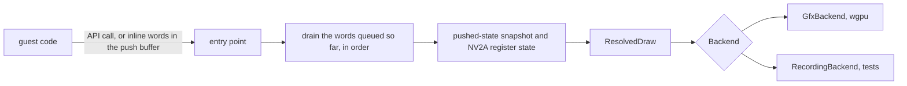
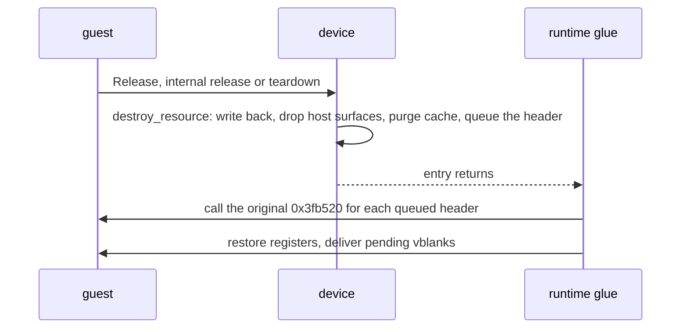

# D3D device model

Status: Built. The guest structures the device reads and writes, and how it orders state, resolves draws, clears, swaps and destroys.
Code: `crates/platform/d3d/src/device.rs`, `crates/platform/d3d/src/device/`. Tests: `crates/platform/d3d/tests/`.
Switch: none. Part of [d3d.md](d3d.md).

## Guest structures

| global / structure | address / size | who touches it |
|---|---|---|
| `D3D__pDevice` | `0x00407488` | D3D; written by CreateDevice |
| device object (`CDevice`) | `0x00404FE0`, `0x928` dwords | D3D and game code (fields below) |
| game's own device pointer | `0x005093B0` | game (CreateDevice's `ppDevice`) |
| `D3D__RenderState` | `0x00407498`, 166 dwords | D3D setters and game code directly |
| `D3D__TextureState` | `0x00404DD0`, `[4][32]` dwords | D3D setters and game code directly |
| `D3D__DirtyFlags` | `0x00407490` | D3D and game code (167 `.text` refs, 50 fns) |
| `D3D__Streams` | `0x00408458`, 16 x 12 bytes `{stride, offset, pVB}` | D3D only (game never writes it) |
| VS constant shadow | `0x00407738`, 192 x 16 bytes | constant setters |
| push-buffer size / kick-off size | `0x0040864C` (default `0x80000`) / `0x00408648` (`0x8000`) | read by inline writers |
| static VS object | `0x00408518` (`+0x14`: 16 x `{stream, offset, format, _}`) | `SelectVertexShaderDirect`, game choke point |
| game PSDEF buffer | `0x00484F68`, 60 dwords | game builds a `D3DPIXELSHADERDEF` here (indexed stores, e.g. in `0x00052040`) |

Device fields with evidence (offsets into the device object):

| offset | meaning | evidence |
|---|---|---|
| `+0x000` / `+0x004` | push-buffer put / threshold | inline writers in about 50 functions |
| `+0x008` | flags: `0x10` = `BehaviorFlags & 0x10`; `0x800` set by Begin and draws | CreateDevice, game tests |
| `+0x01C` | base vertex for `DrawIndexedVertices` (`SetStateVB`) | DrawIndexedVertices |
| `+0x02C` | GPU time, the last-use tag stored in resource `Lock` words | fences |
| `+0x784` | current pixel shader handle (checked by `BumpEnv`) | SetPixelShader, BumpEnv |
| `+0x788` / `+0x78C` | final-combiner-in-use / `PSDEF[59] & 0x100` | SetPixelShader |
| `+0x790` | PSTextureModes mirror | game code |
| `+0x794` | current vertex shader object | VS setters |
| `+0x924..+0x92C` | embedded pixel-shader object `{RefCount, Flags, pPSDef}` | 23 game functions fill it in and pass `device+0x924` to SetPixelShader |
| `+0xB04` / `+0xB08` | stream-input count / `D3DSTREAM_INPUT[]` | SetVertexShaderInput |
| `+0xF88` | textures[4] | SetTexture |
| `+0x93C` / `+0x940` / `+0x944` | W near, W far, 1/W far (from the projection) | SetTransform `0x3f802c..0x3f80eb` |
| `+0x948` | depth scale for the depth format (`D24S8` 16777215, `F24S8` 1e30, `D16` 65535, `F16` 511.9375) | `0x3fd970` |
| `+0x954` / `+0x958` | render-target size | SetRenderTarget `0x3f6741` |
| `+0x95C` / `+0x960` | super-sample scale | CreateDevice |
| `+0x96C` / `+0x970` | back-buffer scale | CreateDevice, SetBackBufferScale |
| `+0x980` | composite: projection x viewport | `0x3f6840` |
| `+0xC60` / `+0xCA0` | transforms (10 matrices) / projection | CreateDevice, SetTransform |
| `+0xEF8` / `+0xEFC` | screen offsets (0.53125) | CreateDevice |
| `+0x196C` | multisample type (0 stored as `0x11`) | CreateDevice; read by Get2DSurfaceDesc |
| `+0x197C` | 32-dword stipple pattern copied by `SetStipple` (`0x3f8cc0`) | `0x3f8cc0` |
| `+0x1C08` / `+0x1C10` / `+0x1C18` | depth-clip shadow (fixed function / program) and game-owned flags | `0x3f6190` |
| `+0x1DB8` | vertical-blank callback | game stores it at `0x12b093` |
| `+0x1A04` / `+0x1A08` | render target / depth surface | SetRenderTarget, game reads |
| `+0x1A10` | frame buffers (back buffers + 1, `0x3fc990`) | CreateDevice; Swap's rotation |
| `+0x1A14` / `+0x1A18` (/ `+0x1A1C`) | back buffer / display surface (/ second back buffer) headers; Swap rotates their `Data` | CreateDevice, Swap, viewport code |
| `+0x2478` | swap count, also returned by Swap | game reads |

Resource headers follow the documented XDK layout:

- `D3DResource` is `{Common, Data, Lock}`.
  - Common holds the type in bits 16–18 (VB 0, IB 1, push buffer 2,
    palette 3, texture 4, surface 5, fixup 6) and the refcount in bits
    0–15.
  - The internal refcount is in `0x00780000`; each bind adds `0x80000`.
  - `D3DCREATED` is `0x01000000`.
- `Data` is a physical address. The CPU view is `0x80000000 | pa`.
- `D3DPixelContainer` adds `Format` and `Size`. `D3DSurface` adds `Parent`.
- A palette's size comes from the top two bits of Common.

Presentation parameters at the two CreateDevice sites (boot `0x00012526`,
game `0x000129cd`):

- 640x480 back buffer, format 6 (`A8R8G8B8`);
- auto depth `D24S8` (`0x2A`);
- `PresentationInterval` `0x80000000`;
- `BehaviorFlags` `0x40`.

## Device model

### Ownership

- **Guest-owned, read at use:**
  - the state arrays, read at every draw (see [State ordering](#state-ordering) below);
  - resource headers and their contents;
  - the inline push-buffer words;
  - PSDEFs and vertex attribute formats.

  Setters only store into the arrays, so direct game writes and API calls
  look the same.
- **Device-owned (host):**
  - surfaces and textures on the backend;
  - the swap ring;
  - API bindings (textures, palettes, streams, shaders, targets);
  - vertex program memory (136 slots) and constants;
  - the viewport, mirrored at device `+0xEE0..+0xEF4` as SetViewport
    stores it (Halo saves and restores those six words at `0x14ac0`).

  Where D3D mirrors these into guest-visible fields that game code reads,
  the device writes the same fields: `D3D__pDevice`, the render-target and
  depth fields, `textures[]`, the constant shadow, the swap count, the
  device reference count (`+0x938`), the viewport words, and the internal
  refcounts in resource headers.

### Push buffer

The device does not intercept inline sites one by one. It gives them a real
guest push buffer (`DeviceConfig::push_buffer`).

- Every entry point first decodes the words written since the last entry,
  so inline draws run in program order relative to API calls.
- `MakeRequestedSpace` executes the words and rewinds put.
- Only the method subset in the [inline methods table](d3d.md#push-buffer), plus the register methods D3D's own fragments push ([d3d-nv2a.md](d3d-nv2a.md), [Fragments and NV2A registers](d3d-nv2a.md#fragments-and-nv2a-registers)), is understood. Anything else is a `PushError::UnknownMethod` stop.
- Headers with reserved bits (bit 31, bits 17-16), control words (jump, call, return), other subchannels, a put that is not on a word boundary, and commands running past put are rejected too.
- A command is consumed only once it has fully executed. Any failure while
  draining **latches** the device: the failing command stays unconsumed and
  every later entry returns `D3dError::Faulted` (naming the original error
  and address), so a retry can never silently skip it.
- This decoder is the bridge until the guest's render front-end stops running ([retire-d3d.md](retire-d3d.md)): 22 functions emit inline Begin/End, and none of them needs to be lifted for it to work.

### State ordering

A value game code stores into `D3D__RenderState` reaches the GPU only when
something pushes it: a setter, `SetRenderState_Simple`, the deferred-state
commit (`0x00400fa0`, also run by `Begin`), or a draw. Words already queued
in the push buffer must not see later stores. The device keeps a *pushed*
snapshot of both arrays:

- setters (including `SetPixelShader`'s PSDEF copy and the ZBias derived
  slots) store into the array and the snapshot;
- the commit, `Begin`, and API draws refresh the snapshot from the arrays
  (D3D commits all pending state there);
- `SetRenderState_Simple` sets the one slot its `ECX` header encodes to
  its `EDX` value. The registers are what counts: game code stores the
  array before the call at some sites and after it at others;
- an inline state method in the push buffer sets its slot to the command's
  own payload when the drain reaches it, so several queued changes apply in
  order however late the drain is. The method-to-slot map is
  the image's encode table inverted, plus `0x030C` (depth-test enable),
  which Halo's inlined ZEnable pushes with the new `D3DRS_ZENABLE` (slot
  143) value at 19 sites (`0x1eb66`, ...). A method several slots share
  is not invertible. The only one is `0x1D90`, the placeholder of the
  unused slots; it is `SET_COLOR_CLEAR_VALUE`, so it lands in the register
  state as on the hardware and changes no render state. Any other
  unknown method is rejected;
- queued inline draws are drained against the snapshot.

### Bounds

Every guest-controlled size and address goes through checked arithmetic,
and allocations are bounded before anything is read:

- one read is at most 128 MiB (`guest::MAX_READ`); ranges that wrap the
  address space fail;
- a draw uses at most 2^20 vertices, and one stream or index list at most
  64 MiB. Immediate-mode primitives share the vertex cap at the one place
  every vertex is emitted (`Immediate::set`), so inline words split over
  any number of drains and `MakeRequestedSpace` rewinds cannot exceed it;
- `Clear` takes at most 4096 rectangles;
- base vertex plus index, stream offset plus start times stride, constant
  register plus count, and stack-argument addresses are all checked.

### Draws

| Part of a draw | Carried in `ResolvedDraw` |
|---|---|
| Vertices | the gfx vertex layout and the stream bytes read from guest memory; for indexed draws, the vertices the indices reach plus the indices rebased onto them (`indices`) |
| State | translated render and stage state (an untranslatable value is `Event::BadState`), the raw words (`raw`), stage state `TextureStageState` does not model (`extras`: alpha kill, colour sign, bump environment, colour key), `ShaderInputs`, the viewport |
| Target and textures | the render target's size and formats (`target`); each bound texture's header, palette, format, kind, size and levels (`texture_info`) |
| Clip | `clip`, the pixel rectangle the draw may touch; `clip_rects`, its disjoint pieces when the scissor area is not one rectangle |
| Registers | `hw`, the NV2A register state (`d3d::hw::HwState`) as last pushed |

A `ResolvedDraw` holds no guest pointers. `GfxBackend` renders pre-transformed fixed-function draws its built-in shader reproduces exactly through that shader, and everything else through a `ShaderProvider` (`Nv2aShaders` over `crates/formats/shaders` by default). A draw the provider cannot translate is skipped with an `Event::DrawSkipped` that gives the reason.

- **Scissors.** Each draw is scissored to `clip`. When the scissors leave several pieces (`clip_rects`), the draw is recorded once per piece in the same pass with that piece as its scissor; the pieces are disjoint, so blending touches every pixel once. The wgpu viewport stays the whole target, because positions are already window coordinates (pre-transformed vertices; NV2A programs apply the viewport themselves), so a `gfx::DrawViewport` would transform them twice.
- **Indices** go through `gfx::Draw::indices`.
- **Z range.** `Renderer::set_pretransformed_z_max` is renderer-wide, so it is set before every built-in draw from that draw's depth format.

#### Batching

Consecutive draws to the same colour and depth surfaces, and a whole-target clear before them, are recorded into one pending pass (`gfx::Renderer::record`). Their vertices, indices and uniforms are packed into upload rings and submitted together, so Metal sees one render pass rather than one per draw.

| Mode | Switch | Rule |
|---|---|---|
| Loose (default) | none | one render pass whatever the colour masks and `discard`; a few edge pixels in a level can differ |
| Exact | `GfxBackend::set_merge_masks(false)` | a draw after one that writes only some colour channels gets its own pass unless it writes the same ones, and so does every draw that can `discard` (`PreparedShader::discards`: alpha test, alpha kill, a clip-plane stage, the polygon stipple); the main menu's frames then match one pass per draw byte for byte |
| Reference | `GfxBackend::set_merge_passes(false)` | one render pass per draw (docs/graphics/graphics.md, "Merged passes") |
| Check | `GfxBackend::set_merge_check(Some(frame))` | renders every pending pass of that frame both ways and prints what differs |

- Any other surface operation (another target, a partial clear, a read, write, copy, snapshot or destruction of a surface, `Swap`) submits the pending pass first. The target switch comes before the provider stages anything for the new draw, because the submit lets the rings reuse their space.
- A pending pass that will encode about 1024 passes (render passes, plus a count pass and a sum per visibility-tested draw) is submitted before the next draw. Metal loses the device at about 2048 render passes in one command buffer.
- `GfxBackend::flush` submits by hand and `GfxBackend::read_color` flushes before reading; code that reads `GfxBackend::store` directly flushes first. `GfxBackend::batch_stats` counts draws, pending passes, render passes and submits.
- Clearing and reporting the pixel counter submit the pending pass first; a report's read waits for its own submission only.

#### Clip and scissors

- `clip` with no scissors is the viewport intersected with the target. With scissors it is the scissor area on the target, and the viewport does not clip. `SetViewport` clips to the target and resets the scissors (exclusive mode included), as the original does; a null viewport keeps the current one.
- `clip_rects` come from `d3d::device::scissor_region`; `clip` is then their bounding box. `SetScissors` (`0x3f8760`) has three branches, and the device follows them:

| Original | Branch |
|---|---|
| no rectangles (`0x3f87a7`) | clip to the viewport |
| one inclusive rectangle (`0x3f886c`) | that rectangle is the surface clip |
| otherwise (`0x3f8928`) | NV2A window clip: clip type = `Exclusive`, rectangle `i` in `SET_WINDOW_CLIP_HORIZONTAL/VERTICAL(i)` with inclusive maxima, surface clip = the whole target |

  The viewport is not a clip in the last two, so window rectangles outside it still draw. Inclusive keeps pixels inside any rectangle, exclusive keeps pixels outside all of them; an exclusive rectangle over the whole target draws nothing. `Stats::scissor_split_draws` counts the split draws. `Clear` ignores the scissors (not checked against hardware).

#### Refusals

State that cannot be expressed stops with `D3dError::Unimplemented` rather than rendering wrongly: a back-buffer scale other than 1 x 1, and a backend that returns `DrawOutcome::Unsupported`.

### Clears

`Device::clear` (`src/device/raster.rs`) intersects every rectangle with the viewport, or uses the viewport when Count is 0 (`0x3fa1a0..0x3fa247`), clips to the target and skips empty intersections.

| Clear | Goes to |
|---|---|
| the whole target, all colour channels (or no colour) | `Backend::clear` |
| anything else | `Backend::clear_rects` with a `RectClear`: the rectangles, the colour plus a `ChannelMask` (`D3DCLEAR` `0x10` red, `0x20` green, `0x40` blue, `0x80` alpha), depth and stencil; `GfxBackend` hands them to `gfx::Renderer::clear_rects` as a `MaskedClear` plus one `ScissorRect` per rectangle |

Halo's wrapper `0x14b60` turns `EAX` into flags as `(eax & 1 ? 0xF0 : 0) | (eax & 0x1E) << 3 | (eax >> 5) & 3`. The alpha-only clears are `0x3c515` (`EAX = 0x10` -> `0x80`, colour `0x00FFFFFF`, Z 0) and `0x13c3f` (`Clear(0, 0, 0x80, 0, 1.0, 0)`).

### Swap

`Device::swap` (`0x3f9d00`). CreateDevice sets device flag `0x4000` (`device::COPY_SWAP_FLAG`) for a multisampled device (type bits `0x3000`) or `D3DSWAPEFFECT_COPY` (`0x3fc9a2..0x3fc9c0`), and stores the frame-buffer count (back buffers + 1) at `+0x1A10`. That flag, not the swap flags' `COPY` bit, decides what Swap does.

| Kind | Flag | What Swap does |
|---|---|---|
| Flip (Halo's device: no multisampling, swap effect 1 or 2 from `0x128c0`) | clear | with `FINISH` (4) set, as in `Swap(0)` (`COPY \| FINISH`, Halo's one per-frame call at `0x140fc`), `0x3f9d75` sets a fence, counts and goes to `0x3f9a70`. That rotates `Data` and `Lock` through the headers from `+0x1A14`: the display surface (`+0x1A18`) gets the back buffer's, the back buffer the last header's, and the CRTC scans out the display surface's `Data`. The host ring rotates the same way. Without `FINISH` the original returns the swap count and does nothing else (`0x3f9d7a`); so does the device |
| Copy | set | `COPY` (1) or `BYPASSCOPY` (2) set a fence and count (`0x3f98f0`). With three frame buffers the display and third headers then exchange `Data` and `Lock` (`0x3f991c..0x3f9944`; the host front and second back buffer trade places, after any copy still owed from back0). With `COPY`, back0 is copied into the display buffer, deferred to the first write into back0 ([d3d-entries.md](d3d-entries.md), "Display entries") |

- On a copy-swap device with fewer than three frame buffers, scanout moves to the display buffer at once (`0x3f998c..0x3f99d4`). With three it moves only on `FINISH` (`0x3f9981`, `0x3f9a16..0x3f9a57`), even with neither copy bit set, and without counting. So `Swap(1)` then `Swap(4)` shows the copied frame at the second call.
- `FINISH` on either kind ends with `0x3f9cc0`: the display header's `Lock` (its parent's, for a level) takes the GPU time (`+0x2C`), and a new fence is stored at `+0x1974[swap count & 1]` (`layout::device_field::SWAP_FENCES`). `Device::set_fence` returns the time used for the stamp and advances the counter by two. The first flip from zero records 2 in both the display `Lock` and the odd slot, with the GPU time at 4 (see [d3d-timing.md](d3d-timing.md), [GPU model](d3d-timing.md#gpu-model-fences-and-the-busy-check)).
- A device re-created after teardown starts with no lost-image state (`shown_lost`, set when a backend cannot make the deferred copy).

### Errors and events

- `D3dError` means the call cannot complete, and the runtime should stop:
  `Unimplemented`, `Invalid`, `Push`, `Faulted`, `NoDevice`, `Guest` and
  `Backend`. A backend reports state it cannot render as
  `DrawOutcome::Unsupported`, which the device turns into `Unimplemented`.
- A frame-wait stop (see [d3d-timing.md](d3d-timing.md), [Vertical blank](d3d-timing.md#vertical-blank)) uses the same hook, with the
  engine address `0x12b2e0`.
- `Event` means something is worth knowing but execution continues:
  `DrawSkipped`, `BadState` and `MissedInvalidation`. Draws record them
  every frame and the run report drains them at exit, so the device keeps
  the first 4096 since the last drain and counts the rest
  (`EventLog` in `crates/platform/d3d/src/events.rs`); the report prints
  the count past the limit as its last event line.
- Nothing is skipped silently.

## Resource destruction

`D3D_DestroyResource` (`0x3fb520`, `EDI` = resource) frees a resource's
guest memory through the game's allocators (`0x2d0a60`, `0x122c0`). Its
D3D callees are the overridden `BlockOnResource` and `0x3fb4d0`, an unlink
from the list at `0x408644` that nothing else names, so the list is always
empty. `Release` (`0x3fb640`) and the internal release `0x3fb5a0` (target
switches, unbinds and teardown) call it. The other two direct calls, game
code at `0x13d24` (in `0x13cd0`) and teardown at `0x3fc611`, release device
`+0x7A0`, which is only ever stored as 0, so they never run.

- The device implements `Release`, `AddRef`, the internal release and the
  teardown as compiled. `Release` of a level releases its parent first,
  and destroys at the last reference when no internal reference remains.
  `AddRef` of a level with refcount 0 adds a reference to its parent.
  `Release` of a refcount-0 resource is an invalid call.
- A destroy (`Device::destroy_resource`) writes back render-to-texture
  pixels, drops the host surfaces of the resource and its levels, purges
  it from the texture cache and queues the header (`Stats::destroys`).
- After the entry returns, the runtime glue (`runtime_glue`) takes the
  queue (`Device::take_pending_destroys`) and calls the original
  `0x3fb520` for each header through `ExecCtx::call_guest`, with `EDI` =
  header. It then restores the entry's registers and delivers any pending
  vblanks. The guest memory is freed by the game's own code, so the
  allocator state stays the game's.
- The original waits on each resource it frees first (`BlockOnResource`,
  `0x3fb537..0x3fb539`, skipped for a surface the title made). After a
  teardown those calls arrive with no device. Teardown drained the push
  buffer and wrote every target back before it queued the resources, so
  `Device::block_on_resource` answers each resource the teardown destroyed
  once with no device; any other wait with no device stops with
  `NoDevice`. CreateDevice forgets the list.
- Tests: `tests/round7.rs` (a runner with a stand-in at `0x3fb520` that
  waits through `BlockOnResource` as the original does) and
  `round6.rs`/`recheck_fixes.rs` (teardown and unbind destroys). The
  ignored `destroy_resource_conventions_in_the_image` checks that `EDI` is the
  resource, the callees, that only `0x3fb4d0` names `0x408644`, and that
  `+0x7A0` is only stored as 0.

## Brightness and gamma

The brightness setting builds a 768-byte gamma ramp (256 red, 256 green, 256
blue) in the view begin `0x12a50` (`render_bridge::display`, an `implement`
hook; the retail code loaded it through the miniport `0x3ff5c6`). The ramp is
`(i / 255) ^ brightness * 255` per channel; the brightness is the view's
setting, faded toward `0x4e673c` by `0x4e6738` at 640 x 480 with one player,
and 1 below 0.1. The ramp is kept in `frame_types::display`; the present
applies it per channel when it copies a frame to the window
(`gfx::display_gamma`, `FrameSink::submit_presented`). The identity ramp is
not applied. No miniport word is read or written, and no D3D entry is
answered for it.

The vblank install `0x12b070` zeroes the frame wait's words and keeps the
callback `0x12b2a0` as `display::vblank_callback`, not at device `+0x1db8`.
The display persist `0x22376b` runs `0x12bf40` and `0x6cb60` and skips the
`PersistDisplay` call.
