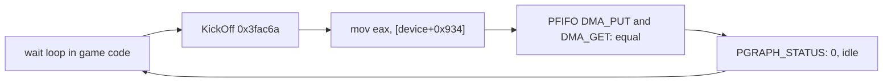
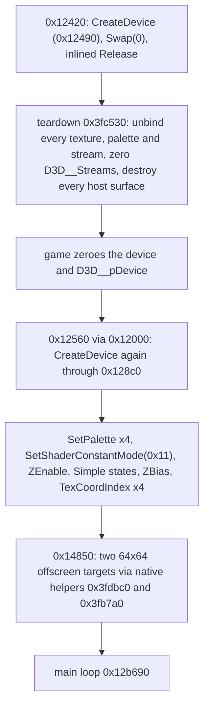

# D3D NV2A registers and the boot path

Status: Built. The NV2A register state the device keeps, the register window game code reads, the port-I/O guards and the boot path.
Code: `crates/platform/d3d/src/device/fragments.rs`, `crates/platform/d3d/src/hw.rs`, `crates/platform/d3d/src/regs.rs`. Tests: `crates/platform/d3d/tests/round6.rs`, `crates/platform/d3d/tests/round5.rs`.
Switch: none. Part of [d3d.md](d3d.md).

## Fragments and NV2A registers

| Fragment | What it does |
|---|---|
| `0x3f6190` viewport push | for a program or pass-through shader (`[vs+4] & 0x12`): `VIEWPORT_OFFSET` and `VIEWPORT_SCALE` from `0x3f6060` (skipped with device flag `0x200`), then `CLIP_MIN/MAX` from `+0x1C10`. Fixed function: `VIEWPORT_OFFSET = [x + ox, y + oy, 0, 0]`, then the clip from `+0x1C08` |
| `0x3f6390` | `SET_CONTROL0`. The base is `0x100001`; `0x10000000` with YUV, `0x10000` when w-buffered, `0x1000` for a float depth format |
| `0x3f6840` | the viewport matrix (scaled by `944 * 948` when w-buffered), multiplied by the projection, into `+0x980`; dirty bit `0x200` |
| `0x3f6f40` | for a pass-through shader, constants 0-1 (`[ssx, ssy, zs, w]` and `[ox, oy, 0, 0]`) and the pass-through program, chunked 32 words per header (`0x3f6b70`). The program is read from the image: `0x403E40` (48 words, no fog table), `0x403D90` (44, affine projection) or `0x403CD0` (48). Space is reserved as the original does |

`src/device/fragments.rs` reproduces them. Each doc comment there cites the addresses it was checked against with `h2 disasm`. Intermediates are `f64` and stores round to `f32` where the x87 code stores; the `0x3fd080` matrix product is `f32` in the SSE accumulation order. The device also runs them where D3D does: CreateDevice, SetViewport, SetRenderTarget, the ZEnable setter and a shader-kind change in SetVertexShader (`0x3f6d50`).

- The clip shadow (`+0x1C08`/`+0x1C10`) is refreshed unless the game owns it (`+0x1C18` bits 0/1). W-buffered (`ZENABLE` = 2), it is `[944 * 93C * 948, 948]`; otherwise `[0, 948]` for programs and `[minZ * 948, maxZ * 948]` for fixed function.
- CreateDevice sets up what they read (`0x3fc421..0x3fc462`, `0x3fba30`): identity transforms and the W parameters; the default FVF object `0x408340` at `+0x794`; the static programmable object `0x408518`, cleared, with flags `0x10`; the multisample type and scales, depth scale and target size; the 0.53125 offsets; then the composite, the pass-through program and the viewport push.
- SetRenderTarget resets the viewport to the whole target (`SetViewport({0, 0, 0x7FFFFFFF, 0x7FFFFFFF, 0, 1})` from `0x403B88`), updates the target fields and pushes the viewport.

### Registers the drain applies

The drain applies these register methods to `d3d::hw::HwState` (`Device::hw`, and `ResolvedDraw::hw`):

| Method | Register | Notes |
|---|---|---|
| `0x0290` | CONTROL0 | |
| `0x0394` / `0x0398` | CLIP_MIN / CLIP_MAX | |
| `0x0A20` / `0x0AF0` | VIEWPORT_OFFSET / VIEWPORT_SCALE | also mirrored into constant registers 59 and 58, where vertex programs read them (the xemu model) |
| `0x0B00..` / `0x0B80..` | the transform program / transform constant words | through the hardware cursors (`0x1E9C` / `0x1EA4`) |
| `0x1E94` / `0x1E98` | execution mode / context write enable | |
| `0x1EA0` | program start | |
| `0x147C` / `0x1480` | stipple control / pattern | |
| `0x1710` | vertex-cache break | no effect |
| `0x1720..0x175C` / `0x1760..0x179C` | `SET_VERTEX_DATA_ARRAY_OFFSET` / `_FORMAT`, per attribute register | recorded only (`HwState::vertex_offset` / `vertex_format`): nothing draws from GPU-side arrays, so `DRAW_ARRAYS` and the `ARRAY_ELEMENT` methods still stop as unknown |
| `0x1D8C` / `0x1D90` | the clear values | also the operands of software methods |

`NO_OPERATION` (`0x0100`) with a non-zero parameter is a software method: the GPU interrupts and D3D's handler (`0x3ff240`) dispatches on the low five bits through the table at `0x3ff454`.

| Low five bits | Meaning | Drain |
|---|---|---|
| 6 and 7 | a callback (`0x3ff3c5`: `function(context)`, cdecl, with the two clear values as operands) | delivered ([d3d-timing.md](d3d-timing.md), [Push-buffer callbacks](d3d-timing.md#push-buffer-callbacks)) |
| 11 | nothing in the original either | nothing |
| others (flip bookkeeping, events, register writes) | only come from D3D's own code, which the overrides replace | stop with a named error |

## NV2A register window

The original CreateDevice stores the NV2A register base (`0xFD000000`) at
device `+0x934` (`0x3fc31d`). Game code reads it back and reads GPU
registers through it, at 17 sites of one shape: `mov edx, [D3D__pDevice]`,
`call 0x3fac30` (KickOff, which preserves `EDX`), `mov eax, [edx+0x934]`,
then `mov ecx, [eax+0x3240]`, `cmp ecx, [eax+0x3244]` and, when they are
equal, a read of `[eax+0x400700]`. The sites sit in wait loops (a timer
compare, KickOff, the reads, a call, a jump back); the values only decide
whether the PGRAPH read happens.

Three of the game sites open a resource cache's flush rather than a wait
loop: `0x12d0cf` (`0x12d0a0`), `0x12e0d6` (`0x12e0c0`) and `0x12e15b`
(`0x12e150`). Those functions are Rust, without the kick or the peek
(`crates/rewrites/engine/src/native_cache_flush.rs`, installed by
`crates/rewrites/sim-bridge/src/cache_flush.rs`). The other game sites sit
in the cache allocator's blocking retry (`0x12d400`, and its inlined copies
in the callers listed above): try `0x12d2f0`, pump the cache with
`0x12c600` up to a count, then until a timeout `KickOff`, the peek and
`SwitchToThread` (`0x2d2084`) between tries. All 14 of those waits
(`0x12d4e3`, `0x6a927`, `0x80ebf`, `0x124292`, `0x19963b`, `0x1997c7`,
`0x86381`, `0x8643d`, `0x8c887`, `0x146f0e`, `0x18f30f`, `0x1941e7`,
`0x194357`, `0x1561eb`) are `before` hooks that yield the thread and resume
at the `jmp` after the yield's call, so the kick and the peek never run
(`crates/hooking/guest-layout/src/points/cache_wait.rs`, installed by
`crates/rewrites/sim-bridge/src/cache_flush.rs`); the retries, the pump and
the timeout stay retail's.

| site | |
|---|---|
| game | `0x6a932`, `0x80eca`, `0x8638c`, `0x86448`, `0x8c892`, `0x12429d`, `0x12d0cf`, `0x12d4ee`, `0x12e0d6`, `0x12e15b`, `0x146f19`, `0x1561f6`, `0x18f31a`, `0x1941f2`, `0x194362`, `0x199646`, `0x1997d2` |
| D3D | `0x3fa8b5` (MakeRequestedSpace helper), `0x3fa904` (BlockOnTime helper), `0x3fac6a` (KickOff), `0x3fad10` (a swap callback CreateDevice installs), `0x3fc3f2` (CreateDevice) |

The D3D sites also read `0x400B10`, and run only under overrides. No site
writes the window. The miniport (`0x3fe005` and the interrupt paths)
reaches the NV2A through its own base, never through `+0x934`; those
functions are overridden (see [Port I/O guards](#port-io-guards)).

**Registers** (`d3d::regs::reg`):

| offset | register | value |
|---|---|---|
| `0x3240` | `NV_PFIFO_CACHE1_DMA_PUT` | the drained push-buffer position, `& 0x0FFFFFFF` (D3D's encoding, `0x3fad07`) |
| `0x3244` | `NV_PFIFO_CACHE1_DMA_GET` | the same: the FIFO has fetched everything |
| `0x400700` | `NV_PGRAPH_STATUS` | 0: idle |
| `0x400B10` | the PGRAPH register D3D's fence word lands in | `(at << 5) \| (fence & 0x1F) << 2 \| ([device+0x40] & 3)` |

`D3D_SetFence` (`0x3fa6a1`) pushes that fence word with method `0x0310`
on subchannel 5, `at` being the push-buffer address of the fence.
`BlockOnTime` waits until bits 6:2 match the completion word
(`0x3fa910`), and `MakeRequestedSpace` reads bits 31:7 back as the address
the GPU has fetched to (`0x3fa8bb`). The synthesized register uses the
completion time for `fence` and the drained position at the last fence
for `at`, so both checks see the GPU caught up. No vblank state is read
through `+0x934`.

**Backing.** The runtime keeps the real aperture free of RAM and has no
MMIO handlers (an access is an unsupported-device fault, by design; see
`docs/lifter/LIFTER.md`). Adding a device hook to `Guest`'s access path would
widen that contract for four read-only words, so the window is a
documented substitute instead, with no runtime change:

- The host picks the base (`DeviceConfig::nv2a_window`), page-aligned with
  room for the 16 MB aperture. Only the PFIFO and PGRAPH pages are mapped,
  as ordinary RAM, so any other register page faults, naming its address.
- `Device::sync_registers` writes the words at CreateDevice, KickOff
  (every game site reads right after one), SetFence and Swap. Between
  those they hold the last values, which still describe an idle GPU.
- At each of those points the device compares both pages with what it
  last wrote. A guest store is reported as `Event::RegisterWrite { offset,
  value }` and undone.
- With a runtime MMIO hook the same `RegisterValues` could answer reads at
  `0xFD000000` directly; nothing else would change.

**Tests** (`tests/round6.rs`):

- Synthetic: the field and the words after CreateDevice, KickOff and
  SetFence; logged and undone stores; release and re-create; a misaligned
  base; the window as mapped runtime memory read through `runtime::Runner`.
- Ignored, needing `$H2_XBE`:
  - `every_0x934_site_reads_only_modelled_registers` decodes the image
    with iced-x86 over the `analyze` function map. It finds every
    `[reg+0x934]` load whose base came from `D3D__pDevice` (and every one
    in the D3D section), and follows the loaded register to its
    accesses. It checks the 17 game sites and their three reads, that the
    D3D sites run only under overrides, and that every game-code access
    at a modelled offset belongs to a site.
  - `game_sites_find_an_idle_gpu_through_lifted_code` loads the image
    into the runtime with the overrides and a window and runs
    CreateDevice through the runner. It then interprets each game site's
    lifted IR from its `D3D__pDevice` load, with the KickOff call going to
    the override through the runner. Every register read must execute
    (including the PGRAPH one) without a fault.

## Port I/O guards

Three D3D-internal functions execute port I/O on the GPIO port `0x80C0`
(the encoder's field bit): `out` at `0x3fe131`, `in` at `0x3feb3c` and
`0x3fee0d`. No game code calls them. They are reached only from the
original CreateDevice (`0x3fbc10 -> 0x3fe005`), the teardown and Reset
paths (`0x3fc530`, `0x3f77c0` through `0x3fe4cb`, `0x3fe67f`, `0x3fe86a`),
and the GPU interrupt service routine and DPC that `0x3fe005` connects.
All of those are overridden, but the three are overridden too
(`d3d::abi::PORT_IO`) so generated code can never execute the port
instructions:

| address | function | override |
|---|---|---|
| `0x3fe005` | miniport hardware init (`EAX` = miniport): connects the interrupt (`0x3fe0a4`, ISR `0x3feac0`, DPC `0x3febe0`), maps the NV2A, writes GPIO | stops |
| `0x3feac0` | GPU interrupt service routine, stdcall `(Interrupt, ServiceContext)`, `ret 8`, `AL` = handled | `AL` = FALSE (the device raises no interrupts; the original's answer when nothing is pending, `0x3febd0`) |
| `0x3fed90` | vertical-blank service (`EAX` = miniport): field bit, flip, vblank callback; from the DPC and the flip paths | stops (vblanks come from `Device::vblank`, see [Vertical blank](d3d-timing.md#vertical-blank)) |

These three instructions (`in` x2, `out` x1) are the only ones `h2 lift
--stats` still reports as unlowered (18,685 of 18,688 functions fully
lowered; the other three are these functions). That is deliberate: the
lifter has no port-I/O model, and a guessed open-bus read would hide a stray
call behind a plausible value, where the unsupported stop names it.

The ignored test in `tests/round5.rs` decodes the retail image
(`$H2_XBE`) to check that each port instruction lies in the function its
guard overrides, after `mov dx, 80C0h`.

## Boot path

The original CreateDevice reaches the NV2A through `0x3fbc10 -> 0x3fe005 -> 0x3fe165` (the MMIO read at `0x3fe16b`). With the overrides installed, Halo's boot reaches D3D in the order above (static call graph from the XBE entry; `main` is `0x12190`).

CreateDevice is `640x480`, `BehaviorFlags` `0x40`. The inlined Release finds device `+0x938` at 1, so it runs the teardown. Reset (`0x3f77c0`) is called only if the game's device pointer is still set at `0x128c0`, which it is not after the first teardown. Nothing else under `0x12000` reaches a stop.

### Stops on the way to the menu

The boot ([BOOT.md](../runtime/BOOT.md)) runs past all of these to the menu and into the first level. The cases are the conditional stops that normal view rendering (`0x223240 -> 0x2232a0 -> 0x2c8a0 -> 0x132d0`) can reach. Of the 18 entries that stopped in the static analysis, one remains in `abi::UNIMPLEMENTED`: `0x3f77c0` Reset, which the boot path above does not reach. The port-I/O guards that stop ([Port I/O guards](#port-io-guards)) are not reached from game code.

| Case | How the device handles it |
|---|---|
| Viewport (`0x14bc0` selects a render target by index and calls SetViewport with its extents) | a smaller viewport (split screen, letterboxing, the offscreen targets) gives each draw and each Count=0 clear a clip rectangle, which `GfxBackend` applies as a scissor; partial clears render through `clear_rects` |
| Offscreen targets (`0x14850`) | texture levels (`Parent` set by `0x3fb7a0`) become render-to-texture targets sampled in place and written back lazily ([d3d-render-targets.md](d3d-render-targets.md)); `0x14bc0`'s Get2DSurfaceDesc (`0x3fdb20`) runs natively |
| Channel clears (wrapper `0x14b60`; alpha-only `0x13c3f` when `0x4BA04C > 1`; `0x3c515`, `EAX = 0x10`, in `0x3c3c0` from `0x2bcd0`; register callers `0x132d0`, `0x2bcd0`, `0x3fdf0`, `0x41cc0`, `0x44370`) | `clear_rects` with a channel mask |
| Frame wait `0x12b2e0` | spins forever without vblanks; with a clocked source it ends at the next vblank ([d3d-timing.md](d3d-timing.md), [Vertical blank](d3d-timing.md#vertical-blank)) |
| Stipple pattern (`0x1e4ae`), `InsertCallback` (`0x2460e`), vertex-cache break (`0x43a1a`) | drain ([d3d-timing.md](d3d-timing.md), [Push-buffer callbacks](d3d-timing.md#push-buffer-callbacks)) |
| Inline `BeginVisibilityTest` (`0x17C8`, `0x20cec`), `EndVisibilityTest`, `GetVisibilityTestResult`, lens-flare pass `0x20bb0` (`0x3f85d0`, `0x3f8630`) | counting queries ([d3d-visibility.md](d3d-visibility.md)) |
| Inline arrays (`0x4b220`'s draw through BeginPush and SetStateVB, both native) | drain; see below |
| Same-size targets (`0x3f7b30`) | implemented; tests for it, the commit's kept bits and the internal references are in `tests/round6.rs` |
| Resource destruction (`0x3fb520`) | the device does its part and the original runs after the entry ([d3d-device.md](d3d-device.md), [Resource destruction](d3d-device.md#resource-destruction)) |
| Gamma ramp (`0x3ff5c6`, from the brightness update at `0x12d08`) | replaced in Rust ([d3d-device.md](d3d-device.md), [Brightness and gamma](d3d-device.md#brightness-and-gamma)) |

**Inline arrays.** `INLINE_ARRAY` (`0x1818`) words between `BEGIN_END` words collect in the immediate-mode state (`ImmediateDraw::inline`, at most `pushbuf::MAX_INLINE_WORDS` per primitive, never mixed with vertex-data writes), and the `End` draws them against the pushed state. Counted in `Stats::inline_array_draws`.

- The vertex is unpacked from the `SET_VERTEX_DATA_ARRAY_FORMAT` registers as the NV2A does it (the xemu model): enabled registers in register order, each aligned to its component size and packed with no gaps. The format's stride field is not used.
- A trailing partial vertex is dropped (64 bytes of 20-byte vertices draw 3), as xemu's `pgraph_gl_bind_inline_array` counts whole vertices. A format with no vertex type, or one with every register disabled, stops.
- After the draw the last vertex's values stay in the attribute registers (xemu `bind_vertex_attributes` does the same), so a later draw that leaves a register disabled reads them as its constant.
- Programs get the registers as attributes; an FVF shader draws fixed function, pre-transformed for `XYZRHW`.
