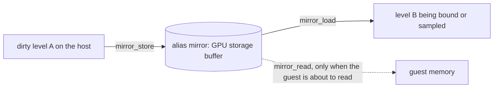

# D3D render targets and overlapping levels

Status: Built. How a surface that is both a render target and a texture lives on the host, and how overlapping levels share one GPU mirror.
Code: `crates/platform/d3d/src/device/raster.rs`, `crates/platform/d3d/src/device/mirror.rs`. Tests: `crates/platform/d3d/tests/alias_mirror.rs`, `crates/platform/d3d/tests/depth_textures.rs`.
Switch: `H2_D3D_WRITEBACK_TRACE` in [switches.md](../runtime/switches.md). Part of [d3d.md](d3d.md).

## Render-to-texture

| | Lazy (default) | Eager |
|---|---|---|
| Set by | `Device::set_rtt_direct(true)` on a backend that samples surfaces (`Backend::can_sample_surfaces`; `GfxBackend` does, `RecordingBackend` only with `sample_surfaces`) | `set_rtt_direct(false)`, or a backend that cannot sample surfaces |
| Sampling a level | the host surface is read in place when the rules below hold | the level is written back, then uploaded |
| Write-back to guest memory | when the guest is about to read the level (list below) | also at every target change, `Swap` and `KickOff`; every busy check or wait writes back all dirty levels |
| Depth levels | same as colour (`Device::set_lazy_depth`, needs `Backend::can_sample_depth_surfaces`) | written back whenever the colour or depth/stencil binding changes |

A target or texture surface whose `Parent` is a texture gets its own host surface (an `RttTarget`). The `0x14850` 64x64 targets are such levels, and `0x14bc0` selects them. A compressed format stops; eagerly, a header rewritten while its level holds unwritten pixels stops too.

### Host surface

- `Backend::create_texture_target` makes the surface (`SurfaceStore::create_texture_target` on `GfxBackend`). `Backend::write_surface` fills it from the level's guest texels, through a `TextureDesc` carrying the guest format, size and pitch (`GfxBackend` calls `SurfaceStore::write_color`). A backend that cannot fill it returns `Ok(false)` and the surface starts as created.
- Bound again, a cached level is refilled when its guest texels changed, judged by the upload policy as for textures: `Always` every time, `Tracked` after a reported write, `Verify` when the hash differs (with `Event::MissedInvalidation` if no write was reported). A level drawn into and not yet written back is kept as it is; lazily, the guest's changes are merged in ("Guest stores into a level").
- A draw or clear into the level marks it dirty. Binding a level first writes back any other dirty level whose memory overlaps it (two surface headers over one level), so it starts from their pixels.

### Sampling in place

A draw that samples a texture over a level reads the level's host surface (`Backend::surface_texture`; `GfxBackend` binds the surface's own view), with no write-back and no upload (`Stats::rtt_direct_samples`), when all of these hold:

- the texture is 2D, has one level and is `A8R8G8B8` or `LIN_A8R8G8B8` (texels that read back unchanged, so the surface holds what an upload of the written-back level would);
- a level has the same `Data`, format, size and pitch (the one drawn into, if several do; any other level drawn into over part of the same memory is written back first);
- the stage has no `COLORSIGN` (signed channels are stored biased);
- the level is not the target being drawn (that reads what the level held before the draw, through guest memory).

Otherwise the texture goes through the write-back and the texture cache. The surface is refreshed from guest memory like a bound target before it is used.

### Write-back

A dirty level is written back through `Backend::read_surface` and noted in the write tracker. Lazily, these ask for it:

| Trigger | Scope |
|---|---|
| `BlockOnResource` or the busy check `0x3fb710` | the level, its texture, or a resource whose memory overlaps it (a texture or surface by its whole layout, another resource by its first byte, reading only its 12-byte resource header) |
| `BlockOnTime` | everything drawn before it (after a fence wait it may be read) |
| push-buffer callbacks | Halo's `0x24970` reads texels |
| a sample that cannot read the surface in place | a texture whose memory overlaps the level (an offset alias included) |
| `PersistDisplay`, a destroy of the level or its texture, a header rewritten with another identity, teardown | teardown then destroys the host surfaces |

Not at a target change, `Swap` or `KickOff`. `Stats::writeback_causes` counts each write-back by what asked for it, and `H2_D3D_WRITEBACK_TRACE=1` prints each one with the level, format and size, to find which waits a scene's read-backs come from.

### Guest stores into a level

Lazily, the guest may store into a level whose pixels are only on the host. Each level keeps its bytes from when surface and memory last matched. When it stops being the target, the guest bytes as they are then become the match; eagerly, the write-back would overwrite any store made while it was the target.

- When the level is next bound, sampled or written back, the guest's stores since win over the drawn pixels. The merged level is written back and the surface is filled with it.
- A store reported exactly (`Device::note_write`) owns every byte it covers, whatever its value. Exact overrides are recorded only while the level is neither the active colour target nor the active depth/stencil target. A failed write to guest memory keeps them for the retry.
- Page reports (`Device::note_written_pages`) and changes the upload policy finds own only the bytes that differ from the match. A store of the value memory already held is not seen there and takes the drawn pixel. A page report that changed nothing (the device's own write-back reported back) costs no write-back.
- Telling those apart needs exact store ranges or a trap on the first store to a page, which the boot's page-granular barrier does not give. A title that waits on the level before its CPU writes, as it must on the Xbox, is not affected.

### Depth levels

A level bound as `pNewZStencil` (shadow maps) gets a host depth/stencil surface (`Backend::create_surface(.., true)`) of the level's format and size: `D24S8` or `D16`, swizzled or linear. It is filled from the level's texels and written back like a colour level, through `Backend::write_surface` and `Backend::read_depth` (guest words `z << 8 | stencil` for `D24S8`, `z` for `D16`, in the level's layout; `GfxBackend` uses `SurfaceStore::write_depth` and `read_depth_as`). A backend without `read_depth` stops at the write-back.

- It is marked dirty only by draws the backend drew that can write depth or stencil (`ZENABLE` with `ZWRITEENABLE`; or `STENCILENABLE` on a format with stencil, a non-zero `STENCILWRITEMASK` and some operation other than `KEEP`) and by clears of depth or stencil. A skipped draw dirties nothing.
- Float depth levels (`F24S8`, `F16`) stop: the host surface does not hold their bits. A level bound as colour after depth (or the other way), or whose format does not match how it is bound, stops too.
- Lazily, a depth level is written back where a colour level is, not at the binding change. When it stops being the depth target the guest bytes become the match, so guest stores after that win at the write-back.
- A draw that samples a dirty `D24S8` level through a whole single-level 2D texture of the same format, size and layout (no `COLORSIGN`) gets `Backend::depth_level_texture`. That is a texture made on the GPU from the surface, holding exactly what an upload of the written-back level holds (`gfx::depth_bits`: the read-back's `round(clamp(d, 0, 1) * 16777215)` with halves away from zero, as `depth_channels` lays the bits out). It is made once per time the level is drawn into (`Stats::depth_level_textures`). `D16`, a mismatched header, or a level with guest stores since goes through the write-back and the texture cache.
- With E3 lighting a render-scale view keeps its own scaled copy of each such level and answers this call from the copy (`d3d::scaled`, [e3-lighting-setting.md](e3-lighting-setting.md)); the device and the guest only see the reference's.
- Tests: `gfx`'s `depth_bits_*` compare the two paths over every 24-bit depth and a sweep of `f32` depths next to each rounding tie. `gpu_lazy_depth_levels_sample_and_write_back_as_the_eager_ones` checks pixels and guest bytes at the wait against the eager device.

### Depth textures

The parent texture of a depth level is sampled from guest memory like any texture (written back first). A depth-format texture decodes to its raw bits (`gfx::convert::depth_channels`: depth bytes high to low in red, green, blue and the stencil in alpha; `D16` in red and green). A colour-format header over the same memory is raw bits, not a comparison.

On the NV2A a depth-format texture is a shadow map, as xemu's `psh_append_shadowmap` models it:

- The stored depth is compared with the texture coordinate under `SHADOWCTL`'s function, which D3D sets from `D3DRS_SHADOWFUNC` (guest slot 156, `0x3f5330`; `state::slot::SHADOWFUNC`; the function pushes `Value - 0x200` to `NV097_SET_SHADOW_DEPTH_FUNC`, `0x1E6C`).
- Every channel returns 1 or 0. PROJECT2D compares with 0, PROJECT3D with `r/q` clamped to the format's depth range.
- `Nv2aShaders` passes each such stage to the translator as `PixelOptions::shadow` (`nv2a::shadow_stages`): the format, the `D3DCMP_*` function, 2x2 percentage-closer filtering when the stage's min or mag filter is linear, and the u/v addressing (docs/graphics/shaders.md, "Shadow maps").
- A depth texture sampled by a mode other than PROJECT2D/PROJECT3D, or a `SHADOWFUNC` that is not a `D3DCMP_*` value, skips the draw with `Event::DrawSkipped` naming the stage, format and value. The texture is uploaded all the same.

Halo's first level draws into 512x512 and 128x128 targets as well as the back buffer. Its one shadow map is a `LIN_D24S8` texture (`0x004b50b4`) sampled on stage 0 with `D3DRS_SHADOWFUNC` `0x204` (`GREATER`); the draws translate as comparisons (`stored > reference`). Shadow passes run in Old Mombasa and The Heretic (Run).

## Overlapping levels on the GPU

Two level headers over one allocation share guest memory, and the guest's CPU never reads those bytes in between. Halo's render-target pool in a level is one: two 160x120 and a 320x240 `LIN_A8R8G8B8` level over the 512x512 `LIN_D24S8` shadow map. Moving pixels through guest memory would write every other dirty level back (`WritebackCause::Overlap`, a read-back each) before binding or sampling one.

The device avoids that with an *alias mirror*. `Backend::mirror_*` (`GfxBackend` implements it as a storage buffer, `gfx::guest_words`) stands for the pool's memory, and `crates/platform/d3d/src/device/mirror.rs` moves the overlapping dirty level into it (`mirror_store`: its guest texels, pitch padding as zeros, exactly what the write-back would store) instead of writing it back. It fills the bound level from the mirror (`mirror_load`: what an upload of those bytes would fill). No read-back. The device tracks, per byte, whether the mirror holds it newer than guest memory, and memory's byte when the mirror took it:

- a guest store into such a byte wins, as for lazy levels: an exact
  `note_write` range whatever its value, or a byte that differs from the
  one taken (a page report). A store into part of a word flushes that
  range first, so the mirror's newer bytes stay whole words;
- a draw into a level makes the level newer over its whole range (it was
  filled from the mirror first), so the mirror gives those bytes up;
- where dirty levels are written back lazily (a wait or busy check on an
  overlapping resource, `BlockOnTime`, push-buffer callbacks, a sample
  through guest memory, a destroy, `PersistDisplay`, teardown), the newer
  bytes over the same span are read back (`mirror_read`) and stored into
  guest memory, guest stores excepted;
- a `D24S8` depth level is filled from the mirror on the GPU as well
  (`GuestWords::load_depth`: depth `z / 16777215` drawn as `frag_depth`
  with the CPU division's rounding, computed without a division; stencil
  packed by a compute pass and copied into the stencil aspect).
  `Device::set_alias_mirror_depth(false)` fills it from memory instead
  (tests); a level the mirror cannot fill on the GPU is filled that way
  too.

A sampled level is picked by matching format, size and layout first, then
by being drawn into, then by header. Formats other than the 32-bit word
formats and `D24S8`, unaligned levels, a bound level that is itself dirty,
overlapping dirty levels and guest stores waiting to be merged into the
moved level take the write-back. `Stats::mirror_stores`, `mirror_loads` and
`mirror_flushes` count the mirror; `Device::set_alias_mirror(false)` turns
it off (tests). The per-byte state is bytes, scanned eight at a time, and
guest memory is compared with what the mirror took only on pages written
since.

Tests: `crates/platform/d3d/tests/alias_mirror.rs` runs a five-level pool (two
pitches, a partial overlap, a swizzled alias, `X8` with padding, a depth
level) through draws, in-place and through-memory samples, guest stores
before and after the mirror took the bytes (whole words and part of one), a
`BlockOnResource` and a final flush, on the device's thread and through the
render thread, and compares the back buffer and guest memory with the
write-back path byte for byte.
`a_depth_level_fills_from_the_mirror_as_from_memory` does the same for a
shadow-map pool and checks that the mirror path reads nothing back;
`crates/platform/gfx/tests/guest_words.rs` checks `load_depth` against `write_depth`
bit for bit. `bench_shadow_map_binding` (same file as the pool test,
`#[ignore]`) times a shadow-map binding.
