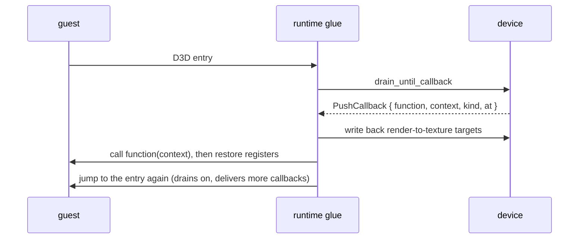

# D3D vertical blank, fences and push-buffer callbacks

Status: Built. Vertical blanks, fences and the busy check, and push-buffer callbacks.
Code: `crates/platform/d3d/src/vblank.rs`, `crates/platform/d3d/src/device.rs`, `crates/platform/d3d/src/runtime_glue.rs`. Tests: `crates/platform/d3d/tests/vblank.rs`, `crates/platform/d3d/tests/vblank_clock.rs`, `crates/platform/d3d/tests/round5.rs`.
Switch: none. Part of [d3d.md](d3d.md).

## Vertical blank

| Delivery | How | When |
|---|---|---|
| Logical clock (faithful) | `kernel.add_periodic(..)` with `d3d::vblank::clocked_vblanks`, and `d3d::register_frame_wait(.., FrameWait::HALO2_CLOCKED, ..)` | the boot with a kernel (`crates/apps/boot/src/lib.rs`) |
| After `Swap` | `Device::set_vblanks_per_swap(n)`, installed by `d3d::register` | no kernel clock |
| In the frame wait | `d3d::register_frame_wait(.., FrameWait::HALO2, ..)`, `Delivery::Inline` | opt-in, no kernel clock |

Halo stores a callback at device `+0x1DB8` (`0x12b093`, the inlined
`SetVerticalBlankCallback`). On the Xbox the GPU interrupt calls it once
per vblank as `cdecl callback(D3DVBLANKDATA *)`, where `D3DVBLANKDATA` is
`{VBlank, Swap, Flags}` (`Flags` 1 = `D3DVBLANK_SWAPDONE`).

- Halo's callback `0x12b2a0` calls `0x14280`. That function increments
  the 64-bit counter at `0x485AB0`, and when `Swap` changed (compared with
  `[0x55E6B8]`) it records the counter and the swap at
  `0x485AB8`/`0x55E6B8`.
- The frame wait `0x12b2e0` spins at `0x12b330..0x12b342` until the
  counter reaches `[0x4E6398] - 1`. Nothing but the callback advances it,
  so without an interrupt the spin never ends.

`Device::vblank` counts a vblank and builds the record. Frame time is
built from the count: `0x12b0e0` divides the vblanks since the last frame
by the refresh word at `0x485AC0` (60 when unset), and that becomes the
dt the tick budget `0x146660` and so physics and script sleeps get. So
vblanks have to follow the kernel's logical clock, or the game's time
and the kernel's (KeTickCount, timers) drift apart.

**On the logical clock** (the faithful delivery). `d3d::vblank::clocked_vblanks(device)`
is a handler for a kernel periodic source (`kernel::periodic`, see
crates/runtime/kernel/README.md "Periodic host interrupts and pacing"):

```rust,ignore
kernel.add_periodic(kernel::periodic::Source {
    name: "vblank",
    rate: kernel::periodic::Rate::HZ_60,
    max_catch_up: 4,
    handler: Box::new(d3d::vblank::clocked_vblanks(device.clone())),
})?;
d3d::register_frame_wait(&mut dispatch, device.clone(), FrameWait::HALO2_CLOCKED, hook);
```

- At each 60 Hz deadline the kernel runs it the way the GPU interrupt's
  DPC would: between thread slices, on the kernel DPC stack at
  DISPATCH_LEVEL. Periods owed after a clock jump come four a drain
  (`max_catch_up`), each with its own callback, so Halo's counter, which
  only counts calls, keeps up with the clock. It counts the vblank (plus
  any periods dropped from a debt over ten seconds,
  `Device::skip_vblanks`), writes
  `{VBlank, Swap, Flags}` into the kernel's scratch area on that stack and
  returns the cdecl call `callback(&record)`. No device or no callback:
  counted, nothing called.
- A guest spinning on the counter (the original `0x12b330` loop, with no
  override) sees it advance once its own charged work has carried the
  clock to the deadline: exact, but a period's worth of work (16.7 million
  charged accesses per vblank).
- `FrameWait::HALO2_CLOCKED` (`Delivery::Clock`) makes the override wait
  instead: until the counter reaches `[0x4E6398] - 1` it calls the
  kernel's `NtYieldExecution` (through its import token), so other threads
  run, or with nothing else runnable the clock jumps straight to the next
  vblank. Exit effects are the original's (below). It stops with a named
  error when no callback is registered, when the target is more than
  `max_vblanks` ahead, or when no vblank comes (no source installed):
  after `vblank::MAX_IDLE_YIELDS` (100000) yields in a row with the
  logical clock standing still, or after `vblank::MAX_VBLANK_GAP` (2 s) of
  logical time. The watchdog reads the clock through
  `Runtime::guest_time`, so other threads working their way to the next
  deadline (a tick a round, say) never trip it.
- `set_vblanks_per_swap` stays 0 with a clocked source, or vblanks would
  be counted twice.
- Halo registers no swap callback: in device `+0x1DA0..+0x1E00` game code
  touches only `+0x1DB8`. A swap reaches the game through the next
  record: `Swap` is the swap count and `Flags` has `D3DVBLANK_SWAPDONE`,
  which `0x14280` records.

Without a kernel clock, `src/vblank.rs` calls the guest at a safe point
that is always an override's return, never mid-instruction. No logical
time passes for these vblanks:

- **After `Swap`** (installed by `d3d::register`). `Swap` counts
  `Device::set_vblanks_per_swap(n)` vblanks (default 0, which leaves boot
  unchanged). When the `Swap` override returns, the glue calls the
  callback once for each:
  - the record goes below the caller's `ESP` and its address is pushed as
    the cdecl argument;
  - the callback is entered through `ExecCtx::call_guest`;
  - after the last one, every register is restored to its value at
    `Swap`'s return (`EAX` = the swap count) and execution returns to
    `Swap`'s caller.

  With `n` at least the frame interval Halo waits for, the spin falls
  through at once.
- **In the frame wait** (opt-in: `d3d::register_frame_wait(&mut dispatch,
  device, FrameWait::HALO2, hook)`, `Delivery::Inline`). An override of `0x12b2e0` delivers
  callbacks until the counter reaches the target, optionally paced
  (`FrameWait::pace`, for example `FrameWait::NTSC_VBLANK`). It then has
  the original's exit effects:
  - `[0x4E63A8] = counter at entry + 1`;
  - `[0x4E63B0] = n = counter + 1`;
  - `EAX = 0` if `n - target < 0`, else `min(n - target, 0x7FFF)`;
  - `ECX` = the high word of `n - target`; `EDX` = the counter's low
    word; `EBX`, `ESI`, `EDI` and `EBP` preserved;
  - byte `[0x4E63BC] = (word [0x4E63B8] > 0 && AX == 0)`.

  It stops with a named error instead of spinning forever when no
  callback is registered, when a callback returns without advancing the
  counter, or after `max_vblanks` (600) in one wait.

Tests: `tests/vblank.rs` (through `runtime::Runner`, with Rust stand-ins
for the callback and, for the clocked wait, for NtYieldExecution);
`tests/vblank_clock.rs` (the clocked source and frame wait under
`kernel::Machine`, the clock ending exactly on the fourth vblank); the
kernel's `tests/preempt.rs` (generated code spinning on a vblank counter
and on a swap) and `tests/pacing.rs`.

## GPU model: fences and the busy check

| Word | Where | Meaning |
|---|---|---|
| GPU time | device `+0x2C` | the stamp D3D puts in a resource's `Lock` word (`+8`) when the GPU last uses it |
| completion word | the address at `[+0x30]` (`GPU_COMPLETED_OFFSET` in the scratch range) | the fence time the GPU last completed; on the Xbox a semaphore release, method `0x1D70`, pushed by `D3D_SetFence` |
| swap fences | `+0x1974[swap count & 1]` | fences stored by `Swap` with `FINISH` |

The device executes the push buffer synchronously: every entry drains
what was queued before it does anything else. So the GPU is idle whenever
guest code can look at it, and its time words say so.

- `D3D_BlockOnTime` (`0x3fa977`) and the busy check (`0x3fb770`) read the completion word.
- CreateDevice points `+0x30` at a word in the scratch range
  (`GPU_COMPLETED_OFFSET`). `Device::set_fence` drains the queue, returns
  the old GPU time and advances `+0x2C` by two, matching retail
  `D3D_SetFence` (`0x3fa69e..0x3fa73b`). The completion word follows the
  advanced GPU time in the synchronous model. `Device::gpu_completed`
  reports that time. Releasing a binding stamps `Lock` with the current
  GPU time.
The busy check (`0x3fb710`, `D3DResource_IsBusy` inlined; `ECX` = resource, `EAX` = 0 or 1) runs as compiled, after draining the queue and writing render-to-texture targets back (lazily only those of the resource):
  1. Lock bits: busy while the resource holds an internal (binding)
     reference, `Common & 0x780000`. A surface (`Common & 0x70000 ==
     0x50000`) with a parent texture (`+0x14`) is busy if either holds
     one, and the parent is tested from then on.
  2. Fence: with `Lock` non-zero, busy while `GPU_TIME - Lock < GPU_TIME
     - completed` (unsigned), i.e. the last use is newer than the last
     completed fence.
  3. Otherwise not busy, and the tested resource's `Lock` is cleared
     (`0x3fb78d`).

  In the synchronous model the completion time covers the current GPU
  time, including resources stamped when a binding is released. Halo's
  inline wait (`0x1d434`) passes the GPU time to `BlockOnTime`, which
  returns once the queue is drained.

## Push-buffer callbacks



Halo inlines one `D3DDevice_InsertCallback` (`0x2460e`, in `0x245c0`,
reached from view rendering through `0x13870`): `SET_ZSTENCIL_CLEAR_VALUE`
= `0x24970`, `SET_COLOR_CLEAR_VALUE` = a context, `WAIT_FOR_IDLE`, then
`NO_OPERATION` 7. On the Xbox the GPU interrupts when it reaches the
method and D3D calls `0x24970(context)` (cdecl). The callback reads a
render target back, so it must run after the work queued before it and
before the work queued after it. The retail image never reaches the
insert: its one caller (`0x000138a8`) passes mode 0 in BX, which takes
`0x000245c0`'s reset branch ([sim-render-split.md](../engine/sim-render-split.md),
coupling 5).

- `Device::drain_until_callback` drains up to and including the first
  callback method and returns it as a `PushCallback` (`function`,
  `context`, `kind` 6 or 7, `at`).
- The runtime glue calls it before every entry. With a callback pending it
  calls the guest function the way D3D's handler does (the argument just
  below the entry's `ESP`, direction flag clear, through
  `ExecCtx::call_guest`), then restores every register and jumps to the
  entry again, which drains on (more callbacks are delivered the same way)
  and runs (`runtime_glue::deliver_push_callback`).
- Draining outside the glue (`sync_push_buffer`, for example a test
  calling the device directly) cannot call the guest: a callback there is
  a named error that latches the device.
- Render-to-texture targets drawn into are written back to guest memory
  before the callback runs: Halo's `0x24970` reads a target's texels
  (through `0x3fdbc0` and `0x24a70`). If the write-back fails, the entry
  stops with that error, unlatched like any other write-back failure; the
  callback is kept, and the next drain retries the write-back and delivers
  it before anything queued after it.
- D3D is not callable from a callback (on the Xbox they run at interrupt
  time). While one is being delivered (`Device::begin_push_callback` ..
  `end_push_callback`), any D3D entry stops with a named error and drains
  nothing, so the work queued after the callback, and the next callback,
  wait until it returns. Halo's `0x24970` only calls the native helper
  `0x3fdbc0`.
- Abandoning a callback is not supported. If one never returns to the
  glue (an unwind past it, a thread that ends inside it), the mark stays
  set and every later D3D call stops with the same error.

Tests: `tests/round5.rs` (`through_the_runtime`, with a Rust stand-in for
`0x24970`).
