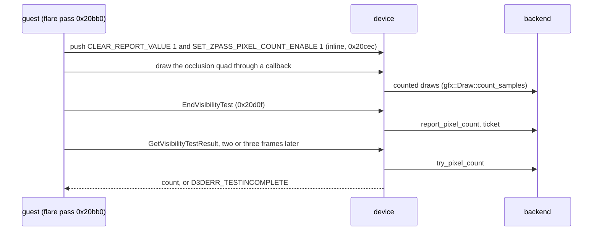
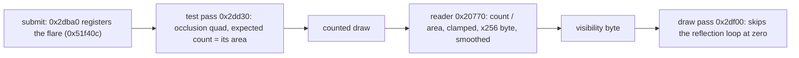
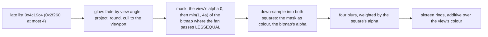

# D3D visibility tests and lens flares

Status: Built. Visibility tests (occlusion counts) and the lens flares that use them.
Code: `crates/platform/d3d/src/device/visibility.rs`, `crates/platform/gfx/src/occlusion.rs`. Tests: `crates/platform/d3d/tests/visibility_async.rs`, `crates/platform/d3d/tests/round7.rs`.
Switch: none. Part of [d3d.md](d3d.md).

## Visibility tests

Halo's one user is the lens-flare/sun visibility pass (`0x20bb0`). Per query it pushes `CLEAR_REPORT_VALUE` 1 and `SET_ZPASS_PIXEL_COUNT_ENABLE` 1 inline (`0x20cec`), draws through a callback that returns the pixel count it expects, and calls `EndVisibilityTest` (`0x20d0f`). The index rotates through three sets (`frame % 3`; object `i` of set `s` is `s + 3i`), and a bit per slot (`0x5233F0`, set at `0x20d51`) records that a test was ended there.

`GetVisibilityTestResult` has two callers:

| Caller | Reads | On `D3DERR_TESTINCOMPLETE` (any non-zero `EAX`) |
|---|---|---|
| reader (`0x207b0`, call at `0x20840`) | set `(frame + 1) % 3`, the tests ended two frames before; divides the count by the expected one, clamps to `[0, 1]` (`0x20861`) and smooths the object's visibility byte towards it | skips the object, which keeps last frame's value (`0x20847`) |
| writer (`0x20bb0`, call at `0x20cbb`) | before reusing a slot that had a test (set `frame % 3`, ended three frames before), asks for its result and discards the count | skips the object for the frame: no new test, the old one stays (`0x20cc4`) |

Neither retries: both jump forward to the next object (`0x2096d`, `0x20d5e`), so an incomplete answer costs one frame of staleness for one flare, never a spin. A constant answer would be wrong somewhere, so the counts are real. The ignored `visibility_conventions_in_the_image` test checks these branches.

### The original

`EndVisibilityTest` stamps report slot `index & 0xFF` of page `index >> 8` (64 pages of 256 16-byte slots at device `+0x7D4`) with the GPU time and pushes `SET_ZPASS_PIXEL_COUNT_ENABLE` 0 and `GET_REPORT`. `GetVisibilityTestResult` returns `D3DERR_TESTINCOMPLETE` (`0x88760828`) while the slot's status word is `0xFFFFFFFF`, writing nothing, after a `D3D_SetFence(0)` when the GPU time (`+0x2C`) has not moved since the end (`0x3f8659..0x3f8660`). Otherwise it copies out the count and timestamp.

The pages are D3D-private: only `0x3f8570`, `0x3f8630` and the teardown (`0x3fc69d`) touch `+0x7D4`. The device keeps the results itself, by index, and allocates no guest pages.

### The device

- **Counting.** While `SET_ZPASS_PIXEL_COUNT_ENABLE` is on (`HwState::zpass_count_enable`), every draw is a counted draw (`gfx::Draw::count_samples`). `CLEAR_REPORT_VALUE` type 1 calls `Backend::clear_pixel_count`, and `EndVisibilityTest` drains, takes a ticket from `Backend::report_pixel_count` and turns counting off. Any other report type stops. A backend that cannot count stops at the end.
- An index never ended, or at or above `0x4000` (`VISIBILITY_INDICES`), is an invalid call. Ending an index again replaces its result. Teardown forgets every test. `Stats::visibility_tests` counts them.

| Mode | Set by | Answer |
|---|---|---|
| Polled (default) | none | `GetVisibilityTestResult` asks the backend without waiting (`Backend::try_pixel_count`). A count that is back is answered and kept. One that is not, for a test ended at most `VISIBILITY_PENDING_SWAPS` (2) `Swap`s before, answers `D3DERR_TESTINCOMPLETE` with the original's fence kick (`Stats::visibility_incomplete`). An older test waits for its count (`Backend::read_pixel_count`) |
| Waited | `Device::set_visibility_poll(false)` | every call waits for the count and `D3DERR_TESTINCOMPLETE` is never returned, so the answers are the same whatever the host's timing; that is what the hardware answers once caught up |

Polled, a test is never left incomplete past the point where the render thread's two-frame limit guarantees its count has been reached. In Halo's terms the reader (two frames) may see incomplete and keep last frame's value, and the writer (three frames) never does. Which calls answer incomplete depends on host timing, as the hardware's answers depend on the GPU's. Waiting for every count stalled the game thread behind everything the render thread had queued ([measurement](notes/d3d-caches.md)).

### Counts across the render thread and gfx

- **The render thread** (`ThreadedBackend`) lands counts on the guest's side (`Waits::landed_counts`): after each batch and each present it asks the inner backend for the reports in order, up to the first not back (`GfxBackend` maps a report the first time it is asked, and at each `Swap`). Its `try_pixel_count` answers from those; a miss (`Waits::pending_counts`) answers at once and hands the pending batch over with a kick, so the count lands at that batch's end. Its `read_pixel_count` answers a landed count at once and otherwise waits for everything queued before it.
- **Sealed game frames.** The scene sink retains each counter clear and the ticket for each report alongside the counted draws. At a present the frame owner matches those commands and tickets against the worker queue. For a matching frame the native pass reads the GPU counter at each report and the worker connects the original guest ticket to that GPU result. A read that needs the original draws before the present flushes them in queue order. At display scale the counter samples one host pixel per guest pixel. A private capture leaves the displayed frame's counter and reports untouched.
- **The count in gfx** (`gfx::occlusion`). wgpu occlusion queries are boolean on Metal, so they cannot give a count. Each counted draw is drawn a second time first, into an `R16Float` target with additive blending and a fragment shader that writes 1, against a scratch copy of the depth/stencil attachment with the draw's full depth/stencil state, writes included. Overlapping triangles of one draw are rejected in the count as in the real draw, and the real attachment is written once. A compute pass then adds up the texels inside the draw's scissor into a `u32` (`PixelCounter`). With multisampling it counts samples, as the NV2A does.
  - The depth texture needs `COPY_SRC` (`SurfaceStore` depth surfaces have it; `DrawError::CountDepthNotCopyable` otherwise). Replacing a registered shader drops the cached count pipelines along with the others.
  - W-buffered draws (all of Halo's 3D, `ZEnable(2)`) store w from the fragment stage, so a W-buffered program's count pass runs the program's own count entry (`shaders::psh::COUNT_DEPTH_ENTRY`, `ShaderProgram::count_entry`), which writes the same depth. Without it the count tests the rasterized z against stored w and every flare in front of geometry counts 0 (see [Lens flares](#lens-flares)).
  - Limit: the count pass does not run the draw's own fragment program, so alpha test, `discard` and the polygon stipple discard do not reject samples there. The flare's occlusion draws do not depend on them.

Tests:

- `tests/visibility_async.rs`: Halo's reader and writer against a synchronous backend, a caught-up, a lagging and a held render thread, the incomplete path through the ABI, and the synthetic ticket and display-scale cases. `cargo bench -p d3d --bench visibility_wait` prints the guest's time in the call with a lagging render thread, waiting and polling.
- `tests/round7.rs` (device and runner) and `gfx`'s `pixel_counter_*` tests (within-draw depth and stencil at 1x and 4x, a replaced shader, a depth that cannot be copied).
- The ignored `visibility_conventions_in_the_image` checks the call sites and conventions in the image.

## Lens flares

The visibility tests feed lens flares, and through them some scripted lights. All addresses are guest VAs, from a static trace.

- A `lens` attachment on an object (definition `+0x94`, classes `lens`, `MGS2`, `tdtl`) is not instantiated by the attachment constructor; the object render walk `0x41c80 -> 0x41c20 -> 0x41980` submits it every frame at its marker through `0x2dba0`. Lights (`ligh +0x94`, `0xc3340`), the sky's sun (`0x3eec0`) and effect parts (`0x179d23`) submit theirs the same way.
- `0x2dba0` registers the flare in the visibility array at `0x51f40c` (32-byte entries, `0x209b0`). The test pass `0x2dd30` (called from `0x2c2e4`) sets `ZEnable(2)`, colour writes off, `LESSEQUAL` without depth writes, and runs `0x20bb0` with the callback `0x2e540`: a quad of half-size `[2, 128]` pixels around the projected flare, pushed inline (a triangle fan with four position-register writes) through a game vertex program, its expected count the quad's area.
- The reader `0x20770` divides the landed count by that area, clamps it to `[0, 1]`, scales it to a byte (x256, at most 255) and smooths it into the entry's visibility byte. The draw pass `0x2df00` (from `0x13b7e`, callback `0x2e9e0`) reads the visibility byte and can skip the reflection loop when the computed visibility is zero. Its billboards and the optional filtered fans are in [Retail lens-flare draws](notes/2026-11-24-lens-flares.md).

A count of 0 is an invisible flare. Under the W-buffer the quad's rasterized z is about 1 (or 0.5 with depth clamp), above every stored w except the cleared far plane, so without the count entry only flares seen against the sky show.

Scripted lights depend on it: the Armory's look test creates `looker_light_top_red` / `looker_light_bottom_red`, model-less `mach` objects whose one attachment is a `lens`. With a count of 0 the light never lights. The script's look gates pass on `objects_can_see_object` or `player0_looking_up`/`_down` regardless. Test: `shaders_render.rs` `w_buffered_visibility_test_counts_against_the_stored_w`.

### The query in Rust

`native-flare-query` (on with the native renderer) makes the query pass's walker call and the reader in Rust (`render_bridge::native_flare_query`). The pass's own setup in `0x2dd30` (target, render states, vertex program) stays the guest's, so the count reads the depth the guest bound.

| Guest | Rust |
|---|---|
| `0x20bb0(view, 0x1f, 0, 0, 1, 0x2e540)` | each entry's quad (`scene_extract::flares::Lens::query`, the port of `0x2e540` and `0x48b00`), one compute pass over the bound depth (`native_render::flare_gpu`), the area at `+6` and the set's bit |
| `0x20770` | each byte from its count two frames back (`read_byte`), `0x20e50` for an inactive entry, the view's read frame |
| the water ocean's gate `0x3c270`: `0x209b0` and its listed `0x20bb0(view, 0x20, &entry, 1, 1, 0x3bf20)` | `register` and `walk_listed`, called by `water_end::ocean::gate` ([retire-d3d-display.md](retire-d3d-display.md#the-water-end)): its corners' rectangle in tiles, the counts summed into one slot |
| the draw pass's `0x20bb0` | the guest's (no tests); the reader reads a slot the guest ended from the device |

- The count is exact: a guest pixel of the quad passes when the quad's stored depth (its `w` held to the W clip and floored, over the full scale) is at most the depth at the pixel's centre. A quad the W clip culls counts 0.
- The counts are the display copy's: under exact mode the display copy's recording replaces the reference copy's, unless the display is drawn through a wider lens than the quads (`native_flare_query_glue::counts_on`).
- Between frames the flare state is in the render-private store and the region holds the simulation's bytes ([sim-render-split.md](../engine/sim-render-split.md), "4. The flare visibility byte").
- The bitmaps at `0x5233f0` stay the one record of which slots hold a test. `State::scrub` clears the bits of Rust's slots in a set, so a guest body is never asked for a test it did not end.
- The query's walker call and every reader call are Rust's; neither guest body runs for them. A call Rust cannot make writes nothing and returns, its entries keeping their areas and bytes.
- Counters in `render.scene`: `flare_{query,read}_{calls,cut}` and `scene_dropped_flare_{query,read}_<cause>` (a call not made, a placed pass that did not count, or `read_device`: a device read refused for a slot the guest ended).

Tests: `scene-extract` `a_flare_fades_from_its_query_result` and `a_quad_is_the_projected_point_with_its_half_size_held_to_2_and_128`; `render-bridge` `the_visibility_byte_lags_two_frames`, `the_water_query_counts_its_quad`, `a_guest_body_never_sees_the_cuts_slots`; `native-render` `a_w_buffered_quad_tests_its_floored_w_over_the_full_scale`.

### The glow in Rust

`native-flare-draw` (on with the native renderer) makes the draw pass's late glows in Rust (`render_bridge::native_flare_draw`). The draw pass `0x2df00` is the post's last call (`0x13b7e`, after the colour glow `0x214f0` and the screen effects `0x2d140`), so the glows are the view's last draws, in slot 13, before the overlay. The pass's setup and its walker call (the reflections) stay the guest's; each late-list entry's call to `0x46ea0` (from `0x2e1c5`) is cut.

| Guest | Rust |
|---|---|
| `0x46ea0`'s numbers: the direction to the glow over its length (`0x30bf0`), the fade `(cos - [0x45e22c]) * [0x45e4b0]` held to `[0, 1]`, the point at the far distance projected (`0x48b00`), rounded, `[0x45e42c]` pixels each side, culled outside the viewport | `scene_extract::flares::glow` |
| the composite's weight: the fade times `1 - [0x4857b4]` held to `[0, 1]`; ring `i` grown by `i * [0x45df78] * [0x45e310] - [0x45dc10]`, weight over `i + 1` | `Glow::rings` |
| the fans, each with the combiner block it writes at `0x484f68` | `native_render::flare_draw_gpu`: the same blocks (`CLEAR`, `MASKED`, `DOWN`, `blur`, `COMPOSITE`), each fan a quad through `glow::QuadDrawer` |
| the bitmap `[[0x485a80] + 0x34]` (`rasterizer\glow`, 64 by 64 `A8Y8`), image 0 | decoded from the guest texture `0x143c0` binds (`effect_material::texture_header`), level 0, kept until its header or bytes change |

The fans, in order:

| Fan | Target | Stages | Block's output | Raster |
|---|---|---|---|---|
| mask (`0x470b2`) | view, over the rectangle | none | alpha 0 (the final constant) | alpha only, depth `ALWAYS` |
| masked sample (`0x47331`) | view, over the rectangle | 0: the bitmap over `[0, 1]` | alpha `min(1, 4 t0.a)` | alpha only, `LESSEQUAL` at `z = w = 16777215` under the W clip, W-buffered |
| down-sample `0x46230`, into `0x10` then `0x11` | a 64 by 64 square (times the render scale) | 0: the view over the rectangle; 1: the bitmap over the square | colour `t0.a` (the mask), alpha `min(1, 2 t1.a * 192/255)` | all channels, no blend, no depth |
| blur `0x467c0(0x10, 0x11, 4)`, pass `k` from square `k % 2` | the other square | 0..3: the source, offset `(-, -)`, `(+, +)`, `(-, +)`, `(+, -)` by 1/128 (`[0x45e488]`, `[0x45df64]`) | `c0.a ((t0.b + t1.b) / 2 + (t2 + t3) / 2)`, `c0.a` 1 on pass 0 and 127/255 after | colour only, `DSTALPHA`, `ZERO`: times the square's alpha |
| composite, 16 rings (`0x47740`) | view, over ring `i` | 0: square `0x10` over `[0, 1]` | `lerp(c0, white, 2 t0.b - 1) * t0`, alpha `v0.a` the ring's weight (`c0` `0x00b0b080`) | colour only, `SRCALPHA`, `ONE` |

- The view's alpha over the rectangle is the masked sample's: 0 where the fan fails the depth, else `min(1, 4a)` of the bitmap. The down-sample reads it, as the guest's does.
- `glow::QuadDrawer` draws each fan with its block through the stage 3 compiler. A tested fan's depth is its quad's `dest` z (`QuadDepth`); `v0.a` is its `dest` w.
- Kept across frames: the quads' programs and pipelines (`QuadDrawer`), the two squares (per side) and the bitmap's texture (per key). Uniforms go in the submission's arena.
- Every late-loop call is Rust's; the guest body never runs for it. A glow Rust cannot plan or place (no host, an unread input, the table, a bitmap that does not decode) draws nothing, `scene_dropped_flare_glow_<cause>`. The body's frame reads (`mark`, `guest_glow`, `same`: its rectangle and weight `0x54` below the entry ESP, the ring count at `+0x20` 0 only when every ring was drawn) stay as the test oracle.
- A call from anywhere but the late loop runs the guest body.
- Limits: engine vertex shader 10 (`lens_flare`, the view's fans) is read as passing the pixel position through, `v3` to `oT0` and `v9` to `oD0`, and vertex shader 1 as applying the two-row texture matrices the down-sample and the blur load at hardware slot `0x12`; neither program is run. The blur's stages address `BORDER` with a colour the glow does not set; Rust's clamp to the edge, which differs only in the square's outer texels, where the bitmap's alpha is at most 3/255.
- Counters in `render.scene`: `flare_glow_{calls,cut}` and `scene_dropped_flare_glow_<cause>` (a glow not placed, or placed and not drawn; the second also `Stage::Flares`'s `scene_dropped`).

Tests: `scene-extract` `a_flare_glow_fades_with_view_angle`, `the_composite_rings_grow_and_dim`; `render-bridge` `the_flare_draw_is_the_last_post_pass`, `an_undrawn_glow_counts_scene_dropped_flare_glow`, `a_checked_glow_reads_the_bodys_frame` (the oracle); `native-render` `the_glow_combiners_give_the_hand_worked_values`, `the_quads_place_the_stages_as_the_guest_matrices`, `the_down_sample_is_the_guest_square_times_the_render_scale`.
