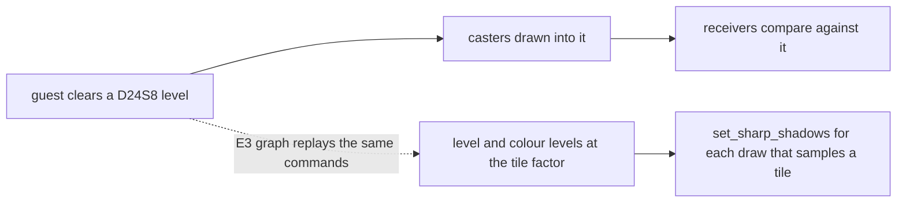

# E3 lighting: shadows from local lights

Status: Built. The guest's shadowed lights are drawn as tiles at `shadow_scale`, and the renderer shadows up to four cones of its own choice, including cones the content flagged no-shadow. Game captures and timing are pending.
Code: `crates/platform/d3d/src/gfx_backend/guest_draw_pass/tiles.rs` (the guest's tiles), `crates/rewrites/native-render/src/cone_shadows.rs` (the choice), `cone_shadows_gpu.rs` (the programs), `frame_graph/cones.rs` (the stage in a game frame). Tests: `crates/platform/d3d/tests/render_scale.rs`, `crates/rewrites/native-render/tests/world_layers_gpu/cone_shadows.rs`, `tests/world_layers_gpu/frame_graph.rs`, the unit tests in `cone_shadows.rs`.
Switch: `H2_LIGHTING` (`retail`), listed in [switches.md](../runtime/switches.md).

The section "Shadows from local lights" of [e3-lighting.md](e3-lighting.md) is the summary; this page is the design and what is built.

| Rule | Value |
|---|---|
| Who casts | cone lights, whatever the no-shadow flag says; sphere lights do not (**Design**) |
| How many | `SHADOW_CAP` = 4 shadowed lights a frame, by score |
| Flashlight | the view's own flashlight holds a slot while it is on |
| Tile size | `d3d::scaled::shadow_scale` times retail's 512-square level (1024 at 1x and 2x, 2048 at 4x), at most 2048; the flashlight's is 2048 |
| Passes | retail's: layer 10 into the tile, layer 11 with the Sharp edge, then 14, 12 and 13 |

- **Why cones only.** A cone has one projection, which is what retail's shadow block builds. A sphere needs six maps (2.9 ms for one in the prototype at 4x, [notes/e3-lighting.md](notes/e3-lighting.md)), and nothing in the record describes shadows from a muzzle flash.
- **Why the flag is ignored.** The demo's lamps and headlights cast again (target look, items 5 and 6). It is a render-thread choice about a scene; no tag or guest memory changes.
- **Casters.** The guest's list for a light the guest shadowed. Otherwise the renderer gathers the instances and cluster parts inside the cone. The level casts here; open meshes are no trouble for a map.

## The guest's shadowed lights

A guest shadow map is a `D24S8` depth level not of the frame's size. In E3 mode the graph replays the guest's commands in the same order. It draws the level and the colour levels bound with it at the tile factor, and turns on `ShaderProvider::set_sharp_shadows` for each draw that samples a tile. Every other draw is the guest's, byte for byte (`guest_draw_pass::tiles`).

- **Where.** On the graph's own attachments, `GuestDrawPass` allocates the level at the tile factor. At render scale the mixed-size private pass keeps the guest-size level, repeats each of its draws and clears into a copy at the tile factor (`ScaledBackend::scene_tile`), and has receivers sample the copy. The display on the guest device's live attachments (`draw_display_on`, `draw_scaled_display_on`) keeps the guest's maps.
- **One tile per light.** A tile is counted at the first caster after each whole depth clear of its level, so `lights_shadowed` is the number of the guest's shadowed lights. Each tile is drawn into its level's own image in the guest's order. The sun's tiles have their own atlas ([e3-lighting-sun.md](e3-lighting-sun.md)); moving these into it, drawn ahead of the light pass, waits for the graph to draw both.
- **Refused.** A level that a frame copies, uploads, aliases, seeds from earlier contents, reads in a typed stage or through an earlier frame's view, or binds with a frame-sized attachment cannot be redrawn at another size. It keeps the guest's size and retail's comparison, and `tiles_refused` counts it. So does a tile sample that fell back to the guest-size level (a stale copy at render scale).

## The shadowed cones

`cone_shadows::choose` takes each view's lit lights from `light_choice::choose` ([e3-lighting-lights.md](e3-lighting-lights.md)).

- **Which.** A light whose effective volume is a frustum (shape code 2) with a finite apex, axis and far extents. A sphere, another projected shape and a host light do not cast. The no-shadow bit (definition bit 3) is read only to count it.
- **Order.** In a view: its own flashlight (definition bit 5) first, then the lights the guest shadowed, then the rest in the lit order, which is score order. The `SHADOW_CAP` slots are shared between the views of split screen as the lit lights are (`slot_caps`: three views take 2, 1 and 1). A second record of a view is chosen alike, shares the first's tiles and is counted once.
- **Whose tile.** A light the guest shadowed keeps its own replayed tile and keeps its shadow past the cap, since the guest draws it whatever the renderer chooses. Every other light gets a slot of the local lights' atlas: 4096 square, four 2048 slots. Its tile is `shadow_scale` times 512, at most 2048.
- **Projection.** The volume's origin is the frustum's apex. The far centre is the light's position plus the axis times the far depth, and the far extents are half the width and height there. The tile's rows are a perspective from the apex along the axis, with the light's up across it (`Cone::rows`).
- **Casters and receivers.** The view's instances whose bounding sphere meets the frustum (`Cone::meets`), and the structure parts of the view's clusters that do (`WorldReceivers::cone_parts`). The light's owner does not cast into its own tile, nor does an instance whose sphere holds the apex (the flashlight's holder stands there). Both still receive.
- **Drawing.** `ConeShadows` clears each slot and draws its casters' world-space triangles, depth only, every frame, since cones move with their owners. Each receiver writes its shadow term into the frame's destination alpha, keeping RGB, as retail's layer 11 writes it for the light's later passes to read. Writing, not multiplying, keeps an earlier shadowed light's term out of the next one's.
- **The term** is the sun receiver's: the normal gated towards the apex, and the Sharp edge's taps kept inside the slot. The comparison is in linear depth from the apex, with a bias of one texel at the receiver's depth.
- **Counters.** `cones_shadowed` (the renderer's own tiles), `cones_flagged_off`, `flashlight_shadowed`, `shadows_over_cap` and `cones_refused` (a lit frustum that makes no projection).

### In a game frame

`frame_graph::cones`. Retail's unshadowed implementations of layers 12 and 13 do not read the destination alpha (**S**), so a cone's term is drawn only for a light whose passes read it: a chosen light the renderer draws shadowed, whose E3 stage names it (`d3d::ExternalPass::cone_shadow`).

- Under E3, just before each such stage the graph applies a cone stage. The frame's first draws the tiles of every named cone, at the target's `shadow_scale`, and each writes its own receivers' term on the light's attachments at the guest's W-buffer depth, as the sun's receivers do.
- A named light whose cone the graph cannot draw is kept: its stage is not applied, since its passes would read an alpha nobody wrote for them. The causes are no renderer cone of its handle in the render thread's choice, a depth that is not a 24-bit W-buffer, an empty rectangle, or nothing under the cone to receive.
- The caster draws join `e3.tiles`, the receivers `e3.marks`. `cones_drawn` counts the tiles and `cones_kept` the kept lights.

Tests: `a_no_shadow_cone_casts_and_a_sphere_does_not`, `four_slots_by_score`, `the_flashlight_holds_a_slot`, `the_guests_shadowed_lights_keep_their_tiles`, `split_screen_shares_the_slots`, `the_projection_spans_the_cone`, `the_owner_does_not_cast_in_its_own_light` and `a_views_shadows_from_its_slice_match_the_frames` (`cone_shadows.rs`); `a_cone_gathers_the_structure_under_it` (`sun_casters.rs`); `a_no_shadow_cone_shadows_the_ground_in_e3_and_not_in_retail`, `a_tile_reads_only_its_own_slot` and `a_receivers_term_replaces_the_alpha_before_it` (`tests/world_layers_gpu/cone_shadows.rs`); `a_shadowed_chosen_light_reads_its_cone_in_e3_and_not_in_retail` (`tests/world_layers_gpu/frame_graph.rs`); `cone_draws_join_the_tile_rows` (`frame_graph/lighting.rs`); `render_scale::e3_tiles_give_a_replayed_shadow_the_sharp_edge` and the plan's tests in `tiles.rs`.

## Not verified

- On a tick with a shadowed light, the E3 capture differs from retail's only within eight pixels of retail's shadow edges, `e3.tiles` and `e3.marks` have draws, `lights_shadowed` is one per shadowed light and `tiles_refused` is 0.
- A lamp placement and the flashlight cast in the E3 capture, with `cones_shadowed`, `cones_drawn` and `scene_e3_lights_shadowed` above zero and `cones_kept` zero.
- That a game frame's shadow maps reach the replay in a form the tile plan admits.
- The flashlight frame at 4x with all of the mode's passes: the worst case the budget must hold.

## Related

[e3-lighting.md](e3-lighting.md), [e3-lighting-lights.md](e3-lighting-lights.md),
[e3-lighting-sun.md](e3-lighting-sun.md), [native-shadows.md](native-shadows.md),
[notes/e3-lighting.md](notes/e3-lighting.md).
