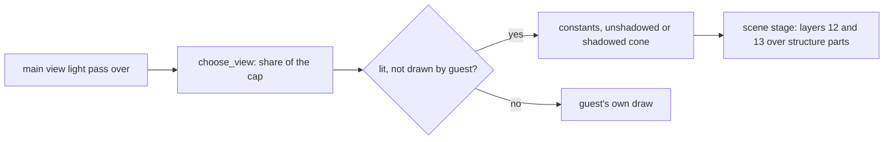

# E3 lighting: the choice of lights and the first-person pass

Status: Partly built. The choice, its first-person set and its counters are built, and the lights beyond the guest's are drawn over the structure and placement parts (shadowed where the renderer shadows them) and over the first-person parts. A chosen light does not light object (model) parts yet.
Code: `crates/rewrites/native-render/src/light_choice.rs` (the choice), `crates/rewrites/render-bridge/src/native_lights/chosen.rs` and `chosen/first_person.rs` (drawing them), `crates/extensions/game/src/native_lights_glue/host.rs` and `host/first_person.rs` (the draws), `crates/rewrites/scene-extract/src/lights.rs` (candidates). Tests: `light_choice.rs`, `native_lights/chosen.rs`, `native_lights/chosen/first_person.rs`, `native_lights_glue/host/first_person.rs`, `crates/rewrites/native-render/tests/world_layers_gpu/frame_graph.rs`.
Switch: `H2_LIGHTING` (`retail`), listed in [switches.md](../runtime/switches.md).

E3 mode chooses its own lit lights from the scene's candidates instead of the guest's ranking. The sections "Lights: which, and how many" and "The flashlight and the first-person pass" of [e3-lighting.md](e3-lighting.md) are the summary; this page is the design and what is built.

| Rule | Value |
|---|---|
| Candidates | every active light reaching the view that passes its owner and camera tests, before retail's ranking |
| Score | retail's projected sphere radius times the light's intensity, ties by lower datum index (**Design**) |
| Lit | the 16 highest scores a frame (`LIT_CAP`), shared between split-screen views (**Design**) |
| First-person set | the first 8 (`FIRST_PERSON_CAP`, retail's recorded-light count) of a view's lit lights |
| Shading | the material's own layer-12 and layer-13 passes, no new shading maths |
| Host lights | the Forge monitors' lights, ranked after every game light |

## Lights: which, and how many

The lights are retail's: 428 scenario placements, 1,033 object attachments (headlights, the flashlight, projectiles) and 834 effect parts (muzzle flashes, explosions) over the disc's 30 maps, of 1,349 sphere and 245 cone definitions ([effects.md](../formats/effects.md), "ligh"). At most 350 are live at once ("The light record" in [e3-lighting.md](e3-lighting.md)).

- **Candidates.** The two flashlight attachments are mutually exclusive for a given owner and view.
- **Score.** Retail stores projected size and fade weight separately ("The light render path" in [e3-lighting.md](e3-lighting.md)).
- **Lit.** A light whose owner chain reaches the view's own unit (its flashlight, its weapon's flash) is placed first. The Xbox drew a handful and the MCC restoration reads dark for culling early (**C**, [pstencil.md](pstencil.md)); 16 is set by the budget, not by taste.
- **Shading.** The implementation is picked by retail's choosers (`engine::light_passes`) with the renderer's shadow decision in place of the guest's. Specular is drawn where retail would draw it. The bump map is whatever the material's pass binds, so there is no table of normal maps to build.
- **Extent.** Receivers are the instances and cluster parts that meet the light's bounds, under a scissor from the sphere's screen rectangle.
- **Constants.** `engine::light_constants` and `engine::shadow_constants` are pure. Extraction runs them for every candidate, so the scene carries each light's constants for both shadow decisions.

Retail mode draws the candidates the guest drew, in its order.

### The choice

`light_choice::choose`, for each view of the scene, takes the lights with a candidate record that the view test admitted (`view_eligible`) or that the guest drew.

- A light's score is its candidate's projected-size priority times its intensity. A missing, negative or non-finite product scores zero.
- Order: the view's own lights first, then the highest scores, ties by lower datum index, then by handle, then the host lights by seat. The order is total, so a scene gives the same lights in the same order whatever the candidates' order.
- The views of split screen share `LIT_CAP` equally, the remainder going one each to the first views (`view_caps`: three views take 6, 5 and 5). A second record of a view is chosen alike and counted once.
- Under E3 the frame graph reports `lights_lit`, `lights_over_cap` and `lights_beyond_guest` (the lit game lights the guest did not draw, `ViewChoice::beyond_guest`).
- **The view's own lights** are its first-person lights (definition bit 5), which the view test admits only for the view's local first-person owner. The scene carries neither the view's unit nor an owner chain, so a light attached to the view's weapon takes its place by score.

**Host lights** (`frame_scene::Light::host_light`, `host: Some(seat)`) have no datum and no `ligh` tag ([forge-monitor-appearance.md](../game/forge-monitor-appearance.md), "Colours, tint and light"). The frame step adds them to each game view after the game's candidates (`render_bridge::scene_step::set_host_lights`). They rank after every game light whatever their score, carry no steps and no shadow, and draw from `render_bridge::native_lights::host` (constants) and `native_lights_glue::host` (layers 12 and 13 over the structure the sphere meets) once the main view's light pass is over.

### Drawing the lights beyond the guest's

`render_bridge::native_lights::chosen` chooses the open view as the render thread does (`light_choice::choose_view`), with its share of the cap from the views of this scene so far and the scene before (`light_choice::share_of`). A frame whose views change chooses on the render thread from the views it has, so its counters and drawn lights can differ for that frame.

- Each lit game light the guest did not draw is drawn from the constants extraction made for it without a shadow (`LightCandidate::constants`, `unshadowed`), as a sphere of its bounds. `native_lights_glue::host` draws its layers 12 and 13 over the structure and placement parts the sphere meets, as it draws a host light.
- Each light is a scene stage of E3 alone (`d3d::ExternalPass::lighting_only`) with its materials, gel and geometry retained. The frame graph records it in an E3 draw and skips it in any other; the render thread's live recording, on the retail reference, takes it and draws nothing. Where the render thread takes no scene stage, no chosen light is drawn.
- **Shadowed.** The frame step chooses the view's shadowed cones as the render thread does (`cone_shadows::view_shadows`, its share of the four slots from `cone_shadows::slot_share_of`). A chosen light among them is drawn from its shadowed constants (`LightVariants::shadowed`) with the shadow flags set (`chosen::SHADOW_FLAGS`), since the guest's flag code clears them for a light the content flagged no-shadow. Its parts take the shadowed implementations (layer 12's implementation 2), which read layer 11's term from the destination alpha, and its stage names the light (`d3d::ExternalPass::cone_shadow`). The frame graph writes the cone's term just before it ([e3-lighting-cones.md](e3-lighting-cones.md)).
- **Not drawn yet.** A chosen light lights no object (model) part. It is left undrawn when its candidate holds no constants or its gel is drawn by a shader into target 13 (the guest's passes produce that gel and did not run for it). A cone the guest draws unshadowed keeps retail's unshadowed implementation, so its tile is not drawn.

Counters: `e3.lights` counts the ranges of the stages an E3 draw recorded. `scene_e3_lights_drawn`, `scene_e3_lights_kept`, `scene_e3_lights_unread` and `scene_e3_lights_shadowed` count the frame step's outcomes.

Tests: `twenty_candidates_draw_the_sixteen_highest_in_score_order_every_run`, `ties_take_the_lower_index_and_only_candidates_are_lit`, `the_views_own_light_is_lit_first`, `split_screen_shares_the_cap`, `the_lights_beyond_the_guests_are_the_lit_ones_it_did_not_draw`, `a_views_choice_from_its_slice_matches_the_frames` and `a_views_share_counts_the_keys_seen_and_itself` (`light_choice.rs`); `the_lit_lights_the_guest_did_not_draw_are_drawn_unshadowed`, `the_cone_the_renderer_shadows_is_drawn_shadowed` and `a_light_without_constants_or_with_a_shader_gel_is_unread` (`render-bridge/src/native_lights/chosen.rs`); `e3_reports_its_choice_of_sixteen_lights_from_twenty` (`tests/world_layers_gpu/frame_graph.rs`).

## The flashlight and the first-person pass

**R**. The Chief's `flashlight` marker carries both `flashlight_1p` and `flashlight_3p`. The Warthog attaches `warthog_headlights` at `headlights_light` and the Scorpion attaches `scorpion_headlight` at `headlight`. All four are frusta with bitmap gels and the no-shadow bit. The unsuffixed flashlight definition in two maps has no attachment ([disc counts](notes/e3-lighting.md)).

**R**. The view test at `0x00031520` requires the local first-person owner for definition bit 5 (the first-person light) and excludes that owner for bit 6 (the third-person light). `0x0003e9c0` tests camera type and the root biped's player against the view user.

**Design**. One lit and shadowed slot is reserved for the view's active flashlight: `light_choice` lights it first and `cone_shadows` shadows it first, at 2048. The lit set is drawn over the first-person parts as retail's recorded-light pass does. The first-person model stays outside the shadow maps.

Retail's first-person pass (`0x000404b0`) replays the recorded lights' slots over the first-person view's parts. The scene holds that view as its own `ViewKind::FirstPerson` view, with its layer items, and a recorded light's layers 12 and 13 as groups of `GroupSite::FirstPerson`. A chosen light the guest did not record has no slot and no groups.

### The chosen first-person lights

When retail's pass begins (its entry hook, before any slot), the frame step reads the slots' datums (`light_gather::first_person::recorded`) and chooses the game view of the guest's view as `chosen_lights` does, with the same share of the cap.

- **Which.** Of the view's first-person set (`ViewChoice::first_person`), a light is drawn when it has no slot, is not a host light, has constants, and its sphere comes within its radius and `REACH` (0.5 world units) of the first-person camera.
- **Constants and flags.** The candidate's unshadowed constants, at its weight (retail's pass sets weight one), with the flags retail's pass sets: bit 0 as the light's own pass found it, bit 1 for a colour B component above zero, the shadow bits clear.
- **Parts.** The first-person view's object items, each once in the order its layers first list it, with its node rows (`first_person::parts`). An item drawn as subparts or with auxiliary depth, or without rows, is left out.
- **The glue** (`native_lights_glue::host::first_person`) makes each part a gathered object entry of the map's model parts (its section's one vertex classification, its held part's range) and resolves its layer 12 and 13 passes as a group's object entry resolves (`LightsWorld::resolve_model`), the implementation the engine's for the light's flags and the material's integer input 4. A section whose buffers differ in classification, or a material with no pass in the layer, draws nothing for that part.
- **Order.** Each light is one scene stage of E3 alone over the whole view. The stages queue before the recorded slots' passes. Both add to the target, so the order does not change the colour.

Counters: `scene_e3_first_person_lights_drawn`, `_kept`, `_unread`, `_far`, `scene_e3_first_person_parts` and `scene_e3_first_person_parts_left`.

Tests: `the_first_person_set_the_guest_did_not_record_is_drawn_over_the_eye`, `retails_first_person_flags_keep_the_sphere_and_take_colour_b_above_zero`, `a_light_reaches_the_eye_within_its_radius_and_the_reach` and `the_first_person_parts_are_its_object_parts_once_with_their_rows` (`render-bridge/src/native_lights/chosen/first_person.rs`); `a_first_person_light_draws_layer_12_over_its_parts_then_13`, `a_sections_classification_is_the_one_its_buffers_share` and `a_first_person_entry_finds_its_held_part` (`native_lights_glue/host/first_person.rs`); `the_recorded_lights_are_the_tables_slots_up_to_its_count` (`engine/src/render/light_gather/first_person.rs`).

## Weapon fire, plasma and explosions

These are effect-part lights (timed spheres) and lights attached to projectiles. They are unshadowed and take their place by score, so a firefight lights the street and the firer (target look, item 7). The fade of a timed light is in its record's intensity.

## Not verified

- That 16 lit lights are enough for a firefight to read as the footage does.
- In the game: `scene_e3_lights_drawn` above zero, `e3.lights` draws in the E3 capture and none in retail, and firing in a dark street (`input.pad`) lighting the firer and the ground.

## Related

[e3-lighting.md](e3-lighting.md), [e3-lighting-cones.md](e3-lighting-cones.md),
[native-lights.md](native-lights.md), [native-light-gather.md](native-light-gather.md),
[notes/e3-lighting.md](notes/e3-lighting.md).
