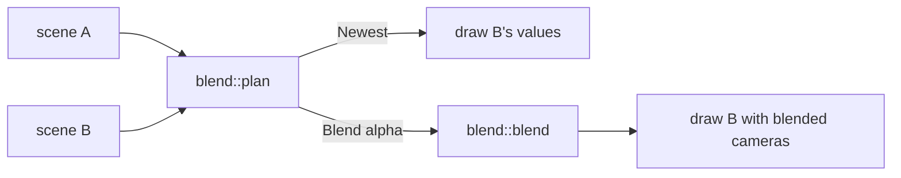

# FrameScene slices 7 to 10: outside frames, display rate, typed stages, deletion

Status: Partly built. Slice 8's blend, pacer and display-rate loop are built; slices 7, 9 and 10 are design. Slices 7 to 10 of [framescene.md](framescene.md) (section 10); the rules for 60 and 120 fps are section 7 there.
Code: `crates/rewrites/frame-scene/src/{blend,pace,display}.rs`, `crates/rewrites/native-render/src/frame_graph/display_rate.rs`, `crates/platform/d3d/src/{scene_sink/retarget.rs,threaded/owner}`, `crates/platform/gfx/src/raster.rs`.

| Slice | State | What |
|---|---|---|
| 7 | design | frames outside a game view through `SceneSink` |
| 8 | partly built | 60 and 120 fps from two scenes |
| 9 | design | type the carried stages that cost the most |
| 10 | design | delete the D3D path (section 11) |

## Slice 7: frames outside a game view

- **Code.** Menus, loading screens, the fallback view `0x002232a0`, the alternate view `0x0002c790` and movies go through `SceneSink` into `Outside` and `Overlay`. Bink frames and glyph pages are `TextureUpload`s. The old backend stack is not constructed when `impl.render.native` is on.
- **Tests.** A carried menu frame with a blur chain through `Aux` targets; a texture upload consumed by a later draw in the same scene.
- **Gate.** Pixels on the menu, loading and movie captures. From boot to gameplay and back to the menu, the D3D backend's draw counter stays zero.

## Slice 8: 60 and 120 fps

### Built

**`frame-scene::blend`** (pure, `crates/rewrites/frame-scene/src/blend.rs`).

- `plan(a, b, due)` gives `Plan::Newest` (B's own values: `alpha >= 1`, `ticks_run == 0`, a cut, another map epoch, no stamp, or a gap over `MAX_GAP`, 45 ms) or `Plan::Blend(alpha)`.
- `blend(a, b, alpha)` returns `Blended`: cameras parallel to `B.views`, node matrices to `B.nodes`, palette rows to `B.rows` and light candidates to `B.lights`, with `BlendCounts`.
- It follows section 7's table for cameras, instances, parts and lights: positions and scales linear, rotations by shortest-path slerp. A row that is sheared, mirrored or moved over `MAX_MOVE` (5 units) keeps B's value, as does a teleported, unmatched, re-modelled or re-noded instance.
- The first person view's nodes and rows blend in camera space and return through the blended camera.

**The display-rate loop** (section 7).

| Piece | Does |
|---|---|
| `frame-scene::pace` | the pacer: rate, schedule, headroom cap |
| `frame-scene::display::DisplayLoop` | what to draw at a Swap and between; alpha from publish stamps |
| `d3d::scene_sink::Retarget` | rewrites the view rows of carried draws and indexed typed stages from the blended camera |
| `d3d::threaded::owner::DisplayRate` | the render thread's idle turns |
| `native_render::frame_graph::display_rate` | the draws; `render.stats`' `display_rate` |

`graphics.fps` drives it; there is no switch and no D3D-side interpolation. Each display frame is presented with synthetic present metadata, so the window projects the world marks with the cameras the frame drew ([high-framerate.md](../game/high-framerate.md), "World marks on made frames"). Above 1x a frame with fixed-size attachments beside the display grid draws them at their own size on fresh targets (`d3d::scaled::private_scene::MixedPrivatePass::into_image`), with no sun tile. The owner and the loop draw on any grid from 1x to `MAX_SCALE` on each axis, whole or fractional (below).

### To write

- Object palette rows, node matrices and lights from `Blended` on the carried and typed draws (objects are drawn at `B`).
- Visible-cluster unions.
- Shadow re-rendering from blended casters.
- Typed stages other than the indexed world, object and transparent passes.
- Display frames into the agent's clip slots.
- Extraction's scripted-cut and distance flags.

### Tests

- Blend: identity at 0 and 1 (bitwise at 1), slerp against known rotations, every snap rule, unmatched and re-ordered instances.
- Pacer (`frame-scene/src/pace.rs`). The loop (`frame-scene/src/display.rs`): 30 fps, the first scene, 60 and 120 fps sequences, cuts and gaps, resets, the headroom cap.
- The render thread's idle turns and the guest image a draw sees (`d3d` `threaded/owner/tests/display_rate.rs`). The marks' metadata (`d3d` `present_camera`, `native-render` `frame_graph::display_rate`).
- A display frame on mixed-size targets at 2x against the private capture (`native-render` `a_scaled_display_frame_draws_mixed_size_attachments`). Retargeting (`d3d` `tests/scene_camera.rs`).
- Fractional grids: `gfx` `raster` (`level`, `replayable`), an owned frame at 3/2 by 5/4 and a refused minifying grid (`native-render` `a_fractional_grid_owns_the_frame_on_its_rounded_targets`), display frames at that grid with and without a fixed-size auxiliary (`a_fractional_display_frame_draws_each_level_on_its_grid`).
- To add: a two-scene render at `alpha = 1` equals the one-scene render.

### Gate

- Hash series identical at `--fps 30`, `60` and `120`. The super-bounce test passes at all three.
- `alpha = 1` captures are identical to 30 fps captures.
- Render-thread time per display frame under 16.7 ms at 60 and under 8.3 ms at 120 on the gate corpus at the user's play scale, p99, or the rate is not offered at that scale.
- `scene_held_draws` reported per level.

## Fractional grids

A sealed scene replays on the grid of its display, a `RenderScale` (`crates/platform/gfx/src/raster.rs`): a reduced ratio per axis, so 1366x768 is 683/320 across and 8/5 down. A whole number is the case where both ratios are `s/1`: every target is exactly `s` times its guest size and no edge rounds.

| Topic | Rule |
|---|---|
| Which grids | `RenderScale::replayable_display(MAX_SCALE)`: no axis minifies, none magnifies past twice `MAX_SCALE` (12x), and the pixel count is at most `MAX_SCALE` squared times the guest's. A 5120x1440 window (8x across, 3x down) is in, an 8x8 one is not. A window smaller than 640x480 is refused (`SceneRefusal::Grid`) and runs the guest's commands |
| Targets | each attachment the pass makes is `grid.size(width, height)`: guest edges times the ratio, rounded half up. A level whose edges round (an odd-sized auxiliary) has its own reduced ratio, `RenderScale::level`, which the surface records. `scene_target_matches` takes an existing target only with that size, format, kind and level ratio, so a borrowed target and a fresh one behave alike. Below the display grid's frame size, the scaled owner and `MixedPrivatePass` keep a level at 1x as at whole numbers |
| Viewports and scissors | guest rectangles keep their guest coordinates up to the device. `RenderScale::rect` maps each edge on its own, so adjacent rectangles share their boundary, and the window-coordinate shift (`window_shift`) is per axis. Typed stages map their viewport the same way (`backend::external_viewport`). [high-resolution.md](high-resolution.md) has the rounding rules |
| Depth | depth and colour of a frame-sized pair are on one grid. A mixed pair (fixed-size colour over the scaled depth) goes through the single-copy backend's guest-size intermediate, as at whole numbers. 32-bit depth aliases decode on the GPU; reinterpreted cube and volume aliases decode at guest size |
| Sampled targets | a live sample must name its attachment's image on the grid that attachment has (`live_view_matches`). A frozen sample uses its reference copy at 1x and its display copy on any other grid. Uploads into a fractional target are staged at its guest size and expanded on the GPU through the level's inverse ratio |
| Shadows and E3 | E3's shadow tiles and sun tiles follow the grid's nearest whole vertical scale (`RenderScale::vertical_rounded`) |
| Counters | `ScaledBackend::scene_refusal` gives the first reason a frame is refused (`SceneRefusal`); the frame owner counts each (`check_scene`) next to the frames it owned on whole and fractional grids, as `render.scene`'s `scene_owned_scaled_*` counters ([agent-api.md](../runtime/agent-api.md), "FrameScene checks") |

## Slice 9: type the carried stages that cost the most

One stage per sub-slice, chosen by the guest time `render-timing` attributes to its producer: transparents (2.58 ms at the sorted dispatch when last measured), then particles and contrails ([native-particles.md](native-particles.md)), decals ([native-decals-research.md](native-decals-research.md)), gels. Each follows 8.2. Typed particles also turn to face the blended camera and move with their parent at display rate.

## Slice 10: deletion

Section 11 of [framescene.md](framescene.md), as its own lane, after a soak the user decides.
