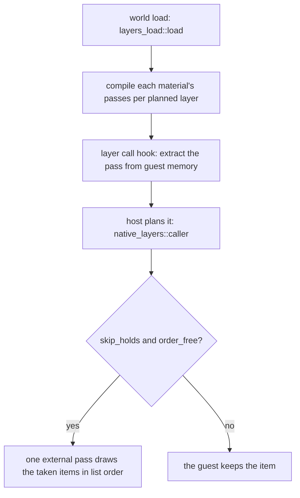

# FrameScene slice 4: whole-call replacement for the opaque block

Status: Partly built. Slice 4 of [framescene.md](framescene.md) (section 10): the entry census and the layer draws from the scene's plan are built; replacing the guest entries is not, because rule 1 of 8.2 (no remainder) holds for none of them.
Code: `crates/rewrites/native-render/src/{layer_pass,layers_load,light_scene,shadow_scene}.rs`, `crates/rewrites/render-bridge/src/{native_layers,entry_census,frame_step}.rs`, `crates/extensions/game/src/native_layers_glue.rs`.
Switch: `frame-scene.layers` (on with the native renderer, `=off` turns it off) and `frame-scene.census`, listed in [switches.md](../runtime/switches.md).

| Entry | Drawn from the scene | Still the guest's |
|---|---|---|
| Layers 1, 5, 7, 8, 20 (scene and first person), 2 and 17 | structure items with resolved constants, object items (layer 5's with the model's PRT stream) | items named by a refusal cause below |
| Layer 3 | decorators, instanced ([native-decorators.md](native-decorators.md)) | draws whose material is not ready or whose skip would change a state; the world's untranslated materials ([native-world.md](native-world.md)); the walk's refused parts |
| Layers 10, 11, 14 | whole groups, with no geometry handler | the guest's begin, clear and end still run |
| Layers 12, 13 | a light's whole group | partial or split spans, aux toggles, shader flags, material animation, template callbacks |

## Layers 1, 5, 7, 8 and 20

Their items are in the scene ([framescene-slice-3.md](framescene-slice-3.md)). The pre-slice stage drew them from the draws the guest resolves under the layer draw (`native_render::world_layers_gpu`, the indexed-draw admission in `boot::native_world_layers_glue`; the first person's per item at issue). Replacing the entry needs a layer pass drawn from the scene alone, which is extracted and planned.

### Material inputs

`frame_scene::LayerInputs`, read at the layer draw's begin by `scene_extract::layout::layer_inputs` (research points in its module notes).

- **Render time** `0x004858a0`, which game-time animated properties divide by their period (`0x0001b230`).
- **Engine inputs** that do not read the item, evaluated as the selectors `0x000336f0`, `0x00033980` and `0x00034060` do, from the render context `0x00485600` (copied per view by `0x000132d0`), the view vectors, the fog and the light block, each with a mask of the ones that read.
- **Defaults** the lighting inputs fall back on.
- **Object lighting.** Every object item carries its owner's lighting (`LayerItem::lighting`), the scene's as the first person's.
- **No game** (the editor): `layer_inputs::without_game(time)` runs the same selectors over a run state of its own, the render time it gives, no fog and no dynamic light. The inputs from the material and fade blocks, the view vectors and the defaults are not given there.

**The lightmap cycle.** `0x00022850`, at each view's begin (`0x00012a50`), steps the probe coefficients `0x004b8940` and the phase `0x005093f0`. Their one reader, `0x00022cf0`, is the object lighting `0x00023690` under the object setup (`0x0004b5d0`). The cycle reaches a layer's draws only through the object items' lighting, read after it; the world's items draw without one.

### The plan

`native_render::layer_pass`, per item:

1. **Pass.** For an object's item, the one pass it names, its `+0x14` at the shader level its `+0x15` names (`LayerItem::pass`, `level`; the guest's list holds an item per pass and `0x00016b90` sets up that pass alone). For a structure item, every pass of the first level its layer set draws for the part (`layer_pass::item_pass`). A pass without a vertex shader draws nothing.
2. **Implementation** (the only one, or the item's).
3. **Engine inputs** (the view's, the lighting's from the item's owner, none for the structure's, and the shader's own). The material is resolved again with them when an implementation reads any.
4. **Animations.** The values of its pixel- and vertex-constant animations at the render time (`0x00017550`: time over period, wrapped unless periodic, the function `0x0013b390`, mapped onto its range).

An item that cannot be planned has a named cause (`LayerRefusal::name`): an input the scene does not give, an object-function or state animation, an unsupported bitmap property, or a material or pass that does not resolve.

### The stage

`frame-scene.layers`; `render_bridge::native_layers`, its host `boot::native_layers_glue`.

**Load.** At the world's load (only with the stage placed; `native_render::layers_load::load` reads the map file alone, so the editor loads the same layers) each world material's passes of each layer the plan takes (1, 5, 7, 8 and 20, the overlay layer 2 and layer 17: `layer_pass::planned_layers`) compile as the fog's layer 16 does (`fog_gpu::layer_passes`, `FogProgram`), all or nothing per material and layer. Each material is resolved once with its instance's properties and input scales; `GpuWorld::set_layer` holds one `fog_gpu::FogSet` per layer.

The object models compile their materials' passes of layers 1, 2, 5, 7, 8, 17 and 20 with their layer-3 passes (`object_program_gpu::lit_model`, `object_program::object_layer_pass`). They compile over the same buffers, keep the pass's blend for its pipeline and have no lightmap stage, since outside layer 3 the geometry draw binds no lightmap page or stream (`0x0004d28b`). Per pass the implementations that compile are kept (`LitLayerPart`, `LitLayerPass`; what does not compile is `LitBuild::layer_refused`). The scene's models (`native_objects_glue`) and the first person's (`native_first_person_glue`) both build them.

Each layer-5 implementation also compiles a PRT variant (`LitLayerPass::prt`). Its declaration has the PRT stream of type `0x39` after the section's streams, as the stream setup `0x0001c8c0` adds it (its format record read with the rest, `object_streams::STREAM_TYPES`). The buffer holds the section's registers only, and the program carries what the stream feeds (`PrtInput`).

**Call sites** (`Site`). The bridge extracts the layer's pass from guest memory and the host plans it (`render_bridge::native_layers::caller`) before:

| Site | Layers |
|---|---|
| `Site::Scene` | a scene view's layer draw; the overlay layer 2 after the dynamic lights at `0x0002c060` (`layer_pass::OVERLAY_LAYER`); the late layer 17 at `0x0002c30b` (`layer_pass::BLOOM_LAYER`) |
| `Site::AlternateView` | 1, 5 and 2 |
| `Site::FirstPerson` | 1, 7, 8, 20 and 2 (its layer 2 returns to `0x00040289`; its layer 3 is `native_first_person`'s) |
| `sorted_site` | the sorted transparent list's camouflage layers 18 and 19 and hologram layer 21 ([native-water-fog.md](native-water-fog.md)) |

**What draws.**

- A structure item (the main or alternate scene caller) draws when it is a cluster's or a placement's and the layer's set draws its part with its shader. The set compiles game-time constant bindings with a time-zero sample to check the registers the program reads. At each layer call the planner samples the material at the render time. The packet uploads its vertex defaults, vertex constants and combiner colours alongside the view constants, placement rows and fog. The compiled modules and pipelines are shared across samples. Materials that need per-draw resolution of engine inputs stay on the D3D path.
- An object item draws when extraction names no cause, its model is resident in the caller's set, and each of its material's passes in the layer plans (`LitObjects::plan_layer_item`, `plan_layer_part`: per pass the implementation it draws for the item, the per-object constants from the item's lighting, the pass's defaults and the item's rows, its state over the device's at the call, `object_state::resolve_layer`, blending kept) with its fog. The device must draw W-buffered over a single clip equal to the viewport; packets use that viewport scaled to each target copy.
- A pass sampling the texture accumulation target (engine texture 3) binds its level as layer 3's objects do (`native_objects_glue::sampled_texaccum`), outside layer 1, which draws into it.
- An item toggling the auxiliary state (record bit 11) draws with the rows and clip the toggle sets for its view (`View::aux_depth`, `scene_extract::extract::layer`), and is taken only when the device holds the toggle off (`native_objects_glue::aux_depth_at_rest`, layer 3's rule).
- An item with a fade byte draws unmasked, taken only where the device's polygon stipple is off and the device and the engine hold the solid pattern and a cached fade of one, which its epilogue leaves (`native_objects_glue::stipple_off`, `stipple_at_rest`).
- An item whose shader's prologue uploads the structure's parameter block draws with its view's upload, taken only where the device and the engine already hold it (`native_objects_glue::structure_at_rest`).
- An item with a PRT stream draws each pass's PRT variant with the stream's constants from `c[68]` on, written over the item's own as the draw sets them after its rows (`0x0004d269`). It is refused when its program reads a constant past them below the section's decompression (`c[170]` on, which the draw sets itself). At the hook the section's vertices are read from the stream's address and gathered through the declaration the stream's type gives (`LitObjects::fill_prt`); the encode binds them as a second vertex buffer from the submission's uploads.

**Skip rule.** Skipping an item's guest draw must leave the device as drawing it would, as layer 3's walk requires of the parts it skips (`layer_pass::skip_holds`).

- A draw of another implementation than the cached one (`0x00016b90`) restores the cached one's restore list and sets its own render-state list without comparing (`0x00018900`).
- Every draw sets the engine-driven values (`0x0001a170`).
- The next layer's setup (`0x00016b10`) restores the cached implementation's list.

So an item is taken only when every state of its passes' restore lists already holds at the call, and every state of their render-state lists already holds or is one the restore list writes back (a blended pass that turns its blend on and its restore list off again, over a device with it off, is taken). A structure item's engine-driven render values the restore list does not write back must hold too, evaluated from the item's inputs over what its list leaves (`layer_pass::skip_holds_with`; refused when a source slot is outside the implementation's input masks or its inputs change per draw). An object item with any refuses.

The first shader begin's fixed states and cleared texture caches (`0x0001bbf0`) are redone by the first item the guest keeps, or by the next layer's. `layer_pass::clear_layer_items` clears the layer's bit on each skipped item.

**Order.** The native pass records before the guest's layer draw, so an item after one the guest keeps moves ahead of it. It is taken only where that cannot change the frame or the device: it and every kept item before it are order-free, and every kept item before it restores what it sets (`skip_holds`).

- `layer_pass::order_free`: depth tested and written with `LESS` or `LESSEQUAL`, no blend or logic op, every colour channel written, and a stencil that is off, writes nothing, or writes one reference on pass under `ALWAYS`. Two items' fragments are assumed not to tie in depth.
- A kept item whose passes did not resolve (a plan or extraction cause) or that is not a geometry build stops the skip of every later one.
- One external pass draws the taken items, run by run in the list's order (`GpuWorld::layer_draws`, `LitObjects::draws`, in the D3D pass open on the bound attachments).

**Stencil** (`layer_pass::item_stencil`). In layer 1 the geometry draw's prologue sets mode 0 when the stencil-off flags are set and mode 2 for a marked object's record, and its epilogue leaves mode 1 after either. With the stencil off the items draw with it disabled and the device must already hold mode 1 (else the layer stays on the D3D path). A marked object item draws in mode 2 (`object_state::mark`) and needs the device in mode 1 (else the marked items stay). In layers 5, 7, 8 and 20 the items draw under the stencil the device holds at the layer call (`fog_gpu::layer_stencil`): no structure pass sets one (`pass_state` refuses it), so the scene's layer 1, which begins in mode 1 (`ALWAYS`, reference 0, `REPLACE` on pass), takes that state in its pipelines and its reference in its packets. The pass reports a depth-stencil write when a draw writes.

Everything else keeps its D3D draws and so the indexed-draw admission: per-draw engine inputs, unsupported animations and every item `order` names.

### Outcome counters

`render.scene` counts each ask as `layer_plan_<layer>_taken` and `layer_plan_<layer>_refused_<cause>`. The first person's are `layer_plan_fp<layer>_*`, the alternate view's `layer_plan_alt<layer>_*`, a sorted handler's `layer_plan_sorted<layer>_*`. `layer_plan_asked`, `layer_plan_drawn` and `layer_plan_items` count the layer calls asked, those drawn natively and their items.

| Cause | Means |
|---|---|
| plan causes (`LayerRefusal::name`, `per_draw` for a material resolved per draw) | the plan could not resolve the item |
| extraction causes (`LayerObjectRefusal::name`) | `object_shader_flag` (also where the device or engine does not hold the structure parameters an item uploads) and the rest |
| `object_shader_flag_target` | a flagged item before the frame's structure target copy whose pass's program has flag bit 20 (`object_program_gpu::makes_target_copy`) |
| `object_fade`, `object_stipple` | a fade byte where the stipple is on; the device or engine does not hold what the epilogue leaves |
| `object_prt` | layer 5's PRT stream does not read or is of a format the variant was not compiled for |
| `object_layer` | a layer outside `object_program_gpu::OBJECT_LAYERS` |
| `object_state`, `state` | the pass would leave a render state other than the device holds (`skip_holds`) |
| `object_models`, `object_model` | the caller's models are not resident or their palettes changed; the item's model is not uploaded |
| `viewport`, `object_w_buffer`, `object_fog`, `object_stencil`, `object_aux_depth`, `object_texaccum` | the device conditions above do not hold (`object_texaccum`: in layer 1, or no target to bind or level to give) |
| `object_warming`, `warming` | a pipeline is not built yet |
| `object_plan_<cause>` (`LayerPlanRefusal::name`) | `not_compiled` (the material's passes of the layer did not compile; its first compile error is kept per layer and shader, counted again as `object_plan_not_compiled_<kind>` with `LayerPlanRefusal::detail`: `constant`, `input`, `object_function`, `wave`, `cube`, `other`, and logged with the shader's tag), `no_part`, `shader`, `level`, `pass`, `pass_empty`, `implementation`, `prt`, `aux_depth`, `structure_parameters`, `defaults`, `ranges`, `program`, `animation`, `constants`, `state`, `model`. The first of each message is logged |
| `stencil` | the device's stencil does not read, tests or writes on a depth with no stencil aspect, or layer 1's stencil is off and the device is not in mode 1 |
| `palettes`, `device`, `program` | no material of the layer compiled |
| `first_person_structure`, `sorted_structure` | structure items at those sites |
| `order` | planned, but after a kept item the reordering does not commute with |
| `set` | planned, but the sets hold no compiled part or fog for it |
| `unread` | the layer's pass did not read |

### With no game

The editor (`scenario_edit::native_view::NativeLayers`) runs the same load with the view constants a camera gives (`layers_load::load_with`, `program::CAMERA_GIVEN`: a pass reading another is refused, named with the register) and no stage palettes. `layers_load::plan_without_game` plans each compiled material as one structure item over `layer_inputs::without_game`, and draws it when the plan supplies the pass constants at the preview time and its own fog words leave fog off. Every other material is counted by cause (`program`, the plan's refusal names, `fog`). `layers_load::upload_static` uploads the drawn materials, and `GpuWorld::prepare_layer` and `encode_layer` draw them in a pass of their own.

### Tests

| For | Tests |
|---|---|
| inputs | `every_view_input_reads_as_its_selector_computes_it`, `without_fog_or_a_view_the_selectors_fall_back`, `an_input_whose_words_do_not_read_is_not_given` (`scene_extract::layout::layer_inputs`); `a_layers_items_are_in_the_scene_with_their_owners_and_the_rest_a_remainder` (`scene_extract::extract`); `a_layer_draws_material_inputs_count_in_the_hash` (`frame_scene::summary`) |
| plan (`native_render::layer_pass`) | `a_static_material_plans_each_pass_with_its_own_inputs`, `the_items_implementation_picks_among_several_and_one_without_a_vertex_shader_draws_nothing`, `view_and_lighting_inputs_are_given_and_the_material_is_resolved_with_them`, `a_structure_item_draws_with_no_lighting_and_an_input_nothing_gives_is_named`, `a_game_time_property_wraps_its_time_over_its_period_and_maps_onto_its_range`, `constant_animations_take_their_values_and_other_kinds_are_named`, `a_scene_layer_plans_its_items_in_order_and_names_the_rest` |
| skip and order (`native_render::layer_pass`) | `the_skip_takes_the_accepted_structure_items_before_the_first_kept_one_of_unknown_effect`, `the_skip_takes_object_items_the_plan_drew_in_the_same_run`, `a_kept_item_in_the_middle_leaves_later_order_free_items_to_the_native_pass`, `an_order_dependent_item_after_a_kept_one_stays_the_guests_and_is_counted`, `an_opaque_depth_writing_pass_is_order_free_and_a_blended_or_stencil_counting_one_is_not`, `layer_1_items_draw_unstenciled_with_the_stencil_off_and_need_mode_1_to_skip`, `a_skipped_pass_holds_when_what_it_sets_is_already_held_or_restored`, `a_pass_whose_restore_list_writes_back_what_it_sets_holds` |
| objects | `a_world_layers_object_item_carries_its_records_flags_or_names_why_not`, `the_walk_takes_a_fade_a_projected_size_and_a_flagged_shader_it_can_draw` (`scene_extract::layout::object_walk`); `the_rest_pattern_is_the_entry_for_one_in_every_rounding_mode` (`engine::render_loop::opaque_material`); `the_upload_is_what_the_two_functions_compute` (`engine::render_loop::structure_parameters`); `the_resolved_implementation_carries_flag_bit_20` (`tags::shader_tests`) |
| PRT | `layer_5_reads_the_objects_constants_and_its_sections_stream_at_its_level`, `a_model_without_a_prt_block_adds_nothing`, `a_draw_that_leaves_its_stream_or_constants_as_they_were_is_named` (`scene_extract::layout::prt`) |
| compile and draw | `a_world_layers_draw_keeps_its_blend_and_inherits_what_it_leaves` (`native_render::object_state`); `a_world_layers_pass_keeps_its_blend_and_cannot_sample_the_lightmap`, `a_materials_world_layer_passes_are_its_first_level_of_details` (`native_render::object_program`); `a_materials_world_layer_passes_compile_over_its_layer_3_buffers`, `layer_5_compiles_a_prt_variant_whose_stream_feeds_its_registers`, `a_prt_item_draws_its_passes_prt_variant_with_its_constants`, `a_world_layers_object_item_draws_each_pass_with_the_implementation_it_picks`, `a_flagged_item_before_the_target_copy_keeps_its_draw_only_where_a_program_makes_it` (`native_render::object_program_gpu`; an aux-depth item with and without its view's values, and a faded and a flagged item that plan as any other, among its cases) |
| device | `a_pass_sampling_the_accumulation_target_binds_it_only_where_it_is_there_and_sampled_in_place`, `a_faded_record_is_skipped_only_where_the_epilogue_leaves_the_device_as_it_is` (`game::native_objects_glue`); `a_views_layer_draws_keep_their_items_and_rows_and_a_first_person_view_is_its_own` (`frame_scene::builder`, each pass's view by `view_of_pass`) |
| stage | `the_plans_outcomes_count_by_layer_and_cause`, `the_stage_takes_the_scenes_layers_and_the_first_persons_besides_layer_3`, `the_stage_is_on_with_the_native_renderer_unless_turned_off` (`render_bridge::native_layers`); `a_layers_stencil_is_the_devices_and_needs_a_stencil_aspect_only_when_on`, `layer_packets_under_the_devices_stencil_write_its_reference_where_they_draw` (`native_render::fog_gpu`); `a_per_draw_refusal_counts_apart_from_a_missing_material`, `the_plan_reads_only_what_the_load_resolved`, `a_game_free_plan_names_what_the_load_refused` (`native_render::layers_load`) |

## Layer 3

The decorators (build `0x0004de20`) are in the scene (`View::decorators`, each placement's draw with its instances' `v11..v15`). The decorator stage draws a view's ready ones instanced and skips their items where skipping leaves the device's render states as drawing them would (`decorators_load::skip_holds`, the rule of `layer_pass::skip_holds` with the draw's `TwoSidedLighting`). A draw whose material is not ready or whose skip would change a state, and a view the stage declines, stays the guest's ([native-decorators.md](native-decorators.md)).

Tests: `a_skipped_placement_holds_only_when_what_its_draw_leaves_already_holds` and `a_placement_whose_restore_list_writes_back_what_it_sets_holds` (`native_render::decorators_load`); `a_draw_whose_skip_would_change_a_state_stays_the_guests_and_counts_apart` (`render_bridge::native_decorators`).

The world keeps the draws of materials it does not translate and of parts that lack an input of their program ([native-world.md](native-world.md)), and the object walk the parts it refuses (`walk_unsupported`).

## The light passes and the shadow layers

The gathered walk draws from a complete scene group or uses the first guest geometry handler's live streams, pose, constants and bindings.

- **Groups.** At each layer build, the sorted entries from `render_bridge::native_lights::walk` go into a group of the light (`scene_extract::light_groups::push`, `frame_scene::LightGroup`, `LightEntry`; `FrameScene::groups_of`). Each entry has its stream (section, part, vertex class, index range, topology), its pose (world, a placement by index, or an object's node rows) and its bindings (shader, pass selector, variant, implementation). Layers 10 and 11 carry the shadow projection block.
- **Sites.** The additional casters' layers 10 and 11 are groups of their own site (`GroupSite::AdditionalCasters`). Each object shadow's layers 10 and 11 are groups of its `ObjectShadow` in the view (`GroupSite::ObjectShadow`). A first-person light's layers 12 and 13 are groups of `GroupSite::FirstPerson`.
- **Object shadows.** An `ObjectShadow` marks a creature caster, which takes the ground-shadow branch `0x00032ce0`, and keeps the light weight read at its layer 11, for E3's sun tiles ([e3-lighting.md](e3-lighting.md), "Sun shadows from objects").
- **Hash.** `frame_scene::summary_hash` covers the groups, their entries and the object shadows.
- **Visibility-masked parts.** The emitter's selected index spans must form a single draw of the entire part. Contiguous list spans can join; separate strips need separate draws. A partial or split span, an auxiliary state toggle, state around one part, a shader flag, material animation or a template callback leaves the entry to the guest by named cause.
- **Drawing.** `native_render::light_scene::plan` turns a whole group into native draws from the scene alone, sorted order and duplicates kept, adjacent list ranges joined. A light's layer 12 or 13 whose group is whole draws from the scene with no handler run, its object entries from model parts the light passes build per map with their node rows ([native-lights.md](native-lights.md), "Gathered groups in the scene").
- **Shadow layers.** Whole groups of layers 10, 11 and 14 draw from the scene at all three sites through `native_render::shadow_scene` and `native_lights_glue::shadow_alone`. The guest's begin, clear and end still run, and `ShadowPass` carries their target and raster words. Receivers bind the boundary's frozen depth or colour-mask map. The object shadow's `filter` carries its native quads and final copy into `native_render::shadow_filter_gpu`, inside the guest call's swallow.

## The entry census

`render_bridge::entry_census` measures both halves of 8.2's first two rules per entry, so the coordinator can tell from the census corpus which entry is ready. It is an option because its exit observers give those entries an after part.

With `frame-scene.census` in `H2_FEATURES` (and the native renderer on), observers before and after every `LAYER_DRAW`, `RENDER_LIGHT_PASSES`, `OBJECT_SHADOW` and `RENDER_SCREEN_EFFECTS` count, per entry:

- the guest draws handed to the D3D backend under it (`d3d::device::backend_draws`: the remainder);
- the steps of both shared random seeds;
- the calls of `ANIMATION_RESOURCE_GET` (`0x001237e0`) and `PARTICLE_VIEW_UPDATE` (`0x00174420`) under it (5.2's seed, effects word, animation stamp and particle stamp rows).

A layer draw is named by its site and layer (`layer.scene.3`, `layer.first_person.1`), or, where the layer table does not place it, by the entry around it (`layer.light.12`, `layer.object_shadow.10`). Entries nest, and each counts what happens under it. `render.scene` reports the totals under `entries`. Tests: the unit tests of `render_bridge::entry_census` (draws and seed steps between entry and exit, unmatched seeds, nesting, missed exits).

## Replacing an entry

An entry whose census is all zero over the corpus is replaced by "return". A non-zero write becomes a row of the slice's table, kept by calling the guest function that makes it or reproduced. Residency requests (5.2's residency row) are not counted by the census.

- **Code.** `render_bridge::frame_step` implements `LAYER_DRAW` for layers 1, 3, 5, 7, 8 and 20, the light pass and the shadow layers, each doing the writes of 5.2 and returning, with the table of writes and their tests. `skip.rs`, the mask plans, `clear_objects`, `keep_only`, `restore`, and the world, object, light and shadow admissions and their glue are deleted. `render.parity` is added.
- **Tests.** For each replaced entry, a differential against the lifted original on synthetic state (the shared harness of change 6 when it exists, the per-crate one until then): same bytes in the 5.2 words, same seed, same particle stamps.
- **Gate.** Hashes identical over the gate corpus and one ten-minute multiplayer run. `render.parity` within the bar on 20 armed frames. The game thread's `render` phase drops by the layer and light sites' time (render-loop.md: layer 3 at 8.26 ms, light bookkeeping at 1.88 ms on Old Mombasa; **Estimate** for today).
