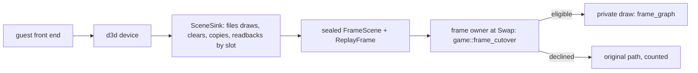

# FrameScene slice 6: the renderer owns game-view frames

Status: Partly built. Slice 6 of [framescene.md](framescene.md) (section 10): the carried census, private draws of sealed scenes and a display owner for eligible game views are built. Display adoption is on by default for a paced display (a window with a render thread) and opt-in for a locked run. The scheduling, corpus, parity and timing gates are not yet measured.
Code: `crates/rewrites/frame-scene/src/mailbox.rs`, `crates/platform/frame-types/src/carried.rs`, `crates/platform/d3d/src/scene_sink`, `crates/platform/d3d/src/threaded/owner.rs`, `crates/rewrites/native-render/src/frame_graph`, `crates/extensions/game/src/{frame_cutover,scene_glue}.rs`.
Switch: `frame-scene.sink`, listed in [switches.md](../runtime/switches.md): on for a paced display; `frame-scene.sink=off` turns it off; a locked run asks for it with `frame-scene.sink`.

The census comes first: the coordinator runs the census corpus and reports every guest readback and every side target still bound in a game view. The slice starts when section 8.3's table covers the list.

The original-renderer census and the owned-renderer arm use the existing [diagnostic options](../runtime/switches.md). The original arm records the guest's remaining reads and target uses while the D3D display worker presents; existing typed stages stay enabled in it. The owner arm records which game frames the native graph presents. The pixel and simulation comparisons in section 9 use the full D3D reference with all native stages disabled.

## The types

`frame_types::carried`, re-exported as `frame_scene::carried`.

| Type | Holds |
|---|---|
| `Slot`, `SlotAt` | the slot and the guest view index |
| `SlotTracker` | moves the slot on the frame step's events and, inside a game view, only forward |
| `GuestOp<D>` | `Draw`, `Bind`, `Clear`, `Copy`, `Upload`, `Sample`, generic in the draw so the crate stays free of `d3d` |
| `TargetRef` | `SceneColour`, `SceneDepth`, `Aux(n)` |
| `Carried<D>` | a frame's ops with their `SlotAt`, its side targets (`AuxTarget`: size, format, depth) and its readbacks (`Readback`: `Surface`, `Depth`, `Mirror`, `PixelCount`) |
| `CarriedSummary` | `Carried::summary`: counts by slot and view, and the side targets a game view names |

## The slot

`render_bridge::carried_slots`, placed by the frame step's build with the option.

| Event | Slot |
|---|---|
| `render_frame_and_present` entry and exit | `Outside` |
| `render_game_view` `0x0002b790` (view index from its record's `+4`) | opens `Opaque` |
| the light pass `0x00031c80` | `AfterOpaque`; its exit `AfterLights` |
| the sorted transparents `0x0001e370` | open `Transparents` (the first person, layer 17, the flares and `render_screen_effects`) |
| `render_screen_effects` exit | `AfterPost` |
| a game view's exit, the HUD's draw `0x001917eb`, `render_views`' exit | `Overlay`, once the frame has had a game view |

Before the slot moves, the device decodes what game code wrote into the push buffer (`carried_slots::Drain`, the host's `Device::sync_push_buffer`), so a draw lands in the slot it was written in.

## The sink

`d3d::SceneSink`, in boot's `install_for_profile` over the whole backend stack, on the sim thread. It forwards every `Backend` call. While the slot reads, it files at the current slot each draw (after a `Bind` when the attachments, slot or view change), clear, whole-surface copy, texel upload into a target and sampled target (a framebuffer snapshot, a render-to-texture level in place, depth bits), and each readback (`read_surface`, `read_depth`, `mirror_read`, `report_pixel_count`).

- **Scene colour and depth.** Colour is the surfaces the guest presents (and, with a copy swap, the one copied into a presented surface); depth is the depth bound with that colour. Anything else is a side target, numbered per frame.
- **Frame end.** A present ends the frame: its summary is published (`d3d::scene_sink::last`) and its totals counted (`d3d::scene_sink::counters`).
- **Typed stages.** When retaining draws, the sink also records repeatable typed stages at the point where they acquired their attachments. One-shot replacements decline admission before guest draws are released.
- **Native draws.** A queued native draw (`Backend::queue_external_draw`) is not carried: the render thread records it or draws its D3D packet. A flare draw (`Stage::Flares`) offered to its pass with an exact resolved fallback and not taken is still issued once, as the guest's own draw (`Backend::draw_admitted`, `draw_owned` by default).

### Retained admissions

A sink that retains the frame keeps the admission (`RetainedExternal`) on that draw's `ReplayOp::Draw` when:

- its pass records repeatedly;
- it writes only the draw's colour target;
- it samples no other surface;
- it equals the submitted packet;
- no guest reference is requested.

Replay (`RetainedExternal::resolve`) prepares the admission on its own attachments with the draw's own live, frozen or sampled texture inputs. It does so only for an unchanged draw bound to the attachments it was made for (a private capture only at 1x), and draws the packet when any copy is refused. Every other draw is carried as the guest's packet alone.

### Native producers

A native producer commits its pass with no guest draw to carry it, and a replaying sink refuses such a reservation (`prepare_external`: "scene capture reservation", with the cause `scene_sink::unretained_cause` names) unless it carries the commit (`Backend::begin_native_carry`, `record_native_carry`, `end_native_carry`).

- The sink carries the water composite (`Stage::Water`), the flares (`Stage::Flares`) and the UI (`Stage::Ui`) by `scene_sink::carries_native_stage`. Each issues the packets that are the draws its guest code would (`ExternalPass::resolved_packets`, in the guest's order), and a pass that records repeatedly (`replays_scene`) does so from those packets and the textures it was resolved against.
- The admission (`RetainedAdmission::packets`) holds the whole ordered list. The sink applies the checks above to every packet (a flare packet that writes depth declines the run) and keeps the commit as one `ReplayOp::Draw` per packet, each holding the same `RetainedExternal` and its place in it (`at`).
- Replay prepares the pass at the run's first draw. Each later draw (`RetainedExternal::follows`) draws nothing when the first recorded the pass, and its own packet when the first drew its packet (`guest_draw_pass/commands.rs`). The carried recordings are not refused as unrecorded.
- A single-draw pass is a run of one. A UI pass with indexed siblings (`UiPass`) is a run of its head and each sibling, built as its `prepare` draws them (the head's state and textures, the sibling's geometry). It has no single worker fallback (`resolved_fallback` is `None`), so outside a kept scene the guest code stays its fallback.
- The ocean's pass (`native_ocean_glue::OceanPass`) records repeatedly, its program and grid loaded, as a sorted layer's range does. So does a standalone `IndexedPass`, textured or not, since every sampled stage binds the recording's own view. One with a resident section or a pinned texaccum surface does not.
- `UiPass`, `FlarePass` and the HUD's `WidgetPass` take attachments and sampled stages from the copy being recorded (the widget's `Bound` overlay textures are the recording's stage views).
- Particles, transparents and sky are carried only as the guest's own admitted draws. Post's glow and screen effects are carried as sealed scene stages (`ReplayOp::Stage`, through `Backend::prepare_carried_stage` and `commit_carried_stage`); a post pass that reaches a plain reservation is refused with that cause.

Tests: `d3d`'s `tests/scene_sink.rs`: `water_flares_and_ui_commits_are_each_retained_as_an_admitted_draw`, `a_flare_that_writes_depth_still_declines`, `a_guest_draws_admission_for_several_packets_is_not_kept`, `other_native_stages_and_any_guest_reference_are_not_carried`. `game::native_hud_glue`: `a_single_draw_ui_pass_replays_in_a_kept_scene_from_its_packet`, `a_ui_pass_with_siblings_is_carried_as_its_packets_under_one_admission`. `game::hud_overlay`: `a_widget_pass_replays_from_its_packet`. `native-render`'s `tests/world_layers_gpu.rs`: `a_textured_standalone_range_replays_and_a_pinned_one_does_not`.

## Coverage

`render.scene` reports, with the option:

- `carried`: the last frame's ops by slot, its side targets with the ops that named them by slot, and its readbacks in and outside a game view;
- each game view's `carried` (its ops by slot);
- the counters `scene_carried_frames`, `scene_carried_draws`, `scene_carried_ops`, `scene_side_target_frames`, `scene_readback` and `scene_readback_<kind>`.

Over the census corpus these are the list section 8.3's table must cover. The sink sees a pixel-count request before the display worker decides which renderer supplies its result.

## Frame identity and inputs

`game::frame_owner` pairs the immutable `FrameScene` with `d3d::scene_sink::ReplayFrame` at the same frame-step sequence and Swap. The replay owns the ordered draw inputs, attachment descriptors, sampled versions and uploads. `CameraUse::View` requires the program's actual position rows to match the sealed view's camera bit for bit. Rewinds and map changes invalidate retained capture inputs.

## Private draw

`native_render::frame_graph` records the ordered typed stages and carried draws through `d3d::gfx_backend::GuestDrawPass`. The worker shares the display device and uses separate render targets.

An intervening copy or sample sees the pixels already drawn. Consecutive slots with the same attachments can share a pass. A private draw reports an error if it cannot reproduce the requested pixels.

## Display ownership

At Swap, `game::frame_cutover` supplies the scene to `d3d::threaded::owner`. The worker checks the original commands, resource bindings and device-local target eligibility before choosing a renderer.

- The game-view entry marks its Swap even when the view only clears or copies attachments, draws its overlay or reuses the previous colour buffer. These frames can reach Swap before the first layer that supplies a camera.
- The graph draws once into the live surfaces, exports sampled textures under their original handles, and installs flare query results under the tickets already held by the guest. An early guest access that needs buffered work runs those commands in order. Menus and declined game frames continue on the same device.
- On the first draw using an earlier frame's immutable snapshot, the worker pins the GPU textures behind its original proxy. A sealed draw can sample those images after the guest releases the proxy. Reference and display versions retain their own resolutions.
- For a colour texture that still views a live attachment, the worker checks its original proxy and physical allocation. Each draw then samples its own copy of that attachment, including writes from earlier in the same scene. Releasing or recycling the source surface invalidates that binding.
- Where a private draw needs incoming pixels from earlier draws, the worker copies the required attachments before the first write. The copies retain the source GPU format, raster dimensions and all depth and stencil bits, and are restored to matching attachments on the same device before recording the sealed commands.

## Scheduling and probes

| Mode | Mailbox (`frame_scene::mailbox`) | Display worker |
|---|---|---|
| Paced | keeps the newest pending scene | accepts two waiting transactions |
| Locked | blocks at two waiting scenes | accepts two waiting transactions |

- An adopted frame releases one slot before recording. A declined frame releases its slot after its original Swap. Both execute in order, because later guest commands can reuse their surfaces, sampled textures and flare tickets.
- The window takes the newest finished picture from its triple buffer. Capture requests can pin a scene across two draws and wake the renderer during pause. A display pass snapshot comes from the renderer that presented that Swap, at the requested pass boundary.
- Display callbacks carry the installing device and the timeline at Swap. A queued draw can finish on that device's attachments after a map or renderer change. Only the current timeline can publish its frame report, change a capture request or supply a pass snapshot.
- A private draw has its own `render.frame` recorder. `render.stats` reports completed graph work. `render.parity` compares the guest present with a separate private draw of its inputs.

## Gate coverage

`render.scene` includes the cumulative original target/read census and an activation baseline. On the owner arm, `scene_owned_presented`, `scene_owned_declined` and `scene_owned_flare_queries` identify what ran. Worker residency counters distinguish observed missing instances from frames whose residency is unknown. A successful carried draw can supply a model regardless of its native cache residency.

## Tests

Synthetic. `frame_types::carried`:

- `a_game_view_runs_its_slots_in_order_and_the_overlay_follows`
- `inside_a_view_the_slot_only_moves_forward_and_outside_it_does_not_move`
- `a_summary_counts_by_slot_and_view_and_names_the_side_targets_of_game_views`

Elsewhere:

| Crate | Tests |
|---|---|
| `d3d::scene_sink` | `forwards_every_backend_method`, `the_sink_names_targets_slots_and_readbacks_and_passes_every_call_on` |
| `d3d` `tests/scene_sink.rs` (the device's draw rig) | `the_sink_carries_the_devices_draws_in_order_by_slot_and_the_backend_still_draws_them`, `a_sink_with_no_slot_records_nothing_and_changes_nothing` |
| `render_bridge::scene_step` | `the_carried_slots_are_placed_only_with_their_option` |
| `boot::scene_glue` | `the_sinks_frame_is_reported_by_slot_and_per_game_view` |
| `agent_proto` | `a_scenes_carried_part_prints_only_when_the_sink_recorded` |
| `native-render/tests/world_layers_gpu/frame_graph.rs` | typed and carried draws on shared attachments, a copy followed by a later sample, same-tick private retail/E3 equality |
| mailbox, threaded worker, parity RPC | replacement and two-scene backpressure; original-command fallback, visibility tickets, retained snapshots, a following menu frame; a private clear changed to exercise the differing-pixel result |

## Cutover status and gate

Eligibility, post-load residency, pixel and hash parity and the delay through Swap still require measurement on the corpus. An unsupported frame runs the original path and appears in the decline count. The default path and the guest resource lifetime machinery are retained through this gate.

**Gate.**

- Pixels on the gate corpus against `native=off` (which selects the old stack) and by `render.parity`. Hashes.
- Every post-load game-view Swap requires zero reads of guest surfaces, depth or mirrors, zero dropped stages and zero unresident instances. The raw `scene_readback` includes flare requests; each must have a matching native result on that same Swap, leaving zero reads that require the original renderer.
- One recording per draw at 4x (`command_buffers`, `passes`).
- The sim thread's frame time includes no `gpu-wait` or `render-wait`.
- Native at least 15% ahead of D3D at 4x on the gate corpus (**Estimate**; the number is set from slice 2's measurement).

If the slice has to be split, the cut is by view kind: single-player game views first, split-screen and cinematic views after, with the old stack serving the rest in between.
