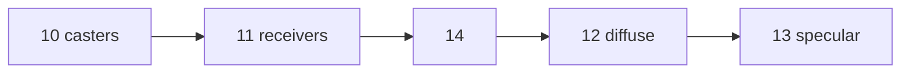

# FrameScene slice 3: no remainder in the opaque block

Status: Built. Slice 3 of [framescene.md](framescene.md) (section 10): objects, lights and layer passes are in the scene, each former refusal reason is a part or a named cause.
Code: `crates/rewrites/scene-extract/src/layout/{object_walk,light_passes,aux_depth}.rs`, `crates/rewrites/frame-scene/src`, `crates/rewrites/native-render/src/object_program_gpu.rs`, `crates/extensions/game/src/native_objects_glue.rs`.

| Part | What is in the scene | Named causes |
|---|---|---|
| Objects | `PartFlags` from the render record's `+0` | `Refusal::{Subparts, AuxState}` and the `walk_part_*` counters |
| Lights | per light, its passes' layers in order (`SceneLight`, `LightStep`), the view's candidate set | the lights stage's refusals |
| First person and layers 1, 5, 7, 8, 20 | each layer draw's items (`LayerPass`, `LayerItem`) | `LayerObjectRefusal` |

Research came first (`h2 disasm`), then code, in three parts.

## Objects

The geometry draw `0x0004d0b0` reads four bits of the render record's `+0` in layer 3 (**Code**; the module notes of `scene_extract::layout::object_walk` give the addresses). `object_walk::record_flags` turns them into `PartFlags`. A part whose flags' inputs do not read refuses by a named cause.

| Bit | Flag | What the guest does | How the scene draws it |
|---|---|---|---|
| 14 | `PartFlags::STENCIL_MARK` | prologue `0x0004d640` sets stencil mode 2 (`0x00015370`: `ALWAYS`, reference `0xff`, masks `0xff`, `REPLACE` on pass); epilogue `0x0004d720` sets mode 1 (the same with reference 0). With the stencil-off flag bytes set it is mode 0 for every item and the bit does nothing | `object_state::mark` (mode 2, packet stencil reference `0xff`). A run with a marked part is taken only when the device holds mode 1 (`boot::native_objects_glue::plan_walk`), so skipping the epilogue leaves the state the guest would |
| 9 | `PartFlags::STRIP` | the whole-part emitter `0x0004daa0` draws a strip when the bit is set and the part's triangle-list flag is clear, a list otherwise | lit models keep, after a strip part's triangles, its indices decoded as a list (`object_program_gpu::lit_listed`, `LitPart::listed`: whole triangles, as D3D draws `n / 3` of `n` list indices). A strip part in the scene without the flag draws them (`part_ranges`) |
| 6 | `PartFlags::SUBPARTS` | with a visible-subpart mask (record `+0x14`, bit `s` of word `s >> 5` for the section's subpart `s`) the emitter draws only the visible subparts: each its own strip with strip topology, runs of index-contiguous ones as one list otherwise | the scene carries the mask over the part's own subparts, however many (`PartDraw::subparts`, `frame_scene::Subparts`). Lit models keep each subpart's triangles decoded alone (`lit_subparts`, `LitPart::subparts`); a planned draw issues the chosen ones, adjacent ranges joined, one packet per run (`SubpartRanges::drawn`) |
| 11 | `PartFlags::AUX_DEPTH` | prologue calls `0x00012d50` on, epilogue off (see below) | `View::aux_depth` (`frame_scene::AuxDepth`); the part draws with those rows and clip (`object_program_gpu::with_aux_depth`) |

The open point on bit 14 is what reads the marks (native-renderer.md, "Not verified"). `0x00015370`'s other modes test the stencil `EQUAL` and `NOTEQUAL` and draw on the D3D path over the same depth-stencil, so the native writes are what they read.

**Bit 9.** A strip part's chosen subparts draw as the list loop `0x0004db68` joins them: each run of index-contiguous chosen subparts (one starting one past the run's last index) is one list of the section's indices. A triangle can span two subparts and a run's last `n % 3` indices draw nothing. The lit models keep, after a strip part's subparts, the section's indices the subparts span, verbatim, with each subpart's place in them (`object_program_gpu::ListedSubparts`, `SubpartRanges::listed`). A planned draw issues each run's whole triangles (`SubpartRanges::drawn_as_list`).

**Bit 6.** A list part whose subparts are not whole triangles has no native subparts and its chosen draws refuse at planning. A negative first subpart or a mask that does not read refuses (`Refusal::Subparts`).

**Bit 11.** The toggle stores the device's program clip range (`+0x1c10`, game-owned through `+0x1c18` bit 1, pushed by `0x003f6190`) as `[near * k, far]` from the game's clip words (`0x00485adc`, `0x00485ae0`), with `k` the constant at `0x004407b8` on and 1.0 off. It builds the view-projection rows from the view at `0x0048568c` (its projection columns through its 3x4 matrix, times `[0x0045dd40] / [0x0048565c]`), all sixteen times `k` on, and uploads them to `c[0..3]` when the byte at `0x0055e6bc` differs from the call's.

- Extraction reads both states once per view (`scene_extract::layout::aux_depth`, the arithmetic in the toggle's order).
- A run holding an aux-depth part is taken only when the device holds the off state: cached byte 0, `c[0..3]` the rows off, the clip the pass's own range off (the host holds `AuxDepth::rest_clip`; no device word is read) (`native_objects_glue::aux_depth_at_rest`).
- When the toggle's inputs do not read, the part refuses (`Refusal::AuxState`).

Refused parts count by cause as `native_objects_walk_part_aux_state`, `_part_subparts`, `_part_shader_flag`, `_part_argument`, `_part_program` and `_part_layout` (parts, where `walk_unsupported` counts objects). `render.scene` reports each view's parts by flag (`part_flags`).

## Lights

The light passes `0x00031170` draw, per light, layer 10 (shadow casters, `0x000312ad`), layer 11 (receivers, `0x00031348`), the additional casters' pair `0x00030ed0`, layer 14 (`0x000313dd`), layer 12 (diffuse, `0x0003144a`) and layer 13 (specular, `0x000314ca`). The module notes of `scene_extract::layout::light_passes` give each layer's condition.

- **Stencil.** Before each of layers 11, 14, 12 and 13 the passes set stencil mode 0 through `0x00015370` (the test off); before layer 10 they set none. No layer reads a stencil an earlier one wrote: a later layer reads the shadow map (target 9) and the destination alpha layer 11 writes, both kept by the GPU's order.
- **What the scene holds.** When the passes' item lists are made (`render_bridge::native_lights::handoff`), the light's constants give its flags, the item body's lists give their layers, and `light_passes::read` gives the additional casters' inputs. `light_passes::steps` gives the layers in order, each with its stencil change, target and whether it draws. The light goes into the open view (`frame_scene::SceneLight`, `LightStep`; `View::lights`). A light of the guest's own loop is read at its passes' entry ([native-light-gather.md](native-light-gather.md), L5).
- **Drawing.** The resolved-draw path takes each of layers 12 and 13 the steps draw, one at a time, with the candidate kept from the entry to the next light. The gathered walk batches any layer the steps draw, each its own reservation (`walk::light_layer_draws`). Layers 10, 11 and 14 are the shadow stage's. A shadowed light's layers 12 and 13 draw like any other's; a pass that samples the shadow maps is refused by `light_look` by name. With the additional casters' pair every layer keeps its handlers (`lights_walk_fallback_graph`).
- **Not built.** Drawing the shadow maps as one batch at the start of the view's stage.
- **The candidate set.** Once the light pass is over, the frame step reads the game view's whole candidate set (`scene_extract::lights::candidates`, `frame_scene::LightCandidate`; [e3-lighting.md](e3-lighting.md)) before the decal mode 1 call (`0x0002c370`, `points::RENDER_DECAL_MODE`, returning to `0x0002c04d`). That call is the next one after `render_dynamic_lights` returns, with no test between, so the light list, records and selections are as the pass left them. The hook is a context-only before, so `0x00031c80` keeps no after hook and its chain runs on the pipelined render thread.

## First person and world layers 1, 5, 7, 8, 20

At each of the scene's layer draws 1, 5, 7, 8 and 20 (`0x0002bcd0`; layer 20 returns to `0x0002c010`, after layer 8, on the scene's list into the view's target after stencil mode 0; `world_layers::layer_site`) and at each of the first-person draw `0x0003fdf0`'s layers, the frame step reads the current list's items into a layer pass of the view (`scene_extract::extract::layer`, `frame_scene::LayerPass`, `LayerItem`; `View::layers`).

| Item field | Holds |
|---|---|
| key, owner | a cluster's section, a placement, or an object by handle |
| model | the record's model (the first-person mode for a first-person item) |
| rows, lighting | an object item's palette rows and its owner's lighting |
| `PartFlags`, subparts | what the record makes the geometry draw `0x0004d0b0` do (`object_walk::layer_part`): the stencil mark only in layers 1 and 3, the fade byte, the shader's flag bit 0, whether its prologue uploads the structure's parameter block (held in `View::structure_parameters`), and whether the frame's structure target copy is still to be made (`TARGET_UNCOPIED`) |
| refusal | a named cause the scene cannot reproduce it (`LayerObjectRefusal`): the shader's flag bit 0 where that upload does not compute, another pass, level or part in the item's argument, layer 5's PRT stream left as the draws before it left it, subparts or auxiliary state that do not read ([native-objects.md](native-objects.md), "Fade, the shader flag and the item's argument") |

- **PRT.** In layer 5 an object item whose model has a PRT block, and whose shader has no flag bit 0, carries what the draw adds for it (`frame_scene::PrtStream`, read by `scene_extract::layout::prt`): the stream's type, stride and the guest address of the item's section's vertices at the object's level, and the constants from `c[68]` on (the object's entry's vector, a fixed vector, then its coefficients).
- **Pass state.** The pass keeps the stencil-off flags and whether the texture accumulation target binds.
- **Remainder.** Another build callback, or a record, owner or rows that do not read, is the pass's remainder.
- **First person.** It is a view of its own (`ViewKind::FirstPerson`) with its own camera. The scene's view can open at its layer 1, before layer 3; its clusters and world state are read at layer 3 either way (`scene_step::open_kind`).
- **Drawing.** The stages draw these layers from their packets with the constants the device holds; slice 4 reads the material inputs of section 4.3 into the pass (`frame_scene::LayerInputs`, [framescene-layer-plan.md](framescene-layer-plan.md)).

## Tests and gate

One synthetic case per former refusal reason, asserting the part or light is in the scene.

| For | Tests |
|---|---|
| objects | `each_former_special_record_flag_is_a_part_or_a_named_cause`, `a_records_flags_become_part_flags_or_name_their_refusal` (`scene_extract::layout::object_walk`); `a_marked_or_strip_part_is_in_the_scene_with_its_flags`, `a_part_drawing_chosen_subparts_is_in_the_scene_with_its_mask`, `an_auxiliary_depth_part_is_in_the_scene_and_its_view_has_what_the_toggle_sets` (`scene_extract::extract`); `a_marked_part_draws_in_mode_2_whatever_its_implementation_left` (`native_render::object_state`); `chosen_subparts_draw_their_ranges_joined_where_adjacent`, `a_part_of_a_hundred_subparts_draws_every_one_its_record_chose`, `a_strip_parts_chosen_subparts_draw_the_triangles_the_list_loop_draws` (each choice against the list loop `0x0004db68` written out), `an_auxiliary_depth_draw_takes_the_toggles_rows_and_clip_and_nothing_else` (`native_render::object_program_gpu`) |
| lights | `the_passes_order_is_10_11_14_12_13_and_each_flag_adds_its_layers`, `every_step_after_the_casters_turns_the_stencil_off_first`, `a_step_draws_only_with_its_layer_in_its_lists_mask` (`scene_extract::layout::light_passes`); `a_light_drawing_both_sorted_layers_is_the_candidate_of_each_in_turn` (`hooks::native_lights`); `each_layer_a_light_draws_batches_alone_unless_additional_casters_run` (`hooks::native_lights::walk`); `a_views_lights_keep_their_steps_in_order_and_count_their_shadows` (`frame_scene::builder`) |
| layers | `a_layers_items_are_in_the_scene_with_their_owners_and_the_rest_a_remainder` (`scene_extract::extract`); `a_views_layer_draws_keep_their_items_and_rows_and_a_first_person_view_is_its_own` (`frame_scene::builder`); `the_same_layer_number_has_different_view_sites` (`scene_extract::layout::world_layers`) |

Shadow batch: N lights record at most N target changes and no pass in between.

**Gate.** `walk_unsupported`, every lights refusal counter, every `refused_*` counter of the five stages and `render.scene`'s `layer_remainder` are zero on the census corpus. Pixels and hashes on the gate corpus. Shadow passes per frame equal the number of shadow maps.

**Open on the default path.** The object walk gives back a part only when what it reads does not read (`walk_unsupported`, by cause `walk_part_*`). The lights stage keeps a light's layers on D3D when a pass is refused by name or the additional casters run.
