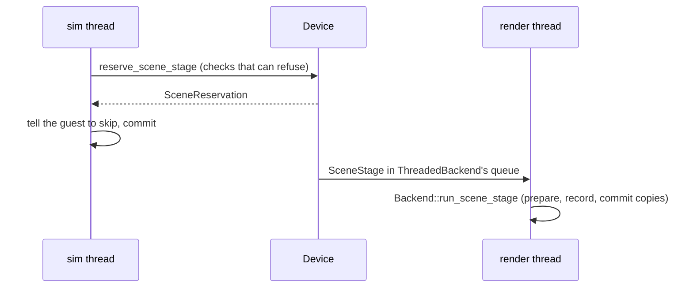

# FrameScene slices 0 to 2: agent methods, crates, scene stages

Status: Built. Slices 0 to 2 of [framescene.md](framescene.md) (section 10): the three agent methods, the `frame-scene` and `scene-extract` crates, and typed stages that prepare and record on the render thread.
Code: `crates/extensions/agent/src/render.rs`, `crates/rewrites/frame-scene`, `crates/rewrites/scene-extract`, `crates/platform/d3d/src/scene_stage.rs`.

| Slice | Adds | Gate |
|---|---|---|
| 0 | `render.compare`, `render.capture`, `sim.hashes` | the baseline is recorded |
| 1 | `frame-scene`, `scene-extract`, `render.scene`; world and object stages take `&View` | pixels identical, hashes identical |
| 2 | `d3d::SceneStage`: world and object stages prepare and record on the render thread | pixels and hashes as slice 1; native at least equals D3D |

## Slice 0: baseline and the three agent methods

- **Code.** Types in `crates/extensions/agent-proto/src/render.rs` and `sim/`, logic in `crates/extensions/agent/src/render.rs` (PNG compare as a pure function), host glue in `crates/extensions/game/src/agent_glue.rs`, the `h2 agent frame compare` verb in the CLI, docs in [agent-api.md](../runtime/agent-api.md).
- **Tests.** Compare: synthetic images (equal, one pixel, size mismatch, the bar's edges). Capture: the frame recorder's rig, by tick. `sim.hashes`: against the sim report writer on a synthetic state. `cargo xtask test -p agent -p agent-proto`.
- **Gate.** The baseline of [framescene-measure.md](framescene-measure.md), the hash series for `native=on` against `off`, and the census counters.

## Slice 1: `frame-scene` and extraction of camera, world and objects

- **Code.** `GuestRead` and the offset-bearing modules for the camera, the world ranges and objects live in `scene-extract`. `SceneBuilder` extracts a `View` at the world and object hooks. `native-render`'s world and object stages take `&View` and `&FrameScene` (`GpuWorld::selection_draws`, `LitObjects::draws`, `instances::pack`) and have no `GuestRead` parameters. The stages still run on the game thread, still make packets and still edit masks. `render.scene` reports the scene.
- **Tests.** `scene-extract`: the synthetic-memory tests of the moved modules, plus round trips (a synthetic guest view to a `View` with the expected instances, parts and rows; a refused record becomes a remainder, not a part). `frame-scene`: builder sealing, range integrity, recycling. `native-render`: its GPU tests, fed scenes. `cargo xtask test -p frame-scene -p scene-extract -p native-render -p render-bridge`.
- **Gate.** Pixels identical to the commit before (`max_channel == 0`) on the gate corpus; hashes identical; fps within noise; `rg GuestRead crates/rewrites/native-render/src/{gpu,objects,instances,world}*` finds nothing.

## Slice 2: typed stages prepare and record on the render thread

- **Types.** `TargetCopy`, `ExternalDraws` and `ExternalEncoded` are `gfx::external`'s, re-exported at their `d3d::backend` paths, so `native-render`'s world and object modules (`gpu`, `object_program_gpu`) build packets without `d3d`. `ResolvedDraw` and the NV2A pipeline key stay in `d3d` until slice 6 carries draws: they are made of `d3d`'s state model (`DrawState`, `ShaderInputs`, `HwState`).
- **The command.** `d3d::SceneStage` in `ThreadedBackend`'s queue. `Device::queues_scene_stages(stage)` says whether one is taken: the render thread's backend records them (`Backend::runs_scene_stages`: `GfxBackend`, and `ScaledBackend` when both copies do) and the stage has not stood down.
- **Reserve and commit.** `Device::reserve_scene_stage` resolves the bound targets, the request, the view's constants and W clip, and makes the checks that would refuse it on the render thread (the targets resolve, the viewport lies in the target, the slots have sizes). The glue then tells the guest to skip and commits (`SceneReservation::commit`); dropping the reservation cancels it. The render thread maps the attachments and calls `Backend::run_scene_stage`.
- **On the sim thread.** Every check that can refuse, because a refusal must leave the items to the guest. World (`boot::native_world_glue`): W-buffering, the stage palettes, the stencil plan, the inherited cull, and the parts the guest skips (frustum against the parts' bounds). Objects (`boot::native_objects_glue`): the render-state checks and each part's plan (`LitObjects::plan_part_of`, where an item refuses).
- **Workers.** Map workers upload world and object geometry, stage textures and material programs. Pipeline workers build the attachment-specific variants. A pending variant leaves the draw on D3D.
- **Render thread.** `WorldPass::record_draws` and `ObjectsPass::packets` bind the prepared resources, write frame-specific uniforms and issue the selected parts.
- **Named errors.** What the render thread cannot record (`d3d::scene_stage`) is counted and its cause logged once. The stage stands down: from then on it reserves on the sim thread, where a refusal leaves the items to the guest. At most one frame is short of the stage's items.
- **No render thread, or stood down.** The stages reserve on the sim thread through `Device::prepare_external_bound`.
- **Inputs by value.** A stage carries the inputs it reads (the world's camera and parts, the objects' planned draws), not an `Arc` of its view: a view seals at the present, after its stages are queued.
- **Extraction points.** The view opens at the base layer 3 and the objects are extracted at the walk's first geometry handler. The walk's sorted entries live on the stack of the layer-3 call (`object_walk::read`), so layer 1 cannot read them.
- **Counters.** `native_<stage>_extract_ns` (sim thread), `prepare_ns` (game thread's preparation alone), `render_prepare_ns` (render thread, `timeline::native::mark_render_thread`), `native_<stage>_scene_stages` and `_scene_dropped`. `render.scene` adds `scene_stages_<stage>` and `scene_dropped_<stage>` for the world and objects.
- **Tests.** `crates/platform/d3d/tests/scene_stage.rs` over the `ThreadedBackend` rig with the recording backend: a scene stage between two D3D draws on one target records between them, on the render thread, and its preparation runs only there; a dropped reservation queues nothing; no stage is taken without a render thread, while the backend replays, after a stand-down, or with no ranges. `timeline`: preparation counted on the render thread is charged as `render_prepare_ns`. A remainder is drawn by D3D exactly once: the world's skip clears only the parts it draws (`an_untranslated_material_keeps_its_d3d_draws_and_a_translated_one_is_skipped` in `boot::native_world_glue`), and the object walk consumes only the run it queued.
- **Gate.** Pixels and hashes as slice 1. On the gate corpus `native_world_prepare_ns`, `native_objects_prepare_ns`, `native_objects_worker_round_trips` and `native_world_worker_round_trips` are zero on the game thread, and `render-wait` does not rise. Native at least equals D3D in fps and p99 at 1x and 4x over three back-to-back pairs ([framescene-measure.md](framescene-measure.md)); if not, attribute before slice 3.
