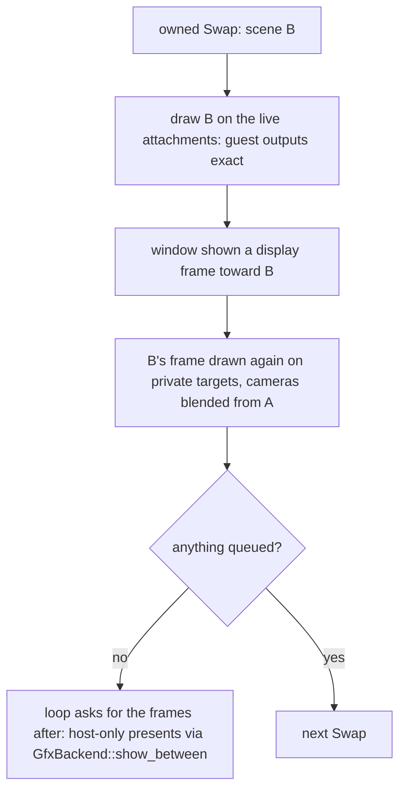

# FrameScene: a native renderer that owns the frame (design)

Status: Partly built. Slices 0 to 3 are built; slices 4, 5, 6 and 8 are partly built (per the table below); slices 7, 9 and 10 are design.
Code: `crates/rewrites/frame-scene` (the type), `crates/rewrites/scene-extract` (guest memory to scene), `crates/rewrites/native-render` (scene to GPU), `crates/rewrites/render-bridge` (the frame step), `crates/platform/d3d` (the device that shrinks).
Switch: `impl.render.native` (on; `=off` is the D3D path, kept as the reference), `frame-scene.sink`, `frame-scene.layers` and `frame-scene.census`, listed in [switches.md](../runtime/switches.md).

This page is the spec for change 7 of the [architecture review](../reviews/2026-11-20-architecture.md) (section 4.3 and section 5 item 7) and lane 7 of the [sim review](../reviews/2026-11-20-sim.md) (the presentation snapshot): types, threads, the order of work, the gates for each slice. Evidence labels as in [feature-engine.md](../engine/feature-engine.md): **Code**, **S** (supposed), **Estimate**. Addresses and offsets are research points. No game data.

| Slice | State | Detail |
|---|---|---|
| 0 | built | [framescene-slices-0-2.md](framescene-slices-0-2.md) |
| 1 | built | [framescene-slices-0-2.md](framescene-slices-0-2.md) |
| 2 | built | [framescene-slices-0-2.md](framescene-slices-0-2.md) |
| 3 | built | [framescene-slice-3.md](framescene-slice-3.md) |
| 4 | entry census and layer draws from the plan built (layers 1, 5, 7, 8, 20 and the first person's, groups of layers 10, 11, 14, the object filter); entry replacement not built | [framescene-layer-plan.md](framescene-layer-plan.md) |
| 5 | extraction of fog, water and post, fog and water recorded on the render thread; entry replacement not built | [framescene-late-passes.md](framescene-late-passes.md) |
| 6 | carried census, private draws of sealed scenes, display owner (on for a paced display, opt-in for a locked run); scheduling, parity and timing gates not measured | [framescene-owner.md](framescene-owner.md) |
| 7 | design | [framescene-display-rate.md](framescene-display-rate.md) |
| 8 | pure blend and the display-rate loop built; the loop blends view cameras, objects stay at the newer tick | [framescene-display-rate.md](framescene-display-rate.md) |
| 9, 10 | design | [framescene-display-rate.md](framescene-display-rate.md), [framescene-deletion.md](framescene-deletion.md) |

Other pages: [framescene-parity.md](framescene-parity.md) (section 9), [framescene-measure.md](framescene-measure.md) (section 12), [framescene-deletion.md](framescene-deletion.md) (sections 11 and 13).

## 1. Where it stands

- `impl.render.native` is the one render switch and is on by default.
- On the default path, native stages contribute to the D3D frame. The guest runs its render front end on the game thread. At a hook, a stage reads guest memory, prepares draws on the game thread and hands the D3D device packets that join its open pass (`gfx::RecordedDraw`). The stage then makes the guest skip the replaced items by editing mask bits and restoring them ([native-renderer.md](native-renderer.md)). The A/B against D3D is in [notes/native-ab.md](notes/native-ab.md).
- Open on that path: the object walk gives back a part only when what it reads does not read (`walk_unsupported`, by cause `walk_part_*`), the lights stage keeps a light's layers on D3D when a pass is refused by name or the additional casters run, and side passes at a render scale above 1 are not deferred.
- `native-render` depends on `d3d`, reads guest memory through `dyn GuestRead` in about 19 of its modules, and is wrapped in about 30,000 lines of glue in `boot` and `feature`.
- 60 and 120 fps are display frames between the last two sealed scenes, drawn by the frame owner on the render thread (section 7). Without a paced frame owner every scene is shown once, at 30 fps. That covers `frame-scene.sink=off`, a headless or locked run, no render thread, and a frame the owner declines (exact readbacks for network play, films and lockstep, or a scaled display without its single copy).

## 2. Decisions

The user's decision is that rendering is one path: the sim runs, then the native renderer draws, and nothing is drawn twice. The rest follows from that and from the two reviews.

1. **`FrameScene` is the only thing the renderer reads.** It is owned, typed data with no guest addresses and no borrowed guest memory. It is built on the sim thread during the frame step that follows the frame's ticks, sealed, and published. After the publish nothing reads guest memory to draw.
2. **Two grades of content, one renderer.** *Typed* content is extracted from engine records (camera, visible clusters, object instances and palettes, lights, fog, post parameters) and the guest code that would have drawn it does not run. *Carried* content is a guest draw that the D3D state model resolved (a `ResolvedDraw`, which holds no guest pointers), stored in the scene at its place in the frame order instead of being sent to a backend. The native renderer draws both. A stage moves from carried to typed when that saves guest time or is needed for smooth motion. Carried content is the fallback for everything, which lets the renderer own the frame before every stage is typed.
3. **The tick does not change, and neither does what it can see.** The guest's render front end writes state the tick reads (section 5). Every slice keeps those writes, by leaving the guest code that makes them running or by making the same writes from Rust in the same order. The gate is the gameplay digest series, not pixels.
4. **Stages skip guest work by whole-call replacement, not by mask bits.** When a stage is typed and has no remainder, its guest entry (a layer draw for one layer, the light pass, the screen effects) is implemented as "do the tick-visible writes, return". `skip.rs` and the per-draw admissions go.
5. **No new switches.** Each slice lands under `impl.render.native`. `=off` stays the whole D3D path until the deletion in section 11, and then the switch goes too. Diagnostics are agent API methods.
6. **Interpolation is a property of the renderer.** With two scenes in hand the render thread draws any number of frames between them. There is no D3D-side interpolation.
7. **Open items are not patched on the tenant path unless they block a slice.** Deferring side passes above 1x is not done: slice 6 removes the second copy, and with it the problem. The object-walk fallbacks and the refused lights are slice 3, because typed stages need them gone to drop their guest entries.
8. **The stage 7a ports and the pipelined-frame worker stay stopped.** `FrameScene` replaces the worker. The scene passes are not ported as an orchestrator; decision 4 needs only entries.

## 3. The frame, today and after

```text
today (impl.render.native=on)
  guest thread   input | tick | guest render front end ................ | Swap, wait
                                 |hook: read guest, prepare, packets|
  d3d-render                     decode'd draws + native packets -> encode -> submit
  window         composite the newest published frame

after slice 6
  sim thread     input | tick | frame step: owners, extract, carry | publish | wait
  render thread  take (S[n-1], S[n]) -> blend -> cull -> encode -> submit   (display rate)
  window         composite the newest published frame
```

The guest thread becomes the sim thread. It never waits for the GPU. The render thread never touches guest memory and takes no guest lock.

## 4. The `FrameScene` type

### 4.1 Crates

| Crate | Holds | Depends on |
|---|---|---|
| `frame-scene` | the types below, the builder, the two-scene history, the blend (pure math) | `bytemuck`; `gfx` without its `wgpu` feature, for `ResolvedDraw` |
| `scene-extract` | guest memory to `FrameScene`. The only render code with guest offsets | `frame-scene`, `engine` (points), the layout crate of change 5 when it exists |
| `native-render` | `FrameScene` to wgpu. No `d3d`, no guest reads | `frame-scene`, `gfx`, `shaders`, `tags`, `map`, `wgpu` |
| `gfx` | the data types both sides need: `ResolvedDraw` and its parts, `PixelRect`, the packet and target types (`ExternalTarget`, `ExternalDraws`, `ExternalBundles`, `TargetCopy`), and the NV2A pipeline key (`d3d::nv2a`'s `NativeDrawKey`, `NativeDrawMaterial`, `NativeDrawProgram`, `w_buffered`, `d3d_fog`) | as before |
| `frame-types` | the types `d3d` and `frame-scene` share: the carried part (`carried`), the render camera (`camera`) and the view and instance keys (`keys`). `frame-scene` re-exports them under its own paths | `serde` |
| `d3d` | the guest-facing device. Depends on `frame-types` to fill the carried part and to classify its draws against the scene's cameras (`ReplayFrame::classify_cameras` takes `FrameScene::view_cameras`). Shrinks in section 11 | `gfx`, `shaders`, `frame-types` |

Until change 5 lands, `scene-extract` keeps offsets in one private `layout` module, one file per guest record, moved there unchanged from `native-render` (`camera.rs`, `objects.rs`, `object_nodes.rs`, `object_walk.rs`, `object_lighting.rs`, `world_ranges.rs`, `light_list.rs`, `fog.rs`, `shadows.rs`, `transparent.rs`, `gels.rs`, `particles.rs`, `effect_geometry.rs`, `post.rs`, `hud.rs`, `glow.rs`, `skip.rs`). Moving them to the layout crate is then a rename.

### 4.2 Shape

Flat arrays and index ranges, so a scene is a handful of allocations that are recycled, and so the blend can walk it without chasing pointers.

```rust
pub struct FrameScene {
    pub id: SceneId,            // map_epoch, guest frame number, tick after this frame's ticks
    pub stamp: Stamp,           // published: Instant (sim thread, at publish); ticks_run: u8 (0, 1 or 2)
    pub cut: Cut,               // bitset: map or BSP change, revert or state.load, view-set change
    pub views: Vec<View>,       // at most 4 game views plus the alternate view
    pub clusters: Vec<u16>,     // visible cluster ids; views index ranges of it
    pub instances: Vec<Instance>,
    pub parts: Vec<PartDraw>,   // what each instance draws, in the guest's layer order
    pub rows: Vec<Row>,         // [[f32; 4]; 3] palette rows, world space; 48 bytes
    pub lights: Vec<Light>,
    pub shadows: Vec<ShadowMap>,
    pub carried: Carried,       // ordered guest ops per slot (4.4)
    pub uploads: Vec<TextureUpload>, // guest-made textures changed this frame (Bink, glyph pages)
    pub overlay: Overlay,       // one ordered list over the views: Quad, TextRun, Fill, MovieFrame, Blur, ModelView items, each with its clip rectangle and overlay slot (frame-scene/src/overlay.rs)
}

pub struct View {
    pub key: ViewKey,           // kind (game, cinematic, alternate), player index, view index
    pub cut: bool,              // this view's camera cut this tick (4.5)
    pub camera: Camera,         // position, forward, up, fov, near, far, viewport: today's RenderCamera
    pub first_person: Option<FirstPerson>, // its own projection, parts and rows in camera space
    pub clusters: Range<u32>,
    pub instances: Range<u32>,  // into FrameScene::instances, in the guest's order
    pub lights: Range<u32>,
    pub world: WorldState,      // texaccum use (a layer draw's material inputs are its LayerPass's)
    pub fog: FogState,          // planar and atmospheric fog words, resolved
    pub water: WaterState,
    pub post: PostParams,       // colour pass, screen effects, glow, fades: values, not draws
    pub slots: [Range<u32>; Slot::COUNT], // into Carried::ops
}

pub struct Instance {
    pub key: InstanceKey,       // object datum handle with its salt; identity across scenes
    pub model: ModelId,         // render model tag datum
    pub lod: u8,                // as the guest's setup chose it
    pub permutations: Permutations, // the guest's per-view permutation bytes, by value
    pub sphere: ([f32; 3], f32),
    pub lighting: Lighting,     // today's object_lighting record, by value
    pub defaults: Defaults,     // material function inputs, evaluated
    pub parts: Range<u32>,
    pub teleported: bool,       // set by extraction when the engine says so, else by distance
}

pub struct PartDraw {
    pub section: u16, pub part: u8, pub layer: u8,
    pub implementation: u8,     // the record's layer-3 implementation
    pub material: MaterialId,   // shader tag datum
    pub rows: Range<u32>,       // palette rows, already remapped for this section
    pub flags: PartFlags,       // stencil marking, strip topology (slice 3)
}
```

`Light`, `ShadowMap`, `FogState`, `WaterState` and `PostParams` take the fields today's stages read at their hooks (`native_render::lights::Light` and `LightConstants`, `shadows`, `fog::FogWords`, `post`), by value. The last three are `frame_scene::late`'s ([framescene-late-passes.md](framescene-late-passes.md)). `ModelId`, `MaterialId` and texture ids are tag datums plus the map epoch; they name GPU resources the loaders built from the tags, never guest pointers. `InstanceKey` is opaque to the renderer.

Bounds come from the guest's own tables (850 render records, 2,560 layer entries, **Code**, `object_walk.rs`), so a scene's typed part is a few hundred kilobytes at most (**Estimate**).

### 4.2.1 The view's slots

`frame_scene::view_slot::ViewSlot` is the traced draw order of one game view as data (`crates/rewrites/frame-scene/src/view_slot.rs`). Its variants are slots 1 to 13 of `render_scene_passes` `0x0002bcd0`, each with its guest call site in the doc comment, then the per-frame overlay `Hud`, `Fade`, `Ui`.

- `ViewSlot::decal(mode)` maps decal mode 0 to slot 2, mode 1 to slot 5 and modes 2 to 6 to slot 7 (`DecalsLate(mode)`, in mode order); other modes have no slot.
- `Ord` is draw order.
- Layers 18, 19 and 21 have no slot of their own: they draw at their sorted entry in slot 9, or 10 for the first person (`ViewSlot::sorted_layer`), each after the view snapshot its handler takes (`native_render::snapshot_gpu`; [notes/2026-11-27-snapshot-slot.md](notes/2026-11-27-snapshot-slot.md)).
- Each overlay item names its slot (`OverlayItem::slot`, `Ui` unless its producer tags its part with `Overlay::set_slot`; `Overlay::in_slot` lists one slot's items). The HUD's parts are `Hud` (`game::hud_overlay`: `place_hud`, `place_text`, and a captured tag quad, glyph or screen draw inside the HUD's scope).
- Tests: `view_slots_follow_the_traced_order`, `every_decal_mode_has_a_slot`, `the_snapshot_layers_draw_in_their_sorted_lists_slot`, `the_overlay_draws_hud_then_fade_then_ui`, `a_hud_part_keeps_its_slot_in_the_scenes_list`.

A text run is shaped in Rust (`native-render/src/text.rs`: `FontFace::from_tag` reads the font tag, its glyph metrics give the pens, its bitmaps are packed once into `GlyphPages`, never the guest's glyph cache) and is one `TextRun` item, so one draw under its clip's scissor.

### 4.3 What is extracted, and where from

| Content | Source on the sim thread | Grade at the end | Slice |
|---|---|---|---|
| Views and cameras | the view records `render_game_views` `0x002234e0` builds (`RenderCamera::read`) | typed | 1 |
| Visible clusters, placements | the Rust scene lists (`feature::native_scene_lists`: camera visibility) | typed | 1 |
| Object instances, parts, palette rows, lighting | the Rust object setup and render records (`native_scene_lists::setup`, `objects::record_rows`, `object_lighting`) | typed | 1 |
| First person | the layer-3 caller in `0x0003fdf0` (return `0x00040136`): its items, each record's mode at `+4`, the owner's lighting | typed | 3 |
| World layers 1, 3, 5, 7, 8, 20 state | each layer draw's material inputs at its begin (`scene_extract::layout::layer_inputs`: the render time, the view-wide engine inputs, the defaults) and each object item's lighting, which carries the lightmap cycle | typed | 1 (layer 3), 3 and 4 (rest) |
| Model decorators | the layer-3 list's items of build `0x0004de20`, each instance's `v11..v15` as the draw `0x0004e260` sets them ([native-decorators.md](native-decorators.md)) | typed | 4 |
| Lights and their geometry | the Rust light order and gathered light geometry (`native_scene_lists::lights`, `native_lights::walk`) | typed | 3 |
| Shadow maps | the shadow layers' casters and projections (`native_shadows`) | typed | 3 |
| Fog (layer 16), water (layer 6) | the device-resolved fog words; the layer gates and items (`scene_extract::late`, the glue) | typed | 5 |
| Post: colour pass, screen effects, glow | the arguments of `0x00013870` and its callees (`scene_extract::late::post`), the strip rows of `0x0002d565` | typed | 5 |
| Gels | the template and quad sites | carried, then typed | 6, 9 |
| Transparents | the sorted list `0x0001e370` dispatches | carried, then typed | 6, 9 |
| Decals, particles, contrails, effects | the producers' draws | carried, then typed | 6, 9 |
| Sky model | per-view node rows, section part and layer-15 material at its indexed strip ([native-renderer.md](native-renderer.md)) | typed; a refused strip keeps its guest draw | 6 |
| Other layer-15 draws, layers 18, 19, 21 | their draws | carried | 6 |
| Lens flares and their visibility tests | the flare writer `0x00020bb0` and reader `0x00020770` | typed (a native query) | 6 |
| HUD, menus, loading screens, movies | the UI dispatch `0x00147af1`, the fallback view `0x002232a0` | carried | 6 |

"The Rust scene lists" matters: `feature::native_scene_lists` already builds the visibility lists, object setup and render records in Rust and publishes them into guest memory for the guest's consumers. Extraction takes the same results before they are written out. When a list's last guest consumer is gone (its stage is typed and has no remainder), the write to guest memory stops, except for the words section 5 lists.

### 4.4 The carried part

```rust
pub struct Carried { pub ops: Vec<GuestOp> }

pub enum GuestOp {
    Draw { draw: ResolvedDraw, camera: CameraUse },
    Clear { target: TargetRef, rect: PixelRect, what: ClearMask, values: ClearValues },
    Bind { colour: TargetRef, depth: TargetRef },
    Copy { from: TargetRef, to: TargetRef, rect: PixelRect }, // framebuffer snapshots, scene copies
}

pub enum TargetRef { SceneColour, SceneDepth, Aux(AuxId), Texture(TextureId) }
pub enum CameraUse { Screen, View { view: u8, block: ViewBlock }, Unknown }
```

`Slot` names a position in the frame, in the guest's order: `Opaque`, `AfterOpaque`, `AfterLights`, `Transparents`, `AfterPost`, `Overlay` (HUD and UI), and `Outside` (frames that never enter a game view). The D3D device fills the slot the frame step declared current ([framescene-owner.md](framescene-owner.md)).

`Aux` targets are the guest's own side targets (a blur chain in a menu, a gel target) for a stage that is still carried. The renderer makes one texture for each at the display scale and plays the ops in order. Nothing in a scene can be read back by the guest (section 8.3).

`CameraUse::View` marks a draw whose vertex program's view block (`VIEW_CONSTANTS`) was rebuilt on the host from the view's camera and matched the uploaded words bit for bit. That is high-framerate.md's rule for design D, applied at capture: only such a draw may be redrawn with a blended camera. `Unknown` is drawn as the tick drew it.

### 4.5 Who writes, who reads

- **Writer: the sim thread only**, through `SceneBuilder`, during the frame step. Typed parts are written at fixed points (section 5.1). The builder seals a `View` when its last point has run, and the scene at the present. A sealed scene is immutable (`Arc<FrameScene>`).
- **Readers: the render thread**, and through it the agent API (`render.scene`, `render.frame`). The editor and `viewer` become readers later by building scenes without a guest (out of scope here; it is why `frame-scene` has no guest or GPU dependency).
- **Cuts.** Extraction sets `View::cut` on a scripted camera cut (by observing the scripted camera path `0x0016c840`), on a respawn, and by a position and angle threshold as the backstop. `FrameScene::cut` is set on a map or BSP change, a checkpoint revert, an agent `state.load` and a change in the set of views.
- **Recycling.** The render thread returns a scene's buffers to the sim thread through a free list when it drops the scene. No allocation in the steady state.
- **Back to the sim: nothing that changes guest memory.** The render thread sends counters, capture results and query results on a `RenderFeedback` channel. Lens-flare pixel counts are the one value the guest reads; they are answered by polling, as `GetVisibilityTestResult` is, and under the same rule for deterministic runs (`d3d::Device::set_visibility_poll(false)`, which the deterministic tests set: the answer waits). Any later feature that needs a render result in the sim applies it at a tick boundary and records it in films as an input.

## 5. The frame step and what the tick can see

### 5.1 The step

Once per guest frame, after the frame's ticks, the guest calls `render_frame_and_present` `0x00223240` (**Code**, [render-loop.md](render-loop.md)). That call is the frame step. It stays guest-driven: the guest builds the view records and runs its view loop. What changes is what runs under it.

| Point (research points, **Code** unless marked) | Runs on the sim thread |
|---|---|
| `render_game_views` `0x002234e0`, `0x00223080` per view | Rust once its byte arm is proven, else the guest ([native-visibility.md](native-visibility.md#the-view-records)) |
| `render_views` `0x0002b5d0` entry | `SceneBuilder::begin(frame)`; the game-time bracket runs in the guest |
| per view, visibility `0x00040e90` and the gathers | the Rust scene lists, with the guest's portal traversal and light frustum setup as their inputs |
| first `LAYER_DRAW` `0x00044550` of the view (layer 1) | extract the view: camera, clusters, instances, parts, rows, world state. The world and object hooks already assume the lists are final here |
| each typed stage's entry | replaced: tick-visible writes, then return (decision 4) |
| each carried stage | guest, unchanged; its D3D draws land in the current slot (slice 6) or go to the D3D backend (before it) |
| the layer-3 caller in `0x0003fdf0` | extract first person |
| `render_screen_effects` `0x00013870` | extract `PostParams`; replaced when post is typed |
| frame tail `0x00013b90`, `0x00013cd0`; present `0x00013f10` | guest, unchanged (the present counter is tick-visible); then `seal` and `publish` |

"Tick end" in the review means this step. The guest computes visibility and object setup inside it, so the snapshot cannot be taken earlier without porting those, and does not need to be: it all runs on the sim thread before the publish.

### 5.2 Writes the tick reads

The render census ([notes/pipelined-render.md](notes/pipelined-render.md), "Every dependency line" and "The new dependency sites") and sim mode ([sim.md](../runtime/sim.md), "What the render writes that the sim reads") list them. The frame step leaves each one as the guest would:

| State | Writer in the guest's frame | Rule for a replaced entry |
|---|---|---|
| The shared random seed `[0x004e7408]` | object code the render reaches (`0x001032a0`) | **Blocking.** A replaced entry makes the same draws from the seed in the same order, or it still calls the guest function that makes them. A sim-mode run already differs from a rendered run here |
| The effects random word | particle draws | the particle producers keep running and keep drawing from the word; the typed effect list (`frame_scene::effect`, in the guest's visit order) carries what they produce, not the draws |
| Particle system visibility and location stamps | the per-view update `0x00174420`, reached from the object and effect draw paths `0x0003fdf0` and `0x00040e90` | made in Rust beside the guest and compared (`effects_shadow::view_update`, retire-d3d.md "R2's shadow arm"); while the arm answers, Rust makes the call. The stamps (system `+0x0d` bit 2 and `+0xc` bit `0x400`, particle `+0x30`) stay in a render-private table and never reach the arena; the singletons and the rows it queues are written (`effects_shadow::stamps`, sim-render-split.md, "6. Render scratch and stamps") |
| Animation cache use stamps (`+0x14` per entry) | `animation_resource_get` `0x001237e0` | replayed in visit order, as the pipelined prototype does |
| Present counter `0x00485aa0`, frame timing `0x004e63a8` | `0x00013f10`, the frame wait `0x0012b2e0` | guest code keeps running |
| Game-time bracket | `0x00146de0` and `0x00146b80` around `render_views` | guest code keeps running |
| Render frame counter `0x004ba034`, the one-shot byte `0x004e6098` | `render_views`, `0x00223080` | guest code keeps running |
| Texture, geometry and animation residency, the async I/O pool | the render's cache requests | the object setup (`0x00133790`, [native-objects.md](native-objects.md), "Object setup") makes the guest's stamps and requests in its own turn; a request that needs a new queue entry is the guest cache's service; the renderer's own resources come from the tags and do not depend on them |
| Object visit marks, the object `+0xcc` handle, light render fields, the render-state cache | the gathers and the object setup | the frame writes the render's own copy, and the tick's bytes go back at the frame's end (`game::render_scratch`, [sim-render-split.md](../engine/sim-render-split.md), "6. Render scratch and stamps"); the visit marks are not in the store |

Each slice that replaces an entry adds its row to a table in `scene-extract`'s doc comment naming the writes it reproduces and the test that proves each. The gate in every slice is the gameplay digest series (and the arena hash) of a run, identical with `impl.render.native=off` and `on` ([framescene-parity.md](framescene-parity.md)).

A consequence, not a goal: a host that runs the frame step with extraction turned off would match a rendered client tick for tick, which sim mode cannot today.

## 6. Threads

| Thread | Does | Never |
|---|---|---|
| **sim** (the `guest` thread) | input, ticks, the frame step, publish, the logical frame wait | waits for the GPU, encodes, submits |
| **render** (`d3d-render`) | owns the pass graph and every GPU resource the frame uses; takes scenes, blends, culls, encodes, submits, publishes to the window's `TripleBuffer` | reads guest memory, takes the guest memory lock, runs guest code |
| **window** | composites the newest published frame (`app::frame`) | |
| **loaders** | tags to GPU resources at map load and on demand; pipeline compile workers (`gfx`) | |

**Hand-off.** The private renderer uses two mailbox modes (`frame_scene::mailbox`). They also define the hand-off required for display cutover.

| Mode | Used by | Behaviour |
|---|---|---|
| Paced | play | the sim publishes and goes on. The render thread keeps the last two scenes it took. If the sim published more than one since, the mailbox keeps the newest pending scene. The private mailbox counts replacements in `scene_private_replaced`; the planned display counter is `scene_dropped` |
| Locked | headless capture, `--unpaced`, lab runs with `H2_BOOT_STOP_AT_PRESENT` | publish blocks while two scenes wait. The receiver takes every scene in order. The display draws each one once so present-indexed captures and lab frame rates keep their meaning. A private draw runs when a capture or parity request selects the scene |

The opt-in display worker can still block the sim when two transactions wait. A skipped scene can have guest-visible writes to a side surface, a sampled texture, or a flare ticket. Its successor must preserve these results before the display worker can drop it.

**Residency.** At map activation the object loader reads the scenario's object palettes. It prioritises those definitions in its tag scan and queues each distinct render model for GPU upload once. Each model's upload publishes its geometry and its immutable material implementation masks together. The object planner checks the published state before accepting a draw. The BSP loader uses the same target-independent worker command for its geometry, material programs and stage textures.

`render.scene` samples palette readiness on each game-view entry and joins it to the completed original present. A ready palette covers all its renderable definitions, every drawable model part and the layer-3 material implementations they require. A partial model, an invalid reference or a pending upload prevents a successful readiness gate.

Full cutover requires an unavailable instance to be omitted for that frame and counted. On the guarded display path, a declined object plan still leaves the guest's packet available to the frame owner. The worker's `scene_unresident` counts actual missing instances in relinquished work. Palette readiness independently measures the native cache even when a carried packet can draw the object.

**Before slice 6** the D3D backend is still in the frame, so its command queue is the order. A typed stage is one command in that queue (`d3d::SceneStage`): its attachments by slot, the plan naming the stage, its guest view and its ranges, and the stage's typed inputs by value. The render thread prepares and records it when it reaches it, into the pass that is open (the packet path). The sim thread does none of that work and does not wait for it. [framescene-slices-0-2.md](framescene-slices-0-2.md) and [framescene-late-passes.md](framescene-late-passes.md) say which stages queue one and what stays on the sim thread.

**Snapshots and pause.** `state.save` needs no scene. `state.load` publishes a scene with `cut` set. A paused game publishes nothing; the render thread holds the last scene.

## 7. 60 and 120 fps from two scenes

The tick stays 30 Hz and bit-identical, so super bounces are untouched by construction ([high-framerate.md](../game/high-framerate.md), section 4). The rules below are that page's design D, with the scene in place of the replayed draw list. Typed content is GPU-resident and drawn with indirect draws, so a display frame costs a cull, a few uniform and palette uploads, and the encode, with no re-encode of a thousand guest draws.

**Time.** For a display frame due at wall time `t`, with scenes `A` (older) and `B` (newer):

```text
alpha = clamp((t - B.published) / (B.published - A.published), 0, 1)
```

One tick of delay, as D. If the next scene is late, hold at `alpha = 1`. Never extrapolate. If `B.ticks_run == 0` (pause, load) or the two are more than 45 ms apart or `B.cut` is set, there is no blend: draw `B`.

**Exactness at the ends.** At `alpha >= 1` the renderer uses `B`'s values themselves, not a blend that happens to equal them. A frame at `alpha = 1` is therefore the same image as the 30 fps frame of that tick, which is what the parity checks compare.

**What is blended**, with `B` as the base (its lists, its materials, its carried ops) and `A` supplying the earlier value:

| Thing | Matched by | Blend | Snap (use `B`) when |
|---|---|---|---|
| View camera | `ViewKey` | position linear, orientation slerp, fov linear; projection rebuilt | `View::cut`, no match |
| Instance palette rows | `InstanceKey`, then part and row index | per row: translation linear, rotation slerp, scale linear | no match, different model or row count, `teleported`, a row moved further than a threshold |
| First person | the view | rows blended in camera space, so the weapon stays locked to the blended camera | weapon or mode change |
| Lights | light datum | position, direction, colour and cone linear | no match |
| Shadow maps | follow their casters | re-rendered from the blended casters when a caster moved; reused otherwise | |
| Visible clusters | | the union of `A`'s and `B`'s sets for the view, culled against the blended frustum | |
| Carried draws, `CameraUse::View` | | the view block is rebuilt from the blended camera; world-space geometry stays where tick `B` put it | |
| Carried draws, `Screen` | | as `B` drew them: 30 Hz, as authored | |
| Carried draws, `Unknown` | | as `B` drew them, and counted (`scene_held_draws`) | |
| Post parameters | | `B`'s | |

The blend runs on the render thread on CPU (a few thousand rows; the slerp is exact, and a matrix lerp in the shader is not). One palette buffer is uploaded per display frame.

**What a player sees** is D's care list: particles and decals are world-anchored and correct under camera motion but move at 30 Hz until they are typed (slice 9); objects culled at tick `B` can appear a frame late at the screen edge in a fast turn; water reflections and camouflage sample tick `B`'s scene copy.

**Pacing.** One frame per vsync at the display's rate, capped by `graphics.fps` (`H2_FPS`, `h2 play --fps`); 30 means one frame per scene. Alpha is computed for the predicted display time. On a variable-refresh display, present when ready up to the cap. The pacer is `frame-scene::pace` (rate, schedule, headroom cap and alpha) and the loop over it `frame-scene::display::DisplayLoop`.

**The loop.** It runs in the frame owner on the render thread (`native_render::frame_graph::display_rate`, through `d3d::threaded::owner::DisplayRate`), only for a paced owner (`frame-scene.sink`, mailbox `Paced`).



The private draw uses `GuestDrawPass::new_lit`. `d3d::scene_sink::Retarget` rewrites the four view rows of carried draws with `CameraUse::View`, and moves a typed stage's draw through `ExternalPass::with_draw`. A Swap that goes out without the graph drops the pair. `render.stats`' `display_rate` reports the loop ([agent-api.md](../runtime/agent-api.md)). The built parts are listed in [framescene-display-rate.md](framescene-display-rate.md).

**Latency.** One tick, as D. Visual aim prediction (rotating the drawn camera by the turn the next tick will apply) stays optional and later; `boot::coop_look` already predicts look per rendered view and keeps its hook.

## 8. Cutting the D3D path, stage by stage

### 8.1 Order

The order is the guest's own pass order where that is free, and "what costs the most guest time" where it is not.

| Step | Stage | Before | After | Guest entry no longer run | Slice |
|---|---|---|---|---|---|
| 1 | Camera, world layer 3, objects | read guest at the layer hook, game-thread prepare, packets | typed; render-thread prepare | none yet (masks stay while there is a remainder) | 1, 2 |
| 2 | Object-walk remainder | about 14 objects a frame through D3D | typed (`PartFlags`) | the layer-3 geometry handlers for objects | 3 |
| 3 | First person | per-item replacement at issue | typed | the layer-3 call in `0x0003fdf0` | 3 |
| 4 | World layers 1, 5, 7, 8, 20, 2 and 17 | recorded at the resolved draw | typed | those layers' draws | 3 |
| 5 | Lights and shadows | admitted per packet; some lights refused | typed, shadows batched in one pass sequence | the light pass `0x00031c80` and the shadow layers | 3 |
| 6 | Opaque block as a whole | mask bits edited and restored | whole-call replacement | `LAYER_DRAW` for layers 1, 3, 5, 7, 8, 20 | 4 |
| 7 | Fog, water | native passes at their layer hooks | typed | layers 16 and 6 | 5 |
| 8 | Post (colour pass, screen effects, glow) | guest code runs, strips replaced | typed | `0x00013870` and its callees | 5 |
| 9 | Everything else in a game view | D3D backend | carried in its slot | none: the guest still produces the draws | 6 |
| 10 | Frames outside a game view (menus, loading, movies) | D3D backend | carried in `Outside` | none | 7 |
| 11 | Transparents, decals, particles, contrails, gels | carried | typed, one at a time by measured guest cost | their producers' emission, then the producers | 9 |

After step 10 no draw reaches a D3D backend. After step 11 the D3D state model serves only the UI, the HUD and the long tail.

### 8.2 The rule for replacing a guest entry

A stage's guest entry is replaced only when all four hold:

1. **No remainder.** Its refusal counters are zero over the census corpus (section 9.1) at the commit before.
2. **Writes accounted for.** The slice's table lists each tick-visible write under the entry (from the `render-census` feature, run by the coordinator on the corpus) and how it is kept.
3. **Hash parity.** Section 9.3.
4. **Pixel parity.** Section 9.2.

After a replacement, content the stage cannot draw is a named error: a counter (`scene_dropped_<stage>`), one log line per cause, and a row in `render.scene`. It is not sent to D3D.

The world layers (`cut::LAYER_CUTS`) do not meet rule 1 yet. An item their pass cannot draw keeps its guest draw and is counted by layer, kind and cause:

| Counter | Becomes a named drop when |
|---|---|
| `scene_kept_<site><layer>_<kind>_<cause>` | every row is zero over the census corpus |

Causes: [native-world-walk.md](native-world-walk.md), "What the scene cannot draw keeps its guest draw".

A replaced entry is a **cut**: `render_bridge::cut::CUTS` lists it by its `residual_census::REGISTRY` row name and entry, and its hook returns the entry's ABI result to the caller without running the guest body. No switch brings the body back; it survives only as a test oracle.

- The hook first runs `frame_step::before` for the producer, which makes the 5.2 writes the body made, in `frame_step::ROWS` order (guest order: the seed, the effects word, the stamps and residency requests inside the views, then `render_views`' frame counter and one-shot byte, then the present counter). The frame owner runs the `Step::Frame` rows once per frame.
- The rows for the seed, effects word and stamps are empty until the slice that cuts their writer fills them.
- The residency row belongs to the object setup, whose seam at `OBJECT_RENDER_SETUP` stages it with the records. The setup is not a cut: a call it cannot build runs the guest body ([native-objects.md](native-objects.md), "Object setup").
- Each row names its test in `crates/rewrites/render-bridge/tests/cut.rs`.

From slice 6 the fallback for a stage that is not ready is to stay carried, which costs guest time but draws correctly.

### 8.3 What the guest can no longer read

The guest can read what it drew: depth aliases, render-to-texture write-backs, pixel counts. That is why a render scale above 1 keeps a 1x reference copy. From slice 6 the scene is drawn once, at the display scale, and the guest cannot read it. Each reader needs an answer before slice 6:

| Reader | Answer |
|---|---|
| Lens-flare visibility (`0x00020bb0`, `0x00020770`) | a native query pass; counts scaled back to guest pixels; answered by polling (4.5) |
| The depth alias the fog pass samples | fog is typed (step 7) and samples the scene's depth on the GPU |
| Framebuffer snapshots (camouflage, screen effects, water) | `GuestOp::Copy` from `SceneColour`, on the GPU |
| A `LockRect` or write-back of a render target | none. Counted (`scene_readback`); the gate for slice 6 is zero over the corpus. If something real is found, it gets a typed stage or a feedback message |

## 9. Parity

Section 9 is in [framescene-parity.md](framescene-parity.md): the corpus, the pixel bar, the hash gate. In short:

### 9.1 Corpus

The gate corpus (every slice) is Old Mombasa from boot, one multiplayer map with four phantoms, the main menu with a blurred overlay, and a split-screen start, at render scale 1 and 4. The census corpus is every campaign level and multiplayer map, 3,000 presents each, counters only.

### 9.2 Pixels

`render.compare` over two launches' PNGs: `max_channel <= 8` and at most 0.01% of pixels off by more than 2. `render.parity` draws one tick both ways in one process. At `alpha = 1` the frame equals the 30 fps frame exactly.

### 9.3 The sim

`sim.hashes` returns the gameplay digest and arena hash series; the gate compares the series of `native=off` and `on` row by row and names the first differing tick. `h2 lockstep` localises but does not gate.

## 10. Slices

One lane each, in this order: slices 0 to 3, 4 to 7, then 8 to 10. Every slice lands under `impl.render.native` with no new switch or variable. Test commands are for the coordinator.

The detail of each slice is in the page the table at the top names.

### Slice 0: baseline and the three agent methods

`render.compare`, `render.capture`, `sim.hashes`. Built. [framescene-slices-0-2.md](framescene-slices-0-2.md).

### Slice 1: `frame-scene`, extraction of camera, world and objects

The two crates and `render.scene`. Built. [framescene-slices-0-2.md](framescene-slices-0-2.md).

### Slice 2: typed stages prepare and record on the render thread

`d3d::SceneStage`. Built. [framescene-slices-0-2.md](framescene-slices-0-2.md).

### Slice 3: no remainder in the opaque block

Objects, lights, first person and layers 1, 5, 7, 8, 20 in the scene. Built. [framescene-slice-3.md](framescene-slice-3.md). Its parts: objects (`PartFlags`, including "Bit 9", strip topology), lights, first person and world layers.

### Slice 4: whole-call replacement for the opaque block

The entry census and the layer draws from the plan are built; the entry replacements are not, because rule 1 of 8.2 holds for none of its entries. [framescene-layer-plan.md](framescene-layer-plan.md). Its parts:

| Part | In that page |
|---|---|
| Layers 1, 5, 7, 8 and 20 | "Layers 1, 5, 7, 8 and 20", including "The stage" |
| Layer 3 | "Layer 3" |
| The light passes and the shadow layers | "The light passes and the shadow layers" |
| The entry census | "The entry census" |

### Slice 5: fog, water and post, typed

The late passes are in the scene; fog and water draw from it on the render thread. No entry is replaced. [framescene-late-passes.md](framescene-late-passes.md).

### Slice 6: the renderer owns game-view frames

The large one. A census comes first: the coordinator runs the census corpus and reports every guest readback and every side target still bound in a game view. The slice starts when section 8.3's table covers the list. The carried census, the sink, private draws and the display owner are built; the gates are not measured. [framescene-owner.md](framescene-owner.md).

The graph declares the targets each replayed frame touches (`native_render::frame_graph::targets::declare`): per target its size, its load (`Clear` when its first op clears every aspect, `Seeded` from an earlier clear or upload, else `Keep`), its uses, ops and slots, and the presented one. `FrameReport::targets` counts them. The replay still binds what the guest bound; owning the targets drops those binds. Tests: `the_graph_declares_every_target_it_draws`, `a_partial_clear_keeps_and_a_seed_is_named`.

Each game view is one pass per traced slot (`frame_graph::passes::plan`; `frame_scene::ViewSlot::PASSES`): the thirteen in order, view after view, then the overlay's HUD, fade and UI once. A pass names the declared targets its ops touch and their load there: the declared load in the first pass that touches a target, `Keep` after. The replay's five carried slots each span a run of traced slots (`ViewSlot::carried`), and an op goes in the first pass of its span, so no load is late. `FrameReport::passes` counts them; the replay's binds and clears still draw. Tests: `a_game_view_is_one_pass_per_slot`, `a_target_loads_in_its_first_pass_only`, `each_carried_slot_spans_its_traced_slots`.

| Carried slot | Traced slots |
|---|---|
| `Opaque` | 1 to 3 |
| `AfterOpaque` | 4 |
| `AfterLights` | 5 to 9 |
| `Transparents` | 9 to 13 |
| `AfterPost` | 13 |
| `Overlay` | HUD, fade, UI |

The scene's target select `0x0001cd30` and clear `0x00014b60` make no guest D3D entry (`render_bridge::native_targets`, switch `native-targets`). Each is a thin wrapper; the cut makes its decision in Rust and calls the device through the host (`game::native_targets_glue`):

| Call | Decision | Device |
|---|---|---|
| `0x0001cd30` | the cached pair `0x0051f3f4`/`f8` unchanged: none; same format and size: `0x003f7b30`; else `0x003f7870`; then the cache words, `al = 1` | `set_render_target_same_size`, `set_render_target` |
| `0x00014b60` | the game's flags as D3D's (`clear_flags`); with the prelude `0x00014ac0`'s gate set, the 640 x 480 screen cleared black between two viewports first (`native_targets::prelude`) | `set_viewport`, `clear` |

No body runs: a call the cut cannot make panics, named `target_select: <cause>` or `scene_clear: <cause>`. Tests: `a_game_view_makes_no_target_bind`, `the_prelude_clears_the_screen_and_puts_the_viewport_back`, `a_refused_call_is_named`.

### Slice 7: frames outside a game view

Menus, loading screens and movies through `SceneSink` into `Outside` and `Overlay`. Design. [framescene-display-rate.md](framescene-display-rate.md).

### Slice 8: 60 and 120 fps

The pure blend and the display-rate loop are built; object palette rows, lights, cluster unions and shadow re-rendering from `Blended` are not. [framescene-display-rate.md](framescene-display-rate.md).

#### Fractional grids

A sealed scene replays on a reduced `RenderScale` ratio per axis, whole or fractional. The rules (targets, viewports, depth, sampled targets, counters) are in "Fractional grids" of [framescene-display-rate.md](framescene-display-rate.md).

### Slice 9: type the carried stages that cost the most

One stage per sub-slice, chosen by measured guest time: transparents, particles and contrails, decals, gels. Design. [framescene-display-rate.md](framescene-display-rate.md).

### Slice 10: deletion

Section 11, as its own lane, after a soak the user decides.

## 11. Order of deletion

Each row is deleted in the slice named, in that slice's last commit, after its gate. The table, with what stays of `d3d`, is in [framescene-deletion.md](framescene-deletion.md). Slice 10 deletes `impl.render.native` and everything only `=off` reaches; [retire-d3d.md](retire-d3d.md) is the plan that types the carried remainder and deletes the crate.

## 12. Measurements

Performance numbers come from the quiet laptop through `h2 lab` ([lab.md](../runtime/lab.md)); local runs are for parity and smoke checks. The A/B, counter, pixel and hash commands are in [framescene-measure.md](framescene-measure.md).

## 13. Risks and open questions

The list (the shared seed, whether `native=on` is hash-identical to `off`, readbacks nobody listed, carried draws at 120, change 5) is in [framescene-deletion.md](framescene-deletion.md).
