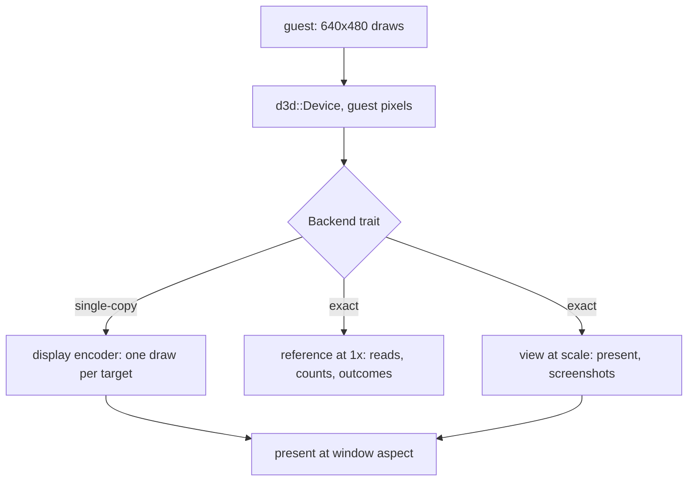

# High resolution: 4K and arbitrary internal resolution

Status: Built. The renderer supports independently sized horizontal and vertical raster grids. MSAA and forced anisotropy are not built.
Code: `crates/platform/gfx/src/raster.rs`, `crates/platform/d3d/src/scaled.rs`, `crates/platform/d3d/src/scaled/single.rs`, `crates/extensions/game/src/d3d_glue.rs`. The startup D3D log shows the configured raster and drawable; the window's performance overlay shows the latest presented raster and current drawable.
Tests: `crates/platform/d3d/tests/render_scale.rs`, `crates/platform/gfx/src/raster.rs`, `crates/extensions/game/src/render_aspect.rs`, `crates/extensions/game/src/lod_distance.rs`.
Switch: Resolution, HUD, LOD distance, single-copy readbacks and glyph smoothing are listed in [switches.md](../runtime/switches.md#settings).

The guest keeps drawing a 640x480 frame. The host renders it at a larger, per-axis scaled raster, and presents it at the window's aspect. The one rule: the guest never sees the scale. Every size, viewport, scissor, header and return value stays in guest pixels, and scaling lives below the `d3d::Backend` trait.

| Page | What it holds |
|---|---|
| this page | the scaling model, surfaces, coordinates, determinism, cost |
| [high-resolution-widescreen.md](high-resolution-widescreen.md) | the projection fit, the gather lens, the display supplement, the menu and HUD fit |
| [high-resolution-prior-art.md](high-resolution-prior-art.md) | what xemu and Halo-2-HD tell us |
| [notes](notes/high-resolution-seams-and-text.md) | seam, crack and glyph measurements |



## Output size

The play window opens at the primary monitor's aspect within 1280 x 960 logical points. Native uses the physical viewport, including Retina backing pixels, at the full window size. In fullscreen it scales both dimensions together if the viewport exceeds the 3840 x 2160 pixel budget, so on a 5120x2880 Studio Display the Resolution row reads **Native (3840x2160)** and **5120x2880** renders at full panel resolution. Explicit sizes stay fixed on resize and support up to 8192 on each axis.

The desktop shell redraws the latest frame to the resized drawable (`Shell::redraw`, `crates/apps/app/src/shell.rs`) while the game prepares its next frame. The physical rectangle in which the shell presents the frame supplies the display aspect, including when the user forces an anamorphic aspect with `--aspect` ([Video screen](../game/settings-menu.md#video-screen), [launch overrides](../runtime/switches.md#settings)).

## Summary

| Rule | Detail |
|---|---|
| Guest coordinates | the device keeps every size, viewport, scissor, header and return value in guest pixels |
| One draw per target | in single-copy mode the display encoder owns the draw stream, including draws to guest-size intermediates; guest reads sample the scaled image at guest pixel positions |
| Scales | the frame buffers, the depth buffer, the textures the game builds over both, and any render target the size of the back buffer |
| Stays at guest size | the small square targets (bloom, blur, reflection and shadow buffers) |
| One ratio per axis | 3840x2160 is 6 host pixels per guest pixel horizontally and 4.5 vertically; scissors, viewports and clears share rounded edges; fixed-size blur targets keep their texel spacing |
| Shadow maps | scale only with E3 lighting: the view keeps a scaled copy of each depth level and samples it with one tap ([e3-lighting-setting.md](e3-lighting-setting.md)) |
| MSAA, forced anisotropy | not built; both would be view-only |

In offline play the guest walk always selects retail geometry whatever the LOD setting; the display draws the chosen selection through the substituting render paths ([projected size and level of detail](occlusion-culling.md#projected-size-and-level-of-detail)).

## Terms

- **Guest pixels**: the coordinates the game uses. The back buffer is 640x480 ([d3d.md](d3d.md), "Guest structures").
- **Host pixels**: texels of the wgpu surface that stands for a guest surface.
- **Scale** `(sx, sy)`: host pixels per guest pixel, per axis. Halo 2's widescreen is anamorphic 640x480 shown at 16:9 ([app.md](../runtime/app.md), "Scaling"), so a 16:9 output wants `sx` larger than `sy`.
- **Reference** and **view**: the two backends of exact mode. In single-copy mode the view is the display encoder and the reference keeps the guest-size state.

## Widescreen projection

The guest builds its projection for 640x480 (builder at `0x0002fb70`, retail widescreen factor at `0x0045dfdc`). The host widens the horizontal terms to the window's aspect: the picture is Hor+ at any window shape and the observer's vertical field of view is kept. The detail is in [high-resolution-widescreen.md](high-resolution-widescreen.md).

| Piece | Rule |
|---|---|
| Horizontal field of view | `2 * atan(tan(v / 2) * a)` for vertical `v` and presented aspect `a` |
| Window lens | the projection's bias and scale take the window's aspect (`widen_terms`, `VIEW_PROJECTION_TERMS` in `crates/extensions/game/src/render_aspect.rs`) |
| Gather lens | the visibility, portal and object bounds take a fixed 12:5 frustum (`GATHER_ASPECT`), so every window up to 12:5 lists and draws the same clusters and objects |
| Ocean grid | the camera-attached `water_ocean` grid widens to the lens that displays the view, fitted camera or per-draw lens (`widen_ocean_grid`) |
| Wider than 12:5 | the window's own bounds; objects outside the gather lens come from the display supplement |
| Networked, lockstep, input tape | the retail terms stay |
| Menus and HUD | a uniform fit in a centred safe area; background art keeps the full view |

**Highest** requests the finest model tiers at any resolution; the structure walks keep their retail projected sizes and pixel radii. Record both settings with the timings when comparing raster cost with retail geometry choices ([lab benchmarks](../runtime/lab-runs.md#--serve-and-bench)).

## What the guest can observe

The guest sees the GPU only through values ([render-thread.md](render-thread.md), "What can move", and [d3d.md](d3d.md)).

| Channel | Where | Could scaled rendering change it? |
|---|---|---|
| Render-to-texture write-backs into guest memory | `Backend::read_surface`, `read_depth`; lazily at `BlockOnResource`, the busy check, fences, push-buffer callbacks (`0x24970`), `PersistDisplay` | Yes. These are pixels. |
| Pixel counts | `GetVisibilityTestResult` (`0x3f8630`); the lens-flare pass `0x20bb0` divides the count by an expected count | Yes. A count is a number of samples. |
| Draw outcomes | drawn or skipped: marks levels dirty, bumps the depth generation, records `Event::DrawSkipped` | Only if the view's answer were used. It must not be. |
| D3D return values, headers, device fields, viewport words | the device | No, if the device never sees the scale. |
| Fences, register words, vblank, swap count | the device and the kernel, on logical time | No. |
| Frame-buffer and depth-buffer contents | never in guest memory; a CPU read through their `Data` faults | No. |
| Textures over the depth buffer (`0x509368`, `0x50936C`) | decoded on the host; the bytes never reach guest memory | No. |

Write-backs and counts feed guest state. The push-buffer callback at `0x24970` would read target texels through `0x3fdbc0` and `0x24a70`, but its insert is never reached ([sim-render-split.md](../engine/sim-render-split.md), coupling 5). The flare reader at `0x207b0` turns a sample count into a smoothed visibility byte. See [Determinism](#determinism).

## Exact mode: reference and view

```text
 Device (guest pixels, unchanged)
    |  Backend trait: draws, clears, surface ops, reads
    v
 ScaledBackend
    |-- reference: GfxBackend at 1x   -> read_surface, read_depth,
    |                                    read_pixel_count, judge, outcomes
    `-- view:      GfxBackend at s    -> present, screenshots
```

| Class | Calls | Goes to |
|---|---|---|
| Reads and outcomes | `read_surface`, `read_depth`, `read_pixel_count`, `judge`, every `DrawOutcome` | the reference; the view never counts samples |
| Mutations | `draw`, `clear_rects`, `write_surface`, `copy_surface`, `snapshot_surface`, `create_surface`, `create_texture_target`, `surface_texture`, `depth_alias_texture` | both; handles are pairs |
| `upload_texture` | decoded once | shared by both, which share one wgpu device |
| `present` | the view presents | the reference still rotates its swap ring, because textures over the display surface read the previous frame |

What scales in the view: surfaces made with `create_surface` at the frame size (the first colour surface's, the back buffer), `PersistDisplay`'s copy, back-buffer-sized render-to-texture levels (`ScaleView::create_scaled_texture_target`) and depth aliases of the whole depth buffer (`ScaleStats::scaled_depth_aliases`). Smaller render targets keep their guest dimensions. Exact mode gives each camera its own contents, including the downsample and blur levels used by the final composite. Scissors and clears are scaled inside `GfxBackend` for a scaled surface.

A view failure (a draw it cannot make, an allocation that fails at 4K) does not stop or alter the guest. It is counted (`ScaleStats::view_errors`) and that frame is shown from the reference (`present_reference`). This differs from the render thread, where a disagreement stops the run, because there the disagreeing backend is the one the guest observes.

| Repair | Trigger | Counter |
|---|---|---|
| Replace the view's target with the reference's, each guest pixel repeated | a draw into a scaled target the view cannot make, or makes with another outcome than the reference's (logged once per kind) | `color_resyncs`, `depth_resyncs` |
| Draw again into the view's depth through a scaled colour surface of the depth's size | a draw that writes depth into a guest-size target with the scaled depth buffer bound | `proxy_depth_draws` |
| `fill_from` | guest bytes written into a scaled depth surface | |

Headless runs (`H2_BOOT_GFX` with `H2_RENDER_SCALE`) write `frame-NNNNN.png` from the view and `frame-NNNNN-1x.png` from the reference (`crates/extensions/game/src/d3d_glue.rs`, [BOOT.md](../runtime/BOOT.md)).

### Changing the scale during a run

At each present, `ScaledBackend::follow_resolution` samples the latest Native target or explicit setting for the next frame (`crates/extensions/game/src/d3d_glue/output_size.rs`). The window redraws the latest published raster at each resize. For Source aspect and Fit scaling, Native takes its presentation aspect from the current physical drawable, including while it draws a cached frame from an earlier size. The compositor and the guest's display-size query share this placement rule (`crates/apps/app/src/scale.rs`).

The backend applies a new scale at the frame boundary on the thread that presents (the render thread under `ThreadedBackend`). D3D logs each accepted raster change, including a fullscreen transition. It recreates each scaled surface at the new size, fills it from the reference, and maps the device's surface handles onto the new allocations.

At 640x480 with retail lighting and 4:3 presentation the view sleeps and the compositor shows the reference (`ScaleStats::reference_frames`). A forced widescreen aspect or stretched window wakes the exact-mode view at the same raster size: the display gets the fitted HUD and adjusted projection while guest reads use the retail reference. Single-copy draws once into its guest-size allocation for this case.

E3 lighting also keeps the view awake (shadow maps at 2x). Tests in `render_scale.rs`: `the_scale_changes_at_a_frame_boundary_with_no_fallback_frames`, `on_the_render_thread_the_change_is_made_there_and_shown_at_once`.

## Window shapes

| Aspect | Lens (`Lens::for_window`) | Uniform fit of the 640x480 canvas |
|---|---|---|
| 4:3 | `x` 1, `y` 1 | none |
| 16:9 | `x` 0.75, `y` 1 | 4:3 box, full height, 1/8 of the width as margin each side |
| 21:9 | `x` 0.571, `y` 1 | 4:3 box, full height |
| 32:9 | `x` 0.375, `y` 1 | 4:3 box, full height |
| 3:4 | `x` 1, `y` 0.5625 | 4:3 box, full width, centred vertically |
| 9:16 | `x` 1, `y` 0.316 | 4:3 box, full width, centred vertically |

`crates/platform/canvas-fit` holds the one rule that turns a window's shape into a lens and a uniform fit. The device (`UiFit::about`, `ScaledBackend::anamorphic_guest_frame`) and the hooks (`render_bridge::ui_layout`, `render_aspect::projection_factor`) all call it.

It depends on the aspect alone: a render scale of 0.5, 1 or 2 multiplies the raster, not its shape, so `(w, h)` and `(w*k, h*k)` give the same lens and fit (tests `the_lens_follows_the_aspect_at_every_render_scale` and `the_uniform_fit_is_the_largest_centred_4_by_3_box_at_every_render_scale`).

A wider window grows the horizontal lens; a narrower one grows the vertical lens. The frame is anamorphic only while the guest raster is the 640x480 canvas (render scale 1) and the presentation is not 4:3 (`canvas_fit::anamorphic_guest_frame`).

## Single-copy readbacks

The policy is selected at launch (`d3d_glue::single_copy`, `graphics.single_copy` in `crates/extensions/game/src/setting_defs.rs`). Set `single_copy = false` under `[graphics]` to request a retail reference in offline play. Boot requires the reference for network and film sessions, input tapes and lockstep. Lighting A/B captures also use a separate reference.

The frame buffers, frame-sized RTT levels and their depth attachment are authoritative at display resolution. An RTT bind shares the actual texture. Feedback and previous-frame snapshots copy it on the GPU so later writes cannot change the snapshot. The guest dimensions in `TextureInfo` still normalise texel coordinates.

The GPU decoder for 32-bit depth aliases maps guest word addresses (pitch, offset or swizzle) into the scaled depth and stencil block. Other alias layouts, and headers over a colour surface drawn into the depth allocation, decode on the GPU too. The decoder addresses guest bytes for each mip, cube face or volume slice.

For reinterpreted cube and volume textures a uniform integer grid preserves the layout; at fractional or unequal scales these aliases decode at guest size so cube faces stay square and mip chains stay valid. Guest-size intermediate draws sample these same images.

A CPU surface read, lock or writeback transfers one sample per guest pixel into a guest-size GPU surface, then uses the existing guest format, pitch and swizzle encoder. Colour, depth and stencil use the same per-axis mapping. On reduction a read selects the first host texel at the rounded guest-pixel edge.

On enlargement a host texel belongs to the guest cell bounded by those edges. Visibility counts use the same selection in the GPU coverage reduction, so a covered guest pixel contributes once at 4x. Mirror stores encode directly from the scaled image into guest-layout words.

Fixed-size intermediates keep their guest dimensions. When a draw pairs a guest-size colour target with scaled depth, both attachments must use the same raster grid. The renderer draws the pair once at guest size and transfers its modified scaled partner back on the GPU. Changing the render scale transfers the last image to the new allocation. None of these transfers needs a CPU mapping.

**Parity trade-off.** Coverage, interpolated values and the outcome of depth and stencil tests can differ at scaled sample positions. A value written to guest memory or returned by a visibility test can therefore differ from a separate 1x render. `ScaleStats` reports reference and display draw counts, downsamples and completed CPU reads. Tests in `render_scale.rs`: `single_copy_records_once_and_only_resolves_when_the_cpu_reads`, `single_copy_depth_and_stencil_read_at_guest_resolution`, `single_copy_visibility_counts_guest_pixels` and the other `single_copy_*` tests.

## Which surfaces scale

| Surface | Policy | Why |
|---|---|---|
| Back buffer, display surface, third buffer | Scale | The image. |
| Depth buffer | Scale, always with the frame buffers | Attachments must match. The depth-larger-than-colour stand-in (`prepare_target`) scales both sides. |
| Textures over the frame buffers (`0x509354`, `0x509358`; `snapshot_surface`) | Scale: the snapshot is a copy of the scaled buffer | Current-frame feedback and the previous-frame crossfade sample them in screen space. |
| Textures and the colour surface over the depth buffer (`0x509368`, `0x50936C`, `0x509370`) | Scale: built from the view's depth buffer | The menu's fog and distortion pass reads depth per pixel. Made on the GPU (see "Depth as a texture"). |
| A render-to-texture level the size of the back buffer | Scale | Halo-2-HD reports one such intermediate, texaccum ([prior art](high-resolution-prior-art.md)). Left at 640x480 it would undo the feature. |
| Fixed-size square targets (the `0x14850` 64x64 pair, the 128x128 and 512x512 targets seen in the first level) | Do not scale | Bloom and blur kernels are measured in texels. Scaling the target shrinks the blur on screen. |
| Shadow maps (depth levels bound as `pNewZStencil`, sampled as `LIN_D24S8`) | 1x with retail lighting. With E3 lighting the view keeps a copy at the rounded vertical scale, at least 2x (`d3d::scaled::shadow_scale`), sampled with one tap ([e3-lighting-setting.md](e3-lighting-setting.md)) | The comparison indexes the host texels it has (`textureDimensions`) at the guest's coordinate, so a bigger map needs no shader change; a sharper map with retail's 2x2 filter alone only narrows the soft edge. |
| Ordinary textures | Never | They are the game's assets. |

A render-to-texture level is classified by its guest size against the back buffer's guest size, checked when the host surface is created. An allow-list by render-target index (`0x14bc0` selects targets by index) is the fallback if a level needs an exception.

### Mixed-scale sampling

A draw can sample a scaled surface into an unscaled target; the first downsample of a bloom chain does this. In single-copy mode a mixed draw runs once at guest size: `ScaledBackend::guest_image` samples the scaled partner to its guest-size handle (`ScaleStats::downsamples`), and a scaled partner that the draw modified is transferred back on the GPU (`crates/platform/d3d/src/scaled/single.rs`, `draw_single`). In exact mode the reference and display each draw the chain from their own frame, both downsampling to the same guest dimensions.

The display then composites its own blurred image, keeping highlights aligned with their sources at each raster resolution. The guest texture header supplies the texel dimensions for UV normalisation, and the compositor supplies the final drawable extent after the frame is complete.

### Depth as a texture

Each camera decodes textures over its own depth or colour attachment. The texture header supplies the guest byte offset, dimensions and pitch or swizzle. The decoder maps each addressed guest texel to the source attachment's physical grid, including subrectangles and headers that reinterpret texaccum or the colour surface drawn over the depth allocation. The GPU paths are `gfx::guest_words::GuestWords` for aligned depth words and `gfx::surface_alias::AliasDecoder` for the other layouts. `crates/platform/d3d/tests/gpu_depth_alias.rs` checks a partial feedback alias against the two cameras at full and three-quarter raster.

Those textures hold packed bits and are point sampled at any scale. A stage that samples one with a linear filter is already wrong at 1x.

## Coordinates

### Positions

Translated vertex programs output guest window coordinates, and the fixup maps them to clip space with the guest target size (`VertexUniforms::surface`, [shaders.md](shaders.md), "Position fixup"). Nothing in that mapping depends on the host size. The built-in pre-transformed shader inverts the guest viewport the same way. So `surface` stays the guest size and the rasteriser does the rest.

- **Subpixel truncation.** At 1x the fixup truncates x and y to 1/16 of a pixel, as the NV2A does. Scaled, it does not truncate at all (see "Subpixel snapping and cracks").
- **Slope-scaled depth bias.** The W-buffer path computes the polygon offset from screen-space derivatives (`max(|dpdx|, |dpdy|)`). Derivatives per host pixel shrink by the scale, which is correct for a bias per sample step, but decals tuned at 480p need a test.
- **Stipple.** The translated fragment shader maps each host pixel to the guest framebuffer cell bounded by the same rounded edges as a scissor, using the guest and host dimensions of the bound target on each axis. A host pixel centre exactly on a guest edge takes the preceding cell's mask bit. The mask stays anchored to the framebuffer's top left when the viewport or scissor moves. See `SetStipple` in [d3d.md](d3d.md) for the row and bit order.

### Subpixel snapping and cracks

Two draws transform the same world vertex and land a few ulps apart in window coordinates (a different material's vertex program, or the host compiler contracting the same `dp4`s differently in two pipelines; the route is not confirmed in a capture). The NV2A, and the fixup at 1x, truncate x and y to 1/16 of a guest pixel. Where the exact value sits just under a grid line, a few ulps move one copy a whole step, and the two sides of a seam disagree by 1/16 of a guest pixel along the whole edge.

At 1x that sliver covers about one pixel centre in sixteen along the seam (retail's occasional sparkle). At render scale `s` it is `s/16` of a host pixel wide (a quarter at 4x, three eighths at 6x), so it covers that share of the host pixels along the seam: a dashed see-through line. A T-junction on the guest's grid behaves the same. The BSP meshes themselves are closed, so the crack is the projection, not the mesh.

**The view does not truncate.** Scaled (`VertexUniforms::shift` above 0), `xvs_fixup` passes x and y through unrounded and the host rasteriser's own sub-pixel precision (at least 8 bits, 1/256 of a host pixel, on Metal and D3D11-class hardware) decides coverage. Two copies a few ulps apart then disagree by about 1e-5 guest pixels, which covers no sample in practice. The built-in pre-transformed shader never truncated. At 1x the expression is unchanged (the `select` takes the truncated value), so the reference, and everything the guest can observe, is identical. The shift's tie-free sampling holds without the grid: host samples sit `(k + 1/4) / s` from a guest pixel centre, so an edge a few ulps off a centre covers the same samples as one on it.

Snapping to 1/16 of a host pixel instead only narrows the sliver. `crates/platform/d3d/tests/seams_gpu.rs` measures it at 2x to 6x; the numbers and the mesh survey are in [the notes](notes/high-resolution-seams-and-text.md).

| Alternative | Why not |
|---|---|
| MSAA | narrows a sliver, does not close it, and costs every pipeline ("Filtering, anisotropy and MSAA") |
| Conservative edge expansion | fattens every edge, alpha-blended ones too |
| T-junction repair on the D3D path | there are none in the drawn world, and the guest's index buffers cannot be changed |

A renderer that owns the world geometry (the native renderer) loads the same welded mesh. It should draw shared edges from one vertex buffer with one position transform for every material, and not snap, so seams match bit for bit.

### Which grids the native frame owner draws

The frame owner draws a sealed scene on the display's own grid when `RenderScale::replayable_display` accepts it (`crates/platform/gfx/src/raster.rs`): no axis minifies, none magnifies past twice `MAX_SCALE` (12x), and the pixel count is at most `MAX_SCALE` squared times the guest's. Whole numbers are not required; the final copy samples the fractional grid. 3440x1440 is 43/8 across and 3 down, and 5120x1440 is 8 across and 3 down. Both are owned; a window under 640x480 on an axis, or 8x8 or beyond, runs the guest's commands. Private PNG capture (`render.capture`) and `render.parity` draw on the same grid: `DisplaySize::scale` (`crates/extensions/game/src/frame_owner.rs`) takes the grid from the guest's present target to the Swap's surface and applies the same test, so 3440x1440 and 5120x1440 capture. Tests: `ultrawide_outputs_are_replayable_displays`, `captures_accept_the_ultrawide_display_grids`.

### Scissor, clears and viewport

`Draw::scissor`, `ScissorRect` clears and `Draw::viewport` are in pixels of the target. The view maps their endpoints on each axis. For an integer scale this is exact. At a fractional scale each edge rounds with the same function (`floor(edge * s + 0.5)`), so the disjoint pieces of a split scissor stay disjoint and gapless ([d3d.md](d3d.md), `clip_rects`).

### Half-pixel and texel offsets

The game and D3D put half-pixel offsets in the viewport offset constant, and the pre-transformed path adds its own (`FF_HALF_PIXEL`). These are lengths in guest pixels, so a 0.5 guest-pixel offset is `0.5 * s` host pixels. Unshifted, they move geometry half a guest pixel off the scaled scissors and clears, and the screen's first row and column stay empty. The view shifts positions to fix it ("Half-pixel shift").

It matters for screen-space copies. A pass that maps guest pixel centres onto guest texel centres with a shift of `d` guest texels lands a host pixel centre on a host texel centre only when `d * s` is an integer:

| Case | Result |
|---|---|
| 1:1 copies (`d` an integer) | exact for any integer scale; point sampling is safe |
| Half-texel taps (`d = 0.5`, the usual four-tap box blur with bilinear filtering) | texel centres at even scales, corners at odd ones; with a linear filter a narrower blur than retail; with a point filter at an odd scale the tap picks a neighbour and a seam appears (xemu issue 1771) |
| Fractional scales | not every guest-texel offset is a whole host texel, so a translated point tap can select an adjacent sample |

Feedback snapshots on equal-size surfaces copy exact host texels. Explicit guest readbacks, fills and mixed-size surface transfers use a separate nearest-cell mapping for each axis. Small filter targets operate on their guest raster. Arbitrarily shifted point taps in retail draws still need a live comparison.

Three rules follow:

1. Texture-size uniforms take the guest size: `tex_scale` for texel-addressed (`LIN_`) textures, and the stage dimensions the engine writes into vertex constants ([shader-instances.md](../formats/shader-instances.md), "Engine inputs"; those come from guest slots and need nothing).
2. Code that indexes texels uses the host texture's real dimensions for the index and the guest size for the coordinate. The shadow comparison (`floor(uv * size)`, [shaders.md](shaders.md), "Shadow maps") is the one known case and matters for E3 lighting's scaled shadow maps.
3. Passes whose source and target are both unscaled are untouched, which is the main reason to leave the blur chain at guest size.

### Half-pixel shift

On each magnified axis at scale `s`, positions move by `(2s - 1) / (4s)` guest pixels (`gfx::renderer::window_shift`, `VertexUniforms::shift`, the built-in shader's `shift_x/y`), with no 1/16 truncation. The shift is zero on an axis at or below 1x. The reference retains retail snapping.

D3D-convention geometry puts edges, and the texel corners of a 1:1 copy, exactly on pixel centres, so at 1x the tie rules decide. Scaled without a shift, a full-screen quad leaves the first host column and row empty (xemu issues 57 and 508) and a point-sampled 1:1 copy reads the neighbouring texel. With the shift, at uniform integer scales the `s x s` host pixels of a guest pixel sample it at offsets `(k + 1/4) / s`, all inside the pixel and none on a tie.

An edge on a pixel centre then covers whole blocks, the top-left rule included, and a 1:1 copy reads the texel 1x reads. A shift of exactly `(s - 1) / (2s)` puts the first sample on the tie and fails at 3x through rounding; the extra quarter is what makes it reliable.

The shift moves everything up and left by `(2s - 1) / 4` host pixels. Geometry that ends on the target's far edge instead of a pixel centre (the D3D 1:1 texel mapping, a quad from -0.5 to the size less 0.5, which the menus use to composite their blurred level) would stop short of the last host columns. A scaled draw therefore holds any position past the last pixel centre at least on the far edge (`xvs_fixup`, the built-in shader).

At 1x those positions all cover the last pixel exactly as the edge does. Test: `a_full_screen_pass_reaches_the_far_edges_at_every_scale`.

## Post-processing

The retail post chain is known by its targets, not by what each pass does: the two 64x64 targets built at `0x14850`, 128x128 and 512x512 targets in the first level, the previous-frame crossfade (`0x002ab270`) and the depth-based fog and distortion pass on the menu. Fixed-size blur targets keep their guest texel grids. Frame-sized intermediates and feedback copies use the display grid (`crates/platform/d3d/src/scaled.rs`).

A frame-sized copy bypasses the widget fit in draw resolution. The motion sensor's wash, tint and composite fans (`crates/rewrites/engine/src/ui_backdrop.rs`) draw the sensor at its HUD placement.

Failure modes to test for, all seen in xemu above 1x ([prior art](high-resolution-prior-art.md)): bloom that ghosts or shrinks, history or intermediate buffers kept at 1x while the scene scales, a row or column of garbage at the screen edge, and water and texture seams.

## The game's 640x480 assumptions

Because the guest keeps its 640x480 back buffer, the game's own arithmetic stays valid. Halo-2-HD raises the guest's own resolution and so had to patch each of these.

| Area | Behaviour |
|---|---|
| Viewports | `0x14bc0` calls `SetViewport` with the selected target's extents, and split screen uses smaller ones. The device mirrors the viewport words in guest pixels. |
| Scissors | `SetScissors` (`0x3f8760`) and the device's scissor region work in guest pixels and the view scales the result. A fitted draw's clip edge on the canvas boundary (0 or 640/480) of a shrunk axis maps to the display boundary (`UiFit::map_rect`), so a full-canvas clip spans a wide window; interior edges are fitted. |
| HUD and UI | one fit rule, below |
| Loading screens and movies | the compositor presents the supplied frame at the selected display aspect; menu and HUD fits apply inside their draw scopes |

### HUD and UI

Widget bounds are in a 640x480 frame ([ui.md](../formats/ui.md)). One rule places every draw: `canvas_fit::anchor_fit`. A group of draws is held at an anchor of its view (`canvas_fit::Anchor`), its artwork is scaled uniformly, `min(w/640, h/480)` display pixels per guest pixel (`uniform_scale`), about that anchor, and the anchor lands the same way everywhere:

| Anchor | On each axis it lands |
|---|---|
| a corner or an edge's middle, at a view edge | on the window's edge when the HUD layout is `Pinned`; on the edge of the safe area, the centred 4:3 box, when it is `Centered` |
| an edge's middle or the centre, at the view's middle | on the window's middle |
| a point the game projected (the crosshair, a tracked mark) | where it is, moved with the widened lens |

```
 4:3                     16:9, pinned                    16:9, centred
+-TL----T----TR-+   +-TL---------T---------TR-+   +----TL----T----TR----+
|               |   |                         |   |    :           :    |
L       C       R   L            C            R   |    L     C     R    |
|               |   |                         |   |    :           :    |
+-BL----B----BR-+   +-BL---------B---------BR-+   +----BL----B----BR----+
```

| Draws | Anchor | Code |
|---|---|---|
| menus and screens | the centre | `ui_layout::menu_fit` |
| a HUD group, and so each widget of ours the game's HUD draws (the HUD kit's) | the game's own id for the group: 0 to 3 the corners clockwise from the top right, 4 and up a projected point (`Anchor::hud`) | `ui_layout::hud_fit`, at `HUD_LAYOUT_ANCHOR_READY` |
| the message group's centred lines: the timed line and the respawn timer (`0x0024d51f` to the group's end) | the bottom's middle. The group is laid out from the top-left anchor for its prompt line and notification list, and draws these two centred in a rect as wide as the frame, 40 above its bottom | `ui_layout::group_fit`, at `HUD_MESSAGE_CENTRED_LINES` |

No widget or group has an aspect offset of its own. The same module answers whether a window has the canvas's shape and how far it stretches it (`is_canvas_shape`, `stretch_ratio`); the projection fit and the glyph pages' density take their aspect from it. At 4:3 every fit is the identity. Tests: `every_anchor_keeps_its_place_and_the_uniform_scale_at_every_aspect` (`canvas-fit`: every anchor at 4:3, 16:9, 21:9 and 9:16), `every_hud_anchor_lands_where_retail_holds_it_at_every_aspect` and `a_line_centred_on_the_frame_stays_on_the_windows_centre_line` (`render-bridge`), `the_message_groups_centred_lines_stay_on_the_windows_centre_line` (`game::render_aspect`). At 21:9 and 32:9 the menu is the centred 4:3 box at the window's full height, a pinned group keeps its window corner at that scale, and the crosshair stays on the centre (test `ultrawide_windows_keep_the_uniform_scale_and_the_corners`).

Each draw records the fit before it moves to the GPU thread. A fit change first drains the push buffer under the old fit (`Device::set_ui_fit`). When an undelivered guest callback stops that drain, the change is queued at the push-buffer address that was PUT when it was asked for, and the drain switches there once the callback has run. Commands written before the change keep the old fit and later draws take the new one (test `a_fit_change_held_back_by_a_callback_starts_after_the_commands_before_it`).

The runs the overlay draws take the same fit at their pass: the run places its positions and clips by the fit the placed draw carries (`game::hud_overlay::fit_overlay`), so its widgets land in the safe area with everything else. A menu quad that is background art keeps the full view, so the menu covers the display while its widgets keep the uniform fit. A generated game image includes the interior UI entries for these scopes; regenerate a pre-existing image to pick them up.

Two things remain:

- **UI atlases.** A linearly filtered bitmap drawn 1:1 at 480p is magnified at a higher scale, and neighbours in an atlas can bleed in at its edge (xemu issue 602 reports bleeding from 2x up, which may be this). It needs a capture-based test before a fix.
- **Lines and points.** wgpu lines are one host pixel wide, so they get thinner. Point sprites are not implemented; expanded to quads in guest window units they would scale for free. Whether Halo 2 draws lines in retail paths is not known.

## Filtering, anisotropy and MSAA

**Mip selection** needs nothing. The host computes derivatives per host pixel, so a scaled target picks sharper mips by `log2(s)` and bottoms out at the top level. The engine's own LOD inputs (`MIPMAPLODBIAS`, `MAXMIPLEVEL`, the per-draw LOD term) are guest state and stay.

**Anisotropy.** The sampler is anisotropic only when the guest asks (`gfx::translate`: an `Anisotropic` filter with `MAXANISOTROPY` above 1). A view-only override (not built) may raise the clamp on a stage when all of these hold:

- the guest's min and mag filters are linear and it has a mip filter;
- the texture is an ordinary uploaded texture, not a surface, snapshot or depth alias;
- the format is not a depth format, a palette index or a `HILO` pair, and the stage has no `COLORSIGN`;
- the texture mode is a plain projective fetch, not a dependent read (bump-env, dot-product modes).

Everything excluded is data, not an image, and filtering it differently changes shading. The override changes the pipeline's sampler key, so it must not create new pipelines per draw.

**MSAA.** Halo's device is not multisampled ([d3d.md](d3d.md), "Swap"), and the guest's `MULTISAMPLE*` states stay as the game set them. Host-forced MSAA on the view is the weaker tool:

- alpha-tested edges (foliage, grates) are not smoothed, since the translated programs emulate alpha test with `discard`;
- every snapshot and depth alias needs a resolve first, and depth has no meaningful average;
- render-to-texture surfaces have no MSAA in `gfx`;
- the W-buffer path writes `frag_depth`, which is per pixel, not per sample;
- the sample count is part of the pipeline key, so every pipeline compiles again, at about 220 ms per Metal pipeline on a cold cache ([gameplay-budget.md](../perf/notes/gameplay-budget.md)).

Supersampling through the scale handles all of those uniformly. MSAA (not built) would be an option for hosts that cannot afford the fill, and must never reach the reference, where sample counts are guest-visible.

### Text

All text comes from one texture, the glyph cache ([fonts.md](../formats/fonts.md), "Glyph cache texture"): glyphs rasterised at 640x480 sizes into a 256x256 `LIN_A4R4G4B4` texture with 3-bit antialiased alpha, drawn 1:1 with screen-aligned quads. Magnified by the guest's filter that text is soft (bilinear) or stair-stepped (point), whatever the scale. The view redraws it from the same texels.

| Stage | Behaviour |
|---|---|
| Detection (`d3d::glyph`, guest side of each draw) | a stage's texture is the glyph cache when it is 2D, `LIN_A4R4G4B4`, 256x256 with one level, and its header is the texture the game's own glyph-cache bitmap names (`[0x4B62AC] + 0x50`); the draw carries the stages as `ResolvedDraw::glyph_cache` |
| Filter (`shaders::psh::GLYPH_WGSL`) | only where the target's scale is above 1 (`Nv2aShaders::prepare` sets `PixelOptions::glyph`), so the reference and a 1x run compile the programs they always did |
| Storage | none: the upscale is computed per fragment from the texture the game already uploads, so a glyph the game adds to the cache is sharp on the next draw |
| Switch | off by default (`d3d::glyph::smoothing_from`); `H2_SMOOTH_TEXT=1` (or `on`, `true`) turns it on; `Device::set_glyph_smoothing` does the same in tests |

The filter reads the 6x6 texels around the sample and rebuilds the edge from the alpha as coverage: a cubic B-spline of the alpha, thresholded at half the local stroke alpha (the same spline through each texel's brightest neighbour) with a ramp one host pixel wide (host pixels per texel from the derivatives). Straight edges keep their position, curves come out round, and thin strokes that never covered a whole texel keep their weight. Where a texel covers at most 1.25 host pixels the guest's own sample is used.

At 2x to 4x the edge position error is 0.19 to 0.39 px against 0.28 to 0.65 px for bilinear and 0.88 to 2.22 px for point, and the area drawn wrong falls to between a quarter and a half of either ([notes](notes/high-resolution-seams-and-text.md)). At 1x and in the reference at every scale the image is byte-identical with the filter on and off (`crates/platform/d3d/tests/glyph_text.rs`).

**The atlas.** The text runs the overlay draws use the disc's font data ([fonts.md](../formats/fonts.md)) instead of the game's cache, rasterised once per glyph into the renderer's own pages at the display's density (`game::hud_overlay::fill_glyphs`, `font::coverage::upsample`). The resample is computed once per glyph on the CPU: the coverage read as a Catmull-Rom surface through the texel centres (a one-texel stem keeps its alpha), the edge put back where it crosses half the local stroke's alpha, with a ramp one output texel wide. A page texel then draws near 1:1 and the runs sample their pages point-wise (`OverlayMaterial::text`), so the text keeps the bitmap font's outline at any density, with no magnification of 480p-sized texels and no per-fragment filter cost.

The scale is the canvas's uniform fit rounded up to whole texels (`hud_overlay::atlas_for`), capped at 8 where a page would stop holding a screen's glyphs. A window of another size rasterises the pages again on its next text run, and the residency drops the old ones with the assets' generation.

Risks: another texture with the cache's shape at the header the game's glyph-cache pointer names would be filtered as text; a build of the game with the pointer elsewhere gets no smoothing. Text the game draws through a render-to-texture surface smaller than the frame stays at 1x like the rest of that surface. The view's half-pixel shift moves the redrawn text by the same fraction of a pixel as everything else.

## Determinism

Boot selects exact readbacks when it installs networking, arms a film recorder, plays a film, or enables lockstep or an input tape. The 640x480 reference supplies texels, depth, stencil and visibility counts using the retail lens and HUD coordinates. The window presents its own resolution, aspect and HUD layout.

Boot selects this policy before the first frame, including time in the menu before a player joins System Link, Live or co-op, because changing a display cannot repair a pixel or visibility count the guest has already consumed. The same reference applies when the user requests single-copy mode.

| Session | Readbacks | Camera the guest sees |
|---|---|---|
| Offline, single-copy (default) | sample the display raster | the window's lens, gather lens |
| Offline, `single_copy = false` | the 640x480 reference | the window's lens, gather lens |
| Network, film, input tape, lockstep | the 640x480 reference | the retail terms (lockstep and tapes register no fit); the render's own random stream |
| Headless sim, dedicated host | none | no display-aspect hook installed |

Resolution is a Host setting. A film viewer chooses the display raster independently of the recorded guest. The Video row itself writes its label into guest memory, so local films record each size the row or picker observes and replaying a trip through Settings shows the same choices on another monitor ([film playback](../game/film-format.md#choosing-a-players-view)).

Every session keeps retail geometry selection on the guest and reference path. The display choice changes only the drawn geometry, through the native display passes and, in single-copy rendering, the D3D fallback's draw-boundary swap (whose records and palettes are per-frame render scratch). The native opaque object pass builds supported display sections on a private overlay and submits them to the display attachments.

The overlay keeps the guest object pose, lighting cache, palette and residency writes private. Marker lookup reads the live object's node matrices, and film and lockstep checkpoints hash the live arena; both are retail whatever the setting. Films with a scalar render scale and LOD selection reproduce that startup multiplier on the reference.

See [private model sections](../../crates/rewrites/render-bridge/src/native_scene_lists/setup.rs), [marker lookup](../../crates/rewrites/engine/src/sim_native/marker.rs) and [the arena hash](../../crates/extensions/lockstep/src/lib.rs).

The observer produces the vertical field of view from player control. Aim search and shot assistance use weapon tag angles and zoom, and the distributed shot path can use transmitted aim data. Resolution and HUD position supply neither input. See [aim assist](../game/aim-assist.md) and [field of view](../game/settings-menu.md#field-of-view).

In exact mode the original object gather stays authoritative. Per-visible-object setup can reach animation variant selection through `0x00133790`, `0x000bd610` and `0x001cb410`. With the animation manager's gameplay RNG bit set, the selector writes the shared seed at `0x001dd6e1`.

The pose evaluation at `0x000bd7b2` computes the object's shared node matrices and clears its dirty bit, and marker lookup reads those matrices. Changing which objects enter that loop could change a later simulation tick, so the tick builds every dirty pose at its end (`crates/rewrites/engine/src/tick_poses.rs`) and the setup finds none to evaluate ([sim-render-split.md](../engine/sim-render-split.md), "2. Node matrices"). A guest camera fitted to the window keeps the simulation's inputs the same in every window:

- **Random numbers.** Every world frame renders on a private random stream (`crates/extensions/game/src/render_rng.rs`): `RENDER_FRAME` swaps the shared seed (`[0x004e7408]`) for the render's own and puts the simulation's back when the frame ends. Boot registers it for every session that renders (lockstep, input tapes and games of several machines included), so a recording and its replay, and every peer of a game, take it alike whatever window each had. A headless host renders nothing and registers nothing. Theater's camera enters the same stream; a frame is entered once.
- **Object setup.** The guest sets up the objects its frustum lists, and the frustum is the gather lens in every window up to 12:5 ([Widescreen projection](#widescreen-projection)): a function of the simulation's state and the view alone. In a wider window the frustum is the window's, and the setup of a main-view object outside the gather lens's set takes the "not drawn" exit before any of it runs (`outside_gather_lens` in `crates/rewrites/render-bridge/src/native_scene_lists/setup.rs`): no section choice, pose evaluation, animation selection, palette or record. That set is the Rust visibility at the view record's retail camera widened to the gather lens (`scene_step::gather_lens_object`). A menu model view (`MODEL_VIEW_CALL` to `MODEL_VIEW_RETURN`, the Choose Profile Spartan) has its own camera, so no lens test applies and setup runs for every object in it.
- **Supplement.** The display supplement draws the skipped objects from the mounted model on a private overlay (`DisplayVisibility::guest_lens`): their opaque layer alone, each object on its own, so one still compiling its pipelines or with a part the supplement cannot plan is absent without the others. Every object keeps its retail section choice: the LOD pixel scale `0x004b9ed0` is the projection's `+0xbc` word, and the fit writes only the horizontal terms. `render.scene` counts the objects left undrawn (`scene_guest_lens_objects_skipped`, zero in a window up to 12:5) and the views whose gather set declined (`scene_guest_lens_gather_declined`); such a view's setups run as the window's frustum lists them.
- **Readbacks.** The reference copy draws the guest's camera, so with the fit its pixel counts and write-backs see the widened view: the flare reader's visibility byte (`0x207b0`). It feeds only later draws.

What must hold in exact mode, and how each is checked:

| Requirement | Check |
|---|---|
| The device's code path does not depend on the scale | The scale is not visible above `Backend`. `the_guest_sees_the_same_answers_at_every_scale` compares a plain backend with the wrapper at 1x, 2x and 4x: the count, written-back bytes, guest memory and skipped draws. |
| The view never writes guest memory, the logical clock or the scheduler | It holds no guest handle, like the render thread. |
| The view never causes a guest-visible wait | Its work is not on the class-1 read path. Any wait is on wall time and charges no logical time ([render-thread.md](render-thread.md)). |
| View errors do not surface as backend errors | They are counted, and the frame falls back (`a_draw_the_view_cannot_repeat_shows_the_reference_not_a_hole`). |
| Screenshots used as goldens come from the reference | `H2_BOOT_GFX` PNGs and capture snapshots stay 1x unless asked. |

## Cost

Pixels and attachment memory for the scaled set (three frame buffers at 4 bytes a pixel, one depth buffer at 8, one snapshot and one resolve in flight):

| Internal size | Scale | Pixels | vs 640x480 | Scaled attachments |
|---|---|---:|---:|---:|
| 640x480 | 1 x 1 | 0.31 M | 1 | about 9 MB |
| 1280x960 | 2 x 2 | 1.23 M | 4 | about 34 MB |
| 1920x1440 | 3 x 3 | 2.76 M | 9 | about 77 MB |
| 2560x1920 | 4 x 4 | 4.92 M | 16 | about 138 MB |
| 3840x2160 | 6 x 4.5 | 8.29 M | 27 | about 232 MB |
| 3440x1440 | 5.375 x 3 | 4.95 M | 16.125 | about 139 MB |
| 5120x2880 | 8 x 6 | 14.75 M | 48 | about 413 MB |

A frame-sized colour target adds four bytes per pixel: 33.2 MB per target at 3840x2160 and 59.0 MB at 5120x2880.

- **GPU.** Fragment work on scaled targets grows with the pixel count; work on unscaled targets does not. Snapshots are full copies of the back buffer (about 44 MB each at 3840x2880), and the menu's five a frame ([menu-budget.md](../perf/notes/menu-budget.md)) are the first thing to measure on GPU-visible copies.
- **CPU.** Single-copy mode records each scaled draw once. Exact mode repeats per-draw work (uniforms, bind groups, recording, encoding, submission) on the second backend but not push-buffer decode, draw resolve, texture decode or shader translation. Timings are in [menu-budget.md](../perf/notes/menu-budget.md) and [render-thread.md](render-thread.md).
- **Readbacks.** The view adds none; single-copy mode resolves CPU reads on the GPU at guest size.
- **Counts.** In exact mode the count pass (a second draw into an `R16Float` target against a scratch depth copy) runs only on the reference.

## Tests

No test needs a game build. Tests invent their data; captures from the owner's runs stay in `$TMPDIR` and never go into Git. GPU tests skip when no adapter exists.

| File | Covers |
|---|---|
| `crates/platform/d3d/tests/render_scale.rs` (headless wgpu) | the guest sees the same answers at every scale; the view's frame box-filtered equals the reference except on geometry edges; only frame-sized surfaces scale; legacy scale overrides outside 1 to 6 are rejected; frame-sized targets, small targets with the scaled depth buffer, depth-level fills, the depth buffer as a texture and colour over depth memory match the reference downsampled; scale and lighting change at a frame boundary; the stipple mask stays aligned in exact and single-copy mode; the E3 shadow-map and `single_copy_*` tests |
| same file, `fractional_per_axis_surfaces_keep_fullscreen_edges_and_guest_answers`, `fractional_clears_and_scissors_tile_the_same_texels`, `fractional_feedback_preserves_patterned_guest_cells_and_snapshot_lifetime` | unequal fractional axes, including a 149x101 surface for a 64x64 guest frame |
| `crates/platform/d3d/tests/seams_gpu.rs` | clear-colour pixels inside a mesh with T-junctions and a one-ulp seam, at 2x to 6x |
| `crates/platform/d3d/tests/glyph_text.rs` | the glyph filter against a synthetic cache |
| `crates/platform/d3d/tests/gpu_depth_alias.rs`, `external_pass.rs` | depth aliases and external passes through `ScaledBackend` |

Whole-frame retail capture replay has no test coverage.

## Open slices

The wide view's remaining work, in order:

1. **Supplement objects past 12:5.** In a 32:9 window the objects outside the gather lens draw their opaque layer alone (`native_objects_glue/display.rs`): no accumulation layer of their own (a part sampling it reads what is behind the object), no dynamic lights, shadows, decals or transparent parts. Either the film records the gather lens it was made with, so each session gathers through its own window, or the supplement draws layer 1 before layer 3.
2. **Networked games.** A game of several machines keeps the retail gather and shows the sides through the display supplement (`VisibilityLens::Display`), with the same object limits and with clusters left out whole when a layer has no display draw. The gather lens needs every peer to take it.

## Not verified

- The gather lens in a running game: that a guest frustum wider than its projection draws every layer correctly at 4:3, 16:9 and 21:9, what it costs in frame time, and that a film recorded in one window replays in another ([theater.md](../game/theater.md), "Experiment 3").
- Cross-machine and film tick-hash parity for the same input across window sizes and HUD settings. Exact mode isolates the display-dependent inputs; it does not establish cross-driver raster equivalence.
- Texaccum, refraction, active camouflage and water may derive projective texture coordinates independently of the clip transform. A synthetic shader covers a lookup derived from the corrected clip X and W. To check, compare a high-contrast surface at the same tick at 4:3 and ultrawide, and use the agent API's `render.frame` and `render.capture` to find the producer of any displaced lookup and its projected coordinates after division by W. `render.frame {"arm":true,"draws":true}` names each program draw's clip source and lens (`vs`: `clip=rows(b)`, `far(b)`, `fixed` or `unknown`, `lens=x<f>`). `lens` appears only on a view that keeps the retail camera (a game of several machines), where the device's per-draw lens widens each draw; there a scene draw on a wide display with `clip=unknown` and no `lens` is the one drawn at the retail width. A fitted single-machine view widens the camera itself, so no draw carries `lens`. A correction belongs on the display's screen-space lookup; asset UVs and the retail reference keep their mapping.
- Fractional and odd-scale point taps in retail water, fog and feedback draws. A half-texel-shifted point sample can select the adjacent texel.
- HUD corner ownership, projected markers and scissor alignment in split screen, cinematics, zoom and ultrawide combat. CPU-positioned effects can disagree with geometry at the sides of a wide view.
- Whether Halo 2 draws lines outside debug paths.
- The CPU cost of exact mode's second backend on current master.
- Whether the back-buffer-sized target that Halo-2-HD reports is the only full-screen intermediate in our captures.

## Related

[d3d.md](d3d.md), [render-thread.md](render-thread.md), [e3-lighting.md](e3-lighting.md), [shaders.md](shaders.md), [settings-menu.md](../game/settings-menu.md), [high-resolution-widescreen.md](high-resolution-widescreen.md), [high-resolution-prior-art.md](high-resolution-prior-art.md), [notes](notes/high-resolution-seams-and-text.md).
