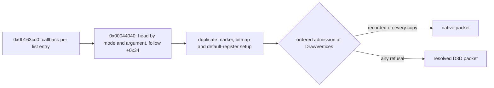

# Native decals

Status: Built. All seven decal modes are admitted through `d3d::DrawAdmission`; pixel parity with D3D is not verified.
Code: `crates/rewrites/render-bridge/src/native_decals.rs`, `crates/extensions/game/src/native_decals_glue.rs`, `crates/rewrites/native-render/src/decal.rs`, `decal_gpu.rs`. Tests: `crates/rewrites/render-bridge/tests/native_defaults.rs` (switch), `crates/rewrites/native-render/tests/decals_gpu.rs`.
Switch: `impl.render.native` (on), listed in [switches.md](../runtime/switches.md).

The guest keeps the decal array, the per-record texture binds, the duplicate markers and the wrapper's state. The stage replaces only the resolved `D3DDevice_DrawVertices` packet of each record. Addresses and offsets below are research points from the guest code (**Code**, `h2 disasm`), not game data. Part of [native-renderer.md](native-renderer.md).

| Piece | Owner |
|---|---|
| decal array, texture binds, duplicate markers, wrapper state, final solid-offset reset | guest |
| the resolved draw packet of each record | native stage, through `d3d::DrawAdmission`; D3D when any copy refuses |
| modes 0 to 6 | one admission each; depth, bias and blend per [Effective render state](#effective-render-state) |

## How it works

### The sorted-list handlers are not decals

The sorted transparent list calls the handler in each entry at `+0x20` with `entry+0x24`, in the order of its sort (`0x0001e370`). The two handlers below replay object and model scene layers. Neither is a decal boundary, and no decal implementation may suppress them.

- `0x000420a0` adds class-3 entries with handler `0x00041cc0` for records
  whose `+0x1c` is 1. Its payload is a count followed by layer IDs. The
  handler calls `0x00044c90` for each of those layers, then replays layers
  **1, 3, 8, 20, 7, 2, 16, 18**, conditionally **19**, then **15**.
- `0x00042760` adds class-3 entries with handler `0x000423c0` for records
  whose `+0x1c` is 3. Its payload is `(layer index, caller argument)`. The
  handler calls `0x00044c90` for that layer, then replays **1, 3, 8, 7, 2,
  16, 15, 21**.

The normal visibility pass (`0x00040e90`, at `0x00040f2f`/`0x00040f46` and `0x00040f35`/`0x00040f4c`) calls their list builders. The records at `0x004c152c` come from `0x0002cbf0`: the BSP and instanced-geometry producers store `-1` in the field tested as `+0x1c`, and the object producer at `0x001341d0` stores `[part+0x1c4]`. `0x00044c90` then walks the object render records in record and increasing part order through `0x00045ce0` and `0x00041040`. These handlers therefore have no single geometry format, depth state or blend state.

The replayed layer setup uses `0x00015370(1)` for layers 1 and 3 (stencil `ALWAYS`, reference and masks `0xff`, pass `REPLACE`, fail and z-fail `KEEP`) and `0x00015370(0)` for the others (stencil disabled). The earlier direct `0x00044c90` calls inherit their state.

### The dynamic decal path

`0x0017d220` initialises the runtime decal array through `0x00043890`. The construction at `0x00180f87` obtains a dynamic geometry address from `0x000439d0`. The renderer is `0x00044040`, not either sorted-list handler.

`0x0002c370` (`points::RENDER_DECAL_MODE`, EAX the mode) is the only caller of the state wrapper `0x00043a40` and supplies `0x00044040` as the callback to `0x00163cd0`. Its seven call sites in `render_scene_passes`, for view kinds 1 and 2 only, sit in this order:

| Order | Stage in `render_scene_passes` | Decal modes called |
|---|---|---|
| 1 | layer 20 | 0 |
| 2 | `0x000335e0`, layer 7, dynamic lights | 1 |
| 3 | layer 2 | 2, 3, 4, 5, 6 |
| 4 | late passes, layer 15 | none |
| 5 | sorted transparents | none |
| 6 | first-person and player chain | none |

`0x00163cd0` invokes the callback once per entry of `[0x00547f94]`, in stored order, with the list value as the first stack argument and `0xffff` as the unused second. `0x00044040` selects the head at `[[0x004ea94c] + 4*(mode*512 + first_argument)]` and follows each record's `+0x34` link without sorting. The native path preserves both orders.

Each record is `0x40` bytes in the array at `[[0x004ea950]+0x44]`. The linked
record at `+0x38` has a frame marker at its `+8`; the handler skips duplicates
and writes `[0x004ba038]`'s low word after admitting the record. Native
replacement leaves the handler and these writes in place, replacing only the
resolved draw packets after their recording has succeeded.

### Geometry and programs

| Record field | Meaning |
|---|---|
| `+0x2a` | signed quad count; `0x00044189` passes primitive type 8 (`D3DPT_QUADLIST`, not quad strip) to `D3DDevice_DrawVertices`, so the vertex count is `4 * count` with no indices. The native expansion is the quad-list rule `[0,1,2, 0,2,3]` per quad |
| `+0x4` | geometry allocation. The byte offset is the allocation's `+8` value shifted left by `[[0x509448]+0x34]`; the guest vertex address is `([[0x509444]+0x4] | 0x80000000) + offset`, and the start vertex is `offset >> 4` |
| `+0x24` | vertex default `v10`; `v11` is zero. Any other unsupplied vertex input is a refusal |
| `+0x2c`, `+0x29` | bitmap datum and signed image selector. `0x000144f0` takes the selector modulo the image count and accepts only a 2D image, else the engine's default bitmap. `0x00014390` resolves the live texture header through `0x00012310`. Admission consumes the resolved stage view; an unresolved image, fallback or streaming case stays on D3D |

The attribute list at `0x0043f7b9` binds 16 bytes per vertex: a float3 position at `+0` in `v0`, and a `NORMPACKED3` dword at `+12` for semantic 3. The declaration builder at `0x0001c3b0` maps semantics to the register slots the vertex shader classification lists, and Colossus's decal program assigns semantic 3 to `v1`. Native pipelines bind the decoded field at the non-position register the declaration selects (`v1` through `v15`). Format code 16 maps through the table at `0x0035790` to `D3DVSDT 0x16`, an 11:11:10 signed normalised vector the NV2A fetches with `w = 1`; the native pass decodes it to three floats, as `gfx::repack` and the D3D translation do.

The vertex program is engine slot 3, selected at `0x00043fe8`. The table at `[[0x00485a80]+0x5c]` gives its shader datum; the resolved shader record's `+0x10` is the microcode and the signed shift of `+0x0c` by 4 its start slot. Admission consumes D3D's resolved copy of that program and its complete constants, never a fixed projection.

### Effective render state

`0x00043a40` sets RGB-only colour writes (`0x00010101`), disables alpha test,
sets `ZBIAS=0`, and then sets the following per mode. The polygon-offset
constant for modes 0 through 5 is loaded from `[0x0045e48c]`; it is not a
copied constant here. Mode 6 takes the no-offset branch. The wrapper disables
solid offset again at `0x0002c38d`.

| Mode | Depth and polygon offset | Blend |
|---|---|---|
| 0, 1 | `ZENABLE=D3DZB_USEW`, final `ZFUNC=ALWAYS`, `ZWRITEENABLE=1`; solid offset enabled, slope 0, constant from `[0x0045e48c]` | enabled, `ONE / INVSRCALPHA`, `ADD` |
| 2 | same | enabled, `DESTCOLOR / SRCCOLOR`, `ADD` |
| 3 | same | enabled, `DESTCOLOR / ZERO`, `ADD` |
| 4 | same | enabled, `MAX` (factors `ONE / ONE` do not affect `MAX`) |
| 5 | same | enabled, `ONE / INVSRCALPHA`, `ADD` |
| 6 | `ZENABLE=0` (the final `ZWRITEENABLE=1` has no effect); offset 0 | disabled explicitly |

The mode's combiner block at `0x00484f68` is part of the snapshot and is translated with the vertex program, never replaced by a generic textured quad. Modes 0/1, 2/3, 4, 5 and 6 have their own
blocks, set at `0x00043d23`, `0x00043db9`, `0x00043e7d`, `0x00043f0f` and
`0x00043c88` respectively.

**Stencil is inherited.** `0x00043a40` does not set it. Its call to `0x00016b10` reaches `0x00018900`, which can apply the previous shader implementation's restore-state list, so the effective stencil state is read from the device's ordered state at the callback. The native path admits only a resolved disabled stencil state; enabled or unreadable stencil stays on D3D.

The observers scope the current mode and outer-list entry. The replacement
point is the ordered `d3d::DrawAdmission` at each resolved
`D3DDevice_DrawVertices`. That snapshot
contains the exact declaration, streams, shader inputs, state, textures,
viewport and scissors. The guest callback still binds textures, writes every
duplicate marker and runs the wrapper's final solid-offset reset.

### Admission

| File | Role |
|---|---|
| `native-render/src/decal.rs` | shared mode, vertex and quad rules |
| `native-render/src/decal_gpu.rs` | translation and encoding |
| `render-bridge/src/native_decals.rs` | callback scope and tallies |
| `game/src/native_decals_glue.rs` | resolved-draw admission |

All seven modes, with their depth, bias and blend configurations, are implemented. The vertex program, all 192 vertex constants, all 16 attribute defaults and the live 60-word combiner (including `PSTEXTUREMODES` and the final-combiner latch) come from the resolved draw and go through the shared NV2A compiler. Records and quad lists keep their order.

The reference copy uses the original constants and guest scissors; the display copy uses the display lens or UI fit and its matching scissors. Both copies use immutable uniforms.

| Input | Rule |
|---|---|
| Stencil | disabled only |
| Fill, blend, colour state | supported combinations only |
| Final combiner | explicit, without fog, eye or bump inputs |
| Depth | the resolved z-perspective state selects W clipping; with W depth the fragment shader applies the live constant and slope offsets before storing or comparing W |
| Stage-0 sampler | hardware border addressing for supported preset colours; the shared NV2A shader border path for other colours or devices (it approximates linear filtering at the boundary, as in D3D) |
| Two-sided lighting | the vertex program's back colours on back faces, from the resolved front winding |
| Polygon stipple | the pushed NV2A control word when available, else the D3D state; each copy applies the resolved 32-row mask in guest pixels |
| Vertex inputs | position and the packed field, plus unsupplied `v10` and `v11` defaults; any other supplied input stays on D3D |
| Stage-0 texture | 2D, not a depth format; otherwise D3D |

Declaration refusals include the resolved layouts and bound strides.

The handoff supplies the resident stage views directly, with no custom bitmap decoder or map cache. Recording returns one range only after the draw is encoded on the required copy. Two-copy recording is transactional: partial recordings are discarded and D3D stays the owner until both are sealed, so a late refusal cannot leave the decal undrawn. The wgpu viewport is target-wide, as in D3D; the resolved clip and disjoint scissor rectangles do the clipping at each copy's scale.

### Per-record submission

The callback issues one array draw after duplicate marking and bitmap and default-register setup. The ordered admission resolves that draw once. If the native packet cannot be recorded on every participating copy, the backend uses the resolved D3D packet. The callback continues at the ordinary draw return `0x00044195` and clears its admission scope at `0x000441aa`.

The guest owns decal allocation and retirement. The log reports draws between completed presents with live decal pool occupancy and separately labelled process totals.

## Not verified

- The per-copy decal range and invariant counters in `H2_FRAME_STATS` show actual recording and suppression. A runtime A/B still has to show actual replacement, exact depth, bias and blend, live texture identity, mixed native and D3D order, and zero unexplained invariants or pixel differences.

## Related

[native-renderer.md](native-renderer.md), [native-particles.md](native-particles.md), [native-transparents.md](native-transparents.md).
