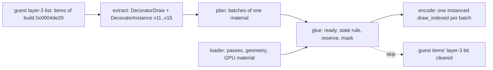
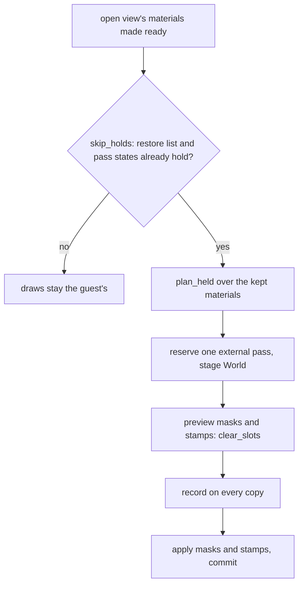

# Native decorators: the BSP's grass and rocks in layer 3

Status: Built, not verified in a run. The read, the build's implementation lookup, extraction, the plan, the loader, the recording and the glue that reserves the pass and skips the guest's items are built and unit-tested; no frame has been compared with the D3D path.
Code: `crates/rewrites/scene-extract/src/layout/decorators.rs` (`read`, `registers`, `implementation`, `set_geometry`), `crates/rewrites/scene-extract/src/decorators.rs` (`extract`, `clear_slots`), `crates/rewrites/frame-scene/src/decorator.rs`, `crates/rewrites/native-render/src/decorators.rs` (`plan`), `crates/rewrites/native-render/src/decorators_load.rs` (`decorator_look`, `skip_holds`, `compile`, `buffers`), `crates/rewrites/native-render/src/decorators_gpu.rs` (`MaterialGpu`, `bind`, `encode`), `crates/rewrites/render-bridge/src/native_decorators.rs` (the observer, `plan_held`), `crates/extensions/game/src/native_decorators_glue.rs` (the host). Tests: the unit tests of those files.
Switch: `impl.render.native` (the stage; extraction runs with the frame step, `frame-scene`).

Model decorators are the structure BSP's placed scatter. Each placement is one item of the layer list, and its draw sets five vertex registers and issues one indexed draw per instance. They have no render record and are not objects, so neither the world nor the object stage takes them ([framescene.md](framescene.md), slice 4).

The frame step types each placement's draw into the scene with the registers the guest would set. The decorator stage draws each run of instances of one model as one instanced draw. The rule: an instance's `v11..v15` in the scene are the values `0x0004e260` would write, from the same reads, in the same order.

| Decorator type (class `+4`) | Build | Draw | Typed here |
|---|---|---|---|
| 0, models | `0x0004de20` | `0x0004e260` | yes |
| 1 and 2, decals | `0x0004dfa0` | `0x0004ebd0` | no, items in the transparent layers, drawn at the call ([retire-d3d-decal-decorators.md](retire-d3d-decal-decorators.md)) |
| 3 to 5, quads | `0x0004e0d0` | `0x0004ede0` or `0x0004efa0` | no, items in the transparent layers |

## How it works

### The guest's list, build and draw (Code, `h2 disasm`)

1. **The list** (`0x00041640`). Per visible decorator grid cell (count `[0x00509438]`, records of `0x10` bytes at `0x004c5700`, the origin at `+4`), each placement of the cell that passes the culling is added to list 0 by `0x00040e30`. The placements are the BSP decorator block `[[0x004e0348] + 0x238]`: cells at `+0x24` (`0x18` bytes), a run of placements at `+0x14` and `+0x12`.
   The item's `+8` is the permutation's shader and its layer mask the shader's (`0x0001bf50`). Its argument is the placement index `<< 8`, the cluster's slot in the low byte and the permutation's detail level (`+9`) in bits 30 and 31.
2. **The build** `0x0004de20` takes nothing in layer 1. It asks the geometry cache (`0x0012de70`, flags 3) for the placement's geometry record and the set's geometry (set `+0x38`), and declines when either is not given.
   It then fills the entry with the implementation the shader's template gives for the layer (vertex type 1, `0x0004cbb0`; `layout::decorators::implementation`). The lookup chain:

   | Step | Read |
   |---|---|
   | shader | the tag table entry of the item's `+8` (`movsx`); a `PRTM` or `prt3` shader reaches its template through a virtual call and is not read |
   | template, postprocess | shader `+0x24`, template `+0x5c` |
   | layer | the detail level's first layer (`+4`, 10-byte records, low 9 bits) |
   | pass | the layer's first pass (`+0xc`, 2-byte), the pass (`+0x14`, 10-byte records, the `spas` datum at `+4`) |
   | implementation | the pass's implementation 0 (`spas` `+0x20`, then `+4`) |

   It declines when the implementation's `vrtx` (`+0x100`) is none, has no classification 1, or classification 1's program size (`+0xc` of the `0x1c`-byte record) is below 16. The guest then draws nothing for the item.
3. **The draw** `0x0004e260`, once per placement: `TwoSidedLighting` on; `c[53]` = (`[0x0052598c + 4·lod]`, `[0x00525998 + 4·lod]`, 0, 1); the set's vertex stream (set `+0x34`, `0x0001c590`, `0x0001c620`, `0x0001c710`); the shader begin `0x0001bbf0`.
   For each instance `n` below the placement's count (`+0xa`) whose index `first + n` (`+8`) is inside the geometry record's instance block (`[record + 0x28]`: count, base; `0x18` bytes each) and whose permutation names a model below the set's count with indices, it issues:
   - `SET_VERTEX_DATA4F` of `v11..v15` (push buffer methods `0x1ab0` to `0x1af0`);
   - the stage textures (`0x0001cf50`);
   - `DrawIndexedVertices(TRIANGLELIST, count, [set + 0x2c] + 2·first)` of the model's range (set `+0x1c`, 8 bytes: `+4` first, `+6` count).

   Then `TwoSidedLighting` goes off.
4. **The registers** (`layout::decorators::registers`). The inputs are the instance, its permutation and the set.

   | Source | Layout |
   |---|---|
   | instance `+0` (packed) | class bits 0..2, permutation 3..8, turn 9..12, tint step 13..15, scale step 16..19, up axis 20..31 |
   | instance `+4` | position, 10, 10 and 12 bits |
   | instance `+8`, `+0xc` | colours |
   | instance `+0x10` | normal, 11, 11 and 10 bits |
   | instance `+0x14` | fade input |
   | set `+0x14` | class, `0x14` bytes, permutations at `+0x10`, `0x28` bytes each |

   - `v11` = (the normal, `0x0004dd70`; `clamp((fade − set[+8]) · set[+0xc], 0, 1)`).
   - `v12..v14` = the rows of the basis times the scale, with the world position (`0x0003f220` plus the cluster origin less `[0x0045dc10]`) in `w`. The scale is the permutation's (`+0xc`, `+0x10`) at the scale step.
     The basis, with permutation flag bit 0: the up axis (`0x0004dcd0`), a perpendicular (`0x0011d000`) and their cross product, the up axis made unit (`0x0004efb0`), turned about it by the turn. Without the flag it is the yaw of the turn (`0x00141ce0`).
   - `v15` = (A·B, 1): the colours `+0xc` and `+8` (`0x00131bb0`), B tinted between the permutation's tints (`+0x14`, `+0x18`) at the tint step and each pulled to its floor by the permutation's weights (`+0x1c`, `+0x20`) (`0x0004ca40`).

   SSE steps are computed in `f32`, x87 steps in `f64` rounded where the guest stores. The constants are read from guest memory (`layout::decorators::Constants`).

### Extraction

`scene_extract::decorators::extract` is called by `render_bridge::scene_step` at the scene's layer 3 once the view is open. Each item of the current list whose build is `0x0004de20` becomes a `DecoratorDraw` (slot, set datum, shader, the item's bytes `+0x15` and `+0x14`, argument, `c[53]`). Its `DecoratorInstance`s (index, model, index range, `v11..v15`) are in the guest's order.

A placement whose memory does not read, or whose geometry is not resident (block info `+0x1e` clear), is the view's `decorator_remainder`.

For a game view whose reference portal windows pass R4, the extractor builds the model list from the BSP:

- The grid walk (`0x0003f830`, `0x0003f970`) intersects the main view bounds with the camera's draw distance box, visits the eight children in storage order and tests each leaf against the view's six planes.
- It compares the resulting cell indices and origin bits with the guest's visible cell table.
- Each cell's model groups supply the set, class, permutation, shader, sphere and BSP cluster. A group must meet a window of its BSP cluster and its permutation's distance limit.
- The permutation supplies the LOD packed into the argument. The shader template supplies the projected-size detail level and layer mask.

Before using the Rust list, the extractor compares its model items in append order with the layer's live model items (duplicates, shader, argument, mask, pass, detail level and draw callback included). On equality the Rust keys drive the draw and instance reads, with the matching guest slots retained for masking. A difference or unavailable input keeps the view on item extraction. The placement producer still runs for comparison and cache requests (`layout/decorators/cells.rs`, `layout/decorators/placements.rs`).

At the grid producer entry (`DECORATOR_GRID`, `0x0003f830`), Rust records the input words its traversal reads. On return it compares the count and every output slot to the guest.

A later call with the same stack location, BSP, camera, MXCSR and input words publishes the Rust cells directly and reproduces the compared call's volatile registers and flags. The proof covers one grid per BSP generation. Reaching the 256-cell limit leaves the call with the guest, which continues visiting the tree after its output is full.

### The plan

`native_render::decorators::plan` takes the draws whose material (set, shader, the two item bytes, layer) the stage has. Each run of consecutive instances with the same material, `c[53]` and index range is one batch. Joining only neighbours keeps the guest's order. `Plan::slots` are the items the guest would skip.

### The loader

`native_render::decorators_load` is called from boot's glue.

| When | What |
|---|---|
| The world's load (`native_world_glue`'s worker) | The shaders the map's decorator sets name (`DECR` root `+0`, 8-byte references, the datum at `+4`), each resolved (`tags::material`). Each of its layer-3 passes at each detail level as the build picks it (`decorator_look`: implementation 0, its `vrtx`'s classification-1 program and input semantics), with its stage bitmaps decoded |
| A material's first sight in a view (`Host::prepare`, once per load) | The set's geometry from guest memory (`set_geometry`): the vertex buffer descriptor at set `+0x34` (type byte `+0`, stride `+1`, offset `+8`, the D3D buffer at `+0x10` whose data is at `+4`), the indices (count `+0x28`, u16 pointer `+0x2c`), the vertex count the largest index plus one. The stream type's format comes from `object_streams::StreamFormats` (the table at `0x0043f408`) |

The guest takes two bulk reads for the index and vertex data. A single utility worker translates the pass for the stream with `v11..v15` supplied and two-sided lighting on (`compile`), gathers the vertices (`buffers`) and uploads the module, buffers and textures (`MaterialGpu::new`). Each load can have one material outstanding. Its first decorator view after a swap collects the result, and other views of that frame use the same ready materials.

### The recording

`native_render::decorators_gpu::encode` stages the plan's instances once per copy (80 bytes each). They bind as the last vertex buffer with instance step (`instance_layout`, locations 11 to 15), and each batch is one draw over the set's u16 indices: an indirect one of the kept instances once the cull has run ("Cull" below).

The program is the material's pass translated with `decorators::PROVIDED_INPUTS` (`v11..v15`) supplied. The batch's bindings (`Bound`) carry its uniforms with `c[53]`. The pass asks the pipeline compiler for each copy's target formats during reservation, and a pending compile keeps the slots on D3D through the next swap.

The load retains the uploaded material and the compiled pipelines. The viewport is the whole target and the view's rectangle the scissor.

### Cull

A view's instances are culled on the GPU before they draw (`GpuWorld::culled_decorators`, `cull_gpu::DecoratorCull`, `cull_decorators.wgsl`). Each instance is bounded by its placement group's sphere (`DecoratorDraw::sphere`): the centre and radius the producer tests against the portal windows and the detail distance (`placements::model_items`), read again for each draw (`read_placement`). The guest culls a whole group by that sphere, so it holds every vertex the group's instances place, whatever the program does to them.

| Step | What |
|---|---|
| Inputs | The view, each batch's range, index range and whether it is occludable, each instance's sphere and `v11..v15`, staged and copied in draw order |
| Frustum | `Frustum::sides` of the lens layer 3's admission takes (the union of both copies'): a sphere outside a side plane is culled |
| Pyramid | For a batch whose pipeline draws nothing where hidden (`gpu::depth_hides`: a `Less`, `LessEqual` or `Equal` test, no stencil write on depth fail, no polygon offset), the sphere's box against the pyramid this view's layer 3 built on the target, read under the same token rule as the later world layers ([native-world.md](native-world.md), "Cull") |
| Compaction | One thread per batch walks its instances in the guest's order and copies the kept ones to the front of the batch's range, so the draw keeps the guest's order |
| Draw | Per batch, the compacted range as the instance buffer and one `draw_indexed_indirect` of its slot |

| Counter (`GpuWorld::decorator_skips`) | When |
|---|---|
| `no_pyramid` | The view found no pyramid of its layer 3 on the target: the frustum alone culls |
| `unbounded` | An instance's group sphere did not read: it bounds nothing and the instance draws |

A plan with no camera, or a load with no GPU world, draws every instance.

### The glue

`render_bridge::native_decorators` is an observer before the layer draw, after the frame step's and the native world's; `native_decorators_glue` is its host. At the scene's layer 3:

The state rule (`Host::holds`, `decorators_load::skip_holds`) exists because of what a guest draw does to the device:

- The shader begin sets its pass's list (`0x00018900`) and its engine-driven values (`0x0001a170`) without comparing them with the device.
- The next switch to another implementation (`0x00016b90`) or layer setup restores the implementation's restore list (`0x00018900`) first.
- The draw leaves `TwoSidedLighting` off (`0x0004ebb4`).

A material is therefore kept only when the restore list, every state of the pass's list the restore list does not write back (at the value the draw sets, `DecoratorLook::leaves`) and `TwoSidedLighting` off already hold at the call. The world layers' items follow the same rule (`layer_pass::skip_holds`).

The host reserves one external pass as the fog's does. The device must be W-buffered, the stage palettes the load expanded palettized stage bitmaps through must still be bound (`palettes_hold`), the stencil in the guest's render-state shadow must read, and so must its cull when a planned pass inherits the cull. The draw `0x0004e260` sets neither, so the pipelines draw under the stencil and cull the render-state shadow holds at the layer-3 call (`decorators_gpu::DrawKey`, `native_targets_glue::stencil_state` and `cull_state`; the stencil through `fog_gpu::layer_stencil`, its reference set on the pass).

A pass that sets its own stencil draws it, with its own reference per batch (`Bound::stencil_reference`). A pass's polygon offset is drawn in its fragments' W depth (`pass_state::DepthOffset`).

Layer 3's bit is cleared on every planned item through a preview (`clear_slots`, all or nothing: each slot an item of build `0x0004de20` with the bit set). With each mask the preview writes the geometry cache stamps the item's build would have made (`layout::decorators::build_stamps`: `0x0012de70`'s resident path, the frame's stamp `[[0x004e649c] + 0x38]` into entry `u16[info + 0x20]`'s `+0x14` of the table `[[[0x004e649c] + 0x64] + 0x44]`, `0x18` bytes an entry, for the placement's geometry record and the set's geometry).

The masks and stamps are applied and the reservation committed only once the pass has recorded on every copy. The next layer draw sets each bit back on the items that still hold the mask it left; a map activation forgets them.

## Interfaces

- **Read** at the layer draw `0x00044550` (the frame step's observer, scene site, layer 3): the current list `[0x00467138]`, its items, the BSP decorator block, the scenario's decorator palette (`[0x004e0350] + 0x37c`, 8 bytes, the set datum at `+4`), the tag table `[0x004e3b44]`, the visible clusters, the set and permutation records, the shader, template, pass and `vrtx` records of the lookup, the set's vertex buffer and indices, the stream format table `0x0043f408`, the constants (`0x0045dbb4`, `0x0045dbbc`, `0x0045dbc0`, `0x0045dbd8`, `0x0045dc10`, `0x0045dc18`, `0x0045dd34`, `0x0045dd38`, `0x0045dd3c`, `0x0045dd44`, `0x005259b4`, `0x0043fde4`) and the detail tables.
- **Written:** layer 3's bit (`1 << 3`) of the drawn items' layer mask (item `+0x10`), cleared before the layer draw and set back at the next; the geometry cache entries' stamps (`+0x14`) of the drawn items' geometry record and set geometry. The glue writes the stamps, a residency write the entry census does not count.
- **Counters** in `render.scene` ([agent-api.md](../runtime/agent-api.md)):

  | Counter | Counts |
  |---|---|
  | `decorators`, `decorator_instances`, `decorator_remainder` (per view) | draws, instances, placements left to the guest |
  | `scene_decorator_draws`, `_instances`, `_remainder` | the same, summed |
  | `scene_decorator_views`, `_views_native`, `_views_declined` | views with decorators, views the stage drew, views the host left to D3D |
  | `scene_decorator_items_skipped` | items the guest skipped |
  | `scene_decorator_draws_unready` | draws left to the guest, material not ready |
  | `scene_decorator_draws_state` | draws left to the guest, skipping would change a held render state |
  | `scene_decorator_grid_compared`, `_differ`, `_native` | original grid calls checked, mismatches, calls replaced |
  | `scene_decorator_placements_equal`, `_differ` | view comparisons |
  | `_no_windows`, `_unread`, `_nonresident`, `_virtual_shader` | fallbacks before the list comparison |

- **Log:** the load prints one line (`native-decorators: … layer-3 passes load; on the D3D path: …`), and each reason a material stays on the D3D path is printed once.

## Rules and limits

- The stage draws all of a view's planned decorators or none: a refusal at the ask or on any copy leaves every item to the D3D path. Draws whose material is not ready, or whose skip would change a render state the device holds, stay the guest's while the rest draw natively.
- The skip's state rule covers the device's render states only. The draw also leaves the engine input table pointer `[0x00485a58]` at 0 (`0x0001bd50`), the lightmap page at -1, `v11..v15`, `c[53]`, its stream, shader and stage textures, which a skip leaves as the draws before it left them.
- A pass's engine-driven render and stage states go over its own (`engine_states::apply_static`): each value from the material's inputs, the render values after the pass's list where `pass_state` reads them, the stage values into the stage's states. A driven state whose source is not the instance's scalar 21 changes per draw and keeps the pass on the D3D path. The byte layouts are in [notes/decorator-stages.md](notes/decorator-stages.md).
- A pass stays on the D3D path when it computes anything per draw, reads a constant the stage does not set (it sets `c[0..18]`, `c[53]` and the pass's own), or its set's stream supplies one of `v11..v15`.
- A stage sampling the lightmap binds the globals' rasterizer bitmap at `+0x64`, as an object's does: the draw sets the current page to -1 (`0x0004e277`) and adds no lightmap coordinates. The load reads it once (`native_objects_glue::engine_lightmap`) and takes it only when it is uniform (`decorators_load::stage_images`); otherwise the passes that sample it stay on the D3D path with the reason.
- A palettized stage bitmap is expanded at load through the palette its stage holds then, as the world's are. A view whose stage palettes differ stays on the D3D path.
- A pass that sets no `CULLMODE` draws with the device's cull and winding; a view where the cull does not read stays on the D3D path. On a copy whose depth has no stencil aspect (a `D16` surface) the pipeline draws with the stencil test off, as the D3D path does.
- The pipeline draws with two-sided lighting on, as the draw sets it.
- Extraction repeats the build's implementation lookup: an item whose build declines is not in the scene, as the guest draws nothing for it.
- A skipped item gets no entry, so its build does not run. The skip writes the stamps its build would have made for its record and set, so the cache ages that geometry as the guest's draw would. A placement whose geometry is not resident is a remainder, and the skip refuses when an item's geometry is no longer resident at the layer draw, so the guest's build makes the cache's load request itself.

## Evidence

- The 15,580 "other builds" the object walk met in layer 3 were all `0x0004de20` ([native-objects.md](native-objects.md), "Other builds in layer 3").
- The read above is Code (`h2 disasm` of `0x00041640`, `0x00040e30`, `0x0004de20`, `0x0004e260` and its helpers). The register arithmetic is checked by synthetic tests against hand-computed values, not against the lifted original.

## Not verified

- That every guest draw after a skipped placement sets what it reads of the state the rule above does not cover (the engine input table pointer, the vertex data `v11..v15`, `c[53]`).
- That the render states at a placement's place in the sorted layer are those at the layer-3 call, where `skip_holds` reads them: the layer's guest draws sorted before it may change them.
- That the `f64` steps give the x87 results bit for bit under the game's precision control.
- Whether `0x0012de70` ever gives a block that is not marked resident without loading it in the same call (a remainder here either way).
- A frame comparison of the stage against the D3D path, and the counters in a run.
- That the shader word at item `+8` and the tags' shader index agree (the load keys passes by the tag index, as the build reads the word).
- That the stamp is the only state `0x0012de70`'s resident path changes (read from its disassembly, `0x0012de7f..0x0012de98`; not compared with a run).

## Related

[framescene.md](framescene.md), [native-objects.md](native-objects.md), [native-world.md](native-world.md), [layer-draw.md](layer-draw.md).
