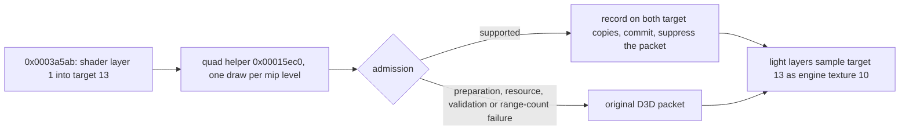

# Native shader gels

Status: Built. Replaces supported gel quad packets through `DrawAdmission`; parity with D3D is not verified.
Code: `crates/rewrites/render-bridge/src/native_gels.rs`, `crates/extensions/game/src/native_gels_glue.rs`, `native_gels_scene.rs`, `native_gels_replace.rs`, `crates/rewrites/native-render/src/gels.rs`, `gels_gpu.rs`. Tests: `crates/rewrites/render-bridge/tests/native_gels.rs`, `crates/rewrites/native-render/tests/gels_gpu.rs`, `gels::tests` in `native-render`, and `native_gels_replace::tests` and `native_gels_glue::tests` in `game`.
Switch: `impl.render.native` (on), listed in [switches.md](../runtime/switches.md).

A light's gel is a shader drawn into render target 13 before the light passes sample it as engine texture 10. The stage replaces its quad draws, one per mip level. Part of [native-renderer.md](native-renderer.md).

The ordered handoff records each quad on both required target copies, then commits before it suppresses the original packet. The device prints one `native-gels` production refusal summary per 100 presents with activity, with counts by reason.

## How it works

### Production order

**Code**, independently read with `h2 disasm` on the owner's XBE:

- `0x0004a1e0` finishes its light constants through `0x0003a550`.
- `0x0003a555..0x0003a561` uploads the light constants. A valid `shad`
  reference at the light definition's `+0xdc/+0xe0` sets the byte
  `0x00485a77` while its shader is being generated.
- `0x0003a5ab`, return `0x0003a5b0`, calls
  `0x00016610(shader, 1, -1, 0, 13, 1)`: **shader layer 1 into target
  13**, not shader layer 13.
- Before calling the template, `0x0001bd50` clears the shader input
  selector at `0x00485a58` and updates the five dirty masks at
  `0x00485b78`. It does this even when layer 1 has no drawable pass.
- For each drawn pass the template restores the preceding implementation's
  states and resets the shader cache (`0x00016b10`), binds the pass
  (`0x0001bbf0`) and loads vertex classification 0 (`0x0001c590`).
  Its full-target quad helper `0x00015ec0`, return `0x0001675a`, binds
  target 13, resets viewport/scissors through SetRenderTarget, and draws
  a four-vertex triangle strip per level. v0 is position, v1..v4 are
  two-component UVs, v5/v6 are zero for one level.
- The original clears `0x00485a77`. Engine texture 10 can then sample
  the generated target for this light. While that byte is set, texture
  10 instead takes the definition's bitmap, avoiding feedback.

The feature hooks the template and quad helper (three hooks, all context-only), never a D3D-owned entry. The helper's exit hook runs after the body, so that chain stays off the render thread. At the helper the feature drains preceding commands through `begin_external_boundary` and arms admission for the helper's ordered mip draws.

At exit it drains any queued last draw and clears the scope. An ownership mismatch clears the scope and retains D3D.

`native_gels_replace` checks the bound surface, shape, declaration, four actual vertices, viewport/scissor, shader and all required resource views. Its `ExternalPlan` promises one gel range. `prepare_copy` validates every physical copy before recording.

`record_ranges` returns one only after the complete native quad is recorded into **the real target-13 attachment** for that level. It declares colour writes and no depth/stencil writes, so the handoff maintains D3D surface coherency and aliases. No queue submission, queue write or update to a live texture escapes the isolated command encoder.

The commit and suppression belong to the ordered handoff, not to a hook-side boolean.

Guest shader setup, geometry assembly and target and state effects continue, so consecutive native and D3D gel packets keep their original order. The actual target retains old pixels for blend, colour masks and fragment discard. Uniform and vertex buffers belong to each recording.

### Resources

Replacement consumes the **resolved draw**: its live microcode, constant banks, combiner definition, defaults, render and sampler state, resident texture views and raw float4 vertices. Shader variants and bitmap identity animation therefore use their actual evaluated resources. Linear texture coordinate scale uses guest dimensions.

Signed textures use the D3D path's already biased views. Clip range/clamp, stipple, blend constant, bump uniforms and two-sided lighting come from that packet.

At quad entry, `gels::Target::read` resolves target 13 when its presence word is set, its hiding byte is clear and its dimensions and level count are valid. Each level uses the embedded surface header that the guest resolver (`0x0001dcf0`) selects. Admission compares that header and the mip dimensions against each resolved draw.

A packet needs a four-vertex non-indexed strip, complete float4 v0..v6 streams, full viewport/scissor, solid Gouraud shading and disabled depth, stencil, fog and alpha test. Depth textures, cube/volume stages, colour keying, border sampling, unknown inputs or missing copies retain the entire original packet.

Immutable resident programs, texture groups and pipelines are cached by map generation, exact resident view identity, shader/state/sampler key and target format. Resident identity includes D3D's palette/residency result. Repeated frames do not rebuild their pipelines.

Per-recording buffers are never reused before submission. The resident program cache is bounded; eviction retains no live mutable GPU storage and recorded commands retain their resource references.

### The gel from the scene

Under the cut light frame (native-lights.md, "The light frame under the
cut") `0x0004a1e0` never runs, so its producer `0x0003a5ab` does not
draw the gel. The light's sequence draws it instead
(`native_lights_glue/scene.rs`, `Op::Gel` and `GelPass`), as its first
step on target 13's attachments:

- At map load `game::native_gels_scene::load` takes each `ligh` tag's gel
  shader (`+0xe0`), every pass of its template layer 1 with
  implementation 0, looks at each as a full-target template pass
  (`native_render::screen_look::template_look`), translates it with its
  vertex shader's first program and decodes its stage bitmaps. A pass
  that samples an engine texture or does not translate keeps the whole
  shader out, and a light with that gel is refused by name.
- An animated pass compiles from its baseline (clock 0, targets cleared)
  and its registers are sampled at the render clock `0x004858a0` for each
  draw (`gels::pass_uniforms`). An animated gel with no clock refuses the
  light as `the animated gel has no render clock` before it reserves the
  step (`Gels::clock_refusal`).
- A pass that reads the call values reads the four words at
  `0x004c19b0` (`gels::CALL_VALUES`), where the last screen effect left
  them.
- The quad is the helper `0x00015ec0`'s for level 0
  (`native_render::gels::quad`): corners `(0, 0)` to the level's size,
  coordinates `(0, 0)` to `(1, 1)` on attributes 1..4, and z and w from
  `[0x00485ad4]`, `[0x00485ad8]` and the depth scale
  (`gels::quad_depth`). Only level 0 is drawn: the light's layers sample
  mip 0.
- The light's layers after it take `Binding` for target 13's level-0
  header and sample it as engine texture 10: the gel step leaves the
  target's view in the sequence's `scene::GelTarget`, and each layer's
  `RunPass` binds it as its gel view, scaled to guest texels
  (`Binding::tex_scale`).

`gels::tests::the_gel_quad_covers_its_level_in_strip_order_at_the_helpers_depth`,
`gels::tests::an_animated_gel_draws` and `scene::tests::a_gel_light_draws_its_gel_into_target_13_before_any_layer`
check the quad, the sampled registers and the order.

## Interfaces

`game::native_gels_glue::install(device) -> Arc<Outputs>` installs the
host. Admission is registered once, lazily, only when the enabled feature
first reaches replacement mode after its ordered boundary. Disabled
calls do not add a gels admission or cause extra draw
snapshots/palette reads. The light graph retains that owner.
`Binding` is re-exported from `native_gels_glue`.

1. At light entry, before original constants run, retain
   `let before = outputs.checkpoint()`.
2. The typed light graph returns a shader-driven gel to the ordinary
   passes before reserving any draws. Its constants call runs the
   producer, including the shader-cache, target and viewport changes
   that later guest draws observe. The gel quad is eligible for
   replacement at that point.
3. At the post-constants boundary use
   `outputs.binding_after(before, definition_ptr, shader_datum,
   target13_surface) -> Option<Binding>`. Retain the binding in the
   light's immutable plan. Its checkpoint rejects the previous light,
   even when definition, shader and surface are equal.
4. `let gel_slot = binding.append(&mut plan)` adds a read-only surface
   slot to the consuming light's `ExternalPlan`. Equivalently append
   `Some(binding.slot())`. Drain/prepare at the ordered light boundary,
   so pending producer commands are recorded before its consumer.
5. In light recording use `binding.sample(&target, gel_slot)` as the gel
   view for `LightGpu::textures`. Each copy samples target 13 at mip 0
   through its own level-zero surface view. A missing slot refuses the
   light's whole transaction.
6. Generated target 13 is **linear**. For each sampled `LightStage::Gel`,
   use `binding.tex_scale()` in `PixelUniforms::tex_scale`: reciprocal
   **guest** width/height, not the scaled physical dimensions or static
   bitmap coordinate scale.

The binding means "target 13's base level as the producer leaves it", including D3D fallback or later D3D gel packets. It does not claim a particular packet committed natively: the `gels` stage counters in `H2_FRAME_STATS` (suppressed and per-copy ranges) show actual replacement. Lights use `binding_after`.

## Rules and limits

A refused quad is never partly recorded. The limits are the admission list in "Resources". Unsupported inputs and missing copies leave the D3D draw.

## Not verified

- Pixel parity and positive suppression and range counters on a level with a supported gel (the Old Mombasa level may have none), at render scale 1 and 2.
- Mixed native and D3D lights with the lights stage's binding.

## Related

[native-lights.md](native-lights.md), [native-shadows.md](native-shadows.md), [native-renderer.md](native-renderer.md).
