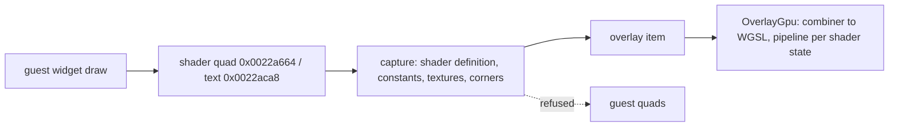
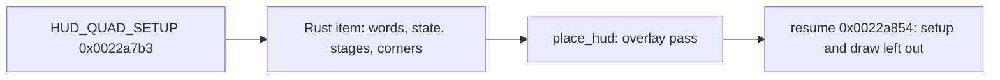
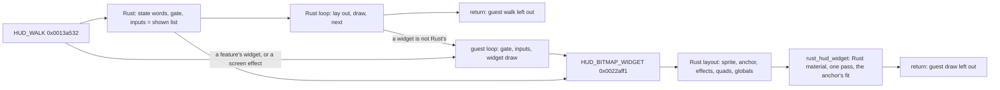
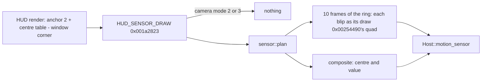
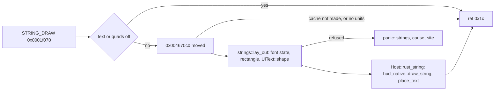

# The HUD on the overlay

Status: Partly built. Every HUD and menu shader quad (a HUD widget's, a training frame's, a navpoint's, and a menu shader bitmap's) is drawn from its shader's Rust material at `HUD_QUAD_SETUP` with no guest shader setup, and a HUD bitmap or text widget's Rust layout draws with no guest draw, from its first draw: nothing waits on a guest draw to prove it, and a quad or widget Rust cannot draw panics by name (`hud: ...`). A screen-effect widget's body is left out; its effect's draw is the post's. Rust walks the definitions a HUD record names in the guest's order, and a string draw's site's strings are laid out and drawn by Rust as text runs. The motion sensor's place and draw calls are worked out in Rust, and its call is Rust's: the host draws them, and the guest's body never runs (the host's target and composite are not built, and the call panics by name). The HUD's overlay items are tagged `ViewSlot::Hud`, a menu shader bitmap's `ViewSlot::Ui`. What the overlay keeps is counted by kind and cause. Pixel parity needs a live check.
Code: `crates/rewrites/render-bridge/src/native_hud/hud_overlay.rs`, `hud_inputs.rs`, `kept.rs`, `walk.rs`, `strings.rs`, `definitions.rs`, `sensor.rs`, `crates/rewrites/hud-kit-core/src/walk.rs`, `crates/rewrites/scene-extract/src/hud.rs`, `crates/rewrites/engine/src/hud_effects.rs`, `hud_sensor.rs`, `crates/extensions/game/src/hud_overlay.rs`, `hud_native.rs`, `crates/rewrites/native-render/src/hud_material.rs`, `ui_gpu.rs`, `overlay.rs`, `layer_pass/animation.rs`. Tests: `crates/rewrites/render-bridge/tests/native_hud.rs`, the unit tests of `hud_material.rs`, `hud_inputs.rs`, `kept.rs`, `hud_native.rs`, `hud_effects.rs`, `hud_sensor.rs`, `scene-extract`'s `hud.rs`, `native_hud/walk.rs`, `native_hud/strings.rs`, `native_hud/definitions.rs` and `native_hud/sensor.rs`, and `hud-kit-core/src/walk_tests.rs`.
Switch: `impl.render.native` (on). The material, the walk and the strings are not switchable. See [switches.md](../runtime/switches.md).

The guest gates each HUD bitmap or text widget; the overlay draws its quad at the shader quad, before the guest's shader setup, in place of the guest's draw. The producers are in [native-ui-producers.md](native-ui-producers.md).

## Bitmap widgets

A bitmap enters the overlay at `0x0022a7f6`, after the shader setup and before Begin. The bitmap helper's ordinary draw calls `0x0022a664` at `0x0022b690`. Special type 5 calls it in a loop at `0x0022b55c`, setting the inputs for each shield layer.

Capturing one quad per invocation preserves layer order, animation and the engine's choice of sprite. Each item carries the shader datum and the four `hud_input` values at `0x004e6980`.

Every HUD caller of the shader quad is drawn from its Rust material as a widget is (`native_hud::hud_overlay::tag_quad`, by the call's return, `native_hud::kept::quad_kind`):

| Kind | Draw | Quad returns (Code) |
|---|---|---|
| `widget`, `crosshair` | bitmap widgets `0x0022aff1`, `0x0022bbca`; the crosshair is a widget held at anchor 4, the centre (its anchor call at `0x0022b055` gives the id in EAX) | `0x0022b39c` .. `0x0022b7d3`, `0x0022bca9` |
| `training` | the training box's frame `0x001e9140` | `0x001e936f` .. `0x001e95bb` |
| `navpoint` | the arrow `0x0024e9c7`, the outline `0x0024f0fc` | `0x0024eca5`, `0x0024f35c` .. `0x0024f55b` |
| `waypoint` | the marker `0x0024ef29` (from `0x0024ecae`) | `0x0024f0bb` |
| `indicator` | the indicator group `0x00200462` | `0x00200784` |

Another caller is the generic fan path (`Host::draw_quad`). The `hud_input` slot of a non-widget quad holds what `0x004e6980` holds at its draw, which is also what its shader reads.

Each placement takes the UI fit the guest's draw carries at that point in the frame (`d3d::backend::UiFit`), set per HUD group by the anchor rule (`canvas_fit::anchor_fit`, [high-resolution.md](high-resolution.md)); a pass placed from Rust takes the device's fit at its placement (`hud_overlay::place`). No item is placed on its own.

A menu shader bitmap (type 9) is drawn the same way. Its draw `0x002b11c9` copies the widget's four shader inputs (`+0x74`) through `0x001392f8` to `+0x1c0` of the UI globals `[0x00510c4c]`, then calls `0x0022a664` at `0x002b12ae` with the definition's bitmap (`+0x10`), image (`+0x0a`) and shader (`+0x18`). At the shader quad, `native_hud::hud_overlay::menu_shader_quad` reads those arguments and the UI's inputs into the item's `hud_input` slot. The quad is drawn at `HUD_QUAD_SETUP` as a HUD widget's is, from its shader's Rust material (`native_hud::setup_quad`, `game::hud_native::draw` with `HudTagQuad::widget` false, placed by `hud_overlay::place_ui`), so the list's shader bitmap draws no guest setup (`0x0001bbf0`). The list's entry stays the game's draw (`ui_overlay::Item::Game`) only for this widget and for entries outside the sort window, which the game culls itself (`menu_shader_quads`).

## Text widgets

The text widget binds its shader before the string draw at `0x0022aca8`. The glyph callback retains that shader and samples the live glyph cache, and the selected combiner computes the glyph's colour. Capturing the glyph after layout preserves spacing and per-corner diffuse colour.

A text widget the list walk draws (`hud_edit::overlay::draw_list` under `Shading::Engine`) is one `TextRun` over its font's glyph pages, laid out by `font::layout`. Its colour is what the shader's captured state gives a fully covered glyph texel under white diffuse (`native_render::ui_gpu::glyph_colour`: the reference combiner interpreter over the definition and its evaluated constants).

The string is the game's. For a widget without the number or name flags, `0x22a97b` calls `0x13925f` with the string ID at `+0x28`, which finds the ID among the language's range of the HUD's `unic` (`engine::locale::LocaleTable::find`, language at `0x0047ff38`, range pairs from `unic` `+0x10`) and decodes the UTF-8 (`0x140440`). The string draw `0x22d2b7` then swaps button glyphs and replacement patterns (`0x22d2ee`). `render_bridge::native_hud::hud_overlay::localized` reads the text the same way and returns nothing for a string that draw would change.

A text widget with no shader capture, no resolved string or no fonts stays inexact (`Inexact::Text`), so a HUD that has one is drawn by the guest's glyph quads.

## Shader state

`game::hud_overlay` takes the selected pixel shader definition and its evaluated constants from the draw snapshot. This covers full shader binds and constants-only updates, including successive instances of the same meter template at different fill values. The vertex program supplies screen positions, texture coordinates and diffuse colour.

`native_render::ui_gpu::OverlayGpu` translates the decoded register combiners to WGSL, caches the pipeline by shader state and uploads the current constants for the draw. The pass uses the bound texture, blend, colour write mask and clip ([shader setup trace](notes/2026-11-24-hud-shader-setup.md)).

Admission handles affine fans and projected 2D texture stages. Each stage uses its own bound texture, sampler and vertex-program coordinates, and the waypoint emblem combines separate foreground and background images. A draw outside the supported material, raster or texture state continues through the UI fan path.

A reserved draw keeps its resolved packet for replay if the worker cannot record the overlay. A kept scene carries the widget's pass with its packet and records it again (`WidgetPass::replays_scene`), so its `Bound` textures are the recording's own stage views. The `native_ui_overlay_hud_*` counters distinguish bitmap and glyph reservations and refusals, display recordings and failed recordings.

## The material in Rust

A shader quad, the HUD's or a menu's, draws with no guest shader setup: its material is read from the map, not from the device after `0x0001bbf0` has run. No guest draw proves it first; what it cannot predict panics by name.

| Step | Symbol | What |
|---|---|---|
| Material | `native_render::hud_material::HudShader::resolve` | the shader's one pass implementation across its template's layers; its stages, samplers, alpha kill and entry render states |
| Inputs | `render_bridge::native_hud::hud_inputs::function_input` | the HUD's function inputs, the callback `0x0022ace7` in Rust |
| Constants | `HudShader::words`, `layer_pass::sample_with_inputs` | the definition's words with animated constants at the render clock `0x004858a0`; each property's `x` from its `input`, the range input `y` from `input_a` (`0x0001b230` with a provider) |
| Prediction | `game::hud_native::predict` | the item but for its target and clip; corners from the quad's own vertices |
| Compare | `game::hud_native::compare` | words, then blend and write state, then stages and sampler, then corners and coordinates, for tests of a prediction against an item |
| Draw | `game::hud_native::draw`, `hud_overlay::place_hud` | the shader's quad as one overlay pass at the setup site, on the UI's 640 by 480 frame and its whole clip (`hud_native::FRAME`) |

The callback's names (string IDs) and values (Code, `h2 disasm 0x22ace7 100`):

| Name | Value |
|---|---|
| `0x0a0005cf`..`0x0a0005d2` | `hud_input1`..`4`, `[0x004e6980]`.. (the widget helper writes them, `0x0022b380`) |
| `0x0d0005ca`, `0x0c0005cb`, `0x0c0005cc`, `0x0e0005cd` | `[0x004e6968]`, `[0x004e696c]`, `[0x004e6970]`, `[0x004e6974]` |
| `0x11000600` | the short at `[0x00510c4c] + 0x1d0` times `[0x0045de4c]` |
| `0x090005ce`; `0x0d0005ff`, `0x170005fa`, `0x170005fb`, `0x180005fc`, `0x1d0005fd`, `0x1d0005fe` | a call (the user's unit state `0x0022acb4`; the UI's `0x0014cca0`, `0x0014ccf0`): not read, the shader stays on the guest's setup |
| any other | 1.0 (`[0x0045dbc0]`) |

The widget's bitmap is engine texture 16 (`0x00019530`'s entry `0x00019817` binds `[0x004e6978]`, `[0x004e697c]`).

| Rule | Why |
|---|---|
| A quad is drawn on its first draw, with no proof against a guest draw | the guest's setup is a device draw, which is deleted |
| A shader or quad Rust cannot draw panics by name (`hud: quad of shader ... does not predict`) | no draw falls back to the guest's setup |
| Refused: more than one pass implementation, per-draw engine inputs, engine-driven or animated states, a stage that is not the widget's bitmap, the text stage, an instance bitmap or none, a blend the implementation does not set | each is something the guest's setup reads that the material does not |
| A text shader's stage 0 is engine texture 15 (`hud_material::TEXT_STAGE_SOURCE`; `text_flash`, `dim_text_flash`): `StageTexture::Glyphs`. A text material takes it as the glyphs (`hud_native::predict_text`); a widget quad has no texture for it (`texture`) | the string draw's batch binds the glyph cache to stage 0 in its place and keeps the shader's combiner (`0x00035b90`, `+0x97`) |

Skipping the setup leaves the shader cache at `0x00485b48` as the last guest setup left it, which is what the device holds, so the next guest setup compares against the right state.

Counters (`render.stats`, `native_ui_overlay_hud_rust_*`): `drawn`, `refused`; a menu shader bitmap's quad counts in `native_ui_overlay_menu_shader_quads`. `render.scene` splits `refused` by cause (`refused_<cause>`: `HudRefusal::name`, or `inputs` for a quad, provider or clock that does not read; `hud_native::refusal_counters`).

## The walk in Rust

The guest's walk of a HUD definition (`0x0013a532`) is ported to `hud_kit_core::walk`, with no guest types; `scene_extract::hud` reads what it needs. A bitmap widget (`0x0022aff1`) or text widget (`0x0022aa16`) is laid out and drawn by Rust and its guest draw is left out. A screen-effect widget (`0x0022b8e2`) is laid out by Rust and the guest runs its call of `0x0002d140` alone.

A definition's loop is Rust's from its first walk: the walk is left out and its widgets are drawn in order. Once the order of the definitions is proven, Rust walks every definition the record names and the guest's walk of them is left out ([the definitions in Rust](#the-definitions-in-rust)).

| Part | Guest | Rust |
|---|---|---|
| State words | `0x0013a050` | `walk::state_words` |
| Gate | `0x0013ac87` | `walk::gate` |
| Inputs | `0x0013ad48` | `walk::inputs` |
| Order | `0x0013a532`: screen effects, bitmaps, texts, each in the definition's | `walk::shown` |
| Anchor | `0x001396c7`, the aim point `0x00139799` | `walk::anchor_point`, `scene_extract::hud::aim` |
| Sprite | `0x0022ae21` | `walk::sprite` over `hud::GuestBitmap` |
| Effects | `0x0022bcaf` | `engine::hud_effects::apply`, on the SSE and x87 models |
| Bitmap widget | `0x0022aff1`: mirrors, the meter, list and colour types, its globals at `0x004e6978`..`0x004e69b0` | `walk::bitmap_widget` |
| Quad vertices | `0x0022a664` to its setup | `walk::vertices` |
| Screen-effect widget | `0x0022b8e2` to its call of `0x0002d140` | `walk::screen_widget`; `native_hud::walk::call_frame` writes the call's frame, and `native_post::screen_effect` makes the call |
| Text place | `0x0022aa16` to its string | `walk::text_widget` |
| String | `0x0022a871`: the table's string; the named input through `_ftol` as `%d`, `0%d`, `00%d`; or the name of the record's player (`+0x228` while `+0x224` is set, through `0x0016bae0`), else nothing | `hud_overlay::localized`, `walk::number_text`, `hud::player_name` |
| Measure | `0x0013e9c0` in 0, 0, 1000, 1000; its callback `0x0013e8e0` | `UiText::shape`, `walk::text_bounds` |
| Rectangle | `0x0022ac08`: starts, centres or ends at the origin, less the window's corner | `walk::text_rect` |
| Glyph quads | `0x0001fb10`, `0x0001f490`: each glyph's shadow one pixel right and down, then the glyph | `UiText::shape` in the rectangle, `walk::text_quads` |
| Colours | `0x0013f4ab`: `[0x004686cc]`'s block times 255 through `_ftol`; the shadow `[0x004686d4]`'s at the lesser alpha | `walk::text_colours` |

| Rule | Why |
|---|---|
| Rust draws a bitmap widget only when `walk::shown` selected it with the inputs the guest's loop gives it (`unselected`) | the loop's gate and input hooks (the HUD kit, a converted Halo 1 HUD) stay in force |
| A widget is Rust's from its first draw (`walk::arm` is always `Arm::Own`) | the guest's draw is a device draw, which is deleted |
| The widget's shader must predict ([the material in Rust](#the-material-in-rust)); its quads are one overlay pass or none, and one that is not drawn panics by name (`hud: a widget's pass is not placed`) | a half-drawn widget is never shown |
| The pass draws under `render_aspect::hud_group_fit` at the widget's anchor and its point, then the enclosing fit is set back | the placement rule is the guest group's (`canvas_fit`) |
| Rust writes the globals the guest's draw would leave | the next guest quad's shader reads them |
| Left to the guest: a widget another feature changes at its hooks (`feature`: `walk::add_foreign`), emblem types 1 and 2 (`emblem`), an anchor past the centre (`anchor`), an effect input that is not read (`effect`), an image whose texture `0x0003bcb0` would fetch (`texture`), vertices outside the capture's check (`vertices`), a failed read (`read`) | each is something the guest's draw reads or does that the layout does not |

Text and screen-effect widgets take the bitmap widget's rules, with these differences:

| Widget | Checked | Drawn |
|---|---|---|
| Text | nothing: a widget laid out and selected is Rust's at its draw (`walk::plan_text`), and an unproven text widget does not hold the loop. The guest's draw would run the string draw, which is Rust's ([strings](#strings)) | `Host::rust_hud_text`: runs over the host's glyph pages (`OverlayTexture::Glyphs`) by the shader's words, the quad's colour as diffuse (`hud_native::build_text`, `hud_overlay::place_text`). The shader is proven on the guest's glyph captures (`hud_native::check_text`: words, state, stages) |
| Screen effect | nothing: a widget laid out and selected is Rust's, in the loop's order | `native_hud::screen_call`: the globals the body writes (`walk::screen_globals`), the values, the 3 by 3 grid and the call's words on free stack below the hook's (`walk::call_frame`), then `native_post::screen_effect` with no guest call. The post draws the effect ([native-post-hud.md](native-post-hud.md)) |

Text left to the guest: a name that is not read (`name`), a number whose input is not read or is past an `i32` (`number`), a string with a character a handler that is not read replaces (`string`: a session's or variant's name, a clock), one the fonts do not shape (`shape`: `menu_text::shape`'s characters and the button glyphs), a font byte past 1 (`font`), a colour outside 0..1 (`colour`), no host fonts (`text_fonts`). The font renderer's own state (`0x004e73a0`..) is not written by a Rust-drawn string (**S**: every string draw sets it first).

The string draw's changes (`0x0022d2ee`) are `hud_overlay::substituted`:

| Character | Guest | Rust |
|---|---|---|
| A replacement pattern (`0x0044a3f0`, 18: `:)` and the like) | the last pattern that starts at a unit becomes its character, when the result fits 0x100 units | the same |
| A glyph-table character (`0x00470204`, 131) with no handler: the buttons `0xe100`..`0xe12b` | stays, and the scanner lays it out as any character (`0x0013f5a0`: type 4) | stays; `UiText::shape_buttons` lays it out, and its page keeps the glyph's own colours ([Glyphs](#glyphs)) |
| Its colour | `0x0013f660` at `0x0013f9c2`: white at the string's alpha for `0xe100`..`0xe105` (the coloured buttons) and the rest of `0xe000`..`0xe3ff` but `0xe000`..`0xe002`, `0xe004`, `0xe008` and `0xe106`..`0xe131`; the shadow keeps its colour | `walk::untinted`, `walk::text_quads` by `UiText::glyph` |
| Its line breaks | `0x0013fd20`: a break only after white space (`0x004536cc`) or beside a CJK character, never before closing or after opening punctuation; a button is neither | as a letter |
| A bound control (`0xe446`..`0xe455`, `0xe45e`: handler `0x0022dcbc`) | the button the view's player's controller binds to the action (`0x0051ea18`, 0x1c bytes a controller, the 16 actions from `+8`): `0xe100` + button to 13, a stick's frame for 14 and 15, `?` past 15 or with no player, nothing with no controller | `hud_overlay::bound_control` |
| A stick (`0xe459`, `0xe45a`: handler `0x0022e1ed`) | one of its three frames (`0xe12c`.., `0xe12f`..) by the clock `[0x0054d5b8]` in 500 | `hud_overlay::stick_frame` |
| Any other glyph-table character with a handler (40 handlers: the session's and variant's names, clocks, profile strings) | the handler writes its text | not read: the string is the guest's (`string`) |

Menus shape through `UiText::shape`, which takes no button glyph: only a caller that checks the glyph quads against the guest's uses `shape_buttons`.

The loop (`walk::plan_loop` at `HUD_WALK`, `native_hud::own_loop`):

| Rule | Why |
|---|---|
| A definition's loop is Rust's from its first walk | no guest draw is left to prove it |
| The guest loops when a feature has a widget in the definition or a script hides HUD widgets (`loop_feature`) | the gate and input hooks stay in force; a feature's widget is the guest's (left to a later lane) |
| A screen effect is a widget of the loop: its call is made in the loop's order, and a mode with no effect calls nothing | the guest's widget does the same |
| Each widget is laid out after the widgets before it are drawn and their globals written | a layout reads what the earlier draws leave |
| A widget that is not laid out, draws nothing or the host does not take gives the loop back (`loop_gave_back`): the guest's walk runs and its draws of the widgets already drawn are left out (`walk::done`) | no widget is drawn twice or dropped |

Hooks (`native_hud::place_walk`, feature `native-hud`, all optional): `HUD_WALK`, `HUD_SCREEN_WIDGET` and `HUD_BITMAP_WIDGET`, each before and after, and `HUD_TEXT_WIDGET` before. No other feature hooks these points, so they need no order. The quad check runs inside `native_hud_rust_quad` at `HUD_QUAD_SETUP`. A screen-effect widget the guest's walk reaches after the loop gave back (`HUD_SCREEN_WIDGET`) is called the same way in place of its body, unless Rust's loop already drew it.

Counters (`render.scene`, `native_ui_overlay_hud_walk_*`): `loop_owned` and the loop's above; `drawn`, `proven`, `shadow_matched`, `shadow_differed`, each refusal above; each screen refusal with `screen_` before it (`screen_called` for a call made; `screen_refused` beside a layout refusal's cause), and each text refusal with `text_` (`text_refused` beside a layout refusal's cause); and `selection_matched`, `selection_differed`, `selection_foreign` (the guest's widget calls of one walk against `walk::shown`; `foreign` when the definition has another feature's widget).

### The definitions in Rust

The HUD render (`0x0013954b`) fills the player's HUD record and calls `0x001394b9` (`points::HUD_DEFINITIONS`, ESI the record, EDI the user), which writes the record to `[0x00510c4c] + 0x1bc` and walks each definition the record names through `HUD_WALK` (Code, `h2 disasm 0x001394b9`). `hud_kit_core::walk::definitions` gives the same walks in the same order; `native_hud::definitions` keeps the proof.

| Step | Record word | Slot | Resume site |
|---|---|---|---|
| 0 | 5 | 3 | the entry |
| 1 | 2 | 4 | `0x001394d8` |
| 2 | 3 | 1 | `0x001394e8` |
| 3 | 4 | 2 | `0x001394f8` |
| 4 | 5 | 3 | `0x00139508` |
| 5 | 6 | 0 | `0x00139518` |
| 6 | 0 | 0 | `0x0013952a` |
| 7 | 1 | 0 | `0x00139539` |

A word of -1 names no definition and is skipped.

| Rule | Why |
|---|---|
| The order is proven by 8 calls whose guest walks of the record were Rust's list: datum and slot, in order (`definitions_proven`), kept per local user for the map | Rust walks the definitions only where its order has been the guest's |
| One proven call in 64 is the guest's, and every walk of it is checked as a loop's recheck is (`definitions::rechecking`) | a later difference is caught, and the walks' rechecks hold without the guest's calls |
| A call whose walks differ keeps the order on the guest for the map (`definitions_differed`) | as a loop's walk |
| Rust writes the record to `[0x00510c4c] + 0x1bc`, then walks each definition with its own loop (`plan_loop`, `own_loop`); with every one Rust's, the body is left out (`definitions_owned`) | the walks read nothing else the body sets |
| A walk that is not Rust's or gives its loop back is handed to the guest (`definitions_gave_back`): the body resumes at that step's site, the caller's EBX pushed and EBX as the step's code has it, and the walk's entry keeps what Rust did of it (`definitions::take_hand_off`) | no walk is run twice or dropped |
| With a step past the first whose site is not a resume (`definitions_resume`), a record or the UI globals that do not read (`definitions_read`), or a stack that does not take the frame (`definitions_frame`), the guest walks them | Rust starts only what it can hand back |

Hooks (`native_hud::place_definitions`, with `place_walk`): `HUD_DEFINITIONS` before and after. Counters as the walk's (`native_ui_overlay_hud_walk_definitions_*`): `owned`, `matched`, `proven`, `differed`, `guest` (a call after one differed), `gave_back` and the refusals above.

### The motion sensor in Rust

After the definitions the HUD render calls `0x001a2823` (`points::HUD_SENSOR_DRAW`, EAX its point, ECX the user) when `0x0015fef0` allows it and the record's word at `+0x3c` is -1 (`0x001395fa`..`0x00139685`). The call is Rust's: `native_hud::sensor::plan` works out the draws it asks for from `engine::hud_sensor` and hands them to the host (`Host::motion_sensor`); the guest's body, its blip draws `0x00254490` and its composite `0x002548f0` never run (Code, `h2 disasm 0x0013954b 120`, `h2 disasm 0x001a2823 100`, `h2 disasm 0x001a2197 40`).

| Part | Guest | Rust |
|---|---|---|
| Screen mode | `0x0013a690(4)`: 0 with the window 640 by 480 or more, 2 with both less, else 1 | `hud_sensor::screen_mode` |
| Point | `0x00139614`: the safe rectangle's left and bottom (anchor 2), plus the mode's entry of the centre table `0x0047ff40`, less the window's corner, each truncated to `i16` | the call's EAX, two `i16` (`hud_sensor::point` gives the render's) |
| Camera mode | `0x00155760`: the user's camera update function (`0x004e8c44 + 0x140 * user`, `+0xc`); first person with no blend 0, following 1, dead or flying with `[0x0051ec10]` 2, else 3. 2 and 3 draw nothing | `hud_sensor::camera_mode` |
| Centre | the point plus the window's corner, as floats | `Draw::centre` |
| Ring | `[0x0051e994] + 0x2f0 * user`: ten frames of `0x44` bytes, sixteen 4-byte blips (x, y, type, size index) and the count at `+0x40`; step `i` reads frame `([[0x0051e994] + 0xbc0] + i) % 10` | `hud_sensor::draw` |
| Step values | `a = (10 - i) * 0.1`; shade `a * a`; swell `pow(1 - a, 3.5) * 7 + 1` on the x87 | the SSE and x87 models, `function_eval::pow` |
| Blip | type 0 is none; size `base * swell + [0x0047ff9c + 4 * index]`, `base` 1 or, for type 6, `(sin(ticks * seconds a tick * pi) + 1) / 30 + 1`; colour `0x00445320 + 12 * type` | `hud_sensor::Blip` |
| Blip quad | the draw `0x00254490` takes the HUD interface's bitmap (`[[0x004e034c] + 0x114]` when `+0x110` is set: the first bitmap of the tags at `+0x64` and `+0x6c`, the second for a pulsing blip, resident when its `+0x70` is past `[0x004e6488]`) and pushes one quad: colour (register 5) the blip's colour times its shade, alpha `[0x0045dbc0]`; corners at the position plus and minus half the size (`[0x0045dc0c]`), y up first; coordinates 0 and 1 (register 1); depth `[0x0045dd40]`; SSE in the body's order | `hud_sensor::blip_draw` over a call frame `sensor::plan` writes on free stack below the hook's: one `BlipDraw` for each blip |
| Composite | the centre and `[0x0051e98c]` | `Draw::centre`, `Draw::value` |

| Rule | Why |
|---|---|
| The call is Rust's wherever it comes from; the Halo 1 HUD's hook (`h1-hud-text`) sits outside it and hides the sensor first | a hidden sensor draws nothing |
| What does not read, or a blip whose bitmap is not resident (its body asks the texture cache), panics by name (`hud: the motion sensor does not work out (...)`) | no guest draw is left to fall back to |
| Each blip's SSE runs under the MXCSR the one before it leaves | the body's operations are the guest's, in order |

Hook (`native_hud::place_sensor`): `HUD_SENSOR_DRAW` before, optional, sitting inside `h1-hud-text`'s hook. Tests: `native_hud::sensor`'s (the call frame, reads, causes) and `hud_sensor`'s `a_blips_quad_*`, `a_pulsing_blip_*` and `a_bitmap_the_cache_must_load_is_refused`.

Not built: the sensor drawn from Rust's list. The host's `motion_sensor` panics by name: the sensor's target (`0x00254200`: target `0x1d` cleared, its blend states), the blips drawn into it as fans, and the composite `0x002548f0` (wash, tint, composite fans over the bitmaps at `+0x3c` and `+0x44`) have no overlay item yet. The rest of the HUD render `0x0013954b` (the record's fill `0x0013992a`, then `0x0015ea50`, `0x00200462` and `0x001e6fe0` after the sensor: the messages and training) and the screen effect's draw from the scene are as before; the effect is the post's transaction over `0x0002d140`.

## Strings

The string draw `0x0001f070` (`points::STRING_DRAW`; from `0x0001fa50`, 22 call sites, and the HUD's `0x0001fb10`) lays a string out through `0x0013f0e0` and pushes one screen quad a glyph (`0x0001f490`, `0x0001f3a0`, `0x000363a0`). The draw is Rust's (an `implement` hook, `native_hud::string_call`): `render_bridge::native_hud::strings::enter` takes the guest's early returns, lays the string out and the host draws it as text runs over its own glyph pages. The guest's body, its batch and its glyph quads never run; a string the layout does not read panics by name with its site.

| Part | Guest | Rust |
|---|---|---|
| Call | EAX clip or 0, ECX rectangle or 0, stack `(&end, leading, &units, scale, record +0x58, +0x5c, keep)` | `StringCall::read` |
| Early returns | text off (`[0x0051080c]`), the quads off (`[0x00485602]`); then `0x004670c0` counts the draw, and the glyph cache not ready (`[0x004b62a0]`) or not made (`[0x004b62ac]`), or the units empty, return (`0x0001f07f`..`0x0001f0c4`) | `strings::enter` |
| Site | `0x0001fa50`'s return (`[esp + 0x2034]` when the draw returns to `0x0001faf7`), else the draw's | `StringCall::site`, named in a refusal's panic |
| Font state | `0x004e73a0` font, `a4` wrap bit, `a8` limit, `ac` justification (0 left, 1 right, 2 centre), `b0` colour, `c0` and `c4` shadow, `dc` tabs, `fe` and `0x004e7400` indents (`0x0013edb0`, `0x0013f470`) | `strings::lay_out` |
| Rectangle | ECX's, or the frame less the window's corner (`0x0001f0da`) | the same |
| Glyphs | `0x0013ef40`, `0x0013f700` | `UiText::shape`; a string that does not wrap must lay out the same in a rectangle `WIDE` wider (a line breaks after the glyph past the edge, wrap or not) |
| Quads, colours | shadow one pixel right and down, then the glyph (`0x0013f9c2`) | `walk::text_colours`, `walk::text_quads` |
| Material | the batch over the glyph cache with blend mode 0 (`0x000142f0`'s tables) | `OverlayMaterial::text` with that blend (`hud_native::build_string`): the pages' coverage times each run's colour |
| Placement | the bound target and the draw's clip area | `Device::target_extent`, `Device::clip_area` (one rectangle), the fit the guest's draws carry; slot `Hud` in the HUD's scope, else `Ui` |

| Rule | Why |
|---|---|
| Runs keep the quads' order, one run per stretch of one colour | a glyph's shadow under the next glyph stays under it |
| The draw counter `0x004670c0` moves as the guest's draw moves it (`0x0001f0a2`): past the first two returns | a reader of it sees the guest's count |
| A string with no glyph draws nothing and returns | the guest pushes no quad |

Not yet ported, each a panic `strings: <cause> (from <site>)`: the HUD's text widget (`hud`, which the walk draws itself), an end point (`end`), leading (`leading`), a scale past 1 (`scale`), the record's extra words (`extra`), a clip rectangle (`clip`), a font past 16 bits (`font`), tab stops (`tabs`), an indent (`indent`), a character limit (`limit`), a unit past 16 bits (`string`), a tab (`tab`), a private-use glyph (`icon`: buttons, the alignment tokens; `icons` swaps their units at the glyph lookup `0x0001f490`, which no longer runs), a string the fonts do not shape (`shape`), a line that would break with no wrap (`overflow`), a colour outside 0..1 (`colour`), a glyph past the window (`clipped`, which `0x0013f700` cuts), a unit or state that does not read (`read`), no host fonts (`no fonts`), and a string the host does not draw. `native_ui_overlay_string_drawn` counts the strings laid out.

## What is kept

A HUD item the overlay does not draw keeps its guest draw and is counted `scene_kept_overlay_<kind>_<cause>` (`native_hud::kept`; kinds and causes in [retire-d3d.md](retire-d3d.md#r6s-remainder)). The producer names the kind before it asks the host (`kept::begin`), the capture names the first refusal (`kept::refuse`, from `hud_overlay::Widget::plan`), and a draw taken by the resolved packet in place of the overlay is `packet` (`kept::carried`). Text, the motion sensor's fans and the HUD's screen-effect calls (`0x0022bbc0`) are counted the same way. A guest draw in the HUD scope that no producer offered is `untraced`.

## Glyphs

The overlay's text runs sample glyph pages (`native_render::overlay::GlyphPages`, one per engine font), which the host fills from the disc's fonts as the game serves them.

| Symbol | Role |
|---|---|
| `game::hud_overlay::fonts` | reads `font_table.txt` and each font file it names once, through the VFS (the game's font rewrites applied), and shares them: engine font N is line N of the table. It reads the Latin table, not the `font_table_{cht,jpn,kor}.txt` of a CJK language |
| `game::hud_overlay::assets` | the loaded map's `OverlayAssets`: the glyph pages every list drawn from the overlay shares, new at each map |
| `game::hud_overlay::fill_glyphs` | takes a list and puts every glyph of its text runs into the pages (below) |
| `ui_gpu::OverlayResidency` | writes a page whole when it first appears and, as it grows, only the rectangles of the glyphs added since the version it holds (`GlyphPages::added_since`): each glyph is decoded once and its texels uploaded once |
| `game::hud_overlay::place_menu` | fills a menu's list from these fonts and pages before it places the pass, which draws through `game::hud_overlay::OverlayPass` |

`fill_glyphs` decodes, for each engine font and glyph index not in its page, the glyph from the font (`font::Font::glyph_by_index`) and writes its ARGB4444 alpha times 17 as coverage, under white (`GlyphPages::insert`) or, for a glyph with a pixel that is not white (a button, a medal), under each pixel's colour, each nibble times 17 (`GlyphPages::insert_rgba`). A glyph already in a page is not decoded again, so a list filled again adds nothing and `Ok(())` says the list can draw. The first glyph the fonts do not give is the error (no such font, a bad record, no room in the page). A run whose glyph is missing at plan time is dropped and counted `native_ui_overlay_refused_glyph`; the rest of the list draws.

A text run's combiner (`Combiner::TextureAlpha`) samples coverage alone, so a coloured glyph in a menu's run draws in the run's colour. A HUD string drawn through its shader samples the page's colours.

## Not verified

- That any retail HUD shader proves: the corners are predicted from the quad's own vertices with no vertex program, the sampler from the tag's stage states as D3D values, the blend from the implementation's states over `gfx`'s defaults. `mismatch_*` names the first part that differs.
- That an overlay pass (`OverlayPass`) places a quad on the same pixels as the widget pass: it does not snap positions to sixteenths (`raster_position`).

- That any retail widget's Rust layout proves (`shadow_differed` and `screen_shadow_differed` count one that does not), that a text widget's Rust layout is the guest's (it is drawn unchecked), and that `selection_differed` stays at zero on retail definitions.
- That the image has `HUD_DEFINITIONS`' resume sites (`definitions_resume` counts a call without them), and that the HUD render reads nothing `0x001394b9` leaves in EAX or the walks leave in memory beyond their widgets' globals (**S**: `0x001395fa` pushes `[ebp-4]` next).
- That the walk's caller reads nothing the walk leaves in a register (**S**: `0x001394b9` loads EAX after each call), and that a widget drawing nothing writes no global (the loop gives such a widget back to the guest).
- That a button glyph proves: a coloured glyph magnified in its page takes each pixel's colour unfiltered, and `text_layout::lines` breaks where `0x0013fd20` does for the characters `shape` takes.
- That the clock `[0x0054d5b8]` does not move between the walk's entry and a widget's draw (a stick's frame is read at the layout).
- That a name the fonts shape lands as the guest's `%s` does, and the UI values' layout (`hud_inputs::ui_value`: bytes 5 to 7 of the player's values at `+0x84`).
- That a text shader resolves and proves (`predict_text` takes one whose only sampled stage is stage 0 with the widget's bitmap, **S**: the glyph cache is bound in its place), and that a run over the host's glyph pages lands on the pixels the guest's glyph cache gives: the pages are rasterised at the display's density and hold coverage alone.
- That a string's quads, the window's pixels plus its corner (`WalkText::origin`), are the frame's pixels the overlay draws in (**S**).
- That the shape's lines are `0x0013ef40`'s for a string that does not wrap, and that a string draws on the pixels the guest's glyph quads covered: the pass takes the target and clip at the draw's entry, and inside a menu canvas `render_aspect` picks a fit per guest quad (**S**: text quads take the canvas's).
- That the string draw's callers read nothing it leaves in EAX, and that skipping its batch leaves no device state a later guest draw reads (**S**: each batch begins with its own state).
- That the plain-text batch's combiner is the glyph's texture times the vertex colour: a run samples the pages' coverage alone (a private-use glyph, the only coloured ones, is the guest's).
- That the 12 widget quads a frame `refused` counted in a 16-bot game were not `texture` too; `refused_<cause>` names them.
- That the measure's callback sees the glyphs `shape` gives and no others (a space has none), and that `_ftol` at `0x00322b0c` truncates.
- That `0x00016a90` changes no state when `0x0013a690` is given 4 (**S**: its result is read only for an argument of 3).
- That the navpoint, waypoint, training and indicator shaders prove: each is checked as a widget's is, and `mismatch_*` names what differs.
- That the outline `0x0024f0fc`'s six quad calls are all the outline's (**S**).
- HUD pixel parity on the lab. From the same saved camera and tick, capture `render.frame` with `impl.render.native` off and on. Compare empty, partial and full ammo and shield meters, a flashing ammo count and a two-colour waypoint emblem, including a split-screen view and a scaled display copy. Compare RGBA in each widget rectangle and check `render.stats` for bitmap and text reservations, display recordings and zero fallback or failed recordings for the exercised widgets.

## Related

[native-post-hud.md](native-post-hud.md), [native-ui-producers.md](native-ui-producers.md), [native-menus-overlay.md](native-menus-overlay.md), [hud-kit.md](../game/hud-kit.md), [hud-editor.md](../editor/hud-editor.md).
