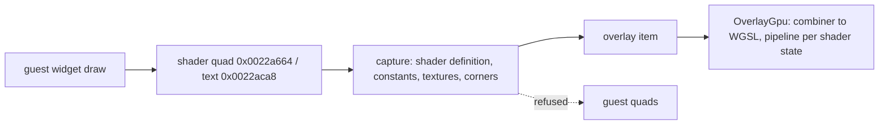

# The HUD on the overlay

Status: Partly built. HUD bitmap and text widgets draw from the overlay with the shader state the guest sets; widgets the overlay cannot match stay on the guest's quads. Pixel parity needs a live check.
Code: `crates/rewrites/render-bridge/src/native_hud/hud_overlay.rs`, `crates/extensions/game/src/hud_overlay.rs`, `crates/rewrites/native-render/src/ui_gpu.rs`, `overlay.rs`. Tests: `crates/rewrites/render-bridge/tests/native_hud.rs`.
Switch: `impl.render.native` (on), listed in [switches.md](../runtime/switches.md).

The guest gates and places each HUD bitmap or text widget. The overlay captures the quad at the shader quad, with the pixel shader definition and constants the guest has bound, and draws it in place of the guest's draw. The producers and the fallback rules are in [native-ui-producers.md](native-ui-producers.md).

## Bitmap widgets

A bitmap enters the overlay at `0x0022a7f6`, after the shader setup and before Begin. The bitmap helper's ordinary draw calls `0x0022a664` at `0x0022b690`. Special type 5 calls it in a loop at `0x0022b55c`, setting the inputs for each shield layer.

Capturing one quad per invocation preserves layer order, animation and the engine's choice of sprite. Each item carries the shader datum and the four `hud_input` values at `0x004e6980`.

A menu shader bitmap (type 9) is drawn the same way. Its draw `0x002b11c9` copies the widget's four shader inputs (`+0x74`) through `0x001392f8` to `+0x1c0` of the UI globals `[0x00510c4c]`, then calls `0x0022a664` at `0x002b12ae` with the definition's bitmap (`+0x10`), image (`+0x0a`) and shader (`+0x18`). At the shader quad, `native_hud::hud_overlay::menu_shader_quad` reads those arguments and the UI's inputs into the item's `hud_input` slot. The quad is captured as a HUD widget's is, with its template's combiner and evaluated constants (`menu_shader_quads`, `menu_shader_fallback`).

## Text widgets

The text widget binds its shader before the string draw at `0x0022aca8`. The glyph callback retains that shader and samples the live glyph cache, and the selected combiner computes the glyph's colour. Capturing the glyph after layout preserves spacing and per-corner diffuse colour.

A text widget the list walk draws (`hud_edit::overlay::draw_list` under `Shading::Engine`) is one `TextRun` over its font's glyph pages, laid out by `font::layout`. Its colour is what the shader's captured state gives a fully covered glyph texel under white diffuse (`native_render::ui_gpu::glyph_colour`: the reference combiner interpreter over the definition and its evaluated constants).

The string is the game's. For a widget without the number or name flags, `0x22a97b` calls `0x13925f` with the string ID at `+0x28`, which finds the ID among the language's range of the HUD's `unic` (`engine::locale::LocaleTable::find`, language at `0x0047ff38`, range pairs from `unic` `+0x10`) and decodes the UTF-8 (`0x140440`). The string draw `0x22d2b7` then swaps button glyphs and replacement patterns (`0x22d2ee`). `render_bridge::native_hud::hud_overlay::localized` reads the text the same way and returns nothing for a string that draw would change.

A text widget with no shader capture, no resolved string or no fonts stays inexact (`Inexact::Text`), so a HUD that has one is drawn by the guest's glyph quads.

## Shader state

`game::hud_overlay` takes the selected pixel shader definition and its evaluated constants from the draw snapshot. This covers full shader binds and constants-only updates, including successive instances of the same meter template at different fill values. The vertex program supplies screen positions, texture coordinates and diffuse colour.

`native_render::ui_gpu::OverlayGpu` translates the decoded register combiners to WGSL, caches the pipeline by shader state and uploads the current constants for the draw. The pass uses the bound texture, blend, colour write mask and clip ([shader setup trace](notes/2026-11-24-hud-shader-setup.md)).

Admission handles affine fans and projected 2D texture stages. Each stage uses its own bound texture, sampler and vertex-program coordinates, and the waypoint emblem combines separate foreground and background images. A draw outside the supported material, raster or texture state continues through the UI fan path.

A reserved draw keeps its resolved packet for replay if the worker cannot record the overlay. A kept scene carries the widget's pass with its packet and records it again (`WidgetPass::replays_scene`), so its `Bound` textures are the recording's own stage views. The `native_ui_overlay_hud_*` counters distinguish bitmap and glyph reservations and refusals, display recordings and failed recordings.

## Glyphs

The overlay's text runs sample glyph pages (`native_render::overlay::GlyphPages`, one per engine font), which the host fills from the disc's fonts as the game serves them.

| Symbol | Role |
|---|---|
| `game::hud_overlay::fonts` | reads `font_table.txt` and each font file it names once, through the VFS (the game's font rewrites applied), and shares them: engine font N is line N of the table. It reads the Latin table, not the `font_table_{cht,jpn,kor}.txt` of a CJK language |
| `game::hud_overlay::assets` | the loaded map's `OverlayAssets`: the glyph pages every list drawn from the overlay shares, new at each map |
| `game::hud_overlay::fill_glyphs` | takes a list and puts every glyph of its text runs into the pages (below) |
| `ui_gpu::OverlayResidency` | writes a page whole when it first appears and, as it grows, only the rectangles of the glyphs added since the version it holds (`GlyphPages::added_since`): each glyph is decoded once and its texels uploaded once |
| `game::hud_overlay::place_menu` | fills a menu's list from these fonts and pages before it places the pass, which draws through `game::hud_overlay::OverlayPass` |

`fill_glyphs` decodes, for each engine font and glyph index not in its page, the glyph from the font (`font::Font::glyph_by_index`) and writes it white with its ARGB4444 alpha times 17 as coverage. A glyph already in a page is not decoded again, so a list filled again adds nothing and `Ok(())` says the list can draw. The first glyph the fonts do not give is the error (no such font, a bad record, no room in the page). A run whose glyph is missing at plan time is dropped and counted `native_ui_overlay_refused_glyph`; the rest of the list draws.

A page keeps coverage alone, so a glyph with colours of its own (a medal, a button icon) draws in its run's colour.

## Not verified

- HUD pixel parity on the lab. From the same saved camera and tick, capture `render.frame` with `impl.render.native` off and on. Compare empty, partial and full ammo and shield meters, a flashing ammo count and a two-colour waypoint emblem, including a split-screen view and a scaled display copy. Compare RGBA in each widget rectangle and check `render.stats` for bitmap and text reservations, display recordings and zero fallback or failed recordings for the exercised widgets.

## Related

[native-post-hud.md](native-post-hud.md), [native-ui-producers.md](native-ui-producers.md), [native-menus-overlay.md](native-menus-overlay.md), [hud-kit.md](../game/hud-kit.md), [hud-editor.md](../editor/hud-editor.md).
