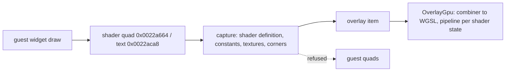
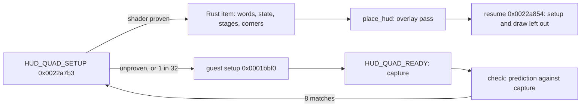
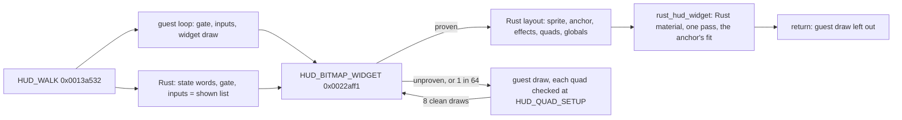

# The HUD on the overlay

Status: Partly built. HUD bitmap and text widgets draw from the overlay with the shader state the guest sets; widgets the overlay cannot match stay on the guest's quads. A HUD quad whose shader's Rust material is proven against the guest's draws is drawn with no guest shader setup, and a bitmap widget whose Rust layout is proven the same way is drawn with no guest draw at all. Text layout and the screen-effect draw are the guest's. What the overlay keeps is counted by kind and cause. Pixel parity needs a live check.
Code: `crates/rewrites/render-bridge/src/native_hud/hud_overlay.rs`, `hud_inputs.rs`, `kept.rs`, `walk.rs`, `crates/rewrites/hud-kit-core/src/walk.rs`, `crates/rewrites/scene-extract/src/hud.rs`, `crates/rewrites/engine/src/hud_effects.rs`, `crates/extensions/game/src/hud_overlay.rs`, `hud_native.rs`, `crates/rewrites/native-render/src/hud_material.rs`, `ui_gpu.rs`, `overlay.rs`, `layer_pass/animation.rs`. Tests: `crates/rewrites/render-bridge/tests/native_hud.rs`, the unit tests of `hud_material.rs`, `hud_inputs.rs`, `kept.rs`, `hud_native.rs`, `hud_effects.rs`, `scene-extract`'s `hud.rs` and `native_hud/walk.rs`, and `hud-kit-core/src/walk_tests.rs`.
Switch: `impl.render.native` (on); `impl.render.native-hud` (on) for [the material in Rust](#the-material-in-rust); `impl.render.native-hud-walk` (on) for [the walk in Rust](#the-walk-in-rust). All in [switches.md](../runtime/switches.md).

The guest gates and places each HUD bitmap or text widget. The overlay captures the quad at the shader quad, with the pixel shader definition and constants the guest has bound, and draws it in place of the guest's draw. The producers and the fallback rules are in [native-ui-producers.md](native-ui-producers.md).

## Bitmap widgets

A bitmap enters the overlay at `0x0022a7f6`, after the shader setup and before Begin. The bitmap helper's ordinary draw calls `0x0022a664` at `0x0022b690`. Special type 5 calls it in a loop at `0x0022b55c`, setting the inputs for each shield layer.

Capturing one quad per invocation preserves layer order, animation and the engine's choice of sprite. Each item carries the shader datum and the four `hud_input` values at `0x004e6980`.

Every HUD caller of the shader quad is captured this way, and proven and drawn from its Rust material as a widget is (`native_hud::hud_overlay::tag_quad`, by the call's return, `native_hud::kept::quad_kind`):

| Kind | Draw | Quad returns (Code) |
|---|---|---|
| `widget`, `crosshair` | bitmap widgets `0x0022aff1`, `0x0022bbca`; the crosshair is a widget held at anchor 4, the centre (its anchor call at `0x0022b055` gives the id in EAX) | `0x0022b39c` .. `0x0022b7d3`, `0x0022bca9` |
| `training` | the training box's frame `0x001e9140` | `0x001e936f` .. `0x001e95bb` |
| `navpoint` | the arrow `0x0024e9c7`, the outline `0x0024f0fc` | `0x0024eca5`, `0x0024f35c` .. `0x0024f55b` |
| `waypoint` | the marker `0x0024ef29` (from `0x0024ecae`) | `0x0024f0bb` |
| `indicator` | the indicator group `0x00200462` | `0x00200784` |

Another caller keeps the generic fan path. The `hud_input` slot of a non-widget quad holds what `0x004e6980` holds at its draw, which is also what its shader reads.

Each placement takes the UI fit the guest's draw carries at that point in the frame (`d3d::backend::UiFit`), set per HUD group by the anchor rule (`canvas_fit::anchor_fit`, [high-resolution.md](high-resolution.md)); a pass placed from Rust takes the device's fit at its placement (`hud_overlay::place`). No item is placed on its own.

A menu shader bitmap (type 9) is drawn the same way. Its draw `0x002b11c9` copies the widget's four shader inputs (`+0x74`) through `0x001392f8` to `+0x1c0` of the UI globals `[0x00510c4c]`, then calls `0x0022a664` at `0x002b12ae` with the definition's bitmap (`+0x10`), image (`+0x0a`) and shader (`+0x18`). At the shader quad, `native_hud::hud_overlay::menu_shader_quad` reads those arguments and the UI's inputs into the item's `hud_input` slot. The quad is captured as a HUD widget's is, with its template's combiner and evaluated constants (`menu_shader_quads`, `menu_shader_fallback`).

## Text widgets

The text widget binds its shader before the string draw at `0x0022aca8`. The glyph callback retains that shader and samples the live glyph cache, and the selected combiner computes the glyph's colour. Capturing the glyph after layout preserves spacing and per-corner diffuse colour.

A text widget the list walk draws (`hud_edit::overlay::draw_list` under `Shading::Engine`) is one `TextRun` over its font's glyph pages, laid out by `font::layout`. Its colour is what the shader's captured state gives a fully covered glyph texel under white diffuse (`native_render::ui_gpu::glyph_colour`: the reference combiner interpreter over the definition and its evaluated constants).

The string is the game's. For a widget without the number or name flags, `0x22a97b` calls `0x13925f` with the string ID at `+0x28`, which finds the ID among the language's range of the HUD's `unic` (`engine::locale::LocaleTable::find`, language at `0x0047ff38`, range pairs from `unic` `+0x10`) and decodes the UTF-8 (`0x140440`). The string draw `0x22d2b7` then swaps button glyphs and replacement patterns (`0x22d2ee`). `render_bridge::native_hud::hud_overlay::localized` reads the text the same way and returns nothing for a string that draw would change.

A text widget with no shader capture, no resolved string or no fonts stays inexact (`Inexact::Text`), so a HUD that has one is drawn by the guest's glyph quads.

## Shader state

`game::hud_overlay` takes the selected pixel shader definition and its evaluated constants from the draw snapshot. This covers full shader binds and constants-only updates, including successive instances of the same meter template at different fill values. The vertex program supplies screen positions, texture coordinates and diffuse colour.

`native_render::ui_gpu::OverlayGpu` translates the decoded register combiners to WGSL, caches the pipeline by shader state and uploads the current constants for the draw. The pass uses the bound texture, blend, colour write mask and clip ([shader setup trace](notes/2026-11-24-hud-shader-setup.md)).

Admission handles affine fans and projected 2D texture stages. Each stage uses its own bound texture, sampler and vertex-program coordinates, and the waypoint emblem combines separate foreground and background images. A draw outside the supported material, raster or texture state continues through the UI fan path.

A reserved draw keeps its resolved packet for replay if the worker cannot record the overlay. A kept scene carries the widget's pass with its packet and records it again (`WidgetPass::replays_scene`), so its `Bound` textures are the recording's own stage views. The `native_ui_overlay_hud_*` counters distinguish bitmap and glyph reservations and refusals, display recordings and failed recordings.

## The material in Rust

A HUD bitmap widget's quad can draw with no guest shader setup: its material is read from the map, not from the device after `0x0001bbf0` has run. Each shader is proven against the guest's own draws first.

| Step | Symbol | What |
|---|---|---|
| Material | `native_render::hud_material::HudShader::resolve` | the shader's one pass implementation across its template's layers; its stages, samplers, alpha kill and entry render states |
| Inputs | `render_bridge::native_hud::hud_inputs::function_input` | the HUD's function inputs, the callback `0x0022ace7` in Rust |
| Constants | `HudShader::words`, `layer_pass::sample_with_inputs` | the definition's words with animated constants at the render clock `0x004858a0`; each property's `x` from its `input`, the range input `y` from `input_a` (`0x0001b230` with a provider) |
| Prediction | `game::hud_native::predict` | the item but for its target and clip; corners from the quad's own vertices |
| Check | `game::hud_native::check`, `compare` | at each captured widget quad: words, then blend and write state, then stages and sampler, then corners and coordinates |
| Draw | `game::hud_native::draw`, `hud_overlay::place_hud` | a proven shader's quad as one overlay pass at the setup site, with the proof's target and clip |

The callback's names (string IDs) and values (Code, `h2 disasm 0x22ace7 100`):

| Name | Value |
|---|---|
| `0x0a0005cf`..`0x0a0005d2` | `hud_input1`..`4`, `[0x004e6980]`.. (the widget helper writes them, `0x0022b380`) |
| `0x0d0005ca`, `0x0c0005cb`, `0x0c0005cc`, `0x0e0005cd` | `[0x004e6968]`, `[0x004e696c]`, `[0x004e6970]`, `[0x004e6974]` |
| `0x11000600` | the short at `[0x00510c4c] + 0x1d0` times `[0x0045de4c]` |
| `0x090005ce`; `0x0d0005ff`, `0x170005fa`, `0x170005fb`, `0x180005fc`, `0x1d0005fd`, `0x1d0005fe` | a call (the user's unit state `0x0022acb4`; the UI's `0x0014cca0`, `0x0014ccf0`): not read, the shader stays on the guest's setup |
| any other | 1.0 (`[0x0045dbc0]`) |

The widget's bitmap is engine texture 16 (`0x00019530`'s entry `0x00019817` binds `[0x004e6978]`, `[0x004e697c]`).

| Rule | Why |
|---|---|
| A shader is proven by 8 matching quads (`PROOF_DRAWS`) | a prediction is drawn only where it has been the guest's draw |
| One mismatch keeps the shader on the guest's setup for the map | no item differs from the guest's on purpose |
| A proven shader's quads drawn on a second target or clip fail it | the setup site does not read the viewport (split screen) |
| One proven quad in 32 (`RECHECK`) runs the guest's setup and is checked again | a later difference is caught |
| Refused: more than one pass implementation, per-draw engine inputs, engine-driven or animated states, a stage that is not the widget's bitmap, an instance bitmap or none, a blend the implementation does not set | each is something the guest's setup reads that the material does not |

Skipping the setup leaves the shader cache at `0x00485b48` as the last guest setup left it, which is what the device holds, so the next guest setup compares against the right state.

Counters (`render.stats`, `native_ui_overlay_hud_rust_*`): `drawn`, `matched`, `proven`, `mismatch_words`, `mismatch_state`, `mismatch_stages`, `mismatch_corners`, `refused`, `recheck_failed`.

## The walk in Rust

The guest's walk of a HUD definition (`0x0013a532`) is ported to `hud_kit_core::walk`, with no guest types; `scene_extract::hud` reads what it needs. A proven bitmap widget is laid out and drawn by Rust and its guest draw (`0x0022aff1`) is left out.

| Part | Guest | Rust |
|---|---|---|
| State words | `0x0013a050` | `walk::state_words` |
| Gate | `0x0013ac87` | `walk::gate` |
| Inputs | `0x0013ad48` | `walk::inputs` |
| Order | `0x0013a532`: screen effects, bitmaps, texts, each in the definition's | `walk::shown` |
| Anchor | `0x001396c7`, the aim point `0x00139799` | `walk::anchor_point`, `scene_extract::hud::aim` |
| Sprite | `0x0022ae21` | `walk::sprite` over `hud::GuestBitmap` |
| Effects | `0x0022bcaf` | `engine::hud_effects::apply`, on the SSE and x87 models |
| Bitmap widget | `0x0022aff1`: mirrors, the meter, list and colour types, its globals at `0x004e6978`..`0x004e69b0` | `walk::bitmap_widget` |
| Quad vertices | `0x0022a664` to its setup | `walk::vertices` |
| Screen-effect widget | `0x0022b8e2` to its call of `0x0002d140` | `walk::screen_widget` (the call's grid) |
| Text widget | `0x0022aa16` to its string | `walk::text_widget` (the string's place) |

| Rule | Why |
|---|---|
| Rust draws a bitmap widget only when `walk::shown` selected it with the inputs the guest's loop gives it (`unselected`) | the loop's gate and input hooks (the HUD kit, a converted Halo 1 HUD) stay in force |
| A widget is proven by 8 draws (`walk::PROOF_DRAWS`) whose every quad matched Rust's at `HUD_QUAD_SETUP`: vertices, bitmap, image, shader and globals, bit for bit, and the same quad count | Rust draws only what has been the guest's draw |
| One draw in 64 (`walk::RECHECK`) of a proven widget is the guest's and is checked again | a later difference is caught |
| A draw that differs keeps the widget on the guest for the map (`differed`) | no widget differs from the guest's on purpose |
| The widget's shader must be proven too ([the material in Rust](#the-material-in-rust)); its quads are one overlay pass or none (`host`) | a half-drawn widget is never shown |
| The pass draws under `render_aspect::hud_group_fit` at the widget's anchor and its point, then the enclosing fit is set back | the placement rule is the guest group's (`canvas_fit`) |
| Rust writes the globals the guest's draw would leave | the next guest quad's shader reads them |
| Left to the guest: a widget another feature changes at its hooks (`feature`: `walk::add_foreign`), emblem types 1 and 2 (`emblem`), an anchor past the centre (`anchor`), an effect input the callback computes by a call (`effect`), an image whose texture `0x0003bcb0` would fetch (`texture`), vertices outside the capture's check (`vertices`), a failed read (`read`) | each is something the guest's draw reads or does that the layout does not |

Hooks (`native_hud::place_walk`, feature `native-hud`, all optional): `HUD_WALK` before and after, `HUD_SCREEN_WIDGET` and `HUD_TEXT_WIDGET` before, `HUD_BITMAP_WIDGET` before and after. No other feature hooks these points, so they need no order. The quad check runs inside `native_hud_rust_quad` at `HUD_QUAD_SETUP`, before the material's draw.

Counters (`render.scene`, `native_ui_overlay_hud_walk_*`): `drawn`, `proven`, `shadow_matched`, `shadow_differed`, each refusal above, and `selection_matched`, `selection_differed`, `selection_foreign` (the guest's widget calls of one walk against `walk::shown`; `foreign` when the definition has another feature's widget).

Not built: the text widget's layout and draw and the screen-effect widget's draw are the guest's; Rust has only their selection and their place.

## What is kept

A HUD item the overlay does not draw keeps its guest draw and is counted `scene_kept_overlay_<kind>_<cause>` (`native_hud::kept`; kinds and causes in [retire-d3d.md](retire-d3d.md#r6s-remainder)). The producer names the kind before it asks the host (`kept::begin`), the capture names the first refusal (`kept::refuse`, from `hud_overlay::Widget::plan`), and a draw taken by the resolved packet in place of the overlay is `packet` (`kept::carried`). Text, the motion sensor's fans and the HUD's screen-effect calls (`0x0022bbc0`) are counted the same way. A guest draw in the HUD scope that no producer offered is `untraced`.

## Glyphs

The overlay's text runs sample glyph pages (`native_render::overlay::GlyphPages`, one per engine font), which the host fills from the disc's fonts as the game serves them.

| Symbol | Role |
|---|---|
| `game::hud_overlay::fonts` | reads `font_table.txt` and each font file it names once, through the VFS (the game's font rewrites applied), and shares them: engine font N is line N of the table. It reads the Latin table, not the `font_table_{cht,jpn,kor}.txt` of a CJK language |
| `game::hud_overlay::assets` | the loaded map's `OverlayAssets`: the glyph pages every list drawn from the overlay shares, new at each map |
| `game::hud_overlay::fill_glyphs` | takes a list and puts every glyph of its text runs into the pages (below) |
| `ui_gpu::OverlayResidency` | writes a page whole when it first appears and, as it grows, only the rectangles of the glyphs added since the version it holds (`GlyphPages::added_since`): each glyph is decoded once and its texels uploaded once |
| `game::hud_overlay::place_menu` | fills a menu's list from these fonts and pages before it places the pass, which draws through `game::hud_overlay::OverlayPass` |

`fill_glyphs` decodes, for each engine font and glyph index not in its page, the glyph from the font (`font::Font::glyph_by_index`) and writes it white with its ARGB4444 alpha times 17 as coverage. A glyph already in a page is not decoded again, so a list filled again adds nothing and `Ok(())` says the list can draw. The first glyph the fonts do not give is the error (no such font, a bad record, no room in the page). A run whose glyph is missing at plan time is dropped and counted `native_ui_overlay_refused_glyph`; the rest of the list draws.

A page keeps coverage alone, so a glyph with colours of its own (a medal, a button icon) draws in its run's colour.

## Not verified

- That any retail HUD shader proves: the corners are predicted from the quad's own vertices with no vertex program, the sampler from the tag's stage states as D3D values, the blend from the implementation's states over `gfx`'s defaults. `mismatch_*` names the first part that differs.
- That an overlay pass (`OverlayPass`) places a quad on the same pixels as the widget pass: it does not snap positions to sixteenths (`raster_position`).

- That any retail widget's Rust layout proves (`shadow_differed` counts one that does not), and that `selection_differed` stays at zero on retail definitions.
- That the navpoint, waypoint, training and indicator shaders prove: each is checked as a widget's is, and `mismatch_*` names what differs.
- That the outline `0x0024f0fc`'s six quad calls are all the outline's (**S**).
- HUD pixel parity on the lab. From the same saved camera and tick, capture `render.frame` with `impl.render.native` off and on. Compare empty, partial and full ammo and shield meters, a flashing ammo count and a two-colour waypoint emblem, including a split-screen view and a scaled display copy. Compare RGBA in each widget rectangle and check `render.stats` for bitmap and text reservations, display recordings and zero fallback or failed recordings for the exercised widgets.

## Related

[native-post-hud.md](native-post-hud.md), [native-ui-producers.md](native-ui-producers.md), [native-menus-overlay.md](native-menus-overlay.md), [hud-kit.md](../game/hud-kit.md), [hud-editor.md](../editor/hud-editor.md).
