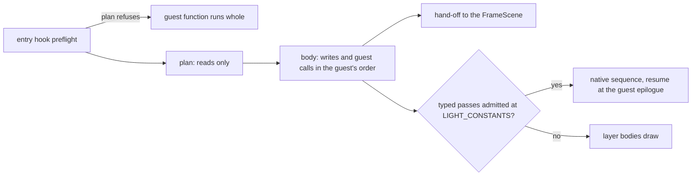

# Native light gather and passes

Status: Partly built. L1 to L7 implement the visible list and history, light volumes, frame and per-light passes, record and item walks, scene hand-off, first-person lights and the object-shadow list, rows and mask casters. L8 admits complete, same-target diffuse and specular passes for dynamic lights and the final first-person slot. Shadow targets, filters and shader gels use the existing layer bodies. L9 and the live parity and timing gates are open.
Code: `crates/rewrites/engine/src/render/light_gather.rs` and `light_gather/` (including `object_shadows.rs`, `object_shadows/rows.rs`, `object_shadows/caster.rs`, `typed.rs` and `typed_tail.rs`), `crates/rewrites/engine/src/render_loop/world_walk.rs` (the record walks), `crates/rewrites/render-bridge/src/native_lights/` (`frame.rs`, `items.rs`, `passes.rs`, `first_person.rs` and `object_shadows.rs` install the bodies, `handoff.rs` supplies the scene lights, `typed.rs` and `typed_groups.rs` admit whole passes), `crates/rewrites/native-render/src/light_graph.rs`, `crates/platform/d3d/src/device/external_sequence.rs`, `crates/rewrites/render-bridge/src/native_scene_lists/lights.rs` (fallback leaves). Tests: [native-light-gather-checks.md](native-light-gather-checks.md) names them per slice.
Switch: `impl.render.native` (on), listed in [switches.md](../runtime/switches.md). No slice adds a switch.

Slice R3 of [retire-d3d.md](retire-d3d.md): the guest's light front-end is replaced by Rust bodies. Three guest entries draw lights, and each becomes a body that owns the decisions as typed data (a `LightFrame`), makes the guest's writes while a guest consumer is left, and puts the lights, their groups and their passes into the `FrameScene`. The one rule: a body that has made its first guest write finishes the frame; it never hands a half-run frame back to the guest function.

| Entry | Address | Called from | Rust body |
|---|---|---|---|
| Dynamic lights | `0x00031c80`, per-light passes `0x00031170` | the lights pass of the view's frame | `light_gather::frame::run`, `passes::run` |
| Object shadows | `0x000335e0`, rows `0x00033400`, caster `0x00032350` | the lightmap pass | `light_gather::object_shadows::run` |
| First-person lights | `0x000404b0`, records `0x000402b0`, reset `0x0003fd70` | between the two first-person draws | `light_gather::first_person::run` |

Evidence labels as in [docs-style.md](../meta/docs-style.md). Addresses and offsets are research points.

## How it works

### The three entries and their phases (Design)

The entry hooks preflight guest state synchronously. Rust gather bodies run through `hooks::entry::start_render`. The L8 hooks offer typed passes at the guest call to `LIGHT_CONSTANTS` after gathering. A refused entry runs its original function with the entry registers and stack intact.

| Phase | Covers | D3D calls |
|---|---|---|
| Gather | which lights, their weights, the pose, the volume, the shadow decision, the light's visibility, its render records and its two item lists | none (**Run**: [notes/scene-pass-timing.md](notes/scene-pass-timing.md) counts zero D3D entries for the site outside the per-light passes) |
| Passes | the light's constants, the scissor, the gel, the shadow projection, and layers 10, 11, 14, 12 and 13 | the layer draws |

A body calls a guest function with `Cx::call` wherever the Rust form is not built or refuses a case. Three groups of guest calls outlive R3 and belong to R4 ([retire-d3d.md](retire-d3d.md), "Visibility"): the light frusta `0x000c1d90`, the traversal inside `0x001320f0`, and the part visibility `0x00044720`.

### The data model (Design)

All of it lives in `engine::render::light_gather`. Floats that the guest only copies are kept as their bits, so NaNs and stale words survive.

| Type | Holds |
|---|---|
| `VisibleLight` | one row of the visible list (`0x14` bytes at the guest's buffer): `local_owner` `+0`, `first_person` `+1` (definition bit 5), `owner_kind_2` `+2`, `keep` `+3` (definition bit 20), `light` datum `+4`, `root_owner` `+8`, `weight` `+0xc` (f32 bits: the record's on the way in, the faded one on the way out), `priority` `+0x10`. The four bytes are kept as written: the ranking tests each against zero |
| `HistoryRow` | one row of a per-view history (`0x24` bytes): the `VisibleLight` at `+0..+0x14`, `rate` `+0x14`, `weight` `+0x18`, `seen` `+0x1c` (the render frame it was last a candidate), `first` `+0x20` (the render frame it entered) |
| `History` | up to 32 rows, the count at `+0x480`. A removal copies the last live row over the removed one, so a slot past the count keeps what was last written there: `slots` is every slot written since the decode, the first `count` live |
| `LightFrame` | what one call of `0x00031c80` decides, in draw order: `view`, `render_frame`, `lights`, `first_person` |
| `FrameLight` | per light: `row`, `drawn` (weight above the threshold word), `definition` (the `ligh` datum) and its flags, `owner` (record `+0x4c` when `+0x54` is not -1, else -1), `root`, `repose` (`None` or `Asked { answered }`), `volume` (31 words), `slot`, `shadow` (the gather's decision), `source_vis` (restricted to the main view's clusters), `cluster`, `frusta`, `records` (its render records), `receivers` (list 1), `casters` (list 2), `passes` |
| `LightPasses` | `shadow` (after the caster list's layer-10 bit), `flags`, `steps` (up to six `frame_scene::LightStep`), `additional_casters` |
| `FirstPersonLights` | the table at `0x004c6700`: eight `FirstPersonSlot`s of `0x408` bytes, each a `light` at `+0x400` and up to 32 records of `0x20` bytes with the count (i16) at `+0x404` |

`object_shadows::rows::Rows` holds a view's decoded `History` and ranked rows. The outer loop loads the two arguments of `0x00032350` from each row at its call site. The shadow observer records that pair in the scene.

**What stays in guest memory.** The two histories are the only state that crosses frames. They stay at their guest addresses and the model decodes and encodes them each frame, so the installing feature stays `SnapshotPolicy::Stateless`, and snapshots, films, `impl.render.native=off` and `render.parity` see one copy. Every other guest write below is a mirror for a guest consumer (the fallback path, the handlers a refused group still runs, `render.parity`) and is deleted with that consumer in R10.

### The scratch frame (Design, from E)

`0x00031c80` keeps its locals in `0x1508` bytes below its entry `ESP` and passes pointers into them to its callees (**E** `0x00031c80`, `0x00031c85`). The body uses the same bytes at the same offsets, so a guest callee is handed the pointers the guest would hand it and the differential transcripts are equal. With `E` the entry `ESP` and `S = E - 0x1518`:

| At | Holds |
|---|---|
| `S+0xc` | the visible list's argument, `S+0xb0` (**E** `0x00031c91`): the probe leaves `ESP` at `S+0x10`, so the push lands below it; with lights to draw, the saved `EBX` overwrites it |
| `S+0x10` | the shadow byte; `0x00031660` is handed its address, `0x00031170` its dword, whose upper bytes are whatever the stack held |
| `S+0x18` | the frusta count `0x000c1d90` writes (i16) |
| `S+0x34` | the posed volume, `0x7c` bytes |
| `S+0xb0` | the visible rows, up to 128 of `0x14` bytes |
| `S+0xab0` | the frusta, up to six of `0x1bc` bytes |

`Cx::call` places a call's frame at the entry `ESP`, which would overwrite these. `GuestCall::reserve(bytes)` makes the call with `ESP` lowered by that much first (`crates/hooking/guest-layout/src/entry.rs`, the driver in `crates/hooking/hooks/src/entry.rs`, and `entry::testing::run`, which writes the arguments where the driver pushes them). Every call a light body makes reserves its frame.

The rest of the frame is private: the saved registers (`S..S+0x10`), the row cursor (`S+0x14`) and `S+0x1c..S+0x34` (`D`, the cluster, the root, the rows left, the source visibility, the datum). No callee is handed them and the body keeps them in Rust.

### The dynamic lights, step by step (E `0x00031c80`..`0x00031f4f`)

`L` is the light record, `D` the definition, `V` the light's visibility struct `0x0054aa68`.

| # | Step | Reads | Writes | Guest function |
|---|---|---|---|---|
| 1 | The list | as `light_gather::visible::list` reads | the view's history and its count; the rows at `S+0xb0` | `0x00031910` (`0x0004a7c0`, `0x0004ac30`): Rust |
| 2 | Per row: drawn | row `+0xc` against the word at `0x0045dc58` (`comiss`, `jbe`: a NaN is not drawn) | none | inline |
| 3 | Record and definition | `[0x004e030c]+0x44`, `L+4`, the tag table `[0x004e3b44]` | none | inline |
| 4 | Owner and root | `L+0x54` (i16), `L+0x4c`, the object headers `[0x004e0300]+0x44` (stride `0xc`), each body `+0x14` | none | inline |
| 5 | Re-pose, when `L+0x54` is not -1 and `D` has bit 5 without bit 18 | the marker name of the owner's attachment `L+0x54`; the first-person state `0x0016640f` reads | `L+0x84`, `L+0xac`, `L+0xb8` when the lookup answers; always `L+0x90..+0x98` = `+0x84` + `+0xac`, and `L+0xb8` made orthogonal to `+0xac` and normalised | `0x000b8c40` (ECX owner, AX the index), `0x0016640f` (ECX owner; marker, `&L+0x84`, `&L+0xac`, `&L+0xb8`; `ret 0x10`), `0x00031b40` (EAX `&L+0xb8`, ECX `&L+0xac`; x87, tail call to `0x00030bf0`) |
| 6 | Volume | as `light_gather::volume::light_volume` reads | `S+0x34` | `0x000c17f0` (EAX `S+0x34`, EDX the datum, one stack word 1, `ret 4`); AL is ignored |
| 7 | First-person slot | `[0x00509440]` | when below 8: `[0x004c6b00 + 0x408·n]` = the datum, `[0x00509440]` = n+1 | inline |
| 8 | Shadow | `D` bit 3 clear, the byte `[0x004ba020]`, `L+0xf8` above the zero word, the volume's kind not 0; the byte `[0x004ba010]` (set: no source visibility) | `S+0x10` | inline |
| 9 | Cluster | `L+0x48` (i16); when -1 and `D` has bits 5 and 18: `[0x004b9ee4]` | none | inline |
| 10 | Frusta | `L+0x84`, the volume | `S+0xab0`, `S+0x18` (six for kind 0, else one) | `0x000c1d90(&L+0x84, S+0x34, S+0xab0, S+0x18)`, `ret 0x10` |
| 11 | Visibility | the frusta, `L+0x18`, `L+0x24`, the source struct | `V` whole; `[0x004c0b80]` = `V`; the epochs `[0x004de2fc]`, `[0x004e0308]`, `[0x004e7c1c]` and their flag bytes; the stamps the two Rust gathers write | `0x001320f0`: EAX 1, ECX the count, DL 0; stack `((D flags >> 12) & 0x400, S+0xab0, &L+0x18, L+0x24, 0x00547f88 or 0, 0, cluster)`; `ret 0x1c`; returns `V` |
| 12 | Geometry flags | as `LIGHT_GEOMETRY_FLAGS` | `V`'s flag columns, `L+0xf8` | `0x00031660`: Rust |
| 13 | Extra caster, `D` bit 22 | as `LIGHT_EXTRA_CASTER` | `V`'s object list | `0x00031c20`: Rust |
| 14 | Records | `V`'s three lists | `[0x004c0b78]` = `[0x004c0b7c]`, then the records `0x004ba138 + 0x20·i`, the bytes at `0x004c0b84 + i` and `0x004c0ed6 + i` | `0x0002cb30`; `0x00133390` (EBX `V`) and `0x00133520(V)`: Rust (`world_walk::records`); `0x00133720` (EAX `V`, one stack word 1) |
| 15 | Part visibility | the records, `V` | the records' subpart masks | `0x00044720` |
| 16 | Passes | below | below | `0x00031170`: EAX the `ligh` datum, ECX `S+0x34`; stack (datum, `&L+0x84`, the dword at `S+0x10`, the row's weight) |

In `V`'s kind (`[V+0x2a78]` not 0) the record writer `0x0002cbf0` advances `[0x004c0b78]` only (**E** `0x0002cf64`), so a light's records are `[0x004c0b7c, 0x004c0b78)` and each light reuses that tail.

### One light's passes (E `0x00031170`..`0x00031518`)

| # | Step | Detail |
|---|---|---|
| 1 | Item lists (Rust: `light_gather::items`) | `0x00040e90` with EAX 0 |
| 2 | Shadow | a set shadow byte becomes bit 10 of the caster list's mask `[0x004c1a80]` (**E** `0x0003119b`) |
| 3 | Constants | `0x0004a1e0` (`engine::light_constants::light_globals`) |
| 4 | Flags | `engine::light_passes::pass_flags`: `[0x004ba014]`, `[0x004ba018]`, colour B zeroed in place |
| 5 | Layers | `scene_extract::layout::light_passes::steps`: with flag bit 2 the shadow projection `0x00048ee0` and layer 10; layer 11; the additional casters `0x00030ed0`; layers 14, 12 and 13 |
| 6 | Tail | `[0x004858bc]` and `[0x004b843c]` zeroed, stencil off, the scissor cleared, the depth range reset (`0x00015720`), the view's target bound (`0x00014bc0`), both flag words zeroed |

**Step 1.** In the light's kind `0x00040e90` zeroes both lists' intervals and masks (`0x004c1a64`, `0x004c1a68`, `0x004c1a6c`; `0x004c1a7c`, `0x004c1a80`, `0x004c1a84`), runs the attachment walk `0x00041c80`, and calls `0x00044ac0(kind, -1, 0x1f)` (**E** `0x00040ee0`..`0x00040f0d`). `0x00044ac0` walks the light's records. A record with flag bit 10 is copied whole into the slot of `[0x00509440] - 1` when that slot holds under 32 (**E** `0x00044b3a`..`0x00044b66`).

Any other record that passes the filters gives each visible part to `0x00041040`. It appends the item to list 1 when the record has flag bit 1, and to list 2 when it has bit 2 (**E** `0x00041319`, `0x00041351`; the chooser `0x00040de0`).

**Step 3.** `0x0004a1e0` also asks `0x001650a0` for the sphere's screen bounds and runs `0x0003a550`: the shader-input dirty masks, the constant upload and the gel shader's draw into target 13. The layer's target setter installs the viewport and resets the device scissor.

**Step 5.** Each drawn layer is the begin (`0x00044370`, or the inline `0x00014bc0`, `0x00015680` pair with the layer words `0x00467130`, `0x00467134`, `0x00467138`), the stencil mode `0x00015370`, the draw `0x00044550` and the end `0x000445d0`.

### The first-person lights (E `0x000404b0`, `0x000402b0`, `0x0003fd70`)

`0x0003fd70` (from `0x0002bc66` in `render_view_scene`, before the view's scene call `0x0002b990`) empties the table: every slot's datum -1 and count 0, `[0x00509440]` 0, and the first-person record list (`0x004c8740`, count `[0x0050943c]`). `0x000404b0(mode)` (from `0x0002c2b9`, between the two first-person draws) then, for each slot with records:

1. poses the volume again (`0x000c17f0`);
2. `0x000402b0` (EDX the slot, one stack word the mode): zeroes both lists, copies the slot's records to `0x004ba138` from index `[0x004c0b7c]`, sets `[0x004c0b78]` past them, and gives each record's visible parts to `0x00041040` in the light's kind 1, with its fifth argument 1, so a part whose level has no layer but bit 15 is still appended (**E** `0x00040457`, `0x000412ad`). The mode picks the record filter, as in `0x00040e90`: 0 every record, 2 the bit `0x10`, any other `0x20` (**E** `0x0004033a`..`0x0004035d`). The record tests read the slot's record; the part calls read the copy;
3. sets the constants with shadow 0 and weight one (`0x0004a1e0`, EDX the light datum; the weight and the scale are the image's pushed words at `0x00040566` and `0x0004056d`);
4. sets the flags: bit 0 for a kind-0 volume, bit 1 for a colour B component above zero (`comiss`, `ja`: a NaN is not), bits 2 to 5 clear, and the passes byte `[0x004ba018]`;
5. draws layers 11, 14, 12 and, with bits 0 and 1, 13 on list 1, each only when the list's mask has its bit; no layer 10 and no additional casters. Layer 11 is reached whatever the flags;
6. runs the passes' tail, with the depth range inline: the device's range words and dirty bit, `0x003faae0` when its push buffer is full, and `0x003f6190` (**E** `0x000407bd`..`0x0004080f`). The port leaves the depth range out: it only fed D3D, and no device exists. The view's target gets AL 1.

The first-person visibility comparison rebuilds the replay slots from the dynamic passes' source records and compares each slot at this loop's entry. See [native-visibility.md](native-visibility.md#first-person-lights).

The loop keeps the slot index at `E-0x84`, the slot's datum address at `E-0x80` (`E` its entry `ESP`), the volume at `E-0x7c` and the draw byte at `E-0x85`. The layer-draw hook reads the index and the address from that frame (`native_lights::first_person_entry`), so the body writes them where the guest does. `0x000402b0` pushes the dword at its `E-0x3c`, whose low byte is the record's pixel byte and whose upper bytes are what that stack held, to `0x00041040`, and overwrites its own argument slot `E+4` with the slot record it reached.

Two things the port keeps (**S** until the differentials run them):

- After eight lights, step 7 of the gather stops adding slots while `0x00044ac0` keeps copying into the slot of `[0x00509440] - 1`, so a ninth light's first-person records join the eighth light's slot.
- A slot holds the record only. The replay reads the pixel byte `0x004c0b84 + i` and the attachment byte `0x004c0ed6 + i` at the record's new index, so it reads what the last gathered light left there. `LightFrame` therefore keeps those two byte ranges for the tail as the last light left them.

### The object shadows (E `0x000335e0`, `0x00033400`)

`0x000335e0(mode)` runs only with an active lightmap (`0x000226d0`) and the override's leave (`0x000335c0`). It sets `0x00485a46`, sizes target 9 (`0x0001ddd0`), sets `0x00509413`, gathers rows into the `0x280` bytes below its entry `ESP` (`0x00033400`, EBX the main view's object list `[0x00547f9c]`), calls `0x00032350(row+8, row+0xc)` per row and clears both bytes.

`0x00033400` takes up to 32 objects whose list flags fit the mode and that `0x0003d7f0` accepts. A row is the candidate row of the lights with the object in `+4` and `+8`, `0x0003d7f0`'s fade in `+0xc` and the projected size in `+0x10`. Byte 0 is `0x0003e9c0`'s answer and bytes 1 and 2 are zero.

It never writes byte 3 (**E** `0x00033558`..`0x00033562`), which the ranking reads as the keep byte, so the port reads that byte from the guest's buffer address. The rows go through the same merge and ranking as the lights (`0x0004a7c0`, `0x0004ac30`), on the view's history at `0x005246f8 + 0x484·view`, with the limit and step the call site passes (**E** `0x0003359b`, `0x000335ad`).

`0x00032350` is one caster: its own volume (`0x000c1930`, `0x000c1a80`), frusta, visibility, records (`0x0002cbc0`), part visibility, lists, constants, projection, layer 10, the filter `0x000222a0` and layer 11 ([native-shadows.md](native-shadows.md), "Object chain").

## Interfaces

| Point | Address | The body | Fallback while it exists |
|---|---|---|---|
| `RENDER_DYNAMIC_LIGHTS` | `0x00031c80` | `light_gather::frame::run` | the guest function, with the leaf seams of `native_scene_lists` |
| `SCENE_ITEMS` | `0x00040e90` | `light_gather::items::run` in a light's kind, installed by `render_bridge::native_lights::items` | the guest function: the main view's kind, a refused plan |
| `RENDER_LIGHT_PASSES` | `0x00031170` | `light_gather::passes::run` with the walk off, called by the frame body, or the guest loop offering typed passes at `LIGHT_CONSTANTS` with the walk on | the guest function |
| `FIRST_PERSON_LIGHTS` | `0x000404b0` | `light_gather::first_person::run_scene`, each slot drawn from the scene or dropped | none: a stand-down or a refused plan returns at once, counted |
| `FIRST_PERSON_LIGHT_RECORDS` | `0x000402b0` | `light_gather::first_person::run_records`, called by the first-person body and installed at the point | the guest function: a refused plan |
| `OBJECT_SHADOW_LIST` | `0x000335e0` | `light_gather::object_shadows::run` | the guest function |
| `GATHER_OBJECT_SHADOWS` | `0x00033400` | `light_gather::object_shadows::rows::run` | the guest function |
| `OBJECT_SHADOW` | `0x00032350` | `light_gather::object_shadows::caster::run` | the guest function |

`FIRST_PERSON_LIGHTS` and `FIRST_PERSON_LIGHT_RECORDS` are named points (`crates/hooking/guest-layout/src/points.rs`). Named points to come, all `[fn]` with the signatures above: `FIRST_PERSON_RESET` `0x0003fd70`, `LIGHT_VOLUME` `0x000c17f0`, `LIGHT_FRUSTA` `0x000c1d90`, `SCENE_VISIBILITY` `0x001320f0`, `SCENE_PART_VISIBILITY` `0x00044720`, `SCENE_ITEMS` `0x00040e90`, `RECORD_ITEMS` `0x00044ac0`, `LIGHT_REPOSE_BASIS` `0x00031b40`, `FIRST_PERSON_MARKER` `0x0016640f`.

### The scene hand-off

The scene's dynamic lights come from the frame body (`render_bridge::native_lights::handoff`). Before each drawn light's passes call, the body hands over the call it is about to make (`frame::Passes`: EAX, ECX and the four stack words; `frame::run_with`). The passes' entry pairs the hand-off with its registers, which must be the same call, and closes the scene's last light.

The passes' first call is the item lists `0x00040e90` (**E** `0x00031192`, returning to `0x00031197`). When the item body makes them, `FrameScene::lights` gets the light (`guest_selected`, `guest_weight` the row's weight, `flags` from the constants of the hand-off's call, `steps` from the `LightItems` layers), and the light becomes the resolved-draw candidate. The shadow word is step 2's: a set byte becomes the casters' layer 10 (`shadow_argument`). The scene reads no list mask back from guest memory for these lights.

A light of the guest's own loop (a refused frame plan), and a hand-off whose item lists the guest makes, are read from memory at the passes' constants call (`Source::observed`): the passes' stack words, the scene flags and both masks. At the passes' entry the masks are the last light's, so both paths wait for the completed lists.

The groups are the layer builds' sorted entries (`walk`, `scene_extract::light_groups`) and keep their type (`frame_scene::LightGroup`). A first-person light goes into the first person's view at its first layer draw, read from the loop's frame (`native_lights::first_person_layer`), and its groups are of their own site, `GroupSite::FirstPerson`.

Counters, tests and live checks per slice are in [native-light-gather-checks.md](native-light-gather-checks.md).

## Slices

| Slice | Size | State | Replaces |
|---|---|---|---|
| L1 | S | built | the model and the leaves: visible list, history, geometry flags, extra caster, volume |
| L2 | M | built | the frame body `0x00031c80` |
| L3 | M | built | a light's cluster and placement record walks |
| L4 | M | built | the item lists `0x00040e90` and the first-person table |
| L5 | M | built | the scene hand-off and the passes body `0x00031170` |
| L6 | M | built | the first-person lights `0x000404b0`, `0x000402b0` |
| L7 | M | built | the object shadows `0x000335e0`, `0x00033400`, `0x00032350` |
| L8 | L | partly built | whole typed passes for dynamic lights and the final first-person slot |
| L9 | S | open | the guest producers and the leaf seams |

Each slice lands on its own under `impl.render.native`, with the guest path whole behind `=off`. Sizes as in retire-d3d.md. Every slice's gate starts with the hash gate (framescene.md 9.3). Tests, live checks and refusals are in [native-light-gather-checks.md](native-light-gather-checks.md).

### L1: the model, and differentials for the built leaves (S)

`engine::render::light_gather::{visible, history}` hold `VisibleLight`, `HistoryRow`, `History` with `decode`/`encode`, and `merge`, `rank_and_fade(limit, step)` and the candidate tests, moved from `native_scene_lists/lights.rs` unchanged in behaviour. `visible::list` is `0x00031910`. A `Writes` list (address, bytes) is the output type; the seams in `native_scene_lists` convert it to their `Output`.

`geometry::flags` (`0x00031660`) and `extra_caster::list` (`0x00031c20`) sit beside them as functions of `(memory, typed arguments)`. `volume::pose` is the pose of `0x000c19f0` and `0x000c1a80` (`scene_extract::lights::volume` calls it), and `volume::light_volume` is `0x000c17f0`: its gates, the pose and AL. The seams' guest reads and writes are unchanged.

### L2: the frame body (M)

`GuestCall::reserve`, and `light_gather::frame::plan` (pure): the float state, the frame's stack, step 1 whole (`visible::list` into `S+0xb0`, its `Writes`), and for every drawn row steps 2 to 4 and the check that step 5 can run (an owner when a re-pose is due), with the record fields and globals the steps read.

`frame::run(cx, plan)` writes the `S+0x10` dword the guest's push leaves, publishes step 1, then makes steps 2 to 16 per row in order, reading each row, record and global when the guest does. It returns a `LightFrame`.

Steps 6, 12 and 13 call the Rust functions of L1 and give the step to the guest function when they refuse. Steps 7 to 9 are inline. Steps 5, 10, 11, 14, 15 and 16 are guest calls (their existing hooks run inside them).

`render_bridge::native_lights::frame` installs it with `implement` at `RENDER_DYNAMIC_LIGHTS` (one implementation; the observers before and after keep running), on the render thread (`context_only`). It runs the original when the lights stage stands down or the plan refuses.

**Call sites.** A hook that tests its caller's return address sees the body's continuation instead. While the body makes a guest call, `frame::call_site` names the guest's return site for it (per thread). `lod_distance.rs` takes its record-reset caller from it, so a light's records keep the world caller `0x00031ef5` ([occlusion-culling.md](occlusion-culling.md)).

### L3: the light's records (M, built)

`engine::render_loop::world_walk` takes the light's kind: `vis` is the main view's `0x00547f88` with `[vis+0x2a78]` 0 or a light's `0x0054aa68` with it not 0, and `[0x004c0b80]` is `vis`. The cursor starts at `[0x004c0b78]` in both; in the light's kind `MAIN_COUNT` is neither advanced nor written (**E** `0x0002cf64`). `world_walk::records` is the whole walk with the reason it refuses (`Refused`: the float state, a cold section, a layout, a write).

The frame body calls the reset `0x0002cb30` as a guest call, because `lod_distance`'s hook on it scales the pixel scale both walks read for the world caller `0x00031ef5`. In the light's kind the reset is the one write `[0x004c0b78]` = `[0x004c0b7c]` (**E** `0x0002cba7`). The body then makes the cluster and the placement walk with `records`, and calls the guest function for a walk that refuses.

`0x00133720` stays a guest call: it is the reorder `0x00134240` and a loop over `0x00133790`, both Rust behind their hooks, with one repeat of an index whose setup returns AL set in kind 1 (**E** `0x00133759`..`0x00133769`). `Gathered` keeps how each walk was made (`clusters`, `placements`).

Guest state: step 14's row. It reads the camera's depth plane and pixel scale (`0x004b9e20`.., `0x004b9ed0`), which are the main view's in the light's kind too (**E** `0x00133390`), and the light's own subpart pool (`V+0x25c`, its words used at `V+0xa5c`).

### L4: the item lists and the first-person table (M, built)

`light_gather::items` is the light's kind of `0x00040e90` (any mode; EAX picks the record filter). `plan` reads and refuses before any write and answers `None` for the main view's kind. `run` zeroes both lists' count, first and layers, calls `0x00041c80` (EDI `V`, EBX the kind) as a guest call, and walks the light's records `[0x004c0b7c, 0x004c0b78)` as `0x00044ac0` does.

A record with flag bit 10 is copied into the table by `items::first_person`, with the guest's arithmetic for the slot (`FirstPerson::Copied` or `Full`). A structure record that passes the filters is `items::record_items`: a port of the light arm of `0x00041040` over the part loop (the material visibility `0x00184000`, the subpart mask `0x000460d0`, the level `0x0001bf50`, the bit-21 skip, list 2 first for both bits, the chooser `0x00040de0`, the append `0x0003b9d0`), read whole before the record's writes. It is its own function rather than `render_bridge::native_world::section`, whose append is the main view's list with its caches.

Any other record (an object's, an overridden shader, a shader of group `MTPR` or `3trp`, an empty level table, a plane table without the two pure callbacks) is made by the guest's per-part calls `0x000449e0`, `0x00045ce0`, `0x000460d0` and `0x00041040`. They run below the record walk's frame so `0x00045ce0` and `0x00041040` are handed the guest's scratch address. `LightItems` keeps the records, `receivers` and `casters` (count, first, layers), how each record was made and each first-person copy.

Guest state: reads the records, the byte arrays `0x004c0b84` and `0x004c0ed6`, the override table `0x004c1228`, the BSP's section, placement and material tables, the material masks `[0x004ed280]`, the shader and template tags. Writes the list headers `0x004c1a60` and `0x004c1a78` and their items, the table `0x004c6700` with its counts at `+0x404`.

### L5: the scene's lights, then the passes body (M, built)

**The hand-off.** `light_gather::frame::run_with(cx, plan, on_passes)` hands each drawn light's `Gathered`, with `Passes` (step 16's registers and stack words), to the caller before the passes' guest call. `render_bridge::native_lights::handoff` keeps it, pairs it at the passes' entry with their registers (`Entry`; a call that is not the hand-off's is read from memory), and takes it at the passes' item lists call (return `0x00031197`).

After `items::run` the scene's light is made from `Source::handed`: the `ligh` datum, the constants' call (`light_constants::Call`, the definition from the tag table, the shadow word through `shadow_argument` with the casters' layers) and both lists' layers from `LightItems`. `source_constants`, `pass_flags` and `light_passes::steps` give the flags and steps, as for a light read from memory. The passes still run whole as a guest call, and the lists are still written for the layer builds and handlers that read them. The hand-off reads the light record, the tag table, the constants' inputs and the additional casters' globals; it writes nothing.

**The passes body.** `light_gather::passes::plan(m, entry_esp, definition, context, fpu)` reads the passes' inputs at entry (`FlagInputs`: the context word, the colour B words, the falloff word; the override byte, the casters' and receivers' masks, the additional casters' count) and refuses only when the FPU state is not one the flags support.

`light_gather::passes::run(cx, plan)` runs the body in Rust order control: the item lists call, the constants call, the shadow setup when the flags have bit 2, layer 10 (begin, draw, end), layer 11 when the flags ask, the additional casters, layers 14, 12 and 13, and the tail's four calls. Each is a guest call with the guest's registers and stack words, so the stage's whole-group draws apply unchanged. Each layer block writes the mask byte, the target and layer words and `[0x004858b4]` as the guest does, and re-reads the byte before its draw.

The flags are `light_passes::flags_of`, the same function `pass_flags` uses. `render_bridge::native_lights::passes` installs it at `RENDER_LIGHT_PASSES`; the hand-off's pairing at entry still runs, as an observer before the implementation. The body writes `[0x004ba014]`, `[0x004ba018]`, the colour B words `0x00485950`.., the layer words and `[0x004858b4]`.

**Return sites.** A guest call from the body returns to a continuation, not to the guest's site inside `0x00031170`. While a call runs, `passes::return_site(slot)` names the guest's site for its return slot, and `passes::caller(m, slot)` gives it, or the word in memory outside the body. The hooks that tell layers apart by their caller (`native_lights` layer draws, the item lists' take, the walk's restore and layer builds, `native_shadows` draw and end) read the site through `caller`.

### L6: the first-person lights (M, built)

`light_gather::first_person::plan` reads and refuses before any write: the float state, the frame, a count past the eight slots, each slot's light and the globals. `run` makes the six steps above per slot with records:

- the volume by the Rust leaf (`volume::light_volume`, its guest function when it refuses);
- the record replay `0x000402b0` as a guest call, and the constants as a guest call;
- the flags inline;
- the layer blocks as the passes body makes them (each a guest call of the target, clip, blend, stencil, draw and end, so `Glue::alone` draws a whole group of layer 12 or 13 as before);
- the tail without the depth range.

`plan_records` and `run_records` are `0x000402b0`: a slot past the eighth, a count above 32, a tail past `0x8000` or over the table refuse. A record that passes the filter is `items::record_items_with` in kind 1 with the fifth argument set, or the guest's per-part calls (`0x000449e0`, `0x00045ce0`, `0x000460d0`, `0x00041040`) with the guest's registers and stack words when the port does not take it (an object's record, an override shader).

`render_bridge::native_lights::first_person` installs both with `implement`, on the render thread. The records run the original when the lights stage stands down or their plan refuses; the loop returns at once and is counted (native-lights.md, "First-person lights from the scene"). The groups of a first-person light's layers are `GroupSite::FirstPerson`.

**Return sites.** Every call the first-person body makes names the guest's return site for its slot (`passes::named`, read through `passes::caller`), so the layer-draw hook (`first_person_site`) and the walk's layer builds see the guest's `0x00040642`, `0x000406ab`, `0x00040718` and `0x0004079c`. A call named inside another (the record replay's body inside the first-person body's call) puts the outer naming back when it returns.

Guest state: the table and `[0x00509440]` (read), the record tail and `[0x004c0b78]`, both lists, the light globals and flag words, the layer words and targets, the device's depth range and put pointer, and the frame's index, slot address and draw byte.

### L7: the object shadows (M, built)

| Part | Behaviour |
|---|---|
| List | `object_shadows::run` calls the lightmap and override gates below the row buffer. On permission it sets the mode, sizes target 9, sets the gather byte and calls `GATHER_OBJECT_SHADOWS`. Each ranked row supplies its caster and fade at the time of the call. ESI points at the caster word and EDI counts down. The loop clears the gather byte first and the mode byte second |
| Rows | `rows::run` tests each object's list flags, calls eligibility even after filling 32 rows, and calls the local-owner predicate only for rows it accepts. It publishes the object words, eligibility fade and projected size before that predicate. It writes flag bytes 0 to 2 and reads byte 3 from the actual row at merge. `history::merge` and `history::rank_and_fade` use the clamped view's history at `0x005246f8` and the ranking call site's limit and step. A frozen override keeps the merged order and fades. A non-finite ranking input goes to the guest rank function. If a predicate invalidates the history layout, the guest merge and rank finish the gather |
| Caster | `caster::plan` admits a visible root of the mask kind with shadows enabled and supported float state, reading the lighting it already has. `caster::run` calls eligibility and visibility in guest order, then makes the lighting lookup `0x0003dc90` in Rust (`engine::render::object_lighting::sample`): an object without a lighting record gets one (`0x0003ddd0`), and an unlit, weak or new record ends the caster at `0x00032a0f`. It then expands extents, constructs the projection basis and bounds using SSE and x87, and asks the guest to cull the bounds. A failed gate after entry takes its original return path in place. If eligibility returns a creature byte on an admitted call, the body obeys the two mode bytes and calls the guest creature setup and draw at their original sites. Frusta, visibility, records, part visibility, constants, projection and items are named guest calls. The record wrapper reaches L3's cluster and placement walks, and `SCENE_ITEMS` reaches L4's item body |
| Layers | Both the caster's layer-10 bit and the receivers' layer-11 bit admit the mask chain. The filter runs even if the layer-10 begin declines the draw. The layer-11 block rereads its mask after the filter and the draw byte after stencil setup. `passes::named` and `passes::caller` preserve the guest sites for the row, record and layer observers. The tail restores the pass flags and mode bytes. [native-shadow-layers.md](native-shadow-layers.md) describes the GPU groups and filter |

### L8: the passes typed (L)

This slice belongs to the light-gather sequence. Extracting off-camera casters and measuring their effect on the simulation thread belong to the independent L8 in [e3-lighting.md](e3-lighting.md).

| Part | Behaviour |
|---|---|
| Admission | A dynamic light offers its passes after `0x00040e90` builds its lists. A first-person slot offers them after `0x000402b0` replays its records. The bridge reads the current list intervals, sorts each drawn layer and checks its streams, material bindings and pose rows. A dynamic group must belong to the current scene light. The guest calls the constants function with its own frame and freshly gathered lists, and the bridge offers the typed sequence at that call. A refusal lets the constants and every following layer run in place |
| Dynamic entry | The bridge checks the return address, registers and four arguments at `LIGHT_CONSTANTS` against the invocation that built the lists. The current map, float controls and view-target continuation must still match. A committed light resumes at `0x00031508` with its target result in EAX and its saved registers on the stack. The guest epilogue restores the registers and returns to the caller |
| First-person entry | Earlier slots run in the guest loop. At a slot's constants call the bridge checks the live slot index, record, definition, posed volume and arguments. Only the final slot can complete the function directly using its saved caller registers and return address |
| View draws | The host admits unshadowed lights whose drawn layers are 12 and 13, or either layer alone, or neither. The view-target surfaces and the unscaled viewport must match, and each shader-cache reset must be reproducible. All materials, streams, poses and GPU copies must be ready. The host records all ranges in pass order, then commits the light globals, device constants, guest cache words and final viewport together. A refusal at the last group leaves both groups to their existing layer handlers. A retained frame keeps one repeatable light stage at its original slot. The display worker and private renderer record against their own attachments using the mesh, pose rows and textures held for that light. An armed guest-reference capture keeps its original draws |
| Gathered geometry | Typed layers, whole scene groups and sorted diffuse/specular dispatches resolve gathered entries against the same resident parts. The light material selection uses the entry's LOD, pass, implementation and vertex class. The BSP light index covers opaque and transparent parts independently of layer 3. The model section supplies the part's indices and the render record supplies its pose. In the per-handler path each issue rechecks its sorted slot and source index window. A partial subpart or a handler with live state can issue native indexed packets using its resolved bindings ([native-lights.md](native-lights.md) describes the target and gel checks) |
| Bounds and clip | `engine::light_constants::screen_bounds` ports `0x001650a0` with the caller's SSE and x87 modes. The globals keep all six words. At layers 12 and 13, the target setter installs the view's viewport, which supplies the draw clip |
| Shadow and gel passes | The graph checks the ordered steps for a dynamic light, each additional-caster suffix, a first-person light and an object-shadow mask with its filter. The view-target host refuses layers 10, 11 and 14, shader-driven gels, and passes that require a target change. Even when the dimensions match, target 1 has a distinct colour-surface header: layer 14 binds that surface and restores the view's actual colour and depth surfaces afterward. An additional-caster loop whose visibility rows select no caster restores its cursor in Rust. A selected caster still needs its own record walk, projection and suffix. An object mask still builds its model items after constants and projection, then generates, filters and applies the mask through L7. Shader gels retain their target-13 producer and its shader and device state changes |

### L9: the gate (S)

The registry rows of the five producers change to `native`. The resolved-draw light admission, the gathered walk's handler path and the leaf seams of `native_scene_lists` that only the guest loop reaches are deleted with their counters. The guest calls a body still makes are listed in its module doc: the R4 three, the first-person marker lookup and the attachment walk `0x00041c80`.

## Rules and limits

- **Plan, then write.** Everything that can refuse a whole entry is checked before its first guest write.
- **A step's fallback is the guest's own function for that step.** No second Rust approximation, and no skipped step.
- **The guest's order.** Writes and guest calls are made in the order of the tables above. A light's records and lists are valid only until the next light's gather.
- **Float state.** The x87 code (`0x00031b40`, the cluster radius in `0x00133390`) is ported through `x87::abi` under the caller's control word, and SSE under the caller's MXCSR, as `light_constants` does.
- **No game data.** Thresholds, limits and steps are read from the image at their addresses or taken from the call site in the lifted code under test. None is written in the repository.
- **Not in R3.** The frusta, the traversal and the part visibility (R4); the lighting selection of [e3-lighting.md](e3-lighting.md), which keeps reading `scene_extract::lights::candidates`.

## Risks

| Risk | Detail |
|---|---|
| Stale reads | Three behaviours depend on bytes nobody wrote that frame: byte 3 of an object-shadow row, the two byte arrays under a replayed first-person record, and the slot a ninth light's records join. Each has a test in its slice; if a differential disagrees with this page, the differential is right |
| Re-pose reads first-person state | `0x0016640f` answers from the weapon's first-person pose. A frame step that runs at another point than the guest's render would read another pose |
| Tick-visible writes | The re-pose writes the light record and `0x00031660` writes `L+0xf8`. framescene.md 5.2 classes the light's render fields as unread by the tick; the hash gate of L2 is the check |
| Shared record tail | The lights, the additional casters, the object shadows and the first-person replay all write `[0x004c0b7c, ..)`. A body that leaves the cursor elsewhere than the guest breaks the next consumer |
| `0x00041c80` in the light's kind | Its work under a light is not read (**S**: nothing, by the kind test). It stays a guest call |
| Object items | L4 leaves model parts on `0x00041040`. Their append is shared with the opaque block (retire-d3d.md, R1) |
| Two loops | Until L9 the guest loop and the body both exist, and a leaf seam fixed in one place must match in the other. L1 moves the leaves to one implementation for that reason |

## Evidence

- **E.** The step tables are the instruction ranges named in their headings, read with `h2 disasm`.
- **Code.** The built leaves and the frame: `engine::render::light_gather` (`visible::list`, `history::merge`, `history::rank_and_fade`, `geometry::flags`, `extra_caster::list`, `volume::light_volume`, `frame::plan`, `frame::run`, `frame::run_with`, `first_person::run`, `first_person::run_records`, `object_shadows::run`, `object_shadows::rows::run`, `object_shadows::caster::run`), `render_bridge::native_lights::handoff` (the scene's lights; the passes' item lists call at `0x00031192`, the shadow byte at `0x0003119b`), `engine::light_constants`, `engine::light_passes`, `engine::shadow_constants`, `engine::render_loop::world_walk`, `render_bridge::native_world::section`.
- **S.** That `0x00041040`'s list choice is only the record's bits 1 and 2 and the kind (L4's differential). That the lighting selection in the record writer's BSP arm does not depend on the kind (L3's differential).

## Not verified

- Every step table against a running game: the differentials of L1 to L8 are the first check.
- Whether any guest code between two frames reads the first-person table or a light's records.
- The time the three entries cost with the bodies in place, per slice (`h2 lab`).
- Pixel parity of a typed first-person light and of a typed object shadow.

## Related

[retire-d3d.md](retire-d3d.md) (R3, R4), [native-light-gather-checks.md](native-light-gather-checks.md), [native-lights.md](native-lights.md), [native-shadows.md](native-shadows.md), [native-shadow-layers.md](native-shadow-layers.md), [native-gels.md](native-gels.md), [native-renderer.md](native-renderer.md) ("Scene list builders"), [framescene.md](framescene.md) (5.2, slice 3), [occlusion-culling.md](occlusion-culling.md), [e3-lighting.md](e3-lighting.md) ("The light render path").
