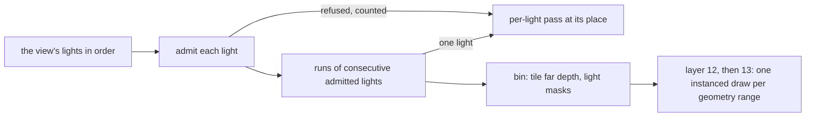
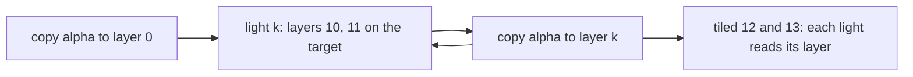

# Native light tiles: a run of lights' layers 12 and 13 in one pass

Status: Partly built. The admission, the binning pass, the instanced draw and the host's held run are built; the host bins each light over its structure parts' projected box, takes shadowed lights through per-light alpha masks, and a compare arm checks tiled runs against their per-light passes.
Code: `crates/rewrites/native-render/src/light_tiles.rs` (planner, volumes, counters), `light_tiles_gpu.rs` (admission, the binning pass, the tiled program and its draws). Tests: in both files.
Switch: none.

Part of [native-lights.md](native-lights.md). Each cut light draws its layers 10, 11, 14, 12 and 13 as a sequence of its own ("The cut light's draw"). Light tiles take the layers 12 and 13 of a run of consecutive lights and draw them as one pass: a compute pass bins the run's lights into 16x16 screen tiles, depth-bounded by the scene's depth, and each draw of the lit geometry is issued once per layer for the whole run, each fragment reading its tile's light list. The rule: the result equals the per-light additive passes within float tolerance, and a light the tiled path cannot reproduce exactly draws on its per-light pass, counted by cause.

## How it works

| Step | Where | What |
|---|---|---|
| 1 | `light_tiles_gpu::admit_light` | per light: its steps, its layer 12 and 13 passes and its volume give `Ok` or a `TileRefusal` |
| 2 | `light_tiles::plan` | the lights in the game's order become segments: a run of up to 32 admitted lights of one view slot, or one light on its per-light pass |
| 3 | `LightTiles::bin` | a compute dispatch, one workgroup per tile: the tile's farthest scene depth, then a bit per run light whose volume touches the tile |
| 4 | `LightTiles::record` | per layer (12, then 13), per draw of the run's groups: one instanced draw, an instance per light that draws it |
| 5 | the tiled program | the light's translated pass, its uniforms indexed by the instance; a fragment whose tile does not list the instance's light writes zero |

### Why the draw is instanced, not a light loop

A light pass is a translated NV2A program pair (`light_look::compile_light`). Its vertex program computes the light's interpolants (the frame `c[31..39]` into texture coordinates), so a pixel cannot evaluate another light's pass from its own interpolants. The tiled program keeps the vertex program per light: instance `i` runs the vertex program with light `i`'s uniforms and carries `i` as a flat varying, and the pixel program reads light `i`'s pixel uniforms (`light_tiles_gpu::tiled_wgsl`). One draw per geometry range replaces one per light. Fragments of an unlisted light still run the pixel program: the translated code samples textures in uniform control flow, so the test selects the output, it does not branch around the program.

### The volume

A light's tile volume is the screen rectangle and nearest stored depth of the geometry its groups draw (`TileVolume`), not its sphere. No scissor holds layers 12 and 13 to the light's sphere ("What a native light draws", "Shading"), so a pass can add light to a pixel of its geometry outside the sphere; only the geometry bounds what it touches. `TileVolume::from_window` takes the geometry's corners in the target's window coordinates and W-buffer depth; `TileVolume::from_bounds` projects a world-space box's corners through the copy's view constants as the world program does: clip `x`, `y`, `w` from `c[0]`, `c[1]`, `c[3]`, then over `w` through the viewport scale `c[10]` and offset `c[11]`.

| Light's layer 12 and 13 entries | Volume |
|---|---|
| structure parts only (clusters, placements) | their `WorldDraw::bounds` (world space, placements placed), projected at issue |
| any object entry | the whole target from depth 0 (no resident box for a posed model) |
| a box across the eye (a corner at `w <= 0`) | the whole target from depth 0 |

A tile lists a light when the rectangle overlaps the tile and the light's nearest depth is at or before the tile's farthest scene depth. The near side of the tile is not used: layers 12 and 13 test `LessEqual` without writing depth, and a transparent part in front of the tile's nearest surface still draws.

### Why it equals the per-light passes

| Condition | Held by |
|---|---|
| A pixel the per-light pass changes is listed for that light | the rectangle bounds the geometry's pixel centres; a pixel nearer than the geometry's nearest depth fails its depth test |
| An unlisted fragment adds nothing | the admitted blends add `src * factor` to the destination; a zero source adds zero, at any target format |
| Drawing all lights' layer 12 then all their layer 13 is the same as each light's 12 then 13 | additive blends commute; on a unorm target the clamp of a sum of non-negative terms does not depend on the order |
| The rest of the frame sees the same state | the run's lights draw no layers 10, 11 or 14, and a refused light keeps its place between runs |

Additions in another order round differently: the tolerance is the target's rounding per added light (a half-float ULP, or 1/255 on `Rgba8Unorm`).

## Interfaces

- **In:** per light, its view slot (4 or 10), its steps (`light_scene::PER_LIGHT_LAYERS`, `FIRST_PERSON_LAYERS`), its layer 12 and 13 `LightDraw`s, whether its gel is the shader-driven target 13, and its `TileVolume`. The first-person lights (slot 10) form runs of their own, binned over the depth the first-person view draws on.
- **Out:** `LightTiles::bin` records a compute pass into the caller's encoder; `TiledPass::encode` records the run's draws into an open render pass on the view's target, with the scene depth loaded.
- **Host:** `render_bridge::native_lights` asks `Host::hold_scene_light` at each slot 4 light; the game's `native_lights_glue/tiles.rs` holds an admitted light's prepared layers 12 and 13 and its box. `Host::flush_light_run` draws the run before any light drawn on its own, when the view target changes, at `MAX_RUN`, and at the light frame's end. The run is one external step (`TiledRun`): the binning dispatch, then a render pass of instanced draws (`gfx::RecordedDraw::instances`). Slot 10 lights are not held.
- **Fallback:** a run that does not prepare draws each light on its per-light sequence (`scene_light_tiles_fallback`); a light that fails that too is `scene_light_tiles_lost`.

### The compare arm

`light_tiles::ARM` compares every run until 4 match, then one run in 64. A compared run draws the tiled pass into a copy of the target, the per-light sequences on the target, then a GPU diff of the two (colour channels only for a masked run, whose copy keeps the alpha it began with) whose largest channel difference is read back 8 flushes later. A difference over `(lights + 1) / 255` turns the arm off until the map retires: every light then draws per light.

| Counter | Counts |
|---|---|
| `scene_light_tiles_compared` | runs compared |
| `scene_light_tiles_matched` / `_mismatched` | compares within / over tolerance |
| `scene_light_tiles_arm_off` | 1 while the arm is off |

## Rules and limits

| Counter (`render.scene`) | The light keeps its per-light pass because |
|---|---|
| `scene_light_tiles_refused_shadow` | its steps draw layers 10 and 11 other than ahead of 12 and 13 alone, a receiver writes colour (multiplies the destination), a shadowed light's lit pass writes alpha, or a lit pass samples a shadow map |
| `scene_light_tiles_refused_opaque` | its steps draw layer 14 (opaque, depth write, target 1) |
| `scene_light_tiles_refused_gel_target` | its gel is drawn into target 13 per light (`Op::Gel`), which the next light overwrites |
| `scene_light_tiles_refused_blend` | a pass replaces, or its blend reads the destination's colour, or reads its alpha while writing alpha, or its operation is not an add with destination factor one |
| `scene_light_tiles_refused_depth` | a pass writes depth or compares other than `Less`, `LessEqual` or `Equal` |
| `scene_light_tiles_refused_bounds` | its geometry's volume is not known |
| `scene_light_tiles_refused_program` | a pass's translated module lacks the shape the instancing rewrite needs |

### Shadowed lights: the masks

Layer 11 marks the target's alpha per light ([native-shadows.md](native-shadows.md), the receiver table), and the light's layers 12 and 13 read it through a `DstAlpha` or `OneMinusDstAlpha` source factor. A run keeps each light's alpha in a mask layer of its own (`native_lights_glue/tiles.rs`, `Snapshot`):

| Rule | Why |
|---|---|
| a light reads the layer of the last shadowed light at or before it | per light, that is the alpha its passes saw |
| the blend's factor becomes one, the program multiplies by the mask (`xl_alpha_factor`), clamped first on a unorm target | the blend clamps the source before it multiplies |
| receivers write alpha only (implementations 0, 1, 2, 6) | 3 and 4 multiply the colour, which the later lights' passes would see |
| no lit pass of a masked run writes alpha (`Run::refuses` flushes first) | the masks are taken before the run's adds |
| at most `MAX_SHADOWED` (3) shadowed lights a run | one target-sized layer each |

A compared masked run takes the per-light sequences on the target with each shadowed light's layer copied between its receivers and its layers 12 and 13, then draws the tiled pass into the copy taken before them.

`scene_light_tiles_runs` and `scene_light_tiles_lights` count the runs and the lights drawn tiled; `scene_light_tiles_single` counts admitted lights drawn alone, a run of one. A static bitmap gel is allowed: lights sharing a gel datum share a draw, and a light with its own gel is a draw of its own within the run.

## Evidence

Tests: `a_tiles_list_holds_exactly_the_lights_whose_volume_touches_it` (the GPU masks against `light_tiles::bin_cpu` and by hand), `tiled_shading_equals_the_per_light_passes` (three overlapping lights, one with a gel, and a shadowed one, against `LightSet::draws` per light on an `Rgba16Float` target), `a_refused_light_draws_on_its_per_light_pass_and_is_counted` and `a_boxs_volume_is_its_corners_projected_through_the_views_rows` (`light_tiles`), `the_tiled_rewrite_indexes_uniforms_by_instance` and `a_masked_run_reads_each_lights_alpha_as_its_per_light_pass_did` (`light_tiles_gpu`).

## Not verified

- Coverage on real maps: how many lights each refusal takes (layer 11 for specular lights, layer 14, target-13 gels).
- The frame time of a tiled run against its per-light sequences on the laptop, with the binning pass included.
- That `TileVolume::from_bounds` holds every pixel a lit program draws: a vertex program that moves positions past the part's box would be culled. The compare arm would see it.
- The glue's held run, `TiledRun` and the compare readback on a running game: no live run yet.

## Related

[native-lights.md](native-lights.md), [native-lights-constants.md](native-lights-constants.md), [native-gels.md](native-gels.md), [native-shadows.md](native-shadows.md).
