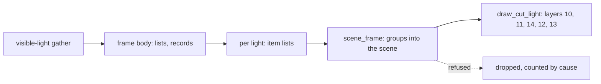

# Native renderer stage 4: lights and shadows

Status: Partly built. Rust gathers visible lights and their lists, and the guest's light frame `0x00031c80` and passes `0x00031170` never run. Each light's groups go into the scene, and the host draws all five layers from them on the single 1x backend; a light it cannot take panics by cause. First-person lights (`0x000404b0`) draw from the scene too, and a slot it refuses panics the same way. Live coverage, pixel parity and timing of whole passes remain unverified.
Code: `crates/rewrites/engine/src/render/light_gather/typed.rs`, `crates/rewrites/render-bridge/src/native_lights/typed.rs`, `crates/rewrites/native-render/src/light_graph.rs`, `crates/rewrites/render-bridge/src/native_lights.rs`, `native_lights/walk.rs`, `native_lights/scene_frame.rs`, `crates/extensions/game/src/native_lights_glue.rs`, `native_lights_glue/walk.rs`, `native_lights_glue/models.rs`, `native_lights_glue/scene.rs`, `crates/rewrites/native-render/src/lights.rs`, `light_gpu.rs`, `light_scene.rs`, `light_models.rs`, `crates/rewrites/scene-extract/src/layout/light_passes.rs`, `crates/rewrites/scene-extract/src/light_groups.rs`, `crates/rewrites/scene-extract/src/lights/gather.rs`, `crates/rewrites/frame-scene/src/light_group.rs`. Constants, implementations and the native look are in [native-lights-constants.md](native-lights-constants.md). Tests: `scene_extract::lights::gather::tests`, `crates/rewrites/render-bridge/tests/native_lights.rs`, `native_lights_split.rs`, `crates/rewrites/engine/tests/light_passes.rs`, `light_constants.rs`.
Switch: `impl.render.native` (on), listed in [switches.md](../runtime/switches.md).

Part of [native-renderer.md](native-renderer.md). The dynamic lights are not layers of the scene list: after layer 7, `render_scene_passes` calls `render_dynamic_lights` (`0x00031c80`, `points::RENDER_DYNAMIC_LIGHTS`), which gathers each visible light's geometry into a list of its own and draws layers 10 to 14 over it, one light at a time.

| Path | Guest entry | Where it draws | Page |
|---|---|---|---|
| Dynamic lights | `0x00031c80` (per light `0x00031170`) | layers 10 to 14, one light at a time, after layer 7 | this page |
| Object shadows | `0x000335e0` (per caster `0x00032350`) | layers 10 and 11, before layer 7 | [native-shadows.md](native-shadows.md) |
| First-person lights | `0x000404b0` | layers 11 to 14 over the first-person view, after the scene | this page, "First-person lights from the scene" |
| Shader gels | `0x0003a550` | target 13 | [native-gels.md](native-gels.md) |

[native-lights-constants.md](native-lights-constants.md) holds the light's constants, the engine textures and implementations, and the native look. [native-shadows.md](native-shadows.md) covers layers 10, 11 and 14.

## Stage 4: lights and shadows

The light path in the order the game draws it ([e3-lighting.md](e3-lighting.md), "The light render path", has the light records and the definition flags).

### The path (Code, `h2 disasm`)

- **Visible lights.** `0x00031c80` builds the visible-light list
  from the main view's cluster light references and its supplementary
  unclustered player lights. `0x00031910` checks the handles at
  `[0x00547f98]` and accepts up to 128. Each accepted row holds the
  light datum, root owner, weight from the light record's `+0x100`
  and a separate projected-size priority. `0x0004a7c0` merges the rows
  by datum into a per-view history of up to 32. `0x0004ac30` promotes
  local lights, suppresses duplicate owners with exceptions, orders the
  remaining rows by projected size and fades their weights towards a
  budget of three. Lights fading out can still draw. For each
  light above the weight threshold (`[0x0045dc58]`) it re-poses an attached light
  (`0x00031dac`), poses its volume (`0x000c17f0`), takes a slot of the
  first-person table for it (the table at `0x004c6700`, eight slots of
  `0x408` bytes, the datum at `+0x400`, count `[0x00509440]`), decides
  the shadow (`0x00031e02`), fills the light's visibility struct
  `0x0054aa68` (`0x000c1d90`, `0x001320f0`, `0x00031660`, and the extra
  call `0x00031c20` for definition bit 22), writes its render records
  (`0x0002cb30`, `0x00133390`, `0x00133520`, `0x00133720`) and their
  part visibility (`0x00044720`), and calls `render_light_passes` once.
  The passes fill the light's item lists `0x004c1a60` and `0x004c1a78`
  from those records (`0x00040e90`). Step by step in
  [native-light-gather.md](native-light-gather.md).
- **One light's passes.** `0x00031170` (`points::RENDER_LIGHT_PASSES`; its
  only caller is `0x00031f26`): EAX the `ligh` datum, ECX a context from
  `0x000c17f0` (the posed light volume, decoded by
  `engine::render::light_volume`). Its first word is the effective shape
  after a scenario placement override. A sphere (zero) sets per-light
  flag bit 0, while a nonzero shape passes the shape test for casting
  a shadow. The stack holds `(light
  datum, &position, shadow byte, weight)`, `ret 0x10`. It sets the light's
  constants (`0x0004a1e0`, which takes 1024.0) and the flags
  `[0x004ba014]` and `[0x004ba018]`, then: with the shadow bit, the shadow
  projection (`0x00048ee0`, `0x24` dwords at `0x004c9798`) and layer 10
  (shadow generate into target 9, cleared to depth 1.0); layer 11 (shadow
  apply, `ShadowFunc GREATER`) when shadowed, bit 1 or definition bit 5;
  `0x00030ed0` when shadowed, the byte at `[0x00510c50]+5` set and
  `[0x004ba134]` positive (not traced); layer 14 (opaque,
  depth write, role unknown); layer 12 (diffuse) and, with bits 0 and 1,
  layer 13 (specular), each on `0x004c1a60` through the layer draw
  (`0x00044550`). Before each of layers 11, 14, 12 and 13 it sets
  stencil mode 0 (`0x00015370`, the test off); it sets none before
  layer 10. It ends by turning stencil off, clearing the scissor,
  setting the view's target back (`0x00014bc0`) and zeroing both flag
  words. `scene_extract::layout::light_passes` gives the steps a light's
  flags and lists make, and each light goes into the frame scene's open
  view with them (`frame_scene::SceneLight`, framescene.md, slice 3).
- **Object shadows.** `0x000335e0(mode)` (from `0x0002c021`, before layer
  7) picks up to 32 casters (`0x00033400`, entries of `0x14` bytes) and
  calls `0x00032350` (stdcall, two words of the entry, `ret 8`) for each:
  its constants and projection (`0x0004a1e0`, `0x00048ee0`), layer 10
  into target 10 (S: 128x128,
  flags `0x14`: bit 4 picks that target) and layer 11 over what the
  shadow falls on.
- **First-person lights.** `0x000404b0` (from `0x0002c2b9`, after the
  first-person draw `0x0003fdf0`) draws the recorded lights again over the
  first-person view. Its table (`0x004c6700`, `0x408` bytes an entry, the
  count at `[0x00509440]`) holds per light up to 32 render records
  (`0x20` bytes each), then the light datum at `+0x400` and the record
  count at `+0x404`; the gather's record at `0x004c6b00` is the datum of
  the first entry. Per entry with records it rebuilds the light's list
  `0x004c1a60` from them (`0x000402b0`: the records copied into the
  render records at `0x004ba138`, their items built by `0x00041040`),
  poses the light volume (`0x000c17f0`, a local of its frame) and calls
  `0x0004a1e0` at `0x0004057e` (EDX the datum, shadow 0, weight 1). It
  sets the flags itself: bit 0 when the volume's first word is 0, bit 1
  when a colour B global is above 0, no shadow bits
  (`light_passes::first_person_steps`). Then, each after stencil mode 0
  and drawn when the list's mask has its layer: layer 11 on the view's
  target, 14 on target 1, 12 on the view's target and, with flag bits 0
  and 1, 13 on the view's target. The layer draws return to
  `0x00040642`, `0x000406ab`, `0x00040718` and `0x0004079c`
  (`render_bridge::native_lights::FIRST_PERSON_LAYERS`).

### The visible-light gather in Rust

The list at `[0x00547f88 + 0x10]` that `0x00031910` ranks is built by the
main view's visibility gather, and `scene_extract::lights::gather` builds
the same list from sim data (`h2 disasm 0x00132220`, `0x00132a30`,
`0x000c3140`, `0x000c3950`, `0x00163c80`). It reads no front-end
product: `read_world` takes the light datums, the light references per
cluster (heads `[0x004e0310]`, nodes `[0x004e0314]`), the tag table and
the capacity of the list's allocation, and `gather` takes the view's
visible clusters and clip from `scene_extract::visibility`.

- Per visible cluster, in the order reached, each referenced light is
  tested by `0x00132a30`: live, brightness and colour tests
  (`0x000c3140`, as `visible::active`), not already stamped, then the
  clip of the view's mode over the light's bounds (`+0x18`, `+0x24`): the
  cluster's frusta, the view sphere plus the light's radius, or none.
  View flag `0x80` takes a light the clip rejects.
- A light is appended only below capacity minus one (`0x00163c80`) and
  stamped only when appended, so a clipped or refused light can still be
  listed through a later cluster, and a light in two clusters is listed
  once.
- The tail (`0x00132589`) follows for a view whose start cluster is set:
  the first four lights in slot order that `0x000c3950` takes (owner test
  `0x00031520`, definition bits `0x20` and `0x40000`, none when the view
  index `[0x004b9ed4]` is `-1`), each appended when it has no cluster, is
  live and is not stamped.
- View flag `0x10` lists no lights.

The order of the result is the guest's append order, which the ranking
reads. `the_light_gather_equals_the_guest_list` runs a fixture with lights
inside and outside the view, one behind a portal, one not live, one
listed from two clusters and the player-only tail, and compares the
result with the guest's list read from guest memory.
`the_gather_stops_at_the_guests_cap` covers the capacity.

The light frame is a cut producer (`render_bridge::cut::CUTS`, row
`dynamic_lights`); the gather feeds the per-light passes of the scene.

### The light frame under the cut

| Step | Layer | Target | What the host draws |
|---|---|---|---|
| 1 | 10 | 9 (colour-mask casters: 10) | casters; depth cleared to 1, stencil 0; the region frozen into a map per target copy |
| 2 | 11 | the view's | receivers, sampling that map |
| 3 | 14 | 1 | opaque items |
| 4 | 12 | the view's | diffuse |
| 5 | 13 | the view's | specular (flag bits 0 and 1) |

Each light draws at its own passes, in the guest's order (`native_lights::draw_cut_light`). A light with a shader gel draws it first.

The guest's `0x00031c80` and `0x00031170` never run. The Rust frame body
(`native_lights/frame.rs`) gathers every drawn light as the guest does:
the visible list and history, the volume, frusta, visibility, records and
part visibility. A map whose lights stage stands down (`Stage::Lights`)
or a run with no renderer (`native_lights::has_host`) draws no light. A
frame it cannot take panics (`scene_frame::fail_frame`):

| Panic | When |
|---|---|
| `lights: frame host` | a host is set and does not draw the scene's light layers (`native_lights::scene_path_ready`, the host's `draws_scene`) |
| `lights: frame plan` | the frame's plan refused (`frame::plan`) |
| `lights: frame passes` | a light's passes' entry plan refused (`passes::plan`) |

Each light's passes (`native_lights/passes.rs`, `scene_passes`) make
only their first step, the item lists `0x00040e90` (the item body,
`light_gather::items`), and stop. No constants, target, stencil or
layer draw is made, and the call returns as `ret 0x10`
(`passes::after_lists`). A light the scene cannot take panics by cause
(`scene_frame::Dropped`, `scene_frame::fail`).

`native_lights::scene_frame` puts what the remaining steps would draw
into the scene. The light and its steps come from the hand-off at the
item lists (or, when the guest made the lists, from memory at that
point). The pass flags are computed as `0x0004a1e0` and the flag code
would set them (`source_constants`). A shadowed light's projection is
`shadow_constants::shadow_globals_for_light`: its block is the groups'
projection, and its resize of target 9 is laid over memory for the read
only.

Each drawn layer of the steps is one group of the light,
`typed_groups::plan` over the lists the item body just made: the entries
the guest's layer build would keep, in its sorted order. A light whose
groups cannot all be made panics (`lights: group <refusal>`).

The additional casters' pair (`0x00030ed0`) is decided at the item lists
by `passes::additional::empty`. When no candidate's first match in the
current visibility list is marked `0x1000`, the pair makes no suffix and
draws nothing, so the light draws its own steps. A pair that would make a
suffix needs the marker lookup and the suffix's record walk, which are
not built: `lights: additional_casters`.

| Panic | Cause |
|---|---|
| `lights: <cause>` | `unread`, `constants`, `projection`, `light`, `additional_casters`, `host` |
| `lights: group <refusal>` | the first step that did not read whole (`typed_groups::GroupRefusal`): `layer`, `memory`, `suffix`, `mask`, `sort`, `pass`, `projection`, or `entry_<cause>` (`scene_extract::light_groups::Cause`) |

Tests: `a_light_the_scene_takes_returns_after_its_lists_and_the_guest_draws_nothing`
(`native_lights/passes.rs`),
`a_cut_light_the_host_refuses_is_not_drawn` (`native_lights.rs`).

### Entry state

The geometry draw's prologue `0x0004d640` sets three things beyond an
entry's bindings, and its epilogue `0x0004d720` puts them back. The
entry carries them (`frame_scene::EntryState`, read by
`scene_extract::light_groups::entry`):

| State | Where | The host draws it with | Held when |
|---|---|---|---|
| `aux_depth` | bit 11 on a record, an object's or the structure's (`0x0004d6a2` tests the flags alone): the auxiliary state toggle `0x00012d50` (the first person's arms and weapon) | the toggle's `c[0..3]` and clip range (`light_gpu::model_part`, `object_program_gpu::with_aux_depth`) | the device holds the toggle's values off (`native_objects_glue::aux_depth_at_rest`) |
| `fade` | the record's fade byte `+0x1a` below `0xff`: a stipple pattern | nothing: unmasked | the stipple is off and at rest (`stipple_off`, `stipple_at_rest`) |
| `shader_flag`, `structure`, `uncopied` | the shader's flag bit 0 (`+0x16`); the active structure's parameter block (`+0x214` above 0); the frame's structure target copy not made (`0x00509430`) | nothing: the guest's prologue uploads the block (`0x0003c650`, `0x0003d000`) and a program with flag bit 20 makes the copy (`0x0003bea0`) | `structure`: the device and the engine hold every word of the upload (`native_objects_glue::structure_at_rest`). `uncopied`: no pass of the layer's draws has flag bit 20 (`LightProgram::copies_target`) |

- `shader_flag` alone always holds (its residency request sets no device
  state); the rest is the R1 object items' rule
  ([native-objects-fade.md](native-objects-fade.md)).
- Every light and shadow layer takes an entry with state
  (`light_groups::state_taken`), and the host draws it the same way in
  each (`native_lights_glue::entry_state`). On the per-handler path
  (`dispatched_entry`) it stays `State`, as does a toggle whose values
  do not read.
- The cut asks the host once per light, and only for an entry with
  state (`Host::held_state`, `typed_groups::plan_or_refusal`). Not held:
  `lights: group entry_state`.
- The host checks again at the draw (`gathered_draws`), and a flagged
  entry before the frame's copy drops the light when a program of the
  layer has flag bit 20 (`lights: host`).

Tests: `an_objects_toggle_and_a_fade_byte_are_the_entrys_state_and_every_light_layer_takes_it`
(`scene_extract::light_groups`),
`a_faded_entry_draws_only_while_the_host_holds_the_stipple_at_rest`,
`a_flagged_entry_draws_in_every_layer_and_asks_the_host_for_the_structure_upload_only_when_it_has_one`
(`native_lights/walk.rs`),
`a_flagged_shader_is_entry_state_with_the_structures_block_and_the_frames_target_copy`,
`a_part_toggling_the_auxiliary_state_draws_with_its_rows_and_clip`
(`native_render::light_gpu`).

### Visible subparts

The emitter `0x0004daa0` draws a record's visible subparts, not the
whole part, when they fall short of it: spans of the part's source
indices (`scene_extract::layout::world_ranges::emissions`). In strip
topology each subpart is its own strip; in list topology consecutive
ones are one list. The entry carries the spans (`LightEntry::subparts`;
`None` is the whole part).

The native buffers hold each part's triangles in source order, the
degenerate ones dropped, and for the world those naming a vertex past
the section's. `native_render::subpart_map::TriangleMap` counts the kept
triangles before each source position, so each span is one native range:

| Topology | A span maps when | Else |
|---|---|---|
| list | it starts and ends on a triangle | no range |
| strip | it starts at an even position | the span's native triangles |
| strip | it starts at an odd position: a sub-strip winds each window by its parity from its own start, so every triangle winds the other way | the same native triangles, drawn with the front face reversed |

- Every layer takes an entry with subparts (`light_groups::taken`): the
  shadow layers draw the spans as diffuse and specular do. Only the
  per-handler path stays `Subparts`.
- The host draws a structure entry's spans from
  `world::light_parts::ResidentRanges::subpart_draws_wound`, an object's
  from `LightModels::part_wound`, each range with whether it winds the
  other way. Such a range is a draw of its own, its pass's cull with the
  front face reversed (`program::reversed_winding`, `Planned::cull`); a
  pass that culls nothing is unchanged. Layers 10, 11 and 14 split a
  model entry's ranges the same way (`split_wound`), and a structure
  run keeps each range's winding.
- A span past the part or off a triangle has no range: the light is
  refused (`lights: host`).

Tests: `visible_subparts_short_of_the_whole_part_are_the_entrys_spans_in_every_layer`
(`scene_extract::light_groups`),
`an_entry_with_visible_subparts_is_a_draw_of_its_own_in_a_shadow_layer`
(`light_scene`),
`a_strip_with_degenerates_maps_each_even_sub_strip_to_its_own_native_triangles`
(`subpart_map`; its odd start is `wound`'s reversed range),
`a_reversed_winding_flips_the_culled_face_s_front_and_leaves_an_unculled_pass`,
`visible_subparts_of_a_strip_with_degenerates_draw_their_own_native_triangles`
(`world/light_parts.rs`),
`an_object_entrys_visible_subparts_draw_their_own_triangles_of_a_strip_with_degenerates`
(`light_models.rs`).

### The cut light's draw

At its passes, once its groups plan, the cut light goes to the host
(`scene_frame::take`, `native_lights::draw_cut_light`) on the view's
target. Its groups go into the scene only after the host draws it.

The game host (`native_lights_glue/scene.rs`) makes each light one
external sequence (`d3d::Device::prepare_external_sequence`), each step
on its own attachments with nothing rebound. It commits the sequence
whole with no light tail (`d3d::PreparedSequence::commit`), or refuses
the light. The guest's layer begin and end do not run; their device
work is the steps:

- layer 10: target 9's depth cleared to 1 and stencil 0, the casters
  drawn into it at the size the shadow setup gives, then the region they
  drew frozen into a map on each target copy at that copy's texels
  (`native_lights_glue/scene.rs`, `Frozen` and `frozen_size`;
  `gfx::depth_bits::DepthBits::convert_region`). A scaled backend records
  the reference and display copies on their own attachments, each its
  freeze before its receivers, and a receiver binds the map of the copy
  it records on;
- layer 11: the receivers on the view's target, sampling that map;
- layer 14: target 1;
- layers 12 and 13: the view's target.

A colour-mask caster draws the same way on target 10: cleared to white
with zero alpha, its casters colour only, its colour copied into each
copy's map. A light with a shader gel draws it first, into target 13's
level 0 (`Op::Gel`, [native-gels.md](native-gels.md), "The gel from the
scene"), and its layers sample that level through a read-only slot of
their own.

A scene light outside slots 4 and 10 refuses the light, and so does a
caster region that does not start at its target's corner or runs past
it. The host's `draws_scene` is true at any render scale and on every
backend while the native shadows are on
(`native_shadows_glue::enabled`); with them off the light frame
draws no light. The first-person lights (`0x000404b0`) replay the slots
the frame body filled and draw from the scene ("First-person lights from
the scene").

Tests: `a_shadowed_lights_layers_clear_draw_and_freeze_the_map_before_its_receivers`,
`each_copy_freezes_the_casters_region_at_its_own_scale`,
`a_receiver_samples_the_map_frozen_on_its_own_copy` and the other tests
in `native_lights_glue/scene.rs` check the steps.
`the_cut_lights_groups_equal_the_guests_layer_builds`
(`native_lights/walk.rs`) builds layers 10, 12 and 13 both ways from the
same lists: as the guest's layer draw builds them, and as the cut frame
plans them before any layer. The entries, poses and order are equal, and
the casters' pass takes the shadow setup's map size with nothing written.
`each_layer_of_a_cut_light_is_one_recorded_pass_in_order`
(`native_lights.rs`) checks that the host is handed one pass per layer in
that order.

### Gathered light and shadow geometry

| Stage | What it does |
|---|---|
| Item walk | builds the receiver and caster lists at `RENDER_LIGHT_PASSES` |
| Whole-pass admission | uses those lists, the light's projected bounds and its pass flags; the graph's view-target draws use the viewport their target setup establishes |
| Per-layer path | takes a light with a shader gel, shadow projection, off-target draw or additional caster with geometry; it computes the projection and produces the gel before its draws |
| Gathered build | reads the active interval of the gathered list just before `LAYER_BUILD`: receivers for layers 11 to 14, casters for layer 10 |

The caller identifies the dynamic light, an additional caster or an
object shadow. Each candidate must have the standard geometry
build/draw pair. Rust resolves the live material implementation, render
section, part and vertex program classification.

It preserves the
scratch bytes the callbacks leave alone, rejects the same unusable
programs, and sorts the surviving 24-byte entries with the original tie
order. A failed read or unknown callback leaves the guest builder at its
entry with its original output buffer.

A dynamic light's layer can skip handlers when the light's steps draw
it (`light_passes`, with the flags and lists the pass set); each layer
is its own reservation, so a light's other layers do not hold it back.
With the additional casters' pair every layer keeps its handlers. Empty
intervals still run their target setup and clears. An object shadow can
skip handlers separately for generation and application.

All sorted entries must share one record, shader, selector,
implementation, vertex class, topology and per-part state. The first
`LIGHT_GEOMETRY_DRAW` runs to its complete-part indexed emission, which
supplies the live streams, pose, constants, texture bindings (including
the gel), scissor and depth/stencil state. Each remaining part supplies
its own index span and vertex window.

The GPU records each range in sorted order, including duplicates. Shadow draws also go through the
existing gate for their site, projection, caster generation and sampled
map.

The device verifies the indexed call and loop counter and records every
required target copy before shortening the loop to one. The guest then
finishes the first handler and exits the loop normally. A missing
resource, different binding, target feedback, incomplete copy or failed
cursor write leaves the original draw and every remaining handler in
place.

Additional-caster chains can use the Rust builder and retain their
original draw dispatch. Clears, map freezes, object shadow filters, gel
updates and target restores run at their original points. The
live-binding requirement still costs one guest handler even for a
successful group.

### Gathered groups in the scene

At the same build, the walk's sorted entries go into the frame scene
as a group of the light (`scene_extract::light_groups`,
`frame_scene::LightGroup`; framescene.md, slice 4), with what the first
`LIGHT_GEOMETRY_DRAW` supplies to the path above: per entry its stream
(the model's section, the cluster, or the placement's definition; the
part, vertex class, index range and topology), its pose (world, the
placement by index, or the object's node rows) and its bindings
(shader, pass selector, variant, implementation), and for layers 10 and
11 the shadow projection block. The additional casters' layers are
groups of their own site. An entry the handler would do more for (a
template callback, or a toggle the view's values do not read) is the
group's remainder, counted by cause in `render.scene`
(`scene_light_entry_remainder_<cause>`). Each object shadow
(`0x00032350`, matched to its caster entry as the shadow stage matches
it) is a `frame_scene::ObjectShadow` of the view with its call's two
arguments, and its layers 10 and 11 are its groups
(`GroupSite::ObjectShadow`, `FrameScene::shadow_groups_of`).
`native_render::light_scene::plan` gives a whole group's draws from the
scene alone, against the native geometry (`Resident`, each entry's part
and its index range there): the sorted order and duplicates kept,
adjacent list ranges of one stream, binding, class and pose joined, an
entry whose part is not held refused by name.

A light's layer 12 or 13 whose group is whole is drawn from the scene
with no handler: `boot::native_lights_glue` (`Glue::alone`, behind
`render_bridge::native_lights::Host::draw_alone`) holds the world's
structure parts and the map's model parts as the `Resident` (`Held`),
resolves each entry's material pass for the light as the resolved-draw
path does, takes the scissor, stencil, W-buffer, palettes and cull from
the device at that point, and requests a complete packet reservation
on every target copy (`Device::prepare_external_bound`). The guest
handlers run when any shader, pipeline or target copy is unavailable. Structure
entries (clusters and placements) draw from the world's buffers.

Object entries draw from model parts built once per map on a worker
(`native_lights_glue/models.rs`, `native_render::light_models`), at the
first gathered object entry. The loader takes drawable parts whose index fits
the item argument's low byte, including transparent parts.

It stores their triangles in one index buffer per section, including the list
interpretation of a strip when the record clears its strip bit. The section
holds its decompression rows and its vertices once
per (vertex shader, classification) that the parts' materials' layer-12
and layer-13 implementations name, gathered through the declaration that
program's input semantics give over the section's streams. Their stage
images load as the world's do, through the stage palettes bound at the
ask.

A utility worker resolves the pass with the light's inputs and
compiles it for the buffer of the program the look names at the entry's
sorted classification (`light_look::compile_light_model`: the
declaration's registers and fetch; reads of the node rows `c[50..]`,
relative to `a0.x` from there as a skinned program does, and of the
decompression `c[170..172]`), cached by material, layer,
implementation, inputs, model, section and classification. Each object entry
is a draw of its own: its node rows from the scene at `c[50..]` and its
section's decompression at `c[170..172]`
(`light_gpu::ModelGeometry`, `model_vertex`), over a pipeline with the
section's vertex layout (`LightGpu::pipeline`, `ModelLayout`).

It refuses, issuing nothing, object entries before the model parts
load, an entry whose part, raw range, topology or classification no
buffer was built for, node rows past the palette, a shader gel (its
target-13 slot is pinned through a draw's plan), a remainder, an entry
state the device does not hold ("Entry state"), and any state the
resolved-draw path refuses.

When it draws, the walk hands the guest's entry loop no
entries, so none of the layer's handlers runs, and the layer leaves the
light's candidate (`render.scene`'s `scene_light_layers_alone` counts
them). Otherwise the layer takes the gathered or resolved-draw path.

Layers 10, 11 and 14 (the light's, the additional casters' and
the object shadows') draw their whole groups from the scene with no
handler through `shadow_look` and `native_lights_glue::shadow_alone`.
Layer 11 binds the boundary's frozen depth or colour-mask map; the
object filter's native quads run before it.

Frame stats count completed dynamic lights in `lights_walked_native`,
`lights_walked_fallback` and `lights_walk_empty`. Each fallback adds
one `lights_walk_fallback_*` reason (graph, memory, callback, material,
geometry or GPU). `light_walk_layer_builds` counts replaced builds.
`light_walk_handlers_skipped` counts the remaining handlers actually
bypassed. `shadow_walk_layers` counts committed shadow layers, including
object shadows outside a dynamic light.

### First-person lights from the scene

`native_lights/first_person.rs` runs the loop as
`engine::render::light_gather::first_person::run_scene`: each slot's
volume and records as the guest makes them, then `scene_slot` plans the
slot from its lists (`SceneSlot::read`: the light's constants computed as
`0x0004a1e0` would leave them, its first-person steps and its groups,
`GroupSite::FirstPerson`). It puts the light, with those constants as its
candidate, into the first person's view and draws it in place
(`native_lights::draw_cut_light`) on the target bound when the loop
began, one sequence per light as a dynamic light's, its gel first. Only
then do its groups go in.

No slot makes the guest's constants call or layer draws. Layer 11 and 14
items and a shader gel are the host's to draw, and the loop's tail runs
once at its exit.

When the lights stage stands down the loop returns at once (`ret 4`);
with no renderer its slots draw nothing.

| Panic | When |
|---|---|
| `lights: first_person plan`, `lights: first_person records plan` | the loop's or a slot's records plan refused |
| `lights: first_person host` | a host is set and does not draw the scene's light layers |
| `lights: first_person <cause>` | a slot the scene cannot take, by the dynamic lights' causes (`unread`, `constants`, `group <refusal>`, `light`, `host`) |
| `lights: first_person record <refusal>` | a record the guest's per-part calls made (`Made::Guest`) |

`scene_first_person_cut_slots` counts the slots drawn.
`a_cut_slots_candidate_carries_its_constants_and_its_definitions_gels`
checks the light the scene is handed, and
`a_dropped_slot_is_counted_under_the_dynamic_lights_cause_with_its_own_prefix`
the counters.

### What a native light draws

- **Geometry.** The sorted diffuse and specular layers use the same
  planner as whole scene groups. Each entry identifies a cluster,
  placement or posed model section, its source index span and topology,
  shader datum, LOD variant, pass selector, implementation and vertex
  class. The BSP's light parts include opaque and transparent geometry
  from the shared buffers, even when layer 3 leaves the base draw to
  D3D. Placements use the rigid program and its three transform rows.
  Object draws keep their own node palette and section decompression.
  A visibility mask can use the resident part when the emitter selects
  one span covering that entire part.
- **At indexed emission.** The host matches the sorted slot, render
  record, owner, shader selection, index address, topology and count
  before substituting a resident draw; posed draws also check the live
  transform constants. When a dynamic light needs its handler, the
  native indexed path can record the emitted range with the handler's
  streams, constants, textures and raster state (partial visibility,
  per-part state). A generated gel needs the light's producer and a
  matching texture view on each copy. A failed reservation retains the
  original draw.
- **Shading.** Each draw takes its view constants and W range at issue,
  the light's 36 frame words in `c[31..39]`, material colours and
  inherited device culling. The sphere projection supplies six float
  words in guest memory. The device scissor comes from the render state
  at the draw, reset to the viewport when layers 12 and 13 bind the view
  target, intersected with the viewport and scaled per copy as a
  half-open pixel rectangle; empty rectangles cover no pixels.
- **Material animation.** A shader whose `+0x24` block `+0x3c` is set
  animates its passes' constants. A lit pass compiles from its baseline
  and keeps the animation (`light_look::animated_light_look`,
  `LightProgram::animation`, `layer_pass::PassAnimation`); each light's
  preparation samples it at the render clock (`prepare_planned`), and the
  draw puts the sampled constants under the light's colours
  (`LightDraw::sample`). A pass the sampler cannot apply is refused by its
  name (`LightRefusal::AnimationSample`) and the guest's passes draw the
  light; the shadow layers' passes are not sampled. Test: `an_animated_pass_is_refused_unless_sampled_and_then_compiles_from_its_baseline`
  (`light_look.rs`).
- **Stencil.** Layers 11, 14, 12 and 13 each follow stencil mode 0, so their passes draw with the test off. A light pass whose implementation sets a stencil state of its own draws it (`PassState::stencil`, in the light pipeline and the packet's reference); its words must be set whole or the pass is refused `Unset` (`LightRefusal::State`). No pass on the disc sets one ([e3-lighting.md](e3-lighting.md), "Stencil: every use, named"). Elsewhere a depth with no stencil aspect draws with the test off, as on D3D (`fog_gpu::layer_stencil`), and object, first-person, decal and sky draws take the stencil they are given ([native-objects-first-person.md](native-objects-first-person.md), "Host").
- **Shadows.** Layer 10's casters draw into a depth texture of our own from the light's projection (`0x00048ee0`, ported as a pure function), as [native-shadows.md](native-shadows.md) describes. Applying the shadow term inside the light's own pass (`GREATER`, one tap as the D3D path's), instead of layer 11's alpha marks, is not built; layers 10, 11 and 14 are the shadow stage's or D3D's, in their place before layers 12 and 13.

## The layer draw's return

The layer draw `0x00044550` of layers 10 to 14 returns without its body on the opaque block's terms ([retire-d3d.md](retire-d3d.md), "R1's remainder") when no item of the list still holds the layer's bit. `render.scene` counts `layer_return_<site><layer>_returned` or `_guest_<cause>`, the site `light`, `extra` (additional casters), `shadow` (an object shadow) or `fplight` (first-person lights) (`native_layers::light_site`, over `passes::caller`). The light stage clears no bit, so a layer with items keeps the body. A layer 12 or 13 drawn from the scene alone is decided at `LAYER_BUILD`, inside the body (`native_lights/walk.rs`): its entry loop is emptied, and the body's begin and end still run. Test: `the_light_passes_layer_draws_return_or_run_the_guest_counted_by_site_and_cause`.

## Rules and limits

- A whole scene group of layer 12 or 13 can skip its handlers for both structure and model entries. Individual indexed emissions keep the handler's ordering and use its resolved draw as the fallback.
- A material with an unsupplied input or unsupported shadow map binding can decline the resident plan. The indexed path requires a supported resolved shader and state and all sampled resources on each target copy.
- The visible-light gather, first-person record replay and ranked object-shadow list run as Rust bodies. The light frame's guest leaves still run as guest calls: the re-pose markers, the visibility `0x001320f0`, the records reset `0x0002cb30`, the object records `0x00133720` and the part visibility `0x00044720`, and a volume, frusta, geometry-flag, extra-caster or record-walk leaf that refuses. None of them draws. See [native-light-gather.md](native-light-gather.md).
- Diagnostics print as `native-lights:` on stderr: at load, each light texture with its size or why it did not load, plus resident structure parts and unread materials; at run time, each refusal reason on its first occurrence, and counts by reason every 1800 host decisions.

## Not verified

- Real-map admission counts and pixel parity for mixed gathered models, placements and BSP parts whose base draw stays on D3D.
- A first-person light's layers drawn from the scene against the guest's (pixel parity over the first-person weapon in a lit room), and that the target bound at the loop's start is the first person's.
- A shadowed light's layers 12 and 13 drawn natively over its D3D or shadow-stage layers 10, 11 and 14 (pixel parity on a scene with one).
- An object entry's layers 12 and 13 drawn from the scene against its handler's draw (`render.compare` on a scene with a lit object); that the sorted entry's classification is the one the model parts are built for (`classification` from the section's `+0x14`), and that the light frame needs no per-object transform.
- Pixel parity at equal presents, with render scale 1 and 2, with the lights stage on and off (`impl.render.native=off`). Captures from a run with zero native submissions establish no light coverage, and a scene with zero shader-gel admissions says nothing about the target-13 binding.
- That reservations are not dropped and the invariant counters stay zero, in `native_lights_v*_reference_ranges` and the other `lights` stage counters of `H2_FRAME_STATS`.
- The time of the light site after parity is established.

## Related

[native-lights-constants.md](native-lights-constants.md), [native-light-tiles.md](native-light-tiles.md), [native-renderer.md](native-renderer.md), [native-light-gather.md](native-light-gather.md), [native-shadows.md](native-shadows.md), [native-gels.md](native-gels.md), [e3-lighting.md](e3-lighting.md), [layer-draw.md](layer-draw.md).
