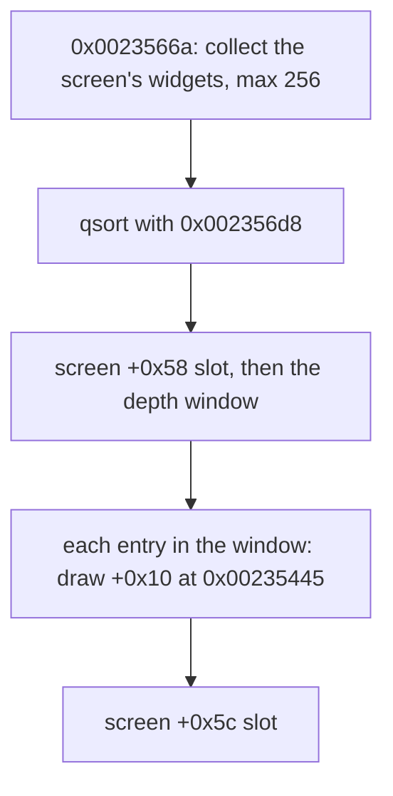
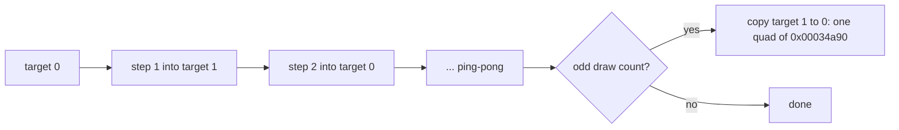

# The menus, the fade and the blur on the overlay

Status: Partly built. Containers, plain and scrolling bitmap widgets, meters, supported text, lists and buttons, the fade, the bars, the loading screen and the blur under a dialog draw from the overlay; unsupported widget states keep the guest's draws.
Code: `crates/rewrites/render-bridge/src/native_hud/ui_overlay.rs`, `ui_overlay/bitmaps.rs`, `fade.rs`, `modal_blur.rs`, `crates/extensions/game/src/hud_overlay.rs`, `modal_blur_glue.rs`, `crates/rewrites/scene-extract/src/ui` (`collect`, `compare`, `sort_widgets`, `read_widget`, `draw_list`), `crates/rewrites/native-render/src/ui_gpu.rs`, `glow.rs`. Tests: `crates/rewrites/render-bridge/tests/native_hud.rs`.
Switch: `impl.render.native` (on), listed in [switches.md](../runtime/switches.md).

| Draw | Taken at | Section |
|---|---|---|
| Containers, plain bitmap widgets, text, lists, buttons, idle model scenes | the sorted list (`0x00235428` to `0x0023545c`) | [The menus on the overlay](#the-menus-on-the-overlay) |
| Shader bitmaps | the shader quad `0x0022a664` | [native-hud-overlay.md](native-hud-overlay.md#bitmap-widgets) |
| Fade | its entry `0x00040890`, in Rust | [The fade in Rust](#the-fade-in-rust) |
| Bars, loading screen | their producers | [The fade, the bars and the loading screen](#the-fade-the-bars-and-the-loading-screen) |
| Backdrop blur under a dialog | `0x00235756` | [The blur under a dialog](#the-blur-under-a-dialog) |

## The menus on the overlay

The overlay stage draws a menu widget in place of its draw when the widget lists exactly. One list is one call of `0x002353a5` on one screen (Code, `h2 disasm`):

1. `0x0023566a` collects the screen's widgets from the root. A widget whose vtable's `+0x40` slot answers false is skipped with its children; each shown widget is added after its children (first child `+0x14`, next sibling `+0x18`) as an entry of `0xc` bytes (the widget, its depth from `+0x60` by `0x0022e9aa`, its bias from `+0x6a`), at most 256.
2. The C runtime's `qsort` (`0x00321460`: median of three, an explicit stack, partitions of at most 8 by a selection sort) sorts them with `0x002356d8`. Depths more than 0.001 (`[0x0045dc70]`) apart put the deeper first; tied depths put the smaller bias first, then the larger widget type. The sort is not stable.
3. The screen's `+0x58` slot runs, then the window: the near depth `[0x0054d5ac] - [0x0054d5b0]` at `[ebp-8]`, the far `[0x0054d5b4] - [0x0054d5b0]` at `[ebp-0xc]`.
4. Each entry whose depth is inside the window has its draw (`+0x10`) called at `0x00235445` with the user argument, then the screen's `+0x5c` slot.

`scene_extract::ui` ports the collection (`collect`), the comparator (`compare`), the sort (`crt_qsort`, `sort_widgets`) and the window (`in_window`). The hooks read the guest's own sorted list, so their order is the guest's whatever the port does.

### Reading and placing a list

At `0x00235428` (`points::ui_render::LIST_READY`, after the window is taken), `render_bridge::native_hud::ui_overlay` asks whether the host draws menus and checks the viewport and screen before it reads the list. The host checks the UI scope's order (`Host::ui_overlay`). The screen quads' viewport (`0x00485648`, top, left, bottom, right) must cover the full canvas, both floating-point units must round to nearest, and the screen must have no earlier mismatch on this map.

Each drawn widget is read (`scene_extract::ui::read_widget`) and listed on its own (`draw_list`). Consecutive drawn entries that list form a run. An entry outside the window leaves the run open and a refused entry ends it.

After a guest draw, each run refreshes only its own entries at placement so changes to focus, colours or resource state reach the pass. List planning and run refresh time count toward `native_ui_extract_ns`.

At the sorted call of a run's first entry, the host places one overlay pass with the run's items (`Host::ui_pass`, `game::hud_overlay::place_menu`, over the map's overlay assets) and the items join `FrameScene::overlay`. A run with no items needs no pass. Each entry of a placed run resumes at `0x00235448` with its draw skipped, as a host-drawn widget's is. A run whose pass is not placed is the game's.

At `0x0023545c` (`LIST_DONE`) the claim closes. One whose left-out draws are not its claimed ones counts `menu_mismatch`, and its screen is the game's until the next map. A list drawn inside another's draw has its own frame and closes inside out.

### What the list reads

The overlay lists containers and plain bitmap widgets. A widget whose draw is the base's `ret 4` (`0x00333105`: the screen's, list item's, page selector's and table's) has no pixels. A bitmap widget's draw is read by `ui_overlay::bitmaps` ([Bitmap widgets](#bitmap-widgets)).

A shader bitmap's draw (`0x002b11c9`) sets its combiner and constants at its quad, not in memory the list can read. The list leaves it to the game: it ends a run and is not refused, and its quad is drawn from the overlay at the shader quad ([native-hud-overlay.md](native-hud-overlay.md#bitmap-widgets)).

Every other draw is the game's, counted by what is not read (`render.stats`, `native_ui_overlay_menu_*`), except these, which the class readers in `render_bridge::native_hud::ui_overlay` list:

- Text and button labels use the live UTF-16 interface, font, justification, colour, clipping rectangle, shadow and flash. The shaper uses the game font's advances and kerning to wrap and justify each line. Each pass fills the same glyph pages as the HUD before the guest draw is skipped ([text draw and interface reads](notes/2026-11-24-menu-text.md)).
- The substitution pass `0x0022d2ee` runs in Rust over a copy of the string (`text::substitute`): each named sequence of `0x0044a3f0` becomes its unit, the last match at a position winning, and the scan moves one unit on. A private-use unit with no handler in `0x00470204` stays and is laid out as a character (`UiText::shape_buttons`, the scanner's type 4 at `0x0013f5a0`). A unit with a handler is replaced by what the handler writes, the named sequences not tried (`0x0022d43d`, `text::tokens`):

  | Body | Units | Writes |
  |---|---|---|
  | `0x0022dcbc` | `0xe446` to `0xe455`, `0xe45e` (the actions, dual fire) | the glyph of the button the UI user's controller layout (`0x0051ea18`, by the profile's `+0x24`) binds the action to: `0xe100` plus 0 to 13, an animated stick for 14 and 15, else `?`; `?` with no user, nothing with no layout |
  | `0x0022df04` | `0xe456`, `0xe457` (move, look) | `0xe110` or `0xe111` by the layout's sticks (`+0x18`) |
  | `0x0022e1ed` | `0xe459`, `0xe45a` (the animated sticks) | one of three frames by the UI clock modulo 500 |

  The other 40 bodies (65 units: names, gamertags, Live, the variant, the countdowns, the clock, storage counts) keep the text the game's.
- The line renderer `0x0013f0e0` runs in Rust (`ui::TextLayout`, `game::ui_kit::preview::text_layout::segments`, `UiText::shape_layout`):

  | Input | Where it comes from | What it does |
  |---|---|---|
  | Rectangle | the offset rectangle's corners projected at the widget's Z about the canvas's centre (`0x002360c3`), truncated to `i16` (`text::projected`) | the layout and the clip |
  | Advance scale `[esp+94h]` | the projected width over the rectangle's (`0x0022d047`) | times every metric: advances, offsets, kerning, line heights, stops, indents and each glyph's quad (`0x0001f3a0`); the shadow moves by it (`0x0001f530`) |
  | Tab stops `0x004e73de`, count `0x004e73dc` | the interface's eight at `+0x28`, count `+0x38`, each plus the projected left (`0x0022d007`, `0x0013eb20`) | column `n` runs from stop `n - 1` to stop `n`; column 0 from the left plus the indent, the last to the right |
  | Indents `0x004e73fe`, `0x004e7400` | the renderer's state | the first row group's, then the rest's |

  The scanner ends a segment at `\r` (the next row group, under the deepest row of this one, column 0), a tab (one column on and the group's first row, or nothing past the last stop), an alignment unit U+E405 to U+E407 (left, right, centre for what follows, the group's first row) or a glyph that does not fit (one row down). Each segment is justified in its column (`0x0013f2d7`).
- The reveal cursor (`0x0022cdbf` to `0x0022ce2d`, `text::Reveal`) is shown and stepped in Rust:

  | Step | What it does |
  |---|---|
  | Show | a cursor at `+0x3c` not negative, clamped to `0x3fe`, cuts the copy there with its glyph (the shared UI globals' `+0x4a`, else `0xdb`); one past the end leaves the string |
  | Step | written when the draw is left out (`ui_overlay::left_out`), only for a string not empty in a rectangle with width and height: the clamped cursor back to `+0x3c`; the first draw stamps the UI clock `[0x0054d5b8]` at `+0x40`; once the globals' ticks (`+0x48`, an `i16` compared unsigned, else 50) have passed, the cursor moves one on and the clock is stamped, and a cursor that reaches `+0x3e` is set to -1 |

  A step that does not read or write counts `native_ui_overlay_menu_reveal_unwritten`.
- Upper case (interface flag bit 1, `0x0013fae0`, `text::upper`) maps `a` to `z`, `é` to `É` and `ó` to `Ó`, and leaves every other unit.
- The list emits scroll arrows using the bound first and last rows, live row occupancy and the active skin. The sorted children carry the row layout and animated highlight. A button's bitmap uses its focus state and precedes its label in the same claim ([list and button draws](notes/2026-11-24-menu-list-button.md)).
- An idle model scene or a selection without objects or lights can produce an empty claim. At the nested camera call an active scene records its viewport, camera and ordered object handles as a `ModelView`, and its geometry still draws through the model material hooks ([model selection and camera](notes/2026-11-24-menu-model-selection.md)).

### What stays with the guest

The remaining guest draws count by reason in `render.stats`:

| Reason | Draw | What keeps it on the guest |
|---|---|---|
| `bitmap_state` | `0x002b0565`, `0x00235f31`, `0x002b07e2` | a draw the overlay does not make as the game does: the debug labels on, an image set at `+0x8c` that no loaded bitmap tag holds, an image not resident, a stage constant not white, the quads turned off, a meter's rasterizer bitmap with no second image |
| `text` | text or button label | by its gap, below |
| `model` | model scene | by its gap, below |
| `draw` | list, button or custom draw | by its gap, below |
| `unlisted`, `pass` | any listed class | layout or pass preparation fails, including unavailable font pages or bitmap assets |

Each text, class and model refusal is a `ui_overlay::Gap`: the draw and the first check that refused it, kept as `scene_kept_ui_widget_<cause>` ([retire-d3d-menus.md](retire-d3d-menus.md#what-is-kept)):

| Cause | Kept because |
|---|---|
| `text_viewport` | the draw's viewport is not the full canvas |
| `text_debug`, `button_debug` | the widget index display or the rectangle outlines are on |
| `text_interface` | the text accessor, the string slot or the buffer setter is not retail's |
| `text_glyphs` | glyph output is off, or no glyph ring or bitmap is active |
| `text_style` | interface flags past bit 2, or its `+0x16`, `+0x18`, `+0x20` overrides |
| `text_tab_overrun` | a tab count past the interface's eight stops: retail copies past its stack buffer |
| `text_token` | a token whose handler is not ported: a name, a gamertag, Live, the variant, a countdown, the clock, a storage count |
| `text_offset` | an animated offset out of range |
| `text_justify`, `text_colour`, `text_font` | an unknown justification; a channel outside 0 to 1; a font id past 16 bits |
| `list_number`, `list_tag`, `list_globals`, `list_screen`, `list_tree`, `list_rows`, `list_pane` | the arrows' or the art's lookups: a number not finite, no tag, no interface globals, the screen not found, a parent chain or row chain that does not end, a row table the helper does not walk, a pane index below -1 |
| `button_focus`, `button_class` | the focus accessors or the user's channel not retail's; a button draw slot not retail's |
| `art_viewport`, `art_image`, `art_texture`, `art_scale`, `art_offset` | the art's viewport not the full canvas, image out of range or empty, image not resident, projection not finite, offset out of range |
| `draw_class`, `draw_runtime_class`, `draw_custom` | a draw no reader knows; a vtable outside the image's UI tables; a host-drawn picture (`Host::ui_custom_widget`) |
| `model_view` | an active model scene: the overlay pass draws no `ModelView` (`native_render::overlay`, `refused_model_view`) |
| `model_lights`, `model_names`, `model_name`, `model_rows` | a selection with lights, more than 32 names, a name with no terminator, a scenario with more rows than an `i16` |

## Bitmap widgets

The bitmap widget's draw `0x002b0540` (Code, `h2 disasm`) draws nothing without a definition (`+0x70`), and draws a meter (`0x002b0a68`: the definition's flags bit 2) through `0x002b07e2`. Otherwise `0x002b0565` runs:

1. The view's offset (`0x002363d4`) from the draw's argument, the view's rectangle (top, left, bottom, right): 20 in a half-width view, left or right by its side, and 16 in a half-height one, up or down. With the debug labels on (`[0x0054d59f]`) a label follows the quad. A definition with no bitmap (`+0x1c` -1) draws no quad.
2. The tint: the alpha at `+0x64` and the colour at `+0x28` to `+0x30`, each times `[0x0045dc38]` and rounded by `fistp` (nearest, ties to even), packed ARGB by shifting left 8 and or-ing the next, with no masks, so a channel past 255 runs into the one above it.
3. The image (`0x002b0b19`): the pointer at `+0x8c` when set, else the bitmap tag's image at `+0x88` when in range (the tag's count at `+0x44`, its images from `+0x48`, `0x74` bytes each), the first otherwise. The pointer's setters (`0x002b0a7b`) take it from a tag's images through `0x00137550` (datum, index) and keep only the image, so the overlay names it by the bitmap tag that holds it (`bitmaps::named_image`): the definition's own bitmap first, then each `bitm` entry of the tag index (`[0x00547f00]` `+0x18` slots at `[0x004e3b44]`), the answer kept per map (index entries and scenario) and checked again on each use. An image no loaded bitmap holds is `bitmap_state`.
4. The rectangle (`0x0022ea81`): the header's, plus the animated offset's X and Y, both corners projected at the offset's Z (`0x0023618e`, `0x002360c3`). The projection depth is the depth plus the camera's distance `[0x0054d5b0]` (1 when under `[0x0045dbdc]` in magnitude), kept at least 1 when not below `[0x0045dbd8]` and at most `[0x0045dbcc]` when below. X is times one over the depth over the distance, plus half the view's width; Y is half the view's height less Y times that. Then the view's offset is added (Y negated).
5. A definition that scrolls (`+0x10` or `+0x14` not 0, or either unordered) draws through `0x00235f31` ([Scrolling bitmaps](#scrolling-bitmaps)). Otherwise `0x00235e5e` takes coordinates from 0 to the image's size over that size (at least 1), at most 1, in texels for a linear image. `0x0023675a` makes the four corners (the far ones as the near plus the extent) and a screen-quad record of the image (clamped, linear filtering), with blend mode 1 when the definition's `+0x08` is 1, else 0. It draws through `0x00052040` when the image is resident (`0x00012360`: its `+0x70` past `[0x004e6488]` and its texture set).

For a record of one image and no colour pointers, `0x00052040` writes a two-stage combiner: stage 0 multiplies the image by its first constant, stage 1 multiplies that by the vertex colour, and the final combiner outputs it. The constant is the colour `[0x00468710]` points at with alpha 1; when that colour is white, the combiner is `Combiner::Texture`. The begin's screen transform with its half pixel puts a guest pixel coordinate on the overlay's pixel edge of the same number.

### Scrolling bitmaps

`0x00235f31` (`ui_overlay::bitmaps::scrolled`) cuts the step 4 rectangle (`x0`, `x1`, `y0`, `y1`) at the widget's scroll state (`+0x7c`: two fractions `su`, `sv`, read as they are): `xm = (x1 - x0) * su + x0`, `ym = (y1 - y0) * sv + y0`. It draws up to four quads, in this order, through `0x0023675a` with the plain quad's tint, image and blend; the image wraps by the fractions (`cu = 1 - su`, `cv = 1 - sv`):

| Piece | X | Y | U | V |
|---|---|---|---|---|
| 0 | `x0` to `xm` | `y0` to `ym` | `cu` to 1 | `cv` to 1 |
| 1 | `xm` to `x1` | `y0` to `ym` | 0 to `cu` | `cv` to 1 |
| 2 | `x0` to `xm` | `ym` to `y1` | `cu` to 1 | 0 to `cv` |
| 3 | `xm` to `x1` | `ym` to `y1` | 0 to `cu` | 0 to `cv` |

- A piece under one pixel wide or high (`comiss; jb`, so an unordered one too) is not drawn.
- A linear image's coordinates are times its size. There is no clamp and no size floor, as `0x00235e5e` has.
- The overlay lists the drawn pieces as one `UiDraw::Bitmap` each, in that order, under the widget's one draw. With none drawn the widget draws nothing.
- The residency, stage constant and quads-off checks of step 5 hold for every piece: a refused scroll is `bitmap_state`.

### Meters

A meter's draw `0x002b07e2` is one filled rectangle (`ui_overlay::bitmaps::meter`):

| Step | Code | What it does |
|---|---|---|
| Colour | `0x00148350`, `0x001482e8` | the shared UI globals' meter colour (`wigl` `+0x50`: alpha, red, green, blue), the `wigl` named by the interface's `wgtz` for the scenario's type (`scnr` `+0x10`: `matg` interface `+0x8c`, `+0x94`, `+0x84`); each times `[0x0045dc38]`, truncated by `_ftol2` `0x00322b0c` (not rounded, as the bitmap's tint is) and packed the same way; each channel `[0x0045dc38]` alone with no globals. The widget's alpha and tint do not enter it |
| Rectangle | `0x0022ea81` | as step 4, then each edge truncated (`cvttss2si`) and the view's offset added in 16 bits, Y as it is (not negated) |
| Draw | `0x00147cbc`, `0x0013c050` | nothing with no scenario; else four corners from (left, top) clockwise, texture coordinate 0, the colour on each, and `0x0023675a`'s screen-quad record with blend mode 0 and image 1 of the bitmap the rasterizer globals name (`matg` `+0x108`, its first element's reference at `+0x60`); `0x00052040` draws it with no residency check and no image count check |

The overlay draws it as a `UiContent::Bitmap` of that image at texel 0. An image that is not resident, a bitmap with one image, or the debug labels on is `bitmap_state`.

`ui_overlay::bitmaps::read` reads all of this at the sorted list into a `UiContent::Bitmap` (the quad's rectangle and colour as the draw makes them), or a scrolling bitmap's quads (`bitmaps::Drawn::Quads`), or refuses the widget: any state above it does not draw as the game does. The image is named by its tag datum and index (`OverlayTexture::Bitmap`), and the menu's pass decodes it from the map before it is placed (`game::hud_overlay::place_menu`, which reads the loaded map off the game thread once a map). While the map loads, or when the image does not decode, the run is not placed and the game draws it.

## The fade, the bars and the loading screen

Each of these draws is taken at its producer ([native-ui-producers.md](native-ui-producers.md#native-ui)) and drawn from the overlay with the guest's own state at the draw (`game::hud_overlay::draw_screen`). That state is the pixel shader definition and its constants from the draw snapshot, the blend and its constant colour, the bound textures, and the vertex program's positions, coordinates and colour, as a HUD widget's quad is. The item names no tag (`Program::Shader` with datum 0) and samples its bound stages. A draw the capture does not take (a raster, texture or combiner state outside it) keeps the UI fan path (`screen_fallback`), counted `scene_kept_ui_<kind>_<cause>` with the capture's cause ([retire-d3d-menus.md](retire-d3d-menus.md#what-is-kept)).

| Draw | Detail (Code, `h2 disasm`) |
|---|---|
| Fade `0x00040890` | Its mode `[0x00485870]` (0 draws nothing) picks one of six cases through the table at `0x00040dc0`. The colour at `0x00485878` and its complement, each times the fraction at `0x00485874`, are packed (`0x00131e50`). Mode 1 blends one with one minus source alpha, added. Mode 2 is one with one, reverse-subtracted. Modes 3 to 5 are one minus the destination colour with one minus the constant colour, by maximum, minimum and addition, the packed colour as `BLENDCOLOR`. Mode 6 is one with one minus the constant colour, added, the packed complement as `BLENDCOLOR`. Each case writes its combiner words into the PSDEF at `0x00484f68` before the fan at `0x00040d86`. The overlay item carries the constant (`OverlayItem::blend_constant`), which the pass sets per batch (`fade_quads`). A proven mode is made in Rust instead ([The fade in Rust](#the-fade-in-rust)) |
| Bars `0x00052ce7`, in `0x00052040` | Menu fade rectangles, cinematic and progress bars and split-screen dividers. A record with no image writes no combiner (`0x00052857` skips to the upload), so the PSDEF at `0x00484f68` is the one the last record with an image wrote; the snapshot at the draw holds that definition, so the bar inherits it as the game's does (`bar_quads`). A fan, quad list or polygon is taken as drawn, a strip with its corners put round the quad (`hud_overlay::corner_order`, [retire-d3d-menus.md](retire-d3d-menus.md#bars)) |
| Loading screen `0x000289e0` | Its background and sweep bitmaps at `0x0002ae60` and its spinner at `0x0002a1f4`, each with its bound bitmap (`loading_quads`) |

The typed `UiDraw::Fade`, `Rect` and `Bitmap` of `scene_extract::ui` are not filled from these draws: a fade's combiner is not one of the overlay's fixed ones.

### The fade in Rust

A proven fade's body does not run (`native_hud::fade`). At its entry Rust reads the mode, the fraction, the colour and the view's rectangle (`[0x00485648]`: top, left, bottom, right as `i16`), packs the colour and its complement as `0x00131e50` does (`fade::pack`: each channel times 255.0, rounded to nearest with ties to even, alpha in the top byte), writes the PSDEF words of the mode's case to `0x00484f68` (`fade::psdef`) and returns. The overlay gets one `Fill` in slot `Fade`, between the HUD's items and the UI's (`fade::plan`). Mode 0 draws nothing and returns at once.

| Mode | Blend (source, dest, op) | Constant | Stage 0 inputs (alpha, colour) |
|---|---|---|---|
| 1 | one, one minus source alpha, add | none | `0x11200000`, `0x01200000` |
| 2 | one, one, reverse subtract | none | `0x11200000`, `0x01200000` |
| 3 | one minus destination colour, one minus constant colour, max | colour | 0, `0x01201140` |
| 4 | the same, min | colour | 0, `0x01201120` |
| 5 | the same, add | colour | 0, `0x01411120` |
| 6 | one, one minus constant colour, add | complement | 0, `0x11200000` |

The cut makes no render-state, texture, program or draw call. The device and the game's state cache (`0x004b81fc`, and D3D's mirror `0x00407498`) keep their values, so they still agree. The PSDEF is game memory, and a bar with no image draws with it, so the cut writes it.

A mode is cut only after a guest call of that mode has been checked and matched. After that, one call in 64 runs the body.

A checked call's fan is taken on the overlay as usual (`hud_overlay::draw_screen` hands it to `fade::guest_drew`). At the body's return (`0x00040dbf`) its PSDEF words, target, clip, blend, constant, combiner and colour writes are compared with the cut's. Its corners must also cover the clip. A difference sends every later call to the body for the session.

Counters in `render.scene`: `fade_{calls,cut,checked}`, and `scene_kept_fade_<cause>` for a call whose body ran (`fallback`, `mode`, `rect`, `scene`, `target`, `append`, `uncaptured` when the overlay did not take a checked fan, `mismatch`).

## The blur under a dialog

Under a dialog the window stack's render fills the screen with the backdrop colour and calls `0x00235756` (`points::UI_MODAL_BLUR`, from `0x00235128`) with the screen's transition fraction in XMM0 (Code, `h2 disasm`). It multiplies the fraction by `[0x0045de14]` and calls the Kawase blur `0x000211a0` with EAX 0 and the words: those steps, scale 1.0, growth 1.0, dest 1, other -1, last 0, combine 1, 0, the strength `[0x0045dc20]` and `y` 0.0. That call returns to `0x00235794`, and the wrapper then returns with a bare RET.

The blur reads target 0 and ping-pongs between targets 1 and 0 (`engine::glow::blur`). Each step's spread is its fraction times the scale, and each scale is the last times `1 - growth + growth * [0x0045dc0c]`, the whole spread factor since the growth is 1. An odd count of draws ends in target 1, which `0x000351a0` copies back to 0 with one more quad of `0x00034a90` (one tap, the texture's colour). Each draw is a full-target quad of four bilinear taps, tap `k` moved by the spread times `[0x0045dbbc]` for `k & 1` in x and `k & 2` in y, else `[0x0045dbc4]`, its negative (`native_render::glow::quad`).

The strength selects `0x00020f30`'s eight-stage combiner (`engine::glow::blur_combiner`). Its colour is not the taps' mean. Stage 0 makes `clamp(4 * (t0 - t1))`, stage 1 the weight `(d * c + 1) / 2` with `c` the strength packed to a byte in each stage's first constant, and stage 2 `w * t0 + (1 - w) * t1`.

Stages 3 to 5 do the same for `t2` and `t3`; stages 6 and 7 and the final combiner do the same for the two results. Each pair leans to its brighter tap: its weight moves from a half by up to half of `c`. The alpha is the mean of the four. A strength of 0 gives the three-stage plain mean.

### How the overlay takes it

`render_bridge::native_hud::modal_blur` observes the blur's entry when its return is `0x00235794`, reads the ten words and computes the draws and the combiner as the guest will (`read`). The overlay's `Blur` item carries the steps' spreads, the tap and the combiner's constant over 255 (`OverlayBlur::pick`, 0 for the plain form).

The host arms the device (`Host::modal_blur`, `game::modal_blur_glue`). The game's code runs whole, so its target binds, texture stage writes, combiner block and dirty bits are its own. The device holds back its quads, the copy's included (`Device::swallow`: slot 0 the target bound at the call, the UI's, slot 1 target 1).

At the wrapper's return (`Host::finish_modal_blur`) the quads are checked: unblended, every channel written, each sampling the target the plan names, whole, with targets 0 and 1 the same size. The overlay's blur is then drawn into target 0 by `OverlayGpu` in their place: the copy, the steps in scratch targets, the result written back into every channel.

The renderer reuses the scratch pair for each of the two most recent target sizes and formats, so the guest and display copies can alternate each frame. The item joins `FrameScene::overlay`. A quad off the plan, a check that fails or a pass that does not record gives the game's quads back in order (`overlay_modal_blur_replayed`).

### Counters

`render.stats` counts the blurs drawn (`overlay_modal_blurs`), those given back, those the host did not arm (`overlay_modal_blur_refused_pass`: the UI scope's order did not hold) and those not read, by reason:

| Counter | Reason |
|---|---|
| `overlay_modal_blur_refused_arguments` | a word not the one the wrapper pushes |
| `overlay_modal_blur_refused_steps` | past `engine::glow::MAX_BLUR_STEPS` |
| `overlay_modal_blur_refused_combiner` | the `y` form or another stage count |
| `overlay_modal_blur_refused_targets` | a draw outside targets 0 and 1 |

## Related

[native-post-hud.md](native-post-hud.md), [native-ui-producers.md](native-ui-producers.md), [native-hud-overlay.md](native-hud-overlay.md), [native-post.md](native-post.md), [retire-d3d.md](retire-d3d.md), [formats/ui.md](../formats/ui.md).
