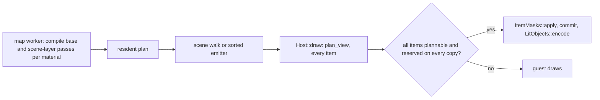

# Native objects: shading, lighting and programs

Status: Built. How the native object pass reproduces the game's own vertex programs, pixel shaders, lighting inputs, render state and streams. Part of stage 2 ([native-objects.md](native-objects.md)).
Code: `crates/rewrites/native-render/src/{object_program,object_program_gpu,object_state,object_streams,object_lighting,object_nodes}.rs`, `crates/rewrites/render-bridge/src/native_objects.rs`, `crates/extensions/game/src/native_objects_glue.rs`. Tests: `crates/rewrites/native-render/tests/object_lighting_differential.rs`, `crates/rewrites/render-bridge/tests/native_objects.rs`.
Switch: `impl.render.native` (on), listed in [switches.md](../runtime/switches.md).

| Constant block | Source | Where it lands |
|---|---|---|
| `c[0..18]` | the view's | vertex block |
| `c[18 + i]` | the implementation's constants, lighting bindings put in from the port | vertex block |
| `c[21..25]`, bump matrices | the structure's parameter block ([native-objects-fade.md](native-objects-fade.md)) | vertex block, stages 1 to 3 |
| `c[50..]` | the node rows | vertex block |
| `c[170..173]` | the decompression | vertex block |
| combiner constants | lighting vectors and scalars, packed per object | pixel block |

## Shading

Opaque parts are drawn with the game's own vertex program and pixel shader (see "Object programs"). `model_gpu::GpuModels` and `models.wgsl` draw the base map times a fixed ambient plus one directional term (`ambient + diffuse · max(n·l, 0)`); only the theater viewer uses that pass (`crates/extensions/game/src/theater/host_view.rs`). The sorted handler submits transparent parts (kind 4) at its indexed emitter ([native-transparents.md](native-transparents.md)).

Base maps go through the world's stage decoder (`StageDecoder`, one per map's model worker). A palettized one (P8, P8 bump) is expanded through the device palette bound when the map's first object was asked for, at the stage its material binds it (the first layer-3 implementation that names the bitmap; stage 0 otherwise), as the D3D path samples it. The objects draw only while the palettes the expansions used stay bound (checked at each layer-3 view); a stage without a full palette refuses the material.

## Object lighting

A fixed ambient and directional term is not the game's lighting, so a material that reads the object's lighting is drawn only with the game's own inputs. `native_render::object_lighting` has the table (Code, `h2 disasm`).

- **The constants.** The object geometry draw `0x0004d0b0` calls `0x0004d9c0`, which hands the render record's lighting pointer (`+0x10`, cache record `+0x44`) to `0x0001bd50`. That makes it the current lighting `[0x00485a58]` and marks the engine inputs that read it dirty.
  The shader draw then evaluates the implementation's dirty inputs (`0x0001ae70`: scalars at `0x000336f0`, vectors at `0x00033980`). `0x00019be0` writes each of the implementation's engine vertex constants (implementation `+0x124`, records of the pass's `+0x38`: register bits 0..3, bank bit 4, mode bits 5..9, input byte 3) into bank 1, uploaded as hardware `c[18 + i]` by `0x00018e80` (bank 0 is the vertex attribute defaults, `0x00018d70`).
  So the lit vertex programs read their lighting from `c[18 + i]`, the registers their implementation names, computed from vector inputs 3, 4, 14..17, 21..24, 35, 40 and 42..45 and scalars 23 and 37.
- **The implementation.** The build `0x0004cbf0` picks which of the pass's implementations an object draws from its lighting: 0 when the byte `+0x76` is not `0xff`, 1 when it is, 2 for a shader flag. On 03a the object passes' programs are the `lightmap_dynamic*` and `sh_dynamic` vertex shaders (`h2 tags 03a_oldmombasa vrtx`).
- **The transform.** `0x0004d830` uploads a single-node object's matrix (record `+0x1c`) as three registers at hardware `c[50]`.
- **The port.** `object_lighting::vector_input` and `scalar_input` give every lighting input.
  Vector 40 (all three components) and scalar 37 are `object_lighting::root_value` (`0x00033670`): the object whose handle is the lighting's `+0` (`0x000badc0`, mask -1: index below the array's count, salt non-zero and equal), walked up its parents (`+0x14`) while its byte `+0xaa` is set, the elements read straight from `[0x004e0300] + 0x44` at a stride of 12. The value is the root's `+0x2b0` clamped to 0..1, or 0 when a handle does not resolve. Both read `[[0x00485a58]]` unchecked, so without a lighting they are not given. The value is taken with the lighting's words at hook time.
  `tests/object_lighting_differential.rs` checks every input bit for bit (NaN for NaN) against the lifted `0x00033980` and `0x000336f0` on seeded states, 40 and 37 over a seeded object array of parents, salts and empty elements.
  The hook copies each drawn object's `0x78` lighting bytes and the inputs' defaults into its `ObjectFrame` (`objects::object_lighting`: body `+0xcc`, the record still its own), so the pass has the frame's values whatever the cache does next.

## Object programs

The map worker compiles each material's base and scene-layer passes independently. Models with only overlay or sorted passes can supply those draws. For a shader substituted by a render record, the worker compiles its layers 18, 19 and 21 over the model's drawn parts.

The layer lookup uses the shader, section and part selected by the record. Its base-layer coverage and display-only section list still require matching base passes.

A transparent-only model needs no base program. Its layer-15 draw uses the shader bindings and index range at the sorted emitter. A model made only of part kinds 0 and 5 has no drawable range. Both definitions can finish loading with an empty base-part list.

If a scene or sorted object misses the resident plan, the standard geometry handler sets up the material and streams. At the indexed emitter, `render_bridge::native_transparents` checks the layer caller, the handler's saved render-record pointer, the live record index and its model datum. An accepted full-part or subpart range submits through `world_layers_gpu::IndexedPass` with the bound state and counts under the objects stage. The handler continues with its ordinary draw when the indexed reservation fails.

### Layer inputs

In layers 1 and 17 an unbound direct read of `c[18]` inherits the hardware register. At layer entry the objects glue reads its four words after draining the device, together with row 0 and its dirty bit in shader material bank 1. A pending upload or a material write that changes the row runs through the binder and indexed emitter. If an earlier structure pass can write the row before an object that may inherit it, the layer planner preserves that upload in list order.

Layer 18 evaluates the pass's Xbox `BLENDCOLOR` writes in order. The pass can supply the starting colour or inherit it. A binding can change RGB while preserving alpha, or change alpha while preserving RGB. When the write must persist for later guest work, the handler performs it before native indexed submission.

Layer 19 takes fog vector 41 and scalar 39 from the view captured at layer begin. Object vertex and pixel bindings use the same values, including the view's disabled-fog defaults.

### Parts of an object program

- **The texture accumulation target** (engine texture 3, Code). The binding `0x00019530` takes for 3 (`0x000195b2`) binds render target 1 through `0x00014f60`. Its kind, the byte at `0x00015154 + 1`, takes `0x00015044`: the texture `0x0001dcc0(1)` returns, the descriptor `0x004b4b58 + 0x98` and its texture at `+4`, valid while `+0x88` is set and `+0x95` clear. It writes the target's size (`+0x80`, `+0x84`) as the stage's size, which engine vertex constants of modes 5..20 read. Layer 1's `_combined` passes draw into it; layer 3 samples it in screen space, a linear texture addressed in texels.
  - `object_look_stages` takes the stage out of the look (`EngineBound::texaccum`); it compiles as a 2D stage without a bias.
  - The pass asks the device for the level (`ExternalPass::sampled`, the header `TEXACCUM_HEADER`). After the drain the device finds the render-to-texture level over it as a draw binding it would (`Device::rtt_level`, in place, nothing written back) and the backend gives the pass that copy's view (`ExternalTarget::sampled`, the scaled copy's under the render scale).
  - A view whose objects need it is left to D3D when levels are not sampled in place (`Device::samples_levels_in_place`). An object whose parts need it is left to D3D at the hook, before its items' skip is kept, when the target is not bound (`object_nodes::texaccum_bound`, the check `0x0001dcc0` makes; `NativeSet::texaccum`). If the device still finds no level after the drain, those parts go undrawn for that view: logged once and counted.
  - Per draw the stage's coordinate scale is one over the level's guest size (`texaccum_scale`), and the engine vertex constants that read the stage's size (`ResolvedImplementation::dimension_bindings`, which the resolver left 0 by 0 for an engine texture) get it (`texaccum_dimensions`).
- **By item, in the list's order.** The skip is per item, not per object or section. `objects::clear_objects` reads each item's key (`objects::ItemKey`: the record, the item's shader, the record key's section and part, bits 9..17 and 0..3, and the implementation its `+0` picks). It offers the item only when the definition's native part at that (section, part) has that shader and implementation (`NativeSet::parts`, published per (definition, section, part) with the implementations that sample the texture accumulation target).
  A lit part is one geometry part of a section (`LitPart::part`; the section's parts share its programs). The feature hands the host the accepted items in the list's order (`objects::ItemDraw`: the item, its object's frame, its key and its record's node rows, `objects::record_rows`). One whose object, rows or texture accumulation target (`object_nodes::texaccum_bound`, for an implementation sampling it) do not read goes back first.
- **Planned before the skip is kept.** `Host::draw` plans every item before the hook returns (`plan_view` in the glue, `LitObjects::plan`/`object_program_gpu::plan_part`): its model on the GPU, exactly its part and implementation, every per-object constant (lighting, defaults, rows, decompression) and every state field resolved, the device W-buffered, and for a part sampling the texture accumulation target a device that samples levels in place. It says per item whether it can draw it.
  Each physical copy reserves that exact sequence and `LitObjects::encode` returns the issue count. A missing texaccum level, a partial encode or a validation error cancels all copies. After full reservation the host rechecks the load generation and calls `ItemMasks::apply(mem, &drawn)`, which runs `objects::keep_items` on the original mask overlay. Only confirmed items change guest memory, and the feature retains their full identities for restoration. A shadow comparison keeps its guest draw.
- **The state, field by field** (`object_state::resolve`). The host reads the render states the device holds at the layer-3 call from the guest's render-state array (`object_state::EntryStates`):

  | Group | Fields |
  |---|---|
  | depth | enable, function, write |
  | alpha | alpha test, function, reference; blend and its factors; colour writes |
  | raster | cull and winding; fill modes; solid offset and its biases; depth clip control |
  | stencil | enable, function, reference, masks, operations |
  | fog | fog state |

  A draw takes its implementation's own value for each field it sets and the device's for the rest, nothing from defaults. A field it depends on that does not read or decode refuses it. So does one the pass does not draw (blending in layer 3, fog without the scene's uniforms, a depth bias, a fill mode other than solid, Z-buffering its own `ZENABLE` sets) or an alpha test other than the one its program was compiled with. The stencil test draws: its function, masks and operations go in the pipeline and its reference in the packet.

  The W clip's clamp is the draw's (`D3DRS_DEPTHCLIPCONTROL`); its range the device's at the issue. This takes in the inherited cull: 03a's `concrete_rebar` part of `concrete_chunk_j` sets no `CULLMODE` and draws with the device's cull and winding. S: the layer's earlier draws leave those fields as at the layer-3 call; the comparison prints the D3D draws' own.
- **One load per map, BSP and generation.** The host keys a load by the map's name, the active BSP's address and its index (as the world's). Another key starts a new load (new models, a new worker, a new generation the set carries). A worker publishes only to the load it was started for (its own `Models`), so a worker of an earlier load of the same map (A, B, A again) publishes nothing, and `Host::draw` refuses a view planned against another generation.
- **The vertex block.** What the game's upload would hold for one drawn object (the table above). The lighting bindings come from the port (`object_vertex_uniforms`: the vector inputs through `ResolvedImplementation::vector_bindings`, the scalar ones through `scalar_bindings`, both keeping only what later bindings leave). Layer passes also resolve bound view inputs. A binding that targets a pixel combiner writes the per-object pixel block.
- **The node rows** (`node_rows`, Code). A record with a matrix at `+0x1c` uploads it transposed, without its scale, as three registers at hardware `c[50]` (`0x0004d830`). Otherwise `0x0004d8e0` reads the record's `+8` node block handle (-1: nothing is uploaded, so the object is refused).

  The block at `0x00487b1c + (handle & 0x0fffffff)` holds per part (`+0xc & 0xf`) a first matrix and a count at `+4 + 4·part`, and the matrices at `+0x44 + 0x30·n`, twelve floats in register order. A model record (`+0xc` bits 29..31 = 1) whose section names a node (`0x0004cb80`: the `mode`'s sections, stride `0x5c`, the i16 at `+0x2c`) uploads one matrix (the part's first when it has one, else that node's). Anything else uploads the part's whole palette (`0x000152a0`), `c[50 + 3·k]` for matrix `k`, which the skinned program indexes with `a0.x`. A palette that would run past `c[170]` is refused.
- **The decompression** (`decompression_rows`, `0x0001cdd0` from the section setup `0x0004d7c0`): `c[170]` half the position bounds' extent (w 1), `c[171]` their centre (w 0), `c[172]` the texture coordinate's scale and offset; the identity where the section's flag is clear.
- **The program** (`object_look`, `compile_object`). The implementation's look with its engine constants allowed, translated as the world's are. Every constant read directly must be one of the above, and a read relative to `a0.x` must start in the node rows.

  A read of a constant the pass does not set counts only where its value can reach a live output (`program::live_source_read`). One that reaches only the coordinate of a stage the pixel shader neither fetches nor reads (`program::dead_texcoords`) is not a read, as on the world path.

  The stencil programs (`stencil_texture`, `stencil_emissive`) write every stage's coordinate from `c[19 + n]` (`c[20]` for stages 2 and 3 in `stencil_texture`), and their layer 1 and 7 passes bind only the rows of the stages they sample. The unbound rows hold what an earlier upload left on the device (`0x00018e80` writes only a pass's dirty rows), which those coordinates carry unused. The device's `c[18]` and the structure rows `c[21..25]` are taken only for live reads, so such a pass records no structure read for the `c[21]` of an unsampled `oT2`.

  A vertex register the object streams do not supply is read only where it reaches a live output (`program::translate_object_pass`, `only_dead_outputs`). Those programs copy the vertex colours `v10` and `v11` into `oD0`, which a pixel shader with its own final combiner, plain fetches and no `v0` input leaves unread.
- **The vertex streams** (`object_streams`, Code). The draw sets its streams through `0x0001caa0`: the section's `vrtx` classification (`0x0001cb20`: the geometry classification at section `+0x18`, 0..2 as they are, 3 the influences byte `+0x14` plus 2 when the tag has that many, else 0), its program, and the streams (`0x0001c8c0`).

  The section's vertex buffer descriptors come in order, each stream's format the record of its type in the table at `0x0043f408` (`0x15` bytes a type: the type, then up to ten (semantic, format) pairs; semantic `0xfe` skips bytes, any other negative one ends it). The classification lists per register `v<i>` the semantic it reads; the declaration puts each attribute in the register reading its semantic. The format codes are the Xbox vertex types in order (float 1..4, packed bytes 1..4, shorts 1..4, normalised shorts 1..4, normalised packed 11:11:10, `D3DCOLOR`). The table is read from guest memory when the map is first seen, never copied.

  A section's streams are gathered once per declaration, each register's guest bytes in a 16-byte slot (`object_streams::gather`). The vertex unit converts them with the formats and shader fetch the D3D path's default (GPU) fetch uses (`object_program_gpu::vertex_fetch`, `input_fetch`; `NORMSHORT3` as `snorm16x4` read `(x, y, z, 1)`, and so on).

  Conversion stays on the GPU because a CPU division can round another way than the GPU's normalised conversion. A part whose layer-3 pass tests depth `Equal` against the depth its D3D pass wrote with the same program then fails wherever w differs in the last bit.
- **The implementation** (`record_implementation`, Code `0x0004cbf0`). The build of one record's draw switches on its third argument, the draw (the jump table at `0x0004d054`, indexed by the bytes at `0x0004d068` from draw 3). At draw 3, layer 3, it takes the record's `+0` bits 29..31 (`0x0004cc70`, the table at `0x0004d07c`: 0..4 as they are, 5..7 give 3), overriding what `0x00015d70` chose.

  The lighting's `+0x76` and the template's layer-15 bit (byte `+3` of its level's layer mask) pick the implementation only at draw 18 (`0x0004cc9f`..`0x0004cd46`), not at layer 3. The hook copies each section's implementation with its rows. Per material each implementation of its layer-3 pass that compiles for every section it is in, with its stage bitmaps decoded (linear textures refused, as the world programs do), is available to the resident walk. The emitter can submit a range whose selected implementation could not be preloaded.
- **The normalisation cube.** A stage sampling engine texture 1 is bound to the vector normalisation cube the lights load (`native_lights_glue::light_textures`, the globals' rasterizer data), sampled as a cube without a bias, as the lights sample it.
- **The shader's property bitmap** (engine texture 26, Code). The material resolver binds the bitmap parameter the drawn shader's postprocess names, or the globals' rasterizer shader's for -1 (`tags::material::PROPERTY_BITMAP_TEXTURE`, [shader-instances.md](../formats/shader-instances.md)), so the stage compiles as an ordinary bitmap stage. When the parameter falls back to the rasterizer default texture the pass is refused as any default-texture stage is (`DefaultTexture`). When the index does not read it stays `EngineTexture(26)`.
- **Animated bitmap frames** (bitmap animation component 0, Code). A stage whose slot's frame is animated binds every image of its bitmap at compile (`object_program_gpu::frame_images`), and each draw picks one from the render clock's frame with `layer_pass::frame_image`, the rule of `0x0001b0a0` (`object_program::animated_blocks`, `PlannedDraw::frames`). The encode caches a bind group per image choice. Components 8 and 9 are never read and are skipped; the proof and the refusals are in [shader-instances.md](../formats/shader-instances.md#animated-bitmap-frames-and-components).
- **The lightmap stage** (`object_program::OBJECT_LIGHTMAP`, Code). An object's draw binds no lightmap page. The draw (`0x0004d0b0`, draw 3) sets the current page `[0x00485a60]` to -1 for every record with a model datum at `+4` (`0x0004d2c4`..`0x0004d2de`, `0x0004d362`, then `0x0004d420`). Only records without one (the BSP's instanced geometry, `0x0004d367`) get a cluster's page and palette through `0x00015c90`.

  With the page at -1 the stage setup (`0x00018c43`..`0x00018c4c`, then `0x00018d1f`) binds the globals' rasterizer data element's bitmap at `+0x64` (`[[0x00485a80] + 0x64]`) and no palette.
  The coordinates the draw adds for it come from the BSP: for a record whose implementation is not 2 or 3 and whose `+0xc` bits 18..28 are not `0x7ff`, the BSP's `+0x64` element (stride 12) at that index holds per section a u16 that `0x0004dc60` turns into the vertex offset of a stream of type `0x2e` in the BSP geometry block its `+2` names (`+0x44`, stride `0x38`). The streams step (`0x0001c8c0`, `0x0001ca25`) adds it with its own type's format.

  The host loads that bitmap as stage 3 decodes it and takes it only when it is uniform (every texel of every level the same). It then samples the same wherever the coordinates fall, and the lit build feeds the stream as zeros instead of reading the BSP. A bitmap that is not uniform keeps implementation 0 on D3D, with the reason; reading the BSP's stream per object section is what that would need.
- **Combiner constants** (`object_pixel_uniforms`). A lighting vector bound to a pixel combiner constant is packed per object as `0x00019ca0` packs an engine value (`pack_engine_colour`: alpha 0, `(x + 1) / 2` first where the binding halves it, each channel rounded to 8 bits) into the byte lanes the binding keeps, the rest as compiled.

  A lighting scalar goes through its binding's transform first (`tags::material::engine_scalar`, the one `0x00019ca0` applies: the complement, or a cosine or sine wave over one period clamped to 0..1), which the binding keeps.
- **Which implementations a map draws.** The observer counts live layer-3 object items by their record's implementation and logs the counts once per map, after 600 views.
- **The node rows at the hook** (`objects::record_rows`). The observer copies, for each accepted item, the rows its record's draw would upload; an item whose rows do not read keeps its D3D draw. Under the pipelined render this reads the render's snapshot, as the rest of the observer does ([notes/pipelined-render.md](notes/pipelined-render.md)): the node blocks at `0x00487b1c..` are guest RAM, so they are frame `k`'s. An object of a definition with lit parts is drawn only where its implementation's lighting inputs (and the root value inputs 40 and 37) read. An unavailable input leaves setup to the geometry handler.
- **The draw** (`LitObjects::encode`). One render pass over the same targets: per planned item, in the list's order, its vertex block (`object_vertex_uniforms` over the view's `c[0..18]`) and pixel block in one buffer at dynamic offsets, as the lights do. The viewport is the whole target, as the programs' own fix-up expects.
