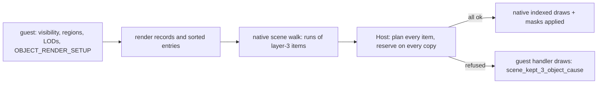
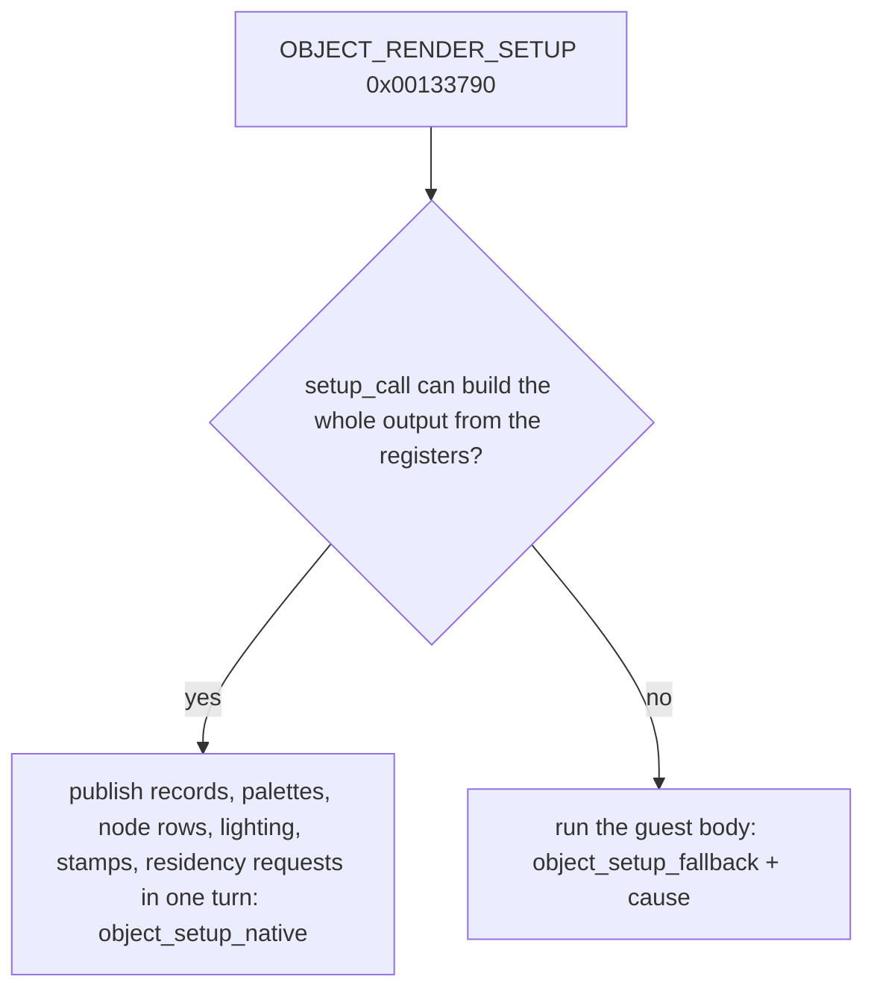

# Native renderer stage 2: objects and skinning

Status: Built. Resident object passes and authenticated indexed ranges draw natively in the default configuration; the first-person lights' layers 12 and 13 draw from the scene ([native-lights.md](native-lights.md)), their layers 11 and 14 on D3D.
Code: `crates/rewrites/native-render/src/{model,model_load,model_gpu,objects,instances,object_*}.rs`, `crates/rewrites/render-bridge/src/{native_objects,native_edits}.rs`, `crates/extensions/game/src/native_objects_glue.rs`. Tests: `crates/rewrites/native-render/tests/models_gpu.rs`, `crates/rewrites/render-bridge/tests/native_objects.rs`, `crates/rewrites/native-render/tests/object_lighting_differential.rs`.
Switch: `impl.render.native` (on), listed in [switches.md](../runtime/switches.md).

| Part of the stage | Page |
|---|---|
| The walk, setup, masks, transforms, LODs, modules (this page) | [native-objects.md](native-objects.md) |
| Fade, the shader flag, structure parameters, the item's argument | [native-objects-fade.md](native-objects-fade.md) |
| The first person's cut, items, effects, drops | [native-objects-first-person.md](native-objects-first-person.md) |
| Shading, lighting inputs, object programs, state, streams | [native-objects-programs.md](native-objects-programs.md) |
| Decorators (the other layer-3 builds) | [native-decorators.md](native-decorators.md) |

Stage 2 of [native-renderer.md](native-renderer.md). It covers bipeds, vehicles, weapons, equipment, scenery, machines and crates: every object whose render model the game queues in the scene list. Geometry is resident per render-model tag, loaded once per map. Each frame the CPU hands over only the drawn objects' node matrices, read from the game's own computed transforms in guest memory, and skinning runs in the vertex shader.

The rule that must hold: an object draws natively only when its material, state and inputs can be reproduced exactly. Otherwise its guest handler draws it, counted by cause. No object goes undrawn.

## Stage 2: objects and skinning

### Native scene object walk

| Piece | Value |
|---|---|
| Covers | the third-person base-layer call to `LAYER_DRAW` (return `0x0002bed5`) |
| Reads | the private sorted entries at the first `LIGHT_GEOMETRY_DRAW` (`0x0004d0b0`) reached from `LAYER_ENTRIES` (return `0x0003bc90`, or the layer port's authenticated continuation) |
| The guest has done | visibility, objects, regions, permutations, LODs, shader implementations |
| Left undone for the part | uploading mesh streams and node rows, evaluating shader parameters, setting render state, issuing the D3D draw |
| Skipped on commit | `0x0004d0b0` and its per-part shader and geometry preparation, including `0x0001bbf0` and `0x00016b90` |

The display gather supplies additional object handles for the wider view. At the scene's layer-3 call, `native_scene_lists::display_model` runs section selection, lighting, palette construction and record emission against a private overlay of guest memory. The display uses the record's chosen permutation, LOD, implementation and skinning rows. Hidden objects and the first-person owner are suppressed. `native_objects_glue/display.rs` submits resident opaque parts only to the display attachments.

An object whose setup needs an animation update, effect overlay or attachment walk, or whose selected section has an unsupported material, can still be absent at the sides in protected sessions. When the unit pose tail (`0x000bd934`) can adjust either of its selected nodes, the shared object setup leaves palette construction to the guest. This also applies when both earlier actor pose overlays are idle.

When the native pass leaves a run to the guest and the guest's D3D draws are the display (single-copy rendering, so no distinct reference copy takes the readbacks), the Highest choice swaps the record's section, palette block and part index range at the sorted geometry handler itself (`native_scene_lists/display_swap.rs`, after the native objects walk has taken its runs). The substituted section must classify and material identically, its geometry must be resident, and its remap rows must already be in the palette, or the retail draw stands. No pose step runs for the substituted tier; the walk and every resource request stay retail. In every other configuration the guest's D3D draws are the reference and keep the retail geometry ([projected size and level of detail](occlusion-culling.md#projected-size-and-level-of-detail)).

#### The entry and the run

The stack holds the remaining entry count at handler ESP + `0x28`, with the array immediately after it.

| Field | Where |
|---|---|
| item index | entry |
| selected implementation byte | entry `+4` |
| vertex classification | entry `+8` |
| implementation pointer | entry `+0x10` |
| dispatcher's exclusion | the vertex shader datum at implementation `+0x100` equal to `-1` |
| model datum, chosen section (permutation and LOD) | the render record the item indexes |
| section count and block | model `+0x24` and `+0x28` |
| section geometry, part element | `+0x34`, `0x48` bytes |

The walk checks the resulting index offset, count and topology against the uploaded part. It uses the record's node rows and the owner's live pose and lighting cache. The render target provides the view constants and W clip.

A native run contains every live layer-3 dispatch of each object it covers. It may include parts interleaved with other eligible objects or slots the dispatcher excludes. An intervening guest draw, an earlier part, a special handler or an unsupported part can make the whole span run on the guest.

The host checks the material and vertex program, render-state writes and restore lists, view and clip, buffer ranges, textures and current map generation. The layer's first shader begin runs on the guest because it initialises the shader and texture caches. A pass transition is eligible when its render-state changes are already reflected in the live state.

Fog uses the fog mode, start, end, density and colour from the render-state shadow and the implementation. The vertex program supplies `oFog`. An implicit final combiner uses the fog factor and D3D's specular-enable bit, with normal alpha semantics.

The walk handles the scene's zero-reference stencil state and its temporary stencil-off bracket when mode 1 is already set. Draws outside those conditions use the original handler.

After every required target copy records the whole run, the hook adjusts ESI and the saved loop count and returns with the handler's normal stack cleanup. The guest loop advances to the next entry in its original order. If planning or reservation fails, the cursor stays put and the original handler runs.

#### The entry state

There is no device. The draw state the walk checks and inherits is what the guest's D3D library keeps in guest memory (`native_objects_glue::device_state`):

| State | Where |
|---|---|
| Render states, fog words, stencil, stipple switch | shadow `0x00407498 + 4·slot`, 166 slots |
| W buffer | slot 143 (`ZENABLE`) is `D3DZB_USEW`; `0x003f54f0` redoes `SET_CONTROL0` from it |
| Texture-stage states | `0x00404dd0 + 4·(32·stage + state)`, as `0x003f5e30` stores them |
| Vertex constants | `0x00407738 + 16·register`, as `SetVertexShaderConstant1` (`0x003f71d0`) keeps them |
| `c[18]` | the material bank at setup context `+0x1630`: `0x00018e80` uploads it through `0x003f7230`, which keeps no shadow |
| Stipple pattern | device `+0x197c`, as `SetStipple` (`0x003f8cc0`) stores it |
| Program clip range and its owner | device `+0x1c10` and the flags at `+0x1c18` |

The auxiliary toggle's rest check compares the cached byte and the stored clip. Its rows reach `c[0..3]` through the push buffer alone, which nothing reads.

The scene list builders supply visibility, LOD inputs and supported records. The object setup tail supplies the palettes consumed by the walk, lights, shadows and later passes.

#### Load and residency

The activation hook starts a utility-priority worker for the mounted map. It reads every object palette in the mounted scenario, including entries with no placement, and walks those definitions first, followed by the remaining object tags. It decodes each distinct render model once, creates its GPU resources and submits its texture uploads.

It publishes the completed definition index and resident models together. The first swap after publication makes them eligible for native draws, and later spawns share those models. The indexed emitter handles resident-plan misses while the models, bindings and target pipelines warm.

Map activation and snapshot reload invalidate the previous load's work. A pass that already committed holds its models until recording ends. The last reference sends their GPU resources to the shared map retirement worker for destruction. First-person models use the same worker.

#### Live edits

A paired editor's live edit changes the map file as the raw overlay serves it ([realtime-edits.md](../editor/realtime-edits.md), "The native refresh"). The hot-edit glue pushes each edited render model and bitmap image onto `render_bridge::native_edits`. When models are resident, the objects' glue drains its share at the next walk or preload, one refresh at a time, onto a worker (`native_objects_glue::refresh_models`).

| Edit | Result |
|---|---|
| Render model the load made native | loaded again from the file as the load does (`load_model`), uploaded into a staging set and moved into the draw set under its lock (`LitObjects::move_model_into`), with its new coverage and the load's residency |
| Render model that no longer loads natively, or whose node count changed | leaves the native path (`LitObjects::remove_model`); its parts keep their D3D draws from guest memory, and the log says why |
| Bitmap image | decoded again at each stage that samples it, every program texture made from it rewritten in place (`LitObjects::rewrite_image`); another size, level count or format keeps the loaded pixels until the map reloads |
| Shader, template, pass or vertex shader (`Edit::Shader`) | each resident model with a part whose shader is built from it is loaded again the same way (`LitObjects::model_shaders`) |
| First person | the same rules on its own set (`native_first_person_glue::refresh_edits`): an edited model is asked of its loader again under its first key, from a map opened again; an edited image is decoded again and rewritten (`native_first_person_load::refresh_images`) |
| Editor and Theater | their `GpuModels` replace a model under its index with `GpuModels::replace_model` |

The sun's caster models (`native_render::sun_casters`) keep the geometry they loaded.

#### Shared program resources

Because the load walks every object tag, a multiplayer map uploads a few thousand material programs. They repeat a small set of generated shaders, stage layouts and samplers, and a material's passes bind the same bitmaps. One `LitObjects` set makes each of these once (`object_program_gpu::Shared`):

- a module with its pipeline layout and pipeline table per WGSL and stage layout;
- a bind group layout per entry list;
- a sampler per descriptor;
- a stage texture per stage index, bitmap image (or the objects' lightmap stage) and signed channels.

Each program keeps only its own bind group. A stage whose image is missing gets a black texel that is never shared.

A staging set (`LitObjects::empty_with_layout`) starts with nothing shared, so a refreshed model uploads its edited images again. An image rewrite (`LitObjects::rewrite_image`) writes the shared texture, so every program that binds it sees the edit. `LitObjects::created` counts what a set made. The size of the saving is in [notes/native-objects-resources.md](notes/native-objects-resources.md).

The palette status (`scene_palette_*` in `render.scene`) distinguishes pending definitions, explicit null model references, failures, partial native coverage and resident definitions. A resident definition has a published model and a layer-3 material program for every drawn part and declared implementation across the model's sections.

Material LODs with different base passes and parts outside the native object renderer's coverage keep the definition partial. Extraction checks the model's published upload as well as the selected part's native coverage. A failed GPU lookup for a covered part keeps the run's guest draws (`native_objects_walk_unresident`).

#### Object setup

`OBJECT_RENDER_SETUP` (`0x00133790`) is answered by `native_scene_lists`' seam (`setup_call`) wherever it can build the whole call's output from the call's registers. That output is the render records, the palettes and node rows, the lighting bytes, the animation and geometry cache stamps and the residency requests, all staged and published in one turn in the guest's visit order, with AL and the "not drawn" registers. Such a call is counted `native_scene_lists_object_setup_native`.

A call the setup cannot build (a refusal of `Refusal`: memory, layout, x87 or MXCSR state, object model, lighting, palette, residency) runs the guest body, counted `native_scene_lists_object_setup_fallback` and under its cause (`..._memory`, `..._layout`, `..._unsupported`, `..._object_model`, `..._lighting`, `..._palette`, `..._residency`). The body issues no draw: it writes the records the native scene then draws. It owns what the build does not reproduce:

- a root object's fresh light sample (`lighting::refresh`, `keeps_light_sample` false: `..._lighting`). The first person's arms are such a root, and the weapon copies its light from them, so taking the "not drawn" exit here loses the arms and leaves the weapon black on a sample never taken;
- a view other than the main view (kind 0) and the light view (kinds 1 and 2), such as a menu's model view (Choose Profile's Spartan: `..._unsupported`);
- a locked pose or a first-person model of more than 64 nodes (`..._palette`).

The setup is therefore not a cut (`render_bridge::cut::CUTS`), and the census row `object_setup` is partial (test `a_setup_the_build_refuses_runs_the_guest_body_and_is_not_dropped`).

A residency request that needs a new queue entry, a priority raise or a wait (`residency_request` returns `NeedsGuestService`) is the guest cache's own service, so that call runs the body too; once the request is queued the next frame's setup is native. A resident block, or a request already queued, is made by the setup: the cache stamp and the structure-miss count (`render_bridge::native_scene_lists::residency_request`; test `object_setup_makes_the_guests_residency_requests`).

#### Frame stats

| Counter | Counts |
|---|---|
| `native_objects_walk_native` | objects drawn per view |
| `walk_unsupported`, `walk_order` | objects of a span the walk did not admit |
| `walk_reservation`, `walk_model`, `walk_inputs`, `walk_state`, `walk_unresident` | objects of a run the host did not take |
| `walk_unreadable` | views whose sorted list or ownership could not be established (unknown object count) |
| `walk_part_*` | parts (not objects) behind `walk_unsupported`, by cause (below) |
| `walk_fallback` | every object above but `walk_native` and `walk_unreadable`: its guest handler draws |
| `scene_kept_<site>3_object_<cause>` (`render.scene`) | the same objects by view (`""` the scene, `alt` the alternate view) and cause (`unsupported`, `order`, `state`, `reservation`, `unresident`, ...), and `scene` for the objects of a walk whose extraction the scene step refused |
| `scene_kept_<site>3_unreadable_list` | walks whose sorted entries do not read |
| `scene_kept_<site>3_object_walk_{host,list}` | object items of a layer 3 with no walk (no host; the list does not read), counted per item at the layer's return (`native_layers::leave`) |

The walk takes only the first slot of its next admitted run (`native_objects::handler_at`). Every other handler call draws as the guest's: an object of a span the walk did not admit, the slots of a run the host refused, a call outside the list (`native_objects::keep`). A Grunt, a Phantom or a door whose part the walk cannot read is drawn by its handler, not dropped (tests `a_handler_the_walk_does_not_take_draws_as_the_guests`, `objects_the_walk_keeps_are_counted_by_cause`).

Once a guest handler has drawn, the layer's state is the guest's, so later runs refuse with `walk_state` and keep their guest draws too. The run draws in `native_objects::SLOT` (`ViewSlot::OpaqueBase`, slot 1), and the pass carries the slot. `walk_unresident` counts the objects in a run whose requested model agrees with the loader's part coverage but has no uploaded geometry and materials. `walk_model` includes unresolved definitions, mismatched models and loader lock contention.

The `walk_part_*` causes are `scene_extract::layout::object_walk::Refusal` ([framescene.md](framescene.md), "Slice 3"). Every refused part is in exactly one, so their sum is what the walk leaves to the guest.

| Counter | Cause |
|---|---|
| `aux_state` | a bit-11 part whose toggle's inputs (`scene_extract::layout::aux_depth`) do not read |
| `subparts` | a bit-6 part whose visible-subpart mask does not read or names a negative first subpart |
| `shader_flag` | a flagged shader on a record with a structure lightmap index |
| `argument` | an item's `+0x14` or `+0x15` set, or an argument's low byte other than the key's part |
| `program` | a program with flag bit 20 |
| `layout` | every other refusal (the item's layout, a check against the guest's choice, memory that does not read) |

The method for comparing the walk with `impl.render.native=off` is in [notes/native-ab.md](notes/native-ab.md).

### Research points (Code unless marked; `h2 disasm`)

| Point | What |
|---|---|
| `0x004e0300` (`points::OBJECTS`) | The object datum array header `H`. Header of handle `h`: `[H+0x44] + 0xc·(h & 0xffff)`; salt `u16 +0` must equal `h >> 16`; body `[header+8]` ([live-gamestate.md](../live/live-gamestate.md)). The pool compacts, so a body address is read every frame, never kept. |
| body `+0x00` | The object definition tag datum (`bipd`, `vehi`, `weap`, `scen`, ...). |
| body `+0x30`, `+0x3c` | World bounding sphere: centre (3 floats), radius ([occlusion-culling.md](occlusion-culling.md)). |
| body `+0x114` (u16), `+0x116` (i16) | **The node-matrix block**: its size in bytes and its offset from the body. `object_new` `0x000b7b40` reserves it at `0x000b800b..0x000b801e` with `0x000bc380(field 0x114, 0x34 · nodes, align 0)`, the node count from hlmt `+0x78` (at least one). `0x000bc380` writes a block reference as `+0` size and `+2` offset (`0x000bc427`, `0x000bc430`). The other blocks it places: `+0x10c` and `+0x110` (32 bytes per node, when animated), `+0x118` (10 bytes per region), `+0x11c` (8 per attachment), `+0x120`, `+0x124` (`0x18` per change colour), `+0x128`. |
| node matrix (`0x34` bytes) | The game's `real_matrix4x3`: `+0` scale, `+4` forward, `+0x10` left, `+0x1c` up, `+0x28` position. A local point `p` goes to `scale · (p.x·forward + p.y·left + p.z·up) + position`: the bounding-sphere update `0x000bdf90..0x000be068` applies the root node exactly so, reading the block through `[body+0x116]`. The matrices are world space (the sphere it produces is the world sphere at `+0x30`). |
| mode node `+0x28` (`0x34` bytes) | The node's inverse rest frame in the same layout (scale, then the inverse's three columns, then its position; `crates/tools/h1-assets/src/models/tests.rs`, `node_inverse_frames_are_stored_as_columns`, and the retail check `retail_h2_mode_layouts`). A retail hlmt node is its mode node's first `0x5c` bytes (V, `crates/formats/tags/src/defs/hlmt.txt`), so object node `i` is mode node `i`. |
| skinning | Vertex world position `Σ wₖ · N[nₖ] · I[nₖ] · p`, with `N` the object's node matrix, `I` the mode node's inverse rest frame, `nₖ` the section's node map applied to the vertex's node index (S: that the game composes the same `N·I` for its node constants; "rest frame times inverse is the identity" is Test in h1models, the draw side is checked by the A/B). Sections without vertex nodes (classification 1) are bound to the first node of their node map, else node 0 (S). |
| `0x0002cbf0` | Fills render record `0x004ba138 + 0x20·i` (at most `0x352` per frame, counter `0x004c0b78`): `+4` its second stack argument, the render model (mode) tag datum (`-1` for the BSP), `+8` a word from the caller's per-section state, `+0x10` its fifth, the object's lighting (below), `+0`, `+0xc` and `+0x1a..+0x1b` bit-packed. Its caller for objects is `0x00133f70`, which walks a per-object render state built under `0x00133ab0` (`+0` the object handle, count `+0x166`, per-section words from `+0x48` with stride 4: the lighting pointer at `+0x48 + 4i`, the mode datum at `+0x5c + 4i`, both filled by `0x0003d4f0` and `0x0004b5d0`). **The record does not hold the object handle**. |
| record `+0x10` → cache record → owner | How an object's render record names its object (`objects::record_owner`): `+0x10` points at `+0x44` of the object's record in the render-state cache (`0x0004b5d0`: `lea ebx, [record+0x44]`), or is 0; the cache record's `+4` is the owner's handle; the owner's body `+0xcc` holds the cache record's handle, which `0x0003ddd0` checks (`[data + 0x100·(body[+0xcc] & 0xffff) + 4] == handle`). The resolve requires all of it (pointer at a record's `+0x44`, index below the cache's high water `+0x38`, owner live by `0x000badc0`'s rules, `+0xcc` naming the record back); a record that fails uses the geometry handler. Code; Test on synthetic memory. |
| `0x000badc0` | The object lookup: slot `handle & 0xffff` below `[H+0x38]`, element `[H+0x24]·slot + [H+0x44]` (12 bytes; `0x0003ddd0` uses a fixed 12), live when its `u16` salt is non-zero and equals `handle >> 16`, body at `+8`. `objects::body` follows it. |
| `0x0002bed5` | The return address of the base layers' layer-3 call (`call 0x00044550` at `0x0002bed0` in `render_scene_passes`, view kinds 1 and 2). The object skip acts only there, so first-person or other-kind layer draws are never touched. |
| `0x00040136` | The return address of the other layer-3 caller: `call 0x00044550` at `0x00040131` in the first-person draw `0x0003fdf0`, which runs after the transparents for its own record list (`0x004c8740`, `[0x0050943c]` records) under the first-person camera and projection, then `0x000445d0`. The call is cut ("First person" below): its body never runs, so this return address is never reached. |
| `0x0004baf0`, `0x0004b5d0` | LOD choice by pixel size inside `0x00133790` ([occlusion-culling.md](occlusion-culling.md)). |
| `0x0016d764` | Region permutation choice (Likely): the variant's region map, its regions at `+0x18`, then `0x0016dad0` ([objects.md](../formats/objects.md)). |
| `0x00165f16` (`points::FIRST_PERSON_RENDER`) | One local player's first-person weapon and arms, after the transparents, with their own projection (camera `0x0023c110`, FOV `0x00187130`). |
| `0x0003ddd0`, `[0x00509434]`, body `+0xcc` | The per-object render-state (lighting) cache: records of `0x100` bytes, lit per frame by `0x0003dfe0`, lighting at `+0x44..` and `+0xc0..` (layout not read; [notes/pipelined-render.md](notes/pipelined-render.md)). |

### Layer-3 masks

Items the walk does not take are planned by the layer observer before the layer draw and paired with their indexed D3D submissions, under the same plan rules as the world (`LAYER_DRAW`, an opaque point).

**Before** the layer draw, when the current layer is 3 and the caller is the base layers' call (`[esp] == 0x0002bed5`), the observer walks the current list:

1. An item is an object item when its build is `0x0004cbf0` and its render record names a live object (see "Research points", record `+0x10`).
2. It is skipped when the host draws that object's definition and the item's shader (`+8`) is one of the host's native materials: layer 3's bit cleared, the item remembered, the object added to the view's drawn set (once).
3. The bits go back **before the next layer draw** (5 and up follow 3 in the same view), on items that still hold the mask the skip left, as the world's do.
4. The host gets one external pass per view carrying, per drawn object, the definition and the node matrices copied out of the body (`0x34 · count` bytes) and the bounding sphere.

The base walk owns layer 3. The scene layer planner handles object layers 1, 2, 5, 7, 8, 17 and 20.

The sorted camouflage and hologram handlers select layers 18, 19 and 21. Each layer retains its own pass order, depth test and blending. Dynamic lighting has a separate planner ([native-lights.md](native-lights.md)).

What the native pass draws is exactly the set of objects whose layer-3 items it skipped. The game's own visibility, object list, attachment recursion and "not drawn" decisions (`0x00133790`, occlusion) have already run, so a held weapon, a vehicle's driver or a culled crate need no logic of ours. A conservative sphere-frustum test runs anyway (cheap, and a guard against a stale sphere).

### Fade, the shader flag and the item's argument

An object item's draw reads three things beyond its material: the fade byte, the shader's flag bit 0 (with the structure's parameter block) and the item's argument. The native draw takes the item only where skipping the guest's draw leaves the device's state as drawing it would. The cases and the names of what declines (`object_fade`, `object_stipple`, `object_shader_flag`, `object_shader_flag_target`) are in [native-objects-fade.md](native-objects-fade.md).

### Depth mode at the layer call

A layer's object items are planned at the layer call, before its first shader begin (`0x0001bbf0`) sets `ZENABLE` to `D3DZB_USEW` (`push 2` at `0x0001bc11`). The shadow at the call holds what the work before left: before layer 1 that is the last view's screen passes, drawn unbuffered.

| Step | Where |
|---|---|
| Before the layer draw, plan with the begin's `ZENABLE` | `plan_walk` with `before`, `LAYER_BEGIN_ZENABLE` |
| The W check reads the shadow's `ZENABLE` | `entry_states`, `device_state::w_buffered`; refused: `object_w_buffer` |

### Texture accumulation order

Layer 1 draws each object's albedo into the texture accumulation target; layer 3 samples it. Both run in stream order: a native pass is issued at the drain after the D3D work pushed before it, and binds the target's level in place (`rtt_direct.rs`, `an_external_pass_samples_a_level_after_the_work_drawn_into_it_before_the_drain`). A layer-3 pass never reads the level ahead of its layer-1 items, native or kept.

### Transform source

Node matrices are read once per view at the hook, from the body (`[body+0x116]`, `[body+0x114] / 0x34` nodes), after the game has finished the frame's animation and attachment updates (the records exist, so `0x00133ab0`'s node pass ran). They are uploaded raw (13 floats a node) into one storage buffer per pass.

Each object has one small instance record: node base, node count, and an RGBA8 highlight the lit colour mixes towards by its alpha (zero for the game, the selection in the editor). The inverse rest frames are resident per model. No matrix product is done on the CPU. An object whose node count disagrees with its model's stays on the D3D path.

### LODs

The game picks a LOD per object by pixel size, and each render record names the section it draws (the key's bits 9..17). An object's parts come from the sections its records name, nothing else. So the load takes every detail level's section of the permutations picked (`model_load::pick_lod_sections`, highest first per region), and a distant object draws the lower level the game picked.

An item whose record names a (section, part) none of the native parts is (another permutation than the one loaded, or a part that did not load) is not offered at all (`NativeSet::parts`, [native-objects-programs.md](native-objects-programs.md)): it keeps its D3D draw. The base-map stand-in for transparent parts still draws the highest level's.

### Permutations and regions

The variant is the object definition's default (`0x0016d180`'s rule, `tags::object::Context::resolve_model`). Its regions map to the render model's regions by name, and each region's permutation to the render model's by name.

A model is drawn natively only when every region the variant lists has **exactly one** permutation. Models with a random or state-driven choice (marine heads, damage states, a variant changed at run time through `+0xb1`) stay on the D3D path until the record's section is read. Regions the variant does not list draw their first permutation, as the viewer does (S: some may be hidden in game).

### First person versus third person

The first-person weapon and arms are drawn by `0x0003fdf0`, not by the base layers' layer-3 call, which the caller check pins. They draw with the render camera record (`0x004b9da0`) and the projection the game view drew with. The local player's third-person body draws natively like any biped when the game queues it. The camera, the cut and everything else are in [native-objects-first-person.md](native-objects-first-person.md).

#### First person

`0x0003fdf0` is a cut producer (`render_bridge::cut::CUTS`, row `first_person`; producer `feature::native_first_person`), held until a frame proves the native path and released for the rest of the run. Released, its items and effects are made in Rust into the first person's view, which draws in slot 10 after the world's transparents. A part that does not draw is a named drop; there is no D3D fallback. The cut, the items, the effects, the drops and the tests are in [native-objects-first-person.md](native-objects-first-person.md).

### Shading

Opaque parts are drawn with the game's own vertex program and pixel shader; the theater viewer alone uses a fixed ambient plus directional term. The decoder, palettes and the sorted handler's transparent parts are in [native-objects-programs.md](native-objects-programs.md).

### Object lighting

A material that reads the object's lighting is drawn only with the game's own inputs, ported in `native_render::object_lighting` and checked bit for bit against the lifted original (`tests/object_lighting_differential.rs`). The constants, the implementation choice, the root value inputs and the frame copy are in [native-objects-programs.md](native-objects-programs.md).

### Object programs

The map worker compiles each material's base and scene-layer passes. A planned item reserves on every copy before the skip is kept. The program, the state field by field, the streams, the node rows, the decompression, the lightmap stage and the draw are in [native-objects-programs.md](native-objects-programs.md).

### Memory and host state

The observer reads the object array and bodies during the render. The node matrices are copied out of guest memory at the hook into the pass (`ObjectFrame`), and nothing reads guest memory after it.

The observer is one hook (context-only, nothing after the body, the restore at the next layer draw). The host's writes are its map state (a mutex only the observer takes, with the model loader on host threads) and a reservation on the device for the current view, which commits in render order at the hook.

### Per frame on the CPU

Per view: one walk of layer 3's list, one object lookup per drawn object, a copy of its nodes (a biped has about 50: 2.6 KB) and one sphere test. The render thread writes two storage buffers and issues one indexed draw per (object, opaque part), grouped by model and material. Nothing per vertex and no matrix work on the CPU.

## Modules

- **`native-render`.**
  - `model`: the game's node matrix, `Model::build` (one vertex and index buffer per model in rest space, vertex node indices through the section's node map, one draw per opaque part sorted by material, the inverse rest frames), `Model::skin` (the shader's arithmetic on the CPU).
  - `model_load`: definition -> `hlmt` -> `mode`, the section pick of "Permutations and regions", the inverse frames from node `+0x28`.
  - `objects`: the handle lookup, the node block at body `+0x114`/`+0x116`, the sphere; `clear_objects`, `keep_only`, `restore` on the base layers' layer 3.
  - `instances`: per view the node array, one instance record per object, a draw per (object, part) sorted by model and material, the sphere-frustum cull, the node-count guard.
  - `model_gpu`: `GpuModels`, models added one at a time, per view one uniform and two storage writes, one pass with an indexed draw per (object, part), `instance_index` the object.
  - `models.wgsl`: skinning `Σ w · N · I · p`, base map times ambient plus one directional term, mixed towards the instance's highlight, the W depth.
  - Tests: the unit tests in each module on invented models and synthetic guest memory. `tests/models_gpu.rs` draws an invented two-node model whose square hangs on a turned node, checks colour (lit by the skinned normal), W depth, one object culled and one with the wrong node count left out.
- **The feature `native-objects`** (`crates/rewrites/render-bridge/src/native_objects.rs`). One observer before `LAYER_DRAW`, inside `render-timing`'s and the world's (`after_feature` on both), context-only. Layer 3 at the main or alternate scene call opens the sorted object walk with that view's kind. The geometry handler consumes contiguous admitted runs after reservation. The packets carry the current view's constants and a scissor scaled to each copy.
  Tests: `crates/rewrites/render-bridge/tests/native_objects.rs` (the plan with `render-timing`, deep, the layer-draw port and the world; with the world alone the chain runs on the render thread; the switch off; the observer on `FlatMemory`, with the restore at the next layer draw and a rebuilt list left alone). Boot plans it (`registration.rs`, in `ALL_ON` of the registration tests); `render_thread`'s test checks the layer draw is render-thread safe with the world and objects on ([notes/render-thread.md](notes/render-thread.md)).
- **Boot glue** (`crates/extensions/game/src/native_objects_glue.rs`). The map worker owns the definition scan and GPU upload, palette definitions first. A validated model contributes its supported parts to draw admission. The worker reports how many definitions it indexed and how many failed to preload. Actual native submissions are counted at the scene walk or the indexed emitter.
- **Diagnostics.** Every layer-3 call of the observer ends in one counted `Stop`:

  | Stop | Meaning |
  |---|---|
  | first person | `[esp]` is `0x00040136`, left to D3D |
  | wrong caller | `[esp]` is neither that nor `0x0002bed5` |
  | no host, no camera, no map, no list | missing input |
  | no object items | no item's record names a live object |
  | none accepted | models not loaded, refused, or shaders not native |
  | none read | node count |
  | draw refused, drawn | the outcome |

  The first of each prints `native-objects: first layer-3 call ending in "<stop>": <detail>`; each distinct wrong caller prints its `[esp]` (up to four). Every 1,800 layer-3 calls one line counts them all, with the definitions wanted and the summed walk (items, in layer, geometry builds, object records, live, accepted, failed writes, and up to four other build functions met in layer 3). A run that draws nothing says which return it took.

### Other builds in layer 3

The walk's `other builds [0x0004de20 x15580]` are decorators (Likely): `0x0004de20` is the build the layer draw's handler table (`0x00041640`) gives the BSP's decorator placements (`[[0x004e0348] + 0x238]`, entries of `0x18` bytes whose first byte indexes the scenario's decorator palette at `+0x37c`, 8 bytes each with the set's datum at `+4`). They have no render record, are not objects, and neither skip touches them (both take only build `0x0004cbf0`): they stay on D3D. Their own stage is [native-decorators.md](native-decorators.md).

## Not verified

- Whether the game composes the same `N · I` for its own node constants (the draw side is checked by a frame A/B).
- Which regions the game hides that the viewer-style first permutation draws.
- Which split of layer 3's D3D calls belongs to the world and which to objects (`render-census` can give it).
- A frame comparison of the first-person path, its lights' layers 12 and 13 included.

## Related

[native-renderer.md](native-renderer.md), [native-world.md](native-world.md), [objects.md](../formats/objects.md), [lighting.md](../formats/lighting.md), [native-objects-fade.md](native-objects-fade.md), [native-objects-first-person.md](native-objects-first-person.md), [native-objects-programs.md](native-objects-programs.md), [notes/native-ab.md](notes/native-ab.md).
