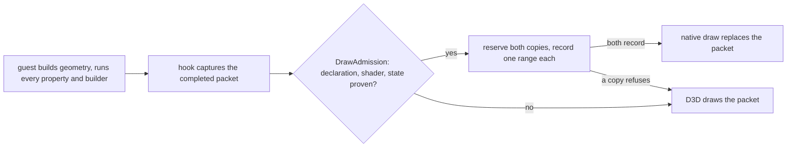
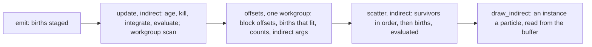
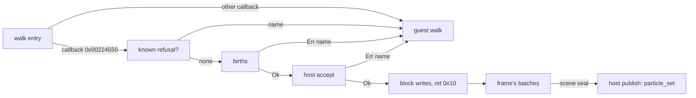
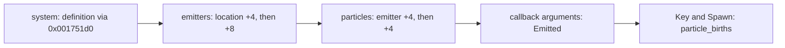

# Native particles and effect geometry

Status: Built. Particles, beam emissions, generated contrails, the four-vertex effect builder, volume and trail billboards, weather layers and lines, and two researched material strips are admitted through `d3d::DrawAdmission`. GPU particle systems (emission, update, compaction, draw on the GPU) are built and tested offscreen, and the frame graph draws a published set of them in slot 9 of each game view; R2's mirror holds the guest's particles as their births ([retire-d3d-r2.md](retire-d3d-r2.md), "R2's particle mirror"), and its game host is not built. Pixel parity and timing are not verified.
Code: `crates/rewrites/render-bridge/src/native_particles.rs`, `native_effects.rs`, `crates/extensions/game/src/native_particles_glue.rs`, `native_particles_admission.rs`, `crates/rewrites/native-render/src/particles.rs`, `particle_gpu.rs`, `particle_system.rs`, `particle_definition.rs`, `particle_compute.rs` (`particle_common.wgsl`, `particle_compute.wgsl`, `particle_draw.wgsl`), `effect_geometry.rs`, `effect_immediate.rs`. Tests: `crates/rewrites/render-bridge/tests/native_particles.rs`, `render_bridge::native_effects::tests`, `crates/rewrites/native-render/tests/particles_gpu.rs`, `particles_compute_gpu.rs`, `crates/platform/d3d/tests/admission_scope.rs`, `external_pass.rs`, `threaded.rs` (`a_particle_batch_is_one_queued_admission_with_the_same_draws_in_order`), `admission_scope.rs` (`same_state_particles_resolve_once_and_offer_identical_draws`).
Switch: `impl.render.native` (on), listed in [switches.md](../runtime/switches.md).

On the admitted path the guest keeps all particle, beam and contrail simulation, property evaluation and geometry construction; the stage reads the completed geometry and replaces only the draw packet. A GPU particle system ("GPU particle systems" below) holds its particles in GPU buffers and updates and draws them there. Part of [native-renderer.md](native-renderer.md).

| Producer | Guest entry | Native admission |
|---|---|---|
| Particles, beams | `0x002243c0` via emitter `0x0023ed30` | Four-corner quad, direct and at publication |
| Contrails | dynamic entry `0x0004b220`, builder `0x00042cf0` | Completed triangle strip |
| Effect quad | `0x00052040`, builder `0x00052020` | Four-vertex strip, fan or quad |
| Light volumes (`MGS2`), trails (`tdtl`) | `0x0004f010`, `0x000508d0` via `0x0004f7e0` | Four-vertex billboard fan |
| Weather | `0x00037a60`, `0x000391f0` | Quad strip, line lists (points refused) |
| Material strips | `0x00244610`, `0x002be650` via `0x0019f680` | Completed triangle strip |
| Colour flare fans | `native_flares.rs` | Six fan sites |
| Lens flare visibility | `0x0002e540` | Counted fan (query) |

The device prints one `native-particles` refusal summary per 100 presents
with activity. Counts are grouped by producer and reason for admission
and by target copy and reason for GPU preparation.

## How it works

### Particle boundary

Code evidence from the owner's executable, inspected with `h2 disasm`:

- `0x00174420` updates particle/effect state while rendering. It is **never
  skipped** here (R2's answer makes it in Rust, retire-d3d-r2.md); neither are property evaluation or emitter iteration.
- `0x002243c0` sets up the particle material, selects the vertex program
  through `0x0023ea80`, then walks particles with callback `0x00224550`.
- `0x00224550` evaluates colour, alpha, rotation, size and sprite windows;
  `0x00224cd2` calls `0x0023ed30` with eight stack words and an EBX pointer.
- `0x0023ed30` writes dynamic attribute registers selected at
  `0x00470a3c..0x00470a58`, then one four-corner quad. The two-float writes
  reset z/w to 0/1. Packed colour is little-endian RGBA, **not** ARGB.
  `0x0023ecd0` initializes the register assignments; we read the live
  assignments and refuse overlaps or register 0 rather than copying that
  table. `0x00470a38` gates emission.
- The inline corner payload is eight words for four vertices. The
  stage admits only a *live declaration proven by the adapter* to be v0
  SHORT4, no other arrays. It expands (0,0), (1,0), (1,1), (0,1), z/w both
  zero. Quad triangulation uses the D3D diagonal (0,1,2), (0,2,3).
  A different declaration or inherited register value leaves direct issue
  to the guest. At publication the scoped admission compares the complete
  corner payload and submits it through the resolved program and vertex
  layout.

`native_render::particles::read_emission` reads the helper inputs without
writing guest memory. The feature's context-only hook always returns
Continue.

Keeping the helper running preserves allocator failure behaviour,
push-buffer put pointer, shader state and the last attribute values that a
later native or D3D draw inherits. The adapter replaces only the captured
primitive after those effects have occurred. The stage saves submission
work only, not the per-particle property evaluation.

### Contrails and other effects

- `0x00042b20` enumerates contrail records and channels. `0x00043740`
  queues a sorted entry through `0x0001e5e0`, with material setup
  `0x00043720`, builder `0x00042cf0`, stride 24 and two vertices per point.
  The existing `0x00035b00` sorted handler selects the live declaration and
  invokes `0x0004b220`. That dispatcher is unchanged.
- `0x00042cf0` retains ownership of ribbon construction: camera facing,
  endpoint fading, curve evaluation and point state. The native decoder
  checks its completed bytes, with a live FLOAT3/FLOAT2/D3DCOLOR layout at
  offsets 0/12/20. Register locations come from the live declaration.
  Packed BGRA goes to GPU vertex fetch unchanged. Triangle strips retain
  vertex order, duplicate/degenerate points and strip topology.
- `0x0004b220` receives stride in ECX and mode, primitive index, vertex
  count, builder and context on the stack. Only mode zero is admitted.
  The primitive index is resolved through the live table at `0x0043fdc0`;
  it is not assumed to be the NV2A topology. Its push-size limit is checked
  before allocation. The original callback and allocator still run.
- `0x00052040` calls the same upload helper with builder `0x00052020`,
  which copies four 20-byte FLOAT3/FLOAT2 vertices. These effect quads are
  admitted only with a proven declaration and strip/fan/quad topology.
  No semantic label such as lens flare is inferred from this helper alone.
- Effect-event beams pass through `0x00179e80` → `0x00156b60`; the sorted
  and direct beam render paths reach `0x00157020`, whose call at
  `0x0015743d` uses the same `0x0023ed30` emitter as particles. They share
  the particle decoder and admission without skipping the beam parents.
- Other effect builders and unsupported declarations remain D3D-owned.
  The lens, MGS2 and tdtl leaves and the remaining refusals are catalogued
  below; admission is per draw, never an entire effect-event handler.

### Bound admission contract

`boot::native_particles_glue::install(&device)` installs a concrete
`ImmediateAdmission` host and `DrawAdmission` implementation. With the switch off it installs neither, which avoids extra D3D snapshot work.

The original six hooks run with the walks disabled and use no Rust continuation.

| Producer | Entry | Publication | Epilogue |
|---|---|---|---|
| Particle | entry | `0x0023ef77` | `0x0023ef79` |
| Dynamic | entry | post-builder, pre-publication `0x0004b28c` | `0x0004b2a3` |

At entry the decoder captures the producer inputs. Before publication, the
adapter reads the completed dynamic bytes and drains only previously
published commands, with no admission active. It then arms exactly one
packet. The epilogue drains that published packet and unconditionally
clears the scope.

- Allocation failure publishes nothing and is cancelled.
- A mismatched first draw consumes the scope too: a later identical quad cannot become owned.
- Pending interrupt callbacks remain queued and refuse the scope.
- No shared sorted dispatcher is modified.

`DrawSnapshot::draw` supplies the actual declaration, streams, defaults,
shaders, constants, state and clipping. The direct particle path requires
bitwise agreement with the independent emission decoder.

The publication path can use the live declaration and carried defaults
when the packet belongs to the emitter and its full corner bytes match.
Generated geometry must agree byte-for-byte with the completed callback
output, and its topology, count and declaration must agree independently.

A small pure helper in `d3d::nv2a::resolved` uses the existing translator's
program-key derivation and state rules for uniforms and samplers. It keeps
the final-combiner latch, inherited defaults, fog, alpha test, signed
channels, mip bias, W clipping and offset, stipple and per-copy window
shift.

W clipping remains enabled even when the fragment does not write
depth. Combiner constants are uniforms, not pipeline-cache keys. Neither
this helper nor the native renderer writes the shared upload ring.

`ExternalTarget::stages` supplies the resident effective texture views,
including D3D's palette, mip, format and signed-channel handling. Each
copy gets immutable vertex/index/uniform buffers. `prepare_copy` prepares
that copy, then `record_ranges` records exactly one range into the supplied
isolated encoder. The handoff seals both reference/display recordings
before committing either; a refusal on either discards both and lets D3D
draw. The handoff also owns target-write, RTT and alias bookkeeping.

Explicit assumptions and limits:

- Publication points above belong to this executable's helper bodies;
  they are not a global next-shape matcher. Guest simulation writes at
  `0x00174420` and all material/property/builder work continue unchanged.
- Attachment/stage views are held by the handoff for the reservation, on
  the render thread when it is queued. Native identities use the host device plus a unique call
  epoch and copy, rather than guessing a map or attachment generation.
  Prepared draws never survive that reservation. Each admission caches
  resources for one host device. Shader and raster state determine the
  pipeline keys, and the caches restart on a miss at 256 programs, 1,024
  pipelines or 128 samplers.
  Texture groups are keyed by the views they bind and last only while
  draws use them (`native_render::texture_groups`): each pass carries the
  frame it was admitted in, and a group no draw used for
  `KEEP_FRAMES` (4) frames is dropped, as the D3D path's
  `ProgramBindings` drops its own. A frame-buffer copy or depth alias is
  a new texture at the target's size every frame, so its group goes with
  the frames that drew with it. The decals' packet cache works the same
  way. The probes `native.particle_group_texture_bytes` and
  `native.decal_group_texture_bytes` report the bytes of the textures the
  groups hold.
- The seam does not expose a player-view ordinal. Diagnostics/counters use
  view bucket 4 (other); each draw's actual viewport, constants and scissor
  still come from its own snapshot. No stale per-view matrices are cached.
- Only programmable vertex shaders, one scissor rectangle, a depth-backed
  target and the researched vertex declarations are admitted. Shadow
  sampling, glyph filtering, unknown shader behaviour and missing sampled
  stages refuse. Only the dedicated flare visibility boundary admits a
  counted draw. Integer uniform render scale and
  single-sample attachments are the handoff/backend contract here.
- The stage replaces D3D's GPU recording and keeps guest geometry construction and resolved-draw capture. Uploads are owned per recording so cancellation stays correct. The feature's armed count is not replacement coverage; the stage counters are.

### One admission a run

What the render thread is handed is joined as each particle is queued: the threaded backend's queue
(`d3d::threaded`, `QueuedRun`) takes a queued draw into the run that ends
its pending batch when nothing was queued between them, the stage, view,
attachments, request, fallback depth and textures are the same, and the
passes join (`ExternalPass::queued_run` for the first two, `extend_run`
after). A particle `Pass` joins the next one on the same renderer, guest
targets, frame and writes; state, constants, blend and stencil stay per
draw. The joined `Run` is a new pass, so the device's single passes, which
a replay may carry, are not altered.

The render thread prepares the run once: `Run::record_draws` gives every
member's packet, in draw order, for the frame's open pass, so the packets
and their order are those of the single admissions. If any copy does not
record, the queue draws every member's fallback in order, as the single
admissions would each have. `d3d::threaded::queued_runs` counts the runs
handed over and the draws in them; draws minus runs is the admissions
saved. A run ends at any other queued command, at a batch handed to the
render thread, or at a particle that does not join.

### Same-state particles

A particle the walk emits resolves through `submit_inner` only when the
device state has changed since the last one
(`crates/platform/d3d/src/device/inline_run.rs`). A native inline draw
that commits through `submit_inner` with plain textures (no frame copy,
depth alias or depth level), no scoped admission or indexed tail, and a UI
fit that leaves its vertices alone, opens a run: its resolved draw, raw
shader inputs, state words, binding and texture keys, under a key of the
state they came from. The key holds the push-buffer words decoded, the
D3D API entries made (`Device::live`), the constants generation, the
render-target epoch, the bound textures, palettes, targets, shaders and
program, the viewport, the pushed NV2A state, the UI fit, the display
projection and the vertex bytes' length.

The next inline draw with the same key, equal state words and the same
shader inputs but for its carried defaults takes the fast path: the run's
draw with its vertices and defaults, offered to the producer's admission
(which still checks the geometry), and queued on the run's binding, with
the replay carry the full path makes. Any other submit ends the run, as
does a refusal or a queue that declines; the draw then resolves in full.
`Stats::native_inline_full` and `native_inline_fast` count the two paths;
`Device::set_inline_runs(false)` resolves every draw in full.

### Colour flare fans

`native_render::flares::Site` names the colour flare fans: Reflection, Mask,
MaskSample, FilterSource, Filter and Composite. Each is one `TriangleFan` of
four vertices with no indices. The bridge decides which draws are flares;
`Site::registers` is the written register set per site, and registers
outside it come from the carried defaults.

The bridge (`native_flares.rs`) arms each fan at its End call and
finishes it at the first instruction after End's return
(`scene_effects::FLARE_*`): a return resumes the caller's generated code
at the continuation, so no hook runs there. The MaskSample and Composite
End calls (`0x00047512`, `0x00047854`) are themselves the return of the
last vertex call, so those two fans arm at that call's first argument push
(`0x00047501`, `0x00047843`), reached by falling through. The callee pops
its arguments (`ret 0x10`), so ESP there equals ESP at End and the
late-pass check reads the same stack word; the fan is still open when the
arm drains. `engine`'s `point_shapes::no_effect_leaf_site_is_a_calls_continuation`
checks every leaf site of `scene_effects::EFFECT_LEAVES` against the
retail XBE.

`FlareGpu::prepare(site, target, draw, frame)` checks that the draw is a
fan of four vertices with a vertex program, one stride-256 stream 0 of
`Float4` registers at `16 * register`, a written set that equals the site's
and the shader's `provided_inputs`, only 2D textures and no glyph filter.
The shared GPU path translates the resolved shader and raster state. A missing
sampled view, unsupported shader or attachment mismatch leaves the packet
on the guest path. The offscreen tests in `tests/world_layers_gpu/flares.rs`
check blended pixels, a carried register's colour and a filter sampling a
replayed target on both the native and fallback paths.

### Additional immediate effect leaves

The adapter also owns narrowly scoped immediate draws. These use the same
`DrawAdmission` and two-copy reservation as particles.

On each leaf's END boundary it drains previous published work with no
owner, arms one draw, then drains or cancels at the next instruction. It
never skips the leaf or its parent. For the two shared billboard emitters
the saved return address must also match a researched caller; another
caller gives `UnownedCaller`.

| Producer | Researched path | Admission |
| --- | --- | --- |
| Light volumes (`MGS2`) | Sorted handler `0x0004f010` → `0x0004f7e0` → `0x000480a0` or `0x000484b0` | Four-vertex triangle fan; saved callers `0x0004fddd` / `0x0004fd9d` |
| Light trails (`tdtl`) | Sorted handler `0x000508d0` → `0x0004f7e0` | Same billboards, preserving every trail update and material change |
| Weather layer | `0x00037a60` | Four-vertex quad strip |
| Weather particle lines | `0x000391f0`, resolved LineList | Complete line pairs, bounded at 65,536 vertices |
| Weather particle points | Same helper, resolved PointList | `WeatherPointRasterization`: point size/expansion is not represented by this renderer |

Boundary pairs (before END / after END) are `0x00048497/0x0004849d`,
`0x00048ae5/0x00048aeb`, and `0x00038336/0x00038349`. The saved-caller
stack offsets are `+0x24` and `+0x30` for the two billboard emitters.

The weather layer's End call (`0x00038342`) is also the return of the last
vertex call, where a return resumes the caller's generated code without a
hook, so its BEGIN is that call's first argument push (`0x00038336`). The
callee pops its four arguments, so ESP there equals ESP at End and the
strip is still open when the arm drains.

Weather particles write END inline: observe before its put publication at
`0x000396f7`, then finish at `0x000396f9`. Early-out paths never arm.

Admission requires a single 256-byte immediate stream with unique Float4
attributes at `16 * register`, matching the resolved shader input mask,
and position register zero present. `ImmediateDeclaration` and
`ImmediateGeometry` identify malformed or unproved inputs.

Written bits are copied exactly; unwritten attributes come from the
resolved vertex defaults. The weather quad-strip winding is
`(0,1,3),(0,3,2)`.

Line primitives use the same shader and state translation as D3D and
cannot enter the triangle pipeline. All shader, texture, target, scissor and state preflight restrictions above
still apply. Failure on either copy retains the original draw.

This assumes the resolved immediate stream is the authoritative output of
the guest's geometry calculation. Unlike the particle emission decoder,
this path does not independently re-evaluate billboard/weather arithmetic.

The handoff prepares every live copy before recording any. Particle passes retain one prepared entry per Reference/Display copy
and remove only the matching entry when recording. This is required at
2x and whenever both views are awake.

### Effect-handler census and remaining refusals

This census follows both calls to the common sorted-entry allocator
`0x0001e2d0` and producers that allocate entries directly. Entries are
0x70 bytes with handler at +0x20 and data at +0x24. It is not a blanket
claim that every runtime callback is known. The shared sorted dispatcher
is unchanged; each owned leaf executes at its original position.

| Handler / producer | Evidence and disposition |
| --- | --- |
| Particle `0x002243c0` | Material and particle iteration reach the existing `0x0023ed30` decoder. Parent and `0x00174420` writes remain guest-owned. |
| Sorted beam `0x00156e10` | Producer `0x00156b60` also queues direct-layer callback `0x00156fe0`. Both call `0x00157020`. Its only geometry emission is `0x0015743d` → `0x0023ed30`; there is no separate unresolved beam draw in this helper. Property evaluation and material/program selection still run. |
| Sorted dynamic `0x00035b00` | Producer `0x0001e5e0`, used by contrails. Exact builder `0x00042cf0` admitted; others give `UnownedDynamicBuilder` or `DynamicDeclarationOrMode`. |
| MGS2 `0x0004f010` | Producer `0x00042850`; reached by effect parts, object attachments and lights. Evaluated volume elements feed shared billboard helper `0x0004f7e0`, admitted per leaf. |
| tdtl `0x000508d0` | Producer `0x000429a0`; reached by attachments/lights. Curve/state updates precede `0x0004f7e0`; they remain guest-owned. |
| Geometry `0x00041020` | Producer `0x00041040`; the transparents stage owns this handler and its `0x0004cbf0`/`0x0004d0b0` callbacks. No particles-stage hook is installed here. |
| Layered geometry `0x00041cc0` / `0x000423c0` | Producers `0x000420a0` / `0x00042760` queue camouflage and hologram. The object layers own their planned ranges, and the transparents stage records remaining standard indexed ranges at their guest layer targets. |
| Material callbacks `0x00244610` / `0x002be650` | Generic producer `0x00041490`, material callback `0x000d4bc0`, geometry callbacks `0x00244470` / `0x002be5d0`. Both reach `0x0019f680`: admits its completed triangle strip, preserving ring/outline construction, material evaluation and degenerates. |
| Other callbacks queued by `0x00041490` | Handler pointer comes from stack +0x18 at entry; data-driven registration through `0x000d4d85` may supply others. `UnownedMaterialCallback` for a handler outside the two researched wrappers. No guessed semantic type or ownership. |
| Wrapper `0x00048e40` | Producer `0x00047870`. Its sole statically found caller, `0x001160b3`, is the antenna draw `0x00116080`: the last slot of the `ant!` row in widget table `0x00467498`. That caller supplies callback `0x0024dc50`, a bare `ret 8` with no geometry. `native_effects::wrapper_callback` owns it as `Antenna`: nothing to draw on the GPU, nothing left on D3D. The wrapper's layer setup (`[0x004670bc]`, `0x00016b10` on `0x00485b48`) still runs in the guest. Any other callback gives `UnownedWrapperCallback`; an unreadable entry gives `UnreadableWrapperCallback`. `wrapper_counts` tallies the three. |
| Four-vertex builder `0x00052020` | Called through `0x00052040` and the existing dynamic-upload adapter; covered without assigning an unsupported effect-family label. |

The material strip's publication/finish pair is `0x0019fc3e/0x0019fc40`.
At publication, the saved caller at stack +0x40 must be `0x002445fa` or
`0x002be647`. The draw must be a resolved triangle strip with an even
count of at least four vertices and the same validated immediate register
declaration as billboards.

The guest still publishes END and restores its
render state afterwards. Other callers give `UnownedCaller`.

#### Lens flares

Lens flares use a separate queue: `0x0002dba0` → `0x000209b0`, populated
from sky, object attachments, lights and effect parts. Pass `0x0002dd30`
invokes callback `0x0002e540` through `0x00020bb0` with query work enabled.
The native flare hook arms one read-only, position-only fan at END
(`0x0002e9b6`) and disarms at `0x0002e9c1`, one instruction past End's
return `0x0002e9bb`: no hook runs at a call's continuation.

The queue helper brackets the fan with the guest's existing z-pass clear
and report. The ordered fan carries a count pipeline using its actual
scissor, vertex program and depth/stencil state. W-buffered fans use the
count entry's W-depth output.

The backend sums on the copy that owns the query and scales the count to
guest pixels. The report stays ordered with earlier draws and retains the
guest's ticket and polling lifecycle. If the fan, targets or count
pipeline fail preparation, the original packet adds its samples through
the same counter.

Reflection pass `0x0002df00` invokes `0x0002e9e0` with counting disabled.
Its visible billboards go to the native flare stage through the shared
leaf at `0x000480a0` when the saved caller is `0x0002f24c`.

#### Weather

Weather is a BSP weather-palette path, not one of the effect sort-list
handlers. The palette is `sbsp+0x84`, stride 0x88, weather datum +0x24;
cluster weather selection is +0x76. All updates, exclusions and cluster
selection stay in the guest.

| Block | Stride | Update | Draw |
|---|---|---|---|
| +8/+12 (layer) | 0x3a8 | `0x00037260`, in the loop around `0x00036e32` | `0x00037a60` |
| +0/+4 (particles) | 0x8c | `0x00038450` | `0x000391f0` |

The particle draw selects PointList or LineList from its mode field
(+0x6c); admission uses the actual resolved primitive. Rain and snow names
are not a reliable mode decoder: the repository's Live weather viewer
infers them from palette and tag labels. Admission therefore covers
rain and snow **line draws**, while any rain or snow **point draws**
refuse with `WeatherPointRasterization`. Nothing assumes all snow is one
mode or all rain another.

Other named admission refusals are `MissingColorTarget`,
`MissingDepthTarget`, `UnsupportedClip`, `GlyphFiltering`,
`UnresolvedState`, plus renderer `State`, `Shader` and `Geometry`.
Preparation uses the live shader, textures and state on each copy; it
never substitutes an approximate material. Diagnostics are bounded and are
not replacement receipts.

What the renderer draws rather than refuses
(`ImmediateDrawSnapshot::validate`, `native-render/src/particle_gpu.rs`):

| Draw shape | Drawn as |
|---|---|
| Scissor past the target | clamped to the target |
| Empty scissor, no whole primitive | taken, nothing rasterised |
| Trailing partial triangle or line | dropped, as D3D drops it |
| Sampled stage with no texture | one zeroed texel of the stage's dimension |
| Stencil reference above 255 | its low 8 bits, as the GPU masks it |
| Wireframe or point fill mode | `PolygonMode::Line`/`Point` where the device has it |

The adapter's own invariants (a named device and generation, bound
targets, indices inside their vertices, textures bound for this draw) are
asserts: a break is a bug, never a draw left to the guest.

### Walking completed emission inputs

The particle walk tries the direct emitter at `0x0023ed5c` after the
allocator succeeds. The native issue uses the live declaration and the
same carried attributes as the inline quad. A successful reservation
bypasses the emitter's guest packet and preserves the final default
registers. A refused reservation restores the defaults and the guest
emits the quad in place.

Behind the render thread the reservation is queued with the resolved quad
as its D3D packet and succeeds once queued: the render thread records the
particle or draws that packet ([render-thread.md](render-thread.md),
"Keeping guest-visible semantics exact").

A sealed frame retains eligible particle replacements beside the guest
packet. It resolves the sampled textures against the replay's targets and
updates verified view constants on paced frames.

The effects walk admits the effect quad at `0x0004b252` from the
builder's source and contrails at `0x0004b28c` from the builder's output.
The return frame and caller arguments must still describe the same
dynamic call. The quad's known builder only copies the four vertices;
contrails run their original builder before native issue.

The effect leaves and query paths keep their documented admission and
fallback boundaries. The effect quad, contrails and the guest-issued
leaves are queued behind the render thread the same way.

### GPU particle systems

A system's particles live in GPU buffers for their whole life. The CPU
stages births and records three dispatches and one draw a frame; it never
reads a count back or writes a vertex
(`native_render::particle_compute`, records in `particle_system`).

| Buffer | Holds |
|---|---|
| particles, two | 144-byte `Particle`: state, then what the update evaluated for the draw. They swap each update |
| scan, blocks | each particle's place in its block (bit 31 alive), each block's total then offset |
| counts | `Counts`: `count`, `old`, `alive`, `spawned` |
| indirect | the next update's dispatch (`args::UPDATE`), this scatter's (`args::SCATTER`), the draw (`args::DRAW`: 6 vertices, `count` instances) |
| spawns, step | births and `dt`, written through the queue at `update` |
| definition, sprites | the `Definition` uniform and its `Sprite` table |

- **Order.** Survivors keep their order and births follow them, so blending
  is stable from frame to frame. A system holds at most `MAX_CAPACITY`
  (65,536) particles: the block scan is one workgroup of 256 block totals.
  Births past the room the survivors leave are dropped.
- **Integration.** `age += dt`; a particle with `age >= lifetime` dies.
  Otherwise `velocity = (velocity + gravity * dt) * max(0, 1 - drag * dt)`,
  then `position += velocity * dt` and `spin += spin_rate * dt`. Births are evaluated, not aged, on the
  frame they arrive, at their `Spawn::age` (0 for a new particle).
- **Mirror.** `GpuParticles::mirror` keeps no survivor: the system is the
  staged births alone, a mirror of particles the guest owns. Its births
  come from the guest's walk, answered in Rust ("Walking a system's
  particles" below).
- **Evaluation** is `0x00224550`'s, as `engine::particle_emission` models
  it, with the tag function baked:

| Step | GPU form |
|---|---|
| inputs | `Input`: life (age over lifetime), age, four random lanes fixed at birth, one, zero, spin (the phase `spin` in turns, wrapped to 0..1 as `0x002490f4` does) |
| property (`0x00246cd0`) | two 16-sample curves (the function at range 0 and 1), lerped by the range input; `map` clamps to 0..1 and maps to `lo..hi`; modifier adds or multiplies another input |
| colour (`0x00246d80`) | the same function's value into an 8-stop gradient |
| alpha, colour | alpha times `tint.x`; RGB times `tint.yzw` and, with flag `0x180`, the particle's packed tint; clamped, packed RGBA (`pack4x8unorm`) |
| rotation | property times `angle_scale`, plus `spin` with flag `0x2000` |
| window, corners | flag `0x10000`: the definition's. Otherwise the sequence (`sequence_first`, plus the word's high half modulo `sequence_pick` with flag `0x10`), frame `t = frame property * frames` (less one with flag `0x8`), its sprite and the next, blended by `t`'s fraction unless flag `0x20`; corners from the registration point and each frame's aspect |
| flips | flags 2 and 4 with the particle's word bits 0 and 16 |
| size | property times `size_scale` |

`particle_definition::definition(tag, sheet, image)` builds the
`Definition` from the `prt3` tag, the bitmap's sprite sequences (`Sheet::of`,
a type 3 bitmap) and the values the guest reads from its image:

| Tag (`prt3`) | `Definition` |
|---|---|
| `+0` flags, `+2` (one u32) | `flags` |
| `+8`, `+0xa` | `sequence_first`, `sequence_pick` (at least 1) |
| `+0x1c` colour | `colour`: curves, and the function's colour stops sampled at the 8 gradient stops |
| `+0x2c`, `+0x3c`, `+0x4c`, `+0x5c` | `alpha`, `size`, `rotation`, `frame`: the function at range 0 and 1 over 16 samples, `lo`/`hi` its output range, `map` unless its output is raw |
| property `+0`, `+2`, `+6` | `input`, `range`, `modifier_input`: guest input 0, 1, 2, 3, 14, 15 to life, age, random 0 to 3; 11 to spin |
| property `+4` | `modifier` (add, multiply; else none) |
| `+0x98` | checked: every input a property reads is in the mask |
| `+0x9c`, `+0xac` | `fixed_corners`, `fixed_window` |
| bitmap sequences | `frames`, `sequences`; `Sheet::sprites` the table |
| image `0x0043f17c`, `0x004123ec` | `angle_scale`, `spin` |

An input the function's value does not depend on reads `Zero`. The
emitter's and movement's `tint`, `size_scale`, `gravity` and `drag` are
one and zero for the system's owner to set. `Refused` names the tags with
no exact GPU form: an input the GPU lacks (4 to 10, 12, 13, 16 up,
negative) or
the mask leaves uncomputed, a function of the age that does not hold its
value past 1 (only identity and transition do), a wave or shape not in the
tables, a missing or unparsable function the callback reads, and sequences
of different sprite counts. An input the GPU lacks is counted by its
index (`input_the_gpu_lacks_4` to `_10`, `_12`, `_13`, `_16`, else
`_other`). Two bakes are approximate: a ranged function whose sets leave
0..1 is clamped after the blend, not per curve, and three or four colour
stops fall between gradient stops.

Input 11 is the particle's spin phase: `0x00248df0` case 11 wraps the
particle's `+0x38`. The phase is random 0..1 at birth (`0x002481bc`), and
the update adds `+0x34` times `dt` (`0x00247307`), `+0x34` being the
emitter's `+0x38` property over 360 (`0x00249b10`): degrees a second as
turns. `Particle` and `Spawn` carry it as `spin` and `spin_rate`. A
mirrored birth's `spin` is its cached input 11, already wrapped, and its
`spin_rate` zero; a guest phase that wraps to exactly 1 reads 0 on the GPU.

The draw (`ParticleDraw::draw`) is the entry a render pass calls: it binds
the system's current buffer, the `View` uniform (clip from world, the
billboard's right and up) and the sprite texture, and records one
`draw_indirect` at `args::DRAW`. The vertex shader expands six corners with
the D3D diagonal, scales by size, turns by rotation and samples both frame
windows; the system's `Blend` ([Templates](#templates)), depth tested, never written.
`ParticleDraw::w_buffered` tests the guest's W-buffer instead of the clip's
z: the `View`'s `w_row` and `depth` (full scale, clip range, floor and
clamp flags) give each fragment the depth the guest's programs store
(`fs_w` and its program variants, [R2's particle mirror](retire-d3d-r2.md#r2s-particle-mirror)).

#### Walking a system's particles

`engine::particle_walk::walk` models the walk `0x00175610(system,
location, callback, draw)`, EDI the input block, to its return. It makes
each callback's arguments in the guest's order without calling the
callback, and the walk's writes (the input block's and, for a child
system, the particle-model singleton's); nothing is written to the guest.
`render_bridge::particle_births` turns them into births through
`particle_mirror::spawn` and batches a run of one `Key` (one tint and
size); the host builds each batch's system with `particle_mirror::owned`.

`render_bridge::native_particle_walk` hooks the walk's entry
(`PARTICLE_WALK`, `0x00175610`) inside `native_particles`, so it is on
with the native renderer (`impl.render.native`).

| Step | What it does |
|---|---|
| known | `known_refusal`: `[draw]`'s flags and class fail `particle_mirror::check`, or the host kept a refusal for `[draw]`, `[draw + 4]` this map (`Host::refused`). Refused at once, the model not walked; a draw that does not read goes on to the walk |
| births | `particle_births::births`: the batches and the walk's writes, nothing written yet |
| accept | the host (`native_particle_systems` in the game) builds each `Key`'s system once a map, or names why not |
| answer | the writes go to the guest and the walk returns `ret 0x10` without running: the callback never runs, so nothing reaches the D3D emitter, the admission or the effects mirror |
| refuse | any `Err` runs the guest's walk; nothing is written |
| frame | at `scene_step::seal` the frame's batches go to the host's `publish`; a frame `render_views` opens again before a seal drops them |

The host builds a system from the `prt3` tag and its bitmap in guest
memory (`mirror_host::build`: `Definition` and sprites) once a map, and
keeps a refusal by definition and bitmap for `Host::refused`, so a system
that does not build costs one lookup a walk after its first. The blend
comes from the tag's shader template ([Templates](#templates)) and the
sprites' image from the running map, found by its tag data address (`SpriteBitmap`, one a bitmap and
image).

Counters, `layer_plan_15_particle_walk_<outcome>`:

| Outcome | Counts |
|---|---|
| `taken`, `particles` | walks answered, and their births |
| `refused_<name>` | the walk's, the mirror's or the host's refusal: `fault`, `no_host`, `no_bitmap`, `tag_unread`, `bitmap_unread`, `sprite_pages`, `map_name`, `map_unopened`, `template_<part>` (a template not drawn, by its path's last part), `template_unnamed`, `bitmap_tag`, `bitmap_decode`, or `particle_definition`'s |
| `other_callback` | walks with another callback, left to the guest |
| `write_fault` | a block write that faulted after the host took the batches |
| `unpublished`, `unbuilt` | batches dropped unsealed, and batches whose system a map change let go |

| Step | Guest | Model |
|---|---|---|
| definition | `0x001751d0`: the tag of `system + 0x10`; an `effe`'s event `system + 0x14`, a `bsdt`'s `+0x18` block; system `+0xe`, stride 0x38 | `definition` |
| child system | a `prt3` or `PRTM` tag: the parent `system + 0x48`'s definition (the same lookup, up to 64 deep), its particle tag `+4`; `0x00137bd0` sets that group's singleton's `+4` tag and `+8` data, `[vtable+0x1c]` the system `+0xe` of `prt3 + 0x88` or `PRTM + 0x7c` | `definition`, the singleton writes among the walk's |
| block records | a new system, location or particle takes `+0x48`, `+0x4c`, `+0x50` and clears inputs `0x670`, `0x13080`, `0xf80f` | the same writes |
| emitters | `[0x51ec88] + 0x44`, stride 0x4c: `+4` the first particle, `+8` the next; their definitions the system's `+0x34`, stride 0xb8. One with no particle is passed by unevaluated | the same order |
| emitter inputs | `+0xb4 & 0x107f0` (`0x00173ba0`, `0x00248df0` cases 4 to 10 and 16: system `+4`, `+0x28`, `+0x2c`, location `+0x1c`, the clock `[0x510c54]`, `[0x4ea93c]` records `+0x6c`, `+0x70`, location byte 3) | `Model::cache` |
| particles | `[0x51ec84] + 0x44`, 0x40 bytes: `+4` the next, `+0x1c` position, `+0x28` axis; inputs `+0xb4 & 0xf80f` (life `+8`, age `+0x10`, lanes `+0x14` to `+0x1a`) | the same |
| size, tint | emitter `+0x48` size, `+0x58` colour, `+0x68` alpha (`0x00246cd0`, `0x00246d80`); `+0xb0` bits 2, 1, 0 evaluate once per emitter, clear per particle | `particle_emission`'s evaluators |
| callback | `(particle, block, &position, &axis, size, &tint, draw)`; `0x00224550` caches the definition's inputs (`+0x98 & 0xf80f`) first | `Emitted`, its `inputs` after that caching |

Refused by name (`particle_walk::Refused::name`), before an emitter is
evaluated:

| Name | Why |
|---|---|
| `scale` | `system + 0xc` bit 10: the size scale is `0x0003eb70`'s, not 1 |
| `local_space` | definition `+0xc`: positions go through `0x00248450` |
| `no_model` | a child system whose parent's particle tag is neither `prt3` nor `PRTM`: `0x00137bd0` answers 0 and the guest calls through it |
| `singleton_vtable` | a particle-model singleton (`0x00479868` `prt3`, `0x00479874` `PRTM`) whose vtable is not the retail one (`0x004535f0`, `0x00453598`) |
| `depth` | more than 64 parents: a cycle |
| `callback` | not `0x00224550`, whose input caching the next particle reads |
| `unbounded` | more than 65,536 emitters and particles: a cycle in a list |

`tests/particle_walk_differential.rs` runs the lifted walk with the
lifted callback from seeded states (`effe` and `bsdt` systems, and child
systems one and two parents deep) and checks every callback's
arguments, its inputs at the emitter call, the block and the singletons
at the return against the model, and that `scale` and `local_space`
reach the call they name.

Particles are visual only. A system's state is in its own buffers; nothing
reads or writes the sim arena or enters its hash. The CPU evaluator is a
test (`tests/particles_compute_gpu/reference.rs`), not a runtime path.

#### Templates

A `prt3` names its shader template (`+0x0c`, a `stem`). Each particle
template has one pass, and implementation 0 of it (vertex shader
`particle`) is the sprite draw. The draw matches a template only when that
pass's pixel program is the sprite pair mixed by the frame blend, times
the vertex colour, with no constant, engine texture or second bitmap;
then its final combiner, render states and colour mask are the
pipeline's (`Blend::plan`, `native_particle_systems::TEMPLATES`).

| Template (`transparent\`) | Pass | `Blend` | Blend, mask | Final colour | Alpha test |
|---|---|---|---|---|---|
| `particle_alpha_blend` | `effect_shader_alphablend` | `Alpha` | `SRCALPHA`, `INVSRCALPHA`; RGB | `s` | greater than 1 |
| `particle_additive` | `effect_shader_additive` | `Additive` | `SRCALPHA`, `ONE`; RGB | `s` | none |
| `particle_alpha_multiply_add` | `effect_shader_alpha_multiply_add` | `MultiplyAdd` | `ONE`, `INVSRCALPHA`; RGB | `s.rgb * colour.a` | greater than 1 |
| `particle_alpha_test_no_lighting_fixed_for_glass` | `particle_alphatest_fixed_for_glass` | `Glass` | `ONE`, `INVSRCALPHA`; RGBA | `s.rgb * s.a` | none |

`s` is the sprite times the colour; its alpha is the output's. The blend
op is add, colour and alpha take the same factors, `ZWRITEENABLE` is off
and `CULLMODE` none on all four. The test is in the fragment
(`alpha_tested`, on the 8-bit alpha).

Refused by name, and why:

| Template | What the draw lacks |
|---|---|
| `particle_additive_tint` | its final combiner mixes `s` with the sprite's fourth power blended towards the sprite by the colour, by `c0.a`, a constant from the particle's parameters |
| `particle_plasma` | its own vertex shader, `c0` and `c1`, and a second bitmap from slot 1 |
| `particle\particle_alpha_blend_distortion` | vertex shader `particle_distortion` and engine texture 23 (the frame) |
| `particle_alpha_test_no_lighting`, `particle\particle_alpha_test` (`particle_alphatest`) | depth written, render state `0x9e`, and `ALPHAREF` left as the last draw set it |

The table comes from the disc's `shared` and `single_player_shared`
passes read through Studio (`tag.read` on each `stem` and `spas`).

#### The frame graph's particle stage

The frame graph draws GPU particle systems in each game view's slot 9
(`ViewSlot::Transparents`, the transparents and effects), as it draws the
markers and the Forge bodies: the game publishes a set, the graph plans a
stage per view (`native_render::particle_set`,
`frame_graph/particles.rs`). The set is the frame's walks answered in
Rust, published at the scene's seal (`native_particle_walk`,
`native_particle_systems`); the stage takes it as input.

| Published (`particle_set::System`) | Holds |
|---|---|
| `bitmap` | the bitmap tag's datum and decoded image (`SpriteBitmap`), uploaded once a device while published |
| `definition`, `sprites` | `particle_definition::definition` then `particle_mirror::owned`; the bitmap's sprite table |
| `blend` | the template's `Blend` ([Templates](#templates)) |
| `births` | the frame's particles as `Spawn`s, in the guest's order; past `MAX_CAPACITY` dropped |

| Step | What it does |
|---|---|
| place | after the view's last op of carried `Opaque`, `AfterOpaque` or `AfterLights` (`AfterLights` spans slots 5 to 9), so before the sorted transparents `0x0001e370`; after the op's sun stages, before the bodies and markers at the same op |
| view | `particle_set::view`: clip from the camera's view-projection, the billboard on its right and up, the W-buffer row `w * 16777215 / far`, floored, culled outside `[0, full scale]` |
| record | per system: `GpuParticles::new` sized to its births, `mirror` (no survivor, each birth at its own age), then one `ParticleDraw::w_buffered` per system into one render pass on the scene's colour and depth, inside the view's viewport, sampling the system's bitmap with a linear sampler |
| skip | no published set or none with a birth, no D24 depth, an unusable camera, a view with no op before its sorted transparents; a system `GpuParticles::new` refuses (`Capacity`, `Sprites`) is not drawn |

A view's systems are made per recording, so two views never share births
in one submission. Pipelines, kernels and sprite textures are kept per
device; a bitmap no longer published is dropped. The stage counts as
`timeline::native::Stage::Effects`, one range a system with births.
`frame_scene::effect::ParticleQuad` (an emitter's registers) is not what
the stage draws.

## Rules and limits

- Coverage comes from the `particles` stage counters in `H2_FRAME_STATS` (suppressed, and positive reference and display ranges in view bucket `other`). Resource and range refusals are named counters, not receipts.
- The feature test `crates/rewrites/render-bridge/tests/native_particles.rs` requires render-safe leaf and visibility hooks and verifies that the particle update and layered handlers have no particle hooks.
- `crates/rewrites/native-render/tests/particles_compute_gpu.rs` runs an invented system for forty frames on the GPU and on the CPU reference, more than a workgroup of particles dying across blocks, and requires the same particles in the same order within float tolerance (frame windows are skipped within 1e-3 of a frame boundary). It checks that a dead particle is compacted out, that births past the capacity drop, and that the draw's instance count is the GPU's: a stale record past it is not drawn. It skips without a GPU adapter.
- One `GpuParticles::update` per submission: the step and births go through the queue.
- `frame_graph/particles.rs` tests: a published system plans one stage a view, after the op that ends in slot 9 and before the next that starts there, holding the system's own bitmap; no system, no birth, no D24 W-buffer or no game view plans none.
- `crates/rewrites/native-render/tests/particles_gpu.rs` draws a canonical particle and a packed ribbon strip into one submission with invented microcode and checks colour readback, an unbound sampled stage reading zero and an empty draw recording nothing. It skips without a GPU adapter. Pure tests cover dynamic register assignment (two slots on one register draw the later write), the emitter gate, colour channel order, z/w reset, NaN and signed zero, missing memory, register and overflow refusal, scissor clamping and trailing partial primitives; `effect_immediate::` tests cover winding, caller allowlisting, defaults and point and odd-line refusals.

## Not verified

- Pixel parity of colour, depth and particle evolution against D3D over the first 4,000 presents of the Old Mombasa level, including a contrail-bearing projectile and the four-vertex effect builder.
- Combat and explosion sections at render scale 1 and 2 and two views, with a receipt on each copy: sprite blending, near clipping, alpha test, additive particles and D3D-only neighbours.
- Sorted and direct beams, a lens with changing occlusion, a light volume or trail, both material-strip callbacks, and a weather BSP in line and point modes.
- Query results and weather and beam simulation state equal to the D3D baseline; refused point draws keep their D3D receipts.
- Timings: warm p50 and p95 with diagnostics off.
- GPU particle systems: the walk's answer and the frame graph's particle stage on a running game (which walks are taken, against the D3D draw), that the guest's bitmap pointer is the map tag's data address, which templates the menu and levels refuse by name, a `Definition` from a disc particle tag, the mirror's game host and that class 0's quad is `ParticleDraw`'s view-facing one; update and draw cost at 1k, 10k and 65k particles.

## Related

[native-renderer.md](native-renderer.md), [native-transparents.md](native-transparents.md), [native-decals-research.md](native-decals-research.md).
