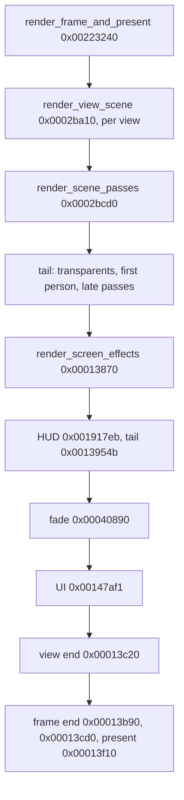

# Stage 5: where post and the HUD sit in the frame

Status: Reference. The guest's call order after a view's scene, read with `h2 disasm`; [native-post-hud.md](native-post-hud.md) is the index of what draws natively.
Code: `crates/hooking/guest-layout/src/points.rs` (`RENDER_SCREEN_EFFECTS`, `COLOUR_PASS`, `SCREEN_EFFECT`). Tests: none, this page is a read of the retail binary.
Switch: `impl.render.native` (on), listed in [switches.md](../runtime/switches.md).

What the game draws after a view's scene comes in three groups: the last passes of `render_scene_passes`, the rest of `render_view_scene` (a fade, then the HUD and UI), and the end of the frame after every view. Only layer 17 is a layer of the scene list. The census figure for `render_screen_effects` is 0.76 ms and 164 D3D calls a frame ([notes/scene-pass-timing.md](notes/scene-pass-timing.md)).

The colour pass and the screen effects see the scene only. The HUD goes over them, the fade over the HUD and the UI over everything, so post needs no HUD split.

## The frame and one view

| Step | Address | What it does |
|---|---|---|
| Frame | `render_frame_and_present` `0x00223240` | renders the views (`0x0002b5d0`, `render_game_view` `0x0002b790`, `render_view_scene` `0x0002ba10`), ends drawing (`0x00013b90`, `0x00013cd0`), presents (`0x00013f10`) |
| View | `render_view_scene` | visibility and records (`0x0002c3b0`, `0x0003fd70`, `0x0002b990`), then `0x00013680`, which calls `render_scene_passes` (`0x0002bcd0`, at `0x000136ac`) |
| After the passes, in order | `0x00015370`, `0x00015680` (view kind `[0x00485898]`), `0x001917eb` when `[0x004b9ed8]` is not -1, `0x00040890`, `0x00147af1` (EAX -1, two words pushed), `0x00013c20` | the view's tail |

## The scene passes' tail

From `0x0002c19a`, in order: the sorted transparents `0x0001e370`, `0x00025dc0` (view kind not 2), the player chain with `[0x00485a76]` set and `0x0002afa0`, the first person (`0x0003fdf0(0)`, its lights `0x000404b0`, `0x0003fdf0(1)`), and `0x00040870` when BL is set (the transparents again, then `[0x004b6284]` copied to `[0x004b6280]`). Then `[0x00485a76]` is cleared and the late passes run:

| Late pass | Gate | What it does |
|---|---|---|
| `0x0002dd30` | caller's byte `[esp+0x28]`, view kind not 2 | the lens flares' visibility tests (below) |
| layer 17 | byte `[esp+0x2c]` (S: bloom; 250 passes on the disc, from the scene list) | its begin draws it when `[0x004ba024]` is set and the list has the layer (below) |
| `0x00020770` | none | the occlusion query results (`[0x0051f408]`, `[0x0051f409]`, the frame count mod 3, `0x003f8630`) |
| `render_screen_effects` `0x00013870` (`points::RENDER_SCREEN_EFFECTS`) | stdcall `(late, colour)`, `ret 8` | `colour` is the byte that gates layer 17, `late` the one that gates `0x0002dd30` |
| exit `0x00013630` | `[0x004850c8]` set (a view drawn into a target of its own) | target back to 0 (`0x00014bc0`), depth clip (`0x00015720`) |

`0x0002dd30` binds the target `[0x00485602]` with no depth surface argument and stencil mode 0. It resets the stipple when `[0x004b8494]` is not 1 (`0x003f8cc0`), turns colour and depth writes off (state `0x40358` 0), clears the desired textures and writes an empty combiner (`0x0048503c` `0x11001`). It binds the rasterizer bitmap at `[[0x00485a80]+0x5c]+0x54` (`0x0001c590`, `0x0001c710` on `0x0051f0f0`) and, outside view kinds 4 to 7, runs the flare writer `0x00020bb0` (view `[0x004b9ed4]`, mask `0x1f`, callback `0x0002e540`): a counted draw per flare ([retire-d3d.md](retire-d3d.md), "Lens flares").

Layer 17's begin draws on the view's target (the descriptor at `0x0043fa1c` gives -1) after a clear of the descriptor's channel flags `0x10`, skipped while `[0x00485a75]` or `[0x00485a76]` is set. It uses stencil mode 0 and sets the byte `[0x00485a74]` that the colour pass's combiners read (`engine::glow::COMBINER_BYTE`). The layer draw at `0x0002c306` returns to `0x0002c30b`.

## render_screen_effects

Its prologue sets `[0x004670bc]` to 1, resets the shader draw state (`0x00016b10` on `0x00485b48`), stores the word `[0x00485600]` at `[[0x00485890]+0x1c]` and runs `0x000245c0` with EAX `0x0051ecf0`. Then:

| Step | Gate | What it does |
|---|---|---|
| 1. Colour pass `0x000214f0` | `colour` | inputs from `0x000137a0`, blended with `[0x004b9fd0]..` and constants `0x407f7cee` and 0.25; the last argument is "view kind is 6". Binds the view's target `[0x004858b8]` as a texture (`0x00014f60`), writes a combiner into the PSDEF at `0x00484f68`, draws through `0x0001ccf0` ([native-post.md](native-post.md#the-colour-pass)) |
| 2. Scenario screen effects | a scenario `[0x004e0350]`, view kind outside 5..7, `[0x00485607]` and `[0x004850c8]` clear, `0x00022710` true | reads a rectangle from `0x004b9dd0..`, walks the scenario block (`+0x3d0` count, `+0x3d4` address, `0x24` bytes an entry) and draws each entry through `0x0002d140` ([native-screen-effects.md](native-screen-effects.md)). S: the map holds one `egor`, `effects\screen_effects\blur` |
| 3. Lens flares `0x0002df00` | `late` | binds the same target; colour writes on (`0x10101`); blending on with factors `0x302` and 1 and equation `0x8006`; depth writes off; the viewport (`0x003f6390`, `0x003f6190`); a two-stage combiner (`0x0048503c` `0x11002`) through `0x0001ccf0`; the same bitmap; then the flare writer `0x00020bb0` (mask `0xf`, callback `0x0002e9e0`) |

The writer collects up to its count `[0x004c1a04]` entries of `0x10` bytes at `0x004c19c4`. Each can issue the filtered fan sequence at `0x00046ea0`, and the callback draws ordinary reflections ([retail trace](notes/2026-11-24-lens-flares.md)).

## After the scene

`0x00040890` is a full-screen fade: when the mode `[0x00485870]` is not 0 it draws the colour at `0x00485874..` (packed by `0x00131e50`) with a blend picked through the jump table at `0x00040dc0`. `0x00147af1` then composes the UI.

The HUD render (`0x0013954b`, gated by `HUD_SHOWN` `0x0013939b`) is not under `0x00147af1`. It is the tail jump of `0x001917eb`, which `render_view_scene` calls before the fade (`0x00191887`; [native-ui-producers.md](native-ui-producers.md)).

## Hook point and order

The colour pass (`COLOUR_PASS`, `0x000214f0`) and each screen effect (`SCREEN_EFFECT`, `0x0002d140`) run their guest bodies. The entry hook records the caller, stack frame and plan. The return continuation closes the plan before the guest caller resumes.

## Related

[native-post-hud.md](native-post-hud.md), [native-post.md](native-post.md), [native-screen-effects.md](native-screen-effects.md), [render-loop.md](render-loop.md).
