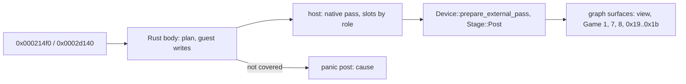

# Native post: the colour pass glow and the screen effects

Status: Built. The colour pass and the screen effect are Rust; pixel identity with the guest's draws needs a live check.
Code: `crates/rewrites/render-bridge/src/native_post.rs`, `crates/extensions/game/src/native_post_glue.rs`, `crates/rewrites/native-render/src/glow.rs`, `screen_gpu.rs`, `crates/rewrites/engine/src/colour_pass.rs`, `glow.rs`, `screen_effect.rs`. Tests: `crates/rewrites/engine/tests/colour_pass_differential.rs`, `glow_differential.rs`, `crates/rewrites/render-bridge/tests/native_post.rs`, the glue's `post_slots_name_the_view_and_table_roles`, `a_calls_ranges_and_slots_are_its_strips_and_targets`, `a_screen_pass_rasters_from_its_template` (`native_post_glue.rs`).
Switch: `impl.render.native` (on), listed in [switches.md](../runtime/switches.md).

The colour pass `0x000214f0` and the screen effect `0x0002d140` are implemented in Rust (`hooks` `implement`): no guest body runs. Each body makes the guest's choices and its guest-visible writes, and the host draws what the guest would as one native pass on the frame graph's targets. A call the body or the host does not cover panics, `post: <cause>`. The call order is in [native-post-frame.md](native-post-frame.md); the screen effects' plan is in [native-screen-effects.md](native-screen-effects.md).

## What the native post draws

| Piece | Draws |
|---|---|
| Colour pass glow `0x000214f0` | the glow, as three stages over a copy of the view's colour target through the stage 3 combiner compiler ([The colour pass](#the-colour-pass)) |
| Screen effects `0x0002d140` | each entry's shader compiled as stage 3 compiles layer 15, with the rectangle and the entry's function values; blur reads the scene as a texture, which the colour pass's copy gives |
| Lens flares `0x0002df00` | a call with `late` set. The flare stage takes its eligible colour fans individually, across the target and shader changes the guest makes |

### The guest's colour pass (`0x000214f0`)

It is two passes, a glow:

1. The view's target (`[0x004858b8]`) is bound to all four stages (`0x00014f60`; sampler states clamp and linear, stored into `D3D__TextureState` with the dirty bits). A four-tap combiner (PSDEF `0x00484f68`, constant colour `pack(c, second x3)` at `0x00484f9c`) is drawn by `0x00034a90` into target 7, which `0x000211a0` (EAX 7) blurs and returns as a texture.
2. That texture goes to stage 0 with alpha blending on (`0x000222d0`: states 59 = 1, 62 = 1 or `0x307` by the sixth argument, 63 = the seventh argument clear, 74 = `0x8006`). A one-stage combiner with `pack(x, third x3)` at `0x00484f90` is drawn by `0x00034a90` into the view's target, and the target is set back (`0x00014bc0`).

`0x000211a0` blurs target 7 Kawase-style:

- `0x00020f30` writes the blur's combiner (eight stages with the fifth argument above 0, else three; `0x00131ed0` packs its colour and the local `y` sets a `<< 24` word) and selects it (the device's `+0x924`, `+0x928`, `+0x92c` = the block, `0x003fa3d0`).
- Then up to `ceil(first argument)` steps (about 3.99: four) each bind the last result to stages 0..3 and draw four taps into the other buffer (7 and 8 in turn). The spread is `fraction * scale`, and the scale grows by `1 - g + g * [0x0045dc0c]` per step (`g` the fourth argument, 0.25). The last buffer drawn is returned.
- At infinity (or past 2^24, where `i + 1` is `i`) the loop never ends. The port stops after `engine::glow::MAX_BLUR_STEPS` (64) with `Error::Unbounded`, a `post: glow: blur` panic.

The quad draw `0x00034a90` (eleven arguments, `ret 0x2c`) takes the target (`0x00014bc0` unless -1), `0x000142f0` with the second argument unless -1, and the colour write mask (third, `0x1010101`). It sets Z off (or mode 2 with the first byte), Z bias 0, Z write off, cull none and stencil off, with two more simple states by the byte (S: alpha test; `0x203`/`0x204` by the sign of the sixth argument). Per tap (the ninth argument: 4 or 1) it takes an offset from the word tables at `0x00485af4`/`0x00485b04` over the source's size (`0x0001dd60`), or the screen rectangle `0x004b9dd0..`, and the spread (seventh). The quad goes through `0x0001c590` and `0x00034420`.

The numbers are ported: `engine::colour_pass` (the arguments and parameters), `engine::glow` (`pass_a`, `pass_b`, `blur_combiner`: the three 60-word blocks; `blur`: each step's source, target and spread, and the result).

## The bodies

`render_bridge::native_post`:

| Call | Rust body | Returns |
|---|---|---|
| `0x000214f0`, seven words, `ret 0x1c` | `colour_pass`: the scene step's arguments, `colour_pass::parameters`, the override record's pending reset (`Parameters::write_reset`, `0x00021533..0x0002156a`); when the parameters draw, the glow through `Host::glow` | to the caller, its registers kept |
| `0x0002d140`, EAX and four words, `ret 0x10` | `screen_effect`: the four values to `0x004c19b0` (`0x0002d140..0x0002d16a`, on every call), then `Host::screen_effect` | EAX -1 from the end (`0x0002db4d`), else the datum |

`Host::screen_effect` (the glue) plans the call (`engine::screen_effect::plan`). A plan of `None` is the guest's return at once (EAX -1, an empty window, another view's target): nothing more is written. Otherwise it makes the body's writes in the guest's order:

| Guest | Rust |
|---|---|
| `0x0002d26e..0x0002d344`: targets 1, `0x19`, `0x1a`, `0x1b`'s sizes saved (0 without a surface or with a hidden size) | `native_post::save_sizes` |
| `0x0002d49f`, before each pass's template gate: target 1 at the pass's size; `0x0002da3e`, `0x0002da47`, past a drawn pass's gate: each drawn convolution's two stand-ins at its size (`0x0001ddd0`: the table's `+0x80`, `+0x84` and both headers' size words `+0x14`, `+0x28`, zero unless `+0x94`) | `resizes`, `native_post::resize` |
| the drawn passes | one native pass ([below](#the-native-passes)) |
| `0x0002dae8..0x0002db5a`: 1, `0x19` and `0x1b` given their saved sizes, `0x19` again with `0x1a`'s (`0x1a` keeps the call's), `[0x004670bc]` set, `0x00016b10` on the template cache `0x00485b48`, the results `0x00485a78`/`7c` -1 | `native_post::end_writes` |

A colour pass that draws makes the guest's two binds of `0x00014bc0` in Rust (`native_post::glow_binds`, `colour_call`, `render_bridge::target_bind::bind`; a bind it cannot make panics, `post: bind: <cause>`): the view's target `[0x004858b8]` (a word, any target) before the glow, as `0x00034a90` binds it for the composite, and at the end `[0x004858b4]` when not -1, else the view's again (`0x00021a44..0x00021a6e`). The glow's view slot is the colour that first bind caches (`[0x0051f3f4]`).

**S**: the guest's state-cache writes inside the bodies (the combiner block `0x00484f68`, the stage table `0x00404de8`, the dirty bits `0x00407490`, the bound sizes `0x00485af4`/`0x00485b04`) are left as they came in, as the device's state is, so the two agree; nothing reads them before setting them. The wide convolution's small-size flag `[0x0055e6c5]` is not written.

## The native passes

Each is one `Device::prepare_external_pass` of `Stage::Post`, committed at the call, and records again on any copy (`replays_scene`), so a scene that keeps the frame replays it on the display's attachments ([framescene.md](framescene.md), slice 5).

**The slots by role.** A pass names its slots by what they are to the game (`PostTarget`): the view, target 0's colour `[0x0050935c]`, or `TargetRole::Game(n)`, the surface header `+0x18` of entry `n` of Halo's table. The device resolves each through `surface_for` and the role table, so the pass draws on the frame graph's surface for that role ([retire-d3d-display.md](retire-d3d-display.md#the-graphs-targets)). An entry that is not made (no surface, a hidden size, no levels) is an `Err`.

| Pass | Slots |
|---|---|
| Glow (`GlowPass`) | 0 the bound colour (the view's target), 1 `Game(7)`, 2 `Game(8)`, all written |
| Screen call (`ScreenPass`) | 1 the view (written when a pass draws into it), 2 `Game(1)` when a pass draws into it, 3 to 5 `Game(0x19)` to `Game(0x1b)` for each stand-in a convolution draws into or reads |

The screen call's resizes are made before its slots resolve, so target 1 and the stand-ins are the graph's surfaces at the call's sizes; one target sized twice in a call is an `Err`. A pass's ranges are its strips and each convolution's quad or grid strips (`screen_ranges`); the glow's are its quads.

**The raster from the plan.** No guest draw is resolved, so the raster state is the plan's:

| Draw | Raster |
|---|---|
| Glow quads | each quad's blend (`Blend`, the composite's; none for the down-sample and the blur), every channel written (`0x00034a90`'s `0x01010101`), no cull, alpha test or scissor |
| Template strips | the pass's own states (`ScreenProgram::state`: blend, blend constant, writes, alpha test, facing, cull, depth clamp) |
| Convolution quads and grids | no blend, every channel written |
| A view read | as `X8` (alpha one) where the texture `0x00014f60` binds for target 0 (`native_post::target_texture`: its case byte `[0x00015154 + n]`, the case's code at `[0x00015114]`) is `LIN_X8R8G8B8` (`reads_opaque`) |

**S**: the states the quad draw and the template do not set (fog, flat shading, two-sided lighting, stipple) are the defaults; the live fog register is not fed (the program's, fog off).

## What panics

Every case the guest would draw and the native pass does not panics, `post: <cause>`:

| Cause | When |
|---|---|
| `host` | no host installed |
| `colour pass args`, `screen effect args`, `screen effect values` | a stack word or the values do not read |
| `colour pass parameters (..)`, `colour pass reset (..)` | `colour_pass::parameters` fails, or the reset does not write |
| `glow: <cause>` | the plan (`pass_a`, `blur_combiner`, `blur`, `pass_b`, a blur that copies its result), the view's texture, a slot, the device refusing the pass |
| `glow on the graph's targets: <refusal>` | the GPU refuses a copy (`glow::Refused`) |
| `scope_zoom` | a HUD screen effect of a converted Halo 1 scope-zoom profile, whose profile the plan does not read |
| `screen effect: <cause>` | the plan, the saved sizes, `template_skipped` (a gate that does not read), a target sized twice, a missing piece (`template_pass`, `pass_target`, `view_target`, `blur`, `wide`, `stand_ins`), the view's texture, a slot, `template_restore` (a template cache with restore states, `0x00018900`, a D3D call), the device refusing the pass |
| `screen effect <entry> on the graph's targets: <refusal>` | the GPU refuses a copy (`screen_gpu::ScreenRefused`) |

While a map's screen effects load (`EffectsSlot`, on a thread of their own) a call makes its guest writes and draws nothing, counted `post_screen_effect_loading`. `render.scene` reports `post_colour_calls`, `post_colour_glows`, `post_screen_effect_calls` and `post_screen_effect_ended` (`native_post::counters`).

## The colour pass

The host (`game::native_post_glue`) plans the glow (`plan`). Bit-equality with the lifted original is tested: `engine::colour_pass` (`arguments`: the caller's half with `0x000137a0`'s curves; `parameters`: the callee's override record and clamps; `pack_colour`: `0x00131e50`; `Parameters::colours`: the two combiner colours) by `engine/tests/colour_pass_differential.rs`, and `engine::glow` (the three combiner blocks, and the blur's steps with the device calls stubbed) by `engine/tests/glow_differential.rs`.

### The quad

`0x0001c590` loads the vertex shader the rasterizer globals name for screen quads (`[[0x00485a80] + 0x5c] + 0x64`, entry 0; `LoadVertexShaderProgram` when Halo's cache at `0x0051f0f0` holds another). It passes every input through (`oPos = v0`, `oT0..oT3 = v1..v4`, `oD0 = v5`, `oD1 = v6`), so positions are the target's pixels.

`0x00034420` (EAX 0: rectangle, callback `0x00034100`, 0, the tap record) runs the draw-state reset `0x00016b10` again, sets the four stages' dirty bits and zeroes their `D3DTSS_ALPHAKILL` words. It commits the textures (`0x0001cf50`: `SetTexture` for each stage whose `0x0051f3d8` word differs from `0x0051f3c8`'s, which it updates), the vertex input (`0x0001c710`) and the deferred state (`0x00400fa0`). Then it emits one four-vertex fan (`Begin(7)`) with corners `(0, 0)`, `(0, 1)`, `(1, 1)`, `(1, 0)` and attributes 15 down to 0 from the callback as inline `SET_VERTEX_DATA4F`.

The callback gives attribute 0 as the rectangle's lerp (`0x000350e0`, z and w from the near and far at `0x00485ad4`). Attribute `k + 1`, for `k` below the tap count, is the same lerp moved by the spread times a sign (`[0x0045dbbc]` with `k & 1` in x and `k & 2` in y, `[0x0045dbc4]` otherwise) and scaled by the stage's bound size over the target's. With the quad draw's tenth argument clear (all three passes) the rectangle is Halo's window (`0x004b9dd0`: top, left, bottom, right shorts), and the eleventh clear means no window offset, so a fragment's base coordinate is its own pixel and each tap reads the source in texels. The down-sample's four taps at spread 0.5 land half way between texel centres: a 4 by 4 box.

`0x0001dd60` reads Halo's target table (`0x004b4b58`, stride `0x98`: width `+0x80`, height `+0x84`, surface `+0x88`, a hiding byte `+0x95`; targets 0, 3 and `0x18` default to 640 by 480). Targets 7 and 8 are made by `0x0001df20` at 160 by 120, `D3DFMT_LIN_A8R8G8B8` (`0x0001d6f0`'s linear format `0x12`), one level. `0x00014f60` binds a target to a stage: its size into `0x00485af4`/`0x00485b04` and its texture into `0x0051f3d8` (through the jump table at `0x00015114` by the target's kind).

### The native glow

`native_render::glow`:

| Symbol | Role |
|---|---|
| `read_frame` | reads the window, the tap signs and the sizes |
| `Plan::quad` | gives each quad its corners and per-stage offsets and scales |
| `VERTEX` | the screen shader for them |
| `program` | compiles a block through `shaders::psh` with its stages linear (`tex_scale` one over the guest size) and fog off |
| `GpuGlow::prepare` | draws a plan's quads into targets 7 and 8 and the view's colour on the graph's surfaces, using each attachment's format and loading its existing pixels |
| `Blend` | the composite's blend from `0x000222d0`'s states: source `ONE` or `INVDESTCOLOR` by the sixth argument, destination `ONE` unless the seventh's byte is set, alpha alike |

The down-sample and blur draw with blending off: `0x00034a90`'s `0x000142f0(10)` sets `NV097_SET_BLEND_ENABLE` (`0x00040304`) to 0 for them. Tests are in `glow::tests` (the taps of the down-sample and the composite, the blend, a block's module, the frame's words). S: the D3D path's pixel centres match a quad whose corners are the window's (the frame A/B shows it).

## Related

[native-post-hud.md](native-post-hud.md), [native-post-frame.md](native-post-frame.md), [native-screen-effects.md](native-screen-effects.md), [d3d.md](d3d.md), [framescene.md](framescene.md), [render-thread.md](render-thread.md).
