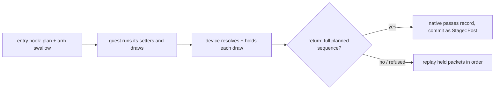

# Native post: the colour pass glow and the call transaction

Status: Partly built. The glow draws natively; pixel identity with D3D needs a live check.
Code: `crates/rewrites/render-bridge/src/native_post.rs`, `crates/extensions/game/src/native_post_glue.rs`, `crates/rewrites/native-render/src/glow.rs`, `crates/rewrites/engine/src/colour_pass.rs`, `glow.rs`, `crates/platform/d3d` (`Device::swallow`). Tests: `crates/rewrites/engine/tests/colour_pass_differential.rs`, `glow_differential.rs`, `crates/rewrites/render-bridge/tests/native_post.rs`, `crates/platform/d3d/tests/swallow.rs`, `swallow_carry.rs`.
Switch: `impl.render.native` (on), listed in [switches.md](../runtime/switches.md).

The guest's colour pass `0x000214f0` and every screen effect run their own code. The host plans the draws they would make, the device holds the guest's quads back (`Device::swallow`), and the native renderer draws the plan in their place. Each call commits one complete replacement or draws all its originals. The call order is in [native-post-frame.md](native-post-frame.md); the screen effects are in [native-screen-effects.md](native-screen-effects.md).

## What the native post draws

| Piece | Draws |
|---|---|
| Colour pass glow `0x000214f0` | the glow, as three stages over a copy of the view's colour target through the stage 3 combiner compiler ([The colour pass](#the-colour-pass)) |
| Screen effects `0x0002d140` | each entry's shader compiled as stage 3 compiles layer 15, with the rectangle and the entry's function values; blur reads the scene as a texture, which the colour pass's copy gives |
| Lens flares `0x0002df00` | a call with `late` set. The flare stage takes its eligible colour fans individually, across the target and shader changes the guest makes |

### The guest's colour pass (`0x000214f0`)

It is two passes, a glow:

1. The view's target (`[0x004858b8]`) is bound to all four stages (`0x00014f60`; sampler states clamp and linear, stored into `D3D__TextureState` with the dirty bits). A four-tap combiner (PSDEF `0x00484f68`, constant colour `pack(c, second x3)` at `0x00484f9c`) is drawn by `0x00034a90` into target 7, which `0x000211a0` (EAX 7) blurs and returns as a texture.
2. That texture goes to stage 0 with alpha blending on (`0x000222d0`: states 59 = 1, 62 = 1 or `0x307` by the sixth argument, 63 = the seventh argument clear, 74 = `0x8006`). A one-stage combiner with `pack(x, third x3)` at `0x00484f90` is drawn by `0x00034a90` into the view's target, and the target is set back (`0x00014bc0`).

`0x000211a0` blurs target 7 Kawase-style:

- `0x00020f30` writes the blur's combiner (eight stages with the fifth argument above 0, else three; `0x00131ed0` packs its colour and the local `y` sets a `<< 24` word) and selects it (the device's `+0x924`, `+0x928`, `+0x92c` = the block, `0x003fa3d0`).
- Then up to `ceil(first argument)` steps (about 3.99: four) each bind the last result to stages 0..3 and draw four taps into the other buffer (7 and 8 in turn). The spread is `fraction * scale`, and the scale grows by `1 - g + g * [0x0045dc0c]` per step (`g` the fourth argument, 0.25). The last buffer drawn is returned.
- At infinity (or past 2^24, where `i + 1` is `i`) the loop never ends. The port stops after `engine::glow::MAX_BLUR_STEPS` (64) with `Error::Unbounded`, so the glue leaves such a call to D3D.

The quad draw `0x00034a90` (eleven arguments, `ret 0x2c`) takes the target (`0x00014bc0` unless -1), `0x000142f0` with the second argument unless -1, and the colour write mask (third, `0x1010101`). It sets Z off (or mode 2 with the first byte), Z bias 0, Z write off, cull none and stencil off, with two more simple states by the byte (S: alpha test; `0x203`/`0x204` by the sign of the sixth argument). Per tap (the ninth argument: 4 or 1) it takes an offset from the word tables at `0x00485af4`/`0x00485b04` over the source's size (`0x0001dd60`), or the screen rectangle `0x004b9dd0..`, and the spread (seventh). The quad goes through `0x0001c590` and `0x00034420`.

The numbers are ported: `engine::colour_pass` (the arguments and parameters), `engine::glow` (`pass_a`, `pass_b`, `blur_combiner`: the three 60-word blocks; `blur`: each step's source, target and spread, and the result).

## Post admission

A call whose plan needs an unsupported input or an unavailable live target uses D3D.

| Effect | Native admission |
|---|---|
| Colour pass glow | The plan reads the view size and each blur target's dimensions independently. The window, combiners and blur steps must plan successfully. Each matched quad uses the live blend, blend constant, channel write mask, winding, cull, front fill and scissor. A colour-only draw accepts inherited depth and stencil settings when they have no effect |
| Screen strips into target 0 or target 1 | All drawn layer-15 passes must have loaded programs and supported bindings. A target 1 read requires an earlier write in the same call. Framebuffer stages may read stored alpha and X8 alpha in the same pass. A resolved side-target input needs no framebuffer copy |
| Kept convolution | Emits no draws. Its result names the pass's target |
| Blur and wide convolutions | The quads or grids must plan successfully and match the live attachments. Each uses the live raster state |
| Template pass skipped by `0x00016610` | The host leaves that pass and its convolutions out of the plan. An unreadable gate refuses the call |
| Layer 17 | `frame-scene.layers` ([framescene.md](framescene.md), slice 4): its structure and object items from the scene's plan, as layers 1, 5, 7, 8 and 20 (`layer_pass::BLOOM_LAYER`) |
| `0x0002df00`, `0x0002dd30` | Carried: the D3D draws, or an owned frame's replay of them with its own counts |

Post admission uses the packet's decoded raster state. Inherited fog, flat shading and two-sided lighting can be omitted when the planned and live combiners are both independent of their inputs. A combiner with an implicit final stage can depend on inherited fog and specular state.

Rejected state words in unused texture stages and fixed-function texture operations do not affect a programmable post draw. A live depth or stencil operation requires the original depth attachment.

The glow and screen effects share one pipeline translation for colour writes, blending, facing, culling, front fill and depth clamp. A quad strip keeps the guest fan's winding and diagonal. Each scissor is scaled from the destination's guest size to its physical copy, and a convolution grid uses the raster its strips share.

The combiner translator generates variants for the live alpha comparison and polygon stipple. The reference byte and mask rows are per-draw uniforms, and stipple uses guest pixel cells on each physical copy. Screen strips also carry the live W clip range and window-depth scale.

## The post hooks

`feature::native_post`: the glow draws after layer 17 and before the screen effects. The entry hooks pass guest arguments, MXCSR and the x87 control word to the host. The guest runs all its setters and its tail with either draw path.

## The call transaction

`d3d::Device::swallow` holds a call's draws and either commits a native replacement or replays them.

| Phase | Rule |
|---|---|
| Arm | drains previously queued pushes. The active guest frame is identified by its entry, entry ESP, caller's return address and live return continuation; D3D entries must stay inside that frame |
| Match | each draw supplies a primitive, count, emitter and colour slot. A layer-15 strip must come from the `D3DDevice_End` return site `0x0002d8b2`. Glow quads and convolution draws use the pushed path |
| Hold | the device resolves each original at its usual draw boundary and keeps the packet, binding handles, textures and stream bytes. The first draw into a slot pins the host surface and its guest resource identity |
| Replay triggers | a pixel observation or resource operation that depends on held writes; a competing external stage or draw scope before it prepares its own recording; a mismatch, extra draw, interruption or early return |
| Commit | the return continuation drains remaining pushed draws and requires the full planned sequence. The last matched draw supplies the primary target and viewport even if the guest tail restored its state. The backend keeps each copy's commands cancellable until all copies have recorded the expected ranges; a failed encode discards them and replays the originals |

Target switches and direct RTT samples proceed while their bindings preserve access to the held surfaces. Gel comparison uses a read-only observer that runs after the last matched guest draw.

The glow and the screen effects record again on any copy once `validate` has frozen their raster (`replays_scene`), so the return commits them as a carried scene stage of `Stage::Post`. Behind a render thread that takes scene stages the stage is queued (`queue_scene_stage`), so the game thread does not wait; one it cannot record is dropped and counted, and Post stands down to sealing every copy (`prepare_carried_stage`, then `commit_carried_stage`, [`scene_stage`](../../crates/platform/d3d/src/scene_stage.rs)).

Under a scene sink that keeps the frame for the display's replay (two-copy mode), the sink retains it as a `ReplayOp::Stage` and the display copy records it again at window resolution ([framescene.md](framescene.md), slice 5). A carried stage has no entry textures, so the glow reads its down-sample's entry from the view's slot, through an alpha-one copy (`OpaqueEntry`) where the guest read the view as `X8`. A pass that does not record again, a guest reference request or a refused carry goes through `prepare_external` with the first packet's entry textures. A replaying sink declines that, and the packets replay.

The call validates live packet state and attachments each time. Under render scaling, a replacement that uses a reference-only intermediate together with a live display target falls back, so A/B runs start at `H2_RENDER_SCALE=1`.

Tests: `d3d/tests/swallow.rs` compares the original packets at every mismatch position and across target switches, and checks same-shape draws from a different End caller. GPU tests compare both colour attachments after a failed encode and check that a successful replacement writes the intermediate back to the guest. `d3d/tests/swallow_carry.rs` checks the carried commit under a replaying sink (one commit, one retained stage, no replayed packet), the packets of a pass that does not record again, the guest reference's decline, and complete reference and display copies. The screen renderer's GPU test covers masked writes and pixels preserved between partial passes into a BGRA intermediate.

## The colour pass

The host (`boot::native_post_glue`) plans the pass through the swallow. Bit-equality with the lifted original is tested: `engine::colour_pass` (`arguments`: the caller's half with `0x000137a0`'s curves; `parameters`: the callee's override record and clamps; `pack_colour`: `0x00131e50`; `Parameters::colours`: the two combiner colours) by `engine/tests/colour_pass_differential.rs`, and `engine::glow` (the three combiner blocks, and the blur's steps with the device calls stubbed) by `engine/tests/glow_differential.rs`.

### The quad

`0x0001c590` loads the vertex shader the rasterizer globals name for screen quads (`[[0x00485a80] + 0x5c] + 0x64`, entry 0; `LoadVertexShaderProgram` when Halo's cache at `0x0051f0f0` holds another). It passes every input through (`oPos = v0`, `oT0..oT3 = v1..v4`, `oD0 = v5`, `oD1 = v6`), so positions are the target's pixels.

`0x00034420` (EAX 0: rectangle, callback `0x00034100`, 0, the tap record) runs the draw-state reset `0x00016b10` again, sets the four stages' dirty bits and zeroes their `D3DTSS_ALPHAKILL` words. It commits the textures (`0x0001cf50`: `SetTexture` for each stage whose `0x0051f3d8` word differs from `0x0051f3c8`'s, which it updates), the vertex input (`0x0001c710`) and the deferred state (`0x00400fa0`). Then it emits one four-vertex fan (`Begin(7)`) with corners `(0, 0)`, `(0, 1)`, `(1, 1)`, `(1, 0)` and attributes 15 down to 0 from the callback as inline `SET_VERTEX_DATA4F`.

The callback gives attribute 0 as the rectangle's lerp (`0x000350e0`, z and w from the near and far at `0x00485ad4`). Attribute `k + 1`, for `k` below the tap count, is the same lerp moved by the spread times a sign (`[0x0045dbbc]` with `k & 1` in x and `k & 2` in y, `[0x0045dbc4]` otherwise) and scaled by the stage's bound size over the target's. With the quad draw's tenth argument clear (all three passes) the rectangle is Halo's window (`0x004b9dd0`: top, left, bottom, right shorts), and the eleventh clear means no window offset, so a fragment's base coordinate is its own pixel and each tap reads the source in texels. The down-sample's four taps at spread 0.5 land half way between texel centres: a 4 by 4 box.

`0x0001dd60` reads Halo's target table (`0x004b4b58`, stride `0x98`: width `+0x80`, height `+0x84`, surface `+0x88`, a hiding byte `+0x95`; targets 0, 3 and `0x18` default to 640 by 480). Targets 7 and 8 are made by `0x0001df20` at 160 by 120, `D3DFMT_LIN_A8R8G8B8` (`0x0001d6f0`'s linear format `0x12`), one level. `0x00014f60` binds a target to a stage: its size into `0x00485af4`/`0x00485b04` and its texture into `0x0051f3d8` (through the jump table at `0x00015114` by the target's kind).

### The native glow

`native_render::glow`:

| Symbol | Role |
|---|---|
| `read_frame` | reads the window, the tap signs and the sizes |
| `Plan::quad` | gives each quad its corners and per-stage offsets and scales |
| `VERTEX` | the screen shader for them |
| `program` | compiles a block through `shaders::psh` with its stages linear (`tex_scale` one over the guest size) and fog off |
| `GpuGlow::encode` | draws a plan's quads into live targets 7 and 8 and the view's colour, using each attachment's format and loading its existing pixels |
| `Blend` | the composite's blend from `0x000222d0`'s states: source `ONE` or `INVDESTCOLOR` by the sixth argument, destination `ONE` unless the seventh's byte is set, alpha alike |

The down-sample and blur draw with blending off: `0x00034a90`'s `0x000142f0(10)` sets `NV097_SET_BLEND_ENABLE` (`0x00040304`) to 0 for them, and the game's code runs while only its quads are dropped. Tests are in `glow::tests` (the taps of the down-sample and the composite, the blend, a block's module, the frame's words). S: the D3D path's pixel centres match a quad whose corners are the window's (the frame A/B shows it).

## Related

[native-post-hud.md](native-post-hud.md), [native-post-frame.md](native-post-frame.md), [native-screen-effects.md](native-screen-effects.md), [d3d.md](d3d.md), [framescene.md](framescene.md), [render-thread.md](render-thread.md).
