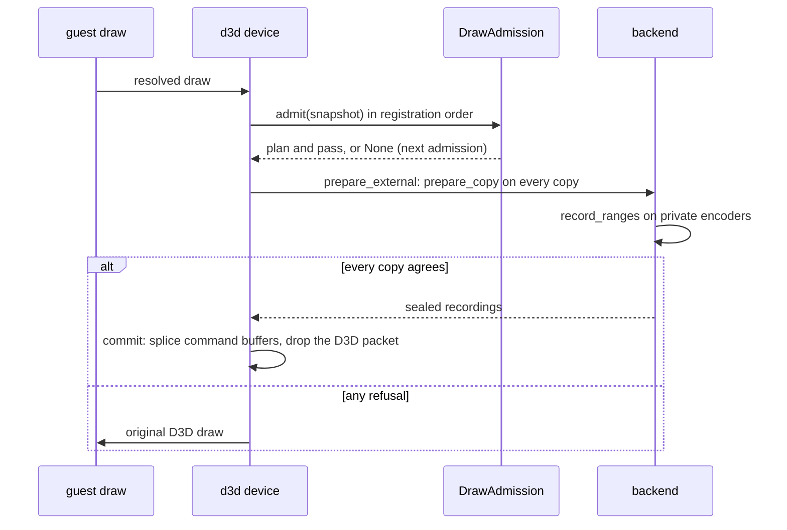

# Native renderer: admission

Status: Built. Sub-page of [native-renderer.md](native-renderer.md).
Code: `crates/platform/d3d/src/device.rs` and `crates/platform/d3d/src/backend.rs` (`DrawAdmission`, `prepare_external_pass`, `Backend::prepare_external`). Tests: `crates/platform/d3d/tests/external_pass.rs`.
Switch: `impl.render.native` (on), listed in [switches.md](../runtime/switches.md).

Admission is how a native stage takes a guest draw. The device shows each
resolved draw to the registered stages, records a wgpu pass on every
participating copy of the frame, and drops the D3D packet only when every
copy recorded.

| Entry | Use | Returns |
|---|---|---|
| `Device::add_draw_admission(Arc<dyn DrawAdmission>)` | a persistent admission for an ordered stream of independently owned draws (particles, decals, HUD, gels, world layers) | `admit(&DrawSnapshot) -> Option<(ExternalPlan, Box<dyn ExternalPass>)>` |
| `Device::begin_draw_scope` / `end_draw_scope` | a helper that emits one quad: arm on entry, drain on return | `Result<bool, D3dError>`: whether the replacement committed |
| `Device::prepare_external_pass(mem, plan, pass)` | a hook outside draw submission, after draining the preceding guest commands | `Option<Reservation>`; `commit()` or drop to cancel |
| `Device::prepare_external_bound_at(mem, plan, pass, slots, rect)` | a held packet at a drained boundary | as above |
| `Device::reserve_scene_stage` | the render thread takes the stage (`Device::queues_scene_stages`) | queued, no round trip |
| `Device::external_stage_now(mem, targets, plan, pass)` | a pass placed at a guest call boundary as a typed scene stage, on named targets or (`None`) the bound ones, nothing rebound: a replaying scene sink keeps it (`ReplayOp::Stage`) where it refuses an untyped `external_pass_now` (the fog fans, the fog quad) | `Result<bool, D3dError>`: queued or run |
| `Device::try_native_*_draw` | a native producer that commits at the queue | the guest skips its own emission |



## Admissions

Admissions are called in registration order at the resolved draw, for
immediate, inline, indexed and array geometry. Scope ownership to the
current producer and match the complete state. Returning `None` leaves the
draw to the next admission, and a failed preparation of a claimed draw falls
through to the original D3D draw.

The decal callback at `0x00044040` owns list order, duplicate stamps, bitmap
selection and attribute defaults. Each array draw enters
`crates/extensions/game/src/native_decals_glue.rs` once through
`DrawAdmission`. An admitted packet uses the live depth comparison and write
state, the resolved W clip and polygon offset, and the live sampler's border
addressing. Reference and display copies select their own vertex constants,
UI transform and scissors, and a refusal draws the same ordered packet
through D3D.

For a helper that emits one quad, call `Device::begin_draw_scope(mem,
Arc<dyn DrawAdmission>) -> Result<Option<DrawScope>, D3dError>` on entry and
keep the handle across the guest call. At return, `Device::end_draw_scope(mem,
scope)` drains that call's pending packets. Earlier packets drain before
entry, refusal consumes the candidate, dropping the handle disarms it, and
nesting supersedes the outer candidate.

```rust
trait DrawAdmission: Send + Sync {
    fn admit(&self, snapshot: &DrawSnapshot<'_>)
        -> Option<(ExternalPlan, Box<dyn ExternalPass>)>;
}

// At a hook outside draw submission, drain the preceding guest commands.
let reservation = device.prepare_external_pass(mem, plan, pass)?;
if let Some(reservation) = reservation {
    // Apply reversible mask edits here. Drop the reservation to cancel.
    reservation.commit();
}
```

## What the snapshot and plan carry

`DrawSnapshot::draw` borrows the exact `ResolvedDraw` that D3D can still
issue. It holds the vertex declaration, streams, indices, shader inputs
(microcode, constants, defaults, pixel definition and combiner state), raw
and translated render and stage state, texture headers and formats,
viewport and scissors. The snapshot adds raw shader handles, bound texture
headers, the sampled-stage mask, bound colour and depth headers, and palette
headers and entries.

The device replaces only the draw packet. The guest's shader setup and
stencil tail still run, including when adjacent draws have different owners.

`ExternalPlan { stage, view, ranges, slots }` promises a positive number of
geometry or effect ranges on **each** participating copy. `slots` is an
indexed `Vec<Option<ExternalSlot>>`; each populated slot names a guest
colour surface header and whether it will be written. `ExternalPass::writes()`
declares writes to the bound colour and depth/stencil.

In `record_ranges(ExternalTarget) -> usize`, `target.copy` is `Reference` or
`Display`, `target.stages` holds the four resident stage views for a
resolved draw, and `target.slots[i]` supplies the live surface's attachment,
sample view, format and texel size for this copy. Record only in the
supplied encoder: a queue submission or write to a live texture would
escape cancellation. A declared sampled header or intermediate surface that
cannot be resolved on one required copy refuses the entire replacement.

Recording happens during prepare and partial recordings are discarded.
Commit splices only previously sealed command buffers into the D3D
submission order, with no remaining stage callbacks or target lookups.

## Backend path

`Backend::prepare_external(surfaces, request, textures, &plan, copy, pass)`
returns `Result<Option<Vec<ExternalRecording>>, String>`. Each copy first
calls `ExternalPass::prepare_copy(&ExternalTarget) -> Result<(), &'static str>`.
Only when every copy agrees does the backend call `record_ranges` on private
encoders. Validation scopes cover resource lookup, native preparation,
recording and encoder finish, and a failed recording discards every copy.

`Backend::commit_external(recording)` takes one sealed copy. The device
reservation also preserves deferred display copies and invalidates guest
colour, depth and alias caches for the declared writes, so code that holds
guest packets uses the device entry for those effects. A private gel
producer or probe can use the default read-only `writes()` while using
`colour_only()` to request a scratch depth attachment.

`ExternalTarget::encoder_uploads()` serves per-view constants, dynamic rows
and indirect arguments. Its upload arena reserves a fresh source range for
each write and records a copy immediately before the consuming draw. Target
copies and multiple runs may share a submission, and the queue completion
callback returns the leased storage to its pool after the last submission
using it.

World placement transforms and layer-3 lighting implementations
are resolved at map load. The accumulation texture sampled by combined
materials is resolved on each target copy at the draw
([native-world.md](native-world.md)).

## Threaded backend

A confirmed admission on the threaded backend needs a synchronous worker
round trip. `encode_pending` closes the preceding merged D3D pass, and each
physical copy gets a private command buffer. World and object hooks batch a
view into one reservation.

When the render thread takes scene stages (`Device::queues_scene_stages`),
the world, objects, fog and water queue one instead
(`Device::reserve_scene_stage`). There is no round trip, and their
preparation and recording run on the render thread ([framescene.md](framescene.md),
"Slice 2" and "Slice 5").

A draw whose pass retains its resolved D3D packet
(`ExternalPass::resolved_fallback`) and makes the same colour and depth
writes as that packet is queued too (`Backend::queue_external_draw`). The
render thread records the pass or draws the packet in its queue slot.

A native producer (`Device::try_native_*_draw`) commits at the queue, so the
guest skips its own emission without waiting. The particle, effect,
single-draw UI and transparent producers work this way ([render-thread.md](render-thread.md),
"Keeping guest-visible semantics exact").

A packet holder can batch consecutive native draws on the same targets in a
single `ExternalPlan` and encode their ranges in guest order. End the batch
before any guest-owned draw, target or state change the batch does not
reproduce, or guest-visible read. A one-draw helper pays the full admission
cost.

At a drained boundary the held-packet entry is
`Device::prepare_external_bound_at(mem, plan, pass, slots, rect)`. It
compares each saved `Option<B::Surface>` against its slot's current guest
header. The rectangle is `(x, y, width, height)` in guest pixels, and each
`ExternalColor` provides both `guest_size` and this copy's physical `size`.

A scaled frame whose intermediate bloom slot exists only at 1x keeps the
entire guest sequence. With the display copy asleep, the 1x reference can
run alone.

## Refusals

A device refusal includes the producer's Rust pass type, its issue
boundary, and the native stage for a typed plan. The first refusal for each
producer, boundary, stage and reason is logged, and device counters retain
every refusal.

A failed reservation leaves the original guest draws available to its
caller. A refusal from a pass with no corresponding guest draw can instead
omit that operation.

Inside a captured scene slot, `d3d::SceneSink` declines untyped passes and
unsealed reservations, except the commits of native producers it carries
(water, flares and UI; [framescene.md](framescene.md)). The display graph
needs retained inputs to record the operation on its own attachments, and a
one-shot pass carries no replay command.

A swallowed call whose pass records again (the dialog blur, the shadow
filter, once their raster is frozen) commits as a carried scene stage
(`Device::swallow_commit`, `prepare_carried_stage`, `commit_carried_stage`).
The sink retains it as a `ReplayOp::Stage`, so it is not declined.

A guest
reference request, or a backend that cannot seal the stage, sends the call to
`prepare_external` and the decline, and its packets replay. The sink names
this case with the producer, so it can be told from a binding failure or a
backend recording failure. Outside captured slots these passes use their
normal backend path.
